# Designing Netflix: Chapter 1 of 12

## 🗺️ The roadmap

We'll build Netflix the way it evolved: each chapter starts with a pain, then a fix, then the flaw in that fix.

| # | Chapter | Core question |
|---|---|---|
| **1** | Requirements, scale math, and the naive v0 | What are we building, and what breaks first? |
| 2 | Video ingestion and transcoding pipeline | How does one raw movie become 1,000+ playable files? |
| 3 | Streaming protocols and adaptive bitrate (HLS/DASH) | How does video play smoothly on bad networks? |
| 4 | CDN and Open Connect | How do we serve ~100+ Tbps? |
| 5 | Metadata storage: SQL vs NoSQL, sharding, replication | Where does catalog, user, and history data live? |
| 6 | Caching (EVCache) | How do we survive 300K+ QPS cheaply? |
| 7 | Microservices, API gateway, resilience, error handling | How do we stop one failure from killing everything? |
| 8 | Search, recommendations, personalization | How do we pick the 40 rows you see? |
| 9 | Event pipeline and viewing history (Kafka, stream processing) | How do we track "continue watching" and analytics? |
| 10 | Multi-region active-active and disaster recovery | What if a whole AWS region dies? |
| 11 | Observability, deployments, and security | How do we ship safely and see problems before users do? |
| 12 | Pre-warming, cold starts, migrations, and the final interview walkthrough | Launch-day traffic, and tying it all together |

Each chapter covers one topic in depth. I won't move on until you confirm you've understood it.

---

# Chapter 1: Requirements, scale math, and the naive v0

## 1.1 What is Netflix, in system-design terms?

Netflix is two products glued together:

1. **A browsing product.** It's a catalog, personalized rows, search, profiles, and "continue watching". This is small data and lots of small API calls.
2. **A video delivery product.** It moves huge files to millions of people at once. This is giant data and a few long-lived connections.

**Most candidates miss that these two products have completely different scaling problems.** Keeping them separate is the most important idea in this whole design.

## 1.2 Requirements (what you say in the first 5 minutes of the interview)

**Functional requirements**
- Users sign up, log in, and manage profiles (a family of 4 has 4 profiles on one account).
- Users browse a catalog and see personalized rows.
- Users search for titles.
- Users play a video, and it should start fast and adapt to their network.
- Users resume from where they stopped, on any device.
- Content team uploads new titles, and the system prepares them for streaming.

**Non-functional requirements** (interviewers care about these more)

| Requirement | Meaning here |
|---|---|
| **High availability** | Playback should almost never fail. Availability beats consistency for most features. |
| **Low startup latency** | Press play, and video starts in about 2 seconds. |
| **No buffering** | Smooth playback even on weak networks. |
| **Scalability** | Handle premieres, where millions press play at the same minute. |
| **Global reach** | Users in India, Brazil, and Germany all get good quality. |
| **Eventual consistency is OK** | If your "continue watching" is 5 seconds stale, nobody dies. |

**Out of scope** (say this explicitly): payments and billing, DRM details, ad tier, live events, and recommendation model training internals. We can revisit them later.

> 💡 **Interview tip:** Saying "I'll scope out billing and ML training to focus on streaming and metadata" shows judgment. Don't try to design everything.

## 1.3 Back-of-the-envelope estimation

These are assumptions, not exact Netflix numbers. In an interview, state your assumptions out loud.

**Assumptions**
- 300M subscribers, 200M daily active users (DAU)
- Average watch time of 1.5 hours per DAU per day
- Average stream bitrate of about 5 Mbps (a mix of SD, HD, and 4K)
- Peak concurrency of about 2.5× the average
- Catalog of about 20,000 titles

**1. Video traffic (the data plane)**
```
Total watch time/day   = 200M × 1.5 hr        = 300M hours/day
Average concurrent     = 300M hr / 24 hr      = 12.5M streams
Peak concurrent        = 12.5M × 2.5          ≈ 30M streams
Peak bandwidth         = 30M × 5 Mbps         = 150M Mbps = 150 Tbps
```

**2. API traffic (the control plane)**
```
Each user session ≈ 50 API calls/day (home, row loads, search, play, heartbeats)
200M × 50 = 10B calls/day
Average QPS = 10B / 86,400 ≈ 115K QPS
Peak QPS    ≈ 3× average ≈ 350K QPS
```

**3. Storage**
```
Encoded files per title (all resolutions, codecs, audio tracks, subtitles) ≈ 50 GB
20,000 titles × 50 GB = 1 PB   (plus larger raw "master" copies)
```

### 🔑 The big insight

| Resource | Number | Difficulty |
|---|---|---|
| API QPS | ~350K | Large, but ordinary web scale |
| Storage | ~1 PB | Cheap and easy by modern standards |
| **Video bandwidth** | **~150 Tbps** | **The real monster** |

> **Netflix is a bandwidth problem, not a storage or QPS problem.** Every major architectural decision (CDN, Open Connect, encoding ladders, adaptive bitrate) exists to attack that 150 Tbps number.

A typical interview follow-up is "which number worries you the most?" Now you can answer with confidence: bandwidth, because it's 4 to 5 orders of magnitude bigger than anything else.

## 1.4 The story begins: Version 0 (circa 2007)

Imagine you're the engineers at Netflix in 2007. The company has been mailing DVDs for 10 years and now wants to stream movies over the internet. You have a Java web app, an Oracle database, and one datacenter. What's the simplest thing that could work?

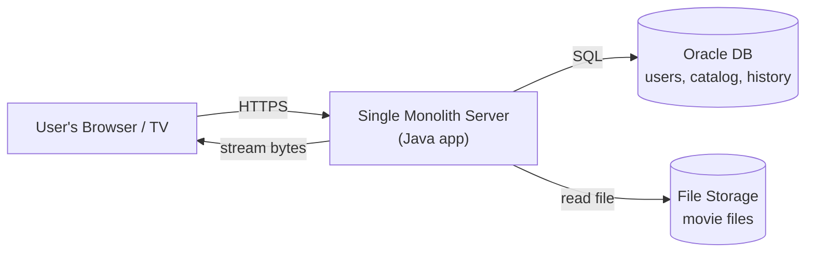

**How it works (request flow)**

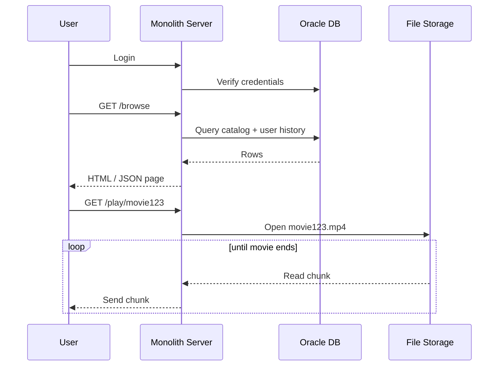

This is a perfectly reasonable v0. It works for 1,000 users. A startup would ship this tomorrow. Now let's find where it breaks, because **spotting flaws is exactly what the interviewer wants to see**.

## 1.5 Problem 1: One server cannot push that much video

A good server has a 10 Gbps network card.

```
10 Gbps / 5 Mbps per stream = 2,000 streams per server (best case, ignoring CPU and disk)
Needed for 30M streams:  30M / 2,000 = 15,000 servers
```

Even if we buy 15,000 servers, **the app server is now doing two jobs**: running business logic (login, browse) and being a file pump. A surge of video viewers slows login and browsing for everyone. Both products fight over the same CPU, memory, and NIC.

## 1.6 Problem 2: Distance kills quality

Our datacenter is in California. A user in Mumbai is about 14,000 km away.

- Round-trip latency is about 250 ms or more.
- The path crosses many networks (ISPs), and any congested hop slows video.
- TCP throughput drops as latency rises, so far-away users get lower bitrates and more buffering.

Buying more servers in California doesn't fix physics.

## 1.7 Problem 3: Single points of failure everywhere

- One datacenter: a fire, power cut, or fiber cut means total outage.
- One Oracle DB: if it corrupts or goes down, nothing works.

> **Real history:** In August 2008, Netflix suffered a major database corruption. The service couldn't ship DVDs for about 3 days. This painful event pushed leadership toward a **cloud, distributed, no-single-point-of-failure** architecture, which led to the famous multi-year migration to AWS (finished around 2016). We'll cover that in later chapters.

## 1.8 Problem 4: The monolith is hard to evolve

- Fixing a typo in the search page requires redeploying the entire app, including the playback code.
- One bad commit can take down everything.
- 100 engineers editing one codebase means constant merge conflicts and slow releases.

## 1.9 The idea that fixes the root cause: split the planes

Everything above comes from mixing two very different workloads. So the first big design decision, even before any technology choice, is:

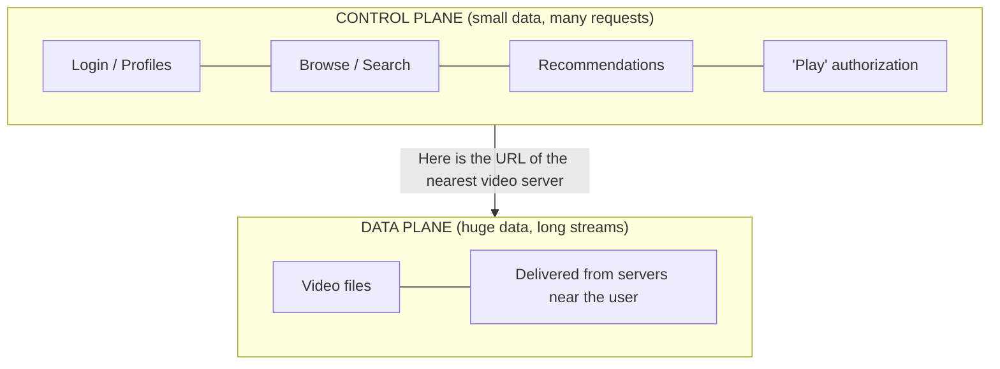

- **Control plane:** decides what to show and where to get the video. It runs in the cloud (AWS), is request-heavy, and uses small JSON payloads.
- **Data plane:** actually moves the video bytes. It's bandwidth-heavy and uses giant files. It must sit physically close to users.

The control plane tells the player, "Go fetch your video from *that* server." The video then flows directly from a nearby server, never touching the app servers.

Netflix really works this way. When you press Play, an AWS-hosted service authorizes you and returns a list of nearby video servers, and your device streams from them.

## 1.10 How to say this in an interview (60-second script)

> "Netflix has two very different workloads. The browsing side is about 350K peak QPS of small requests, which is a standard web-scale problem. The streaming side is about 150 Tbps at peak, which dominates everything. So I'll separate a **control plane** (API, metadata, recommendations in the cloud) from a **data plane** (video delivery from servers close to users). A naive single-server design fails on bandwidth, latency, availability, and deployability, and I'll evolve it step by step."

## ✅ Chapter 1 recap

1. Netflix = browsing (control plane) + video delivery (data plane).
2. Numbers: ~350K peak QPS, ~1 PB storage, **~150 Tbps bandwidth**. Bandwidth is the bottleneck.
3. A monolith with a single DB and files served from the app server breaks on bandwidth, distance, single points of failure, and deployment coupling.
4. The first architectural split is control plane vs data plane.

## 🧠 Check your understanding (answer in your own words)

1. Why is storage *not* the main challenge at Netflix scale, even though videos are big?
2. Why can't we just buy more servers in one datacenter to solve the Mumbai latency problem?
3. In v0, which two workloads compete for the same server, and why is that a problem?

Reply with your answers, or tell me what's unclear, and I'll explain further. When you're comfortable, say **"next"** and we'll go to **Chapter 2: the ingestion and transcoding pipeline**. That's where we ask how a raw 1 TB movie from a studio becomes the 1,000+ files that can play on a phone, a 4K TV, and a 2G network in rural India.


-----------------------------------------------------------------------------------------------------------------------
-----------------------------------------------------------------------------------------------------------------------
-----------------------------------------------------------------------------------------------------------------------
-----------------------------------------------------------------------------------------------------------------------


## 1. Inputs

| Input | Value |
|---|---|
| DAU | 100M |
| Watch time per user | 100 min/day |
| Stream bitrate | 5 Mbps |
| Other API calls | 50 per user per day |
| Content size | 50 GB per title (I treat this as total storage for all renditions of one title) |
| Peak-to-average ratio | 3x (my assumption) |

## 2. Why we need bitrate

Bitrate converts **time watched** into **data moved**. Without it, "100 min per day" tells you nothing about the system. It drives:

- **CDN and network capacity:** the bandwidth we must serve at peak.
- **Cost:** egress is the biggest bill in a video product.
- **Storage per title:** each quality level (240p to 4K) has its own bitrate, so more levels mean more storage.
- **Adaptive streaming design:** the player switches between bitrate levels when the network changes.
- **Segment size:** 5 Mbps × 4 s = 20 Mb ≈ 2.5 MB per video segment.

One note: bitrate is in **bits** per second, while storage is in **bytes**. Divide by 8.

## 3. Estimates

**Watch time and concurrency**
- Total watch time: 100M × 100 min = 10 billion min/day ≈ **167M hours/day**
- Average concurrent streams: 10B min ÷ 1,440 min/day ≈ **7M**
- Peak concurrent streams (3x): ≈ **21M**

**Data per user**
- 5 Mbps × 6,000 s = 30,000 Mb ≈ **3.75 GB per user per day**

**Egress (the big number)**
- Daily: 100M × 3.75 GB ≈ **375 PB/day**
- Average bandwidth: 7M × 5 Mbps ≈ **35 Tbps**
- Peak bandwidth: 21M × 5 Mbps ≈ **105 Tbps**
- Monthly: ≈ **11 EB**

**API traffic (non-video)**
- Daily: 100M × 50 = **5B requests/day**
- Average QPS: 5B ÷ 86,400 ≈ **58K QPS**
- Peak QPS (3x): ≈ **175K QPS**

**Playback-related traffic (hidden but important)**
- Segment requests at 4 s each: 7M streams × 0.25/s ≈ **1.7M req/s average**, about 5M at peak. These go to the CDN, not the app servers.
- Progress heartbeats every 30 s: 7M ÷ 30 ≈ **230K writes/s average**, about 700K at peak. This is the real write load on the backend.

**Storage**
- I assume a catalog of about 15,000 titles. It is not in your inputs, so state it out loud.
- 15,000 × 50 GB ≈ **750 TB** per copy
- With 3x replication at origin: ≈ **2.25 PB**
- CDN copies are extra. Popular titles sit on thousands of edge servers.

## 4. What the numbers tell us

1. **Video delivery dwarfs everything else.** Metadata traffic is about 5B × 10 KB ≈ 50 TB/day, which is roughly 0.01% of 375 PB. So the CDN is the main design problem, and the control plane is the smaller one.
2. **Origin must be shielded.** A catalog of 750 TB is small, but 105 Tbps cannot come from origin. Edge caches must serve over 95% of bytes.
3. **Heartbeats can be the hottest backend write path.** That is why resume position should be async and batched.
4. **Storage is cheap compared to egress.** Extra renditions cost little next to bandwidth.

## 5. Correction to my earlier answer

Earlier I assumed 10M peak concurrent streams. With 100 min per user per day, the average is already 7M, so a peak of about **20M** is more realistic. Use 20M and about 100 Tbps on the board.


-----------------------------------------------------------------------------------------------------------------------
-----------------------------------------------------------------------------------------------------------------------
-----------------------------------------------------------------------------------------------------------------------
-----------------------------------------------------------------------------------------------------------------------


# Chapter 2: Video Ingestion and Transcoding Pipeline

*(You skipped the check questions, so here's the short version of the answers: (1) bandwidth is about 150 Tbps vs about 1 PB of storage, so bytes in motion dominate bytes at rest; (2) physics, since latency and the number of network hops depend on distance, not server count; (3) browsing/login and video streaming compete for the same CPU/NIC. Everything else builds on these.)*

## 2.1 The problem: a studio hands you ONE giant file

A studio delivers a movie as a **mezzanine/master file**: very high quality, barely compressed.

- ProRes or IMF format, often **hundreds of GB to several TB** for a 2-hour 4K HDR film.
- It can't be streamed. Even at 100 Mbps, a viewer would need days of buffering on a typical connection.

Meanwhile your customers watch on:

| Device | Constraint |
|---|---|
| 2012 smart TV | Only plays H.264, max 1080p |
| iPhone on 4G in Mumbai | ~2 Mbps, fluctuating |
| 4K OLED TV on fiber | 25+ Mbps, supports HEVC/AV1 + HDR |
| Android phone in a village | 2G/3G, ~300 kbps |
| Browser on a laptop | Different codec support again |

**Transcoding** is converting the master into many smaller, playable versions: different codecs, resolutions, and bitrates.

## 2.2 Story step 1: The naive approach

Engineers think: "Just convert the master into one H.264 MP4 file and serve it."

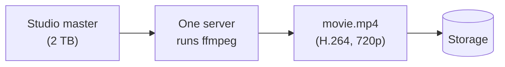

**It breaks in four ways:**

1. **Network mismatch.** A 720p file at 3 Mbps buffers on a 2 Mbps phone and wastes quality on a 25 Mbps fiber user.
2. **Device mismatch.** Some devices can't decode that codec/profile at all.
3. **Time.** Encoding a 2-hour film on one machine can take a day or more. A premiere deadline would be missed.
4. **Fragility.** If the server dies at hour 20 of 24, you restart from zero.

## 2.3 Story step 2: Encoding ladders (multiple versions of the same movie)

**Fix:** produce many versions at different quality levels, then let the player pick the best one for the current network. Each version is a *rung*, and the set is the **bitrate ladder**.

Illustrative ladder (not exact Netflix numbers):

| Rung | Resolution | Bitrate |
|---|---|---|
| 1 | 320×240 | 235 kbps |
| 2 | 640×360 | 560 kbps |
| 3 | 854×480 | 1,050 kbps |
| 4 | 1280×720 | 2,350 kbps |
| 5 | 1920×1080 | 5,800 kbps |
| 6 | 3840×2160 | 16,000 kbps |

Multiply by **codecs** (H.264, HEVC, VP9, AV1) and **audio** (languages × 2.0/5.1/Atmos) and **subtitles**, and one title becomes **hundreds to 1,000+ files**. That's the number from Chapter 1.

### Why more than one codec?

A codec is the compression algorithm. Newer codecs shrink the file for the same quality, but cost more compute to encode and need device support.

| Codec | Compression efficiency | Encode cost | Device support |
|---|---|---|---|
| H.264 (AVC) | baseline | low | nearly universal |
| HEVC (H.265) | about 30-50% smaller | higher | most modern TVs/phones |
| AV1 | even smaller | much higher | newer devices |

**The trade-off you can state in an interview:** pay encoding compute **once**, save bandwidth **millions of times**. Even a 20% bandwidth saving on 150 Tbps is 30 Tbps, which is a fortune in CDN cost. Netflix therefore accepts very expensive encodes.

## 2.4 Flaw in the fixed ladder: one size does NOT fit all

Netflix originally used the **same ladder for every title**. Think about two titles:

- **A flat-color cartoon:** looks great at 1080p with a low bitrate (say 1.5 Mbps in this example) because there's little detail. A fixed ladder wastes bits.
- **A dark, grainy action film:** needs much higher bitrate at the same resolution (maybe 6+ Mbps), and the fixed ladder under-serves it, so it looks blocky.

The fixed ladder over-spends on easy content and under-delivers on hard content.

## 2.5 Story step 3: Per-title encoding (about 2015)

**Fix:** analyze each title's complexity first. Run test encodes at many resolution/bitrate combinations, measure quality, and build a **custom ladder per title**.

How do we *measure* quality? PSNR (a pixel-math metric) correlates poorly with what humans perceive. Netflix developed **VMAF**, a perceptual quality score from 0 to 100 trained on human ratings, and open-sourced it. The optimizer picks the cheapest points that reach a target VMAF.

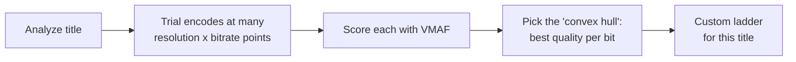

Netflix reported average bitrate savings of around 20% from this, and on easy content the savings are far higher.

## 2.6 Flaw in per-title: scenes inside one title vary wildly

A single movie has a quiet dialogue scene (easy to compress) and then an explosion in the rain (very hard). One ladder for the whole title still wastes bits on easy scenes and starves hard ones.

## 2.7 Story step 4: Shot-based encoding (about 2018)

**Fix:** split the movie into **shots** (continuous camera takes, with cuts between them) and optimize encoding settings **per shot**. This is Netflix's "Dynamic Optimizer."

Beyond quality, this solves another problem: **shots are natural chunks that can be encoded independently and in parallel.** That leads straight into our biggest operational problem.

## 2.8 The compute problem: this is a massive distributed job

Rough math for **one** 2-hour title (illustrative):

```
Video length               = 7,200 s
Chunk (shot group) size    ≈ 10 s              → 720 chunks
Ladder rungs               ≈ 10 resolutions/bitrates
Codecs                     ≈ 3                 → 720 × 10 × 3 = 21,600 encode jobs
Trial encodes for the optimizer multiply this further
```

A single machine would take days or weeks. But each job is **independent**, which is the best-case scenario for parallelism: a classic *embarrassingly parallel* workload.

### The pipeline architecture

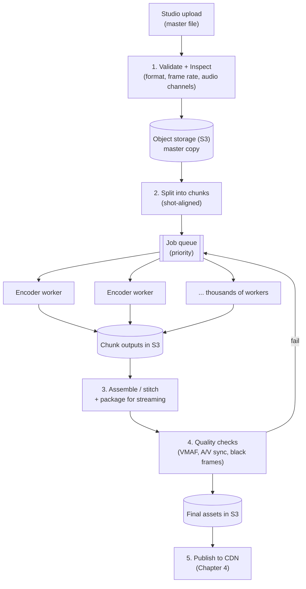

### Components, one by one

1. **Validation/inspection.** Reject bad files early: wrong frame rate, corrupt audio, missing subtitle tracks. Failing in minute 1 is far cheaper than failing after 10 hours of compute.
2. **Splitting.** Cut at shot boundaries (GOP-aligned, meaning a clean point where decoding can start). Cutting mid-GOP creates visible glitches at joins.
3. **Job queue.** Holds the tens of thousands of encode tasks. It should be **priority-aware**. A new-release title due Friday outranks a back-catalog re-encode.
4. **Workers.** Stateless compute that pulls a task, reads one chunk from S3, encodes it, and writes the output back. They're stateless, so they scale horizontally. Workers often run on **cheap spare/spot capacity** (cheap but can be taken away anytime).
5. **Assembler/packager.** Stitches chunks per rung, then packages into streaming segments (the format details are Chapter 3) and applies **DRM encryption**.
6. **Quality control.** Automated checks (VMAF thresholds, audio/video sync, black frames, wrong loudness). Failures re-queue only the bad chunks.

## 2.9 Failure handling (a favorite interview follow-up)

| Failure | How the design handles it |
|---|---|
| Worker crashes or spot instance is reclaimed | The task wasn't acknowledged, so the queue's **visibility timeout** expires and it re-delivers to another worker. Only **one chunk** is lost (about 10 s of video), not 20 hours of work. |
| Duplicate execution (two workers run the same chunk) | Make tasks **idempotent**: output goes to a **deterministic key** like `title123/h264/1080p/chunk-0457`. Writing the same bytes twice is harmless. |
| One chunk repeatedly fails (a "poison" chunk) | Retry with a limit (e.g., 3), then move to a **dead-letter queue** and alert a human. Don't block the other 21,599 jobs. |
| Orchestrator dies mid-pipeline | Persist workflow state in a database (state machine). On restart, resume from the last completed stage instead of starting over. |
| Bad encode slips through | QC stage catches it. Rerun only affected chunks. |

**The core principle:** small, independent, idempotent tasks mean failure is cheap. Compare with the naive design, where one failure cost the entire job.

**Workflow state machine (stored in DB):**

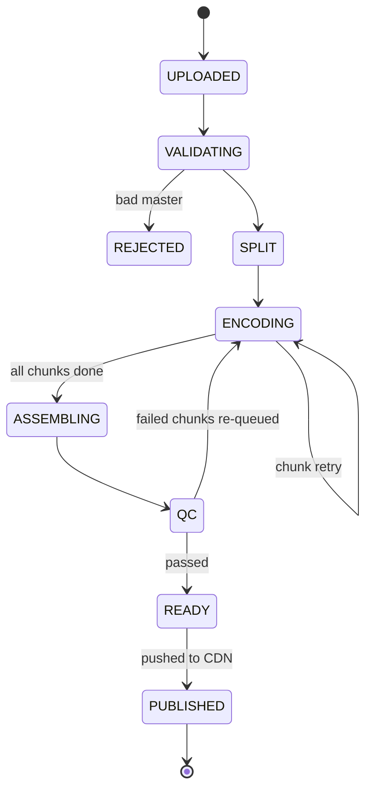

## 2.10 Where's the "sharding" here?

You can mention this to show breadth: **chunking is data partitioning.** We split one big object by *time range*, process partitions in parallel, and merge. Same idea as sharding a database by key, except the "key" is the position in the video. The job queue can also be partitioned (e.g., by title or priority class) so one huge title doesn't starve others.

## 2.11 Other outputs from this pipeline (brief)

- **Audio:** each language × quality tier (stereo, 5.1, Atmos).
- **Subtitles/captions:** text files per language (tiny, but numerous).
- **Trick-play images:** thumbnails for the seek bar preview.
- **Artwork and trailers:** processed separately (these feed the browse UI).
- **Metadata records:** the DB row listing every available encode of a title. Chapter 5 covers how this is stored.

## 2.12 Your 60-second interview script

> "Studios deliver a multi-terabyte master that can't be streamed. I'd build an offline **transcoding pipeline**: validate, split the master into shot-aligned chunks, and fan encoding tasks out through a priority queue to thousands of stateless workers on cheap spot capacity, then stitch, package, encrypt, run quality checks, and publish. The ladder shouldn't be fixed: it should be per-title or per-shot using a perceptual metric like VMAF, because we pay compute once and save bandwidth millions of times. For reliability, tasks are small, idempotent, and retried independently, with a dead-letter queue for poison chunks and workflow state persisted so we resume instead of restart."

## ✅ Chapter 2 recap

1. A studio master is far too big to stream, so we transcode into **many** versions (resolutions × bitrates × codecs × audio).
2. Evolution: single MP4 → fixed ladder → **per-title** ladder → **per-shot** optimization, driven by **VMAF**.
3. Encoding is expensive but done once. It's offline and **embarrassingly parallel**, so we chunk it.
4. Reliability comes from small idempotent tasks, queue redelivery, DLQs, and persisted workflow state.
5. Trade-off to remember: **encoding compute is spent once; bandwidth savings repeat forever.**

## 🧠 Check your understanding

1. Why does the fixed ladder waste money on a cartoon but hurt quality on an action film?
2. If a worker dies halfway through encoding a chunk, why is it safe to give the same chunk to another worker? (Hint: idempotency.)
3. Why is it worth paying much higher encoding cost for AV1 even though many devices can't play it yet?

Answer these (or tell me what's fuzzy), and when you're comfortable say **"next"**. Chapter 3 covers **how the player actually plays these files**: segmenting video, manifests, HLS/DASH, and **adaptive bitrate**, the logic that switches quality up and down in real time as your network changes.


-----------------------------------------------------------------------------------------------------------------------
-----------------------------------------------------------------------------------------------------------------------
-----------------------------------------------------------------------------------------------------------------------
-----------------------------------------------------------------------------------------------------------------------


# Chapter 2, Deep Dive: Data Structures, Queue Mechanics, and Failure Handling

I'll reuse the same pipeline from 2.8 and zoom in on *what data exists*, *who owns it*, and *what happens when things go wrong*.

## 2.13 The golden rule: Queue vs Database

| | Queue | Database (task table) |
|---|---|---|
| Answers | "Someone should work on this" | "What is the truth about this task?" |
| Holds | Tiny pointers like `{task_id}` | Full task state, attempts, output location |
| Delivery | **At-least-once**, so duplicates are possible | Atomic conditional updates |
| If it loses data | A sweeper rebuilds it from the DB | It is the source of truth |

> **Interview line:** "The queue is a *hint*, the database is the *truth*. Workers always verify against the DB before doing or committing work."

Everything below follows from this.

## 2.14 The data structures

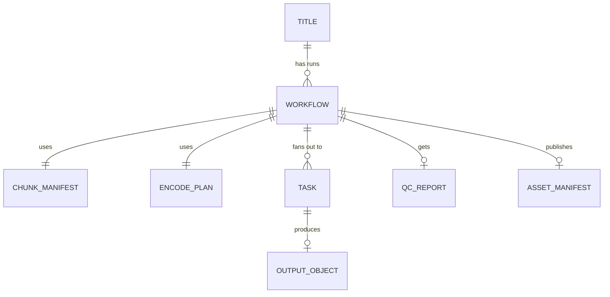

### 1) Workflow record (one per title run) in the DB

```
workflow_id          PK
title_id
kind                 NEW_RELEASE | BACKFILL | RE_ENCODE
priority             P0 (premiere) ... P3 (backfill)
state                UPLOADED | VALIDATING | SPLIT | ENCODING | ASSEMBLING | QC | READY | PUBLISHED | REJECTED
version              integer (optimistic lock)
master_uri           s3://masters/title123/v7/
chunk_manifest_uri   s3://work/title123/v7/chunks.json
encode_plan_uri      s3://work/title123/v7/plan.json
tasks_total          21600
tasks_remaining      21600  (atomic counter)
deadline, created_at, updated_at
```

### 2) Chunk manifest (immutable JSON in S3)

```json
{
  "master": "s3://masters/title123/v7/",
  "fps": 23.976,
  "chunks": [
    {"idx": 0, "start_pts": 0.0,    "end_pts": 10.427, "starts_on_keyframe": true, "uri": ".../chunk-0000.mxf"},
    {"idx": 1, "start_pts": 10.427, "end_pts": 21.100, "starts_on_keyframe": true, "uri": ".../chunk-0001.mxf"}
  ]
}
```
Chunks are shot-aligned, so their lengths differ. This is written once and never edited.

### 3) Encode plan (output of the analyzer/optimizer, immutable)

```json
{
  "rungs": [
    {"codec": "h264", "res": "1080p", "bitrate_kbps": 3100, "target_vmaf": 93},
    {"codec": "av1",  "res": "1080p", "bitrate_kbps": 2200, "target_vmaf": 93}
  ],
  "per_shot_overrides": [{"chunk_idx": 457, "codec": "av1", "res": "1080p", "bitrate_kbps": 5400}]
}
```

### 4) Task record (the most important table; one row per unit of work)

```
task_id         PK = hash(workflow_id | stage | codec | rung | chunk_idx)   <- deterministic
workflow_id     partition key (all tasks of a workflow live together)
stage           ENCODE | PACKAGE | QC
input_uri, params
status          PENDING | RUNNING | DONE | DEAD
attempt         int, incremented AT CLAIM TIME (doubles as a fencing token)
preempt_count   int (spot reclaim, counted separately from real failures)
lease_owner     worker id
lease_expiry    timestamp
not_before      timestamp (retry backoff)
output_uri      set only on commit
output_checksum, vmaf_score
last_error_class   TRANSIENT | RESOURCE | PERMANENT
last_error_msg
```

### 5) Queue message (tiny)

```json
{"task_id": "a91f...", "workflow_id": "wf-77", "priority": "P0", "enqueued_at": "..."}
```
It never carries video data, parameters, or state. Those come from the DB.

### 6) Output object in S3

```
s3://encodes/title123/v7/av1/1080p/chunk-0457/attempt-2.mp4
```
The key includes the **attempt number**. It's only "official" once the task row's `output_uri` points to it.

### 7) Asset manifest (final result)

It lists every playable encode (codec, resolution, bitrate, segment URLs, DRM key IDs, audio and subtitle tracks). The packager creates it, and it's published to the metadata service (Chapter 5).

### Who creates and modifies what

| Data | Created by | Modified by | Mutable? |
|---|---|---|---|
| Workflow record | Ingestion service | **Orchestrator only** | Yes (state, counters) |
| Chunk manifest | Splitter | nobody | **Immutable** |
| Encode plan | Analyzer/optimizer | nobody | **Immutable** |
| Task rows | Orchestrator (bulk insert) | **Workers**, only while holding the lease. Orchestrator and sweeper for resets | Yes |
| Queue messages | Orchestrator (and sweeper) | Workers (hide, extend, delete) | Ephemeral |
| Output objects | Workers | nobody (garbage collector deletes losers) | **Write-once** |
| QC report | QC workers | nobody | Immutable |
| Asset manifest | Packager | nobody | Immutable per version |

> **Design principle (single writer per field):** two components should never fight over the same field. Workers touch only task rows they hold a lease on. The orchestrator touches workflow rows. Immutable artifacts (manifests, plans, outputs) can't conflict at all.

## 2.15 How a worker pulls and processes a task (happy path)

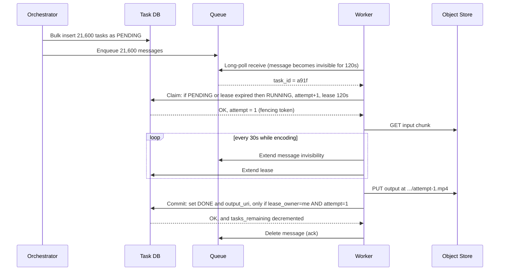

### The claim (the heart of correctness)

```sql
UPDATE tasks
SET status='RUNNING', attempt = attempt + 1,
    lease_owner = :me, lease_expiry = now() + 120s
WHERE task_id = :id
  AND ( status = 'PENDING'
        OR (status = 'RUNNING' AND lease_expiry < now()) )
  AND not_before <= now();
```

One atomic statement. If it affects 0 rows, either the task is already `DONE` (a duplicate message), or another live worker owns it. In both cases, the worker **acks the message and moves on**. This is why duplicate deliveries are harmless.

### Why each step is designed this way

**1. Pull, not push.** Workers ask for work when they're free. A fast worker naturally takes more, a slow one takes less, and no scheduler needs to know machine speeds. Autoscaling just watches queue depth: `workers_needed ≈ backlog / tasks_per_worker_per_minute`.

**2. Long polling.** The worker waits up to ~20 s on the queue instead of hammering it with empty requests.

**3. Short lease plus heartbeats (not one long timeout).** Suppose an encode takes 40 minutes.
- *Long visibility timeout (60 min):* a crash goes undetected for an hour.
- *Short lease (2 min) plus heartbeat every 30 s:* a crash is detected within 2 minutes, and healthy long tasks keep renewing.

**4. Increment `attempt` at claim, not at failure.** A worker that gets OOM-killed never gets to write "I failed". If we only counted *reported* failures, a poison chunk would crash workers forever without the counter moving. Counting at claim means the number always rises.

**5. Commit before ack.** Order is: write output, commit DB row, delete queue message.
- Crash after commit but before ack: the message is redelivered, the claim finds `DONE`, and the worker just acks. Nothing is redone.
- The reverse order (ack first, then commit) would **lose** work if the worker crashed in between.

**6. Exactly-once effect on the counter.** `tasks_remaining` is decremented only when the commit's conditional update actually flips the status to `DONE`. The conditional update is true exactly once per task, so even with duplicate deliveries the workflow counter is exact. When it reaches 0, the orchestrator advances to ASSEMBLING.

**7. Attempt-scoped output keys.** I told you in 2.9 that the key is deterministic, and here is the refinement. Video encoders using multiple threads don't always produce byte-identical output, and S3 has no "rename". So each attempt writes its own file, and the **DB commit decides which one is official**. Losing attempts are cleaned up by a garbage collector. (S3 PUTs are atomic, so a half-written object is never visible as a complete one.)

## 2.16 Failure handling in depth

### Task state machine

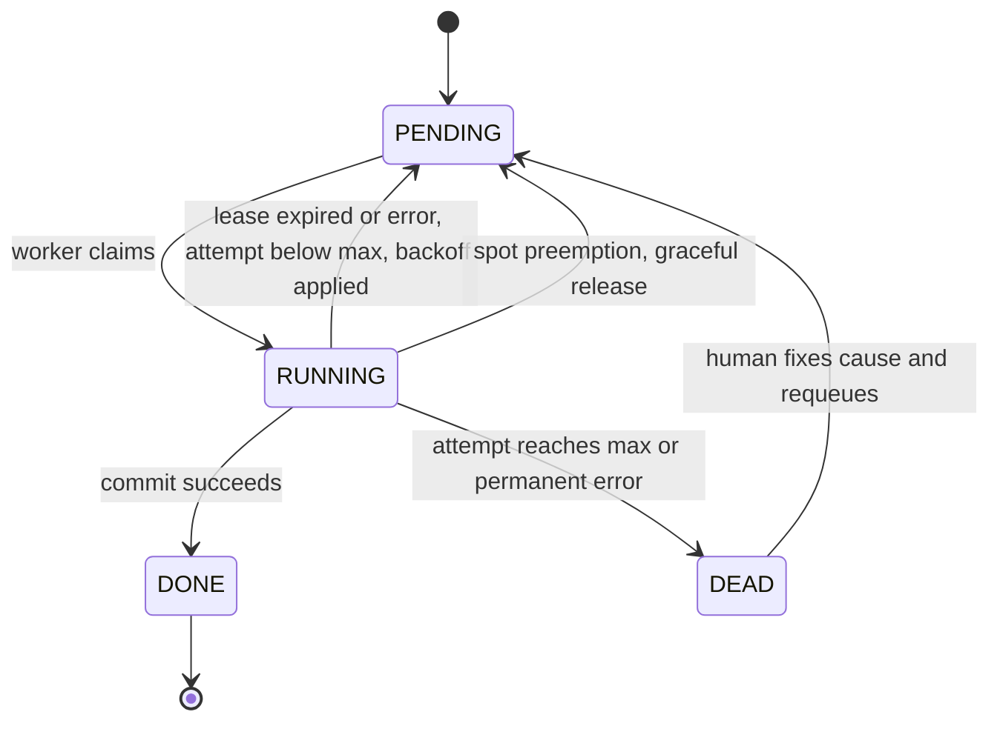

### Scenario A: Worker crashes mid-encode

1. The worker stops heartbeating, so the lease expires after at most 2 minutes.
2. The queue message becomes visible again and another worker receives it.
3. The claim succeeds because `lease_expiry < now()`, and `attempt` becomes 2.
4. Wasted work: at most one chunk, about 10 seconds of video.

### Scenario B: The "zombie worker" (the subtle one interviewers love)

A worker doesn't die. It freezes (long GC pause, network partition), the lease expires, and a second worker takes over. Then the first worker **wakes up** and tries to commit.

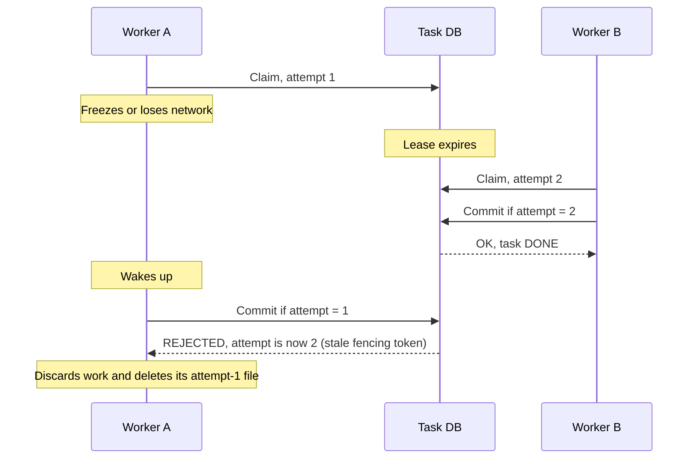

The `attempt` number is a **fencing token**. A stale worker can never overwrite a newer result, because the commit condition checks it. Without this, two workers could both think they own the task and corrupt state.

### Scenario C: Poison chunk (always fails)

A corrupt frame makes the encoder crash on every attempt.

- Attempt 1, 2, 3 each fail. Retry delays grow with **exponential backoff plus jitter** (say 30 s, 2 min, 8 min), using the `not_before` field, so we don't hammer a broken input.
- At `attempt >= 3` the task goes to `DEAD` and the message goes to the **dead-letter queue (DLQ)**. An alert is raised.
- The other 21,599 tasks continue. The workflow can't finish, but it's visibly blocked on one named chunk, and a human (or an automated re-split) can fix just that piece and requeue it.

**Classify errors, since the right retry differs:**

| Error class | Example | Response |
|---|---|---|
| TRANSIENT | S3 503, network blip | Retry soon |
| RESOURCE | Out of memory on 4K AV1 | Retry on a **bigger instance class** (re-enqueue to a "large" queue) |
| PERMANENT | Corrupt input, unsupported format | Straight to DLQ, no pointless retries |

### Scenario D: Spot instance reclaimed (very common)

Cloud providers give a short warning (roughly 2 minutes on AWS) before taking spot machines back.
- The worker sees the notice, **stops pulling new tasks**, and releases its current task: status back to `PENDING`, queue message made immediately visible.
- It increments `preempt_count`, **not** the failure counter. Otherwise a title could be sent to the DLQ simply because the cloud was busy.

### Scenario E: Message lost (the dual-write problem)

The orchestrator inserts tasks into the DB, then crashes *before* enqueueing. The DB says `PENDING`, but no queue message exists, so the task would be stuck forever.

Two defenses:
1. **Sweeper/reconciler:** a background job periodically finds tasks that are `PENDING` for too long, or `RUNNING` with an expired lease, and re-enqueues them. This also protects against the queue losing messages.
2. **Transactional outbox:** write the "to be enqueued" intent in the *same DB transaction* as the task rows, and a relay publishes it afterward.

This is why the DB is the truth. The queue can be rebuilt from it at any time.

### Scenario F: Orchestrator crashes

It's stateless. All workflow state lives in the DB, and the orchestrator runs as several replicas with optimistic locking on the workflow `version` column. A restarted orchestrator reads the workflow, sees e.g. `tasks_remaining = 8,000`, and carries on. Netflix's open-source **Conductor** workflow engine is a real example of this persisted-state-machine pattern.

### Scenario G: Stragglers (slow but not dead)

One task is running 5× longer than its siblings and holds up the whole workflow, because assembly needs *all* chunks. The fix is **speculative execution**: if a task runs beyond, say, the p99 duration for its class, enqueue a duplicate attempt. Whichever commits first wins, and the fencing token rejects the loser.

## 2.17 Queue design details worth mentioning in an interview

- **Priority:** use separate queues (P0 to P3) with workers polling by weights (e.g., 70/20/8/2) rather than strict priority, so backfills still make progress. Add priority aging to prevent starvation.
- **Task classes:** separate queues for heavy work (4K AV1 needs more CPU and RAM) and light work (audio, subtitles), so small tasks aren't stuck behind giants and each pool autoscales independently.
- **Backpressure:** orchestrator enqueues in waves (e.g., keep at most N messages in flight per workflow) so one huge backfill doesn't bury a premiere.
- **Queue choice:** any at-least-once queue (SQS, Kafka-based task queue, etc.) works because correctness comes from idempotent, fenced commits, not from queue magic. Don't claim "exactly-once delivery". Say "at-least-once delivery plus idempotent processing equals exactly-once effect".

## 2.18 Interview-ready answer: "How do you make the pipeline reliable?"

> "I split the job into small independent tasks stored in a DB with a state and a lease, and put only task IDs on an at-least-once queue. Workers pull, atomically claim the task with a conditional update that increments an attempt number, heartbeat to extend a short lease, write output to an attempt-scoped S3 key, and then commit with a condition on that attempt number. That attempt number is a fencing token, so a zombie worker can't overwrite a newer result. I commit before I ack, so crashes between the two just cause a harmless redelivery. Retries use backoff with error classification, poison tasks go to a DLQ after N attempts, spot preemptions are counted separately, and a sweeper reconciles DB and queue to survive lost messages. Everything stateful lives in the DB, so orchestrators and workers are disposable."

## ✅ Deep-dive recap

1. **Queue = hint, DB = truth.** Messages carry only IDs.
2. Data: workflow row, immutable chunk manifest and encode plan, task rows (with `attempt`, lease, status), write-once outputs, immutable final manifest.
3. Each mutable field has **one owner**. Workers write only what they hold a lease on.
4. Safety comes from three mechanisms: **atomic conditional claim**, **short lease with heartbeat**, and **fenced commit** (attempt number).
5. Order matters: **output, then DB commit, then ack**.
6. Failure toolbox: lease expiry (crash), fencing (zombie), backoff plus DLQ (poison), separate preemption counter (spot), sweeper/outbox (lost messages), speculative execution (stragglers).

## 🧠 Check your understanding

1. Why do we increment `attempt` when a worker *claims* a task instead of when it *reports a failure*?
2. A worker commits to the DB successfully but crashes before acking the queue. What happens next, and why is it harmless?
3. Worker A freezes, its lease expires, Worker B finishes the task, then A wakes up and tries to commit. What stops A, and what is that mechanism called?

Tell me which parts are still fuzzy and I'll go deeper on any of them. Once you're comfortable, say **"next"** for **Chapter 3: how the player actually plays these files**, covering segmenting, manifests, HLS/DASH, and **adaptive bitrate** logic.


-----------------------------------------------------------------------------------------------------------------------
-----------------------------------------------------------------------------------------------------------------------
-----------------------------------------------------------------------------------------------------------------------
-----------------------------------------------------------------------------------------------------------------------


# Chapter 3: Streaming Protocols and Adaptive Bitrate (ABR)

*(You skipped the check questions again, so here are the short answers to the deep-dive ones: (1) a crashed worker can never report its own failure, so counting at claim time makes the counter rise even for a poison chunk that kills every worker; (2) the message is redelivered, the claim finds the task already `DONE` and affects 0 rows, so the worker just acks and moves on; (3) A's commit is rejected because its `attempt` no longer matches. The mechanism is a **fencing token**.)*

## 3.1 Where we are

After Chapter 2, S3 holds hundreds of encoded renditions of a title (codec × resolution × bitrate, plus audio and subtitle tracks). Now a user presses Play on a phone whose bandwidth changes every few seconds.

> **Clarification:** the **chunks** in Chapter 2 were *shot-aligned, variable-length pieces for parallel encoding*. The **segments** in this chapter are *fixed-duration pieces (a few seconds) for playback*. The packager re-cuts the stitched renditions into segments. They are different concepts with different purposes.

## 3.2 Story step 1: Progressive download (one big MP4 over HTTP)

The simplest idea is to point the player at `https://.../movie.mp4` and let the browser download and play it.

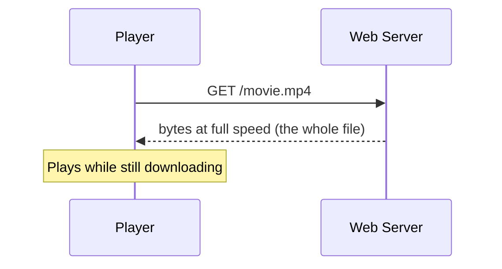

**It breaks in five ways:**

1. **No adaptation.** The quality is chosen once, before playback. If the network degrades at minute 20, the player buffers, because it can't switch to a lower quality mid-file.
2. **Wasted bandwidth.** The server pushes the file as fast as possible. If the user quits after 3 minutes of a 2-hour movie, you paid to transfer the first 40 minutes anyway.
3. **Slow start and awkward seeking.** A regular MP4 keeps its index (the `moov` atom) either at the end or the start of the file. If it's at the end, the player can't begin until it has it. Seeking needs HTTP Range requests and index math.
4. **Poor cacheability.** One multi-GB object is a clumsy unit for caches.
5. **One file per quality means no mixing.** You can't take 1080p video for one minute and 480p for the next.

## 3.3 Story step 2: Dedicated streaming servers (RTMP, RTSP)

The industry's first answer was special streaming protocols (RTMP for Flash, RTSP/RTP over UDP). A stateful server tracks each viewer and pushes frames at the playback rate.

**It breaks at Netflix scale:**

- **Stateful servers.** Each viewer pins a server connection, so scaling and failover are painful.
- **Firewall and proxy trouble.** Non-HTTP protocols are often blocked in corporate and some ISP networks.
- **Can't use ordinary HTTP caches and CDNs.** That means we can't use the cheapest and most widely deployed content delivery machinery on earth. This is fatal for a 150 Tbps problem.
- **Server-side intelligence.** The server has to guess the viewer's bandwidth, and it sees the network worse than the client does.

## 3.4 Story step 3: HTTP Adaptive Streaming (the winning idea)

The insight: **make the video look like a pile of small, boring, static files, and let the client be smart.**

1. Cut each rendition into **segments** of a few seconds each.
2. Publish a **manifest**: a text file that lists the renditions and where every segment lives.
3. The player downloads the manifest, then fetches segments with plain HTTP GETs, **choosing which rendition to fetch for each next segment**.

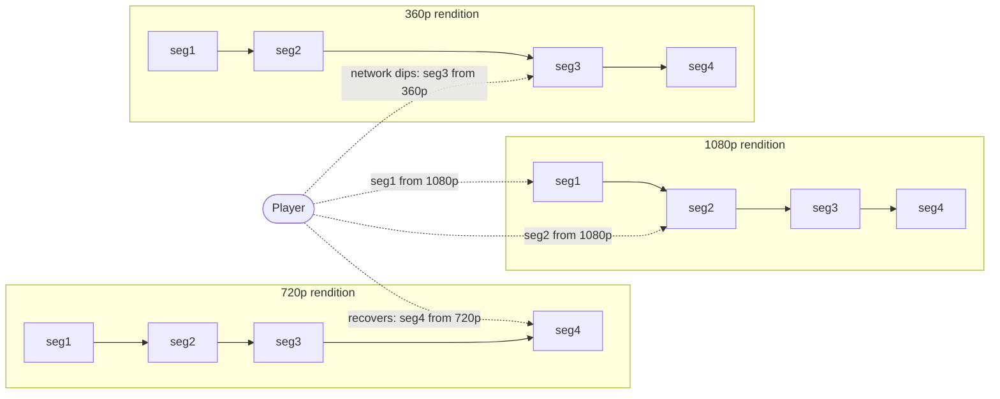

**Why this won:**

| Property | Benefit |
|---|---|
| Plain HTTP(S) | Passes every firewall and uses all existing infrastructure |
| Segments are static, identical for every viewer | **Perfectly cacheable on CDNs**, and the same bytes serve millions |
| Stateless servers | Any server can answer any request, so scaling and failover are trivial |
| Client picks the rendition per segment | Adapts to its own network, which it knows best |
| Quitting costs almost nothing | Only a short buffer was downloaded |

> **Real history:** Netflix's early streaming (around 2008) used Microsoft Silverlight with *Smooth Streaming*, an HTTP adaptive protocol. The industry later converged on **HLS** (Apple) and **MPEG-DASH** (open standard), with HTML5 Media Source Extensions replacing plugins. Netflix uses its own player and manifest logic on top of these ideas across devices.

## 3.5 Anatomy of the files

### Segment format: fragmented MP4 (fMP4 / CMAF)

```
init segment   → codec setup info (no media, tiny)
seg_0001.m4s   → 4 seconds of video
seg_0002.m4s   → next 4 seconds
...
```

Each segment **starts on a keyframe** (a full independent frame), so the player can start decoding at any segment boundary without earlier data. **Keyframes are aligned across all renditions**, so segment 57 covers the same seconds in 1080p and 360p. That alignment is what makes mid-stream switching seamless, with no visible glitch at the seam.

### Segment duration trade-off (a classic interview question)

| | Short (about 2 s) | Long (about 10 s) |
|---|---|---|
| Adaptation speed | Fast reaction to network change | Slow reaction |
| Startup time | Faster (small first download) | Slower |
| Request count | Many more HTTP requests and overhead | Fewer |
| Compression efficiency | Worse (more forced keyframes, which are expensive) | Better |
| Manifest/index size | Larger | Smaller |

A common choice is **about 2-6 seconds**. For a 2-hour title at 4 s, that's 1,800 segments per rendition. With about 30 video renditions (10 rungs × 3 codecs), that's about 54,000 segment objects for video alone.

### Storage layout choice

- **Option A: one object per segment.** Simple, and every segment is an independently cacheable unit. The downside is a huge number of small objects.
- **Option B: one file per rendition plus an index, fetched with HTTP byte-range requests** (DASH `SegmentBase`, HLS byte ranges). Fewer objects and easier to manage, and CDNs handle range requests well, but caching semantics are slightly more complex.

Either is defensible. Say which you chose and why.

### The manifest

**HLS master playlist** (lists renditions):
```
#EXTM3U
#EXT-X-STREAM-INF:BANDWIDTH=560000,RESOLUTION=640x360
360p/index.m3u8
#EXT-X-STREAM-INF:BANDWIDTH=2350000,RESOLUTION=1280x720
720p/index.m3u8
#EXT-X-STREAM-INF:BANDWIDTH=5800000,RESOLUTION=1920x1080
1080p/index.m3u8
```

**HLS media playlist** (lists segments of one rendition):
```
#EXTM3U
#EXT-X-TARGETDURATION:4
#EXT-X-MAP:URI="init.mp4"
#EXTINF:4.0,
seg_0001.m4s
#EXTINF:4.0,
seg_0002.m4s
...
#EXT-X-ENDLIST
```

DASH does the same job with an XML file (MPD). The concepts match: renditions, segment addresses, durations.

**Seeking is trivial.** To jump to minute 47:00, the player computes `segment = 2820 s / 4 s = 705`, fetches that segment (plus the init segment), and plays. No scanning of giant files.

### Netflix twist: the manifest is *personalized and generated*, not a static file

The manifest isn't a public static file. When you press Play, a **playback service** (control plane, from Chapter 1) builds it per request. It:

1. Checks your subscription and plan (a 4K stream is allowed only on the premium plan).
2. Checks your device capabilities (codecs, HDR, max resolution) and filters the renditions accordingly.
3. Chooses **which CDN servers** you should fetch from, and includes **several URLs per stream** for failover (Chapter 4).
4. Signs the URLs with expiring tokens and includes the DRM license endpoint.

The video segments themselves *are* static, shared files. Only the thin "map" is personalized.

## 3.6 What happens when you press Play

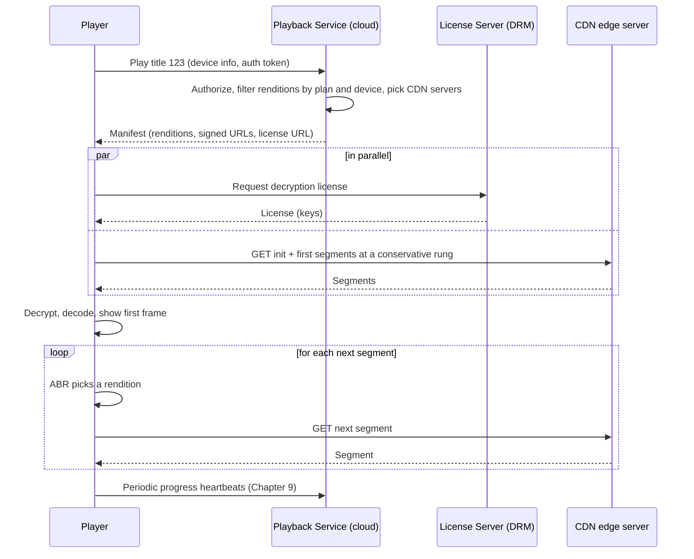

**Startup latency tricks** (interview gold):
- Fetch the license and the first segments **in parallel**, not one after another.
- **Start conservatively.** Pick a low-to-medium rung for the first segments (small download, quick first frame), then ramp up. Viewers tolerate a short soft-focus start far better than a 5 s spinner.
- Reuse the **connection** (TLS/HTTP keep-alive, pre-resolved DNS) to avoid handshake round trips.
- **Pre-fetch while browsing:** when you hover or linger on a title, the app can warm up the manifest and license in the background.
- Use a **small buffer target initially**, since we only need enough to start, then grow it.

## 3.7 The heart of the chapter: ABR algorithms

The client keeps a **playback buffer** (seconds of video downloaded but not yet shown). For each next segment it must decide which rung to fetch.

**QoE (Quality of Experience) pulls in competing directions:**

1. Higher bitrate means better picture.
2. **Rebuffering (the spinner) is the worst outcome.** Users hate it far more than lower resolution.
3. Frequent quality switching is distracting.
4. Startup time matters.

So ABR is an optimization problem: *maximize quality while avoiding stalls and excess switching.*

### Approach 1: Throughput-based ABR (the obvious one)

Measure how fast the last segment(s) downloaded, estimate bandwidth, and pick the highest rung **below** the estimate (with a safety margin).

```
Segment = 4 s of 2,350 kbps video = 9.4 Mb
Downloaded in 3.1 s  →  measured throughput ≈ 3.0 Mbps
Estimate 3.0 Mbps × 0.8 safety margin = 2.4 Mbps  →  choose the 2,350 kbps rung
```

**Flaws:**
- **Noisy estimates.** Wi-Fi, mobile networks, and TCP slow-start make single-segment measurements jumpy, so the player oscillates between rungs.
- **Chicken-and-egg.** You can only measure bandwidth by downloading. If you're on a low rung, short downloads on a shared link may under-estimate the capacity, and you may stay low unnecessarily.
- **Shared bottlenecks.** Multiple players in one home pull segments in bursts, so each sees a distorted view of the link.
- **Ignores the buffer.** A viewer with a 60 s buffer can safely take risks, and one with 4 s can't, but this approach treats them the same.

### Approach 2: Buffer-based ABR (a Netflix research result)

A well-known 2014 study (Huang et al., done with Netflix) argued: *don't try to predict bandwidth. Use the buffer level as the signal.* The buffer already integrates everything that happened to the network.

The rule: map buffer occupancy to a rung.

```
Buffer (seconds)   Chosen rung
  0 ──────── 10    LOWEST rung only      ← "reservoir": protect against stalls
 10 ──────── 40    ramps up gradually    ← "cushion": higher buffer = higher quality
 40 ──────── +     HIGHEST rung          ← plenty of safety margin
```

**Intuition:** a full buffer means we can afford risky, high-quality downloads, and a draining buffer means we should drop quality to refill. The reservoir guarantees that if the network collapses, we have enough runway at the lowest rung to avoid a stall.

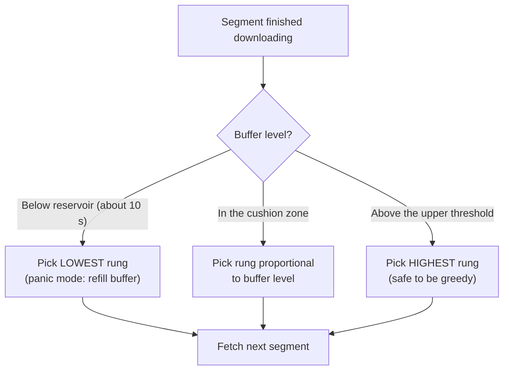

**Flaws of pure buffer-based:**
- **Startup.** The buffer starts at 0, so a pure buffer rule would sit on the lowest rung for a while. In practice, the **startup phase uses throughput estimation** and then hands over to buffer-based logic.
- It can be slow to *discover* that more bandwidth is available.

### Approach 3: Hybrid and predictive (what real players do)

Modern players combine throughput history, buffer level, and sometimes a short-horizon lookahead (model predictive control: simulate "if I pick rung X for the next 5 segments, what buffer and quality would I get?"). Some also use machine-learned policies trained on real session traces. Netflix also uses its own tuning. Neither buffer nor throughput alone wins, so mixing them is standard.

### Worked example (follow the numbers)

Ladder: 235 / 560 / 1050 / 2350 / 5800 kbps. Segments are 4 s long.

| Time | Network | Buffer | Decision | Why |
|---|---|---|---|---|
| 0 s | about 3 Mbps | 0 s | Fetch 560 kbps | Startup: small and fast to first frame |
| 8 s | about 3 Mbps | 8 s | 1050, then 2350 | Throughput estimate supports ramping |
| 30 s | about 3 Mbps | 25 s | 2350 kbps (steady) | Buffer in cushion zone, estimate agrees |
| 60 s | **drops to 1 Mbps** | 28 s | still 2350 for one segment | A 4 s segment of 2350 kbps (9.4 Mb) now takes 9.4 s to download, so the buffer drains about 5.4 s per segment |
| 70 s | 1 Mbps | 17 s | drop to 1050, then 560 | Buffer falling through the cushion, so quality steps down |
| 100 s | 1 Mbps | 14 s, stable | 560 kbps | Fits within 1 Mbps, so the buffer stops draining |
| 150 s | back to 3 Mbps | refilling | Step up gradually | The buffer rises, so quality ramps back |

The viewer saw a softer picture for about 90 seconds but **never saw a spinner**. That is exactly the goal.

### Other player-side controls

- **Buffer cap (about 30-60+ s ahead):** limits wasted data if the viewer leaves and limits device memory use. When the buffer is full, the player pauses fetching and fetches a segment only when there's room, which creates "on-off" traffic patterns.
- **Switch damping:** don't change rungs on every tiny fluctuation. Require a sustained change before switching up, but switch **down quickly** (down-switching is a safety action and up-switching is an opportunity).
- **Abandoning a download:** if a segment is crawling and the buffer is about to run dry, cancel and re-fetch at a lower rung.
- **Audio first:** audio is tiny and the ear forgives low video quality but not audio gaps, so audio is usually fetched on its own track with higher priority.

## 3.8 Client-side failure handling

The player must assume the network and servers misbehave.

| Failure | Player reaction |
|---|---|
| Segment request times out or returns 5xx | Retry (with short backoff). If it fails again, **switch to the next URL for the same stream** from the manifest (a different CDN server, Chapter 4). |
| CDN server is slow (not dead) | The throughput estimate drops and ABR steps down. Persistent slowness triggers failover to another server. |
| Signed URL expired (403) | Ask the playback service for a refreshed manifest or tokens, then resume. |
| Network disappears briefly | Keep playing from the buffer. If the buffer empties, show the spinner and keep retrying with backoff. |
| Segment is corrupt or won't decode | Re-fetch it. If persistent, skip to a different rung or CDN and report telemetry. |
| DRM license failure | Retry. If it persists, surface a specific error code to the user, and report it. |
| Device can't decode a codec | Should not occur, because the manifest was filtered by capabilities. If it does (a decoder bug), fall back to a safer codec such as H.264. |

> **Why this matters:** the manifest carrying multiple URLs per stream means resilience is built into the data, not bolted on. The client can fail over in seconds without asking the backend to do anything.

## 3.9 Data structures and ownership (as in the last chapter)

| Data | Created by | Modified by | Mutable? |
|---|---|---|---|
| Media segments + init segments | Packager (Chapter 2 pipeline) | nobody | Immutable, cache-forever |
| Rendition index (segment offsets, durations) | Packager | nobody | Immutable |
| Asset manifest (all renditions and DRM key IDs) | Packager | nobody | Immutable per version |
| **Per-session manifest** (what the user receives) | **Playback service**, on demand | nobody, it's generated per request | Ephemeral, expiring |
| DRM keys | Key management service | Rotated by KMS only | Secret |
| Player buffer, bandwidth estimate, current rung | **Player (client)** | Player | In-memory, per session |
| Playback session record (device, start time, QoE telemetry) | Playback service + player telemetry | Event pipeline (Chapter 9) | Append-only |

Notice that **the server holds no per-viewer streaming state**. This is the reason the delivery layer scales horizontally and cheaply.

## 3.10 Variants worth a sentence in interviews

- **Live streaming:** segments are produced continuously, the manifest keeps updating (a sliding window), and latency matters. Chunked transfer and shorter segments are used. (Out of scope for us, but mention it if asked.)
- **Downloads for offline:** the same segments are fetched ahead and stored encrypted, with license rules (expiry).
- **Codec/DRM-specific packaging:** DASH and HLS differ in manifest format and encryption conventions. The Common Media Application Format (CMAF) lets one set of fMP4 segments serve both, which **halves storage and improves CDN cache hit rates**. Say this if asked how to reduce the number of files.

## 3.11 Your 60-second interview script

> "I'd use HTTP adaptive streaming. The packager cuts each rendition into 2-6 second fMP4 segments with keyframes aligned across renditions, and a manifest describes renditions and segment locations. The segments are static and identical for all users, so they're cacheable on a CDN and servers stay stateless. A playback service in the control plane authorizes the user, filters renditions by plan and device, signs URLs, and returns a personalized manifest with several CDN URLs per stream for failover. The client then runs ABR: throughput-based at startup, then buffer-based or hybrid once the buffer builds, stepping down fast and up slowly, with a buffer reservoir so it avoids stalls. Startup is optimized by fetching the DRM license and first segments in parallel at a conservative rung. If a segment or server fails, the player retries and switches to another CDN URL without the backend's help."

## ✅ Chapter 3 recap

1. Evolution: progressive MP4 → stateful streaming servers (RTMP/RTSP) → **HTTP adaptive streaming** with segments + manifest.
2. Static, identical, small segments are **cacheable and stateless**, which is what makes CDN scale possible.
3. Aligned keyframes across renditions make mid-stream switching seamless. Segment length trades adaptation speed against efficiency.
4. The manifest is **personalized per request** by the playback service (control plane) and contains multiple URLs for failover.
5. ABR: throughput-based (noisy, ignores buffer) → buffer-based (robust, bad at startup) → **hybrid**. Rebuffering is the thing to avoid most.
6. Client-side resilience: retries, CDN failover, token refresh, and abandoning slow downloads.

## 🧠 Check your understanding

1. Why do keyframes need to be aligned across all renditions, and what would go wrong if they weren't?
2. A user's buffer is 3 seconds and the throughput estimator says "plenty of bandwidth." A pure throughput-based player would pick a high rung. What risk does that take, and how does a buffer-based or hybrid player avoid it?
3. Why is it good that the video segments are identical for every viewer, even though the manifest is personalized?

Tell me what's still fuzzy, and I'll go deeper (for example, a detailed walk through a specific ABR algorithm, or HLS vs DASH). When you're comfortable, say **"next"** for **Chapter 4: CDN and Open Connect**. That's where we attack the 150 Tbps problem head-on: why a normal CDN wasn't enough, why Netflix built its own boxes and put them *inside ISPs*, how files get placed on those boxes overnight, and how a client is steered to the right one.


-----------------------------------------------------------------------------------------------------------------------
-----------------------------------------------------------------------------------------------------------------------
-----------------------------------------------------------------------------------------------------------------------
-----------------------------------------------------------------------------------------------------------------------


# Chapter 4: CDN and Open Connect

*(Short answers to Chapter 3's questions: (1) if keyframes weren't aligned, switching renditions mid-stream would land on a segment that starts at a different instant or doesn't start on a keyframe, so you'd get glitches, skipped or repeated frames, or decode errors at every switch. (2) The throughput player risks starting a huge download with only 3 s of runway, stalling if the network dips. Buffer-based or hybrid logic sees the tiny buffer and stays on a low rung until it refills. (3) Identical segments mean every viewer hits the same cached bytes, so cache hit rates are very high and servers hold no per-user state.)*

## 4.1 The problem

From Chapter 1: about **150 Tbps at peak**. From Chapter 3: video is now thousands of static, identical, cacheable HTTP objects. That makes this a **caching and placement problem**: put the right bytes as close to each viewer as possible, and never make them cross the long-haul internet more than once.

## 4.2 Story step 1: Serve everything from the cloud origin

Segments sit in S3 in one region, and players fetch them directly.

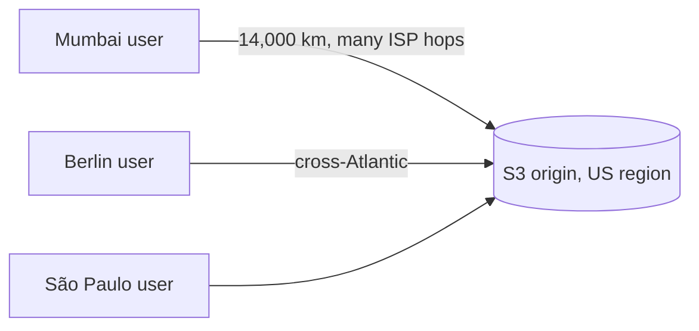

**It breaks:**

1. **Latency and throughput.** TCP throughput falls as round-trip time rises, so far users get a lower rung and more rebuffering.
2. **Cost.** Cloud egress is billed per GB. At 150 Tbps, this is astronomically expensive.
3. **Origin overload.** The origin must serve every byte of every viewer.
4. **Crossing congested networks.** The path goes through transit providers and interconnect points that clog at peak hours.

## 4.3 Story step 2: Rent a commercial CDN (Akamai, Limelight, Level 3)

**A CDN** is a network of caching servers (**edges**) spread worldwide, in front of an origin.

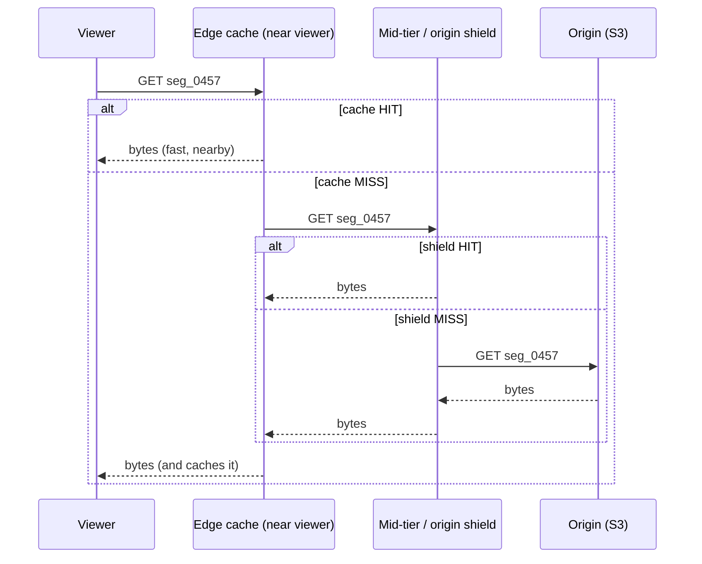

**Tiering** (edge, then shield, then origin) is important. Without a shield, 1,000 edges each missing the same new segment would send 1,000 requests to the origin. With a shield, they send one.

Netflix used commercial CDNs around 2008 to 2012. It worked, and then it hit limits:

| Limit | Why it hurt Netflix |
|---|---|
| **Cost at scale** | Per-GB pricing. Netflix was becoming a large share of all US peak-hour traffic. |
| **Cache churn** | A generic CDN uses LRU eviction (evict the least recently used) across many customers' content. Netflix's catalog is huge and the long tail is rarely watched, so many requests miss and go back to the origin. |
| **Little control** | Netflix couldn't tune hardware, software, or routing for video. |
| **Interconnect congestion** | Traffic still crossed the boundary between the CDN and the viewer's ISP. When that link saturated at 9 pm, Netflix was blamed, and the 2010 to 2014 interconnection disputes (e.g., Comcast vs. CDN providers) were public fights. |
| **ISP friction** | ISPs saw a giant stream they hadn't asked for, crossing their paid links. |

## 4.4 The key insight: Netflix's traffic is *predictable*

Compare with a general website:

- Catalog is **small and known in advance** (about 20K titles, with new releases scheduled).
- Popularity is **heavily skewed** (Zipf-like): a small fraction of titles drives most views.
- Demand follows a daily **rhythm**: a huge peak in the evening, quiet at night.

So there is no need to wait for a viewer to request a segment and *then* cache it. Netflix can **predict what will be popular in each region and push it there during off-peak hours**. This turns a *pull-through cache* into a *proactive pre-placement* system. That one idea underpins Open Connect.

## 4.5 Story step 3: Open Connect (Netflix builds its own CDN)

Netflix designed its own server appliances (**OCAs, Open Connect Appliances**), and deployed them two ways:

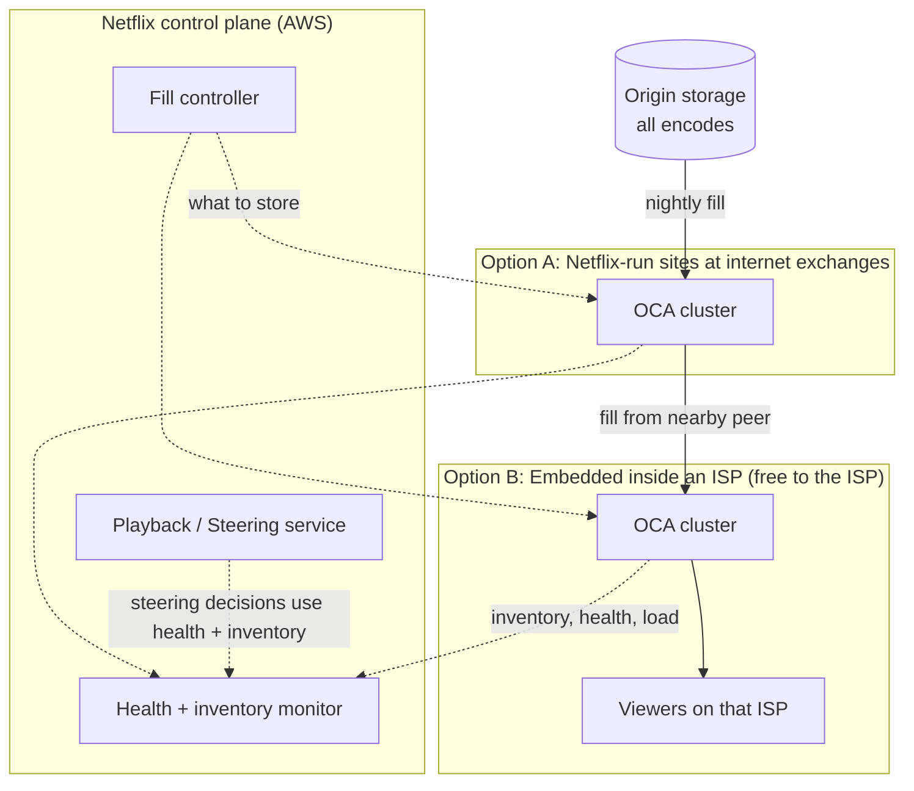

**Option A, IXP sites:** Netflix-owned clusters at internet exchange points where many networks meet, so ISPs can connect directly (peer) instead of via paid transit.

**Option B, embedded:** Netflix gives the ISP appliances **for free** to install inside its own network, close to its subscribers.

**Why would an ISP accept?**

- It saves **transit and backbone cost**, because the video comes from inside its own network and not over its paid upstream links.
- Its customers get **better quality**, so fewer support calls.
- The ISP pays only for power, space, and connectivity.

Everyone wins, and Netflix gets video delivered over the **shortest possible path**, often **one or two hops from the viewer**. This also shrinks the "congested interconnect" problem to almost nothing.

> The numbers (illustrative): 150 Tbps ÷ about 100 Gbps per box ≈ 1,500 boxes at perfect 100% utilization. With realistic headroom, diverse locations, and redundancy, you need many thousands of appliances spread over a very large number of sites.

## 4.6 Inside one OCA (why one box can push so much)

You don't need kernel details in an interview, but showing you know *why* a box is efficient is a strong signal.

- **Specialized for one job:** serve large static files over HTTPS. Nothing else runs on it.
- **Storage tiers:** there are two common types: **flash/NVMe** boxes for the hot head of the catalog and high throughput, and **dense HDD** boxes for the long tail. Popular segments get served from flash and from RAM page cache.
- **Efficient data path:** `sendfile`-style zero-copy from disk to network, and TLS encryption done in the kernel (kTLS, NIC offload on newer designs), so data isn't copied back and forth through user space.
- **Tuned TCP, with BBR-style congestion control** to keep throughput high on lossy last-mile paths.
- **Stateless:** no per-viewer state. Any request for a segment it holds can be answered immediately.

## 4.7 How content gets onto the boxes (the *fill* process)

**Fill = copying content from upstream into the OCAs. Serving = answering viewers. They're deliberately separate**, so fill traffic never competes with the evening peak.

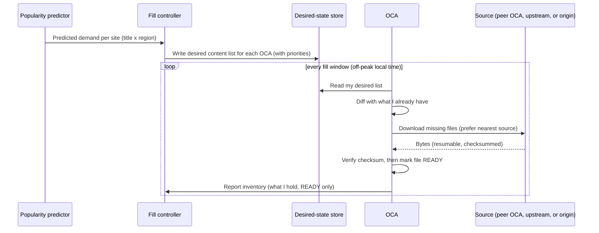

Details worth knowing:

- **Declarative, not imperative.** The controller says "box 17 *should* hold these files." The box reconciles toward that state, like Kubernetes. If it crashes mid-way, it just resumes the diff after restart.
- **Fill tiers (cheapest source first):** another OCA in the **same cluster** (free, local), then a nearby site, then the origin. Each file crosses the expensive long-haul path *once* per region, not once per box.
- **Off-peak windows:** fill when the local network is quiet (e.g., local early morning), so it doesn't steal capacity from viewers.
- **New releases:** pre-positioned **days ahead** of launch. At launch hour, the content is already sitting inside the ISP. (We'll revisit this in Chapter 12.)
- **Eviction:** when full, remove the lowest predicted-value files first, not simply the least recently used, since our predictions beat LRU for this workload.
- **Integrity:** every file has a checksum. A file is only advertised after it's fully downloaded and verified (no half-files served).

## 4.8 Where does each file live inside a cluster? (sharding and replication)

A site has, say, 20 boxes. Two naive options:

| Option | Problem |
|---|---|
| **Every box holds everything** | Wastes storage: the cluster's unique capacity equals one box's. The long tail won't fit. |
| **Each file on one box only** | Total capacity is maximal, but a hot title melts one box, and one dead box loses its files. |

**The solution is partitioning plus popularity-based replication.**

**Step 1, spread files across boxes with consistent hashing.** Placement with `box = hash(file) mod N` has a nasty flaw: when you add or remove a box, `N` changes and almost **every** file maps to a new box, forcing a huge reshuffle. With a **hash ring**, each box owns arcs of the ring, and a file goes to the next box clockwise. Adding or removing a box moves only about 1/N of files.

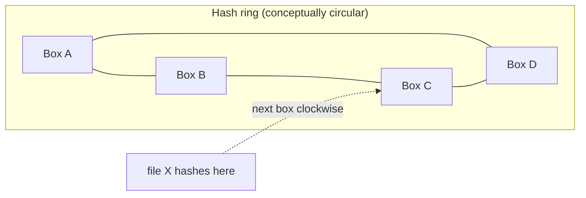

**Step 2, replicate by heat.** Cold titles live on 1 or 2 boxes. Hot titles are copied onto more boxes, and the replica count scales with predicted demand. A premiere may sit on *every* box.

**Step 3, make steering aware of it.** The steering layer knows which boxes hold which files (from inventory reports), so it never sends a viewer to a box that lacks the segment.

> **Interview line:** "Inside a site I shard the catalog across boxes with consistent hashing so unique capacity adds up, then add replicas proportional to popularity so no box gets hot and a box failure doesn't lose hot content."

## 4.9 Steering: how does a viewer find the *right* box?

Pressing Play must pick among thousands of boxes. Remember from Chapter 3: the **playback service** builds your manifest, and this is where it picks the CDN URLs.

**Rejected alternative: DNS-based steering** (`video.netflix.com` resolves to a different IP by region). Problems:

- DNS sees the **resolver's** location, not the viewer's (many people use public DNS far away).
- DNS answers are cached (TTL), so reactions to overload or failure are slow.
- It's per hostname, not per file, so it can't know whether a box has *this specific* segment.

**What Netflix does instead: application-level steering in the playback service.**

```mermaid
flowchart TD
    A["Play request (client IP, device, title)"] --> B["Map client IP to network location / ISP prefix"]
    B --> C["Candidate OCAs: those reachable closely<br/>(learned via BGP from the ISP)"]
    C --> D{"Has this exact rendition READY?"}
    D -->|"no"| X["discard"]
    D -->|"yes"| E{"Healthy and below load threshold?"}
    E -->|"no"| X
    E -->|"yes"| F["Rank: network proximity, spare capacity,<br/>cache-affinity, cost"]
    F --> G["Return top N signed URLs in the manifest"]
```

How does Netflix know which OCA is "close" to which client? The OCAs **exchange routing information (BGP) with the ISP** they sit in. This tells Netflix which client IP ranges are reachable via which box, so "closeness" comes from real network topology and not guesswork from geolocation.

**Ranking inputs:**

- Network proximity (fewest hops, same ISP).
- **Current load** (don't overload a box, so shed to the next one).
- Content availability (the file must be READY).
- Cost preferences (prefer embedded OCAs over farther sites).
- **Cache affinity:** steer requests for the same title to the same boxes, so hot content isn't unnecessarily spread across the whole cluster.

The response includes **multiple ranked URLs**, which is the failover hook we introduced in Chapter 3.

## 4.10 Data structures and ownership

| Data | Created by | Modified by | Notes |
|---|---|---|---|
| **OCA registry** (id, site, ISP/ASN, hardware class, capacity Gbps, BGP-learned prefixes) | Network ops / provisioning | Ops, and the OCA's own heartbeat for dynamic fields | Mostly static |
| **Desired-state fill list** (per OCA: file IDs and priorities) | **Fill controller** (from popularity predictions) | Fill controller only | Declarative target |
| **Actual inventory** (per OCA: READY file IDs and versions, checksums) | **The OCA itself** (it reports what it holds) | OCA only | Truth about reality |
| **Health and load** (current Gbps, error rate, disk status) | OCA heartbeat | OCA only | Short TTL, refreshed every few seconds |
| **Steering routing table** (client prefix → candidate sites and boxes) | Derived by steering service from registry plus BGP data | Rebuilt continuously | In-memory in steering replicas, **rebuildable**, eventually consistent |
| **Segment files** | Packager (Chapter 2) | nobody | **Immutable**, so replicas can never disagree |

The same principle holds as before: **single writer per field**. *Desired* state is written by the controller, and *actual* state by the box, so each has one owner. Steering reads both and trusts neither blindly (it uses health and inventory freshness).

Because the files are immutable and versioned, replicas can never be stale in a harmful way. A new encode is a new file ID, never an edit in place.

## 4.11 Failure handling in depth

| Failure | What happens |
|---|---|
| **OCA dies mid-stream** | The segment request fails. The player **retries and moves to the next URL** in its manifest within seconds (Chapter 3). The heartbeat stops, so steering marks the box unhealthy and stops returning it. The viewer sees at most a brief dip. |
| **OCA overloaded** (premiere) | Load reports cross the threshold, steering **sheds** new sessions to other boxes or sites. Existing sessions continue. The ABR also steps down if throughput falls. |
| **Content missing** (fill lagged) | Steering only returns boxes with the file READY, so this is a non-event. If a box still gets a miss (race), it **fetches from a peer or upstream and proxies to the viewer** while storing it. The cost is a slower first request. |
| **Thundering herd on a miss** (thousands ask for a new segment at once) | **Request coalescing:** one upstream fetch, with all other waiters queued behind it. Otherwise the miss storm hits the fill source. |
| **Fill download fails or is corrupted** | Checksum mismatch means discard and retry from another source. The file isn't advertised until verified, and downloads are resumable. |
| **ISP link or whole site down** | All boxes there drop out of steering, and viewers are routed to the next nearest site (an IXP cluster, or another ISP's site). Quality may dip because the path is longer, but playback continues. |
| **Bad content pushed** (wrong encode) | Files are versioned and checksummed. Fix = publish the corrected version and switch the manifest. The old one is never edited. |
| **Stale or wrong health data in steering** | Health has a short TTL, and a box that stops reporting is dropped. The client-side URL failover covers the gap. |
| **Hot spot on one box** | Popularity-based replication spreads the load, and steering's load awareness avoids overloaded boxes. |
| **Unauthorized access/hotlinking** | URLs are **signed with an expiry** by the playback service. The OCA validates the signature, so it needs no per-viewer state or database lookup. |

**Two layers of resilience:** the *server side* (health-aware steering) and the *client side* (multiple URLs). Either alone is fragile, because steering is eventually consistent, so the client's failover is the backstop.

## 4.12 Trade-offs to state out loud

- **Pre-placement vs. pull-through caching.** Pre-placement needs good predictions and spends bandwidth on content that might not be watched. It wins here because the catalog is bounded and demand is predictable, and it keeps the peak hours free of fill traffic.
- **Embedded vs. IXP.** Embedded is closest and cheapest for the ISP, but depends on ISP partnerships and has less shared capacity. IXP sites are more flexible and easier to operate. Use both.
- **Cost vs. quality.** The more content on more boxes, the better the hit rate, but the hardware bill grows. Tiering (flash for hot, HDD for tail) balances this.
- **Control-plane dependence.** If the steering service were down, nobody could start *new* playback. In-flight streams keep going. (Resilience of the control plane is Chapter 7.)

## 4.13 Your 60-second interview script

> "Video is static, immutable, cacheable HTTP content, so a CDN is the natural fit, but at 150 Tbps a rented generic CDN is too expensive, offers little control, and still crosses congested ISP interconnects. Because Netflix's catalog is bounded and demand is predictable, I'd build my own CDN: caching appliances placed inside ISPs and at internet exchanges, with content **pre-positioned** during off-peak hours based on predicted regional popularity. A fill controller writes the desired content for each box, and each box reconciles toward it, pulling from the cheapest nearby source, verifying checksums, and reporting inventory. Within a site I partition files with consistent hashing and replicate hot titles more. At Play time, the playback service steers the client: it maps the client's network, filters boxes to those that hold the file and are healthy and not overloaded, ranks by proximity and load, and returns several signed URLs. If a box dies, the client fails over to the next URL, and health-aware steering stops using it."

## ✅ Chapter 4 recap

1. Evolution: **origin only → commercial CDN → Open Connect (own CDN inside ISPs)**.
2. Key insight: Netflix's demand is **predictable and skewed**, so push content to the edge off-peak instead of waiting for misses.
3. Fill (off-peak, declarative, checksummed, tiered sources) is separate from serving.
4. Within a site: **consistent hashing** for placement, **popularity-based replication** for hot content.
5. **Steering** happens in the playback service using BGP-derived topology, content inventory, health, and load, not DNS.
6. Resilience layers: health-aware steering, multiple URLs for client failover, request coalescing, signed URLs.

## 🧠 Check your understanding

1. Why does pre-positioning content beat a normal pull-through cache for Netflix, and what two properties of Netflix's workload make it possible?
2. Why is `hash(file) mod N` a bad way to assign files to boxes, and how does consistent hashing fix it?
3. An OCA crashes while 5,000 viewers are streaming from it. Describe, step by step, what the players do and what the steering service does.

Tell me what's still fuzzy (for example, a deeper walk through consistent hashing with virtual nodes, or how the popularity predictor works) and I'll go deeper. When you're comfortable, say **"next"** for **Chapter 5: metadata storage**. We'll look at where users, profiles, titles, and viewing history live, why Netflix started with Oracle, why it moved to Cassandra, and how sharding, replication, quorum, and consistency choices work in real detail.


-----------------------------------------------------------------------------------------------------------------------
-----------------------------------------------------------------------------------------------------------------------
-----------------------------------------------------------------------------------------------------------------------
-----------------------------------------------------------------------------------------------------------------------


# Chapter 5: Metadata Storage (SQL vs NoSQL, Sharding, Replication, Consistency)

*(Short answers to Chapter 4's questions: (1) Pre-positioning works because the catalog is **bounded** and demand is **predictable and skewed**. We can fill boxes off-peak, so peak hours see high hit rates and no fill traffic. (2) With `hash mod N`, changing N remaps almost every file. A hash ring moves only about 1/N of them. (3) Players see failed requests, retry, and move to the next URL in the manifest within seconds. Steering sees the heartbeat stop, marks the box unhealthy, and stops returning it. The neighbors absorb the 5,000 sessions, so they need spare headroom.)*

## 5.1 What data are we storing?

Video bytes live in S3 and on OCAs. This chapter is about the **small but extremely hot** data behind the control plane.

| Data | Example | Size and shape | Access pattern | Consistency need |
|---|---|---|---|---|
| **Account and billing** | plan, payment status | Small, relational | Low QPS, transactions | **Strong** (money) |
| **Profiles** | "Kids", "Dad" | Small | Read on every login | Moderate |
| **Catalog** | titles, seasons, episodes, cast, artwork IDs, availability per country | About 20K titles, MBs to GBs | **Read-heavy, rarely written** | Eventual is fine |
| **Viewing history** | what each profile watched and when | **Huge, append-only** | Write-heavy, read by profile | Eventual |
| **Bookmarks** | "Episode 3 at 12:41" | Tiny, one per profile per title | **Very write-heavy** | Eventual (seconds stale is OK) |
| **My List, ratings** | thumbs up | Small | Moderate | Eventual |

**Write math for bookmarks** (using our Chapter 1 numbers):

```
Concurrent streams: 12.5M average, 30M at peak
Heartbeat every 60 s
Average writes = 12.5M / 60 ≈ 210K writes/s
Peak writes    = 30M / 60  = 500K writes/s
```

**Viewing history storage** (illustrative): 300M accounts × 1,000 events per year × 200 B ≈ 60 TB per year. That is not huge, but it's far beyond one machine's comfortable write rate.

> **Key insight to say out loud:** this isn't one database problem, it's several different problems. Billing wants transactions, the catalog wants read scale, and bookmarks want massive write throughput with high availability. One database type won't be best at all three. This idea is called **polyglot persistence**.

## 5.2 The story begins: one Oracle database (v0)

```mermaid
flowchart LR
    A["App servers"] --> DB[("Single Oracle DB<br/>users, catalog, history, billing")]
```

It's simple, supports joins and transactions, and is perfect for 1,000 users. Then it breaks.

**Flaws:**

1. **Single point of failure.** Remember the August 2008 corruption from Chapter 1: three days with no DVD shipping.
2. **Vertical scaling only.** You buy a bigger machine until none exists.
3. **Write bottleneck.** All 500K writes/s land on one node.
4. **Mixed workloads.** A heavy analytics query slows down login.

## 5.3 Story step 1: Primary-replica (read replicas)

Keep one **primary** for writes and add **replicas** that copy it, and send reads to the replicas.

```mermaid
flowchart LR
    W["Writes"] --> P[("Primary")]
    P -->|"async replication log"| R1[("Replica 1")]
    P -->|"async replication log"| R2[("Replica 2")]
    RD["Reads"] --> R1
    RD --> R2
```

**This fixes** read scale, and adds some redundancy. **It breaks:**

| Flaw | Explanation |
|---|---|
| **Writes still hit one node** | Replicas don't help write throughput at all. |
| **Replication lag** | Async replication means a replica can be seconds behind. You rate a show, refresh, and it's gone. This is "read-your-writes" violation. |
| **Failover pain** | If the primary dies, someone must **promote** a replica. Async replicas may be missing the last few writes (data loss), and during promotion, writes are down. Worse, if the old primary comes back thinking it's still primary, you get **split brain**. |
| **Dataset must fit on one machine** | Every replica holds a full copy. |

*Sync* replication (the primary waits for the replica) avoids loss but makes every write slower, and if the replica is down, writes block.

## 5.4 Story step 2: Manual sharding of SQL

**Sharding** = split data across multiple independent databases so each holds a subset. Choose a **shard key**, e.g. `user_id`.

```mermaid
flowchart TB
    APP["App"] --> R{"shard = hash(user_id) mod 4"}
    R --> S0[("Shard 0")]
    R --> S1[("Shard 1")]
    R --> S2[("Shard 2")]
    R --> S3[("Shard 3")]
```

Writes now spread out. But a team doing this by hand runs into:

1. **Resharding is brutal.** Going from 4 to 8 shards with `mod N` remaps most users (the same flaw from Chapter 4). You'd run a huge migration, usually with downtime or complicated dual-writes.
2. **Cross-shard queries and transactions.** "Top 10 most watched titles today" touches every shard. Joins across shards are painful, and distributed transactions (2PC) are slow and fragile.
3. **Hot shards.** If a few users are huge, one shard overheats.
4. **Application complexity.** Every query needs routing logic. Schema changes must roll out across N shards.
5. **Each shard is still primary-replica.** Failover pain returns, multiplied by the number of shards.
6. **Region failure.** Everything still lives in one datacenter.

The takeaway is that we've been trying to bolt scalability onto a database designed for one machine. The cloud migration pushed Netflix toward databases **built for distribution from the start**.

## 5.5 Story step 3: The Dynamo idea (leaderless, partitioned, replicated)

Amazon's 2007 **Dynamo paper** described a store that treats failure as normal. Cassandra (open source, Facebook and Dynamo lineage) implements these ideas, and Netflix adopted it heavily on AWS. Netflix has also publicly described using MySQL for billing-type data, which fits the polyglot idea.

The core design:

1. **No single primary.** Every node can accept reads and writes, so there is no failover event, and nothing to promote.
2. **Partition by consistent hashing** (you already know the ring from Chapter 4).
3. **Replicate each key to N nodes** (typically N = 3).
4. **Tunable consistency** per request using quorums.
5. **Repair mechanisms** to converge replicas after failures.

### Partitioning with virtual nodes

```mermaid
flowchart LR
    subgraph Ring["Token ring"]
        direction LR
        A1["A (vnode 1)"] --- B1["B (vnode 1)"] --- C1["C (vnode 1)"] --- A2["A (vnode 2)"] --- B2["B (vnode 2)"] --- C2["C (vnode 2)"] --- A1
    end
    K["key: profile_42 hashes here"] -.-> B1
```

Each key's hash picks a position on the ring. The node owning that arc is the **coordinator-owner**, and the next N-1 distinct nodes clockwise (placed on different racks or availability zones) hold the **replicas**.

**Why virtual nodes?** With one token per machine, arcs are uneven, and a new node takes load from only one neighbor. With ~256 vnodes per machine, each machine owns many small arcs, so load is even, and a new node pulls a small slice from *many* machines in parallel. A dead node's load is also spread across many survivors, rather than doubling one neighbor.

### The write path

```mermaid
sequenceDiagram
    participant C as Client
    participant CO as Coordinator (any node)
    participant R1 as Replica 1
    participant R2 as Replica 2
    participant R3 as Replica 3
    C->>CO: write(profile_42, bookmark)
    CO->>R1: write
    CO->>R2: write
    CO->>R3: write
    R1-->>CO: ack
    R2-->>CO: ack
    Note over CO: W = 2 acks received
    CO-->>C: success
    R3-->>CO: ack (late, or hinted handoff if down)
```

Any node can be the **coordinator**. The client's driver is token-aware and picks a replica node directly to save a hop. The coordinator sends the write to all N replicas and **replies once W acknowledged**.

### What one replica does with a write (why it's fast)

Cassandra uses an **LSM tree** (log-structured merge tree):

1. Append to a **commit log** (sequential disk write, for durability).
2. Insert into an in-memory **memtable**.
3. When the memtable is full, flush it as an immutable sorted file, an **SSTable**.
4. Background **compaction** merges SSTables and discards old versions.

All disk writes are **sequential appends**, never random in-place updates. That's why it absorbs hundreds of thousands of writes per second, ideal for heartbeats and viewing events.

**The price:** reads may need to check several SSTables (mitigated by **bloom filters**, which quickly say "this key is definitely not in this file"), and deletes are written as **tombstones** that linger until compaction (a source of operational pain if you delete massively).

### Quorum math (a must-know)

With **N** replicas, **W** acks needed for a write, **R** replicas consulted for a read:

> **If R + W > N, every read overlaps at least one replica that has the latest write.**

| N | W | R | R+W | Behavior |
|---|---|---|---|---|
| 3 | 2 | 2 | 4 > 3 | **Strongly consistent reads**, tolerates 1 node down |
| 3 | 1 | 1 | 2 ≤ 3 | Fastest and most available, but reads can be stale |
| 3 | 3 | 1 | 4 > 3 | Fast reads, writes fail if any node is down |
| 3 | 1 | 3 | 4 > 3 | Fast writes, slow reads |

**Trade-off by data type** (what to say in an interview):

- **Bookmarks and history:** a low consistency level like `LOCAL_ONE` or `LOCAL_QUORUM`, to favor availability and latency. Being 2 seconds stale is fine.
- **Anything money-related:** don't use this store, or use a strongly consistent database.

`LOCAL_QUORUM` means "quorum within my own datacenter or region", so you avoid cross-ocean latency on each request (important in Chapter 10).

> **Say this carefully:** R + W > N gives you overlap, not full linearizability. Concurrent writes, clock issues, and failed partial writes can still produce surprises. Cassandra is **eventually consistent with tunable knobs**, not a transactional system.

## 5.6 How replicas converge after failures

Failures leave replicas disagreeing. Three mechanisms repair them, from cheapest to heaviest.

| Mechanism | When it runs | What it does |
|---|---|---|
| **Hinted handoff** | During a short outage | Replica 3 is down during a write. The coordinator stores a **hint** ("give this to node 3 later") and delivers it when node 3 returns. This makes writes succeed even with a node down. |
| **Read repair** | On reads | The coordinator compares responses from R replicas. If one is stale, it sends the newest value to it in the background. Hot data heals itself by being read. |
| **Anti-entropy repair (Merkle trees)** | Scheduled background job | Replicas build hash trees over their data ranges and compare root hashes. If equal, the ranges match. If not, they walk down the tree and sync **only the differing ranges**, so no full scan comparison is needed. This catches cold data that nobody reads. |

Failure **detection** uses **gossip**: every node periodically tells a few random peers what it knows about everyone's status. Information spreads epidemic-style with no central coordinator, so there's no master to fail. A **phi-accrual** detector turns "I haven't heard from node X" into a probability and not a binary guess.

### Conflict resolution: last-write-wins (LWW)

Two writes to the same cell resolve by **timestamp**, and the higher timestamp wins.

**Example:** you pause on your phone at 12:41 and on the TV at 12:43. Both write `bookmark`. LWW keeps the later one, which is what we want.

**Flaws, and what to say about them:**

- **Clock skew.** If the phone's clock is 5 minutes fast, its stale write can beat a newer TV write. Mitigations: NTP, use **server-assigned** timestamps (the coordinator stamps the write, not the device), and choose data where a rare wrong answer is harmless.
- **Silent data loss.** The losing write vanishes. This is acceptable for "where did I stop watching" and **unacceptable for billing**.
- **Alternatives** when LWW isn't OK: vector clocks (track causality and keep siblings for the app to merge, as in the original Dynamo), CRDTs (data types that merge automatically), or use a strongly consistent store (Raft or Paxos-based, or a relational database).

## 5.7 Data modeling: design the table from the query

In Cassandra, you design tables **per query**, and you **denormalize**. There are no joins. Each table is defined by a **partition key** (which node holds it) and **clustering columns** (sort order inside the partition).

### Table 1: Viewing history ("what did this profile watch recently?")

```sql
CREATE TABLE viewing_history (
  profile_id  uuid,
  month       text,          -- bucket, e.g. '2026-11'
  watched_at  timestamp,
  title_id    uuid,
  episode_id  uuid,
  duration_s  int,
  device      text,
  PRIMARY KEY ((profile_id, month), watched_at)
) WITH CLUSTERING ORDER BY (watched_at DESC);
```

- **Partition key** `(profile_id, month)`: all of a profile's history for a month lives on one set of replicas, so "recent history" is **one partition read**, which is fast.
- **Clustering** `watched_at DESC`: newest first, so "last 20" reads the first 20 rows sequentially.
- **Why the `month` bucket?** Without it, one heavy profile's partition would grow **unbounded** for years (a "wide partition"), causing slow reads, memory pressure, and compaction trouble. Bucketing caps partition size.

### Table 2: Bookmarks ("where did I stop?")

```sql
CREATE TABLE bookmarks (
  profile_id   uuid,
  title_id     uuid,
  episode_id   uuid,
  position_s   int,
  updated_at   timestamp,
  PRIMARY KEY ((profile_id), title_id, episode_id)
);
```

One row per profile per episode, **overwritten** on every heartbeat (an upsert). This keeps it tiny, and LWW is the right semantic here.

### Table 3: Catalog (read-heavy)

The catalog is tiny. Sharding it is pointless, so we just **replicate the entire catalog** into every region and cache it heavily (Chapter 6). Writes come from content teams a few times a day, with a pipeline that publishes a **versioned snapshot**.

### Table 4: Accounts and billing

Stay on a **relational, strongly consistent** database (MySQL or similar) with ACID transactions, primary and synchronous replicas for durability, and a low QPS that comfortably fits one primary per region of customers. This is the right tool, and you should say so rather than force everything into Cassandra.

> **Interview move:** "I pick the store per access pattern. Billing needs transactions, so a relational DB. Bookmarks and history need massive write throughput and availability, so a Dynamo-style store with LSM storage. The catalog is small and read-mostly, so I replicate it fully and cache it."

## 5.8 Architecture with ownership

```mermaid
flowchart TB
    subgraph Svc["Control-plane services"]
        ACC["Account service"]
        PRF["Profile service"]
        CAT["Catalog service"]
        VH["Viewing-history service"]
    end
    ACC --> SQL[("Relational DB<br/>accounts, billing")]
    PRF --> CS1[("Cassandra cluster<br/>profiles, My List")]
    VH --> CS2[("Cassandra cluster<br/>history, bookmarks")]
    PUB["Catalog publisher (content ops)"] -->|"versioned snapshot"| CATDB[("Catalog store<br/>replicated per region")]
    CAT --> CATDB
```

**Each service owns its data store.** Other services talk to it through its API and never read its tables directly. That prevents hidden coupling and lets each team scale and migrate independently (see microservices in Chapter 7).

| Data | Created by | Modified by | Notes |
|---|---|---|---|
| Account, billing rows | Account service | Account service and billing jobs | ACID, strongly consistent |
| Profile rows | Profile service | Profile service | Rare writes |
| Catalog snapshot | Catalog publisher (content ops) | Publisher only, as new **versions** | Immutable per version, read everywhere |
| Viewing history rows | Viewing-history service (from playback events) | Append-only, no edits | Time-bucketed |
| Bookmark rows | Viewing-history service (from heartbeats) | Upserted by heartbeats (LWW) | Tiny, hot |
| Replica copies | Cassandra itself | Cassandra repair | Eventually identical |

## 5.9 Failure handling in depth

| Failure | What happens |
|---|---|
| **One Cassandra node dies** | There is no failover event. Gossip marks it down, and replicas on the other two nodes still serve with W=2 and R=2 quorum. Hinted handoff stores missed writes. When the node returns, hints replay and repair catches up. |
| **Whole availability zone dies** | Replicas are spread across zones (rack/zone-aware placement), so with N=3 across 3 zones, you lose one replica per key and `LOCAL_QUORUM` still works. This is why topology-aware placement matters. |
| **Node down longer than the hint window** | Hints expire (otherwise they'd pile up forever). The node must run a full **anti-entropy repair** (or be rebuilt) before rejoining reads. |
| **Slow node (not dead)** | It's the worst case, since it's alive but drags latency. **Speculative retry:** if a replica hasn't answered within, say, the p99 latency, the coordinator asks another replica. Gossip's dynamic snitch also steers reads away from slow replicas. |
| **Write fails to reach W replicas** | The client gets an error or timeout. Since upserts are **idempotent**, the client can simply retry. The write may have partially landed, but a retry with the same value and a fresh timestamp is harmless. |
| **Stale read** (R+W ≤ N, or replica lag) | Accepted by design for bookmarks, and read repair heals it. If a flow needs read-your-writes, use a higher consistency level or **read from the same region and cache with write-through**. |
| **Tombstone buildup** | Heavy deletes degrade reads. Prefer **TTL expiry** (e.g., drop raw events after N months) and time-bucketed partitions so whole old partitions fall away. |
| **Hot partition** | One key getting extreme traffic. For history and bookmarks, keys are per profile, so load is naturally spread. For *shared* hot data (e.g., a blockbuster's catalog row), the answer is **caching** (Chapter 6), not a bigger database. |
| **Relational primary dies** | Automatic failover to a synchronous replica (no data loss since it's sync), with fencing so the old primary can't accept writes. Brief write unavailability is acceptable for billing. |
| **Bad deploy corrupts data** | Backups, point-in-time recovery, and, for Cassandra, snapshots. Immutable catalog versions mean you can roll back by pointing to the previous version. |

## 5.10 Trade-offs to state out loud

- **CAP, applied correctly.** During a network partition, the Dynamo-style stores choose **availability** (AP: keep accepting reads and writes, reconcile later), while billing chooses **consistency** (CP-leaning: refuse or delay rather than double-charge). Netflix's rule is that *a user being able to watch something* beats *the bookmark being exactly right*.
- **PACELC (the fuller model).** Even with no partition, there's a trade between **latency and consistency**. Lower consistency levels are faster.
- **Query-first modeling.** Cassandra is blazing fast for the queries you planned and awful for ad hoc ones. Analytical questions go to the data warehouse through the event pipeline (Chapter 9), not to this database.
- **Operational cost.** Compaction tuning, repair scheduling, and capacity planning are real work. Managed services reduce this, but you still need to understand them.
- **Denormalization** duplicates data, so writes become more complex (update several tables). It's the price of fast, join-free reads.

## 5.11 Your 60-second interview script

> "I'd choose stores per access pattern. Billing and account data need ACID, so I'd keep them in a relational database with synchronous replicas and automatic failover. Viewing history and bookmarks are about 500K peak writes per second and must stay available, so I'd use a Dynamo-style store like Cassandra: data is partitioned with consistent hashing and virtual nodes, replicated three ways across availability zones, and written with LSM trees so all disk writes are sequential. Consistency is tunable: I'd use `LOCAL_QUORUM` or even `LOCAL_ONE`, because being a few seconds stale on a bookmark is fine. Replicas converge using hinted handoff, read repair, and Merkle-tree anti-entropy, and conflicts resolve by last-write-wins, which is acceptable for bookmarks but not for money. I'd model tables per query, bucketing history by month to avoid unbounded partitions. The catalog is small and read-mostly, so I wouldn't shard it. I'd replicate it fully per region and cache it."

## ✅ Chapter 5 recap

1. Evolution: **single Oracle → primary-replica → manual sharding → Dynamo-style leaderless store**, each step fixing the previous flaw (SPOF, write scale, resharding pain, failover).
2. **Polyglot persistence:** relational for billing, Dynamo-style for high-write availability data, full replication plus cache for the small catalog.
3. Partitioning uses consistent hashing with **vnodes**, and replication places N copies across zones.
4. **R + W > N** gives overlapping quorums, with tunable consistency per request.
5. Healing uses hinted handoff, read repair, and Merkle-tree anti-entropy, with gossip for failure detection.
6. LWW is simple but dangerous with clock skew and for important data.
7. Model tables around queries, bucket by time to avoid wide partitions, and let each service own its data.

## 🧠 Check your understanding

1. In a 3-replica setup with W=2 and R=2, a node is down. Can you still read and write? What if you chose W=3?
2. Why do we add a `month` bucket to the viewing-history partition key?
3. The phone has a clock 5 minutes fast and writes an old bookmark after the TV writes a newer one. What does LWW do, and how would you reduce the risk?

Tell me what's fuzzy (for example, a worked consistent-hashing example with vnodes, or the LSM write/read path in more detail), and I'll go deeper. When you're comfortable, say **"next"** for **Chapter 6: caching (EVCache)**. We'll see why even a great database can't take 350K QPS on its own, how Netflix caches across regions, and how to handle cache invalidation, stampedes, and cold caches.


-----------------------------------------------------------------------------------------------------------------------
-----------------------------------------------------------------------------------------------------------------------
-----------------------------------------------------------------------------------------------------------------------
-----------------------------------------------------------------------------------------------------------------------


# Chapter 6: Caching (EVCache)

*(Short answers to Chapter 5's questions: (1) **W=2, R=2 with one node down:** yes, both still work, because the two live replicas satisfy both quorums. **With W=3:** writes fail, since all three replicas must acknowledge, although reads at R=2 still work. (2) The `month` bucket caps partition size. Without it, one heavy profile's partition grows forever and becomes a slow, memory-hungry wide partition. (3) LWW keeps the phone's stale write because its timestamp is "later". You reduce the risk with server-assigned timestamps, NTP, and for bookmarks, also ignoring writes whose position or episode contradicts a much newer one.)*

## 6.1 The problem: even a great database can't take this

From Chapter 1, the API sees about **350K QPS at peak**. But one API call is not one database read. Opening the home page fans out to many backend lookups: profile, rows, artwork, titles, bookmarks, entitlements, and so on.

```
350K API calls/s × ~10 backend reads each ≈ 3.5M reads/s at peak
```

A well-tuned Cassandra node serves perhaps 10-20K reads/s with acceptable latency. That means **hundreds of nodes** just for reads, with latencies of several milliseconds to tens of milliseconds, and a huge bill. Yet most of those reads ask for the *same hot data*: the same titles, the same artwork, the same recommendation lists.

There is also a latency problem called **tail latency amplification**. If a page needs 20 sequential-or-parallel lookups and each has a 1% chance of being slow (its p99), then:

```
P(at least one slow call) = 1 - 0.99^20 ≈ 18%
```

Nearly 1 in 5 page loads hits a slow call. The only fix is to make each call fast and consistent, which is what a cache does with sub-millisecond reads from memory.

> **Key insight:** a cache is not just a speed-up. It is how you convert an expensive disk-backed system into one that can serve millions of reads per second.

## 6.2 Story step 1: No cache

```mermaid
flowchart LR
    S["App servers"] -->|"3.5M reads/s"| DB[("Cassandra / SQL")]
```

It's simple and always correct, but it's slow, expensive, and the database is the bottleneck for everything. Next idea.

## 6.3 Story step 2: In-process (local) cache

Each app instance keeps a hash map in its own memory.

```mermaid
flowchart LR
    A1["App instance 1<br/>local map"] --> DB[("Database")]
    A2["App instance 2<br/>local map"] --> DB
    A3["App instance 3<br/>local map"] --> DB
```

**Good:** it's the fastest possible, with no network hop.

**Flaws:**

| Flaw | Why it hurts |
|---|---|
| **Low hit rate** | With 5,000 instances, each warms its own copy. The same item is fetched from the DB up to 5,000 times. |
| **Memory limited** | It shares the heap with the application and can't hold terabytes. |
| **Inconsistent** | Instance 1 has the old value and instance 2 has the new one. You can't invalidate all copies reliably. |
| **Cold on every deploy or autoscale** | A new instance starts empty, and a rolling deploy of the whole fleet sends a wave of misses to the DB. |

Keep this idea as a small **L1 cache** for ultra-hot, tiny items with very short TTLs (1-5 s), but it can't be the main cache.

## 6.4 Story step 3: A shared distributed cache (Memcached)

Put a separate fleet of memory servers between the app and the DB. All instances share it, so one miss warms everyone.

Memcached is a simple key-value store in RAM: `get(key)`, `set(key, value, ttl)`, `delete(key)`. It is multi-threaded, extremely fast (100K+ ops/s per node, sub-millisecond), evicts with LRU when full, and has no persistence.

**How does the client pick a node?** The naive way is `node = hash(key) mod N`.

```mermaid
flowchart LR
    APP["App + cache client"] -->|"hash(key) mod 4"| M0["Node 0"]
    APP --> M1["Node 1"]
    APP --> M2["Node 2"]
    APP --> M3["Node 3"]
```

**Flaw:** you've seen this before (Chapters 4 and 5). Add or lose a node and `N` changes, so almost every key maps to a different node. The cache is effectively wiped, and **every request becomes a DB read at once**. The database takes the full 3.5M reads/s and collapses.

## 6.5 Story step 4: Consistent hashing in the client

The same hash-ring fix: adding or removing a node moves only about 1/N of the keys. Better, but two problems remain:

1. **One copy per key.** If a node dies, its slice of keys is gone. All requests for that slice miss and hit the DB (a smaller storm, but still a storm).
2. **One zone.** If an availability zone (AZ) fails, a large share of the cache vanishes.

## 6.6 Story step 5: EVCache, replicate across zones

Netflix built **EVCache** (ephemeral volatile cache) on top of Memcached, adding a smart client library. The key ideas:

1. **Every zone holds a full copy of the cache.** Within a zone, keys are spread across nodes by consistent hashing.
2. **Reads go to the local zone first.** This is fast, and it avoids paying for cross-zone data transfer on every read.
3. **Writes go to all zones.** The client library fans the write out to each zone's replica.
4. **On a miss or failure, the client falls back to another zone.**

```mermaid
flowchart TB
    subgraph APP["App instance in zone A (with EVCache client)"]
        C["Client library"]
    end
    subgraph ZA["Zone A replica set"]
        A1["mc node"]
        A2["mc node"]
    end
    subgraph ZB["Zone B replica set"]
        B1["mc node"]
        B2["mc node"]
    end
    subgraph ZC["Zone C replica set"]
        C1["mc node"]
        C2["mc node"]
    end
    C -->|"READ: local zone first"| ZA
    C -.->|"fallback if miss or down"| ZB
    C -->|"WRITE / DELETE: all zones"| ZA
    C --> ZB
    C --> ZC
```

**Why this design:**

| Property | Result |
|---|---|
| Node dies | Reads fall back to another zone's copy, so there's no miss storm. The dead node's slice is repopulated by the next writes and reads. |
| Whole AZ dies | The other two zones still have everything. |
| Local reads | Lowest latency and no cross-zone traffic cost for the common case. |
| Reads are never blocked on remote zones | A slow or sick zone doesn't affect the hot path. |

**The price:** you store the data three times, so RAM cost triples, and writes fan out 3× (more write traffic and more chances for partial failure). Netflix accepts this because the read-heavy workload dwarfs write traffic, and RAM is cheaper than outages and database nodes.

> At very large scale, RAM cost dominates, so Netflix has also described tiering EVCache with fast SSD storage for less-hot data (an effort called Moneta), keeping the hottest items in RAM and the long tail on flash. Mention this if the interviewer asks about cost.

## 6.7 Caching patterns: who fills the cache?

| Pattern | How it works | Good for | Weakness |
|---|---|---|---|
| **Cache-aside (lazy loading)** | The app checks the cache. On a miss it reads the DB and then populates the cache. | General-purpose, the most common | The first request is slow. There are races (see 6.9). |
| **Read-through** | The cache itself loads from the DB on a miss. | Simplifies app code | Needs a smart cache layer. |
| **Write-through** | Write goes to the cache and DB together. | Read-after-write freshness | Slower writes, and caches data that may never be read. |
| **Write-behind (write-back)** | Write goes to the cache and is flushed to the DB later. | Extreme write throughput | **Data loss risk** if the cache dies before flushing. Not for important data. |
| **Precompute and push (refresh-ahead)** | A background job computes the value and writes it to the cache before anyone asks. | Expensive-to-compute data like recommendations | Wasted work for items never read. |

**What Netflix mostly does:**

- **Cache-aside** for general service data.
- **Precompute and push** for expensive data. Recommendation lists are computed by offline and nearline jobs and written into the cache, so the request path only does a cache read (Chapter 8).

### Cache-aside flow

```mermaid
sequenceDiagram
    participant App as Service
    participant EV as EVCache (local zone)
    participant DB as Database
    App->>EV: get(profile:42)
    alt HIT
        EV-->>App: value
    else MISS
        EV-->>App: null
        App->>DB: read profile 42
        DB-->>App: value
        App->>EV: set(profile:42, value, ttl) to all zones
    end
```

## 6.8 Sizing and the hit-rate math (interview gold)

**How much RAM?** Illustrative working set:

```
Catalog metadata:      20K titles × 50 KB                 ≈ 1 GB
Profiles:              300M × 2 KB                        ≈ 600 GB
Recommendation lists:  200M active profiles × 20 KB       ≈ 4 TB
Total working set                                         ≈ ~5 TB
× 3 zone copies                                           ≈ ~15 TB RAM
At ~100 GB usable per node                                ≈ 150 nodes
```

That's small compared with hundreds of database nodes.

**Why hit rate matters so much:**

```
Backend reads = 3.5M/s × (1 - hit_rate)

hit rate 99%  →  35K reads/s on the DB     (comfortable)
hit rate 95%  →  175K reads/s
hit rate 90%  →  350K reads/s              (10× the load at 99%!)
```

A fall from 99% to 90% looks small but multiplies database load by **10×**. That's why **cold caches and cache failures are dangerous**: the DB is sized for a 99% hit rate and cannot survive 0%.

## 6.9 The hardest problem: invalidation

There's a classic saying that the two hard problems in computer science are cache invalidation and naming things. Here are the options, from weakest to strongest.

**1. TTL only.** Each entry expires after a time (say 10 minutes). It's simple and a universal backstop, but the data can be stale until expiry.

**2. Delete on write.** When the service updates the DB, it deletes the cache key, and the next read repopulates it. Why *delete* and not *update* the cache? With two concurrent writers, updates can arrive out of order and leave the older value last. A delete is idempotent and order-independent.

**3. Versioned keys (the cleanest for immutable data).** Put the version in the key: `catalog:v57:title:123`. A new catalog snapshot is `v58`, which uses entirely new keys. **Nothing is invalidated.** Old keys simply age out, and rollback is just switching the version pointer. This works because the catalog is published as an immutable, versioned snapshot (Chapter 5).

**4. Event-driven invalidation.** The owning service publishes a change event, and subscribers evict or refresh the keys.

### The race that even delete-on-write has

```mermaid
sequenceDiagram
    participant R as Reader
    participant W as Writer
    participant DB as Database
    participant EV as Cache
    R->>EV: get(k) → MISS
    R->>DB: read k = OLD
    W->>DB: write k = NEW
    W->>EV: delete(k)
    R->>EV: set(k, OLD)
    Note over EV: Cache now holds OLD, stale until TTL expires
```

The reader's slow DB read finished *before* the write, but its cache `set` landed *after* the delete. **The cache is now stale and nobody will fix it until the TTL.**

**Mitigations:**

- **Always set a TTL** as the safety net, so staleness is bounded.
- **Versioned values with compare-and-set:** store a version or timestamp in the value, and only accept a `set` that is newer than what's there.
- **Leases (as in Facebook's Memcache paper):** on a miss, the cache gives the reader a lease token. A `delete` invalidates outstanding tokens, so the stale `set` is rejected.
- **Pick data where bounded staleness is fine.** For "what artwork shows on this title," 60 seconds stale is acceptable. For entitlements ("can this user play 4K?"), keep TTLs short or read the source of truth.

## 6.10 Failure handling in depth

### A) Thundering herd or stampede on a hot key

A very popular key (say a blockbuster's metadata) expires. In the next 10 ms, 50,000 requests all miss and all go to the database.

```mermaid
flowchart LR
    subgraph BAD["Without protection"]
        R1["50,000 requests"] --> DB1[("DB: 50,000 reads")]
    end
    subgraph GOOD["With request coalescing"]
        R2["50,000 requests"] --> L["First one fetches,<br/>the rest wait"] --> DB2[("DB: 1 read")]
        L --> R2b["All get the same result"]
    end
```

**Fixes (combine them):**

- **Request coalescing (single-flight):** within one app instance, concurrent misses for the same key share one in-flight fetch.
- **Leases or locks:** across instances, only one is allowed to rebuild the value, and others wait briefly or get a slightly stale value.
- **Stale-while-revalidate:** serve the old value while one request refreshes it in the background.
- **Jittered TTLs** and **probabilistic early refresh:** refresh a little *before* expiry, with randomness, so it doesn't expire exactly at one instant.

### B) Cache avalanche (many keys expire together)

If a deploy or job loads a million keys all with `ttl=600`, they all expire in the same second. Fix: **add random jitter** (`ttl = 600 ± 20%`).

### C) Cache penetration (requests for keys that don't exist)

Lookups for non-existent IDs (bugs or attackers) always miss and always hit the DB. Fixes: **negative caching** (cache "not found" with a short TTL) and, for huge key spaces, a **Bloom filter** to reject keys that definitely don't exist.

### D) Node failure

The client detects errors and quickly **marks the node as down**, and reads fall back to another zone. Avoid retry storms: use short timeouts, limited retries, and **fail fast**. When the node returns (empty), it refills gradually from new reads and writes.

### E) Whole-zone failure

The other zones keep serving. The new reads from the lost zone's app instances go to remote zones, which temporarily increases cross-zone traffic and latency. Capacity planning must include this headroom.

### F) Partial write failure across zones

A write succeeds in zone A and fails in zone B. Zone B readers see the old value until TTL. Options: **retry or queue the failed write**, rely on a bounded TTL, and for critical keys use a **read-two-zones-and-compare** approach. Most data tolerates this.

### G) Hot key (not a miss, but too much traffic on one node)

One node holds the key and gets 100K requests/s. Fixes: the three zone copies already divide the load, and you can add an **in-process L1 cache** with a 1-5 s TTL, or **replicate the key** under several names (`key#1..key#k`) and have clients pick one at random.

### H) The whole cache layer is down or cold, the most important one

If the cache vanishes, the DB suddenly sees 100× load and **falls over, which makes the outage worse and slows recovery**. This is a **metastable failure**: the system can't recover even after the original trigger is gone, because the load from the retries and misses keeps it down.

**Defenses:**

- **Load shedding and rate limits** in front of the database. Reject some requests rather than die.
- **Circuit breakers** (Chapter 7): stop calling a failing dependency and use fallbacks.
- **Serve stale or default data:** show a generic row set instead of a personalized one rather than an error page.
- **Warm before traffic:** don't point production traffic at a cold cache. Copy data from a live replica (EVCache can warm a new or restarted node from another zone's copy) and shift traffic gradually (Chapter 12).
- **Size the DB with graceful degradation in mind**, and don't claim it can take the full load.

> **Interview line:** "A cache starts as an optimization but becomes load-bearing. I design so that losing it degrades the experience instead of taking the whole service down."

### I) Memory pressure and large values

Memcached evicts with LRU and has a per-item size limit (about 1 MB by default). Compress large values, keep keys small, and watch eviction rates: constant evictions of hot items signal an undersized cluster.

## 6.11 Cross-region caching (a preview of Chapter 10)

Each region has its own EVCache. When data changes in one region, the change needs to reach other regions' caches. Netflix described a **replication relay** that ships cache writes and deletes between regions asynchronously. The trade-offs:

- Replicating **deletes (invalidations)** is cheaper and safer than replicating full values, and the other region repopulates from its own database.
- Replicating **sets** keeps remote caches warm (important for regional failover) but costs more bandwidth.
- It's **eventually consistent**, so stale reads across regions are possible for a moment.

We'll return to this in Chapter 10.

## 6.12 Data structures and ownership

**Key format:** `<service>:<version>:<entity>:<id>`, for example `cat:v57:title:123` or `recs:profile:42`.

**Value:** a compact serialized object (protobuf or similar), often compressed, with a **version or timestamp** field inside for compare-and-set.

| Data | Created by | Modified by | Notes |
|---|---|---|---|
| Cached entry | **The owning service**, via cache-aside, or a precompute job (recommendations) | The same owning service only (set, delete). Other services call its API rather than touching its keys. | Always **derived and rebuildable** from the source of truth |
| Entry expiry and eviction | **Memcached** itself | TTL and LRU | Never relied on for correctness |
| Cluster topology (which nodes in which zone) | Provisioning and service discovery | Updated when nodes join or leave | Clients read it to build their hash rings |
| Client-side ring and health state | **Client library** (in each app instance) | Client library | In-memory, rebuilt on restart |
| Source-of-truth data | The database (Chapter 5) | The owning service | Cache never overrides it |

**The principle:** the cache is never the source of truth. Anything in it can be thrown away and rebuilt. This is why we're comfortable with an in-memory, non-persistent store.

## 6.13 Trade-offs to state out loud

- **Freshness vs. hit rate:** long TTLs mean fewer DB hits but more staleness. Match the TTL to how much staleness each data type tolerates.
- **Cost vs. resilience:** 3× zone replication costs RAM but buys zone-failure tolerance.
- **Simplicity vs. strictness:** cache-aside with TTL is simple and eventually consistent. Strict consistency needs leases, versioning, or bypassing the cache.
- **Delete vs. update on write:** delete is safer, but the next read pays a miss.
- **Precompute vs. on-demand:** precompute gives low latency but burns compute on unread data.

## 6.14 Your 60-second interview script

> "At about 350K API QPS with roughly 10 backend reads per call, the database would need to serve millions of reads per second, and tail latency would compound across the fan-out. So I'd put a distributed in-memory cache, Memcached-based like EVCache, in front of the stores. A local-only cache has poor hit rates and goes cold on every deploy, and `mod N` hashing wipes the cache when nodes change, so I'd use consistent hashing and replicate the entire cache in every availability zone: reads go to the local zone, writes fan out to all zones, and failures fall back to another zone. I'd use cache-aside for general data and precompute-and-push for expensive data like recommendations. Invalidation uses TTLs as a backstop, delete-on-write, and versioned keys for immutable data like the catalog. To survive stampedes I'd use request coalescing, leases, jittered TTLs, and stale-while-revalidate. And because a cache becomes load-bearing, I'd protect the database with load shedding and circuit breakers, and warm caches before shifting traffic to them."

## ✅ Chapter 6 recap

1. Evolution: **no cache → local cache → shared Memcached with `mod N` → consistent hashing → EVCache (zone-replicated)**. Each step fixes the previous flaw.
2. At scale, **hit rate** is everything: dropping from 99% to 90% multiplies DB load by 10×.
3. EVCache: reads local-zone-first, writes to all zones, fallback on failure.
4. Patterns: cache-aside (default), precompute-and-push (recommendations), write-behind only for non-critical data.
5. Invalidation: TTL backstop, **delete not update**, **versioned keys** for immutable data, leases or CAS to defeat the stale-set race.
6. Failure toolbox: coalescing and leases (stampede), jitter (avalanche), negative caching (penetration), zone fallback (node or zone loss), load shedding and warm-up (cold or dead cache).
7. The cache is **derived data**, never the source of truth.

## 🧠 Check your understanding

1. Why does replicating the cache into every zone make reads cheaper and more resilient, and what is the cost?
2. Walk through the race where a reader sets a stale value after a writer's delete. Give two ways to prevent it.
3. The entire cache layer restarts empty at peak hour. What happens to the database, and what would you have in place beforehand to survive it?

Tell me what's fuzzy (for example, a deeper walk through leases and compare-and-set, or hot-key handling), and I'll go deeper. When you're comfortable, say **"next"** for **Chapter 7: microservices, the API gateway, and resilience**. We'll see why the monolith had to be broken up, and how Netflix designed for failure with timeouts, retries, circuit breakers (Hystrix), bulkheads, fallbacks, rate limiting, and chaos engineering.


-----------------------------------------------------------------------------------------------------------------------
-----------------------------------------------------------------------------------------------------------------------
-----------------------------------------------------------------------------------------------------------------------
-----------------------------------------------------------------------------------------------------------------------


# Chapter 7: Microservices, API Gateway, and Resilience

*(Short answers to Chapter 6's questions: (1) Each zone holds a full copy, so reads stay local (low latency, no cross-zone transfer cost) and a lost node or zone just means falling back to another full copy. The cost is 3× RAM and 3× write fan-out, plus the chance of partial write failure across zones. (2) Reader misses and reads OLD from the DB, the writer writes NEW and deletes the key, then the reader's late `set(OLD)` lands. The cache is now stale. Prevent it with a TTL backstop and with leases or compare-and-set on a version. (3) The DB suddenly takes nearly all ~3.5M reads/s and falls over, and retries keep it down (a metastable failure). Beforehand you need load shedding, circuit breakers, stale or default fallbacks, cache warming from another zone, and gradual traffic shifting.)*

## 7.1 The problem

Back in Chapter 1 we noted that the monolith is hard to evolve: one bad commit takes down everything, 100 engineers fight in one codebase, and you can't scale playback separately from search. By now we've also built separate data stores, a CDN, and a cache. Something must sit on top and orchestrate all of it.

This chapter answers two questions:

1. **How do we structure the control plane** (services, gateway, discovery)?
2. **How do we stop one failing piece from taking down everything?** This second question is the heart of the chapter, and interviewers love it.

## 7.2 Story step 1: The monolith (recap)

```mermaid
flowchart LR
    D["Devices"] --> M["One big app<br/>login + browse + search + playback + recs"]
    M --> DB[("Shared DB")]
```

Its flaws: a deploy touches everything, a memory leak in one feature kills all features, you can't scale the hot part alone, and teams block each other. Remember that 2008 outage? The company wanted **no single point of failure anywhere**, and the cloud migration was the moment to also break the code apart.

## 7.3 Story step 2: Split into microservices

Each business capability becomes its own service, owned by one team, deployed independently, owning its own data store (as in Chapter 5).

```mermaid
flowchart TB
    subgraph Services
        ACC["Account service"]
        PRF["Profile service"]
        CAT["Catalog service"]
        REC["Recommendation service"]
        SRCH["Search service"]
        PB["Playback service"]
        BK["Bookmark / history service"]
    end
```

**What this buys:**

| Benefit | Example |
|---|---|
| **Independent deploys** | The search team ships 10 times a day without touching playback. |
| **Independent scaling** | Playback gets 100 instances, the account service gets 5. |
| **Blast-radius containment** | A bug in recommendations doesn't corrupt billing code. |
| **Team autonomy** | A small team owns a service end to end ("you build it, you run it"). |
| **Technology freedom** | Each service picks the right store and language. |

**But we just created four new problems.** Remember this, because *"microservices are not free"* is a very strong interview statement.

1. **Chattiness.** A home screen needs data from 10+ services. If the TV app calls each one over a slow home Wi-Fi link, the screen takes seconds to load.
2. **Discovery.** Services scale up and down constantly, so IPs change. How does the Playback service find a healthy Bookmark instance?
3. **Cascading failure.** Calls that were function calls are now network calls, which can be slow or fail. One sick service can drag down every caller.
4. **Debuggability.** One user action touches 20 services. Where did it go wrong? (Observability is Chapter 11.)

We'll solve each one in turn.

## 7.4 Story step 3: The API gateway (the edge)

**Fix for chattiness:** put a single **edge gateway** in front of everything. The device makes **one** call to the edge, and the edge fans out to internal services over fast datacenter networks.

```mermaid
flowchart TB
    TV["TV app"] --> GW["Edge gateway"]
    PH["Phone app"] --> GW
    WEB["Browser"] --> GW
    GW --> ACC["Account"]
    GW --> PRF["Profile"]
    GW --> REC["Recommendations"]
    GW --> BK["Bookmarks"]
    GW --> CAT["Catalog"]
```

Netflix's edge gateway is **Zuul**, built around a chain of **filters**:

| Filter stage | Jobs |
|---|---|
| **Pre-routing** | Authentication, token validation, rate limiting, request tagging, routing decisions (including canary routing, Chapter 11) |
| **Routing** | Pick the backend service and forward |
| **Post-routing** | Add headers, record metrics, shape the response |
| **Error** | Turn failures into a clean, consistent response |

### The sub-story: one API for all devices doesn't work

A phone on 4G wants a tiny payload. A 4K TV wants rich data. A 2012 set-top box wants something special. A generic REST API either over-fetches for phones or under-fetches for TVs, which forces more round trips.

Netflix's answer was to let **each device team write its own adapter at the edge**, tailoring the aggregation and payload shape for its device. That fixed chattiness, but it created a new flaw: the central edge team became a **bottleneck**, since every device change needed their involvement, and a bad adapter could hurt the shared gateway.

The industry later moved toward the **Backend-for-Frontend (BFF)** and **GraphQL federation** pattern (Netflix has described a federated GraphQL edge where each domain team owns its part of a unified schema). The idea is that clients ask for exactly the fields they need, and the edge routes sub-queries to the owning services. You don't need the details; just say that you want *client-shaped responses, with ownership of each part staying with the domain team*.

**Gateway design risks to mention:**

- It's a **single choke point**, so it must be stateless, horizontally scaled, and multi-zone.
- Thread-per-request (blocking) gateways waste threads waiting on slow backends, and Netflix moved Zuul to an **async, non-blocking** model (Netty-based) so a slow backend doesn't hold a thread hostage.
- Business logic should *not* creep into the gateway. Keep it thin.

## 7.5 Story step 4: Service discovery and load balancing

**Problem:** instances are ephemeral. At 10 AM there are 40 Bookmark instances, and at 9 PM there are 120.

**Option A: a central load balancer in front of every service.** Simple, but it's an extra hop, a potential bottleneck, and one more thing to keep available per service.

**Option B (Netflix's choice): client-side discovery and load balancing.**

```mermaid
sequenceDiagram
    participant S as Bookmark instance
    participant R as Registry (Eureka)
    participant C as Caller (Playback service)
    S->>R: Register (host, port, zone, health URL)
    loop every 30s
        S->>R: Heartbeat
    end
    C->>R: Fetch registry (cached locally, refreshed periodically)
    C->>C: Pick an instance (zone-aware round-robin, skip unhealthy)
    C->>S: Call directly
    Note over R: No heartbeat for 90s then evict
```

- Each caller keeps a **local cached copy** of the registry and picks an instance itself (Netflix's Ribbon library did this).
- It prefers instances **in its own zone** (cheaper and faster), and avoids ones that recently failed.

**Registry design is a lesson in CAP.** Eureka deliberately favors **availability over consistency**. Registry nodes replicate to each other asynchronously, and a client keeps working from its cache even if the registry is down. It also has a **self-preservation mode**: if a large fraction of instances suddenly stop heartbeating (likely a *network problem*, not mass death), the registry stops evicting them, because wrongly evicting everyone is worse than keeping a few dead entries. Stale entries are handled by the caller's retries and circuit breakers.

> **Interview line:** "A stale registry entry is cheap, because the caller retries on another instance. An unavailable registry is catastrophic, because nothing can find anything. So the registry should be AP."

(Modern systems also use service meshes and sidecars for this. The principle is the same.)

## 7.6 Story step 5: The cascading failure (the main story)

Now all the services talk over the network. Here's what happens in the real world.

**Setup:** The Playback service calls the Bookmark service, which calls Cassandra. Playback handles 500 requests/s, with 20 ms average Bookmark latency.

**Little's Law** says: `concurrent requests = arrival rate × latency`.

```
Normal:    500 req/s × 0.02 s = 10 concurrent calls in flight
Bookmark gets slow (10 s per call):
           500 req/s × 10 s   = 5,000 concurrent calls in flight
```

Playback has, say, 200 worker threads. All 200 are now stuck waiting on Bookmark. **Playback can't serve anyone**, even requests that don't need bookmarks. Its callers (the gateway) then fill up *their* threads waiting on Playback. The failure spreads upward, and users see a dead app. A **non-critical** service (bookmarks) has taken down the **critical** one (playback).

```mermaid
flowchart LR
    GW["Gateway threads"] -->|"waiting"| PB["Playback threads"]
    PB -->|"all stuck waiting"| BK["Bookmark (slow)"]
    BK --> DB[("DB under pressure")]
    style BK fill:#fdd
    style PB fill:#fdd
    style GW fill:#fdd
```

### Retries make it worse (retry amplification)

Everyone's instinct is "retry on failure". If each of 3 layers makes up to 3 attempts:

```
3 × 3 × 3 = 27 requests hitting the sick bottom service for every 1 user request
```

The struggling service gets hammered at exactly the moment it needs relief. This is a retry storm, and it's a classic way to turn a blip into an outage.

## 7.7 The resilience toolkit (apply in this order)

### Tool 1: Timeouts (and deadlines)

Never wait forever. Every network call gets a timeout, set from the dependency's **observed latency**, for example just above its p99 (not a magic 30 s).

**Deadline propagation:** the gateway knows the user-facing budget (say 2 s). It passes the *remaining* budget down: "you have 1.7 s left". Each hop uses `min(own timeout, remaining deadline)`. If the deadline has already passed, **don't even start the work**, because the caller has already given up. Otherwise you waste capacity doing work nobody will read.

### Tool 2: Retries, done carefully

- **Only retry safe operations.** Reads and **idempotent** writes (an upsert bookmark is safe, but "charge card" is not, unless it carries an idempotency key).
- **Exponential backoff plus jitter**: waits of ~100 ms, 200 ms, 400 ms, each with random variation, so thousands of clients don't retry in lockstep.
- **Retry budget:** allow retries to be at most, say, 10% of total traffic to a dependency. When it's under stress, the budget runs out, retries stop, and amplification is capped.
- **Retry at one layer only** (usually the closest to the failure), not at every layer.

### Tool 3: Circuit breaker

Like a house's electrical breaker: if a dependency keeps failing, **stop calling it for a while** and fail fast. This protects the caller's threads and gives the dependency room to recover.

```mermaid
stateDiagram-v2
    [*] --> CLOSED
    CLOSED --> OPEN: error rate or latency over threshold
    OPEN --> HALF_OPEN: after cool-down period
    HALF_OPEN --> CLOSED: probe calls succeed
    HALF_OPEN --> OPEN: probe call fails
```

- **CLOSED:** normal, calls flow, and the breaker tracks success and failure in a rolling window (e.g., last 10 s, with a minimum volume so 1 failure out of 2 calls doesn't trip it).
- **OPEN:** calls **fail immediately** (no waiting) and trigger the *fallback* (Tool 5).
- **HALF-OPEN:** after a cool-down, let a **few trial calls** through. If they succeed, close. If not, reopen.

Netflix's library for this was **Hystrix**, which wrapped each dependency call in a command with a timeout, a breaker, a bulkhead, and a fallback. Netflix later put Hystrix in maintenance mode in favor of more adaptive approaches (Tool 7), but the *concepts* are still what interviewers want.

### Tool 4: Bulkheads (isolation)

Ships have watertight compartments so one hole doesn't sink the whole vessel. Give **each dependency its own limited resource pool**.

```mermaid
flowchart TB
    subgraph PB["Playback service"]
        direction LR
        P1["Pool for Bookmark<br/>max 20 concurrent"]
        P2["Pool for Entitlement<br/>max 50 concurrent"]
        P3["Pool for Catalog<br/>max 50 concurrent"]
    end
    P1 --> BK["Bookmark"]
    P2 --> EN["Entitlement"]
    P3 --> CA["Catalog"]
```

If Bookmark hangs, only its 20 slots fill up. Calls to Entitlement and Catalog proceed normally, **so playback still works**. Pools can be thread pools or semaphores (semaphores are cheaper but can't enforce a timeout on a blocked thread by themselves).

### Tool 5: Fallbacks and graceful degradation

When a call fails or the breaker is open, return something *useful but lesser* instead of an error. Rank features by criticality:

| Tier | Feature | If it fails |
|---|---|---|
| **0: Must work** | Login, authorize play, get manifest, license | Fight hard. Multi-zone, over-provisioned, strict isolation. |
| **1: Important** | Home rows, search, bookmarks | Degrade: use cached or generic content. |
| **2: Nice to have** | Ratings, personalized artwork, "Top 10" badges | Drop silently. |

Examples of fallbacks (all real patterns):

- **Recommendations are down:** show a cached or non-personalized "popular" list, and the user still sees rows.
- **Bookmark service is down:** start the video from the beginning (or the last cached position), and the user can still watch.
- **Personalized artwork service down:** show the default poster.
- **Search is degraded:** simple prefix search from a cache.

> **Principle:** *the Play button must keep working no matter what else is broken.* The design goal is a *degraded* experience instead of a *dead* one.

### Tool 6: Load shedding, rate limiting, and prioritization

When demand exceeds capacity (a premiere, a retry storm), **reject some work early** so the rest succeeds, rather than slowing everything down until it all times out.

- **Rate limiting with a token bucket:** a bucket holds up to B tokens, and refills at R tokens/s. Each request takes a token, and if none is left, it's rejected (HTTP 429). This allows bursts of up to B while enforcing an average of R. Limits can be per client, per IP, or per account to stop abusive or buggy clients.
- **Priority-based shedding:** when overloaded, shed Tier 2 (e.g., prefetch and low-priority background calls) first, then Tier 1, and protect Tier 0 playback requests until the end. Netflix has described prioritizing user-initiated playback traffic over other requests during overload.
- **Fail fast:** a quick "503, try later" is far better than a 30-second hang. It frees resources and lets clients back off.

### Tool 7: Adaptive concurrency limits (replacing hand-tuned thresholds)

Static numbers ("max 20 concurrent", "trip at 50% errors") go stale as traffic and hardware change. Netflix's idea (in its open-source *concurrency-limits* library) borrows from **TCP congestion control**: each service **continuously measures latency** and adjusts its own limit on in-flight requests.

- Latency stays near its minimum, so **raise the limit gently** (additive increase).
- Latency climbs (queues are forming), so **cut the limit sharply** (multiplicative decrease).
- Requests above the limit get rejected immediately.

The service finds its own safe capacity, without people retuning it per deploy.

### Tool 8: Hedged requests (for tail latency)

For idempotent reads, if the first request hasn't answered by the p95 latency, send a second copy to *another* instance and use whichever returns first (cancel the other). This clips the tail at a small cost (about 5% extra load). Compare with the "speculative retry" we saw in Cassandra (Chapter 5).

## 7.8 Putting it together: a Play request under failure

```mermaid
sequenceDiagram
    participant D as Device
    participant GW as Edge gateway
    participant PB as Playback service
    participant EN as Entitlement
    participant BK as Bookmark (sick)
    participant CA as Catalog (cached)
    D->>GW: Play title 123
    GW->>GW: Authenticate, rate-limit, set deadline 2s
    GW->>PB: Forward (deadline 1.9s left)
    par Critical path
        PB->>EN: Can this account play 4K? (timeout 150ms, 1 retry)
        EN-->>PB: yes
    and
        PB->>CA: Title and renditions (cache hit)
        CA-->>PB: metadata
    and Non-critical
        PB-xBK: Bookmark call (circuit OPEN, fails instantly)
        Note over PB: Fallback: start from beginning
    end
    PB-->>GW: Manifest with signed CDN URLs
    GW-->>D: Playback starts
```

Bookmarks are dead, yet the user watches. That's the aim: **critical paths don't depend on non-critical ones**, and non-critical calls run in parallel with fast failure.

## 7.9 Chaos engineering: prove it works *before* the real outage

Everything above is just a hypothesis until it's tested. Netflix's culture: **assume failure will happen, and practice it continuously.**

- **Chaos Monkey:** randomly kills production instances during business hours. If a service can't survive one instance dying, you want to know on a Tuesday afternoon, with engineers present, not at 3 AM on a Saturday.
- **The Simian Army** extended this: Latency Monkey (inject delays), Chaos Gorilla (kill a whole zone), and later Chaos Kong (simulate losing a whole region, which sets up Chapter 10).
- **Failure injection testing:** inject failures or latency for *specific* requests or accounts (a small slice of traffic) to test that fallbacks really trigger.
- **Automated canary experiments:** run a chaos experiment on a small group and compare its metrics against a control group, stopping automatically if the user experience degrades.

> **Interview line:** "Resilience that isn't exercised rots. I'd run continuous, controlled failure injection in production, with a small blast radius and automatic abort."

## 7.10 Data structures and ownership

| Data | Created by | Modified by | Where it lives |
|---|---|---|---|
| **Service registry entries** (service name, instance host, port, zone, health URL, status) | Each instance, on startup (self-registers) | The instance (heartbeat/renew), the registry (evicts on missed heartbeats) | Registry cluster, replicated asynchronously (AP), with each client's local cached copy |
| **Gateway routing rules and filter config** | Service and platform teams (config repo) | Those teams, via reviewed, versioned rollout | Central config, pushed to gateways (hot-reloadable, with rollback) |
| **Circuit-breaker state** (`CLOSED/OPEN/HALF_OPEN`, rolling window counts, last-opened time) | The **calling** service's library, per dependency | The same library only | **In-process memory** of each caller instance, not shared |
| **Bulkhead/concurrency counters** | Caller's library | Caller's library | In-process, per dependency |
| **Adaptive limit** (current concurrency limit, min latency estimate) | The service instance itself | Itself, continuously | In-process |
| **Rate-limit counters** (token bucket per client/account) | The gateway | The gateway | In-process or a fast shared store (e.g., the cache), approximate counts are acceptable |
| **Fallback data** (popular rows, default artwork, last-known-good responses) | Offline or nearline jobs / the owning service | The owning service | Cache or static bundle, kept **ready in advance** |
| **Criticality tags** (Tier 0/1/2 per endpoint and request) | Service owners | Service owners | Request metadata, read by the shedding logic |

Notice that circuit-breaker state is **local and per-caller**. There's no central "circuit breaker server". That avoids creating a new single point of failure, and each caller reacts to *its own* experience. (The cost: instances may disagree for a moment, which is fine.)

## 7.11 Failure handling summary

| Failure | Mechanism |
|---|---|
| Slow dependency | Timeout, then bulkhead (limits damage), then circuit breaker (stops calls) |
| Dependency down | Circuit opens, fallback returns degraded data |
| Retry storm | Backoff plus jitter, retry budget, retry at one layer only |
| Overload or premiere surge | Rate limiting, priority-based load shedding, adaptive concurrency limits |
| Stale registry entry | Caller retries on another instance, health-aware load balancing |
| Registry outage | Clients run from their cached registry |
| Gateway instance or zone down | Stateless, multi-zone, and the load balancer reroutes |
| Gateway overloaded by one noisy client | Per-client rate limits |
| Bad config pushed to gateway | Versioned config, staged rollout, instant rollback |
| Unknown unknowns | Chaos engineering finds them first |
| Slow tail latency | Hedged requests, deadline propagation |

## 7.12 Trade-offs to state out loud

- **Microservices vs. monolith:** autonomy and scale vs. network failure modes, operational complexity, and harder debugging. They're right at Netflix's scale and team size, and often overkill for a small startup.
- **Client-side vs. server-side load balancing:** fewer hops and no central bottleneck, but logic lives in every client library (version skew, language support).
- **Fail fast vs. retry:** retries mask transient errors but amplify overload, so use budgets.
- **Fallback quality vs. complexity:** every fallback is extra code that's rarely exercised, which is exactly why you test it with chaos.
- **Thin vs. smart gateway:** convenience for clients vs. the risk of a central bottleneck and a coupling point.
- **Static vs. adaptive limits:** static is predictable but goes stale, and adaptive self-tunes but is harder to reason about.

## 7.13 Your 60-second interview script

> "I'd break the monolith into domain-owned microservices, each with its own data store, and put an edge gateway in front, filter-based like Zuul, that does auth, rate limiting, routing, and aggregates calls so devices make one request. Services find each other through an AP registry like Eureka with client-side, zone-aware load balancing, so a stale entry is cheap and the registry going down doesn't stop traffic. The big risk is cascading failure: a slow dependency exhausts threads, and by Little's Law concurrency equals rate times latency, so a 20 ms call turning into 10 s needs 500× the threads. I defend with layers: tight timeouts with deadline propagation, retries only for idempotent calls with backoff, jitter and a retry budget, circuit breakers per dependency, bulkheads so each dependency has its own pool, and fallbacks that degrade gracefully. I tier features so playback is Tier 0 and bookmarks or ratings can fail without hurting it. Under overload I shed low-priority traffic first and use adaptive concurrency limits instead of hand-tuned numbers. And I'd continuously prove it with chaos engineering, killing instances, injecting latency, and eventually whole zones."

## ✅ Chapter 7 recap

1. Evolution: **monolith → microservices → edge gateway → service discovery → resilience patterns**. Each step solved one problem and created the next.
2. Microservices trade code coupling for **network failure modes**, so resilience is part of the design, not an add-on.
3. The gateway solves chattiness and centralizes auth, routing, and rate limits. Device-specific needs pushed Netflix toward BFF and federated GraphQL.
4. Discovery is **client-side and AP**: stale beats unavailable.
5. **Little's Law** explains cascading failure, and retries multiply it (27× with 3 layers × 3 attempts).
6. Toolkit: timeouts and deadlines, careful retries, circuit breakers, bulkheads, fallbacks, load shedding, adaptive limits, hedging.
7. **Criticality tiers:** playback must survive everything else breaking.
8. **Chaos engineering** validates all of it in production.

## 🧠 Check your understanding

1. A downstream call goes from 20 ms to 5 s while you handle 400 req/s. How many concurrent calls are now in flight, and why does that hurt services that don't even use that dependency?
2. Explain how a bulkhead, a circuit breaker, and a fallback each help, and why you want all three, not just one.
3. Why is circuit-breaker state kept in each caller's memory and not in a central shared service?

Tell me what's fuzzy (for example, token-bucket math with a worked example, or a deeper dive on adaptive concurrency limits), and I'll go deeper. When you're comfortable, say **"next"** for **Chapter 8: search, recommendations, and personalization**. We'll see how Netflix picks the roughly 40 rows you see, from offline batch models to nearline and online layers, how search indexing works, and what to do when the recommendation service is slow or cold for a new user.


-----------------------------------------------------------------------------------------------------------------------
-----------------------------------------------------------------------------------------------------------------------
-----------------------------------------------------------------------------------------------------------------------
-----------------------------------------------------------------------------------------------------------------------


# Chapter 8: Search, Recommendations, and Personalization

*(Short answers to Chapter 7's questions: (1) 400 req/s × 5 s = **2,000 calls in flight**, against about 8 normally (400 × 0.02). Threads are a shared pool, so once they're all stuck waiting, even requests that never touch that dependency can't get a thread. (2) The **bulkhead** limits the blast radius to one pool. The **breaker** stops wasting that pool on calls that will fail and gives the dependency room to recover. The **fallback** turns the fast failure into a useful degraded answer. Without the breaker, the bulkhead's slots stay full of doomed calls. Without the fallback, the breaker just returns errors faster. (3) Local state adds no new single point of failure or network hop, and each caller reacts to its own experience. A central breaker service would itself be a dependency you must call on every request.)*

## 8.1 The problem

The catalog has about 20,000 titles, and a screen shows maybe 5 rows of 6 titles. Nobody scrolls through 20,000 tiles. If the user can't find something in about 60 to 90 seconds, they leave. Netflix has publicly said the large majority of viewing (around 80% of hours) comes from recommendations, so this is a core product feature and not decoration.

There are two different user intents:

| Intent | Example | System |
|---|---|---|
| **"I know what I want"** | Types "stranger th" | **Search** |
| **"Surprise me"** | Opens the app, sees rows | **Recommendations** |

They share some signals, but they're different systems. We'll do recommendations first (the bigger story), then search.

## 8.2 Recommendations: the evolution

### Step 1: Same popular list for everyone

Show the global Top 50 by views.

**Flaws:**
- It's identical for everyone, so a kids' profile and a horror fan see the same thing.
- **Rich-get-richer:** what's shown gets watched, so it stays on top, and new or niche titles never surface.
- The long tail (most of the catalog) is invisible, though it's where a lot of the value is.

### Step 2: Collaborative filtering (the Netflix Prize era, 2006 to 2009)

**Core idea:** *people with similar taste like similar things.* You don't need to understand movies, only behavior.

Build a user × title matrix. It's **extremely sparse**: of 20K titles, a user has touched maybe 200.

**Approach A: item-based.** "People who watched X also watched Y." Compute similarity between titles from co-watch patterns (e.g., cosine similarity between their user vectors). It's cheap and precomputable, and it's explainable ("Because you watched X").

**Approach B: matrix factorization.** Learn a short vector (say 50 numbers) of **latent factors** for every user and every title, so that `user · title` predicts affinity. A toy example with 2 factors:

```
Factors:        [action-ness, romance-ness]
User Asha:      [0.9, 0.1]
"Die Hard":     [0.8, 0.0]   score = 0.9×0.8 + 0.1×0.0 = 0.72   high
"The Notebook": [0.0, 0.9]   score = 0.9×0.0 + 0.1×0.9 = 0.09   low
```

Nobody labels the factors. Training discovers them by minimizing prediction error (using algorithms such as ALS or SGD, with regularization to avoid overfitting). These vectors are also called **embeddings**.

In 2006, Netflix offered $1M for a 10% better rating predictor. The winning ensemble (2009) blended hundreds of models, and Netflix publicly said it deployed only a couple of the component algorithms, because the full ensemble's engineering cost wasn't worth the marginal gain.

**Flaws that changed the direction:**

1. **Explicit ratings vanished.** With streaming, people rarely rate things. The signals became **implicit**: plays, watch time, abandonment, re-watches, searches, scrolling past. Implicit data is noisy ("started and quit after 3 minutes" could mean boredom or a phone call).
2. **Predicting a star rating isn't the product.** The product is a *page*: which rows, in what order, with which titles and which artwork.
3. **Cold start.** A new user has no history, and a new title has no viewers, so there is nothing to factorize.
4. **Context matters.** Friday night, TV, family profile versus Tuesday lunch, phone. A static taste vector ignores this.

### Step 3: Ranking and page generation, not rating prediction

Instead of one score, the system becomes a **set of specialized algorithms**, each feeding a different row, and a **page-level algorithm** that decides which rows to show and in what order:

| Row | Algorithm idea |
|---|---|
| Continue Watching | Recent unfinished titles, ranked by likelihood of resuming (time of day, how recently watched) |
| Because you watched X | Item similarity seeded from your recent history |
| Trending Now | Short-window popularity, perhaps personalized by region |
| Top 10 in your country | Aggregated views by country |
| New releases | Recency, filtered and ranked by your taste |
| Genre rows | Personalized ranking inside a genre |

The page algorithm picks the best set of rows, removes duplicates across rows (the same title shouldn't appear in 5 rows), and orders them. This is a **ranking** problem with diversity constraints.

### Step 4: The compute problem, and the three-layer architecture

Now the engineering conflict:

- Training on petabytes of history takes **hours**. You can't do it per request.
- But the user's taste changes **minutes** ago: they just finished a documentary, and tomorrow's home page should reflect it.
- A page must render in **tens to hundreds of milliseconds**.

Netflix's answer is three layers with different time scales.

```mermaid
flowchart TB
    subgraph OFF["OFFLINE (hours to days)"]
        H[("Historical data<br/>(data lake)")] --> TR["Batch training<br/>(Spark etc.)"]
        TR --> M[("Models + precomputed<br/>candidate lists")]
    end
    subgraph NEAR["NEARLINE (seconds to minutes)"]
        EV["Event stream<br/>(plays, stops, searches)"] --> SP["Stream processors"]
        SP --> UPD["Update per-profile<br/>results incrementally"]
    end
    subgraph ON["ONLINE (milliseconds, per request)"]
        REQ["Home page request"] --> RK["Fetch candidates + light re-rank<br/>+ filters + page assembly"]
    end
    M --> C[("EVCache<br/>per-profile results")]
    UPD --> C
    C --> RK
```

| Layer | Runs | Good at | Weak at |
|---|---|---|---|
| **Offline** | Batch, e.g., daily | Heavy models over all history. Cheap per user, since the work is amortized. | Stale. It doesn't know what you did an hour ago. |
| **Nearline** | Triggered by events | Fresh signals, with no request-time deadline. Results are *stored*, not returned inline. | More complex. It needs a streaming system and idempotent updates. |
| **Online** | Per request | Context (device, time, what's on screen now), and the final filters. | Hard time limits, so only light computation fits. |

> **Interview line:** "I move as much computation as possible *out* of the request path, into offline and nearline, and keep the online step to a cheap re-rank and filter. Precompute what's expensive, compute at request time only what depends on context."

### The two-stage funnel (candidate generation, then ranking)

```mermaid
flowchart LR
    A["Full catalog<br/>~20,000 titles"] -->|"Candidate generation<br/>cheap, broad recall"| B["~hundreds of candidates<br/>per row type"]
    B -->|"Ranking model<br/>richer features, costlier"| C["~top 75 per row"]
    C -->|"Filters, dedupe,<br/>diversity, page assembly"| D["Final page<br/>~40 rows"]
```

You can't run an expensive model on every title for every request, so a cheap stage narrows the field and an expensive stage orders the survivors. This pattern appears in almost every recommender or search interview.

### Sizing (callback to Chapter 6)

```
Precomputed lists:  200M active profiles × ~20 KB ≈ 4 TB in EVCache
```

That's why Chapter 6 treated "precompute and push" as the pattern for recommendations. A page request is mostly a **cache read**, not a model run.

## 8.3 What happens when you open the home page

```mermaid
sequenceDiagram
    participant D as Device
    participant GW as Edge gateway
    participant HP as Homepage service
    participant EV as EVCache
    participant RK as Online ranker
    participant AR as Artwork service
    participant CAT as Catalog (cached)
    D->>GW: GET /home (profile 42, device TV)
    GW->>HP: Forward (deadline ~800ms)
    HP->>EV: Get precomputed rows for profile 42
    EV-->>HP: Row candidates (title IDs, scores)
    HP->>CAT: Batch-fetch title metadata
    CAT-->>HP: Titles
    HP->>RK: Re-rank with context (device, time, session)
    RK-->>HP: Ordered rows
    HP->>HP: Filters: country licensing, maturity rating, dedupe, hide watched
    HP->>AR: Pick artwork per title
    AR-->>HP: Image IDs
    HP-->>GW: Page
    GW-->>D: Response
```

**The online filters matter for correctness:**

- **Licensing:** a title may be licensed in Germany but not in India, and rights can change overnight. The offline list may be a day old, so availability must be checked *at request time* against fresh catalog data.
- **Maturity and kids profiles:** never show age-inappropriate titles, even if stale precomputed data suggests them.
- **Already watched and dismissed:** respect "not interested".

> **Rule:** *ranking can be stale, but eligibility filters must be fresh.* A slightly suboptimal order is fine, but showing an unavailable or inappropriate title is a bug.

## 8.4 Nearline in action

You finish a documentary at 9:58 PM:

```mermaid
sequenceDiagram
    participant P as Player
    participant K as Event stream (Kafka)
    participant S as Stream processor
    participant E as EVCache
    P->>K: Event: finished title 77 (profile 42)
    K->>S: Consume event
    S->>S: Recompute "Because you watched" + Continue Watching for profile 42
    S->>E: Write updated rows (versioned, idempotent)
    Note over E: Next home page load already reflects it
```

The stream processor doesn't answer anyone. It **keeps the precomputed store fresh**. Events are keyed by `profile_id`, so all of one profile's events go to the same partition and are processed in order (Chapter 9 explains this pipeline).

## 8.5 Cold start

| Case | Approach |
|---|---|
| **New user** | Ask for a few liked titles during signup. Otherwise use country, language, device, and time as weak signals, and show diverse popular-in-country rows. The **first few plays** matter enormously, and nearline updates make the page adapt within the first session. |
| **New title** | No viewing data yet, so use **content-based features** (genre, cast, director, text, and trailer or artwork embeddings) to find similar titles' audiences. Add **exploration slots** (see below) and merchandising placement. |
| **New profile on an old account** | Inherit weak priors from the account, but not strongly, since it's a different person. |

## 8.6 Exploration vs exploitation (and artwork personalization)

If you only show what the model is already confident about, the model never learns about the rest, and the same few titles dominate (a **feedback loop**). So reserve some traffic for **exploration**.

**Multi-armed bandit:** treat each choice (which artwork for a title, which title in a slot) as a slot machine arm. Mostly pick the arm with the best observed reward, and sometimes try others. Simple strategies include epsilon-greedy ("10% random") and Thompson sampling (sample from a belief distribution, so uncertain arms get tried more).

**Artwork personalization:** the same title can show different images to different people, such as a romance-leaning viewer seeing the couple and a comedy-leaning viewer seeing the funny supporting actor. Netflix described using contextual bandits for this. The reward is whether you played (plus how much you watched), and the **context** is your history.

**Why logging matters:** to learn properly you must record *what was shown* (the impression), not only what was clicked. Without impressions you can't compute a click rate or correct for position bias (top-left tiles get clicked more simply because they're top-left).

## 8.7 Evaluation: how do we know a change is better?

Offline metrics (such as ranking accuracy on held-out history) are a first filter, but they don't prove the product improved. Netflix relies on **online A/B tests**: assign a random slice of users to the new algorithm and compare long-term engagement and retention metrics against the control group. A new model that raises clicks but lowers satisfaction, or increases "play then abandon", should lose. (Chapter 11 returns to experiments and canaries.)

## 8.8 Search: the evolution

### Step 1: `WHERE title LIKE '%query%'`

```sql
SELECT * FROM titles WHERE title LIKE '%stranger%';
```

**Flaws:**
- A leading wildcard means a **full table scan**, so it can't use an ordinary index.
- No relevance ranking. There's no way to say "exact title first, then cast matches".
- No typo tolerance ("strnger things" returns nothing).
- Can't search across fields (title, cast, genre, description) and languages.
- No typeahead.

### Step 2: Inverted index

The standard search structure (Lucene, Elasticsearch, OpenSearch): instead of document → words, store **word → documents**.

```
Docs:
  1: "Stranger Things"
  2: "Things We Lost in the Fire"
  3: "The Strangers"

Inverted index:
  stranger → [1]
  things   → [1, 2]
  strangers→ [3]          (stemming can map this to "stranger" too)
  lost     → [2]
  fire     → [2]

Query "stranger things" → intersect [1] and [1, 2] → doc 1 first
```

Lookup is a dictionary read and a list intersection, not a scan.

**The analysis pipeline** (applied identically at index time and query time): lowercase, tokenize, remove accents, stem or lemmatize, handle synonyms, and use language-specific analyzers for non-English titles.

### Step 3: Relevance, typos, and typeahead

- **Relevance ranking:** **BM25** scores term-frequency/rarity and field importance (title match > description match). Then blend in **popularity** and **personalization** (a user who watches Korean dramas gets Korean-language matches boosted for an ambiguous query).
- **Typos:** fuzzy matching by edit distance (e.g., up to 1 to 2 edits), plus phonetic matching.
- **Typeahead:** index **edge n-grams** ("s", "st", "str", ...) so each keystroke is a quick prefix lookup. Latency target is under about 100 ms per keystroke. **Client-side debouncing** (wait for a short pause in typing) cuts requests, and the most common prefixes are **cached**.
- **Entities:** people, genres, and titles are different result types, and the query can match several ("Tom Hanks", "scary movies").

### Step 4: Scaling and operating the index

**Sharding thought exercise (a good interview moment):** the catalog is about 20K titles with maybe a few KB each, which is **tens of MB to a few GB**. That fits in one machine's RAM. So **don't shard by document**. Instead, replicate the full index across several nodes and scale **read throughput by adding replicas**. Over-engineering with shards would only add scatter-gather latency (a query would hit every shard and merge results).

Sharding becomes relevant for **huge** corpora (billions of documents), which isn't our case. Saying this shows judgment.

**Regional catalogs:** availability differs by country, so either keep a per-country filter field in the index, or build per-region indexes. Querying uses a filter such as `available_in: IN`.

**Indexing pipeline:**

```mermaid
flowchart LR
    SRC[("Catalog source of truth<br/>(Chapter 5)")] -->|"change events"| IDX["Indexer"]
    IDX --> NEWI[("New index version v58")]
    NEWI -.->|"validate, then flip alias"| ALIAS["alias: titles_live"]
    OLDI[("Old index v57")] -.->|"kept for rollback"| ALIAS
    Q["Search service"] --> ALIAS
```

Catalog changes are small and infrequent, so updates apply near-real-time. For big schema or analyzer changes, build a **whole new index version**, validate it, then atomically **swap an alias**. This is the same versioned-immutable idea as the catalog snapshot, and rollback is flipping the alias back.

## 8.9 Data structures and ownership

| Data | Created by | Modified by | Notes |
|---|---|---|---|
| **Interaction events** (plays, stops, impressions, searches) | Players and services | Append-only, nobody edits | Source for all learning (Chapter 9) |
| **Trained models and embeddings** (versioned) | Offline training jobs | Only new versions are published | Immutable per version, so rollback means repointing |
| **Precomputed candidate lists** (per profile and row type) | Offline jobs, then **nearline processors** | These two writers, via **versioned or timestamped, idempotent** writes | Lives in EVCache, rebuildable. Offline and nearline write different row types, or use timestamps, to avoid fighting over the same field. |
| **Feature store** (per-user and per-title features) | Feature pipelines | Pipelines | Shared by training and serving, to avoid skew |
| **Bandit state** (per-arm reward estimates, e.g., artwork per title) | Experiment and bandit service | That service, continuously | Updated from logged impressions and plays |
| **Online page response** | Homepage service | Nobody | Ephemeral, built per request |
| **Search index** (versioned) | Indexer from the catalog source of truth | Indexer only | Derived and fully rebuildable |
| **Query logs and click logs** | Search service | Append-only | Feeds relevance tuning |

**Principle (same as before):** every serving-side structure is **derived and rebuildable** from logs and the catalog. The sources of truth are the event log and catalog database.

## 8.10 Failure handling in depth

| Failure | What happens |
|---|---|
| **Recommendation service slow or down** | Circuit breaker opens (Chapter 7). Fallback ladder: **last-known-good page** for this profile from cache (stale is fine), then **country-level popular rows**, then a static default. The Play button and search still work. |
| **Cache miss for a profile's lists** (new or evicted) | Compute a cheap on-demand version (or fall back to generic rows), with request coalescing so a burst doesn't stampede the backend (Chapter 6). |
| **Nightly batch job late, failed, or produced garbage** | Keep serving yesterday's lists, since TTLs exceed the job period. Publish new results **atomically** (write the full set under a new version, then flip a pointer), never half-overwrite. Add **freshness alerts** ("lists older than 36 hours") and sanity checks (row counts, score distributions) before publishing. |
| **Bad model released** | Canary to a small slice with A/B guardrail metrics (engagement, abandon rate, latency), automatic rollback by repointing to the previous model version. |
| **Nearline stream lags or processor crashes** | The system **degrades to offline freshness**, not to errors. Kafka retains events, so the processor resumes from its last committed offset. Updates are idempotent, so replays are harmless. |
| **Training-serving skew** (a feature computed differently in training and live) | One **shared feature definition**, and **log the exact features used at serving time** to train on what the model actually saw. |
| **Stale eligibility** (a title just left the country) | Eligibility checked at request time against fresh catalog data (8.3). Never trust the precomputed list for this. |
| **Feedback loops and popularity bias** | Exploration slots, bandits, and monitoring of catalog coverage (what share of titles ever gets shown). |
| **Search node failure** | Full-index replicas and the load balancer reroute. With N replicas, losing one costs capacity, not correctness. |
| **Corrupt or bad index** | Validate before the alias flip. If a problem is found afterward, flip back to the previous version, or rebuild from the catalog source of truth. |
| **Search service down or slow** | Fallback to a **cached prefix or popular-queries** result, and hide advanced features. Search is Tier 1, so it must never block playback. |
| **Typeahead traffic spike** | Client debounce, per-client rate limits, caching of top prefixes, and a tight timeout (a typeahead answer arriving after the user typed another character is useless). |
| **Hot query** (a big premiere trends) | Result caching by normalized query, and the replicas absorb the rest. |

## 8.11 Trade-offs to state out loud

- **Freshness vs. cost.** More nearline processing means fresher pages but a more complex and more expensive system. Spend it where freshness matters most (Continue Watching, "because you watched").
- **Precompute vs. request-time compute.** Precomputing is fast and cheap per request, but wastes work for inactive users and ignores context. Online re-ranking adds context at a latency cost.
- **Relevance vs. diversity vs. exploration.** Pure accuracy produces repetitive pages. Some deliberate "inaccuracy" gives long-term learning and user satisfaction.
- **Model complexity vs. operability.** The Netflix Prize ensemble was too costly to run for its gain. Simpler models that you can monitor, debug, and roll back often win.
- **Personalization vs. privacy/explainability.** Per-profile personalization needs behavioral data, so treat it carefully and offer controls such as removing viewing history. "Because you watched X" helps trust.
- **Shared index vs. sharded index:** for a small catalog, replicate. Sharding pays only at much larger corpus sizes.

## 8.12 Your 60-second interview script

> "Discovery has two parts: recommendations for browsing and search for known-item lookups. For recommendations, a global popularity list ignores taste, and the Netflix Prize-style rating prediction ignores that the product is a *page* and that signals are implicit. So I'd use collaborative filtering and embeddings to generate candidates, a ranking model to order them, and a page-level step to choose and diversify rows. To fit the latency budget I'd split the work into three layers: **offline** batch training and precomputed per-profile lists, **nearline** stream processing that updates those lists within minutes of new events, and **online** work that is only a cheap context-aware re-rank plus fresh filters for licensing and maturity, since eligibility must never be stale. Results live in the cache, so a page request is mostly cache reads. For cold start I'd use signup preferences, country and device, content-based features, and bandit exploration. For search, `LIKE` scans fail, so I'd use an inverted index with BM25, edge n-grams for typeahead, and fuzzy matching, blended with popularity and personalization. The catalog is small, so I'd replicate the index instead of sharding it, and rebuild it as versioned indexes behind an alias for safe rollback. If recommendations fail, I'd fall back to cached pages and popular rows, because playback must keep working."

## ✅ Chapter 8 recap

1. Evolution: **global popularity → collaborative filtering and matrix factorization → ranking and page generation → offline, nearline, online layers**.
2. The Netflix Prize taught that **implicit feedback, page-level ranking, and operational cost** matter more than a tiny accuracy gain.
3. **Candidate generation then ranking** (a funnel) is the standard shape.
4. **Precompute what's expensive, compute online only what depends on context.** Ranking can be stale, but **eligibility filters must be fresh**.
5. Cold start uses content features, priors, and exploration, and **bandits** handle exploration, including personalized artwork.
6. Search evolved from `LIKE` scans to an **inverted index** with analyzers, BM25, edge n-grams, and fuzzy matching. A small catalog means **replicate, don't shard**.
7. Failure approach: **degrade down a fallback ladder** (personalized, cached, popular, static), publish new data **atomically with versions**, and keep rollback one pointer flip away.

## 🧠 Check your understanding

1. Why is it acceptable for the *ranking* in a precomputed list to be a day old, but not acceptable for the *availability filter* to be a day old?
2. What problem does the nearline layer solve that offline and online can't solve on their own?
3. The catalog is about 20K titles. Why would sharding the search index by document be a mistake here, and what would you do instead to handle high query volume?

Tell me what's fuzzy (for example, a worked matrix factorization training example, how a bandit updates its beliefs, or the BM25 formula), and I'll go deeper. When you're comfortable, say **"next"** for **Chapter 9: the event pipeline and viewing history**. We'll look at how every play, pause, and heartbeat is captured at hundreds of thousands of events per second using Kafka and stream processing, how "continue watching" stays correct, and how to handle ordering, duplicates, late events, and backpressure.


-----------------------------------------------------------------------------------------------------------------------
-----------------------------------------------------------------------------------------------------------------------
-----------------------------------------------------------------------------------------------------------------------
-----------------------------------------------------------------------------------------------------------------------


# Chapter 9: The Event Pipeline and Viewing History

*(Short answers to Chapter 8's questions: (1) A stale ranking costs a slightly worse ordering, and quality degrades gracefully with age. A stale availability filter shows a title that is unlicensed or inappropriate, which is a legal or safety bug, so eligibility is checked fresh and ranking can be old. (2) Nearline gives freshness without per-request compute. Offline is too stale, and online has a latency budget too tight for heavy work. Nearline reacts to events within minutes and *stores* the result. (3) The catalog is tens of MB to a few GB, so it fits in one machine's RAM. Sharding would only add scatter-gather latency and complexity. Replicate the full index across nodes, scale reads by adding replicas, and cache hot queries.)*

## 9.1 The problem: everything the product learns comes from events

Almost every earlier chapter quietly depended on a stream of events:

| Consumer | Needs | Freshness |
|---|---|---|
| **Continue Watching / bookmarks** (Ch 5) | Latest position per profile | Seconds |
| **Viewing history** (Ch 5) | "Watched" records | Seconds to minutes |
| **Nearline recommendations** (Ch 8) | Fresh signals per profile | Minutes |
| **QoE monitoring** (Ch 3, 4, 11) | Rebuffer and error rates per ISP, device, and OCA | Seconds, since it drives alerts and steering health |
| **Model training** (Ch 8) | Complete history, including impressions | Hours (batch) |
| **A/B test analysis** (Ch 8, 11) | Exposure and outcome events | Hours to days |
| **Business analytics, content decisions** | Aggregates | Daily |

**Volume (illustrative, built on Chapter 5's numbers):**

```
Playback heartbeats:   up to 500K/s at peak (30M streams / 60 s)
Lifecycle events:      start, pause, seek, stop, buffering, errors
UI impressions:        every tile shown on every page load (the biggest volume)
Search and click events
Assume ~1M events/s average, ~500 B each
→ 500 MB/s ≈ 43 TB/day
```

This is a classic **fan-in, then fan-out** problem. Hundreds of millions of devices produce events, and many different consumers need the same events, each at its own speed and freshness.

## 9.2 The story begins: write straight to the database

**v0:** the heartbeat endpoint writes the bookmark directly to the database.

```mermaid
flowchart LR
    P["Player"] --> PB["Playback service"]
    PB -->|"sync write"| DB[("Cassandra")]
    PB -->|"sync write"| AN[("Analytics DB")]
    PB -->|"sync call"| REC["Recommendation service"]
```

**Flaws:**

1. **Coupling.** If the analytics DB is slow, playback requests slow down. A Tier 2 concern hurts Tier 0 (Chapter 7's lesson).
2. **Every new consumer means a change to the producer.** Adding fraud detection means editing and redeploying the playback service.
3. **No replay.** If the recommendation team ships a bug and wrongly processes three days of events, the data is gone.
4. **Spikes hit the databases directly.** A premiere's burst has no buffer.
5. **Fan-out cost.** The producer must write to N places, and the failure of any one forces a decision about retrying or dropping.

## 9.3 Story step 1: log files and batch jobs

**Fix:** services append events to local log files, and an agent ships them to a data warehouse, with nightly Hadoop or Spark jobs.

**Flaws:**

- **Hours of latency.** "Continue Watching" can't wait until tomorrow.
- **Log loss.** If the instance is terminated (and cloud instances are ephemeral by design), unshipped logs die with it.
- **No real-time path** for alerting or nearline recommendations.
- Each consumer parses raw files in its own way, so schemas drift.

## 9.4 Story step 2: a traditional message queue

Put a queue in the middle: producers publish, consumers pull.

**Flaws at this scale:**

| Flaw | Why |
|---|---|
| **Messages are deleted once consumed** | There's no replay, and a bug-fix reprocess is impossible. |
| **One message goes to one consumer** | To feed 6 different consumers, you either duplicate the stream 6 times or build a fan-out layer. |
| **Weak ordering** | With competing consumers, two events for the same profile can be processed out of order. |
| **Throughput ceiling** | Per-message acknowledgements and broker-side tracking limit scale. |
| **Slow consumers cause broker pain** | Broker memory grows, and backpressure falls on the producers. |

## 9.5 Story step 3: the distributed commit log (Kafka)

The key idea is to **stop thinking of it as a queue and think of it as a durable, replayable, append-only log**. The broker doesn't track who consumed what. Consumers track their own position (the **offset**).

```mermaid
flowchart LR
    subgraph T["Topic: playback.heartbeat (split into partitions)"]
        direction TB
        P0["Partition 0:  e0, e1, e2, e3, ..."]
        P1["Partition 1:  e0, e1, e2, e3, ..."]
        P2["Partition 2:  e0, e1, e2, e3, ..."]
    end
    PR["Producers"] -->|"key = profile_id, so the same profile always lands in the same partition"| T
    T --> CG1["Consumer group A: bookmark updater"]
    T --> CG2["Consumer group B: nearline recs"]
    T --> CG3["Consumer group C: data-lake sink"]
```

**Core concepts:**

- **Topic:** a named stream (`playback.heartbeat`, `ui.impressions`).
- **Partition:** an independent ordered log, and the unit of parallelism. Order is guaranteed **within** a partition only, never across partitions.
- **Key:** the producer chooses a key (here `profile_id`), and `hash(key) mod partitions` picks the partition. All events of one profile go to one partition, **in order**, which is what the bookmark updater needs.
- **Offset:** an event's position in its partition. Each **consumer group** stores its own committed offset, so groups are completely independent. A new consumer group can start from the beginning (replay).
- **Consumer group:** inside a group, each partition is read by exactly one consumer instance, so you scale a group up to the partition count. Different groups each get the full stream.
- **Retention:** events are kept for a time (say 3 days) regardless of consumption. This is what makes **replay** possible.

### Replication and durability inside Kafka

Each partition has one **leader** and followers (replication factor 3, spread across zones).

```mermaid
sequenceDiagram
    participant P as Producer
    participant L as Leader broker (zone A)
    participant F1 as Follower (zone B)
    participant F2 as Follower (zone C)
    P->>L: Produce batch
    L->>F1: Replicate
    L->>F2: Replicate
    F1-->>L: ack
    F2-->>L: ack
    L-->>P: ack (acks=all)
    Note over L,F2: In-Sync Replicas (ISR) = followers that are caught up
```

- **`acks=all` with `min.insync.replicas=2`:** the leader acknowledges only after at least 2 replicas (itself plus one follower) have the data. Losing one broker loses nothing.
- If the leader dies, a new leader is elected **from the in-sync replicas**, so it already holds all acknowledged data.
- **Trade-off:** `acks=1` is faster, but a leader crash right after acking loses data. Use `acks=all` for important events like bookmarks and history, and cheaper settings for low-value telemetry.
- Allowing an *out-of-sync* replica to become leader ("unclean election") keeps the partition available but can lose data. This is the CAP trade-off again, so pick it deliberately per topic.

### Why Kafka is fast

Everything is **sequential disk appends** (the same idea as the LSM write path in Chapter 5), data is batched and compressed, reads are served mostly from the OS page cache, and it uses zero-copy transfer from disk to network (like the OCA's `sendfile` in Chapter 4).

### Sizing (illustrative)

```
Throughput:    500 MB/s in. At ~10 MB/s comfortable per partition = 50 partitions
               minimum. Use ~500 for headroom and consumer parallelism.
Replication:   3×  → 1.5 GB/s of broker disk writes
Retention:     43 TB/day × 3 days × 3 replicas ≈ 390 TB across the cluster
```

> **Gotcha to mention:** the partition count is hard to change later. Changing it changes `hash(key) mod N`, which breaks per-key ordering history. Over-provision at the start.

## 9.6 Netflix's pipeline in shape

Netflix has described its **Keystone** pipeline: producers send to a fronting Kafka tier, a routing layer (using stream processors such as Flink) fans out to destinations, and a consumer-facing Kafka tier serves downstream consumers, with sinks into the data lake, Elasticsearch, and other Kafka topics. The details evolved over time, but the shape is the point, so I'll present the design as I'd draw it in an interview:

```mermaid
flowchart TB
    subgraph CL["Clients"]
        PL["Player / app: batches and buffers events"]
    end
    PL -->|"HTTPS batch"| EG["Event gateway (stateless, autoscaled)"]
    SV["Backend services"] -->|"client library"| EG
    EG -->|"validate, enrich, stamp server time"| K1[["Kafka: raw event topics"]]
    K1 --> SP1["Stream processors (Flink-style, stateful)"]
    K1 --> SINK["Lake sink (batched files)"]
    SP1 --> BK["Bookmark updater"]
    SP1 --> SESS["Sessionizer, history writer"]
    SP1 --> NL["Nearline recommendation triggers"]
    SP1 --> QOE["QoE aggregator, per ISP/device/OCA, windowed"]
    BK --> CS[("Cassandra: bookmarks")]
    SESS --> CS2[("Cassandra: viewing history")]
    NL --> EV[("EVCache: per-profile rows")]
    QOE --> MET[("Metrics + alerting, steering health")]
    SINK --> LAKE[("Data lake on S3, Parquet, partitioned by date/hour")]
    LAKE --> TRAIN["Batch training, A/B analysis"]
```

### Step by step

**1. Client side.** Players buffer events and send them in **batches** (every ~30 s or on stop, and flush with a beacon when the app closes). Batching cuts requests by 10 to 50×. If the device is offline, events are stored locally and sent later (this causes the late-event problem in 9.9). Low-value telemetry is **sampled** (say 1 in 10 sessions), while bookmarks and lifecycle events are never sampled.

**2. Event gateway.** A stateless service that authenticates, validates the schema, adds server-side fields, and writes to Kafka. It acks the client *after* a durable Kafka write for important events, and fire-and-forgets low-value ones. It sits behind rate limits and load shedding (Chapter 7), because a buggy app release can flood it.

**3. Kafka raw topics.** One per event family, since they have different volumes and importance: `playback.heartbeat`, `playback.lifecycle`, `ui.impressions`, `search.queries`, `qoe.errors`. Don't mix a 100× louder impression stream into the same topic as bookmarks.

**4. Stream processors.** Stateful jobs that consume, transform, aggregate, and write to sinks (detailed below).

**5. Sinks.** Cassandra (serving state), EVCache (precomputed rows), the metrics system, and S3 (the system of record for analytics).

## 9.7 The event envelope and ownership

```json
{
  "event_id": "7c1e...-uuid",
  "event_type": "heartbeat",
  "schema_version": 3,
  "profile_id": "p_42",
  "account_id": "a_9",
  "title_id": "t_123", "episode_id": "e_7",
  "session_id": "s_88f",
  "seq": 41,
  "position_s": 2341,
  "client_ts": "2026-11-05T12:41:03Z",
  "server_ts": "2026-11-05T12:41:04Z",
  "device": {"type": "tv", "app_ver": "9.2"},
  "cdn": {"oca_id": "oca-bom-17"},
  "bitrate_kbps": 5800, "rebuffer_count": 0
}
```

Why each field exists:

- **`event_id`** is generated by the client and is the **deduplication key**. Retries resend the same ID.
- **`session_id` and `seq`** let the processor detect gaps and order events within a session, even when arrival is shuffled.
- **`client_ts` and `server_ts`:** the client clock is untrustworthy (Chapter 5's skew lesson), so we keep both. Use `server_ts` for ordering decisions across devices, and `client_ts` to reconstruct what happened on the device.
- **`schema_version`:** managed by a **schema registry** (Avro or protobuf). Changes must be **backward compatible** (add optional fields, never repurpose or remove). Otherwise one team's change breaks every consumer.

| Data | Created by | Modified by | Notes |
|---|---|---|---|
| Event (envelope) | Player or service, with the gateway adding server fields | **Nobody** (immutable) | Append-only facts. A correction is a new event, never an edit. |
| Kafka topics and partitions | Platform team | Kafka replication only | Retention-bound (days) |
| **Consumer offsets** | Each consumer group | The group itself | "Where am I?" is the consumer's state, not the broker's |
| Schema registry entries | Event-owning teams | New versions only, compatibility-checked | Contract between producers and consumers |
| Processor state (windows, sessions, dedup set) | The stream job | The same job | Checkpointed to durable storage (see 9.10) |
| Bookmark rows | Bookmark updater | The updater only (upsert) | Derived, rebuildable by replaying the stream |
| Viewing history rows | Sessionizer | Append-only | Derived |
| Data-lake files | Lake sink | Immutable files. Partitions can be rewritten by backfill jobs | **System of record** for analytics and training |

> **Principle:** events are immutable facts. Everything else (bookmarks, history, recommendation lists, dashboards) is **derived** state you can rebuild by replaying. This is what makes the system recoverable from almost any bug.

## 9.8 Use case deep-dive: keeping "Continue Watching" correct

### The happy path

```mermaid
sequenceDiagram
    participant P as Player (phone)
    participant G as Event gateway
    participant K as Kafka (partition by profile_id)
    participant U as Bookmark updater
    participant C as Cassandra (bookmarks)
    participant E as EVCache
    P->>G: heartbeat(pos=2341, seq=41, event_id=X)
    G->>K: produce (key = profile_id), acks=all
    K-->>G: ack
    G-->>P: 200
    K->>U: consume heartbeat
    U->>U: coalesce: keep only the latest per profile for ~10s
    U->>C: upsert bookmark (position, server_ts), LWW by server_ts
    U->>E: write-through / invalidate bookmark key
    U->>K: commit offset (after sink success)
```

**Design choices (state them):**

1. **Key by `profile_id`.** One partition per profile means **in-order** processing and a single updater instance holding that profile's state. A profile's two devices (phone and TV) still land in the same partition.
2. **Coalescing.** A heartbeat arrives every 60 s, but the DB write only needs the *latest* position. The updater keeps `latest[profile, episode]` in memory and flushes every ~10 to 30 s or on stop. This cuts Cassandra writes several-fold and tolerates bursts.
3. **Commit the offset after the sink write succeeds** (at-least-once). A crash between write and commit means the batch is replayed, and the upsert is **idempotent**, so it's harmless.
4. **Stop and pause events take a fast path.** They're flushed immediately (no coalescing), because "I paused on the phone, now I open the TV" is the visible multi-device moment.
5. **Monotonic guard for conflicts.** Phone and TV both write bookmarks for the same episode. LWW by `server_ts` usually works, but I'd add a rule: accept an older-position update only if it comes from an *explicit seek or restart* event. Otherwise a lagging device re-sending an old heartbeat could drag your position back.

### Marking something "watched"

A title counts as watched when position crosses a threshold (say, the credits start, or ~90% of runtime, tuned by content type). A **sessionizer** builds this from many heartbeats:

```mermaid
stateDiagram-v2
    [*] --> STARTED: play event
    STARTED --> WATCHING: heartbeat
    WATCHING --> WATCHING: heartbeat (resets inactivity timer)
    WATCHING --> PAUSED: pause event
    PAUSED --> WATCHING: resume or heartbeat
    WATCHING --> ENDED: stop event
    WATCHING --> TIMED_OUT: no heartbeat for gap (e.g. 5 min)
    PAUSED --> TIMED_OUT: no heartbeat for gap
    ENDED --> [*]: emit history record
    TIMED_OUT --> [*]: emit history record (close by timeout)
```

This is a **session window**: a window that stays open as long as events keep arriving within a gap, and closes after inactivity. The state (open sessions) lives in the stream processor. A closed session emits one clean **history row** (start, end, total watched seconds, completion flag) into the viewing-history table from Chapter 5. That's much cheaper than storing raw heartbeats forever, and the raw heartbeats still land in the data lake if you ever need to recompute.

## 9.9 The hard parts: ordering, duplicates, and late events

### Delivery semantics

| Guarantee | Meaning | Reality |
|---|---|---|
| At-most-once | Never retried, so may lose events | Fine for low-value telemetry |
| **At-least-once** | Retried until acked, so duplicates are possible | **The default, and what we want** |
| Exactly-once | Each event affects state once | Achieved as an *effect*, not by magic |

> **Say this carefully:** "exactly-once" is built from **at-least-once delivery + idempotent or transactional processing**, as in Chapter 2. Kafka offers idempotent producers (per-partition sequence numbers stop broker-side duplicates from producer retries) and transactions (atomic read-process-write across topics), and Flink offers checkpoint-based exactly-once state. But once you write to an **external** system like Cassandra, you need that sink to be idempotent (an upsert) or to deduplicate on `event_id`.

**Where duplicates come from:** client retries after a timeout (the server got it, but the ack was lost), producer retries, consumer reprocessing after a crash, and replays during recovery.

**Dedup approaches:**

1. **Naturally idempotent writes** (best): upsert bookmark by key, set-style operations.
2. **Dedup by `event_id`** in the processor: keep a set of recent IDs with a TTL (say, 1 hour) in state, which is enough to cover retry windows. Memory is bounded by the TTL.
3. **Deterministic output keys** for files, as in Chapter 2.

### Ordering

Kafka orders only **within a partition**. We chose a key so that *the ordering we need* is within a partition. We do **not** need global order, and chasing it would destroy scalability. State what you need ordered, and key accordingly.

### Event time vs processing time, and late events

Consider a viewer on a train who loses signal. The player buffers events and uploads them 40 minutes later.

- **Processing time** is when the processor sees the event.
- **Event time** is when it actually happened.

If you aggregate by processing time, "rebuffer rate at 12:00" is wrong, because the data arrives at the wrong time. So aggregate by **event time**.

The processor can't wait forever for stragglers, so it uses a **watermark**: "I believe I've now seen all events with time ≤ T." A window closes when the watermark passes its end.

```
Window [12:00, 12:01) of QoE metrics
  Watermark = (max event time seen) − (allowed lateness, e.g. 2 min)
  Event arrives for 12:00:30 at processing time 12:02:10  → still accepted (within lateness)
  Event arrives for 12:00:30 at processing time 12:40     → too late
```

**Handling too-late events:**

- **Stream path (real-time dashboards, alerts):** drop them or send to a "late" side output. A slightly under-counted last minute is acceptable.
- **Batch path (training, analytics, billing-grade numbers):** the data lake gets *everything*, and the daily job **recomputes** the affected partitions. The lake is the truth, and the stream is a fast approximation. This pairing of a fast approximate path with a slow accurate one is the Lambda-style idea. When the same code can reprocess the log for both, it's called a Kappa-style approach.
- **Bookmarks:** a late *older* bookmark must not overwrite a newer one, and the `server_ts` LWW rule and monotonic guard from 9.8 handle that.

## 9.10 Stateful stream processing and recovering state

A sessionizer keeps open sessions in memory, and a dedup stage keeps recent IDs. If the process crashes, what happens to that state?

```mermaid
sequenceDiagram
    participant K as Kafka
    participant J as Stream job
    participant S as State (local, e.g. RocksDB)
    participant CP as Checkpoint store (S3)
    K->>J: events (offsets 1000 to 2000)
    J->>S: update state
    Note over J: Periodic checkpoint barrier (e.g. every 60s)
    J->>CP: snapshot state + the input offsets at that moment
    Note over J: CRASH
    J->>CP: restart, load latest snapshot
    J->>K: seek to the snapshotted offsets and replay
    Note over J: State and offsets are consistent again, so recovery is exact
```

The crucial detail is that the checkpoint saves **state and input offsets together**, so replaying from those offsets rebuilds precisely the same state. If an output sink isn't idempotent, you additionally need transactional or two-phase-commit sinks. Otherwise, make sinks idempotent upserts.

## 9.11 Backpressure and consumer lag

**Consumer lag** = latest offset − committed offset, i.e. how far behind the consumer is. It's *the* key health metric for this pipeline.

| Situation | What happens | Response |
|---|---|---|
| Sink (Cassandra) slows down | The consumer slows, lag grows, and **Kafka absorbs the backlog**, because the log is the buffer | Alert on lag. Backlog is fine while lag is below retention. |
| Spike (a premiere) | Brief lag | Autoscale consumers (up to the partition count) |
| Lag approaching retention | Danger: the data will be deleted before it's consumed | Page someone, shed low-priority consumers, or extend retention |
| Producer-side overload | Gateway buffers fill | **Shed by priority**: drop sampled telemetry and impressions first, keep bookmarks and lifecycle (Chapter 7's tiers) |

This is the biggest benefit of the log design: **the producer and consumer are decoupled in time**. A slow database causes a *delay*, not a playback outage.

## 9.12 Failure handling in depth

| Failure | What happens |
|---|---|
| **Kafka unreachable from the gateway** | Gateway retries with backoff, then **spills to local disk or a secondary path**. For low-value events, it drops with a counter. Client playback is never blocked (Tier 0 independence). Clients keep their own buffer and resend. |
| **Broker dies** | Partition leaders on it re-elect to in-sync replicas. Producers and consumers refresh metadata and continue. With `acks=all` and `min.insync.replicas=2`, no acknowledged data is lost. |
| **Whole zone down** | Replicas are placed across zones, so the remaining replicas still satisfy `min.insync.replicas=2` (with RF=3 and 3 zones). If *two* zones go, writes to those partitions stop (by design, to avoid losing data). |
| **Consumer instance crashes** | The group rebalances, and the partitions are reassigned. The new owner resumes from the last committed offset, and the reprocessed events are harmless thanks to idempotent writes. Use **cooperative rebalancing** and sticky assignment to avoid stop-the-world pauses. |
| **Zombie consumer** (paused, then wakes after losing its partition) | Same idea as Chapter 2's fencing: Kafka transactions use producer epochs, and sinks use conditional writes or timestamps so a stale writer can't override newer state. |
| **Poison message** (malformed or unprocessable) | Retry a few times, then route to a **dead-letter topic** with the error, and move on. One bad event must never block a partition forever. Alert and inspect. |
| **Duplicate events** | Idempotent upserts and `event_id` dedup (9.9). |
| **Late or out-of-order events** | Event-time processing, watermarks, allowed lateness, and batch correction from the lake (9.9). |
| **Hot partition** (skew) | Keying by `profile_id` spreads well. For keys that don't, such as `title_id` aggregations during a premiere, use **two-phase aggregation**: pre-aggregate by `(title_id, random_salt)`, then merge. Watch per-partition throughput. |
| **Cassandra sink down** | Consumption pauses and lag grows (Kafka buffers). Resume and drain after recovery. This requires retention longer than the outage, and your lag alerts are what tell you the clock is ticking. |
| **Stream job state lost or corrupt** | Restore from the last checkpoint, or, in the worst case, **reset offsets and replay** from Kafka or the lake to rebuild derived state. |
| **Bug in a processor** (bad bookmarks written for 2 hours) | Fix, deploy, **rewind the consumer group's offsets** to before the bug, and reprocess. Because the writes are idempotent upserts and events are immutable, the repaired state converges. This replay power is the main reason to use a log. |
| **Schema break** | The schema registry rejects incompatible changes at publish time. Unknown fields are ignored by older consumers. |
| **Privacy deletion request** (a user asks to delete their history) | Delete from serving stores, and from the lake via partition rewrite or table formats that support row-level deletes. Kafka's retention is short, and compacted topics can use key tombstones. Plan this in advance. |
| **Region failure** | Topics are mirrored to another region (Chapter 10). Consumers there continue, with a small data-loss window equal to the mirror lag, which is acceptable for bookmarks. |
| **Clock skew on devices** | Use `server_ts` for ordering decisions, and keep `client_ts` as a hint. Reject events with absurd timestamps. |

## 9.13 Trade-offs to state out loud

- **Durability vs. latency/cost:** `acks=all` is safe but slower, and `acks=1` or sampling is cheaper. Choose per topic by event value.
- **Freshness vs. correctness:** the streaming path is fast but approximate with late data. The batch path is slow but exact. Use both, and be clear about which numbers come from which.
- **Partition count:** more partitions mean more parallelism but more overhead (files, leader elections, rebalance time), and changing it later breaks key ordering.
- **Retention:** a longer retention window gives more replay safety but costs more disk. The data lake is the long-term store, so Kafka retention only needs to cover recovery time.
- **Coalescing vs. exactness:** coalescing bookmark writes saves DB load but means a crash can lose up to ~10 s of position, which nobody notices.
- **Exactly-once complexity vs. idempotent design:** it's usually simpler and more robust to make operations idempotent than to chase end-to-end exactly-once guarantees.
- **Event volume vs. insight:** logging every impression gives better models and experiments but is the dominant cost. Sampling and aggregation at the edge control it.

## 9.14 Your 60-second interview script

> "Every consumer, from bookmarks to recommendations to QoE alerts to training, depends on a stream of events, about a million per second. Writing directly to databases couples playback to analytics, and file-based batch is hours late, and a classic queue deletes messages and can't fan out or replay. So I'd use a distributed commit log like Kafka. Clients batch events with a client-generated `event_id`; a stateless gateway validates and writes to Kafka with `acks=all`. Topics are split by event family and keyed by `profile_id`, so a profile's events are ordered within one partition, and each consumer group tracks its own offsets, so groups are independent and can replay. Stream processors do the work: a bookmark updater that coalesces heartbeats and upserts idempotently, a sessionizer with session windows that emits history rows, a nearline recommendation trigger, and windowed QoE aggregates by ISP and OCA. Everything is at-least-once with idempotent sinks, which gives an exactly-once effect. I aggregate by event time with watermarks and let the data lake's batch jobs correct late data. State is checkpointed together with offsets, so crashes recover exactly. Slow sinks cause lag, not outages, because the log buffers; I alert on lag, shed low-priority events first, and send poison messages to a dead-letter topic. And because events are immutable facts and everything else is derived, any bug can be fixed by rewinding offsets and replaying."

## ✅ Chapter 9 recap

1. Evolution: **direct DB writes → log files and batch → classic queue → distributed commit log (Kafka)**, each step fixing coupling, latency, fan-out, or replay.
2. A log is a **durable, partitioned, replayable** record. Consumers own their offsets, and order exists only within a partition, so **choose the key for the ordering you need**.
3. Durability comes from replication across zones with `acks=all` and `min.insync.replicas`. Producers and consumers are **decoupled in time**.
4. **Events are immutable facts, and everything else is derived**, which makes replay-based recovery possible.
5. Correctness comes from **at-least-once plus idempotent sinks**, dedup by `event_id`, **event-time** processing with watermarks, and batch correction from the lake.
6. Stateful processors **checkpoint state and offsets together**, and consumer lag is the key operational metric.
7. Failure toolbox: ISR election, rebalance and resume, dead-letter topics, salted aggregation for hot keys, replay for bugs, priority-based shedding.

## 🧠 Check your understanding

1. Why do we key the heartbeat topic by `profile_id`, and what would break if we used a random key?
2. A bookmark updater writes to Cassandra and then crashes before committing its Kafka offset. What happens on restart, and why is the result still correct?
3. A phone is offline for 40 minutes and then uploads old heartbeats. Explain how the real-time QoE dashboard and the nightly training data each handle them, and why the bookmark doesn't go backwards.

Tell me what's fuzzy (for example, a worked watermark example, a deeper look at Kafka's replication and leader election, or how Flink's checkpoint barriers work), and I'll go deeper. When you're comfortable, say **"next"** for **Chapter 10: multi-region active-active and disaster recovery**. We'll see why a single region was no longer enough after AWS outages, how Netflix runs several regions that can each absorb the others' traffic (regional evacuation, "Chaos Kong"), and how data replication, traffic routing, and failover work in detail.


-----------------------------------------------------------------------------------------------------------------------
-----------------------------------------------------------------------------------------------------------------------
-----------------------------------------------------------------------------------------------------------------------
-----------------------------------------------------------------------------------------------------------------------


# Chapter 10: Multi-Region Active-Active and Disaster Recovery

*(Short answers to Chapter 9's questions: (1) Keying by `profile_id` sends all of a profile's events to one partition, so they are processed in order by one updater instance that holds that profile's state. A random key would spread them across partitions with no ordering guarantee, so a stale heartbeat could be applied after a newer one. (2) On restart the consumer resumes from the last committed offset and replays the batch. The Cassandra write is an idempotent upsert, so the replay produces the same result. (3) The real-time dashboard uses event time with a watermark, so the 40-minute-old events are dropped or sent to a late side output. The nightly batch job recomputes from the data lake, which holds everything, so training data is complete. The bookmark doesn't go backwards because of the `server_ts` last-write-wins rule and the monotonic guard.)*

## 10.1 The problem: an availability zone is not a failure domain big enough

So far we survived node failures and AZ failures (Chapters 5, 6, 9 all spread replicas across zones). But what if the **entire region** fails?

Real regional failures happen: a bad network or control-plane change, a power event, a failed deployment of a shared regional service, a cloud provider outage. Netflix has described a real incident: on Christmas Eve 2012, an AWS load-balancer problem in the US-East region disrupted Netflix streaming for many users. That event is widely credited with pushing Netflix toward true multi-region operation.

**Two vocabulary words every interviewer expects:**

| Term | Meaning | Example |
|---|---|---|
| **RTO** (Recovery Time Objective) | How long until service is back | "Within 10 minutes" |
| **RPO** (Recovery Point Objective) | How much recent data we can afford to lose | "Up to ~30 seconds of bookmarks" |

Our goals: **RTO of minutes, RPO of seconds for non-critical data, and zero loss for money.**

## 10.2 The evolution

### Step 1: Single region, multiple AZs

```mermaid
flowchart TB
    U["Users worldwide"] --> R["Region US-East (3 AZs)"]
```

It survives an AZ loss but not a region loss, and a user in Mumbai or Frankfurt always pays the long-distance latency for every control-plane call (login, browse, play). Playback bytes come from nearby OCAs, but the *manifest request* still travels far.

### Step 2: Active-passive disaster recovery (a standby region)

```mermaid
flowchart LR
    U["Users"] --> A["Region A: ACTIVE<br/>serves 100%"]
    A -->|"async data replication"| B["Region B: PASSIVE<br/>idle or minimal"]
```

If A dies, we flip DNS to B.

**Flaws (this is where the story gets interesting):**

| Flaw | Why it hurts |
|---|---|
| **Untested standby** | Code in B is rarely exercised. Configs drift, a dependency is missing, and you discover it during the real disaster. A DR plan nobody has run is a hope, not a plan. |
| **Cold capacity** | B is small or empty. Suddenly sending it 100% of traffic is a stampede on cold caches (Chapter 6) and un-scaled services. |
| **Data lag** | Async replication means B is behind. Some recent writes are lost. |
| **Wasted money** | You pay for a full second region that serves nobody. |
| **Manual, scary failover** | Humans under pressure run a runbook at 3 AM. Failover takes hours. |
| **Failback is harder than failover** | After B takes over, you must sync data back to A without losing B's new writes. |
| **No latency benefit** | Users far from A stay far from A. |

### Step 3: "Isthmus" (stateless in many regions, stateful in one)

Netflix described an intermediate architecture: run the **stateless** services (edge, API, playback) in multiple regions, but keep the **data stores** in one primary region. The idea is that it's easy to run extra copies of stateless services, while data replication is the hard part.

```mermaid
flowchart LR
    U1["Users (EU)"] --> E["Region EU: stateless services"]
    U2["Users (US)"] --> W["Region US-West: stateless services"]
    E -->|"cross-region calls for data"| D[("Data stores: US-East only")]
    W --> D
```

This is useful for a quick win: if one stateless region fails, others take over. But the **data region is still a single point of failure**, and every data call from the far regions pays cross-ocean latency (a call that was 5 ms becomes 100 ms, and a page with 10 sequential calls becomes seconds). It was a stepping stone.

### Step 4: Active-active (every region serves real traffic and owns data)

```mermaid
flowchart TB
    DNS["Global traffic routing<br/>(latency/geo-based DNS + edge)"]
    DNS --> R1["Region US-East<br/>full stack + data"]
    DNS --> R2["Region US-West<br/>full stack + data"]
    DNS --> R3["Region EU-West<br/>full stack + data"]
    R1 <-->|"async data replication"| R2
    R2 <-->|"async data replication"| R3
    R1 <-->|"async data replication"| R3
```

**Every region is a complete copy of the control plane, serving a share of users all the time.** Users go to the nearest healthy region.

**What this fixes:**

- **No cold standby.** Every region is warm and proven daily by real traffic, so failover is just "send more traffic to regions that already work".
- **Latency.** Users hit a nearby region.
- **No wasted spare region.** All capacity serves traffic (with headroom, see 10.5).
- **Failover is a routine operation.** Netflix described regularly *evacuating* a region on purpose and practicing it.

**What this costs (the new problems):**

1. **Data replication across regions** (the central problem, next section).
2. **Capacity headroom** so survivors can absorb a lost region's users.
3. **Traffic management** that is fast, safe, and automated.
4. **Hidden global dependencies** that quietly defeat region independence.
5. **Operational complexity**, since you now run N copies of everything.

## 10.3 Data in multiple regions

Different data, different strategy (polyglot again, from Chapter 5).

### Dynamo-style data (Cassandra: history, bookmarks, profiles)

Cassandra natively supports multiple datacenters. Configure replication **per region**: "keep 3 replicas in US-East, 3 in US-West, 3 in EU-West".

```mermaid
flowchart LR
    subgraph USE["US-East ring"]
        A1["replica"] --- A2["replica"] --- A3["replica"]
    end
    subgraph EU["EU-West ring"]
        B1["replica"] --- B2["replica"] --- B3["replica"]
    end
    C["Client in US-East"] -->|"LOCAL_QUORUM: 2 of 3 local replicas"| USE
    USE -.->|"async cross-region replication"| EU
```

- A write is acknowledged after a **local quorum** (`LOCAL_QUORUM`), so requests never wait on a cross-ocean round trip. The coordinator replicates to the remote regions **asynchronously**.
- Reads also use `LOCAL_QUORUM`, so they stay local and fast.
- **Why not a global quorum (`EACH_QUORUM`)?** Every write would wait on the slowest region (100+ ms) and would **fail if a region is unreachable**, which defeats the point of surviving a region outage.

**What we accept:**

- **RPO is non-zero.** If a region dies, writes it accepted but hadn't yet shipped (typically seconds of lag) are stuck there. For bookmarks, that means "your position is a few seconds old", which is fine.
- **Conflict resolution is LWW** (Chapter 5). Two regions writing the same key at about the same time resolve by timestamp. Bookmarks and profiles tolerate this.
- **Anti-entropy repair** between regions converges data after a partition heals.

**A useful design trick, reduce conflicts by routing:** a user is usually served by **one region at a time** (the nearest), so concurrent writes to the same profile from two regions are rare. Conflicts mostly appear only around failovers.

### Cache (EVCache)

Each region has its own cache. Netflix described a **cross-region replication relay**: writes and invalidations are shipped asynchronously to other regions (Chapter 6.11). Why it matters for DR: **a survivor region's cache already holds a good share of the evacuated users' data**, which softens the cold-cache stampede. Replicating *invalidations* is cheap and safe, and replicating *values* keeps remote caches warm at a bandwidth cost.

### Events (Kafka)

Each region has its own Kafka cluster so event capture never depends on another region. Topics are **mirrored** to other regions (or to an aggregation cluster) for analytics, and for continuity if a region is lost. Mirroring is async, so there's a lag window. The data lake on S3 uses **cross-region replication** of objects.

### Relational data (billing and accounts), the hard case

Money needs strong consistency, and you cannot get that with async multi-master writes without risking double charges. Common approaches:

| Approach | How | Trade-off |
|---|---|---|
| **Single write region, replicas elsewhere** | One primary region takes all writes. Others hold async read replicas. | Simple and strong, but writes from far away pay latency, and if the primary region dies, we must **promote** a replica (with possible small loss, so you need fencing and a decision process). |
| **Partition by account ("home region")** | Each account is assigned a home region that owns its writes. | Strong consistency per account, with no cross-region conflicts. Failover means reassigning home regions. Needs a routing map. |
| **Globally consistent store** (consensus-based, e.g., Spanner-style) | Writes replicate synchronously through Paxos or Raft across regions. | Zero data loss and strong consistency, but higher write latency and more cost and complexity. |

For Netflix, billing QPS is tiny, so a **single write region with a rehearsed promotion** (or home-region partitioning) is a reasonable answer. Importantly, **playback doesn't depend on billing being writable.** Entitlement data is *read* and cached, so even during a billing-database failover, users keep watching. (Tier 0 vs Tier 2 from Chapter 7.)

### Catalog and the video origin

The catalog snapshot (Chapter 5) is immutable and versioned, so it's **published to every region**. Encoded video files in S3 are replicated across regions, so the OCA fill process (Chapter 4) has a nearby origin from any region.

### The data plane is region-independent

OCAs (Chapter 4) sit in ISPs and IXPs, **not in AWS regions**. In-flight streams keep playing even if a region's control plane fails, because players already hold manifests and signed URLs and the OCAs serve segments with no call back to AWS. What's affected is *starting new sessions* and *browsing*. (This is a nice point for the interview: the biggest piece of Netflix, the video bytes, already has a failure domain separate from the cloud regions.)

## 10.4 Traffic routing

How do users reach the right region, and how do we move them?

**Layers:**

1. **Global DNS (latency- or geo-based routing)** maps `api.netflix.com` to the nearest healthy region's edge. DNS is coarse: answers are cached by resolvers and clients (TTL), so shifts take minutes to fully apply. Use short TTLs (e.g., 60 s) on the front-door records, but know that some resolvers and apps ignore them.
2. **Regional edge gateways** (Zuul from Chapter 7) in each region. The edge can also **proxy** a request to another region if the local region is unhealthy, which gives finer control than DNS.
3. **Client-side retries and fallback:** if a device can't reach its region, it can retry via a different endpoint.

**Health signals that drive routing decisions:**

- Synthetic probes ("canary users" doing login, browse, play every few seconds from many places).
- Real-user metrics: **stream starts per second (SPS)** is the single most-watched health metric. Netflix has talked about it as the "heartbeat" of the service: if SPS drops against its predicted daily curve, something is wrong. Error rates and latency back it up.
- Dependency health (data stores, Kafka lag).

## 10.5 Capacity math: the headroom problem

With N equal regions, losing one pushes `1/(N-1)` of its load onto *each* survivor.

```
N = 3 regions, each normally serving 33% of traffic:
Lose one  →  each survivor goes from 33% to 50%  =  1.5× its normal load
So each region must be able to run at 150% of its normal peak

Equivalently: normal utilization must stay ≤ ~66% of capacity.
N = 4 regions: survivors take 4/3 = 1.33× → can run at ~75% normally.
```

The trade-off: **more regions reduce the headroom each needs, but add operational complexity.** Netflix settled on a small number of regions (three-plus in the active-active design it has described) as a sensible balance.

**Cost-saving tricks:**

- **Don't keep full headroom idle.** **Autoscale on demand.** When traffic shifts, new instances launch. But launch takes minutes, so combine it with **pre-scaling**: when an evacuation begins, *scale up the destination regions first (or at the same time)*, before or as traffic moves.
- **Gradual shift** gives autoscaling time to keep up (see the runbook).
- **Reserved capacity** for the critical Tier 0 services, because in a regional disaster, *every customer of the cloud provider* is also trying to launch instances. Spot or on-demand capacity might not be available when everyone wants it.
- **Shed Tier 2 load** during failover (Chapter 7) to reduce the capacity needed.

## 10.6 The regional evacuation runbook

```mermaid
sequenceDiagram
    participant M as Monitoring (SPS, errors)
    participant O as Oncall / automation
    participant T as Traffic controller
    participant S as Survivor regions
    participant F as Failing region
    M->>O: Alert: SPS in region F below predicted curve, errors rising
    O->>O: Triage: is it regional? (not a bad deploy, not a global bug)
    alt Cause is a recent deploy
        O->>F: Roll back the deploy (fastest fix, Chapter 11)
    else Region-level failure
        O->>S: Pre-scale survivors (+50% capacity)
        O->>T: Shift 1/3 of F's traffic to survivors
        T->>S: Verify error rate and latency are healthy
        O->>T: Shift remaining traffic in steps
        T->>F: Weight = 0 (evacuated)
    end
    Note over F: Investigate and repair F at leisure
    O->>T: Failback: gradually shift traffic back (5%, 25%, 50%, 100%)
```

**Key principles:**

1. **Fix forward only if fast; otherwise evacuate first and debug later.** The priority is restoring users, not diagnosing. Netflix has said it aims to evacuate in minutes, and that when a regional issue appears, shifting traffic away is the first move because it restores service quickly.
2. **Roll back before you evacuate if a deploy is the cause.** A regional evacuation moves a bad build's blast radius to healthy regions if the bug is in the code that all regions run.
3. **Shift gradually, not all at once.** All-at-once shifting stampedes cold caches, un-scaled services, and connection pools.
4. **Verify at each step** before continuing.
5. **Automate and rehearse.** Regular **evacuation drills** (Chaos Kong, Chapter 7) prove the process works. Netflix has described running these exercises in production regularly.
6. **Failback is gradual too**, and only after the region is healthy and its data has caught up.

## 10.7 Data structures and ownership

| Data | Created by | Modified by | Notes |
|---|---|---|---|
| **Region traffic weights** (`US-East: 40, US-West: 30, EU: 30`, evacuated flags) | Traffic-management service, initially from config | **Traffic controller** (automation) and authorized oncall, via audited changes | Written to the global DNS and edge configuration. Single writer path, with a change log and rollback. |
| **Region health state** (SPS vs predicted, error rates, dependency status) | Monitoring and probes | Monitoring only | Read by the traffic controller and humans. Short TTL. |
| **Account home-region map** (if using home-region partitioning for relational data) | Account service at signup | Account service, only on a controlled "migrate account" operation or regional failover | Strongly consistent small table. Must be replicated safely, because a wrong entry can cause split-brain writes. |
| **Cassandra cross-region replication state** (hints, repair status) | Cassandra | Cassandra | Eventually convergent |
| **Mirrored Kafka offsets** (translation of offsets between clusters) | Mirroring tool | Mirroring tool | Needed so consumers can resume in another region |
| **Replicated cache entries / invalidations** | Owning services in each region | Replication relay | Derived and rebuildable |
| **Deployment version per region** | CI/CD system | CI/CD system | Regions deploy **one at a time** (Chapter 11), so versions differ temporarily. |
| **Runbooks and evacuation scripts** | Platform/SRE team | Same, under code review | Treated as code, and tested in drills |

**Single-writer principle:** exactly one automated path changes traffic weights, so two people (or an automation and a human) can't issue conflicting changes during an incident.

## 10.8 Failure handling in depth

| Failure | What happens |
|---|---|
| **One AZ fails** | Handled inside the region: replicas and instances span 3 AZs, and `LOCAL_QUORUM` still works. No evacuation. |
| **Partial regional degradation** (e.g., only one service is sick) | Don't evacuate the whole region. Use circuit breakers, fallbacks, and load shedding (Chapter 7), or shift only a fraction of traffic. Evacuation is a big lever. Use the smallest effective one. |
| **Full region outage** | Evacuate per 10.6. Survivors absorb traffic using headroom, pre-scaling, and the warm replicated cache. **RTO:** minutes. **RPO:** the cross-region replication lag, a few seconds of bookmarks and history. |
| **Bad deploy in one region** | Because regions deploy sequentially, only one region has the bug. Roll back there, or evacuate if rollback is slow. The other regions are untouched. This is why we never deploy to all regions at once (Chapter 11). |
| **Bad deploy that reaches all regions** | Evacuation doesn't help, because every region runs the bug. Rollback is the only fix, and this scenario is the argument for staged rollouts and canaries. |
| **Cross-region network partition** (regions can't talk to each other, but each is healthy) | Each region keeps serving local users (AP). Cassandra keeps accepting local quorum writes. The relational primary region remains the only writer for billing, and other regions serve reads and queue or reject billing writes. After healing, **anti-entropy repair** converges data, with LWW resolving conflicts. |
| **Split brain on the relational DB** (two regions each think they are primary) | Prevent with **fencing**, a single authoritative promotion decision (a human or a consensus-backed controller), and fencing tokens (Chapter 2) so the old primary's writes are rejected. Never auto-promote on a flaky signal. |
| **Replication lag spikes** | A failover now would lose more data. Monitor lag, and when it's large, prefer fixing the region over evacuating (if possible), or accept the larger RPO for bookmarks. Billing is unaffected, since it uses a different strategy. |
| **Thundering herd on the survivor regions** | Shift traffic in steps, pre-scale, use the replicated cache, and apply load shedding and rate limits. Clients retry with jitter (Chapter 7) so they don't synchronize. |
| **Stale DNS / clients still hitting the dead region** | Short TTLs plus edge-level proxying from the failing region, and client retries to alternate endpoints. A small fraction of clients lag by minutes. Expect it. |
| **Hidden global dependency** (e.g., a "global" auth service, DNS provider, or config store that's secretly in one region) | The most dangerous failure, because it **breaks the independence assumption.** Prevention: audit dependencies, make each region self-sufficient, replicate or cache config and secrets per region, and let **chaos drills expose it** by actually killing a region. |
| **Evacuation destination also fails** (cascading) | Stop shifting. Shed Tier 2 traffic and rely on fallbacks. Per-region capacity limits and circuit breakers stop an overloaded survivor from collapsing. The reason for headroom math is to prevent this. |
| **Failback causes a second incident** | Gradual shift (5% → 25% → 50% → 100%), a warm region first (caches replicated, data caught up), and the same verification gates. |
| **DNS provider outage** | Use more than one DNS provider, and rely on edge-level routing for already-connected clients. The global front door is itself a dependency to design redundantly. |
| **Human error in the traffic controller** (set the wrong weights) | Guardrails: refuse changes that would send more traffic to a region than its capacity, require the change to be reviewed, dry-run, and keep a one-step rollback. |
| **Regulatory or data-residency constraints** | Some data may need to stay in a region. Replication must respect those rules, which can change the design for those fields. |

## 10.9 Trade-offs to state out loud

- **Active-passive vs. active-active:** active-passive is simpler but has untested failover, cold capacity, wasted money, and no latency benefit. Active-active costs complexity, but failover is routine and proven.
- **RPO vs. write latency:** async replication gives fast local writes and an RPO of seconds. Synchronous cross-region replication gives RPO of zero but slow, failure-sensitive writes. Choose by data value. Bookmarks go async, and money goes strongly consistent.
- **Headroom vs. cost:** more spare capacity means safer failover but a larger bill. Autoscaling and shedding Tier 2 traffic shrink this but add the risk that capacity isn't available when you need it.
- **Number of regions:** more regions mean less headroom per region and lower latency, but more operations and replication traffic.
- **Evacuate vs. repair in place:** evacuation is fast and safe for users but moves load. Choose the smallest lever that works.
- **Consistency vs. availability across regions:** the stack deliberately chooses availability (AP) for user-facing data, and consistency (CP-style) only where correctness demands it.
- **Automation vs. human control:** automation reacts faster, but a wrong automatic failover can cause bigger problems, such as split brain. Automate the routine path and require guarded approval for irreversible steps like database promotion.

## 10.10 Your 60-second interview script

> "An availability zone isn't a big enough failure domain, because regional outages do happen. A single region fails entirely, and an active-passive standby is cold, untested, lagging, and costly, with no latency benefit. So I'd run active-active: every region is a full stack with its own data, serving nearby users all the time, so failover is a routine traffic shift to regions that are already warm. For data, user-facing stores like Cassandra replicate across regions asynchronously with `LOCAL_QUORUM` locally, so writes are fast and survive a region loss with an RPO of seconds, resolved by last-write-wins, which is fine for bookmarks. Billing needs strong consistency, so I'd keep one write region, or partition by home region, with fenced and rehearsed promotion, and make sure playback only reads cached entitlements so it never depends on billing writes. Caches and Kafka are replicated or mirrored so survivors start warm. Video bytes come from OCAs that live outside the cloud regions, so in-flight playback continues even if a region dies. With N regions, survivors need 1/(N-1) extra capacity, so I'd keep utilization under about 66% with three regions, pre-scale, and shed low-priority load. Traffic moves via short-TTL DNS plus edge proxying, driven by stream-starts-per-second and error rates. The runbook is: roll back first if a deploy caused it, otherwise pre-scale the survivors, shift traffic in steps, verify at each step, then fail back gradually. And I'd rehearse region evacuations regularly with chaos drills, because hidden global dependencies only show up when you actually kill a region."

## ✅ Chapter 10 recap

1. Evolution: **single region → active-passive DR → stateless-only multi-region (Isthmus) → active-active**, each step fixing the previous one's flaw (no regional tolerance, cold and untested standby, data in one place).
2. **RTO and RPO** frame the goals: minutes and seconds for user data, zero loss for money.
3. Data strategies differ: **Cassandra** uses per-region replication with `LOCAL_QUORUM` and async cross-region sync, **caches and Kafka** are replicated or mirrored, and **relational billing** uses a single write region or home-region partitioning with fenced promotion.
4. The **video data plane (OCAs) is already independent of cloud regions**, so in-flight streams survive a regional outage.
5. **Headroom math:** survivors must absorb `1/(N-1)` more load, so autoscale, pre-scale, and shed Tier 2.
6. **Evacuation runbook:** detect with stream starts per second, roll back if deploy-related, pre-scale, shift gradually, verify, and fail back gradually.
7. **Hidden global dependencies** are the biggest threat to independence, and only drills expose them.

## 🧠 Check your understanding

1. Why does active-passive fail in practice even when the replication works perfectly? Name at least three reasons.
2. Why do we use `LOCAL_QUORUM` across regions and not a global quorum, and what do we give up (RPO) in exchange?
3. With 3 equal regions, one dies. By how much does each survivor's load increase, and what three things would you do to survive the shift without the survivors collapsing?

Tell me what's fuzzy (for example, a worked cross-region replication-lag scenario, how fencing prevents split brain, or how the traffic controller decides weights), and I'll go deeper. When you're comfortable, say **"next"** for **Chapter 11: observability, deployments, and security**, grouped as one chapter. We'll cover how to see problems before users do (metrics, logs, traces, and stream-starts-per-second), how to ship code safely (Spinnaker, canary analysis, red/black deploys, staged regional rollout), and how the system is protected (authentication, DRM, signed URLs, zero trust, and abuse like account sharing).


-----------------------------------------------------------------------------------------------------------------------
-----------------------------------------------------------------------------------------------------------------------
-----------------------------------------------------------------------------------------------------------------------
-----------------------------------------------------------------------------------------------------------------------


# Chapter 11: Observability, Deployments, and Security

*(Short answers to Chapter 10's questions: (1) Active-passive fails even with perfect replication because the standby is **untested** (config drift, a missing dependency), its **capacity and caches are cold**, failover is **manual and slow**, failback is hard, it wastes money, and it gives no latency benefit. (2) A global quorum makes every write wait on the slowest region and **fail if a region is unreachable**, which defeats surviving a region loss. `LOCAL_QUORUM` gives fast, available writes, and you give up RPO: writes not yet replicated (seconds of lag) can be lost if the region dies. (3) Each survivor goes from 33% to 50% of traffic, a **1.5× increase**. Survive it by pre-scaling survivors, shifting traffic in steps with verification, relying on the replicated warm cache, shedding Tier 2 load, and holding reserved capacity for Tier 0.)*

As you asked, observability, deployments, and security are grouped into one chapter. They share one theme: **operating a huge system safely**. Observability tells you something is wrong, deployments are the biggest source of change (and so of outages), and security protects against deliberate harm.

---

# Part A: Observability

## 11.1 The problem

By Chapter 10 we have hundreds of microservices, thousands of instances, several regions, and one user action touching 20 services. When stream starts dip at 9 PM, you need to answer **"is something wrong, where, and why?"** in minutes.

## 11.2 The evolution

**Step 1: SSH into servers and `tail` logs.** It works for 3 servers. With ephemeral, autoscaled instances (Chapter 7), the instance that served the bad request may already be gone, and its logs with it.

**Step 2: Centralized logging.** Ship every log line to a central searchable store.

**Flaws:**
- At our scale, logs are tens of TB per day, so cost explodes.
- Logs answer "what happened to *this* request" well, but are terrible at "is the error rate rising across 5,000 instances".
- Free-text logs are hard to query, so use **structured logs** (JSON with fields) with consistent field names.

**Step 3: Metrics (numbers over time).** Each instance emits counters, gauges, and latency histograms. A metrics system aggregates them into time series you can graph and alert on. They are cheap, because they store a number per interval, not one record per event.

**Flaw: cardinality.** Metrics are identified by name plus **dimensions** (tags), for example `requests{service=playback, region=eu, status=200}`. Every distinct tag combination is a separate time series.

```
Tag: user_id   → 200M values   → 200M time series per metric  (system dies)
Tag: status    → ~5 values     → fine
Tag: region × service × status × device_type → thousands → fine
```

Rule: **never put unbounded values (user ID, request ID, URL with IDs) in metric tags.** Put them in logs and traces instead. Netflix built its own in-memory dimensional time-series system, **Atlas**, partly to make queries across dimensions fast. Say the idea: *a dimensional metrics store kept in memory for recent data, with older data rolled up.*

**Step 4: Distributed tracing.** Metrics tell you *that* playback is slow. They don't tell you *which of 20 downstream calls* is the culprit. A **trace** follows one request across services:

```mermaid
sequenceDiagram
    participant GW as Gateway (span A, 640ms)
    participant PB as Playback (span B, 600ms)
    participant EN as Entitlement (span C, 40ms)
    participant BK as Bookmark (span D, 520ms)
    participant CS as Cassandra (span E, 500ms)
    Note over GW,CS: All share one trace_id, each span records its parent span_id
    GW->>PB: trace_id=abc, parent=A
    PB->>EN: trace_id=abc, parent=B
    PB->>BK: trace_id=abc, parent=B
    BK->>CS: trace_id=abc, parent=D
```

Reading the span timings, the 520 ms in Bookmark, and inside it the 500 ms Cassandra call, is the culprit. The mechanism is **context propagation**: the gateway generates a `trace_id`, and every service passes it on in request headers and attaches it to its own logs. That also lets you jump from a slow trace straight to the relevant log lines.

**Tracing is expensive**, so you **sample**:

| Sampling | How | Weakness |
|---|---|---|
| **Head-based** | Decide at the start (say 0.1% of requests) | Misses rare errors, since you decided before knowing it would fail |
| **Tail-based** | Buffer spans, then keep traces that were slow or errored | More memory and complexity, but you keep the interesting ones |

**Step 5: Alert on user symptoms, not machine causes.** Early alerting watched CPU, disk, and memory on thousands of machines, so someone was paged for every blip, and **alert fatigue** taught people to ignore pages. The better approach is to alert on **what users feel**.

For Netflix, the primary one is **stream starts per second (SPS)** (Chapter 10). Viewing is highly seasonal (a daily curve), so a static threshold ("alert if below 100K") is wrong at 4 AM and wrong at 9 PM. Instead, **compare against the predicted curve for this time and day**, and alert on a significant deviation. Back it up with error rate, startup latency, and rebuffer rate.

## 11.3 The observability pipeline

```mermaid
flowchart TB
    subgraph SRC["Sources"]
        SVC["Services: metrics, structured logs, trace spans"]
        PLY["Players: QoE events (Chapter 9)"]
        OCA["OCAs: health and throughput (Chapter 4)"]
    end
    SVC --> MET[("Metrics store (dimensional, in-memory + rollups)")]
    SVC --> LOGS[("Log store (sampled, tiered retention)")]
    SVC --> TRC[("Trace store (tail-sampled)")]
    PLY --> K[["Kafka"]] --> SP["Stream processor: windowed QoE aggregates"] --> MET
    OCA --> MET
    MET --> ALR["Alerting: SLO and anomaly rules"]
    ALR --> PAGE["Paging, incident channel"]
    MET --> DASH["Dashboards"]
    LOGS --> DASH
    TRC --> DASH
```

**Metrics for each service (the "golden signals"):** latency (percentiles, not averages), traffic, errors, and saturation (thread pool use, queue depth, CPU). Use **percentiles** (p50, p99) because averages hide tail pain (Chapter 6's tail amplification).

**SLOs and burn rate.** Define an SLO, for example "99.9% of play requests succeed within 2 s". The 0.1% is your **error budget**. Alert on the **burn rate**: "at the current error rate we'll exhaust the monthly budget in 2 hours." This is better than raw thresholds because a brief blip doesn't page anyone, while a sustained one does. The budget also governs release speed: if the budget is spent, slow down deployments and fix reliability.

**Cost control:** log levels, sampling noisy debug logs, tiered retention (recent logs hot, older logs cheap storage), dropping high-cardinality tags, and rolling metrics up to coarser resolution as they age.

---

# Part B: Deployments

## 11.4 The problem

Most outages are caused by **change**: a code deploy, a config push, or a schema migration. In Chapter 10 we said a bad deploy to all regions can't be fixed by evacuation. The goal is to make a bad change **affect few users, be detected fast, and be rolled back faster**.

## 11.5 The evolution

**Step 1: Manual in-place deploys.** SSH into each server, copy the new code, restart.

**Flaws:** servers drift into slightly different states ("snowflakes"), a half-finished deploy leaves a mixed fleet, rollback means re-deploying the old version under pressure, and it doesn't scale to thousands of instances.

**Step 2: Immutable images and red/black (blue-green).** Bake the code into a machine image or container. **Never modify a running server. Replace it.**

```mermaid
flowchart LR
    LB["Load balancer / routing"] --> OLD["Cluster v1 (RED, serving)"]
    LB -.->|"after verification, switch traffic"| NEW["Cluster v2 (BLACK, new)"]
    OLD -.->|"kept running for fast rollback, then terminated"| X["Terminate"]
```

Spin up a full v2 cluster beside v1, switch traffic, and keep v1 for instant rollback (flip back). Every instance is identical, because it was built from the same image.

**Flaws:**
- It's **all-or-nothing**: after the cutover, 100% of users run v2. A bug only visible under production traffic hurts everyone before you notice.
- It temporarily doubles capacity.
- Tests in staging never fully match production traffic and data.

**Step 3: Canary releases with automated analysis.** Send a **small slice (1 to 5%)** of real traffic to v2, compare it against the existing version, and promote or abort automatically.

```mermaid
flowchart TB
    NEWV["New version v2"] --> C["Canary cluster (few instances, ~1-5% traffic)"]
    OLDV["Current version v1"] --> B["Baseline cluster (same size as canary, FRESH instances of v1)"]
    OLDV --> P["Production (the rest of the fleet)"]
    C --> CMP["Automated canary analysis: compare metrics"]
    B --> CMP
    CMP -->|"score above threshold"| PROMO["Promote: roll out wider"]
    CMP -->|"score below threshold"| ABORT["Abort: roll back canary"]
```

**Why a separate baseline instead of comparing against the whole production fleet?** The production fleet has been running for days (warm caches, warmed JIT, long-lived connections), while the canary is brand new. Comparing new against old would blame the canary for being *cold*, not for being *buggy*. So you launch a **fresh baseline** of v1 with the same age and size as the canary. Only the code differs.

The analysis compares many metrics (error rate, latency percentiles, CPU, memory, plus business signals) using statistical tests, reduces them to a score, and passes or fails. Netflix open-sourced this idea as **Kayenta** (with Google), as part of its delivery platform **Spinnaker**.

**Step 4: Staged rollout across regions and zones.**

```mermaid
flowchart LR
    A["Canary analysis (one region, low-traffic region first)"] --> B["Wait: bake time (hours, spans a traffic peak)"]
    B --> C["Region 2"] --> D["Bake"] --> E["Region 3"] --> F["Done"]
    A -.->|"any stage fails"| R["Automatic rollback"]
    C -.-> R
    E -.-> R
```

- **One region at a time**, so a bug never hits all regions together. This is exactly what makes regional evacuation (Chapter 10) useful.
- **Start with the smallest or quietest region.** Avoid deploying at peak or just before a weekend.
- **Bake time** between stages, long enough to include a traffic peak, since some bugs (memory leaks, rare paths) only show up later.
- **Automated rollback** on a failed gate: repoint to the previous image.
- **Deploys can be paused** during an incident (a "deploy freeze") so changes don't confuse diagnosis.

**Step 5: Decouple deploy from release with feature flags.** Ship the code **dark** (off), then turn the feature on for 1% of users, then more. The on/off decision is data, changed at runtime with no deploy. A **kill switch** turns a misbehaving feature off in seconds, far faster than any rollout. This is also the basis for A/B tests (Chapter 8).

## 11.6 Changes that are not code

Config and data changes cause big outages too, because teams treat them as "just config". Apply the same discipline: **version them, review them, roll them out gradually (canary, then region by region), and keep rollback one step away.** Examples: gateway routing rules (Chapter 7), traffic weights (Chapter 10), model versions (Chapter 8), and encode plans (Chapter 2).

## 11.7 Database schema migrations without downtime

The code and the schema can't change atomically, and during a rolling deploy, v1 and v2 of the code run **at the same time** against the same database. So use **expand and contract**. Example: split `name` into `first_name` and `last_name`.

| Phase | Change | Compatible with |
|---|---|---|
| 1. **Expand** | Add new nullable columns. | v1 (ignores them) and v2 |
| 2. **Dual write** | Deploy code that writes both old and new columns, still reading the old. | v1 and v2 |
| 3. **Backfill** | A background job fills the new columns for old rows (throttled to protect the DB). | all |
| 4. **Switch reads** | Deploy code that reads the new columns. | all (old column still written) |
| 5. **Contract** | Stop writing the old column, then drop it, much later. | v2 only |

Every step is individually reversible, and each deploy is safe next to the previous version. Never drop or rename a column in the same release that stops using it. For Cassandra and events, the same rule appears as **backward-compatible schemas**: only add optional fields (Chapter 9).

## 11.8 Client apps are the hard case

You can roll back a server in seconds. You **cannot** force every TV and phone to roll back an app. So: staged app-store rollouts, server-side feature flags and kill switches for anything risky, **tolerant servers** that support old client versions for a long time, and server-driven configuration so behavior can change without shipping a new app.

---

# Part C: Security

## 11.9 Threat model first

State what you're defending against. It signals maturity.

| Threat | Example | Primary defense |
|---|---|---|
| **Account takeover** | Credential stuffing with passwords leaked elsewhere | Rate limits, bot detection, breached-password checks, optional MFA, anomaly detection |
| **Content piracy** | Ripping the video stream | DRM, encrypted segments, hardware-backed decryption, forensic watermarking |
| **Unauthorized access to media** | Sharing or hotlinking CDN URLs | Signed, expiring URLs (Chapter 4) |
| **Internal compromise** | A hacked service calls others | Mutual TLS, workload identity, least privilege, zero trust |
| **DDoS** | Flood the edge | Edge capacity, rate limits, shedding (Chapter 7) |
| **Abuse and account sharing** | Many households on one account | Signals and policy |
| **Data leaks, privacy** | Viewing history exposed | Encryption, access control, auditing, deletion |

## 11.10 Authentication and sessions

- **Passwords** are stored only as **salted, slow hashes** (bcrypt, scrypt, or argon2), never reversibly. The slowness makes offline cracking expensive.
- **Tokens:** after login, the device gets a **short-lived access token** (minutes) plus a **longer-lived refresh token**, bound to the device. A stolen access token expires quickly, and a refresh token can be revoked server-side.
- **Where tokens are checked:** the edge gateway (Chapter 7) validates them in its pre-routing filters, then passes a verified identity context internally, so every service doesn't redo the login logic. Signed tokens (for example JWTs) can be verified **without a database call**, which keeps auth off the critical path. The trade-off: revocation is harder, so keep lifetimes short and check a revocation list for sensitive actions.
- **Credential stuffing defense:** per-IP and per-account rate limits (token bucket, Chapter 7), CAPTCHA or step-up challenges on suspicious patterns, device fingerprinting, and checking against known-breached passwords.

## 11.11 Service-to-service security (zero trust)

The old model was a hard perimeter: once inside the network, everything trusts everything. A single compromised service can then reach all the others.

**Zero trust:** *never trust a call because of where it comes from. Authenticate and authorize every call.*

- **Mutual TLS (mTLS):** both sides present certificates, so the caller proves *which service it is* and the connection is encrypted.
- **Workload identity with short-lived certificates:** each instance gets an identity at startup and a certificate that expires in hours, so a stolen one is nearly useless. A central certificate authority issues and rotates them automatically. (Netflix described internal systems for this, including Metatron for workload identity.)
- **Least privilege:** the Playback service may call Entitlement but not Billing. Cloud IAM roles are scoped narrowly, and unused permissions are pruned automatically.
- **Secrets management:** keys and passwords are held in a secrets service or KMS, fetched at startup and rotated. They are never put in code or images.

## 11.12 Protecting the video: DRM

Anyone who can play a stream can also try to copy the bytes. Studios require content protection as a condition of licensing.

**Encryption:** the packager (Chapter 2) encrypts each segment (AES) before it is stored and replicated. Anyone who downloads a segment from an OCA gets unusable ciphertext. This also means OCAs and ISPs never need to be trusted with plaintext.

**DRM** controls who gets the **key**, and how it's used. Three major systems exist, tied to platforms: Widevine (Android, Chrome), FairPlay (Apple), PlayReady (Microsoft). Using the **Common Encryption** standard with CMAF (Chapter 3), one set of encrypted segments serves all three, and only the license wrapping differs.

```mermaid
sequenceDiagram
    participant P as Player (with DRM module)
    participant API as Playback service
    participant LS as License server
    participant KMS as Key service (HSM-backed)
    participant OCA as OCA
    P->>API: Play title 123
    API->>API: Authenticate, check plan and device
    API-->>P: Manifest, signed segment URLs, license URL
    P->>LS: License request (device cert, content key ID)
    LS->>LS: Verify entitlement, device security level, concurrent stream limits
    LS->>KMS: Fetch content key for key ID
    KMS-->>LS: Content key
    LS-->>P: License (key, wrapped for this device, with usage rules)
    P->>OCA: GET encrypted segments
    OCA-->>P: Ciphertext
    Note over P: Decrypt inside the secure DRM module and decode, key never exposed to the app
```

**Key points:**
- **Keys never reach the application layer.** Decryption happens in a protected module, ideally in hardware (a trusted execution environment).
- **Security levels set quality:** a device with hardware-backed protection can get HD and 4K, while a software-only device is capped at SD or 720p. The license server enforces this, using the device's reported security level. That is why some browsers don't get 4K.
- **Usage rules in the license:** expiry (offline downloads expire), stream limits per plan, and output restrictions.
- **The key service** is guarded by hardware security modules, with strict auditing.
- **Forensic watermarking:** embed an invisible per-session mark so a leaked copy can be traced to an account or device.
- **Honest limit:** DRM can't stop someone from filming the screen. It raises the cost of piracy. It doesn't remove it.

**Latency link (Chapter 3):** the license request happens in parallel with fetching the first segments, so DRM doesn't add to startup time. License servers are Tier 0 (no license means no playback), so they're multi-region, heavily cached for repeat requests, and fall back to cached or pre-issued licenses where policy allows.

## 11.13 Abuse, sharing, and privacy

- **Account sharing:** combine signals such as device, IP and network patterns, location, and concurrent streams. Enforce **concurrent-stream limits** at the license or session layer. Beyond that is a product and policy decision, so mention it as a business trade-off (revenue vs. friction), not just a technical one.
- **Privacy:** encrypt data **in transit** (TLS everywhere) and **at rest** (disk, database, and S3 encryption with KMS-managed keys), minimize what's collected, restrict access to viewing data by role, and keep **audit logs** of who accessed what. Honor deletion requests across serving stores, the lake, and backups (Chapter 9).
- **Supply chain:** scan dependencies for vulnerabilities, sign build artifacts, and deploy only images from the trusted pipeline, so the deploy system (Part B) is also a security control.
- **DDoS:** the video data plane sits on OCAs spread across thousands of ISP and IXP locations, which naturally absorbs volumetric floods that would crush a single entry point. The control plane relies on cloud-provider DDoS protection, edge rate limits, and shedding.

---

## 11.14 Data structures and ownership

| Data | Created by | Modified by | Notes |
|---|---|---|---|
| **Metrics time series** | Instances (emit), metrics store (aggregates) | Append-only, rolled up by retention policy | Cardinality is governed by naming and tag rules |
| **Trace spans** (`trace_id`, `span_id`, `parent_id`, service, start, duration, status) | Each service's tracing library | Append-only | Tail-sampled, short retention |
| **Structured logs** | Services | Append-only | Tiered retention, carry `trace_id` |
| **SLO definitions and alert rules** | Service owners (as code, reviewed) | Same owners, via versioned changes | Treated as code |
| **Deployment record** (artifact version, region, stage, canary score, status) | CI/CD pipeline | **Pipeline only** | The audit trail for "what changed before the incident" |
| **Machine image / container image** | Build pipeline | **Nobody (immutable)** | Signed, versioned. Rollback means repointing. |
| **Feature flag values and rollout percentages** | Product and service owners | Those owners, audited | Read at runtime, cached locally, with safe defaults if the flag service is down |
| **Schema migration state** (phase per migration) | Service team | Service team, step by step | Each phase individually reversible |
| **User credentials (hashes)** | Account service | Account service only | Slow salted hash, never plaintext |
| **Access and refresh tokens** | Auth service | Auth service issues and revokes | Short-lived, device-bound |
| **Service identities and certificates** | Certificate authority | CA rotates automatically | Hours of validity |
| **Content keys** | Packager and key service | Key service only (rotation) | HSM-backed, never leaves the secure boundary in plaintext |
| **DRM licenses** | License server, per request | Not modified (issued and expire) | Carry usage rules and expiry |
| **Audit logs** | Services and access systems | Append-only, tamper-evident | Needed for investigations and compliance |

## 11.15 Failure handling in depth

| Failure | What happens |
|---|---|
| **Bad deploy reaches canary** | The canary score drops (errors, latency, or memory), the pipeline **aborts and rolls back automatically**. Only about 1 to 5% of users were affected for minutes. |
| **Bug that appears only after hours** (a memory leak) | Bake time spans a peak, so it shows up on the canary or the first region before the rest. If found later, roll back region by region. |
| **Bad deploy slips past canary** | Staged regions limit the blast radius. SPS or error alerts fire, deploys freeze, and the last known-good image is redeployed. Evacuation helps only if the bug is regional (Chapter 10). |
| **Bad config pushed** | Roll out config like code (gradual, versioned). Services keep the **last-known-good config** if the new one fails validation, and a revert is one step. |
| **Feature misbehaving in production** | Flip the **kill switch** (seconds), without any deploy. |
| **Flag service down** | Clients and services use locally cached flag values and safe defaults. A flag outage must not become a product outage. |
| **Monitoring system itself down** | A **blind spot** is dangerous. Run monitoring in separate failure domains, use external synthetic probes and "dead-man's switch" alerts (alert if the alerting pipeline goes silent), and keep a minimal independent backup view of critical signals like SPS. |
| **Alert storm** (one root cause triggers 500 alerts) | Group and deduplicate alerts, suppress downstream symptoms when a known upstream is failing, and page on the user-facing symptom first. |
| **Alert fatigue** | Page only on user-impacting, actionable conditions. Route everything else to tickets or dashboards. Review noisy alerts regularly. |
| **Metrics cardinality explosion** | Enforce tag allow-lists and limits at ingestion, drop or aggregate offending series, and alert the owning team. |
| **Trace or log pipeline overload** | Shed observability data **before** shedding user traffic: sample harder or drop debug logs. Observability is Tier 2, never allowed to hurt playback. |
| **Migration fails halfway** | Expand and contract keeps every step compatible with the previous code, so you stop and roll back the code while the extra column stays harmless. |
| **Credential stuffing wave** | Rate limits and bot challenges at the edge, temporary step-up verification, and forced resets for accounts with matching breached credentials. |
| **Stolen access token** | Short expiry limits the window. Revoke the refresh token and sessions server-side. |
| **Compromised service** | mTLS with least privilege confines what it can call. Short-lived certificates expire, and revoking its identity cuts it off. Audit logs show what it touched. |
| **Leaked secret or key** | Rotate immediately (automated rotation makes this routine), and check audit logs for use. |
| **License server or key service outage** | It's Tier 0 for new playback. Multi-region and cached licenses reduce impact, and existing streams continue with the licenses they already hold. |
| **A device class is compromised** (a hacked player leaking keys) | **Revoke** that device class or certificate in the license server, and cap its quality. Rotate content keys for new titles. |
| **Malicious or vulnerable dependency** | Dependency scanning, pinned versions, and signed artifacts. Only images from the trusted pipeline can be deployed. |
| **Insider misuse** | Least privilege, just-in-time access for sensitive systems, and tamper-evident audit logs reviewed for anomalies. |

## 11.16 Trade-offs to state out loud

- **Observability cost vs. visibility:** more telemetry means faster diagnosis but a bigger bill and cardinality risk. Sample, tier retention, and keep high-cardinality detail in logs and traces, not metrics.
- **Canary speed vs. confidence:** longer bake time and more traffic catch subtler bugs but slow delivery. Match the gate to the risk (a payment change gets a slower rollout than a UI string).
- **Red/black vs. rolling deploys:** red/black gives instant rollback but costs double capacity briefly. Rolling is cheaper but slower to revert and runs mixed versions longer.
- **Automation vs. control:** automated rollback is faster than humans, but a flaky signal can cause needless rollbacks. Use sensible thresholds and minimum traffic.
- **Short-lived tokens vs. UX and load:** shorter lifetimes limit theft but add refresh traffic. Signed tokens avoid database calls but make instant revocation harder.
- **Security vs. reach:** strict DRM and device limits protect the content, but block or degrade some legitimate devices (no 4K on weak devices).
- **Zero trust vs. complexity:** mTLS and certificate rotation add operational overhead but remove implicit trust.
- **Deploy frequency vs. stability:** many small deploys are individually less risky and easier to debug than rare large ones, provided the pipeline is safe.

## 11.17 Your 60-second interview script

> "I'd treat operating the system as three connected problems. For **observability**, I'd use the three pillars: structured logs, dimensional metrics, and distributed traces with a propagated trace ID, keeping unbounded values out of metric tags to avoid cardinality blowups and tail-sampling traces. I'd alert on user-visible symptoms, mainly stream starts per second against its predicted daily curve, plus SLO burn rates, so we avoid alert fatigue. For **deployments**, most outages come from change, so I'd use immutable images, then canary analysis against a fresh baseline of the old version, so a cold canary isn't blamed for being cold, then rollout one region at a time with bake time across a traffic peak and automatic rollback. I'd separate deploy from release with feature flags and kill switches, treat config like code, and do schema changes with expand and contract so old and new code coexist. For **security**, I'd name the threats first: account takeover is handled with slow password hashes, short-lived device-bound tokens validated at the gateway, and rate limits; service-to-service calls use mutual TLS with short-lived workload identities and least privilege; and video is encrypted with multi-DRM, where a license server checks entitlement and device security level, keys never leave the secure module, signed URLs protect the CDN, and weaker devices get capped quality. Observability is Tier 2 so it's shed before playback, and monitoring runs in a separate failure domain with dead-man's-switch alerts."

## ✅ Chapter 11 recap

1. **Observability:** SSH and tail → central logs → **metrics** (watch cardinality) → **traces** (context propagation, sampling) → **symptom-based alerting** (SPS vs. predicted curve, SLO burn rate).
2. **Deployments:** manual in-place → **immutable red/black** → **canary with fresh baseline** → **staged region rollout with bake time and auto-rollback** → **feature flags and kill switches**. Treat config and schema changes with the same care, using **expand and contract**.
3. Client apps can't be rolled back, so use server-side flags and tolerant servers.
4. **Security:** threat model first. **Short-lived tokens** and rate limits for users, **mTLS and least privilege** for services, **encrypted segments plus multi-DRM** with hardware-backed levels for content, signed URLs for CDN, and encryption and auditing for data.
5. Monitoring and flag systems must **fail safe** and be isolated, so they never take down playback.

## 🧠 Check your understanding

1. Why do we compare the canary against a freshly launched baseline of the old version, not against the whole production fleet?
2. Why is putting `user_id` in a metric tag a mistake, and where should that information go instead?
3. In the DRM flow, why can an OCA or ISP serve the video without being trusted, and what stops a user's app from simply saving the decrypted stream?

Tell me what's fuzzy (for example, a worked canary scoring example, SLO burn-rate math, or how mTLS certificate rotation works), and I'll go deeper. When you're comfortable, say **"next"** for **Chapter 12, the final chapter**: pre-warming and cold starts for launch-day traffic (a big premiere), migrations (including the real move from the datacenter to AWS and how to migrate data with no downtime), and a complete end-to-end interview walkthrough that ties all 12 chapters together.


-----------------------------------------------------------------------------------------------------------------------
-----------------------------------------------------------------------------------------------------------------------
-----------------------------------------------------------------------------------------------------------------------
-----------------------------------------------------------------------------------------------------------------------


# Chapter 12 (Final): Launch-Day Traffic, Migrations, and the End-to-End Walkthrough

*(Short answers to Chapter 11's questions: (1) Production has been running for days, with warm caches, a warmed JIT and long-lived connections, while the canary is brand new. Comparing the two would blame the canary for being cold, not buggy. A fresh baseline of the old version, with the same age and size, isolates the code as the only difference. (2) `user_id` has about 200M values, so every metric would explode into 200M time series. Put unbounded IDs in logs and traces, which are searchable per request, and keep metric tags to small bounded sets. (3) Segments are encrypted before storage, so an OCA or ISP only ever holds ciphertext. The key reaches the device only through a license, and decryption happens inside a protected DRM module, ideally hardware-backed, so the app never sees the key. DRM raises the cost of piracy but can't stop someone filming the screen.)*

This chapter has three parts:

- **A:** Launch-day traffic and cold starts
- **B:** Migrations
- **C:** The end-to-end interview walkthrough

---

# Part A: Launch-Day Traffic, Pre-Warming, and Cold Starts

## 12.1 The problem

A hit series drops at midnight, and millions of people press play within the same few minutes. Traffic isn't a smooth daily curve but a **spike**, and a spike exposes everything that is cold.

**Illustrative numbers:**

```
Normal peak:                ~30M concurrent streams
Premiere: 10M new sessions in the first 10 minutes ≈ 17K play starts/s
Everyone also opens the home page first → API load several times normal
All of them want ONE title's manifest, license and first segments
```

Everything that was fine in steady state becomes a hazard:

| Component | Why it's dangerous at launch |
|---|---|
| Autoscaling | New instances take minutes to launch, and the spike arrives in seconds. |
| Caches (Ch 6) | A brand-new title has no cache entries, so the first thousands of requests all miss. |
| OCAs (Ch 4) | If the title isn't on the boxes yet, the fill traffic hits the peak hour. |
| License servers (Ch 11) | Every play needs a license, so they are Tier 0 and see a sudden burst. |
| New instances | JIT-cold code, empty local caches and no connections, so they're slow at first. |
| Databases | The thundering herd arrives right when caches are least helpful. |

## 12.2 The evolution

### Step 1: Do nothing special and let autoscaling react

Autoscaling watches CPU, adds instances when load rises, and removes them when it falls.

**Flaws:**

1. **It's reactive and slow.** Detection takes about a minute, launching takes a few minutes, and warm-up takes more. The spike has already hit.
2. **CPU is a lagging signal.** By the time CPU is high, queues are already full and latency is already bad.
3. **New instances are cold,** so they are slow exactly when they're needed most.
4. **Scale-up can fail,** because a regional event means everyone competes for capacity.

### Step 2: Pre-position the content (already built in Chapter 4)

The encrypted video files go onto OCAs **days ahead** through off-peak fill. At launch, the bytes are already inside the ISP. This handles the *data plane*. The remaining problem is the control plane.

**The key trick is separating "files are present" from "title is released":**

```mermaid
flowchart LR
    A["Days before: encode, encrypt, publish files to S3 and fill OCAs"] --> B["Title exists but is NOT available (flag off, no licenses issued)"]
    B --> C["T = release time: the catalog version flips (title becomes available)"]
    C --> D["License server starts issuing licenses, home pages start showing it"]
```

Because the files are encrypted and the license server decides who gets keys, **availability is just a metadata flip**, not a data movement. The release time is decided by the **server**, never by device clocks. The release is a **versioned catalog snapshot with an effective time** (Chapter 5), so rollback means pointing back to the previous version.

### Step 3: Scheduled and predictive scaling (pre-scale)

Netflix knows the release schedule, so there's no need to wait for CPU to rise.

- **Scheduled scaling:** before T, scale the relevant services (home page, playback, license, steering, edge gateway) to the capacity plan, for example 2 to 3× normal.
- **Predictive scaling:** forecast the daily curve and scale ahead of it, so autoscaling handles only the *error* between forecast and reality.
- **Scale on a leading metric,** such as requests per second or queue depth per instance, not CPU.
- **Reserve capacity for Tier 0** services, because in a big regional event, spot or on-demand capacity may not be available (Chapter 10).
- **Capacity plan from a model:** `instances = peak_RPS ÷ safe_RPS_per_instance × headroom`, where `safe_RPS_per_instance` comes from **load tests**, not guesses.

### Step 4: Pre-warm everything that can be cold

| Layer | How to pre-warm |
|---|---|
| **Caches** | A **warmer job** preloads the new title's metadata, artwork, manifests and "new release" rows into EVCache in all zones and regions before T. Use versioned keys (Chapter 6) so the data is written under the new version without touching live keys. |
| **Per-profile rows** | Nearline jobs (Chapter 8) precompute home pages that include the premiere for likely viewers, shortly before T. |
| **License servers** | Pre-fetch content keys for the title into the license tier's memory, so a burst doesn't hit the key service per request. |
| **Connection pools and TLS sessions** | Open pools to Cassandra, EVCache and downstream services before taking traffic. |
| **Code** | Replay sample traffic against new instances (the JIT compiles hot paths, classes load, lazy initializations run) before they join the pool. |
| **Databases** | Verify headroom and avoid maintenance or repair jobs near launch. Don't add Cassandra nodes then, because streaming data to them consumes capacity. |
| **Kafka and sinks** | Confirm partitions and consumer capacity for 3 to 5× event rates. |

### Step 5: Rehearse, then add guardrails

- **Load tests and game days** against production-like environments, with traffic at the predicted peak plus a safety multiple. Cache-hit rates and downstream limits only show up under realistic load.
- **Dark launches / shadow traffic:** run the new code path with copied traffic and discard its responses.
- **Launch checklist and a war room** for big releases, with deploy freezes in the hours around T.
- **Stagger the demand:** if push notifications go out, **spread them over minutes** with jitter, instead of notifying 100M devices in the same second. This one is cheap and effective.

## 12.3 Cold starts of a single instance (bootup)

A fresh instance is not ready just because the process started.

```mermaid
stateDiagram-v2
    [*] --> STARTING: process launches
    STARTING --> WARMING: config loaded, deps reachable
    WARMING --> READY: warm-up requests done, caches primed, pools open
    READY --> IN_SERVICE: registers in discovery, load balancer ramps traffic gradually
    IN_SERVICE --> DRAINING: shutdown signal
    DRAINING --> [*]: in-flight requests finish, deregistered
```

- **Readiness is separate from liveness.** *Alive* means "don't kill me", and *ready* means "send me traffic". An instance registers in service discovery (Chapter 7) **only when ready**.
- **Slow start:** the load balancer ramps traffic to a new instance over, say, 1 to 2 minutes, instead of giving it a full share immediately, so a cold instance isn't flooded.
- **Warm local state from peers:** a new cache node fills from another zone's replica (Chapter 6), and a new OCA fills from a nearby peer (Chapter 4).
- **Graceful shutdown:** stop accepting new work, finish in-flight work, then exit. Otherwise every deploy and scale-down drops requests.
- **Startup storms:** if 500 instances restart together, they all hit the config service, the registry and the database at once. Stagger them (rolling deploys with limited concurrency) and add jitter to startup tasks.

## 12.4 Data structures and ownership

| Data | Created by | Modified by | Notes |
|---|---|---|---|
| **Release record** (title_id, effective_at, regions, state: STAGED / SCHEDULED / LIVE / ROLLED_BACK) | Content operations | Release controller only, through audited transitions | The single source of "is it live". The flip is a versioned catalog snapshot. |
| **Capacity plan** (service, expected peak RPS, safe RPS per instance, target instance count, scheduled time) | Service owners, from load-test data | Same owners, reviewed | Drives scheduled scaling. Treated as code. |
| **Warm-up manifest** (keys to preload, rows to precompute, endpoints to replay) | Service owners and the release tooling | Same | Run by the warmer jobs before T |
| **Scaling policies and desired instance counts** | Platform team and service owners | The autoscaler (within min and max bounds) | Bounded so automation can't scale to zero or to infinity |
| **Instance readiness state** | The instance itself | The instance, observed by discovery | Short-lived, and discovery trusts only "ready" |
| **Notification schedule** (batches and delay offsets) | Marketing and product tooling | Same | Spreads the demand |
| **Feature flags for the launch** (kill switches for non-critical features) | Service owners | Same, audited | Allows shedding Tier 2 instantly |

## 12.5 Failure handling in depth

| Failure | What happens |
|---|---|
| **Autoscaling can't keep up** | Pre-scaling covered the planned peak. For the surprise remainder, **load shedding** protects Tier 0 (Chapter 7), Tier 2 features are switched off by flag, and clients retry with jitter. |
| **Cache stampede on the new title** | Warmed keys, request coalescing, leases and replicated hot keys (Chapter 6). |
| **A key is hot on one cache node** | Zone replicas share the load, and an in-process L1 cache with a 1 to 5 s TTL absorbs the rest. |
| **License burst overwhelms the key service** | License servers hold keys in memory (pre-fetched), cache repeat licenses, and sit behind rate limits. The key service sees one lookup per key, not one per play. |
| **Release flips but some regions lag** | The catalog version is replicated to all regions before T. The release controller checks that all regions hold the new version, and only then marks it LIVE. |
| **Release must be undone** (a wrong file or a rights problem) | Flip back to the previous catalog version. Cached entries use versioned keys, so nothing needs invalidating. |
| **A premiere title is missing on some OCAs** | Steering only returns OCAs that report the file READY (Chapter 4), and others fetch from peers with coalesced fills. |
| **Cold instances slow down the fleet** | Readiness gating plus slow-start ramping, and pre-warming by replaying sample traffic. |
| **Retry storm from clients** | Backoff with jitter, retry budgets, and server-side rate limits (Chapter 7). |
| **Dependency collapses under load** | Circuit breaker, fallback (generic "new releases" row, default artwork), and bulkheads. Playback stays up while personalization degrades. |
| **Region fails during the premiere** | Evacuation (Chapter 10), with headroom planned for the launch peak, and regions already warmed by the same pre-warm process. |
| **Capacity unavailable from the cloud** | Reserved capacity for Tier 0, plus a pre-warmed buffer. Never depend on getting capacity during an incident. |
| **A deploy would land inside the launch window** | Deploy freeze. Only fixes for active incidents go out, using the same canary path. |

## 12.6 Trade-offs to state out loud

- **Pre-scaling vs. cost:** paying for capacity you might not use is insurance, justified because a failed premiere is far more expensive. Predictable events justify it, and unpredictable spikes need headroom and shedding.
- **Pre-position early vs. rights risk:** files sit on OCAs before release, so encryption and key control must guarantee nothing plays before T.
- **Warm-up time vs. scale-out speed:** thorough warm-up makes instances safe but slower to become useful, so start earlier and keep a buffer.
- **Staggering vs. user experience:** spreading notifications avoids spikes but makes some users wait a few minutes. Usually that's acceptable.
- **Graceful degradation vs. completeness:** a generic home page during overload is worse than a personalized one, but far better than an error.

---

# Part B: Migrations

Migrations are the most dangerous routine operation in a big system. The theme: **never do a big-bang cutover, and always keep a way back.**

## 12.7 The big story: datacenter to AWS (2008 to 2016)

Netflix has described the move this way. After the 2008 database corruption (Chapter 1), leadership concluded that running its own datacenters with vertically scaled databases was the wrong foundation. It chose to rebuild on the cloud with horizontally scalable, distributed systems, and **migrated gradually over roughly eight years**, finishing in 2016 when the last datacenter dependency for streaming went away.

### Step 1: Big-bang migration (the idea that doesn't work)

Build everything in the cloud, schedule a weekend, and flip.

**Flaws:** no real-world proof before cutover, huge risk concentrated in one moment, a rollback that is hard or impossible once new writes exist, and a long freeze on feature work.

### Step 2: The strangler fig pattern (incremental)

Like the strangler fig vine that gradually grows around a tree, **build the new system around the old one, move one capability at a time, and retire the old one once empty.**

```mermaid
flowchart LR
    C["Clients"] --> R["Routing layer (gateway / proxy)"]
    R -->|"capability A: migrated"| NEW["Cloud services"]
    R -->|"capability B: not yet"| OLD["Datacenter monolith"]
    OLD -.->|"gradually shrinks"| X["Decommission when empty"]
    NEW <-->|"data sync during migration"| OLD
```

**Ordering principles (what to say in an interview):**

1. **Start with low-risk, stateless, non-critical pieces** to build skill and tooling and to learn failure modes cheaply.
2. **Move the most critical and stateful pieces last**, when the team and tooling are mature. (Netflix has said billing was among the last.)
3. **Migrate the data plane of each service before decommissioning:** don't leave the old store as a hidden dependency.
4. **Make every step reversible.**

## 12.8 Migrating data with no downtime

The central technique has five phases. Here's the generic form, using "move a store from system OLD to system NEW".

```mermaid
sequenceDiagram
    participant App as Application
    participant Old as OLD store
    participant New as NEW store
    participant V as Verifier
    Note over App,New: Phase 1: bulk copy a consistent snapshot, while capturing changes
    Old->>New: Snapshot copy
    Old->>New: Change stream (CDC) catches up
    Note over App,New: Phase 2: dual write
    App->>Old: write (still the source of truth)
    App->>New: write (best-effort, errors logged, not user-visible)
    Note over App,New: Phase 3: shadow read and verify
    App->>Old: read (served to user)
    App->>New: read (compared, discarded)
    V->>V: Diff results, track mismatch rate to near zero
    Note over App,New: Phase 4: shift reads gradually (1%, 10%, 50%, 100%)
    Note over App,New: Phase 5: flip the source of truth for writes (fenced), keep reverse sync for rollback
    App->>New: write (now the source of truth)
    New->>Old: reverse replication (rollback safety net)
```

**Why each phase exists:**

1. **Snapshot plus change capture.** Copying a big dataset takes hours or days, and the data keeps changing meanwhile. A snapshot alone is stale by the time it finishes, so you also capture the change log and apply it until the new store catches up.
2. **Dual write.** The old store stays authoritative, and new writes also go to the new store. The new store's failures are **not user-visible**, which keeps the migration safe.
3. **Shadow reads with diffing.** You prove equivalence on **real production traffic** before anyone depends on it. Mismatches reveal bugs in the migration logic, schema mapping and edge cases.
4. **Gradual read shift** with the usual canary discipline.
5. **Write cutover with fencing.** Switching the source of truth is the riskiest moment. Use a **single flip** guarded by a fencing token or a brief write pause, so two systems can never both accept writes for the same key. Afterward, **replicate in reverse** so you can fall back without losing the new writes.
6. **Decommission last,** after a long observation period and a final backup.

**Reconciliation:** run **background comparison jobs** (checksums over key ranges, sampled row diffs) continuously during the migration. Dual write alone cannot prove correctness, because partial failures create silent divergence.

### Cassandra's built-in migration trick

For Dynamo-style stores, **add the new datacenter as another replication "region"** (Chapter 10). Cassandra streams existing data and keeps it in sync, you move clients to the new region using `LOCAL_QUORUM`, and then you **remove the old datacenter** from the replication settings. The database's own multi-DC replication is the migration tool. Netflix has described moving large Cassandra footprints from its datacenters to AWS this way.

### The harder case: changing the data model (Oracle to Cassandra)

Moving between *different kinds* of stores (the relational model to the Cassandra model of Chapter 5) isn't a copy. Data is **re-modeled** (denormalized into per-query tables), so the migration code transforms rows, and some queries disappear (no joins). The dual-write and shadow-read phases are even more important here, and the verification compares **query results**, not raw rows.

## 12.9 Other migrations worth naming

| Migration | Approach |
|---|---|
| **Adding a new region** | Build the full stack from the same automated definitions, replicate data (Chapter 10), warm caches, send 1% of traffic, then step it up with verification gates. Failover capability is proven by actually using it. |
| **Re-encoding the library** (new codec such as AV1, or a new ladder) | New encodes are **new immutable files and new manifest entries** (Chapter 2). Players pick them up when the device supports them, and old files are garbage collected after the new ones take over. No cutover is needed. |
| **Changing a Kafka topic's partition count** | Create a **new topic**, dual publish, migrate consumers (replaying history where needed), then retire the old topic. Changing the count in place breaks per-key ordering (Chapter 9). |
| **Schema changes** | Expand and contract (Chapter 11). |
| **Cassandra version or hardware upgrade** | Replace nodes **one at a time** (or one zone at a time), because replication and quorum keep serving. Verify repair status and don't upgrade during peak or a launch. |
| **Search index or model change** | Build the new version beside the old one, validate, flip an alias or pointer, and keep the old one for rollback (Chapter 8). |
| **Service rewrite** | Strangler pattern: route a small share of calls to the new implementation, compare responses (shadow), then shift gradually. |

## 12.10 Data structures and ownership

| Data | Created by | Modified by | Notes |
|---|---|---|---|
| **Migration plan and state** (store, phase, percentage shifted, owner, rollback criteria) | Migration owner | Migration controller, through audited phase changes | The single source of "where are we". |
| **Routing config** (which backend serves which capability and what share) | Platform team | The migration controller only, versioned and gradual | Single writer, with a one-step rollback. |
| **Change stream (CDC log)** | The old store or the app | Append-only | Consumed by the new store's loader. It retains data long enough to catch up. |
| **Dual-write outbox / retry queue** | The application | The replayer | Handles failed writes to the new store, and makes them idempotent. |
| **Reconciliation reports** (mismatch counts per key range) | Verifier jobs | Append-only | Cutover is gated on these reaching an agreed threshold, such as near zero. |
| **Source-of-truth marker** (which system is authoritative, plus fencing token) | Migration controller | **Only at the cutover, atomically** | Prevents two authoritative writers. |
| **Reverse-replication stream** | The new store | Append-only | Keeps the rollback path warm. |

## 12.11 Failure handling in depth

| Failure | What happens |
|---|---|
| **Dual write to the new store fails** | Don't fail the user request. Log it, enqueue a retry, and let reconciliation catch it. The old store is still authoritative. |
| **Divergence detected** (mismatch rate rises) | **Stop shifting traffic.** Find the root cause (a mapping bug, race, or missed write path), fix it, re-run the backfill for the affected ranges, and resume only when mismatches drop. |
| **Cutover goes wrong** | Roll back by flipping the source-of-truth marker and routing back to the old store. The **reverse replication** means no data written since the cutover is lost. |
| **Split brain (both stores accepting writes)** | Prevented by the fenced flip. Detected by comparing write counts against the marker, and repaired using timestamps or version rules plus manual review for sensitive data. |
| **Backfill overloads the source** | Throttle it, run it off-peak or against a replica, and use adaptive rate limits tied to production latency. |
| **Performance regression on the new store** | Caught during shadow reads and the gradual shift (latency percentiles are compared). Stop at the current percentage and tune. |
| **Data loss risk at the end** | Final backup, long observation period, and decommission only after checksum equality and sign-off. |
| **A hidden dependency on the old system** | Shadow traffic, access logs and a "dark period" (read-only, then off for a while) reveal who still calls it before final shutdown. |
| **Migration extends over years** | Treat it as a product: dashboards, owners, per-capability milestones, and strict rules that no *new* dependencies on the old system are allowed. |

## 12.12 Trade-offs to state out loud

- **Incremental vs. big-bang:** slower and requires running two systems for a long time, but each step is reversible and tested on real traffic.
- **Dual-write complexity vs. safety:** dual writes create consistency edge cases, so reconcile continuously, and make the writes idempotent.
- **Speed vs. verification:** more shadow reads and diffs slow the migration, but silent corruption is the worst outcome.
- **Cost of running both systems:** it's real, and it's the price of a rollback path.
- **Freeze vs. feature velocity:** migrating critical data often restricts schema changes, so plan the freeze windows.

---

# Part C: The End-to-End Interview Walkthrough

## 12.13 The whole system in one picture

```mermaid
flowchart TB
    subgraph PIPE["Content pipeline (Ch 2, 3)"]
        ST["Studio master"] --> TC["Validate, chunk, encode (per-title / per-shot), package, DRM-encrypt"]
        TC --> S3[("Object storage: segments + manifests")]
    end
    subgraph CP["CONTROL PLANE: AWS, multi-region active-active (Ch 5-11)"]
        GW["Edge gateway: auth, rate limits, routing"]
        GW --> SVC["Microservices: account, profile, catalog, homepage, search, playback and steering, license"]
        SVC --> EV[("EVCache, zone-replicated")]
        SVC --> CS[("Cassandra: history, bookmarks, profiles")]
        SVC --> SQL[("Relational: billing, accounts")]
        SVC --> K[["Kafka event pipeline"]]
        K --> SP["Stream processors: bookmarks, sessions, nearline recs, QoE"]
        SP --> CS
        SP --> EV
        K --> LAKE[("Data lake")]
        LAKE --> ML["Offline training and A/B analysis"]
        ML --> EV
    end
    subgraph DP["DATA PLANE: Open Connect (Ch 4)"]
        OCA["OCAs inside ISPs and at IXPs"]
    end
    S3 -->|"off-peak fill, predicted popularity"| OCA
    DEV["Devices: adaptive bitrate player (Ch 3)"] -->|"1: browse, search, play"| GW
    SVC -->|"2: manifest with signed OCA URLs + license URL"| DEV
    DEV -->|"3: segments over HTTPS"| OCA
    DEV -->|"4: heartbeats and events"| K
```

## 12.14 One "Play" request through every layer

```mermaid
sequenceDiagram
    participant D as Device
    participant GW as Edge gateway (Ch 7)
    participant PB as Playback service
    participant EN as Entitlement (cached, Ch 6)
    participant ST as Steering (Ch 4)
    participant LS as License server (Ch 11)
    participant OCA as OCA (Ch 4)
    participant K as Kafka (Ch 9)
    D->>GW: Play title 123 (token, device info)
    GW->>GW: Validate token, rate limit, set deadline
    GW->>PB: Forward
    PB->>EN: Plan allows this quality? (cache hit)
    PB->>ST: Best OCAs for this client (healthy, has file, close)
    ST-->>PB: Ranked OCA list
    PB-->>GW: Manifest: renditions filtered by device, signed URLs, license URL
    GW-->>D: Manifest
    par in parallel
        D->>LS: License request
        LS-->>D: Key (secure module)
    and
        D->>OCA: First segments at a conservative rung
        OCA-->>D: Encrypted segments
    end
    loop each segment
        D->>D: ABR picks rung (buffer + throughput)
        D->>OCA: GET next segment (fail over to next URL on error)
    end
    D->>K: Heartbeats (batched, with event_id)
    K->>K: Stream processors update bookmark and history
```

Each step maps to a chapter, so you can narrate it while drawing.

## 12.15 A 45-minute interview structure

| Minutes | What to do | Chapter |
|---|---|---|
| 0 to 5 | Clarify and scope. State functional and non-functional requirements. Exclude billing, ads and live. | 1 |
| 5 to 10 | Estimates: ~350K QPS, ~1 PB, **~150 Tbps**. Say bandwidth is the bottleneck, and split control plane from data plane. | 1 |
| 10 to 15 | High-level diagram (12.13). | all |
| 15 to 25 | Deep dive 1, the part the interviewer cares about: usually **video delivery** (segments, ABR, Open Connect, steering) or **ingestion** (chunked transcoding, idempotent tasks). | 2, 3, 4 |
| 25 to 35 | Deep dive 2: **data and scale** (store per access pattern, sharding and replication, EVCache, event pipeline). | 5, 6, 9 |
| 35 to 42 | **Reliability:** cascading failure toolkit, multi-region, tiering. | 7, 10 |
| 42 to 45 | **Operations:** observability, deployments, security, launch day. Then summarize the trade-offs. | 11, 12 |

**Mid-interview habits that score well:**

1. **State assumptions and numbers aloud,** and let them drive the design.
2. **Tell the evolution,** not just the final answer: "the naive version breaks here, so we do this".
3. **Name the trade-off of every choice** before the interviewer asks.
4. **Tier the features,** so you can say what is allowed to fail.
5. **Always include the failure story** for each component.
6. **Check in with the interviewer** every few minutes about where to go deeper.

## 12.16 The master cheat sheet: problem to solution to trade-off

| Problem | Solution | Key trade-off | Ch |
|---|---|---|---|
| 150 Tbps bandwidth | Own CDN with appliances inside ISPs, content pre-positioned off-peak | Predictions and hardware cost vs. rented-CDN dependence | 4 |
| One master file, many devices and networks | Transcode to ladders (per-title, per-shot), chunked and parallel | Encode compute (paid once) vs. bandwidth (paid forever) | 2 |
| Variable networks | Segmented HTTP adaptive streaming, hybrid ABR | Segment length: adaptation speed vs. efficiency | 3 |
| Pipeline reliability | Task table plus lease, fenced commit, idempotent tasks, DLQ | Complexity vs. cheap failures | 2 |
| Metadata at scale | Polyglot: SQL for money, Dynamo-style for history, replicate-and-cache for the catalog | Consistency vs. availability, per data type | 5 |
| Read load, tail latency | Zone-replicated memory cache, cache-aside, versioned keys | RAM cost and staleness vs. DB load | 6 |
| Cascading failures | Timeouts, retry budgets, breakers, bulkheads, fallbacks, shedding, chaos | Degraded features vs. total outage | 7 |
| Personalization | Offline / nearline / online layers, candidate then rank, bandits | Freshness vs. cost, accuracy vs. diversity | 8 |
| Event firehose | Kafka log, keyed partitions, idempotent sinks, event-time windows | Durability vs. latency, exactly-once vs. simplicity | 9 |
| Region failure | Active-active, local quorum, headroom, evacuation drills | RPO and cost vs. complexity | 10 |
| Change causes outages | Canary with baseline, staged regions, flags, expand-contract | Speed vs. confidence | 11 |
| Piracy and abuse | Encrypted segments, multi-DRM with device levels, signed URLs, zero trust | Reach vs. protection | 11 |
| Premiere spikes | Pre-position, release flip, pre-scale, pre-warm, shed, stagger | Pre-paid capacity vs. launch risk | 12 |
| Safe migration | Strangler, dual write, shadow read, fenced cutover, reverse sync | Time and cost vs. reversibility | 12 |

## 12.17 Likely follow-up questions and short answers

- **"Why not just use a commercial CDN?"** At 150 Tbps the per-GB cost, the generic caching policy, and the congested ISP interconnects hurt. Predictable demand lets us pre-position inside ISPs (4.3 to 4.5).
- **"How do you start playback quickly?"** Parallel license and first-segment fetch, a conservative first rung, connection reuse, and pre-warming while the user browses (3.6).
- **"What if the recommendation service is down?"** Fall back to a cached page, then to country-level popular rows. Playback is Tier 0 and independent (7.7, 8.10).
- **"How do you keep Continue Watching correct across devices?"** Key events by `profile_id`, coalesce heartbeats, upsert idempotently with last-write-wins by server time, flush stop and pause events immediately (9.8).
- **"What if a whole region dies?"** Evacuate through gradual traffic shifts to pre-scaled, warm regions. In-flight streams continue because OCAs are outside the regions (10.6).
- **"How would you shard the database?"** Show that you pick the store per access pattern. Partition history by `(profile_id, month)` with consistent hashing and vnodes, replicate across zones, and don't shard the small catalog (5.7).
- **"How do you handle duplicates and ordering?"** At-least-once delivery, idempotent sinks, `event_id` dedup, order only where needed through partition keys (9.9).
- **"How would you roll out a risky change?"** Flag it off, canary against a fresh baseline, one region at a time, with bake time and a kill switch (11.5).
- **"How would you support live events?"** Segments arrive continuously, the manifest uses a sliding window, latency matters more, and cache hit rates change. It's a different design and worth saying you'd treat it separately.

## 12.18 Common mistakes to avoid

1. Treating Netflix as one workload. **Separate control and data planes first.**
2. Putting everything in one database. **Choose stores per access pattern.**
3. Claiming "exactly-once" with no mechanism. **Say at-least-once plus idempotence.**
4. Forgetting that the cache is load-bearing. **Plan for the cold cache.**
5. Designing for the happy path only. **Every component needs a failure story.**
6. Retrying everywhere. **Budgets, jitter, one layer.**
7. Proposing big-bang migrations or all-region deploys. **Incremental, reversible, staged.**
8. Over-engineering. **Don't shard a 1 GB catalog.** State when something isn't needed.
9. Ignoring cost and operations. **Mention headroom, retention and observability costs.**
10. Memorizing instead of reasoning. **Re-derive from numbers and trade-offs.**

## 12.19 Your 60-second interview script (the whole system)

> "Netflix is two systems: a **control plane** of about 350K QPS of small requests that runs in the cloud, and a **data plane** that moves about 150 Tbps of video, which is the real challenge. Studios deliver multi-terabyte masters, so an offline pipeline chunks them, encodes many renditions with per-title and per-shot optimization, packages into short segments with a manifest, and encrypts them. The pipeline is reliable because tasks are small, idempotent, leased and fenced. Video is delivered over HTTP adaptive streaming, so segments are static and cacheable and the client runs buffer-aware ABR. Because demand is predictable, I'd build a custom CDN of appliances inside ISPs, pre-positioned off-peak, and steer clients to healthy nearby boxes with signed URLs and several fallbacks. The control plane is microservices behind an edge gateway, with per-access-pattern data stores: relational for billing, a Dynamo-style store for history and bookmarks with `LOCAL_QUORUM`, and a zone-replicated memory cache in front. Recommendations use offline, nearline and online layers, so a page is mostly cache reads. Events flow through Kafka to stream processors with idempotent sinks, and the data lake is the system of record. Resilience comes from timeouts, budgets, breakers, bulkheads, fallbacks and tiering, so playback survives anything else failing, plus active-active regions with evacuation drills. We ship through canaries and staged regions, protect content with multi-DRM, pre-scale and pre-warm for premieres, and migrate with strangler patterns, dual writes and reversible cutovers."

---

## ✅ Chapter 12 recap

1. **Launch day:** autoscaling is too slow and reactive, so **pre-position encrypted content, release by a server-side metadata flip, pre-scale on a schedule, pre-warm caches, licenses and instances, stagger demand, and shed Tier 2**.
2. **Cold starts:** gate on **readiness**, ramp traffic slowly, warm from peers, shut down gracefully, and avoid startup storms.
3. **Migrations:** **strangler pattern** with low-risk, stateless pieces first and critical stateful pieces last. For data: **snapshot plus CDC, dual write, shadow read and diff, gradual read shift, fenced write cutover, reverse sync, then decommission**.
4. **Interviews:** requirements, numbers, split planes, high-level design, two deep dives, reliability, operations, trade-offs, told as an **evolution with a failure story for each part**.

## 🧠 Final check questions

1. Why is release at launch time a *metadata flip* and not a file copy, and what protects against someone playing the title early?
2. In a data migration, why do we do shadow reads and continuous reconciliation, and what is the reverse-replication stream for?
3. Walk through what happens, in order, when a user presses Play, naming at least five components and the chapter idea behind each.

## 🎓 You've finished the series

You now have the full story: requirements and scale math, ingestion, streaming and ABR, the CDN, storage, caching, resilience, recommendations, events, multi-region, operations, and launches and migrations.

Here are good next steps, if you'd like them:

- **A mock interview:** I play the interviewer on "Design Netflix" (or a variation such as YouTube or Disney+ live), challenge your choices, and give feedback.
- **A deep dive on any chapter,** such as a worked consistent-hashing example, ABR simulation, watermark walkthrough, or canary scoring.
- **A new system** taught the same way: YouTube, Uber, WhatsApp, or a report-generating system.

Which would you like?


-----------------------------------------------------------------------------------------------------------------------
-----------------------------------------------------------------------------------------------------------------------
-----------------------------------------------------------------------------------------------------------------------
-----------------------------------------------------------------------------------------------------------------------


# Deep Dive: How Video Data Is Sharded and Replicated

**Short answer:** S3 handles sharding and replication *inside one region*, so we don't build that ourselves. We still own four decisions around it: the key layout, cross-region copies, storage tiers, and above all the **OCA layer**, which is a cache we shard and replicate ourselves.

## 1. The three copies of video data

"Video data" is really three different things with different needs:

```mermaid
flowchart LR
    M[("1. Masters<br/>studio originals, TBs each<br/>cold, must never be lost")] --> PIPE["Transcoding pipeline (Ch 2)"]
    PIPE --> O[("2. Encoded origin in S3<br/>~1 PB, segments + manifests<br/>immutable, encrypted")]
    O -->|"off-peak fill (Ch 4)"| OCA[("3. OCA copies<br/>cache tier inside ISPs<br/>sharded and replicated by us")]
    OCA --> V["Viewers"]
```

| Tier | Durability need | Who shards/replicates | Access pattern |
|---|---|---|---|
| **Masters** | Highest. Re-creating one means going back to the studio. | **S3** (plus a cold storage class) | Rare: re-encodes only |
| **Encoded origin** | High, but derivable from masters | **S3** (plus cross-region copies we configure) | Low request rate, because OCAs absorb viewers |
| **OCA copies** | Low. It's a cache, and anything lost can be refilled. | **We do** (Ch 4.8) | Extremely hot, ~100+ Tbps |

## 2. What S3 does for you (so you don't build it)

- **Replication within a region.** S3 Standard stores each object redundantly across at least 3 AZs, advertised as 11 nines of durability. You never pick shards or replica counts.
- **Partitioning.** S3 splits the keyspace internally and scales automatically. The documented limit is roughly 3,500 writes and 5,500 reads per second **per prefix**, with unlimited prefixes. The old trick of randomizing key prefixes is no longer required.
- **Integrity.** It stores and verifies checksums and repairs corrupted copies in the background, which is the same job as Cassandra's anti-entropy repair (Ch 5) with none of the operations burden.
- **Strong read-after-write consistency.** Once the packager's PUT returns, the next GET sees it. That makes "publish segment, then flip manifest" safe.

**Why not build it ourselves (HDFS or Ceph)?** For a 1 PB origin, a self-run store is a large operational burden for no benefit. Our differentiated engineering goes into the **serving layer**, because that's where the 150 Tbps problem is.

## 3. Why S3 can't be the serving layer

This answers the "do we even need our own sharding?" question. Chapter 4 explained why viewers can't read from the origin directly: egress cost, distance, and per-prefix request limits. Check the numbers:

```
Viewers:  30M concurrent × (1 segment / 4 s) = 7.5M segment requests/s at peak
S3 limit: ~5,500 GET/s per prefix
```

Even spread across thousands of prefixes, that's an expensive and slow way to serve, with every byte crossing the internet. The origin only needs to handle **fill traffic**: each file crosses the long-haul path about once per region, then the OCAs serve it millions of times. S3 sees a trickle, and OCAs see the flood.

## 4. What we still decide

### a) Object key layout

Keys are immutable and versioned, which lets caches keep them forever:

```
s3://encodes/title=123/enc=v7/codec=av1/res=1080p/seg_000457.m4s
s3://encodes/title=123/enc=v7/codec=av1/res=1080p/init.mp4
s3://encodes/title=123/enc=v7/manifest.json
```

- `enc=v7` is the **encode version**. A re-encode writes `v8` and never edits `v7`, so cache invalidation never exists (Ch 6's versioned-key idea).
- Spreading titles and renditions across many prefixes means the origin never has one hot prefix.
- **One object per segment vs. one file per rendition plus byte ranges** (Ch 3.5) is a real choice. Per-segment gives about 54K objects per title for video alone, so ~1B objects across 20K titles, which S3 handles comfortably. The per-rendition file means fewer objects, but range-request caching is more awkward. Pick one and justify it.

### b) Cross-region replication

One region's S3 isn't enough for multi-region active-active (Ch 10). We configure **cross-region replication** so every region has a nearby origin for OCA fills, and so a regional outage doesn't strand the origin.

```mermaid
flowchart LR
    PK["Packager (writes once)"] --> S1[("S3 US-East<br/>primary origin")]
    S1 -->|"async CRR"| S2[("S3 EU-West")]
    S1 -->|"async CRR"| S3b[("S3 AP-South")]
    S2 --> O2["EU OCAs fill from here"]
    S3b --> O3["India OCAs fill from here"]
    S1 --> O1["US OCAs fill from here"]
```

Why this is **easy for video but hard for databases**: objects are write-once. There are no concurrent updates, so no conflicts and no last-write-wins. The only question is whether a file has arrived yet.

**The release rule ties this to Chapter 12:** the release controller checks that every region reports all files of the new encode as present *before* flipping the catalog version to LIVE. Otherwise a region could advertise a title whose bytes haven't arrived.

### c) Storage classes and cost

```
1 PB encoded × 3 regions = 3 PB in S3 Standard (illustrative)
Masters: tens of PB if kept, mostly never read
```

| Data | Storage choice | Reasoning |
|---|---|---|
| Recent and popular encodes | Standard | Read for fills and re-fills |
| Masters | Cold/archive class (hours to retrieve) | Read only for re-encodes, so retrieval delay is fine |
| Old encodes (superseded ladders) | Lifecycle delete or archive | Garbage-collect after the new encode is fully live |
| Rarely watched long tail | Cheaper infrequent-access class | OCAs hold what's popular, so origin reads are rare |

**Trade-off to state:** encodes are *derived* data (re-creatable from masters), so you could use a lower-redundancy class for them. But re-encoding a whole library costs a lot of compute, so most teams keep them in normal redundant storage and save money on masters and the long tail instead.

### d) The OCA layer is where we shard and replicate

This is Chapter 4.8. A recap with the new framing:

```mermaid
flowchart TB
    subgraph SITE["One OCA site (say 20 boxes)"]
        direction LR
        R["Consistent-hash ring over boxes"]
        B1["Box A: files hashed to its arcs"]
        B2["Box B"]
        B3["Box C"]
        R --- B1
        R --- B2
        R --- B3
    end
    HOT["Hot title: replicated onto many boxes"] -.-> B1
    HOT -.-> B2
    HOT -.-> B3
    COLD["Cold title: 1-2 boxes only"] -.-> B2
```

- **Sharding:** consistent hashing assigns each file to a box, so the site's unique capacity is the sum of all boxes.
- **Replication:** popularity decides the replica count. A premiere may sit on every box, while a long-tail title may sit on one or two.
- **Failure:** losing a box loses a *cache copy*, not data. The steering service stops returning it (Ch 4.9), and the files refill from a peer or S3.

> **Interview line:** "S3 is the durable source of truth, and I rely on it for replication inside a region. I add cross-region replication for origin availability. The OCAs are a cache I shard with consistent hashing and replicate by popularity, because that's where the bandwidth problem lives."

## 5. Data structures and ownership

| Data | Created by | Modified by | Notes |
|---|---|---|---|
| **Master files** | Studio ingest | Nobody | Cold storage, versioned, backed up |
| **Encoded segments and init segments** | Packager | **Nobody (immutable)** | Write-once, keyed by encode version |
| **Asset manifest** (list of renditions and segment keys) | Packager | New versions only | Published only after all objects are verified |
| **S3 replication configuration** (rules, destination buckets, filters) | Platform team (infrastructure as code) | Platform team, reviewed | Config changes are risky, so they're canaried like code (Ch 11) |
| **Replication status per object** | S3 | S3 | Release controller reads it as a go/no-go gate |
| **Lifecycle rules** (tiering, expiry) | Platform and content teams | Same, reviewed | A wrong rule can delete live files, so protect them with versioning |
| **OCA desired-state fill list** | Fill controller | Fill controller only | Declarative (Ch 4.7) |
| **OCA inventory** | Each OCA | Each OCA only | What's actually READY |
| **Consistent-hash ring and replica counts** | Fill controller, from popularity | Fill controller | Rebuildable |

**Single-writer principle again:** only the packager writes encoded objects, and only each OCA writes its own inventory.

## 6. Failure handling

| Failure | What happens |
|---|---|
| **A disk or node inside S3 fails** | Invisible to us. S3 re-replicates internally. |
| **One AZ down** | S3 Standard spans AZs, so reads and writes continue. |
| **Whole S3 region unavailable** | OCAs keep serving what they already hold. Fills read from another region's replica. **Viewer playback is barely affected**, because it's the data plane. New titles may be delayed. |
| **Replication lags** | Release is gated on all regions having the files (see 4b). If one region is slow, delay the release or release without it. |
| **Corrupt object** | Checksum verification at fill detects it. The OCA discards the file, refetches from another source, and the incident is alerted. Because files are immutable, the fix is re-publishing a new encode version, never editing in place. |
| **Accidental delete or bad lifecycle rule** | **S3 Versioning** plus restricted delete permissions (and MFA delete or object lock for masters) let us recover. Treat deletes as a privileged, audited operation. |
| **Replication misconfigured** (a bucket silently not replicating) | Monitor replication lag and missing-object metrics, and run a reconciliation job that compares object inventories across regions. |
| **Hot prefix or request throttling (503 Slow Down)** | Spread keys across prefixes, and have fills use backoff and **request coalescing** (Ch 4.11). Fill traffic is smooth and off-peak, so this is rare. |
| **Many OCAs fill the same new file at once** | Tiered fill: one OCA per site pulls from S3, and the others copy from that peer. S3 sees one read per site. |
| **Egress cost spike** | Same fix: peer-first fills and ISP-embedded OCAs mean each file crosses the expensive link about once per region. |
| **Ransomware or malicious deletion** | Object lock (write-once-read-many) on masters, cross-account backup copies, and least-privilege credentials (Ch 11). |

## 7. Trade-offs to state out loud

- **Managed (S3) vs. self-run storage:** S3 removes operations burden and gives strong durability, at the price of per-request and egress costs and less control. At the origin, the savings in engineering time win, and the OCA layer is where we spend effort.
- **Cross-region copies vs. cost:** three regions means about 3× origin storage. This buys resilience and faster fills, and the cost is small next to the bandwidth bill.
- **Durability tier for encodes:** cheaper, lower-redundancy storage saves money but turns a lost object into an expensive re-encode.
- **Replica count on OCAs:** more replicas mean better hit rates and failure tolerance, but less unique capacity per site.
- **Per-segment objects vs. byte ranges:** simplicity and cacheability against object count.

## 8. Your 60-second interview answer

> "Video exists in three places. Masters and encoded outputs live in S3, which already replicates across availability zones with 11 nines of durability and partitions the keyspace itself, so I won't build a storage layer. I do decide the key layout with immutable, versioned encode paths so nothing needs invalidating, enable cross-region replication so each region has a nearby origin, and tier masters into cold storage. Because objects are write-once, replication has no conflicts, and I gate a title's release on all regions holding its files. S3 isn't the serving layer, since 7.5M segment requests per second and egress costs would be prohibitive, so the real sharding and replication work is in the Open Connect layer: consistent hashing across boxes in a site, with extra replicas for popular titles, and a fill controller that reconciles desired state. Losing an OCA loses only a cache copy, so steering avoids it and the files refill from a peer or the origin."

## ✅ Recap

1. S3 handles **sharding and replication inside a region**, and you don't implement them.
2. You own **key design, cross-region replication, storage tiers, versioning and delete protection**.
3. **OCAs are the layer we shard and replicate ourselves**: consistent hashing for placement, popularity-based replicas.
4. **Immutability** makes video replication conflict-free and invalidation-free.
5. Release is gated on replication being complete, and failures degrade to refills, not outages.

## 🧠 Check your understanding

1. Why can we rely on S3 for the origin but not for serving viewers directly?
2. Why is cross-region replication of video simple, while cross-region replication of bookmarks needed conflict rules?
3. A new episode's files haven't reached the India region's S3 yet. What stops the title from appearing there, and what are two ways to handle it?

If you'd like, I can go deeper on the **OCA fill-tiering** (peer-first fills, how one OCA per site pulls from S3), or **consistent hashing with virtual nodes** with a worked example, or we can return to a mock interview.


-----------------------------------------------------------------------------------------------------------------------
-----------------------------------------------------------------------------------------------------------------------
-----------------------------------------------------------------------------------------------------------------------
-----------------------------------------------------------------------------------------------------------------------


-----------------------------------------------------------------------------------------------------------------------
-----------------------------------------------------------------------------------------------------------------------
-----------------------------------------------------------------------------------------------------------------------
-----------------------------------------------------------------------------------------------------------------------


-----------------------------------------------------------------------------------------------------------------------
-----------------------------------------------------------------------------------------------------------------------
-----------------------------------------------------------------------------------------------------------------------
-----------------------------------------------------------------------------------------------------------------------


-----------------------------------------------------------------------------------------------------------------------
-----------------------------------------------------------------------------------------------------------------------
-----------------------------------------------------------------------------------------------------------------------
-----------------------------------------------------------------------------------------------------------------------


-----------------------------------------------------------------------------------------------------------------------
-----------------------------------------------------------------------------------------------------------------------
-----------------------------------------------------------------------------------------------------------------------
-----------------------------------------------------------------------------------------------------------------------


-----------------------------------------------------------------------------------------------------------------------
-----------------------------------------------------------------------------------------------------------------------
-----------------------------------------------------------------------------------------------------------------------
-----------------------------------------------------------------------------------------------------------------------


-----------------------------------------------------------------------------------------------------------------------
-----------------------------------------------------------------------------------------------------------------------
-----------------------------------------------------------------------------------------------------------------------
-----------------------------------------------------------------------------------------------------------------------


-----------------------------------------------------------------------------------------------------------------------
-----------------------------------------------------------------------------------------------------------------------
-----------------------------------------------------------------------------------------------------------------------
-----------------------------------------------------------------------------------------------------------------------


-----------------------------------------------------------------------------------------------------------------------
-----------------------------------------------------------------------------------------------------------------------
-----------------------------------------------------------------------------------------------------------------------
-----------------------------------------------------------------------------------------------------------------------


