# Designing Google Maps

## 1. Opening Hook

In 2004, "directions" meant printing a MapQuest page. Every pan or zoom reloaded the whole page, and if you missed a turn, the printout was useless. Google Maps launched in 2005 by chopping the world into small image tiles. The browser fetched only the tiles it needed, as you dragged. Later, phones turned every driver into a live traffic sensor, and the map stopped being a picture and became a living graph.

## 2. Clarifying Questions

1. **Which features are in scope: map display, search, routing, live navigation?**
   Each is a different subsystem. "Just display" is a CDN problem. "Routing" is a graph problem.

2. **Are we rendering raster tiles or vector tiles?**
   Raster pushes work to the server and CDN. Vector pushes work to the client and shrinks bandwidth.

3. **How large are routes: within a city, or coast to coast?**
   City-scale routing can run plain A* on one machine. Continental routing forces precomputed hierarchies and a partitioned graph.

4. **Do ETAs need live traffic, and do we ingest location pings from users?**
   If yes, you need a streaming pipeline and edge weights that change every minute. If no, the graph is static and can be heavily precomputed.

5. **Do we own the base map data, or license and ingest it from providers?**
   Ingesting is a batch pipeline. Owning means continuous edits and versioning.

6. **Is place search and autocomplete in scope?**
   If yes, you add a geospatial index plus a text index. It is a separate read path.

7. **Does turn-by-turn navigation need automatic rerouting when the user deviates?**
   Rerouting makes the session stateful and creates a steady stream of reroute requests.

8. **Are offline maps required?**
   Offline needs region packaging and versioned downloads. It also changes how tiles are bundled.

9. **What scale should I assume: DAU and concurrent navigating users?**
   Concurrent navigators set the location-ping write rate, which sizes the traffic pipeline.

## 3. Scope (provisional)

I'll assume reasonable defaults unless you say otherwise: vector tiles, own the data via ingestion, global scale, live traffic from user pings.

**P0**
- View the map: pan and zoom at any location, fast.
- Route from A to B with a distance-based ETA.

**P1**
- Traffic-aware ETA, built from live location pings.
- Reroute when the user leaves the route.

**P2, cut**
- Place search and autocomplete: a separate geo-and-text index problem that doesn't interact with the core.
- Offline maps: packaging, not architecture.
- Street View, transit, reviews, ads: each is its own product.

**The crux: routing on a planet-sized graph whose edge weights change every minute.**
Fast routing needs heavy precomputation. Live traffic invalidates that precomputation. Reconciling those two is where most of our time goes. Tile serving is important, but it is a well-understood caching problem.

Tell me which defaults to change, or say "go" and I'll start V0.


-----------------------------------------------------------------------------------------------------------------------
-----------------------------------------------------------------------------------------------------------------------
-----------------------------------------------------------------------------------------------------------------------
-----------------------------------------------------------------------------------------------------------------------


# V0: The Dumbest Thing That Works

## The idea

Priya sits in Gachibowli, Hyderabad. She wants to see the map and get directions to Charminar.

V0 is one server in one city. It does two jobs.

- **Show the map.** Serve pre-built map tiles.
- **Find a route.** Run Dijkstra on a road graph held in memory.

**The guarantee V0 has.** Every route is exactly optimal for the stored edge weights. Nothing is approximated, precomputed, or stale. Later versions will deliberately trade some of that away for speed.

## How the map works

The world is cut into a grid of squares called tiles. At zoom 0, one tile covers the whole planet. Each zoom level splits every tile into 4.

Priya's screen is about 6 tiles at her zoom level. The phone asks only for those 6.

This is the same trick as a paper atlas. You don't carry the whole globe. You carry the pages for where you are.

**Tile key:** `(zoom, x, y)`. We use vector tiles, so each tile is a small binary file of roads, water, and labels. The phone draws it.

**Storage.** Tiles go in a blob store, here a plain directory or an MBTiles file.
- A tile is an immutable blob.
- It is fetched by exact key and never queried.
- Nothing else fits that shape better than key-to-blob.

```python
import math

def latlon_to_tile(lat, lon, z):
    n = 2 ** z
    x = int((lon + 180.0) / 360.0 * n)
    lat_r = math.radians(lat)
    y = int((1.0 - math.asinh(math.tan(lat_r)) / math.pi) / 2.0 * n)
    return z, x, y

# Gachibowli at zoom 15
latlon_to_tile(17.4401, 78.3489, 15)
```

## How routing works

A road map is a graph.
- **Nodes** are intersections.
- **Edges** are road segments.
- **Edge weight** is travel time.

**Relational schema.** The ingest job writes it once.

```sql
CREATE TABLE nodes (
  node_id BIGINT PRIMARY KEY,
  lat     DOUBLE PRECISION,
  lon     DOUBLE PRECISION
);

CREATE TABLE edges (
  edge_id    BIGINT PRIMARY KEY,
  from_node  BIGINT REFERENCES nodes,
  to_node    BIGINT REFERENCES nodes,
  length_m   INT,
  speed_kmh  SMALLINT,   -- posted speed limit
  road_class SMALLINT,   -- 1=highway ... 5=residential
  oneway     BOOLEAN
);
```

**Why relational for ingest.** We load, clean, and validate OSM-style data with joins. It is a batch job, so a relational store fits.

**Why memory for queries.** At startup, the server loads the tables into an in-memory adjacency list. Dijkstra touches thousands of edges per query. It can't afford a database round trip per edge.

```python
import heapq

# graph[node_id] = [(neighbor_id, travel_seconds), ...]
def dijkstra(graph, src, dst):
    dist = {src: 0}
    prev = {}
    pq = [(0, src)]
    while pq:
        d, u = heapq.heappop(pq)
        if u == dst:
            break
        if d > dist.get(u, float("inf")):
            continue
        for v, w in graph.get(u, []):
            nd = d + w
            if nd < dist.get(v, float("inf")):
                dist[v] = nd
                prev[v] = u
                heapq.heappush(pq, (nd, v))
    return dist.get(dst), prev

# edge weight = length_m / (speed_kmh * 1000 / 3600)
```

**Snapping.** Priya's GPS point is not a node. We find the nearest node first. For a city-sized graph, a brute-force scan is fast enough.

## Solve it: what this design buys and costs

- ✅ **What we gained:** Exact optimal routes. Trivial to reason about. One deployable. Tiles are static files with no compute.
- ⚠️ **What we gave up:** Everything scale-related.
  - One machine holds the graph.
  - Weights are posted speed limits, so there is no traffic.
  - One server is a single point of failure.
- ❌ **Considered and rejected:**
  - *Graph in Postgres, recursive CTE for shortest path.* Each hop becomes a query. Too slow even for one city.
  - *Render raster tiles per request.* CPU-heavy and wasteful when the data barely changes.

## Implement it

### Flow A: load the map

`GET /tiles/15/23456/14567.pbf`

1. Phone computes which `(z, x, y)` tiles cover the viewport. It uses `latlon_to_tile` on the screen corners.
2. Phone sends one GET per tile to **Tile Server**.
3. Tile Server reads `tiles/15/23456/14567.pbf` from the **tile blob store**.
4. Branch: file exists, return `200` with `Content-Type: application/x-protobuf`. File missing (ocean, empty area), return `204`.
5. Phone decodes the vector data and draws it.

### Flow B: get a route

`POST /routes`

```json
{
  "origin":      {"lat": 17.4401, "lon": 78.3489},
  "destination": {"lat": 17.3616, "lon": 78.4747},
  "mode": "driving"
}
```

1. **Routing Service** receives the request.
2. It snaps both points to the nearest `node_id` using the in-memory node coordinates.
3. It runs `dijkstra(graph, src, dst)` over the in-memory adjacency list.
4. It walks `prev` backward to build the node path.
5. It looks up edge geometry to build a polyline.
6. It returns the response.

```json
{
  "distance_m": 18400,
  "eta_seconds": 1560,
  "polyline": "u~ybGq{kvM..."
}
```

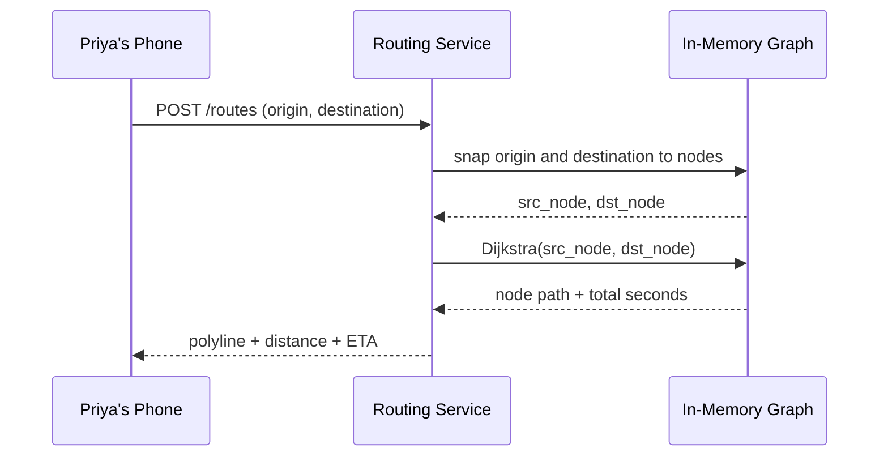

## Current state (after V0)

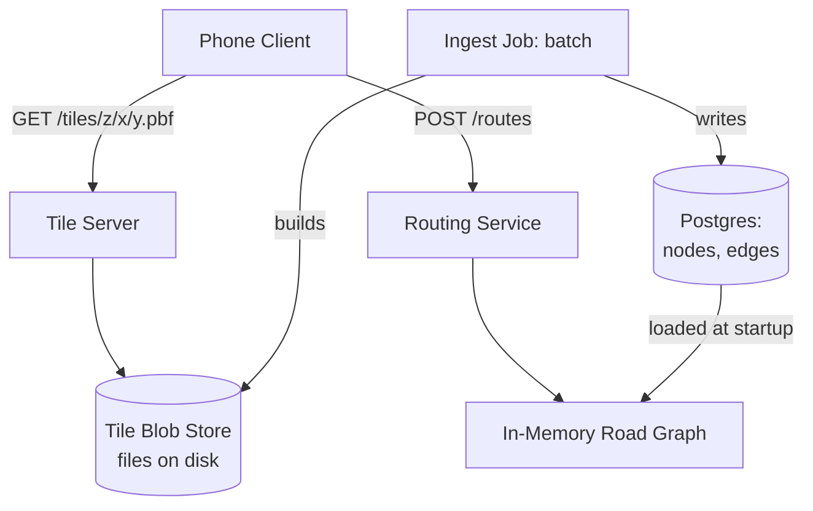

**Who writes, who reads**

| Structure | Lives in | Written by | Read by |
|---|---|---|---|
| `nodes`, `edges` tables | Postgres | Ingest Job (batch) | Routing Service (at startup only) |
| Tile files | Disk | Ingest Job (batch) | Tile Server (every tile request) |
| Adjacency list | Routing Service RAM | Routing Service (at startup) | Routing Service (every route request) |

**Every current flow**
1. **Map view:** Phone → Tile Server → Tile Blob Store → Phone.
2. **Route:** Phone → Routing Service → snap → Dijkstra on in-memory graph → polyline + ETA → Phone.
3. **Ingest (offline):** Ingest Job → Postgres tables → tile files. Server restarts reload the graph.

There is no traffic flow, no reroute, and no write path from users yet.

## Where V0 breaks

Rahul drives Hyderabad to Delhi, about 1,500 km.

Dijkstra expands outward in a circle. Before it reaches Delhi, it has settled a huge share of the nodes in between. On a national graph, that is tens of millions of nodes. That is seconds of CPU for one request.

Now add 5,000 route requests per second. One core-second each means thousands of cores. And the full graph no longer fits on one box.

The routing algorithm has to change before anything else. That is V1.

## Interview follow-ups

**Q: Why vector tiles instead of raster?**
Vector tiles are smaller and scale cleanly across zoom levels. The client can restyle or rotate them. The cost is client-side rendering work.

**Q: Why load the graph in memory instead of querying Postgres per edge?**
Dijkstra visits thousands of edges per query. A network hop per edge turns milliseconds into minutes. The graph is read-only at query time, so memory is safe.

## Recap

| Concept | The Insight |
|---|---|
| Tiles | Cut the world into a `(zoom, x, y)` grid. The client fetches only what is on screen. |
| Tile storage | A tile is an immutable blob fetched by key, so a blob store fits. |
| Road graph | Intersections are nodes. Segments are edges. Weight is travel time. |
| Ingest vs. query | Relational for batch cleaning. In-memory adjacency for fast queries. |
| V0 guarantee | Exact optimal route, with simple and fresh data. |

**Interview arc:** *"For maps, I'd start by tiling the world so clients fetch only the viewport, and by modeling roads as a graph in memory with Dijkstra. That's optimal and simple, but it explores millions of nodes on long routes and can't scale past one city, so routing needs precomputation."*

**Next (V1):** Rahul's Delhi trip takes seconds. How do we make long-distance routing fast without losing the optimal answer?


-----------------------------------------------------------------------------------------------------------------------
-----------------------------------------------------------------------------------------------------------------------
-----------------------------------------------------------------------------------------------------------------------
-----------------------------------------------------------------------------------------------------------------------


# Deep dive: Raster vs vector tiles

This is a side-dive into the "Tile Server" and "Ingest Job" boxes from V0. The routing problem for V1 is unchanged.

## Raster tiles: pre-baked pictures

A raster tile is an image. Usually it is a 256x256 or 512x512 PNG, JPEG, or WebP.

Think of a printed atlas page. Someone already decided the colors, line widths, and label fonts. You can only look at it.

**What's stored:** pixels. Roads, water, and labels are all flattened into one image.

**Where it hurts:**
- Rotate the map and the street names rotate with it, upside down.
- A phone with a sharp screen needs a 2x image, which doubles the bytes.
- Change the road color from yellow to orange and you must re-render every tile on Earth.
- Tap a building and there's nothing to tap. It's just pixels.

**Where it still wins:** satellite imagery. A photo is pixels by nature, so it stays raster even in a vector-first system.

## Vector tiles: a box of drawing instructions

A vector tile holds geometry and attributes. It holds no colors and no pixels. The phone decides how to draw.

Priya's phone gets a tile for Gachibowli. Inside are a `roads` layer, a `buildings` layer, a `water` layer, and a `places` layer. She switches to dark mode. The phone restyles the same bytes. No new download.

### What's inside a tile

The format is Mapbox Vector Tile (MVT), which is protobuf. A tile is a list of layers. A layer is a list of features.

```protobuf
message Tile  { repeated Layer layers = 3; }

message Layer {
  string          name     = 1;   // "roads", "buildings"
  repeated Feature features = 2;
  repeated string keys     = 3;   // ["class", "name", "oneway"]
  repeated Value  values   = 4;   // ["primary", "Road No. 12", true]
  uint32          extent   = 5;   // 4096
}

message Feature {
  uint64          id       = 1;   // stable id from source data
  repeated uint32 tags     = 2;   // pairs of (key idx, value idx)
  GeomType        type     = 3;   // POINT, LINESTRING, POLYGON
  repeated uint32 geometry = 4;   // encoded draw commands
}
```

Two tricks keep it small.

**Trick 1: shared property tables.** Each distinct key and value is stored once per layer. A feature says `tags: [0,0, 1,1]`, which means "key 0 = value 0, key 1 = value 1". Ten thousand roads with `class=residential` store the string once.

**Trick 2: local integer coordinates.** Inside a tile, the square is a 4096x4096 grid. A point is two integers, not two floats. Geometry is stored as draw commands with deltas.

A road from (3900, 2000) to (4160, 2065) is encoded like this:

```
MoveTo(3900, 2000)   -> command int 9,  params zigzag(3900)=7800, zigzag(2000)=4000
LineTo(+260, +65)    -> command int 10, params zigzag(260)=520,   zigzag(65)=130

geometry = [9, 7800, 4000, 10, 520, 130]
```

- The command int is `(count << 3) | id`. MoveTo is 1, LineTo is 2, ClosePath is 7.
- After the first point, each point is a delta from the previous one.
- Zigzag turns small signed numbers into small unsigned numbers. Varint then stores them in one or two bytes.

A typical dense tile ends up in the tens of KB after gzip.

### Which features appear at which zoom

A world view must not contain every alley.

| Zoom | What's in the tile |
|---|---|
| 0-5 | Countries, oceans, big cities |
| 6-9 | Motorways, major towns, rivers |
| 10-13 | Primary and secondary roads, parks |
| 14 | Everything: residential roads, buildings, POIs |

Beyond zoom 14, the client over-zooms. It stretches the z14 geometry. Since it's vector, it stays sharp.

## The hard question: how do things connect across tile edges?

Tiles are independent files. Tile A has no pointer to tile B. Yet a road that crosses the boundary must look like one road.

Here is a concrete case. A road runs from x=3900 in tile A, across the east edge at x=4096, and on to x=4300 in A's coordinate frame. Tile B is the neighbor to the east.

### Step 1: clip the geometry to the tile

The build step cuts the road at the tile edge. Tile A keeps the left piece. Tile B keeps the right piece.

### Step 2: keep a buffer, so seams never show

Cutting exactly at the edge causes two bugs.
- A thick road drawn from two separate pieces can show a thin gap at the join.
- A clipped polygon gets a fake edge along the tile border. Stroke its outline and you see a hairline grid across the map.

The fix is a buffer. Each tile keeps geometry slightly past its own border, typically 64 units of 4096.

```
        Tile A (x = 5)            |           Tile B (x = 6)
                                  |
 ------------o====================|======o----------->   road
                                  |
        A keeps up to x=4160 ---->|<---- B keeps from x=-64
                                  |
        <-- both tiles hold the overlap strip (128 units) -->
```

Real numbers, using the road's slope of 0.25:

| Tile | Local coordinates kept |
|---|---|
| A | (3900, 2000) to (4160, 2065) |
| B | (-64, 2033) to (204, 2100) |

At the shared border, A's frame is x=4096 and B's frame is x=0. Both tiles put the road at y=2049 there. The overlap strip holds the same line twice, so drawing both looks identical. The fake clip edges sit outside the visible area, so no one sees them.

### Why the two pieces agree exactly

- Both tiles start from the same source geometry.
- Both convert it onto one global integer grid first, then subtract their own tile offset. A shared point lands on the same integer in both tiles.
- Only the new points created by clipping differ. They differ by under one 4096th of a tile, which is sub-pixel.

### Step 3: simplify before clipping, never after

At low zoom we simplify geometry, for example with Douglas-Peucker. Simplify the whole road once, then clip. If you clip first and simplify each piece, the two tiles can pick different points. The road then breaks at the border.

### Polygons and big features

A building crossing a border becomes two clipped polygons, one per tile. Both carry the same feature `id`. A large lake can become a full-tile rectangle in dozens of tiles.

Polygon winding matters. Outer rings go one direction and holes go the opposite, so the renderer knows what to fill.

### Labels

- A **point** (a city name) lives in exactly one tile, the one that contains it.
- A **line label** (a street name) appears in every tile its road touches, with the same `id`.
- The client collects labels from all loaded tiles, dedupes by `id`, then runs collision detection once. The name is drawn once and is never upside down, because the client decides the placement.

### What tiles do not do

Tiles do not know connectivity. Two roads "connect" in a tile only because they share coordinates. Nobody could route on tiles.

The routing graph from V0 is a separate artifact. Both come from the same ingest, so we stamp both with the same `map_version`. A tile and a route should never come from different map versions.

## How to build the tile set

The V0 box "Ingest Job" was vague. Here is the real pipeline.

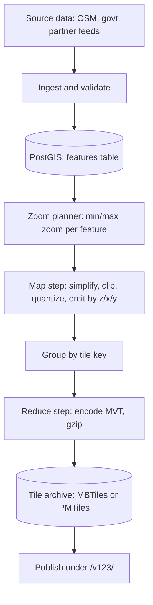

The core of the build is this loop:

```python
for f in features:                              # from PostGIS
    minz, maxz = zoom_range(f)                  # e.g. motorway: 3..14, house: 14..14
    for z in range(minz, maxz + 1):
        g = simplify(f.geom, tolerance=px_to_world(z))   # whole feature, before clipping
        for (x, y) in tiles_overlapping(bbox(g), z):
            piece = clip(g, tile_bounds(z, x, y).expand(buffer=64/4096))
            if piece:
                emit(key=(z, x, y), layer=f.layer, id=f.id,
                     tags=f.tags, geom=quantize(piece, z, x, y))

# group by key, then per tile:
#   mvt = encode_mvt(layers); write(archive, z, x, y, gzip(mvt))
```

This is a map-reduce shape. Map emits by tile key. Reduce encodes one tile.

**Parallelism.** Pick a coarse zoom such as z6. Give each worker one z6 tile and all its descendants. Workers never need each other's output.

**Storage layout.** The output goes into a tile archive, not millions of loose files.
- **MBTiles** is a SQLite file with `tiles(zoom_level, tile_column, tile_row, tile_data)`. Watch the y-axis flip. MBTiles uses TMS rows, which count from the bottom.
- **PMTiles** is one file with an index. Clients fetch tiles with HTTP range requests straight from object storage.
- Millions of tiny blobs are costly to write and list, so we pack them.
- Identical tiles, like open ocean, are stored once.

**Updates.** A road edit near Gachibowli touches a bounding box. We rebuild only the tiles that intersect it, at the zooms where that feature appears. The new tiles are published under a new version prefix such as `/v124/`. We flip the version pointer atomically. Old CDN entries are never mutated.

## Raster vs vector

| Criteria | Raster | Vector |
|---|---|---|
| Stored as | Pixels | Geometry plus attributes |
| Tile size | Larger | Smaller (gzip) |
| Restyle or dark mode | Re-render everything | Client-side, free |
| Rotate or tilt | Text rotates, blurry | Crisp, labels re-placed |
| Smooth zoom between levels | Blurry stretch | Sharp over-zoom |
| Client work | Almost none | Real rendering cost |
| Best for | Satellite photos | Street maps |

## Interview follow-ups

**Q: Why not send one big vector file for the city?**
The phone would download the whole city to look at one street. Tiles bound the bytes to the viewport and make each piece independently cacheable.

**Q: A road crosses a tile border. How does it render without a gap?**
Clip each piece with a buffer, so both tiles hold the overlap strip. Simplify before clipping, and quantize onto a global grid. Both tiles then agree on the shared points.

## Recap

| Concept | The Insight |
|---|---|
| Raster | Pre-baked pixels. Simple client, but style is frozen and bytes are heavy. |
| Vector (MVT) | Layers of features: integer geometry plus a shared property table. The client styles it. |
| Clipping and buffer | Cut at the tile edge but keep a 64-unit margin, so seams and fake edges fall outside the view. |
| Simplify, then clip | Otherwise neighboring tiles pick different points and the road breaks. |
| Tiles vs. graph | Tiles are for drawing, not routing. Both are built from one source, stamped with one `map_version`. |
| Build pipeline | Map-reduce by `(z, x, y)`, packed into MBTiles or PMTiles, published under a versioned prefix. |

**Interview arc:** *"If asked how vector tiles stay seamless: tiles are independent files, so a road crossing a border would break, and clipping alone leaves hairline seams and fake polygon edges; the fix is to simplify first, quantize to a global grid, then clip with a buffer so both tiles carry the overlap."*

**Next (V1):** back to Rahul's Hyderabad-to-Delhi route. Say "next" when you're ready.


-----------------------------------------------------------------------------------------------------------------------
-----------------------------------------------------------------------------------------------------------------------
-----------------------------------------------------------------------------------------------------------------------
-----------------------------------------------------------------------------------------------------------------------


# V1: Contraction Hierarchies

V0's Dijkstra is exact but explores a huge circle around the origin. This version makes long routes fast without giving up exactness. Live traffic stays out for now, and it is the reason V2 exists.

## Break it

Rahul drives from Hyderabad to Delhi, about 1,500 km.

On a national road graph of roughly 30M nodes, V0's Dijkstra settles tens of millions of them before it reaches Delhi. That is about 5 seconds of CPU for one request.

At 5,000 route requests per second, that is around 25,000 cores. Latency is also far past any usable budget.

The cost is in the search itself, so we can't fix it by adding machines. We need to do less work per query.

## The crux: walking the naive attempts

### Attempt 1: A* with a straight-line heuristic

*Why it looked reasonable:* Delhi is north, so why search south? A* adds "distance still to go as the crow flies" to steer the search.

*How it breaks:* Roads are not straight lines. To keep the heuristic safe (never overestimating), we must assume top speed everywhere, about 120 km/h. Real routes crawl through towns at 30 km/h. The heuristic is so optimistic it barely prunes. Bidirectional search halves the circle's area, which is still millions of nodes.

### Attempt 2: precompute every pair

*Why it looked reasonable:* Do the work once. Make queries a lookup.

Two engineers, at the whiteboard:

> **Asha:** Just store the shortest time for every (A, B) pair. Query is one read.
> **Dev:** With 30M nodes that is 30M x 30M. About 9 x 10^14 entries.
> **Asha:** ...Petabytes. And one road closure invalidates a chunk of them.

*How it breaks:* The table is too big to store and too fragile to maintain.

### Attempt 3: highways only for long trips

*Why it looked reasonable:* Humans do this. Get on the highway, stay on it, get off near the destination.

*How it breaks:* Which highway entry is best depends on the exact origin and destination. A state road shortcut sometimes beats the national highway. Rule-of-thumb routing loses the V0 guarantee of exactly optimal routes. We also can't tell when it is wrong.

The idea inside attempt 3 is still correct. Long trips do ride the important roads. We just need a way to find "important" that never loses optimality.

## Solve it: Contraction Hierarchies (CH)

**The mechanism.** Rank every node by importance. Then remove nodes one at a time, least important first. Removing a node must not change any shortest distance between the nodes that remain.

When we remove node B, anything that used to pass through B needs a replacement. We add a **shortcut** edge that jumps over it.

**Tiny example.** Road A to B costs 4 minutes. Road B to C costs 3 minutes. B is a quiet junction.

- Remove B. Add shortcut A to C with weight 7, and remember `via = B`.
- But if a direct road A to C costs 5, then removing B changes nothing. A **witness path** (the 5-minute road) already beats 7. No shortcut is needed.

Repeat until every node is removed. Each node now has a **rank**: its removal order. Dead-end lanes go first. Big highway junctions go last.

**Why queries become tiny.** Every shortest path can be reshaped to climb in rank and then descend. It goes up from the origin, peaks at one important node, then goes down to the destination.

So the query runs two searches:
- **Forward** from the origin, following only edges that go to a higher rank.
- **Backward** from the destination, following only edges that come from a higher rank.
- Wherever they meet at the lowest total cost is the answer.

Both searches climb toward the same few important nodes. They each settle a few hundred nodes, not millions.

**Analogy.** Think of airline hubs. You fly from a small town to a regional airport, then a major hub, then back down. You never search every small airport pair.

**Ordering.** We don't rank by road class. Ranking by road class is attempt 3 again. We rank by a score that measures the damage of removing a node:

`priority = (shortcuts added - edges removed) + deleted_neighbors`

Low score first. Cheap, harmless removals happen early. This ordering produces the hierarchy automatically.

### Comparing the real options

| Option | Query time | Preprocess and memory | Exact? | Fits weights that change? |
|---|---|---|---|---|
| A* / ALT landmarks | 10s of ms to seconds | Small | Yes | Yes, easily |
| Contraction Hierarchies | Around 1 ms | Minutes to an hour, about 2x edges | Yes | Poorly (V2) |
| Hub labels | Microseconds | Very large memory | Yes | Poorly |
| Transit node routing | Microseconds | Large lookup tables | Yes | Poorly |

CH is the best balance of speed, memory, and build time for this scale.

- ✅ **What we gained:** Exact optimal routes in about 1 ms, using hundreds of settled nodes instead of tens of millions. One server now handles thousands of long routes per second.
- ⚠️ **What we gave up:** Shortcut weights are frozen at preprocessing time. A traffic jam makes every shortcut passing through it wrong. A map update also needs a rebuild, which takes minutes. The index is also bigger in memory.
- ❌ **Considered and rejected:**
  - *Bidirectional A* alone:* Does not remove the circle.
  - *Hub labels:* Fastest query, but memory is too large for a first step.
  - *All-pairs table:* Petabytes.
  - *Rank by road class:* Not exact.

## Implement it

### New store: the CH index

This is not a new storage class. It is a binary file in the same tile blob store (object storage), loaded into RAM at startup.

- **Why a file and not a database:** Queries chase pointers through arrays millions of times a second. Only contiguous memory is fast enough.

**Shape.** Compact arrays (CSR layout):

```
nodes:    rank[node]                      // int32
up_fwd:   offsets[], targets[], weights[], via[]   // edges to higher rank
up_bwd:   offsets[], targets[], weights[], via[]   // reverse edges to higher rank
via[e] = -1  for an original road edge
via[e] = B   for a shortcut that skips node B
meta:     map_version = "v123"
```

**Who writes and who reads**

| Structure | Lives in | Written by | Read by |
|---|---|---|---|
| `nodes`, `edges` (unchanged) | Postgres | Ingest Job | CH Builder |
| CH index file | Blob store | CH Builder (offline) | Routing Service (at startup) |
| In-memory CH arrays | Routing Service RAM | Routing Service (load) | Routing Service (every query) |

### Build step (CH Builder, offline)

```python
def build_ch(graph):
    pq = MinHeap((priority(v), v) for v in graph.nodes)
    rank, r = {}, 0
    while pq:
        _, v = pq.pop()
        # lazy update: priority may be stale
        p = priority(v)
        if pq and p > pq.peek_priority():
            pq.push((p, v)); continue
        for (u, w_uv) in graph.in_edges(v):
            for (x, w_vx) in graph.out_edges(v):
                if u == x: continue
                via_cost = w_uv + w_vx
                # witness search: any path u->x, avoiding v, that is <= via_cost?
                if not witness(graph, u, x, avoid=v, limit=via_cost):
                    graph.add_edge(u, x, via_cost, via=v)   # shortcut
        rank[v] = r; r += 1
        graph.remove_node(v)   # edges stay recorded in the CH index
    write_ch_file(rank, all_edges_ever_created)
```

The `witness` call is a bounded Dijkstra. It is capped by `limit` and a small hop count.

### Query step (Routing Service)

`POST /routes` is unchanged. Only step 3 changes.

```python
def ch_query(s, t):
    df, db = {s: 0}, {t: 0}
    pf, pb = [(0, s)], [(0, t)]
    best, meet = INF, None
    while pf or pb:
        if min_key(pf, pb) >= best: break
        # alternate forward/backward, one pop each
        for (heap, dist, other, graph) in ((pf, df, db, up_fwd), (pb, db, df, up_bwd)):
            if not heap: continue
            d, u = heappop(heap)
            if d > dist.get(u, INF): continue
            if u in other and d + other[u] < best:
                best, meet = d + other[u], u
            for (v, w, _via) in graph.edges(u):      # only edges to higher rank
                if d + w < dist.get(v, INF):
                    dist[v] = d + w
                    heappush(heap, (d + w, v))
    return best, meet
```

**Unpacking.** The path from the meeting node contains shortcuts. Expand each one back into real roads:

```python
def unpack(u, w):
    v = via_of(u, w)
    if v == -1: return [u, w]            # real road
    return unpack(u, v)[:-1] + unpack(v, w)   # shortcut: split at via node
```

Steps for one route:

1. **Routing Service** snaps origin and destination to `src` and `dst` (unchanged).
2. It runs `ch_query(src, dst)` on the in-memory arrays. Result: `eta` and a meeting node.
3. It follows parent pointers from `src` up to `meet` and from `dst` up to `meet`.
4. It calls `unpack` on every edge to recover the real node path.
5. It builds the polyline from edge geometry (unchanged) and returns the same JSON.

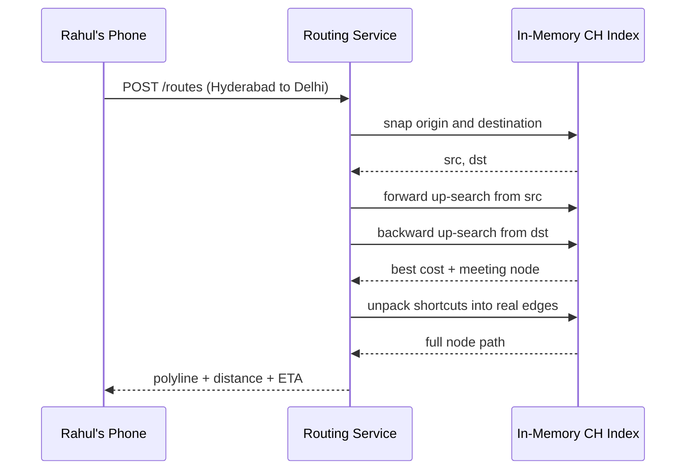

## Current state (after V1)

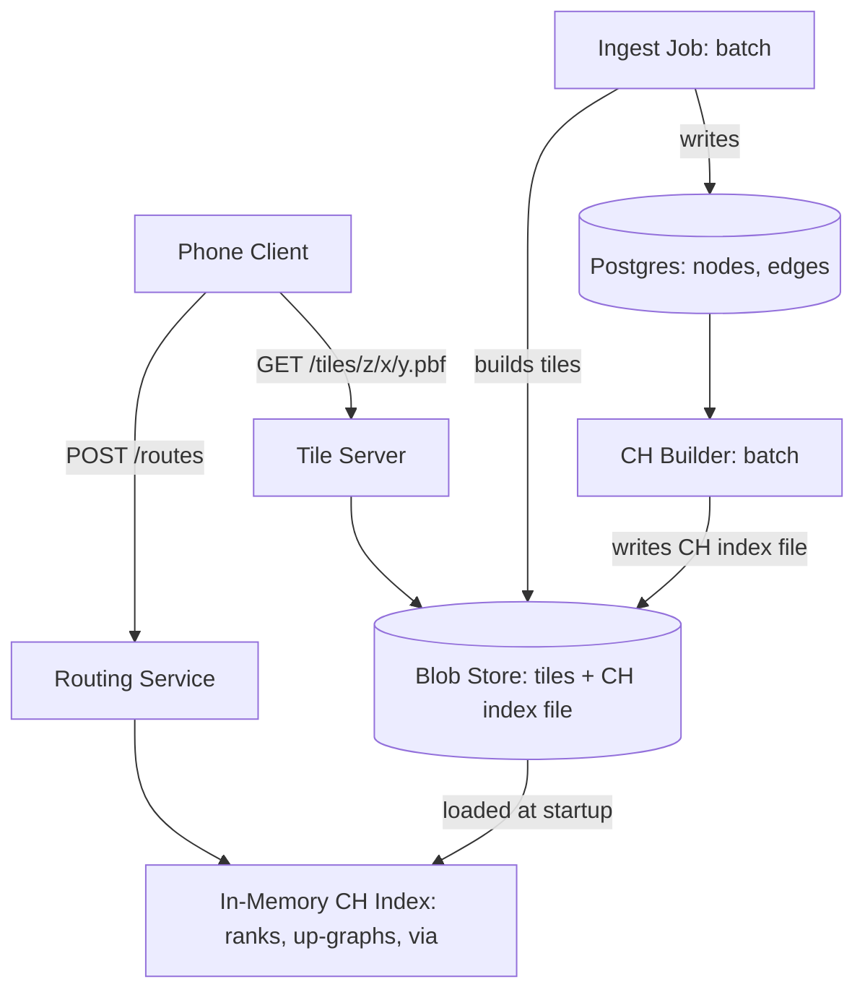

New in V1: **CH Builder**, the **CH index file** in the blob store, and the **in-memory CH index** replacing the plain adjacency list.

**Every current flow**

1. **Map view:** unchanged. Phone to Tile Server to blob store to Phone.
2. **Route:** Phone to Routing Service, snap, bidirectional upward CH search, unpack shortcuts, polyline and ETA back to Phone.
3. **Ingest (offline):** Ingest Job writes Postgres and tiles. CH Builder then reads Postgres, writes the CH index file, and both artifacts are stamped with the same `map_version`. Routing Service loads the index at startup.

Still absent: traffic data, reroute, and any user write path.

## Interview follow-ups

**Q: Why not just use A*?**
A* needs a safe heuristic. On road networks, with time weights, the only safe one is straight line at top speed, which prunes very little. CH does the work ahead of time, so queries are tiny.

**Q: How do you know contraction doesn't change the answer?**
A shortcut is added whenever no witness path is at least as short. So every removal preserves all shortest distances among the remaining nodes. The result is exact, not approximate.

## Recap

| Concept | The Insight |
|---|---|
| Why Dijkstra is slow | It explores a circle that grows with distance, so it settles millions of nodes. |
| Contraction | Remove nodes by importance. Add a shortcut only if no witness path is as short. |
| Query | Search upward from both ends. Both reach the same few important nodes. |
| Ordering | Rank by damage score, not by road class. Hierarchy emerges on its own. |
| Unpacking | Shortcuts store `via`, so we expand them back into real roads. |
| Cost | Weights are frozen at build time. Traffic will break it. |

**Interview arc:** *"If asked how you make cross-country routing fast: Dijkstra explores millions of nodes and all-pairs tables are petabytes, so I contract nodes by importance, add shortcuts only when no witness path exists, and run two upward-only searches that meet at the top, which stays exact and settles hundreds of nodes."*

**Next (V2):** it is 6 pm and Priya's Gachibowli road jams up. Every CH shortcut through it is now wrong, and a rebuild takes much longer than the jam lasts. How do we keep fast routing when weights change every minute?


-----------------------------------------------------------------------------------------------------------------------
-----------------------------------------------------------------------------------------------------------------------
-----------------------------------------------------------------------------------------------------------------------
-----------------------------------------------------------------------------------------------------------------------


# V2: Live Weights with Customizable Contraction Hierarchies

V1 made routing fast by freezing weights into shortcuts. This version makes the weights changeable without losing that speed.

Where the speeds come from (millions of phone pings) is V3. Here we assume a feed that says "edge X is now doing Y km/h" once a minute.

## Break it

It is 6:05 pm. Priya is in Gachibowli. One edge on her usual road drops from 40 km/h to 6 km/h because of a jam.

In V1, that edge's weight is baked into shortcuts. Every shortcut that jumps over it carries the old, fast number. Thousands of them depend on it, mostly high in the hierarchy.

The routing service now sends Priya straight into the jam, and the ETA is wrong.

We can rebuild V1's index, but a national CH build takes 30 to 60 minutes. The jam clears in 20. Traffic changes on millions of edges every minute, so the index would never catch up.

## The crux: walking the naive attempts

### Attempt 1: rebuild the CH every minute

*Why it looked reasonable:* V1 is exact. Just feed it fresh weights.

*How it breaks:* The expensive parts are node ordering and witness searches. Both take tens of minutes on 30M nodes. The result is already stale when it ships.

### Attempt 2: patch only the affected shortcuts

*Why it looked reasonable:* One edge changed, so touch only what depends on it.

> **Asha:** Track which shortcuts used that edge. Recompute only those.
> **Dev:** Shortcuts exist only where no witness path beat them. The jam just killed some witness paths.
> **Asha:** So new shortcuts are now needed that were never built.
> **Dev:** And when the jam clears, some shortcuts become useless. The structure itself depends on the weights.

*How it breaks:* In V1, which shortcuts exist depends on the weights. A weight change can change the shape of the index, not just its numbers.

### Attempt 3: keep CH static, apply traffic at the end

*Why it looked reasonable:* Find the route with free-flow weights, then re-price it with live speeds.

*How it breaks:* The ETA becomes correct, but the route is still wrong. It never considers the detour that is slower in free flow and faster right now. Priya gets an honest ETA for a bad road.

All three fail on one fact. V1 mixes two things together: the **shape** of the hierarchy and the **numbers** on it. We need to split them.

## Solve it: Customizable Contraction Hierarchies (CCH)

**The mechanism.** Build the hierarchy using only the map's shape, with no weights at all. Then fill in the weights as a separate, fast pass.

Think of a subway map. The lines and stations rarely change. The delay board changes every minute. V1 printed the delays onto the map. CCH keeps them on a separate board.

**Step 1: order by shape, using separators.**

Road networks have natural chokepoints: rivers with few bridges, ghats, city ring roads. A small set of nodes can split the graph into two halves. This is called a separator.

- Find a small separator S that splits the graph into halves A and B.
- Rank S highest.
- Recurse into A and B.

This is nested dissection. Important chokepoints end up at the top, the same outcome V1 got from damage scores. But it needs no weights.

**Step 2: contract with every shortcut.**

V1 skipped a shortcut when a witness path beat it. A witness depends on weights, so we can't use one. CCH adds a shortcut between every pair of higher-ranked neighbors of the removed node.

This makes the index bigger, around 2 to 3x V1's edges. In exchange, the structure is valid for any weights.

**Step 3: customize.**

Each shortcut {a, b} can be replaced by a "lower triangle": a node x ranked below both, with edges {x,a} and {x,b}. Customization walks edges bottom-up. Each edge takes the cheaper of its own weight and each triangle's sum.

Lower edges finish first, so each triangle's inputs are always ready. It is one linear pass with no searching. A national graph takes a few seconds on a multi-core box.

The **query** is unchanged: bidirectional upward search, then unpack. It reads from the new weight arrays.

### Comparing the real options

| Option | Reflect new traffic in | Query time | Exact? | Memory |
|---|---|---|---|---|
| Rebuild CH | 30-60 min | ~1 ms | Yes | 1x |
| Patch CH | Not possible, structure changes | ~1 ms | Yes | 1x |
| CCH | A few seconds | A few ms | Yes | 2-3x |
| CRP (multi-level partitions) | Under a second | Few ms to 10s of ms | Yes | Moderate |

I'm choosing CCH. It extends V1 directly, so the query code and unpacking stay the same. CRP is the main alternative, and Bing Maps uses it. It customizes faster but changes the query algorithm.

- ✅ **What we gained:** Exact routes on current weights, with updates visible within seconds. The expensive build (ordering) happens once per map version. Only the cheap pass runs every minute.
- ⚠️ **What we gave up:**
  - Queries are a few ms instead of about 1 ms.
  - The index is 2 to 3x larger.
  - Routes use current speeds for the whole trip. A 3-hour drive is priced as if the 6 pm jam lasts all three hours.
  - Every Routing Service instance now burns CPU on customization.
- ❌ **Considered and rejected:**
  - *Rebuild CH per minute:* too slow.
  - *Patch CH:* the structure itself changes with weights.
  - *Static CH plus re-pricing:* correct ETA, wrong route.
  - *Hub labels:* even harder to update than CH.

## Implement it

### New stores

**1. CCH topology file** (replaces V1's CH index file).

It lives in the blob store. It is immutable, keyed by `map_version`, and loaded into RAM. It stays a flat file for the same reason as V1: queries chase pointers through arrays.

```
topo_v123.bin
  rank[node]                            // int32
  up_offsets[], up_targets[]            // CSR of CCH edges, lower -> higher node
  cch_id[orig_edge_id]                  // which CCH edge a real road maps to
  orig_is_up[orig_edge_id]              // road direction vs. rank direction
  tri_offsets[], tri_e1[], tri_e2[], tri_x[]
      // for CCH edge e = {a,b}: lower triangles (e1={x,a}, e2={x,b}, x)
```

**2. Speed snapshot**, a dense array.

It is one byte per road edge, in km/h. Zero means "no live data, use the free-flow speed". At 70M edges that is about 70 MB. It is a blob because it is replaced whole every minute and read in full.

```
traffic/speeds_20261106T1805.bin     // uint8[num_orig_edges]
traffic/latest.json
{"snapshot":"2026-11-06T18:05Z","uri":"s3://maps/traffic/speeds_20261106T1805.bin","map_version":"v123"}
```

**3. Weight arrays**, in RAM only.

These are the customization result. They are rebuilt every minute and never persisted.

```
w_up[cch_edge], w_dn[cch_edge]       // int32 milliseconds, lower->higher and higher->lower
via_up[cch_edge], via_dn[cch_edge]   // int32, -1 = real road, else the middle node x
```

**Who writes and who reads**

| Structure | Lives in | Written by | Read by |
|---|---|---|---|
| CCH topology file | Blob store | CCH Builder (offline, per map version) | Routing Service (at startup) |
| Speed snapshot | Blob store | Traffic feed (stubbed now, built in V3) | Customizer thread in each Routing Service |
| `latest.json` pointer | Blob store | Traffic feed | Customizer thread |
| `w_up`, `w_dn`, `via_*` | Routing Service RAM | Customizer thread | Query threads (every route) |

### Build the topology (CCH Builder, offline, replaces CH Builder)

```python
def build_cch(graph):
    order = nested_dissection(graph.nodes)          # weights are never used
    rank = {v: i for i, v in enumerate(order)}
    adj = undirected_adjacency(graph)
    for v in order:                                  # lowest rank first
        higher = [u for u in adj[v] if rank[u] > rank[v]]
        for a, b in combinations(higher, 2):
            adj[a].add(b); adj[b].add(a)             # always add, no witness search
    record_edges_and_lower_triangles(adj, rank)
    write_topology_file(rank, edges, triangles)

def nested_dissection(nodes):
    if len(nodes) < 64:
        return list(nodes)
    A, B, S = balanced_separator(nodes)              # no edge joins A and B
    return nested_dissection(A) + nested_dissection(B) + list(S)   # S ranked highest
```

### Customize (runs inside each Routing Service)

Every CCH edge is stored as {lo, hi}, where `lo` is the lower-ranked endpoint. `w_up` is the cost lo to hi. `w_dn` is the cost hi to lo.

```python
def customize(topo, speeds):
    E = topo.num_edges
    w_up, w_dn = [INF] * E, [INF] * E
    via_up, via_dn = [-1] * E, [-1] * E

    for oe in topo.orig_edges:                       # seed with real roads
        kmh = speeds[oe.id] or oe.free_flow_kmh      # 0 = no live data
        ms = int(oe.length_m / (kmh / 3.6) * 1000)
        e = topo.cch_id[oe.id]
        if topo.orig_is_up[oe.id]: w_up[e] = min(w_up[e], ms)
        else:                      w_dn[e] = min(w_dn[e], ms)

    for e in topo.edges_by_lower_rank:               # bottom-up pass
        for (e1, e2, x) in topo.triangles(e):        # e1={x,lo}, e2={x,hi}
            c = w_dn[e1] + w_up[e2]                  # lo -> x -> hi
            if c < w_up[e]: w_up[e], via_up[e] = c, x
            c = w_dn[e2] + w_up[e1]                  # hi -> x -> lo
            if c < w_dn[e]: w_dn[e], via_dn[e] = c, x
    return Weights(w_up, w_dn, via_up, via_dn)
```

Because `edges_by_lower_rank` is ascending, every triangle edge was finalized earlier. The pass is parallel-friendly within a rank band.

**Swap without blocking queries.**

```python
current = AtomicReference(initial_weights)

def customizer_loop():                               # background thread, every ~60 s
    meta = http_get("s3://maps/traffic/latest.json")
    if meta.map_version != topo.map_version:  return # wrong map, keep serving old weights
    speeds = download(meta.uri)
    current.set(customize(topo, speeds))             # atomic reference swap

def handle_route(req):
    w = current.get()                                # pin one snapshot for the whole query
    return ch_query(topo, w, snap(req.origin), snap(req.destination))
```

A query pins one `Weights` object at its start. A swap mid-query cannot mix two snapshots.

### Query and unpack

The query is V1's `ch_query`, with two changes:

- The forward search reads `w_up`.
- The backward search reads `w_dn`.

Unpacking reads the `via_*` arrays, which are now rebuilt every customization. A shortcut can stop meaning "through B" and start meaning "through C" when traffic changes.

### Failure handling

- **Customization throws, or the snapshot is missing:** keep serving the previous `Weights`.
- **Snapshot older than about 10 minutes:** customize with the free-flow baseline (speeds all zero), so ETAs fall back to "typical" rather than serving stale jams.
- **Wrong `map_version`:** ignore the snapshot. A new map version needs a new topology file, which is the offline path.

### Flow C: weight update (new)

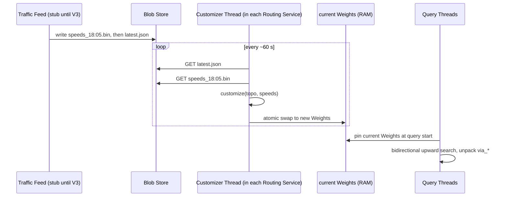

Steps for Priya:

1. 18:05: the traffic feed writes `speeds_18:05.bin`. The Gachibowli edge now reads `6`.
2. 18:05:30: each Routing Service's customizer downloads it.
3. About 3 seconds later, `customize` finishes. `w_up` and `w_dn` for that edge, and for every shortcut above it, reflect 6 km/h.
4. The new `Weights` is swapped in.
5. 18:06: `POST /routes` for Priya pins the new weights. The upward search no longer prefers the jammed edge. She gets a detour and an honest ETA.

## Current state (after V2)

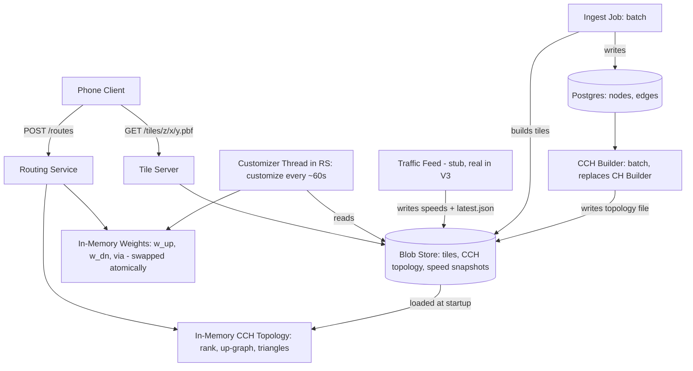

New in V2: **CCH Builder** (replaces CH Builder), the **topology** and **weights** split, the **Customizer thread**, and the **speed snapshots** with their pointer, fed by a stub **Traffic Feed**.

**Every current flow**

1. **Map view:** unchanged. Phone to Tile Server to blob store to Phone.
2. **Route:** Phone to Routing Service. It pins the current `Weights`, snaps, runs the bidirectional upward search on the CCH, unpacks shortcuts through `via_*`, and returns polyline and ETA.
3. **Ingest (offline, per map version):** Ingest Job writes Postgres and tiles. CCH Builder writes the topology file. Both are stamped with the same `map_version`.
4. **Weight update (new, every ~60 s):** Traffic Feed writes a speed snapshot and `latest.json`. Each Routing Service downloads it, customizes, and swaps the weights.

Still absent: the real source of speeds, and reroute.

## Interview follow-ups

**Q: Why not just rebuild CH more often, or on faster hardware?**
Ordering and witness search are the cost, and no amount of hardware shrinks them to seconds on a national graph. CCH moves that cost to a one-time, weight-free build. Only the cheap pass stays on the hot loop.

**Q: Isn't customizing on every Routing Service instance wasteful?**
It is a few seconds of CPU per minute per instance. That is far cheaper than shipping a multi-GB weight file to every instance each minute. The speed snapshot is only about 70 MB. Later, we can customize only the triangles above changed edges.

**Q: CCH or CRP?**
Both are exact and both separate shape from weights. CCH keeps V1's query and unpacking. CRP customizes faster, but its query is a different algorithm. At this stage, building on what V1 already has wins.

## Recap

| Concept | The Insight |
|---|---|
| Why V1 breaks | It bakes weights into shortcut existence, so any traffic change can alter the structure. |
| Split shape from numbers | Order and contract using topology only. Weights become a swappable array. |
| Nested dissection | Rank small separators highest, so the order needs no weights. |
| Customization | One bottom-up pass over lower triangles takes seconds, not tens of minutes. |
| Atomic swap | Queries pin one weights object, so no query sees a half-updated state. |
| Cost | Bigger index, slightly slower queries, and routes use current speeds for the whole trip. |

**Interview arc:** *"If asked how you route on live traffic: a CH rebuild takes an hour and a patch can't work because witness-based shortcuts depend on weights, so I build the hierarchy from topology only with nested dissection, keep every shortcut, and re-run a linear bottom-up customization pass every minute, which keeps routes exact and updates visible in seconds."*

**Next (V3):** the speed feed was a stub. Millions of phones send a GPS dot every few seconds, and a dot is not an edge. How do we turn that firehose into per-road speeds every minute?


-----------------------------------------------------------------------------------------------------------------------
-----------------------------------------------------------------------------------------------------------------------
-----------------------------------------------------------------------------------------------------------------------
-----------------------------------------------------------------------------------------------------------------------


# V3: Turning GPS Dots into Road Speeds

V2 assumed a feed that says "edge X is doing Y km/h". This version builds that feed. Reroute stays out until V4.

## Break it

It is 6:05 pm. Priya's phone reports `(17.4401, 78.3489)` with 15 m accuracy. Five million other phones are reporting too.

At one ping every 5 seconds, that is about **1M pings per second**. A database write per ping is out of the question, so the data has to flow through a stream.

The harder problem is that a ping is a dot, not an edge. Near Gachibowli, a flyover runs 12 m above a service road. The flyover moves at 50 km/h while the service road crawls at 6 km/h.

GPS error is 15 m, which is bigger than the 12 m gap. Snap each dot to the nearest road and it is a coin flip which one gets the credit. The flyover cars make the jammed service road look free. Or the reverse.

Priya would be sent into the jam by a feed that looked healthy.

## The crux: walking the naive attempts

The crux of the whole design is routing on changing weights. This version is the quality gate for those weights. Wrong speeds make V2's exact algorithm exactly wrong.

### Attempt 1: snap each ping to the nearest edge, average the phone's own speed

*Why it looked reasonable:* It is one spatial lookup per ping, with no state.

> **Asha:** Nearest edge, average the speed field, done.
> **Dev:** Look at the flyover. The nearest edge flips between two roads from one ping to the next.
> **Asha:** So the same car is on both roads in the same minute.

*How it breaks:* Parallel roads, GPS error, and urban canyons make a single dot ambiguous. Each ping is judged alone, so nothing ties it to the previous one.

### Attempt 2: speed from the distance between two consecutive pings

*Why it looked reasonable:* It needs no phone-reported speed. Distance over time is physics.

*How it breaks:* A car stopped at a red light jitters 10 m per ping, which becomes a phantom 7 km/h. Pings 5 seconds apart on a curved road undercount the distance. And it still doesn't say which edge the car was on.

### Attempt 3: mean speed of all pings per edge per minute

*Why it looked reasonable:* More samples smooth the noise.

*How it breaks:* One edge sees one motorbike weaving at 70 km/h, and the mean says there is no jam. An edge with a single sample jumps wildly. A wrong match drags the mean far off. We also have no minimum crowd size, which is both a quality problem and a privacy problem.

What all three miss: **a car's trajectory is a connected path.** Look at the whole path, not each dot.

## Solve it: HMM map matching, then robust per-edge aggregation

**The mechanism.** For each device, look at a short run of consecutive pings. Pick the one road path that best explains all of them together.

A road is a good explanation if it is close to the dots. A path is a good explanation if its length matches how far the car actually moved. A car that moved 80 m in a straight line did not drive 900 m of road to get there.

This is a Hidden Markov Model, solved with the Viterbi algorithm. It is the Newson and Krumm approach.

- **Emission:** how likely is this dot, given the car is on this candidate edge? Closer is likelier.
- **Transition:** how likely is moving from candidate A to candidate B? It is likelier when route distance is close to straight-line distance.

On the flyover, the service-road candidate would need a long ramp detour to connect to the next dot. The transition term makes that path unlikely, so the flyover wins.

**Then aggregation.** Matching tells us which edges each trip crossed and when. For each fully crossed edge we get a travel time. Per edge, per minute:

- Require at least 3 distinct devices.
- Take the median speed, not the mean.
- Blend with the previous value (EWMA).
- If no data arrives for 10 minutes, drop back to free-flow.

**Analogy.** Connect-the-dots. One dot can belong to many pictures. The whole sequence only fits one.

### Comparing the real options

| Option | Handles parallel roads | Handles sparse pings | Cost | Verdict |
|---|---|---|---|---|
| Nearest-edge snap | No | n/a | Tiny | Rejected |
| Heading-aware snap | Partly | No | Small | Rejected |
| HMM / Viterbi on a window | Yes | Yes | Moderate, per device state | Chosen |
| On-phone matching | Yes | Yes | Phone battery, privacy gain | Possible later, hard to trust |

- ✅ **What we gained:** Speeds attached to the right road. A robust per-edge number with a built-in minimum crowd. The output is exactly V2's speed snapshot, so nothing downstream changes.
- ⚠️ **What we gave up:**
  - Matching needs per-device state and a bounded search per ping.
  - Latency: pings are batched and windowed, so speeds trail reality by about 1 to 2 minutes.
  - Rural edges rarely get 3 devices, so they stay at free-flow.
  - A new privacy surface: we now hold location trails.
- ❌ **Considered and rejected:**
  - *Nearest-edge snap:* the flyover problem.
  - *Mean aggregation:* outliers and wrong matches dominate.
  - *Per-ping DB writes:* 1M/s is the wrong shape for a database.
  - *Store raw pings forever:* a privacy liability with no routing value.
  - *Historical speed predictions per time-of-week:* useful for long trips, but it is a separate feature (see V2's "priced as if the jam lasts all trip").

## Implement it

### New stores

**1. Pings log.** This is a Kafka topic named `pings`.

A log fits because pings are append-only and must be consumed in order per device. We also need replay if a consumer crashes. A relational table would force a write per ping.

```json
POST /v1/locations
{
  "device": "d_8f3a9c",
  "points": [
    {"lat": 17.44012, "lon": 78.34890, "ts": 1793988310, "acc_m": 15, "kmh": 6},
    {"lat": 17.44021, "lon": 78.34895, "ts": 1793988315, "acc_m": 12, "kmh": 7}
  ]
}
```

The phone batches about 6 points per request, so the API sees about 170K requests/s, not 1M.

**Privacy rules, applied at the API:**
- `device` is an anonymous id that rotates every trip.
- The first and last 500 m of each trip are dropped, so home and work don't leak.
- Raw pings expire from Kafka in 24 hours.

**2. Traversals log.** Kafka topic `edge_traversals`, keyed by `edge_id`.

```json
{"edge_id": 55120387, "device": "d_8f3a9c", "enter_ts": 1793988311, "exit_ts": 1793988342, "map_version": "v123"}
```

**3. Speeds log.** Kafka topic `edge_speeds`, keyed by `edge_id`.

```json
{"edge_id": 55120387, "kmh": 6, "n_devices": 7, "window_end": 1793988360}
```

**4. Matcher state.** It lives in the Map Matcher's keyed state, per device. It holds the last few pings and candidates, and is discarded after 5 minutes of silence.

**5. Speed snapshot.** This is V2's `speeds_<ts>.bin` and `latest.json`, unchanged in shape. The stub is replaced by a real writer.

**Who writes and who reads**

| Structure | Lives in | Written by | Read by |
|---|---|---|---|
| `pings` topic | Kafka | Location Ingest API | Map Matcher |
| Per-device window state | Map Matcher memory, checkpointed | Map Matcher | Map Matcher |
| `edge_traversals` topic | Kafka | Map Matcher | Edge Aggregator |
| `edge_speeds` topic | Kafka | Edge Aggregator | Snapshot Writer |
| `speeds_<ts>.bin`, `latest.json` | Blob store | Snapshot Writer | Customizer threads (V2) |

### Step 1: ingest (Location Ingest API)

1. Phone sends `POST /v1/locations` every ~30 s.
2. The API validates the payload. Malformed or out-of-range points go to a dead-letter topic, `pings_dlq`.
3. It drops points with `acc_m > 30`.
4. It trims trip start and end for privacy.
5. It produces to `pings` with key `device`, so one device always lands on one partition and stays ordered.

### Step 2: match (Map Matcher)

The matcher holds an in-memory grid index of edges, built from the same `map_version` as the CCH topology. It consumes `pings` and processes each device's window.

```python
def match(pings, idx, graph):
    layers = []
    for p in pings:
        cands = idx.edges_within(p.lat, p.lon, radius_m=50, k=5)
        layers.append([(c, -0.5 * (c.dist_m / 10.0) ** 2) for c in cands])   # emission, sigma=10m

    score = [dict((c.id, e) for c, e in layers[0])]
    back  = [{}]
    for i in range(1, len(pings)):
        gc = haversine(pings[i-1], pings[i])
        score.append({}); back.append({})
        for c, e in layers[i]:
            best, arg = -inf, None
            for pc, ps in score[i-1].items():
                rd = bounded_route_dist(graph, pc, c.id, limit=2 * gc + 200)
                if rd is None: continue
                s = ps - abs(gc - rd) / 5.0 + e                               # transition, beta=5m
                if s > best: best, arg = s, pc
            if arg is not None:
                score[i][c.id], back[i][c.id] = best, arg
    return backtrack(score, back)
```

Then it turns the matched path into traversals:

```python
def to_traversals(path, pings):
    out = []
    for edge in path.fully_crossed_edges():          # entered AND exited inside the window
        t_in  = interpolate_time(path, pings, edge.start_offset)
        t_out = interpolate_time(path, pings, edge.end_offset)
        out.append(Traversal(edge.id, t_in, t_out))
    return out
```

Partly crossed edges are skipped. A trip's first and last edge would otherwise look artificially fast or slow.

6. The matcher produces each traversal to `edge_traversals` with key `edge_id`.

Keying by `edge_id` means all observations for one road land at one aggregator, which is what the median needs.

### Step 3: aggregate (Edge Aggregator)

It uses 60-second tumbling windows on event time. It waits 30 s after window end for late batches, because phones batch pings. Later arrivals are dropped.

```python
def on_window_close(edge_id, obs):               # obs: [(device, enter_ts, exit_ts)]
    obs = dedupe(obs, key=lambda o: (o.device, o.enter_ts))     # at-least-once safety
    if len({o.device for o in obs}) < 3:
        return                                   # too few cars: stay free-flow
    kmh = sorted(length_m[edge_id] / (o.exit_ts - o.enter_ts) * 3.6 for o in obs)
    med = kmh[len(kmh) // 2]
    prev = state.get(edge_id)
    smooth = med if prev is None else 0.5 * med + 0.5 * prev   # EWMA
    state[edge_id] = smooth
    produce("edge_speeds", key=edge_id,
            value={"edge_id": edge_id, "kmh": clamp(round(smooth), 1, 255),
                   "n_devices": len({o.device for o in obs}), "window_end": window_end})
```

A speed of `1` is the minimum, because V2 reserves `0` for "no live data".

### Step 4: publish the snapshot (Snapshot Writer)

It is one process that holds the dense array in RAM.

```python
speeds   = np.fromfile(last_snapshot, dtype=np.uint8)     # reload on restart
last_upd = np.zeros(NUM_EDGES, dtype=np.uint32)

while True:                                               # every 60 s
    for m in drain("edge_speeds"):
        speeds[m.edge_id], last_upd[m.edge_id] = m.kmh, m.window_end
    speeds[now() - last_upd > 600] = 0                    # stale for 10 min: free-flow
    upload(f"traffic/speeds_{ts}.bin", speeds)            # data first
    upload("traffic/latest.json", pointer_to(ts))         # pointer last
```

The write order matters. A Customizer reading `latest.json` never sees a pointer to a file that isn't there yet.

### Flow D: ping to speed

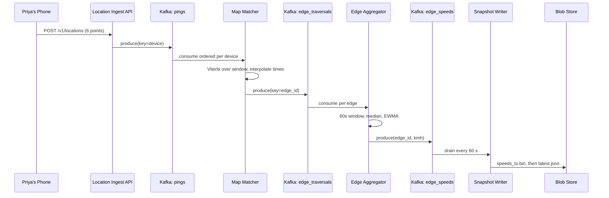

Priya's case: the matcher puts her on the service road, not the flyover, because the flyover path would need a 900 m ramp detour. Seven cars cross that edge in the minute. The median is 6 km/h. At 18:06 the snapshot says `6`, and V2's customizer picks it up.

## Current state (after V3)

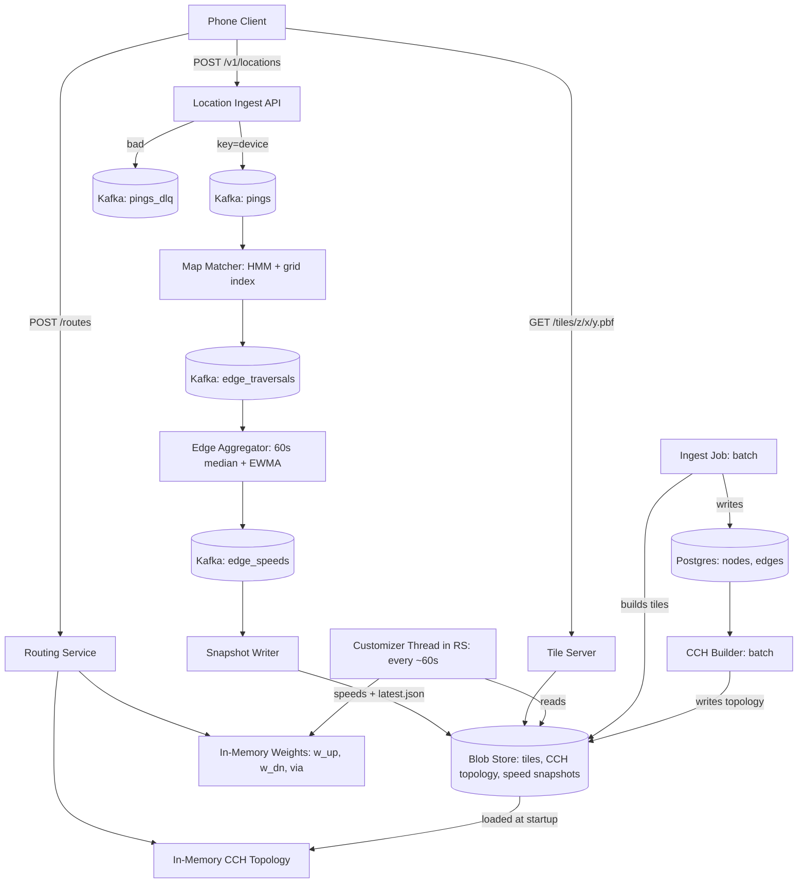

New in V3: the whole traffic pipeline: **Location Ingest API**, the three Kafka topics plus the DLQ, **Map Matcher**, **Edge Aggregator**, and **Snapshot Writer**. They replace V2's stub Traffic Feed.

**Every current flow**

1. **Map view:** unchanged. Phone to Tile Server to blob store to Phone.
2. **Route:** unchanged. Phone to Routing Service, pin current `Weights`, bidirectional upward search, unpack, polyline and ETA.
3. **Ingest (offline, per map version):** unchanged. Postgres, tiles, CCH topology file, all stamped with one `map_version`.
4. **Weight update (every ~60 s):** unchanged from the Customizer's side. It now reads a real snapshot.
5. **Traffic ingest (new, continuous):** Phone to Location Ingest API to `pings` to Map Matcher to `edge_traversals` to Edge Aggregator to `edge_speeds` to Snapshot Writer to blob store.

Still absent: reroute when a user leaves the route.

## Interview follow-ups

**Q: Why HMM and not just snap to the nearest road?**
One dot is ambiguous when roads are parallel and GPS error exceeds the gap. A trajectory is not. The transition term says the route length must match the distance moved, so the wrong parallel road loses.

**Q: What if pings arrive late or twice?**
Event-time windows with a 30 s grace period absorb phone batching. Late arrivals beyond that are dropped. Producers are at-least-once, so the aggregator dedupes by `(device, enter_ts)`.

**Q: Why require 3 devices per edge?**
It stops a single odd driver from setting a road's speed. It is also a basic anonymity floor: no published speed is traceable to one phone.

## Recap

| Concept | The Insight |
|---|---|
| A ping is not an edge | Nearest-road snapping fails on parallel roads, so match whole trajectories. |
| HMM map matching | Emission scores closeness. Transition scores route length against distance moved. Viterbi picks the best path. |
| Fully crossed edges only | Partial edges at the window boundary give fake speeds. |
| Median, 3 devices, EWMA | Robust to outliers and wrong matches, with a built-in crowd floor and smooth changes. |
| Key by device, then by edge | Matching needs one device's ordered trail. Aggregation needs one edge's observations. |
| Same output as V2 | The pipeline's result is the existing speed snapshot, so routing didn't change. |

**Interview arc:** *"If asked how you get live traffic from phones: a ping is a noisy dot, so nearest-road snapping puts flyover cars on the service road and averaging lets outliers decide, so I map-match whole trajectories with an HMM, keep only fully crossed edges, take a per-minute median with at least three devices, and publish it as the same speed snapshot the router already consumes."*

**Next (V4):** Priya misses the turn near Hi-Tech City. Her phone says "recalculating", and so do 200,000 other navigating phones. How do we handle reroutes without every deviation becoming a full route search?


-----------------------------------------------------------------------------------------------------------------------
-----------------------------------------------------------------------------------------------------------------------
-----------------------------------------------------------------------------------------------------------------------
-----------------------------------------------------------------------------------------------------------------------


# V4: Reroute When the User Leaves the Route

V3 gave us live speeds. This version handles the moment a navigating user stops following the route. Scaling the routing fleet for reroute bursts is deliberately left to V5.

## Break it

Priya is navigating to Charminar. Her route says "turn left at Hi-Tech City". She is on the flyover and misses it. Her phone keeps showing the old polyline.

Today, nothing detects this. Even if she tapped "recalculate", V0 to V3 would call `POST /routes` with her raw position. That call snaps to the nearest node, which fails in two concrete ways.

- **Wrong road.** She is on the flyover at 50 km/h. The nearest node is on the service road 12 m below. GPS error is 15 m, so the router plans from a road she can't reach.
- **Wrong direction.** The nearest node is 40 m behind her. The new route opens with "make a U-turn", on a flyover with no U-turn.

Now add scale. Around 5M phones are navigating at once. If each deviates once every 20 minutes, that is about 4K reroutes per second. A closed flyover exit at 6:20 pm makes 200K phones deviate within seconds. That burst is a capacity problem, and it is V5's job.

For this version, one question matters: who notices she left the route, and from where exactly should the new route start?

## Solve it: client-side detection, stateless server reroute

**The mechanism.** The phone already has the whole polyline. It checks every GPS fix against it. When Priya is off the route for 3 fixes in a row, the phone asks the server for a new route. The request carries her destination and her last few fixes, so the server never needs to remember her.

**Analogy.** A passenger with a paper map notices the missed exit first. They then tell the driver "route me from here", and don't phone a dispatcher who has been watching a dot on a screen.

**Where the new route starts.** She is mid-edge, moving forward. She can't turn onto the next road until she reaches the end of the edge she is on. So the search starts from that edge's *head node*, and the remaining edge time is added to the ETA.

### Comparing the real options

| Option | Detection speed | Server state | Handles flyover/U-turn | Verdict |
|---|---|---|---|---|
| Server detects from the V3 ping stream | 30 s+ (batched, trimmed) | Per-session | Yes | Rejected |
| Server-side nav session | Fast | Sticky, lost on failover | Yes | Rejected |
| Client detects, stateless reroute | 3 s | None | Yes, with trajectory | Chosen |
| Client re-requests on a fixed timer | Slow | None | No | Rejected |

- ✅ **What we gained:** Reroute within about 3 to 5 seconds. Any Routing Service instance can answer, because requests are self-contained. No session state for 5M navigators.
- ⚠️ **What we gave up:**
  - The phone runs detection logic and holds route state.
  - GPS jitter can trigger false reroutes, so we need tolerances.
  - Turn restrictions at the head node are ignored for now. A turn-aware (edge-based) search is a later refinement.
  - Retries during a bad moment can pile onto an already-hot server.
- ❌ **Considered and rejected:**
  - *Server detects from V3's ping stream:* pings are batched every ~30 s and trimmed at trip ends. A missed turn must be fixed in seconds.
  - *Server-side session per navigator:* sticky routing, 5M live objects, state lost on every crash.
  - *Nearest-node snap:* the flyover and U-turn bugs above.
  - *Proactive "faster route available" rerouting:* a different trigger, so it is a separate feature.

## Implement it

### New state, and where it lives

There is no new store. Nothing is added to Postgres, Kafka, or the blob store.

| State | Lives in | Written by | Read by |
|---|---|---|---|
| Active route (polyline, `route_id`, `destination_node`) | Phone RAM | Phone, from the `/routes` response | Phone's off-route detector |
| Off-route counter, in-flight flag, retry timer | Phone RAM | Phone | Phone |
| Last 5 GPS fixes | Phone RAM | Phone | Phone, sent with each reroute |
| Grid edge index | Routing Service RAM | Routing Service at startup, per `map_version` | Directed snap |

**One change to V1's response.** `POST /routes` now also returns `route_id` and `destination_node`. The phone sends them back, so the reroute skips destination snapping.

### Step 1: detect off-route (phone, every GPS fix)

```python
def on_gps_fix(fix, route, st):
    seg, dist_m, along_m = project_onto_polyline(fix, route.polyline, hint=st.seg)
    tol = max(30.0, 2.0 * fix.acc_m)
    heading_ok = fix.speed_mps < 2 or angle_diff(fix.heading, route.bearing_at(seg, along_m)) < 70
    if dist_m <= tol and heading_ok:
        st.seg, st.misses = seg, 0              # on route
        return
    st.misses += 1
    if st.misses >= 3 and not st.inflight:      # 3 bad fixes in a row, one request at a time
        st.inflight = True
        send_reroute(fix, route, st)
```

Three misses in a row, with a tolerance tied to GPS accuracy, stops a tunnel jitter from triggering a reroute. The `hint` keeps projection cheap by searching near the last matched segment.

### Step 2: the request

`POST /routes/reroute`

```json
{
  "route_id": "r_91c2",
  "reroute_seq": 1,
  "recent_fixes": [
    {"lat": 17.4452, "lon": 78.3811, "ts": 1793989200, "acc_m": 9, "kmh": 52, "heading": 18},
    {"lat": 17.4455, "lon": 78.3812, "ts": 1793989201, "acc_m": 9, "kmh": 51, "heading": 18}
  ],
  "destination_node": 4410029381,
  "mode": "driving"
}
```

(The request carries 5 fixes, 2 shown.) `reroute_seq` lets the phone discard a late reply to an older request.

### Step 3: reroute (Routing Service, stateless)

1. Pin the current `Weights` (V2, unchanged).
2. Run V3's `match()` over `recent_fixes`, as a library call. The trajectory settles the flyover versus service road question, exactly as in V3. Edges that run opposite to her heading are dropped when speed is above 2 m/s.
3. Take the last matched `(edge, offset_m)`.
4. Set `src = edge.to_node` and `lead_ms = (edge.length_m - offset_m) / speed`.
5. Run V2's `ch_query(src, destination_node)` on the pinned weights, then unpack.
6. Prepend the partial edge geometry from her position to `src`. Add `lead_ms` to the ETA.

```python
def handle_reroute(req):
    w = current.get()
    path = match(req.recent_fixes, grid_idx, graph)        # V3 code, reused
    edge, offset = path.last_edge_and_offset()
    lead_ms = (edge.length_m - offset) / max(req.recent_fixes[-1].kmh / 3.6, 1.0) * 1000
    best, meet = ch_query(topo, w, edge.to_node, req.destination_node)
    nodes = unpack_path(topo, w, meet)
    return {
        "route_id": new_id(),
        "eta_seconds": round((best + lead_ms) / 1000),
        "polyline": encode(partial_geom(edge, offset) + geom(nodes)),
        "destination_node": req.destination_node,
    }
```

If `match()` finds nothing (for example in a tunnel with no good candidates), fall back to the nearest edge within 50 m. If that also fails, return `422`.

### Step 4: failure handling (phone)

- **One in flight.** A second reroute is never sent while the first is pending.
- **Timeout 2 s, then retry** with exponential backoff and full jitter: `sleep(random(0, min(8, 2**attempt)))`.
- **Keep the old route** drawn with "Rerouting..." until a reply arrives.
- **Reply is stale** (`reroute_seq` older than the last sent): drop it.
- **Reply arrives but she is on the old route again** (she made a late turn): drop it and clear the state.
- **Server rate limit:** the server returns `429` with `Retry-After` if one device sends more than 1 reroute per 3 s.

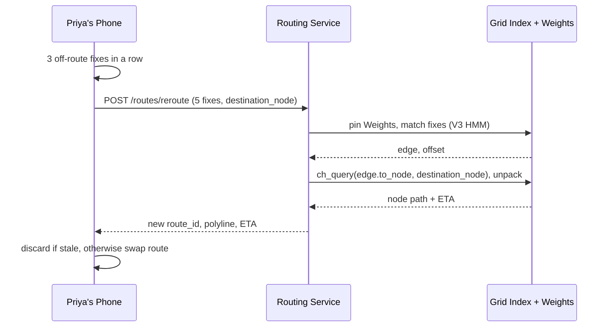

## Current state (after V4)

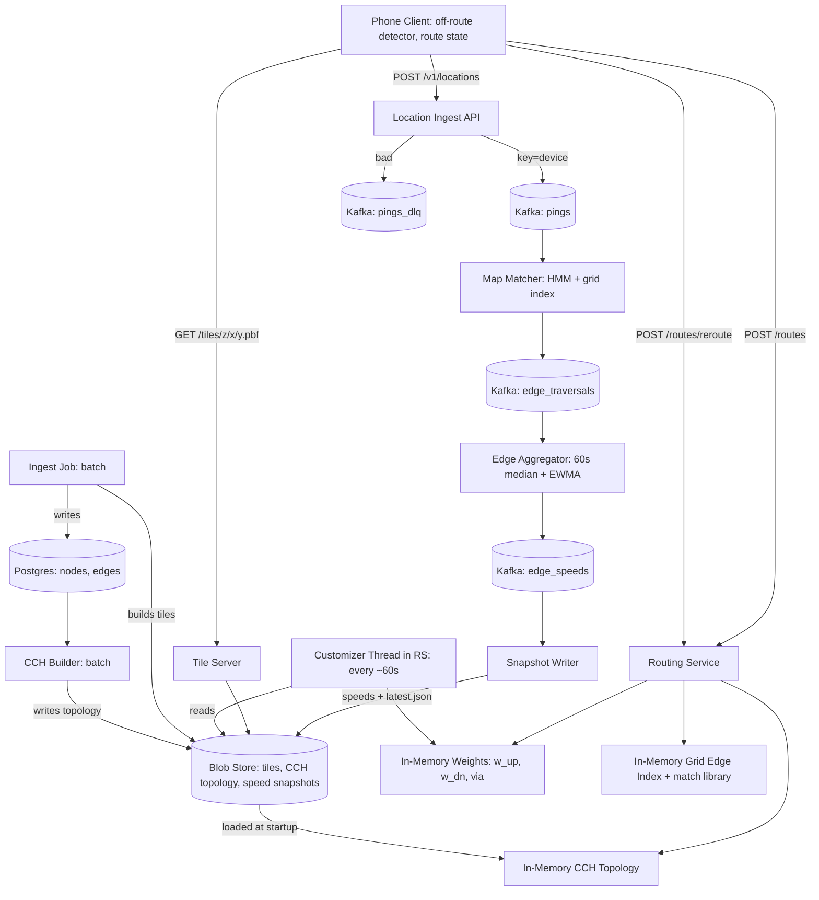

New in V4: the **off-route detector and route state on the phone**, the **`/routes/reroute` endpoint**, and the **grid index and match library inside the Routing Service**, reusing V3's matcher code.

**Every current flow**

1. **Map view:** unchanged. Phone to Tile Server to blob store to Phone.
2. **Route:** Phone to Routing Service, pin `Weights`, snap, bidirectional upward search, unpack. The response now also carries `route_id` and `destination_node`.
3. **Ingest (offline, per map version):** unchanged. Postgres, tiles, CCH topology, one `map_version`.
4. **Weight update (every ~60 s):** unchanged. Customizer downloads the snapshot and swaps `Weights`.
5. **Traffic ingest (continuous):** unchanged. Phone to Location Ingest to `pings` to Map Matcher to `edge_traversals` to Edge Aggregator to `edge_speeds` to Snapshot Writer to blob store.
6. **Reroute (new):** Phone detects 3 off-route fixes, sends `/routes/reroute` with 5 fixes and `destination_node`. Routing Service matches the fixes, starts CCH from the edge's head node, and returns a new polyline and ETA.

Still absent: scaling the Routing Service for bursts, and anything beyond one `map_version` in one place.

## Interview follow-ups

**Q: Why detect off-route on the phone and not on the server?**
The phone has the polyline and a 1 Hz GPS signal, so it notices within about 3 seconds. The server's view is the V3 ping stream, which is batched, trimmed, and anonymous per trip. Server-side detection would also need a session per navigator.

**Q: Why start the search at the edge's head node and not at the nearest node?**
She is mid-edge and moving forward. The nearest node may be behind her or on a different level. The only place she can actually change roads is the end of her current edge, so we start there and add the remaining time.

## Recap

| Concept | The Insight |
|---|---|
| Who detects | The phone, because it holds the polyline and a 1 Hz fix stream. |
| Off-route rule | Distance beyond a tolerance tied to GPS accuracy, 3 fixes in a row, plus a heading check. |
| Stateless reroute | Each request carries destination and recent fixes, so any instance can answer. |
| Directed start | Match a short trajectory to find the edge, then route from its head node plus leftover time. |
| Reuse V3 | The HMM matcher is a library, so the flyover problem is solved once. |
| Retry safely | One in flight, 2 s timeout, backoff with jitter, drop stale replies. |

**Interview arc:** *"If asked how you handle a missed turn: nearest-node snapping puts her on the wrong level or behind her, and server-side detection is too slow and needs sessions, so the phone detects three off-route fixes and sends its destination and last few fixes to a stateless endpoint, which map-matches them and routes from the head of her current edge."*

**Next (V5):** the 6:20 pm flyover closure sends 200K reroutes in five seconds, about 40K QPS at the Routing Service. Each instance holds a multi-GB graph in RAM. How do we scale the routing fleet horizontally?


-----------------------------------------------------------------------------------------------------------------------
-----------------------------------------------------------------------------------------------------------------------
-----------------------------------------------------------------------------------------------------------------------
-----------------------------------------------------------------------------------------------------------------------


# V5: Scaling the Routing Fleet

V4 made reroute stateless. This version turns that into a fleet of identical Routing Service instances behind a load balancer. The Tile Server is also still one box. That is a caching problem, so it waits for V6. Splitting the graph across machines is not needed yet, and I'll say why below.

## Break it

It is 6:20 pm. A flyover exit closes. 200K navigating phones go off-route within 5 seconds. That is **40K reroutes per second** hitting one Routing Service.

A reroute costs about 5 ms of CPU: the HMM match plus a CCH query. A 16-core box serves about 3,000 QPS. That is 13x short.

- In 5 seconds, 200K requests arrive and about 15K are served. The queue holds 185K.
- The last request in that queue waits over a minute.
- V4's phones time out at 2 seconds and retry. The retries add to the backlog, so the load grows while the server falls behind.

Adding a second box mid-burst doesn't help. A fresh instance must download about 8 GB of topology, parse it, and run its first customization. That takes 60 to 90 seconds.

Meanwhile, one instance also means one crash takes routing down for everyone.

## Teach: vertical vs. horizontal

**Vertical scaling** means a bigger machine. A 96-core box serves about 18K QPS.

- It has a cost ceiling.
- It is still one machine, so a crash or deploy means downtime.
- Even 18K QPS is under half of 40K.

**Horizontal scaling** means more machines doing the same job. There is no hard ceiling. It only works if any machine can answer any request.

So what state would a Routing Service instance hold locally?

| Local state | Can replicas hold identical copies? |
|---|---|
| CCH topology (about 8 GB) | Yes. It is immutable and keyed by `map_version`. |
| Grid edge index | Yes. It is immutable. |
| `Weights` (w_up, w_dn, via) | Yes, within about a minute. Each instance builds them from the same snapshot. |
| Per-user session | None. V4 removed it. |

Nothing has to move out of the servers. V4's choice of a client-driven reroute with a stateless request is what makes this version cheap.

The graph fits in one machine's RAM, so every replica holds the whole graph. We don't shard it. Sharding makes a route that crosses shards a distributed problem. That only pays off at planet scale, so it waits for the multi-region version.

## Solve it: stateless replicas behind an L7 load balancer

Many identical instances sit behind a load balancer. Three things need decisions: the balancing algorithm, how to handle bursts, and how to roll out new map versions.

### The load balancing algorithm

Request cost varies a lot. A 2 km reroute settles tens of nodes. Hyderabad to Delhi settles hundreds.

| Algorithm | What it optimizes | What it breaks here |
|---|---|---|
| Round robin | Simplicity | Equal count is not equal work, so one instance can pile up long queries. |
| Hash by origin region | Cache locality | Hot regions overload one instance. Only useful once there is a cache (V6). |
| Least outstanding requests, power of two choices | Balances actual work in flight | Needs per-instance in-flight counters. The LB already has them. |

I'm choosing **power of two choices on least outstanding requests**. Pick 2 instances at random, send to the one with fewer in-flight requests. It is nearly as good as a global least-loaded choice and needs no shared state.

### The burst, as a known sub-problem

The fixes for a sudden spike, each with a sketch:

1. **Headroom.** Run more instances than steady state needs. It is simple, but costs RAM around the clock.
2. **Autoscale.** Add instances when load rises. It is cheap, but the 60 to 90 s cold start means it can't catch a 5 s burst.
3. **Shed load.** Reject excess work quickly with `503` and `Retry-After`. Protect the instances so they keep serving at full speed.

Steady load is about 10K QPS, so about 5 instances. I'm combining all three:

- **Headroom:** a baseline of 12 instances, about 26K QPS.
- **Autoscale:** target 24 instances at peak, scaled on in-flight count, because it leads CPU.
- **Shed:** the shortfall of about 14K QPS for 5 seconds is shed with a jittered `Retry-After`. Those phones come back spread over several seconds, as V4's backoff intends.

A reroute is a driver who just missed a turn. A new route is someone about to leave. Under overload, reroutes get priority.

- ✅ **What we gained:** Capacity that grows with instance count. No single point of failure. Rolling deploys with zero downtime. Overload degrades into slower reroutes instead of a collapse.
- ⚠️ **What we gave up:**
  - Replicas can hold `Weights` from different snapshots for up to about a minute, so two near-identical requests can return slightly different ETAs.
  - Each instance pays 8 GB of RAM, plus a second `Weights` copy during a swap.
  - Customization uses CPU on every instance, so it must run at low priority.
  - Some phones see a reroute take 5 to 10 s during an extreme burst.
- ❌ **Considered and rejected:**
  - *Vertical scaling:* ceiling, and still a single point of failure.
  - *Sharding the graph by region:* not needed while the graph fits in RAM, and it makes cross-region routes harder.
  - *Round robin:* ignores the cost spread between short and long queries.
  - *Autoscale alone:* the cold start is longer than the burst.
  - *Per-user sticky routing:* there is no session to stick to.

## Implement it

### New components and where they live

There is no new data store. The new pieces:

| Component | Lives in | Written by | Read by |
|---|---|---|---|
| Instance registry (health, in-flight counts) | Load Balancer memory | LB health checks and request accounting | LB routing decision |
| Fleet metrics: in-flight, p95, `503` rate | Metrics store | Each Routing Service | Autoscaler |
| Desired replica count | Orchestrator | Autoscaler | Orchestrator |

One request-shape delta: `/routes/reroute` now also carries `map_version` and `destination` as `{lat, lon}`.

### Step 1: load balancer (L7, Envoy)

```yaml
clusters:
- name: routing_service
  lb_policy: LEAST_REQUEST
  least_request_lb_config: { choice_count: 2 }      # power of two choices
  health_checks:
  - timeout: 1s
    interval: 2s
    http_health_check: { path: /ready }
  outlier_detection:
    consecutive_5xx: 5
    base_ejection_time: 10s                         # eject a sick instance
  circuit_breakers:
    thresholds:
    - max_requests: 4000                            # per-LB cap on in-flight
      max_pending_requests: 500
  # retry only connect failures, never a 503 shed
  retry_policy: { retry_on: connect-failure, num_retries: 1 }
```

Retrying only connect failures matters. Retrying a `503` would send a shed request straight back into the overload.

### Step 2: readiness gate (Routing Service)

```python
@app.get("/ready")
def ready():
    ok = topo_loaded and grid_idx_loaded and current.get() is not None \
         and (now() - current.get().built_at) < 600
    return Response(status=200 if ok else 503)
```

An instance receives traffic only after three conditions hold: topology loaded, grid index built, and its first customization done. This hides the 60 to 90 s cold start from callers.

### Step 3: admission control (Routing Service)

```python
MAX_INFLIGHT = 2 * CORES

def admit(kind):
    if inflight.try_inc(MAX_INFLIGHT):
        return True
    if kind == "reroute" and reroute_wait.size() < 64:       # priority lane
        return reroute_wait.acquire(timeout=0.3)
    return False

def handle(req):
    if not admit(req.kind):
        return Response(503, headers={"Retry-After": str(random.randint(1, 6))})
    try:
        return do_route_or_reroute(req)
    finally:
        inflight.dec()
```

Capping in-flight work at 2 per core keeps latency flat. Excess requests are rejected in microseconds instead of queued.

### Step 4: autoscaling

```yaml
metrics:
- type: Pods
  pods:
    metric: { name: inflight_per_instance }
    target: { type: AverageValue, averageValue: "20" }   # 2x cores = shed point; scale at ~60%
minReplicas: 12
maxReplicas: 40
behavior:
  scaleUp:   { stabilizationWindowSeconds: 0,   policies: [{ type: Percent, value: 100, periodSeconds: 30 }] }
  scaleDown: { stabilizationWindowSeconds: 600 }          # slow down, avoid flapping
```

In-flight per instance rises before CPU saturates, so it triggers earlier. Scale-down is slow because a cold start is expensive.

### Step 5: customization CPU isolation

The customizer thread pool runs at low OS priority and uses at most 2 cores. A swap never stalls query threads. Queries keep pinning one `Weights` object, as in V2.

### Step 6: rolling out a new `map_version`

1. The CCH Builder writes `topo_v124.bin`.
2. The orchestrator starts a second fleet that loads `v124`, with `/ready` gating it.
3. The LB shifts traffic gradually. In-flight requests on `v123` finish.
4. A reroute carrying `map_version: v123` that reaches a `v124` instance re-snaps from `destination {lat, lon}`, because node ids may differ.

### Flow: reroute burst

```mermaid
sequenceDiagram
    participant P as Phone
    participant LB as L7 Load Balancer
    participant R1 as Routing Service A
    participant R2 as Routing Service B
    participant AS as Autoscaler
    P->>LB: POST /routes/reroute
    LB->>LB: pick 2 random, choose fewer in-flight
    LB->>R1: forward
    alt capacity available
        R1-->>LB: 200 new polyline + ETA
        LB-->>P: 200
    else in-flight at cap, priority lane full
        R1-->>LB: 503 Retry-After 1-6 s
        LB-->>P: 503
        P->>P: wait Retry-After, retry (V4 backoff)
    end
    R2-->>AS: inflight_per_instance high
    AS->>AS: add replicas; ready after load + customize
```

## Current state (after V5)

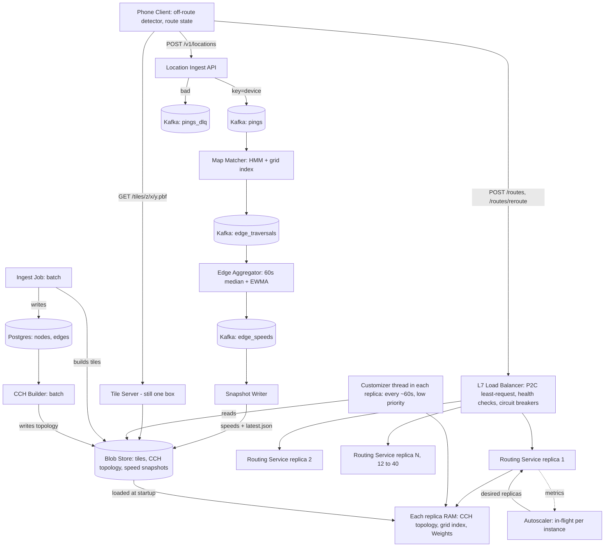

New in V5: the **L7 Load Balancer**, the **replica fleet** (shown as 3 of N), the **Autoscaler**, **readiness gating**, and **admission control** with `503` shedding.

**Every current flow**

1. **Map view:** unchanged. Phone to Tile Server to blob store to Phone.
2. **Route:** Phone to Load Balancer, then to one replica chosen by power of two choices. The replica pins its `Weights`, snaps, runs the CCH query, and unpacks. A `503` with `Retry-After` means the replica is full.
3. **Ingest (offline, per map version):** unchanged. Rollout to the fleet is now gradual, gated by `/ready`.
4. **Weight update (every ~60 s):** unchanged, but each replica customizes on its own. Replicas can lag each other by up to a minute.
5. **Traffic ingest (continuous):** unchanged.
6. **Reroute:** Phone to LB to a replica. The replica admits it with priority, matches the fixes, and routes from the edge's head node. If the request's `map_version` differs, it re-snaps from `destination {lat, lon}`.

Still absent: caching anywhere, and multiple regions.

## Interview follow-ups

**Q: Why not just autoscale on CPU and skip the headroom?**
A new instance needs 60 to 90 seconds before it is useful, and the burst lasts 5. Autoscaling covers the second wave. A baseline plus shedding covers the first five seconds.

**Q: Why not shard the graph across instances?**
The national graph is about 8 GB, which fits in one machine's RAM. Replicating it keeps every request on one instance and every replica interchangeable. Sharding only helps when the graph no longer fits, which is a planet-scale concern.

## Recap

| Concept | The Insight |
|---|---|
| Stateless enables scale | V4 removed sessions, so any replica can answer any request. |
| Replicate, don't shard | Graph fits in RAM, so every replica holds all of it and routes entirely locally. |
| Power of two choices | Requests differ 10x in cost, so balance by in-flight work, not by count. |
| Autoscaling is too slow | A 60-90 s cold start outlasts a 5 s burst, so headroom and shedding cover the gap. |
| Shed, don't queue | A fast `503` with jittered `Retry-After` keeps latency flat and spreads the retries. |
| Readiness gate | Traffic only reaches an instance after topology, grid index, and first customization are done. |

**Interview arc:** *"If asked how you survive a 40K QPS reroute burst: one box is 13x short and a bigger box is still a single point of failure, so I run identical stateless replicas holding the whole graph behind a power-of-two-choices balancer, keep headroom for the first seconds, autoscale on in-flight work for the sustained part, and shed the excess with jittered retries."*

**Next (V6):** every phone in Gachibowli asks the Tile Server for the same few tiles, and the same Hyderabad to Charminar route is requested thousands of times. Where does caching belong, and does this system need a CDN?


-----------------------------------------------------------------------------------------------------------------------
-----------------------------------------------------------------------------------------------------------------------
-----------------------------------------------------------------------------------------------------------------------
-----------------------------------------------------------------------------------------------------------------------


# V6: Caching Tiles with a CDN

V5 scaled routing. This version fixes the Tile Server, the last single box. Tile caching is the one concern here. I'll say at the end why route caching is rejected.

## Break it

It is 6:30 pm. Priya opens the map in Gachibowli. Her phone asks for 6 tiles.

Around 20M people have the map open at this hour. Panning and zooming gives about **200K tile requests per second** worldwide. One Tile Server box reading disk serves about 5K per second. It is 40x short.

There is also a distance problem. The Tile Server sits in one data center. A phone in Hyderabad pays about 250 ms round trip to reach it, and loading 6 tiles takes several round trips. The map paints in pieces, and Priya watches it fill in.

The most telling number is the read pattern. Tiles are immutable blobs. The same Gachibowli tile is fetched by thousands of phones every hour. Reads outnumber writes by millions to one, because a "write" is a map-version rebuild that happens a few times a month.

## Teach: where a cache can sit

A cache answers a repeated question without redoing the work. The decision is which layer.

| Layer | What it saves | Fits tiles? |
|---|---|---|
| Client (phone) | The network trip entirely | Yes. Revisiting your own neighborhood is the most common request. |
| CDN edge (a nearby server) | The long trip to origin | Yes. Thousands of nearby phones want the same bytes. |
| Origin app cache | Disk reads | Marginal. The CDN absorbs nearly all of it. |
| Database | Query work | No. Tiles aren't queried. |

Think of a chain of bookshops. Priya doesn't order from the publisher each time. She checks her own shelf first, then the local branch, and only then does the branch order from the warehouse.

### Do we need a CDN? Yes, and here is why.

A CDN pays off when the content is shared across many users, identical for each of them, and changes rarely. Tiles meet all three tests. The users are global, so the distance saving is large too.

The same test fails for routes.

- **Route caching: rejected.** Every `POST /routes` has a unique origin and destination, snapped to different nodes. A repeat of the exact same pair is rare. Weights also change every minute (V2), so a cached ETA goes stale in 60 seconds. We'd store a lot and rarely hit it. I'm leaving routing uncached.
- **Traffic coloring is not in the tiles.** If speeds were baked in, every tile would change every minute and nothing could be cached. Traffic stays a separate overlay.

### Invalidation: don't invalidate

Tile contents only change when a new `map_version` ships. So we never mutate a cached tile. We change the URL instead.

- Old URL: `/v123/15/23456/14567.pbf`
- New URL: `/v124/15/23456/14567.pbf`

The old entry just ages out. There is no purge, no race, and no stale tile. The version prefix is the invalidation strategy.

### The known sub-problem: the origin stampede after a version flip

When `v124` goes live, every edge location has zero `v124` tiles. Thousands of phones in Hyderabad ask for the same Gachibowli tile in the same second. Every edge forwards its own miss to origin.

The candidate fixes:

1. **Request coalescing.** An edge holds duplicate misses and sends one upstream request.
   ```
   if key in inflight: wait(inflight[key])
   else: inflight[key] = fetch_origin(key)
   ```
2. **Origin shield (tiered cache).** All edges miss to one regional parent cache, and only the parent talks to origin. 200 edges become 1 request.
3. **Pre-warm hot tiles.** Before flipping the manifest, fetch the top city tiles at zoom 10 to 14 through the CDN.
   ```
   for (z,x,y) in hot_tiles: GET /v124/{z}/{x}/{y}.pbf
   ```

I'm using all three. Coalescing and the shield are standard CDN settings. Pre-warming costs a small script, and it is what makes the flip invisible to users.

- ✅ **What we gained:**
  - About 98% of tile requests never reach origin.
  - Latency drops from about 250 ms to under 30 ms for most requests.
  - Tile cost stops scaling with users.
  - There is no invalidation logic.
- ⚠️ **What we gave up:**
  - A map fix takes a version rebuild and flip. It is not instant.
  - Cold tiles in rare regions are always slow, because they always miss.
  - A new `map_version` doubles the cached bytes for a while, since old and new coexist.
  - Phones must read the version from a manifest, which is one more request.
  - Every client caches tiles on disk.
- ❌ **Considered and rejected:**
  - *Scale the Tile Server horizontally and skip caching:* 40 boxes to serve identical bytes, and still 250 ms away.
  - *Purge-based invalidation on edits:* races, and purge fan-out to every edge.
  - *App cache at origin only:* saves disk reads, not distance.
  - *Caching routes:* rejected above.
  - *Baking traffic into tiles:* defeats cacheability.

## Implement it

### New shapes

**1. The manifest.** It is the one cache entry that does change. It tells the phone which tile version to use.

```
GET /v1/map/manifest
200
Cache-Control: public, max-age=60
{"map_version": "v123", "tiles": "https://tiles.example.com/v123/{z}/{x}/{y}.pbf", "minzoom": 0, "maxzoom": 14}
```

**2. Tile response headers.**

```
GET /v123/15/23456/14567.pbf
200
Content-Type: application/x-protobuf
Content-Encoding: gzip
Cache-Control: public, max-age=31536000, immutable
ETag: "v123-15-23456-14567"
```

An empty tile returns `204`, with the same `Cache-Control`. Caching "nothing here" saves origin trips for open ocean.

**3. Cache key.** The path only. Query strings and cookies are dropped, and `Accept-Encoding` is normalized to gzip. Without this, two phones with different cookies would get separate cache entries for the same tile.

**Who writes and who reads**

| Structure | Lives in | Written by | Read by |
|---|---|---|---|
| Phone tile cache (disk LRU, about 200 MB) | Phone | Phone, on a miss | Phone renderer |
| CDN edge cache | Edge servers | CDN, on a miss | Phones |
| Shield cache | One regional parent | CDN | Edge servers |
| Tile archive (PMTiles, V0) | Blob store | Ingest Job | Tile Server (origin) |
| Manifest | Blob store, cached by CDN for 60 s | Ingest Job (at flip) | Phones |

### Step 1: phone

1. On launch and every ~10 min, `GET /v1/map/manifest`. Read `map_version` and the tile URL template.
2. For each visible `(z, x, y)`, build the URL.
3. Check the disk LRU. A hit renders at once.
4. A miss requests the CDN.
5. Store the response in the disk LRU, keyed by URL. The version is in the key, so old tiles are simply never asked for again.
6. Keep the previous version's tiles on screen until the new version's tiles have loaded. The map never goes blank during a flip.

### Step 2: CDN

```
cache_key      = path
edge_ttl       = 1 year      (honors Cache-Control: immutable)
tiered_cache   = on          (edge -> regional shield -> origin)
request_coalescing = on
negative_cache = 204 cached with the same TTL
```

### Step 3: Tile Server (origin)

The V0 Tile Server stays as a thin service. It reads from the PMTiles archive in blob storage, sets the headers above, and returns `204` for empty tiles. It scales as a small fleet of identical replicas, since it is stateless and read-only. At 2% of 200K, origin load is about 4K per second before the shield, so two or three replicas suffice. The shield cuts that further.

### Step 4: version flip

1. Ingest Job writes `/v124/` tiles to the blob store.
2. A warm-up script requests the top city tiles at zoom 10 to 14 through the CDN, so the shield and edges fill.
3. Ingest Job updates the manifest to `v124`.
4. Phones pick it up within about 60 seconds to 10 minutes and start requesting `/v124/` URLs.

This is the same `map_version` stamp used by the routing topology and the grid index in V5, so tiles and routes flip together.

### Flow E: tile fetch

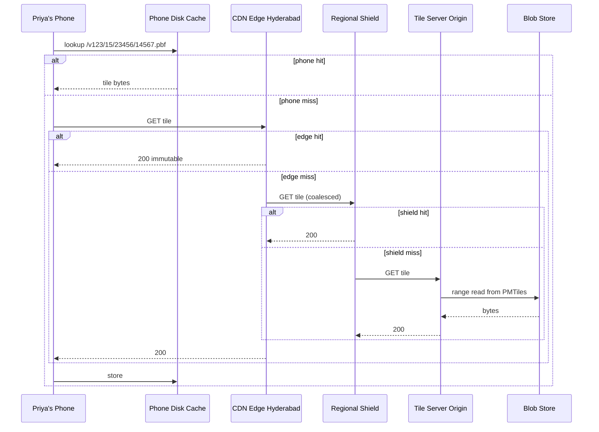

## Current state (after V6)

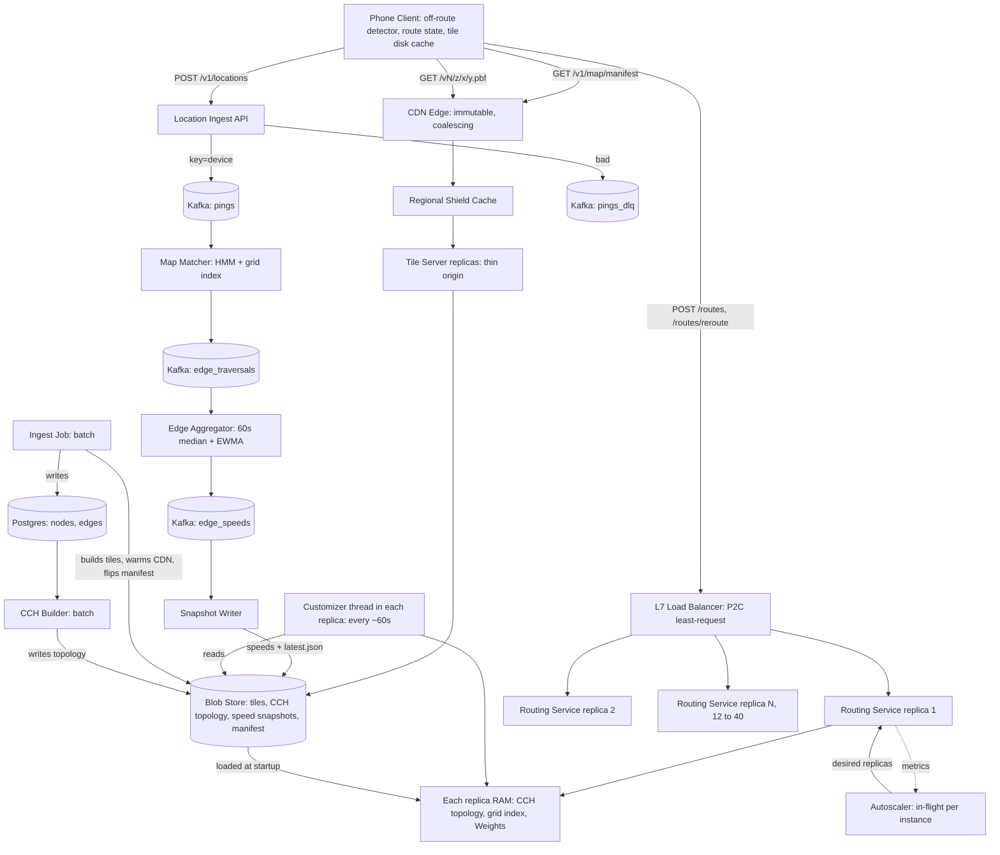

New in V6: the **CDN edge**, the **regional shield**, the **manifest**, the **phone tile disk cache**, and a **Tile Server fleet** that is now a thin origin. Versioned URLs replace invalidation.

**Every current flow**

1. **Map view (changed):** Phone reads the manifest, checks its disk cache, then CDN edge, then shield, then Tile Server, then the PMTiles archive in blob storage. Each layer fills on the way back.
2. **Route:** unchanged. Phone to LB to one replica, CCH query, polyline and ETA. Not cached.
3. **Ingest (offline, per map version):** Ingest Job writes tiles, CCH Builder writes the topology. New: warm the CDN, then flip the manifest.
4. **Weight update (every ~60 s):** unchanged.
5. **Traffic ingest (continuous):** unchanged.
6. **Reroute:** unchanged.

Still absent: any notion of regions. Every write, Kafka topic, and origin sits in one place.

## Interview follow-ups

**Q: How do you invalidate a cached tile when a road changes?**
We don't. A tile's URL includes its `map_version`, so a change ships under a new URL. Old entries expire on their own. There is no purge race and no stale tile.

**Q: Why not cache routes the same way?**
The key space is huge, because every origin and destination pair differs after snapping. The values also expire every minute, since weights change. Hit rate would be tiny, and a stale ETA is worse than a slow one. Tiles are the opposite on both counts.

## Recap

| Concept | The Insight |
|---|---|
| Why a cache fits | Tiles are immutable, shared by everyone nearby, and read millions of times per write. |
| Layers | Phone saves the trip, CDN saves the distance, origin cache would save little. |
| Versioned URL | The `map_version` in the path makes invalidation unnecessary. |
| Cache key | Path only. Cookies and query strings would split one tile into many entries. |
| Stampede on flip | Coalescing, a shield tier, and pre-warming keep the origin quiet. |
| What not to cache | Routes: unique keys and 60-second values. Traffic colors: kept out of tiles. |

**Interview arc:** *"If asked how you serve 200K tile requests per second: one box is 40x short and 250 ms away, and purging on edits causes races, so I put the version in the URL and mark tiles immutable, serve them through a CDN with a shield and request coalescing, pre-warm before a flip, and leave routes uncached because their keys are unique and their weights change every minute."*

**Next (V7):** all of this lives in one region. A Mumbai data center outage takes down routing and the traffic pipeline for India, and a Hyderabad phone pays a long trip for every route. Who owns which writes when we go multi-region?


-----------------------------------------------------------------------------------------------------------------------
-----------------------------------------------------------------------------------------------------------------------
-----------------------------------------------------------------------------------------------------------------------
-----------------------------------------------------------------------------------------------------------------------


# V7: Multi-Region

V6 cached the tiles. This version splits the live parts (routing, ingest, traffic) across regions. The only concern here is who owns which writes. Predicting future traffic is left for V8.

## Break it

Everything so far runs in one region, Mumbai. Priya in Hyderabad is fine. About 30 ms away, she never notices.

Karl in Berlin is not fine. Every reroute costs him about 130 ms per round trip, and the setup needs three. His phone also sends 6-point ping batches across the ocean, 30 s apart, around the clock.

Worldwide, that is about 170K requests per second of location data (about 100 MB/s) flowing into one region. The cost matters less than the failure domain.

At 7:10 pm a Mumbai power event takes the region down. Nobody on Earth gets a route, a reroute, or a fresh traffic number. Tiles still load from the CDN, but the map is a picture with no brain.

Two different pressures show up. One is distance. The other is blast radius. Blast radius is the dominant one, and it forces the design. Distance gets fixed along the way.

## Teach: why "just deploy it everywhere" is not enough

A region is a separate failure domain. Running a second copy in Frankfurt sounds easy for routing, because routing is stateless (V5). The hard part is any structure that accepts writes. Two regions writing the same thing can disagree.

Which of our structures accept writes from users?

| Structure | Written by | Can two regions write the same record? |
|---|---|---|
| `pings` | Phones | Yes, if a phone near a border reaches either region |
| Per-edge speed | Aggregator | Yes, if two regions both compute speed for one road |
| Tiles, topology, Postgres | Offline batch jobs | No. One writer, run on a schedule |

Everything user-facing is a write to live traffic. So the whole question is: who may write the speed of Gachibowli Road No. 12?

### Candidate approaches

| Option | What it optimizes | What it breaks |
|---|---|---|
| Active-passive (one writer, standby elsewhere) | No conflicts | Distance is unchanged, and failover is a manual, slow event |
| Active-active, every region writes every edge, merge later | Lowest latency | Two regions give different speeds for one road. The merge rule is a guess |
| Geo-partitioned ownership, global read replication | One writer per edge, so no conflicts | Border edges, and every region must read speeds it doesn't own |

I'm choosing geo-partitioned ownership.

**The reason it fits here.** Traffic is geographic. A phone in Hyderabad produces data about Hyderabad's roads. Nearly every ping is processed by the region that owns the roads beneath it. Conflicts are avoided by construction, not resolved afterward.

**Analogy.** Each city has one traffic desk. The Hyderabad desk reports Hyderabad. Other desks read its bulletin and never write it.

### What does each region hold?

V5 promised this answer. A planet graph is about 250 GB. That does not fit a replica's RAM. Replicating all of it per instance is out.

- Each region serves a **serving area**: its geography plus a buffer of neighboring countries, about 8 to 20 GB.
- A trip entirely inside one serving area is routed locally, which is nearly every trip.
- A trip that spans areas (under 0.1%) goes to a small **global pool** of big-RAM replicas holding the whole planet graph.

Splitting by serving area keeps V5's "each request runs on one instance" property for almost everything.

- ✅ **What we gained:**
  - A regional outage hits only that region's users, and even they fail over.
  - Latency falls from about 130 ms to about 20 ms for Karl.
  - Raw pings stay in-region, which is also a privacy win.
  - No write conflicts, because every edge has exactly one owner.
- ⚠️ **What we gave up:**
  - Border edges are written from the wrong side, so some traversals must cross regions.
  - Every region must read the other regions' speed slices, which are seconds to a minute behind.
  - A dead region's traffic goes stale and falls back to free-flow.
  - More fleets to run, and capacity must be sized for failover.
  - A small global pool of expensive RAM.
- ❌ **Considered and rejected:**
  - *Active-passive:* leaves Karl 130 ms away and fails over by hand.
  - *Active-active on all edges with merge:* two regions both say a road is 6 and 40 km/h. Any merge rule is arbitrary.
  - *Full planet graph on every replica:* 250 GB per instance.
  - *Move ownership automatically on outage:* split-brain risk (see below).

### Known sub-problem: failover and split-brain

If Mumbai dies, who owns Hyderabad's edges? The fixes:

1. **Operator flips ownership.** A human edits the owner table.
   ```
   OWNER[cell] = "ap-southeast"   # manual, audited
   ```
   Safe, but takes minutes.
2. **Lease with fencing epoch.** The owner holds a lease. If it expires, a standby takes it with a higher epoch. Writes with an old epoch are rejected.
   ```
   if write.epoch < current_epoch(cell): reject
   ```
   Fast and automatic, but needs a strongly consistent store and careful fencing.
3. **Don't move ownership. Degrade.** The dead region's slice goes stale. After 10 minutes (V3's rule), those edges fall back to free-flow.
   ```
   slice_age > 600 s  ->  speeds[mask] = 0   # free-flow
   ```
   There is nothing to split.

I'm choosing option 3. Traffic is soft data. A route priced at typical speeds is still a good route, and the routing itself fails over right away. A split-brain on speeds would be worse than a stale slice.

## Implement it

### New shape 1: the owner table and per-edge region

A small, strongly consistent config (etcd). It changes only when we deliberately re-plan regions.

```
OWNER (etcd key /maps/ownership/v1)
{ "cell_level": 5,
  "cells": { "8f2a...": "ap-south", "8f2b...": "ap-south", "8f61...": "eu-west", ... } }
```

Each edge belongs to the cell of its midpoint. The CCH Builder bakes the result into the topology file, so no runtime lookup is needed.

```
topo_v123.bin  (delta)
  edge_region[orig_edge_id]    // uint8: 0=ap-south, 1=ap-southeast, 2=eu-west, 3=us-east
```

```python
def region_of(edge):
    cell = h3.latlng_to_cell(edge.mid_lat, edge.mid_lon, 5)
    return OWNER[cell]
```

### New shape 2: per-region speed slices

V3's snapshot was one file for all edges. Now each region writes only its own edges.

```
traffic/ap-south/speeds_20261106T1905.bin   // uint8[num_orig_edges], 0 for edges it doesn't own
traffic/ap-south/latest.json
{"region":"ap-south","snapshot":"2026-11-06T19:05Z","uri":"s3://maps-aps/traffic/ap-south/speeds_...bin","map_version":"v123"}
```

Buckets replicate to every region's blob store (asynchronous object replication).

**Who writes and who reads**

| Structure | Lives in | Written by | Read by |
|---|---|---|---|
| `pings` topic | Regional Kafka, per region | Regional Location Ingest | Regional Map Matcher |
| `edge_traversals` topic | Regional Kafka | Local Map Matcher, or the mirror from a neighbor | Regional Edge Aggregator (owned edges only) |
| `edge_traversals_out` topic | Regional Kafka | Map Matcher, for edges owned elsewhere | Cross-region mirror |
| Speed slice `traffic/<region>/` | Blob store, replicated to all regions | That region's Snapshot Writer only | Customizers in every region that need it |
| Owner table | etcd | Operators | CCH Builder |
| `edge_region[]` | Topology file | CCH Builder | Map Matcher, Customizer |

### Step 1: route the phone

1. DNS is latency-based GeoDNS with health checks. Karl resolves to `eu-west`, Priya to `ap-south`.
2. A health check fails 3 times in 10 s. DNS stops returning that region.
3. A client that cannot connect tries the next endpoint in a list the manifest provides.

### Step 2: ingest and match, locally

The Location Ingest API, Kafka, and Map Matcher work as in V3, inside each region. The change comes after matching:

```python
def emit(trav):
    if edge_region[trav.edge_id] == MY_REGION:
        produce("edge_traversals", key=trav.edge_id, value=trav)
    else:
        produce("edge_traversals_out", key=trav.edge_id, value=trav)   # border case
```

A mirror job (MirrorMaker 2) copies `edge_traversals_out` into the owner region's `edge_traversals`. Only border edges travel. That is a tiny fraction of traffic.

### Step 3: aggregate owned edges only

V3's Edge Aggregator is unchanged, except for one guard. It ignores any edge that doesn't belong to its region.

```python
if edge_region[edge_id] != MY_REGION: return     # defensive: one writer per edge
```

The dedupe key `(device, enter_ts)` from V3 also protects against a traversal being delivered twice by the mirror.

### Step 4: merge slices in the Customizer

V2's customizer used one snapshot. It now merges several:

```python
def build_speeds(topo, my_area_regions):
    speeds = np.zeros(NUM_EDGES, dtype=np.uint8)
    for r in my_area_regions:                          # regions in my serving area
        meta = http_get(f"s3://maps-local/traffic/{r}/latest.json")
        if meta.map_version != topo.map_version: continue
        if now() - parse(meta.snapshot) > 600: continue     # that slice is stale: free-flow
        s = download(meta.uri)
        mask = topo.edge_region == REGION_ID[r]
        speeds[mask] = s[mask]                         # each edge has one writer, no conflicts
    return speeds
```

The staleness check is per slice. One dead region's edges go free-flow, while every other region's edges stay live.

### Step 5: serve and fail over

1. A replica in the region checks that both origin and destination fall inside its serving area.
2. If yes, it routes locally, exactly as V5.
3. If not, the LB forwards to the global pool (planet graph, same `ch_query`, same merge).

On a regional outage, the next-nearest region absorbs the traffic.

- Its replicas already hold the serving-area graph, so no cold start.
- Each region is sized at about 1.5x steady load, so it can absorb a neighbor's peak.
- V5's shedding covers the first seconds.

### Step 6: map version rollout

1. The batch jobs write `v124` artifacts once, in the primary build region.
2. Replication copies them to each regional blob store.
3. Each region verifies the checksums, then runs V5's rolling replacement, then the V6 manifest flip. The CDN warm-up runs per region.

### Flow F: a border ping to a far reader

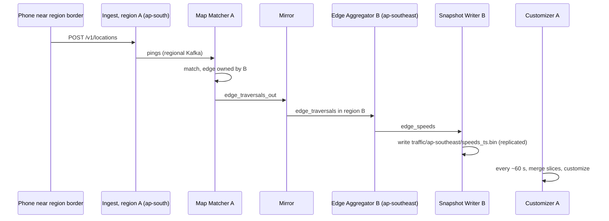

## Current state (after V7)

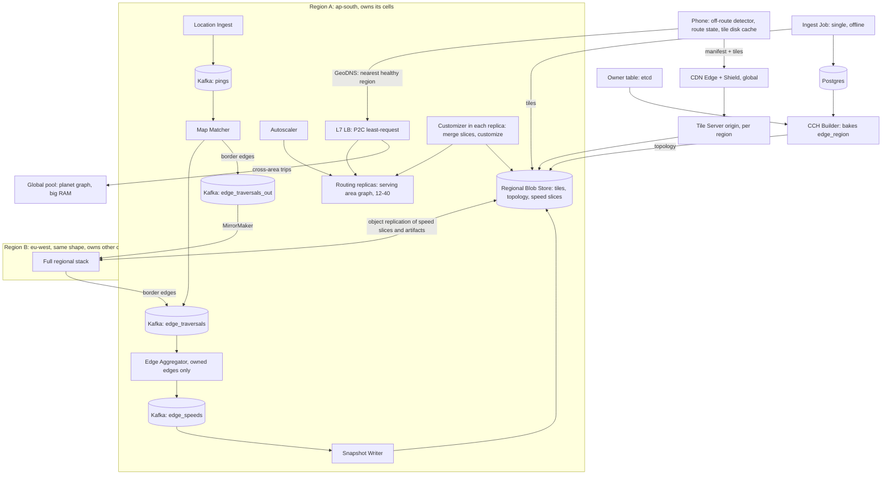

New in V7: **regions with ownership**, **GeoDNS with health checks**, the **owner table**, **`edge_region[]`** in the topology, **per-region speed slices** merged by the Customizer, the **border mirror**, **serving areas**, and the **global pool**.

**Every current flow**

1. **Map view:** unchanged in shape. Phone to CDN edge to shield to a regional Tile Server to that region's blob store.
2. **Route:** Phone resolves to the nearest healthy region. The LB picks a replica. The replica routes locally if both ends are inside its serving area. Otherwise the LB forwards to the global pool.
3. **Ingest (offline, per map version):** Ingest Job and CCH Builder run once, and artifacts replicate to every region. Each region rolls out on its own, then warms the CDN and flips the manifest.
4. **Weight update (changed):** every ~60 s each replica reads the speed slices for its serving area. It merges by `edge_region`, skips any slice older than 10 min, then customizes and swaps.
5. **Traffic ingest (changed):** Phone to the regional Location Ingest to `pings` to Map Matcher. Owned edges go to the local `edge_traversals`. Border edges go through the mirror to the owner. The owner's Aggregator and Snapshot Writer publish the slice.
6. **Reroute:** unchanged in logic. It runs in the nearest region, and cross-area trips go to the global pool.
7. **Regional failover (new):** DNS drops the failed region. The next region serves its users. That region's speed slice goes stale and falls back to free-flow after 10 min.

## Interview follow-ups

**Q: Why not let every region write every edge and merge with last-write-wins?**
Two regions can see the same road differently, because they get different samples. Last-write-wins then picks one at random, and clock skew makes it worse. With one owner per edge, there is nothing to merge.

**Q: What happens to traffic in a region that dies?**
Routing fails over at once, since replicas elsewhere hold the graph. That region's speeds go stale. After 10 minutes they fall back to free-flow, so ETAs revert to typical rather than serving a frozen jam. We don't move ownership, because a split-brain on speeds is worse than temporarily stale ones.

## Recap

| Concept | The Insight |
|---|---|
| Two pressures | Distance and blast radius. Blast radius is what forces regions. |
| What conflicts | Only live user writes (pings, speeds). Offline artifacts have one writer. |
| Geo-partitioned ownership | Traffic is geographic, so each edge has one home region and conflicts can't happen. |
| Read everywhere, write at home | Every region reads all relevant speed slices. Only the owner writes its own. |
| Serving areas | The planet graph won't fit one replica, so each region holds its area plus a buffer. |
| Failover by degrading | Stale slice falls back to free-flow. Ownership never moves, so no split-brain. |

**Interview arc:** *"If asked how you go multi-region: one region is one failure domain and 130 ms from half the world, and writing every edge everywhere gives conflicting speeds, so I give each road one owning region by geography, keep pings and aggregation local, replicate the speed slices to everyone, and on an outage fail routing over instantly while the dead region's traffic decays to free-flow instead of moving ownership."*

**Next (V8):** Priya leaves for a 3-hour drive at 6 pm. We price every road at today's speed, as if the 6 pm jam lasts all three hours. How do we predict what traffic will be when she actually gets there?


-----------------------------------------------------------------------------------------------------------------------
-----------------------------------------------------------------------------------------------------------------------
-----------------------------------------------------------------------------------------------------------------------
-----------------------------------------------------------------------------------------------------------------------


# V8: Predicting Traffic Along the Trip

V7 split the live system across regions. This version fixes a flaw V2 admitted: a route is priced as if right-now traffic lasts the whole trip. The only concern here is the time dimension of edge weights. Measuring whether our ETAs are actually right is V9.

## Break it

It is 6:00 pm. Priya leaves Hyderabad for Kurnool, about 210 km and roughly 3 hours.

V2 prices every road at the 6:00 speed. Two things go wrong.

- **A jam that will be gone.** The Outer Ring Road ramp reads 8 km/h. She reaches it around 6:25, and the evening peak is already easing. V2 sees the jam and sends her on a 25 km detour through town. The detour costs her 20 minutes the ramp would not have.
- **A jam that isn't here yet.** A factory-belt road near Shadnagar reads 55 km/h at 6:00. Shifts end at 8:30 and it drops to 12 km/h. She reaches it at 8:25. V2 never sees this coming.

The result is a wrong route and a wrong ETA. V2 says 3h20 and she arrives in 2h50 on the better road she never saw.

These are not rare cases. For any trip over about 30 minutes, the first half of the route is priced for the wrong time.

## The crux: walking the naive attempts

### Attempt 1: use historical averages only

*Why it looked reasonable:* Traffic repeats weekly. Average each road by hour of week and forget live data.

*How it breaks:* A bridge closes at 5:50 pm. History says the road is fine. The system sends Priya straight at it.

### Attempt 2: keep V2's current speeds, and let V4 fix it later

*Why it looked reasonable:* If the route is wrong, she will drift off it, and the phone will reroute.

> **Asha:** V4 already reroutes. Let her find the problem when she hits it.
> **Dev:** V4 only fires when she leaves the route. She won't. She'll follow us into the jam.
> **Asha:** Then trigger on ETA drift.
> **Dev:** By then she is past the fork. A better route needed a decision 40 minutes earlier.

*How it breaks:* Rerouting repairs a wrong turn. It can't undo a wrong first choice, because the cost of that choice is already spent.

### Attempt 3: exact time-dependent routing on the CCH

*Why it looked reasonable:* The textbook answer. Each edge's cost is a function of when you enter it. Run the search on those functions.

*How it breaks:* A CCH shortcut must now store a travel-time function, and combining two functions makes a bigger one. Memory grows by 10x or more, and customization stops being a linear pass over numbers. Every minute's new traffic would rebuild all of it. V2's few-second update and a few-ms query are gone.

All three share a gap. We need a **forecast** of each edge's speed at the time she will be there. Then we need a way to use it without losing V2's speed.

## Solve it: forecast speeds, then price by horizon

### Part 1: the forecast

For each edge and a future time, we want one number. We have two signals.

- **Typical:** what this road does at this hour of the week. It is accurate for recurring patterns.
- **Live:** what it is doing now. It catches incidents, rain, and a match at the stadium.

The live signal is informative about the next 30 minutes and fades after that. So the forecast is typical at the target time, shifted by how far today differs from typical, with the shift fading.

**Analogy.** A weather forecast. Next hour, look out the window. Next week, trust the season.

Let `h` be minutes ahead:

`forecast(h) = typical(t+h) × (1 + (live/typical(now) − 1) × e^(−h/30))`

If today is 40% slower than normal, that gap is mostly present in 10 minutes and nearly gone in 90.

### Part 2: using it without breaking CCH

Instead of a function per edge, we build a few **full weight sets**, one per horizon. We have a speed array for 0, +30, +60, +120, and +180 minutes. Each is customized like V2's.

A query picks which set to price with. A trip is on the first road at +0 and the last at +ETA. Its average position in time is about half the ETA. So we search with the set nearest `ETA/2`, then compute the exact ETA by walking the chosen path with true arrival times.

This is an approximation for route choice. It is exact for the ETA of whatever route we return.

### Comparing the real options

| Option | Reacts to today's incident | Predicts recurring jams | Query cost | Memory |
|---|---|---|---|---|
| Current speeds only (V2) | Yes | No | ~ms | 1x |
| Historical average only | No | Yes | ~ms | 1x |
| Exact time-dependent CCH | Yes | Yes | 10-100 ms | 10x+ |
| Blended forecast, horizon weight sets | Yes | Yes | ~ms, 2 queries | ~5x weights (not topology) |

I'm choosing the **blended forecast with horizon sets**.

- ✅ **What we gained:** Routes chosen for when she will be there. Incidents still respected. V2's query, unpacking, and customization pass are reused as they are. ETAs are computed exactly along the final path.
- ⚠️ **What we gave up:**
  - Route choice is approximate. The `ETA/2` rule can pick a slightly worse path.
  - About 1 GB more RAM per extra weight set per replica.
  - A new offline pipeline that must be fed and kept healthy.
  - Rare roads with little history fall back to free-flow shape.
  - Forecasts can be wrong, so there is now an accuracy question (V9).
- ❌ **Considered and rejected:**
  - *History only:* blind to today's incident.
  - *Live only:* V2's problem.
  - *Exact TD-CCH:* memory and the customization budget.
  - *A learned model per edge:* heavy to serve at 70M edges, and not needed for this horizon yet.
  - *A weight set per minute of horizon:* the speeds change smoothly, so 5 sets with interpolation are enough.

## Implement it

### New stores

**1. Speed history.** Columnar files, one partition per day, in the blob store.

This is a new storage class. The access pattern is a nightly scan of weeks of `(edge, minute, speed)` rows, with aggregation. That favors columnar, compressed files. A row store or Kafka would be wrong for scans.

```
history/dt=2026-11-05/part-000.parquet
columns: edge_id int64, window_end int64, kmh int16, n_devices int16
```

**2. Profile templates.** 4,096 typical weekly curves.

Storing 672 buckets per edge would cost 47 GB. Most roads behave like one of a few shapes: commuter inbound, commuter outbound, market street, quiet residential. So we cluster.

```
profile_templates.bin   uint8[4096][672]     // 15-min buckets of a week
                                             // value = typical_speed / free_flow, scaled by 255
edge_profile.bin        uint16 template_id[num_edges]
                        uint8  free_flow_kmh[num_edges]
```

The `edge_profile` file costs about 210 MB. It is read-only and keyed by `map_version`.

**3. Horizon speed sets**, in RAM only.

```
S[k]  uint8[num_edges]     k = 0..4 for h = 0, 30, 60, 120, 180 min
W[k]  Weights (w_up, w_dn, via_up, via_dn)    // one customization per set
```

**Who writes and who reads**

| Structure | Lives in | Written by | Read by |
|---|---|---|---|
| `history/` Parquet | Regional blob store | History Archiver (consumes `edge_speeds`) | Profile Builder |
| `profile_templates.bin`, `edge_profile.bin` | Blob store | Profile Builder (weekly batch) | Customizer in each replica (at startup) |
| `S[k]`, `W[k]` | Replica RAM | Customizer | Query threads |
| `edge_speeds` topic (existing) | Regional Kafka | Edge Aggregator | Snapshot Writer, History Archiver |

### Step 1: offline, build the profiles

1. The History Archiver consumes `edge_speeds` and appends Parquet files, one per hour.
2. Weekly, the Profile Builder reads 6 to 8 weeks.
3. For each edge it builds a 672-bucket curve, as the median speed over free flow. Missing buckets are filled from the road class's average.
4. It runs k-means, `k=4096`, over edges with enough data. It writes `template_id` per edge.
5. Edges with too little data get the template of their road class.

```python
def build_profiles(history, edges):
    curve = {e: median_by_bucket(history[e]) / edges[e].free_flow for e in edges.with_data()}
    centers, assign = kmeans(np.stack(list(curve.values())), k=4096)
    write("profile_templates.bin", (centers * 255).astype(np.uint8))
    write("edge_profile.bin", assign_with_class_fallback(assign, edges))
```

### Step 2: online, build the horizon sets (inside the Customizer)

```python
HORIZONS = [0, 30, 60, 120, 180]        # minutes

def forecast_speeds(live, now, h):
    b_now, b_fut = bucket(now), bucket(now + h * 60)
    typ_now = TMPL[TID, b_now] / 255.0 * FF
    typ_fut = TMPL[TID, b_fut] / 255.0 * FF
    resid   = np.where(live > 0, live / np.maximum(typ_now, 1), 1.0)   # 0 = no live data
    shift   = 1.0 + (resid - 1.0) * np.exp(-h / 30.0)
    return np.clip(typ_fut * shift, 1, 255).astype(np.uint8)

def refresh(topo, live, now, ks):
    for k in ks:
        S[k] = forecast_speeds(live, now, HORIZONS[k]) if k > 0 else live_or_typical(live, now)
        W_new[k] = customize(topo, S[k])          # V2's pass, unchanged
    current.set(Weights_all(S, W_new))            # one atomic swap
```

The live set `k=0` refreshes every minute, as in V2. The future sets refresh every 5 minutes. Past 30 minutes, they depend mostly on history, and a slower refresh costs little accuracy. A closure flagged by the incident feed carries its own expected end time, and it overrides the decay.

### Step 3: query with a horizon

`POST /routes` gains an optional departure time.

```json
{ "origin": {"lat":17.4401,"lon":78.3489}, "destination": {"lat":15.8281,"lon":78.0373},
  "depart_at": "2026-11-06T18:00:00+05:30", "mode": "driving" }
```

```python
def route_td(req):
    ws = current.get()                              # pin all horizon sets together
    src, dst = snap(req.origin), snap(req.destination)
    t0 = req.depart_at or now()
    h0 = (t0 - now()) / 60                          # departure offset, minutes
    eta0, _ = ch_query(topo, ws.W[nearest(h0)], src, dst)
    if eta0 < 20 * 60:                              # short trip: skip the second query
        k = nearest(h0)
    else:
        k = nearest(h0 + eta0 / 120)                # horizon at roughly half the trip (seconds to minutes)
    best, meet = ch_query(topo, ws.W[k], src, dst)
    nodes = unpack_path(topo, ws.W[k], meet)
    eta = walk_path(nodes, ws.S, t0)                # exact ETA with true arrival times
    return build_response(nodes, eta, "predicted")

def walk_path(nodes, S, t0):
    t = t0
    for e in edges_of(nodes):
        kmh = lerp_between_horizons(S, e, t)        # interpolate neighboring sets
        t += e.length_m / (kmh / 3.6)
    return t - t0
```

At most 2 queries run per route. Reroutes (V4) use the same function with `depart_at = now`.

### Failure handling

- **Profile files missing or stale:** the forecast uses `typ = free_flow` and live data only for 30 minutes, then falls to free-flow. It is V2's behavior, not an outage.
- **Wrong `map_version`:** ignore the profile and keep the old one. The version stamp is the same as before.
- **Weight set builds late:** queries keep pinning the previous `Weights_all`, as in V2.

### Flow G: a 6 pm departure

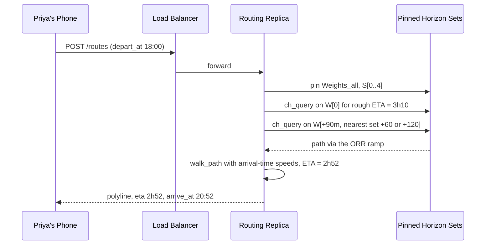

For Priya, the ramp at 6:25 is forecast at 38 km/h, because the jam is typical for 6:00 and fades. The detour loses. The factory belt is flagged as slow at 8:25, so the route avoids it.

## Current state (after V8)

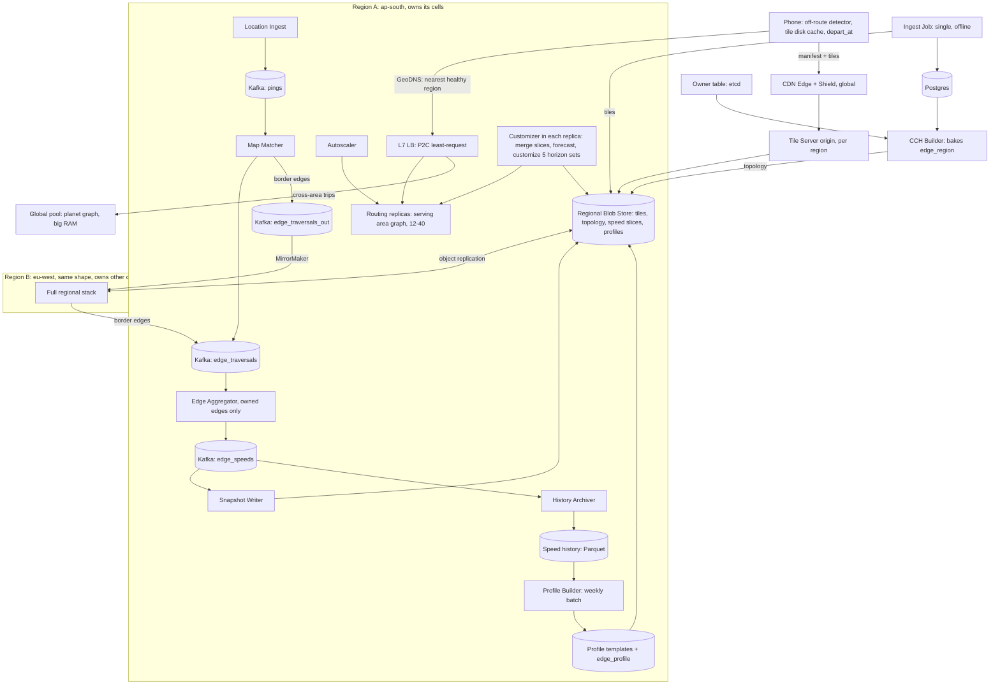

New in V8: the **History Archiver**, **speed history**, **Profile Builder**, **profile templates**, and **horizon weight sets** (`S[k]`, `W[k]`) built by the Customizer.

**Every current flow**

1. **Map view:** unchanged. Phone to CDN to shield to Tile Server to blob store.
2. **Route (changed):** Phone to nearest healthy region and LB to a replica. The replica pins all horizon sets, runs a rough query, picks the set near the half-trip horizon, queries again, unpacks, and walks the path for an exact ETA. Cross-area trips go to the global pool.
3. **Ingest (offline, per map version):** unchanged. Artifacts replicate, each region rolls out, warms the CDN, and flips the manifest.
4. **Weight update (changed):** every ~60 s the live set refreshes from merged slices. Every ~5 min the four future sets rebuild from profile and live data. One atomic swap.
5. **Traffic ingest:** unchanged, plus `edge_speeds` now also feeds the History Archiver.
6. **Reroute:** unchanged, now priced with the horizon sets.
7. **Regional failover:** unchanged.
8. **Profile build (new, weekly):** History Archiver to Parquet, Profile Builder to templates and per-edge ids, published to the blob store.

## Interview follow-ups

**Q: Why not exact time-dependent routing?**
It needs travel-time functions on every shortcut, and combining them grows each one. Memory goes up 10x or more, and the minute-by-minute customization becomes a function rebuild. Five horizon sets keep V2's numeric pass and cost about 4 GB more per replica.

**Q: Why decay the live signal instead of trusting it all trip?**
A jam from an accident usually clears within an hour. A typical evening peak will have moved on. If we trust today's speed for 3 hours, we repeat V2's mistake. If we ignore it, we miss the closure. The decay keeps it strong now and weak later.

## Recap

| Concept | The Insight |
|---|---|
| The flaw in V2 | Every road is priced at the time of departure, but she reaches most roads much later. |
| Forecast = typical plus fading residual | History predicts recurring patterns, live data catches today, and live fades with horizon. |
| Profile templates | 4,096 weekly shapes plus one id per edge, instead of 672 values per edge. |
| Horizon weight sets | Five customized arrays keep V2's fast query, without per-edge functions. |
| Query with `ETA/2` | The average time a trip spends on a road is about half the trip. Price with that horizon. |
| Exact ETA, approximate route | The returned path is walked with true arrival times, so its ETA is honest. |

**Interview arc:** *"If asked how you handle traffic that will change during the trip: pricing roads at departure time sends a 6 pm driver around a jam that clears and into one that hasn't started, exact time-dependent routing multiplies the index size, so I forecast each edge as its weekly typical shape plus today's deviation fading over about 30 minutes, customize five horizon weight sets, route with the one near half the ETA, and compute the final ETA exactly along the path."*

**Next (V9):** we now publish ETAs worth trusting, but how do we know whether they are right? Which signals do we watch when the matcher drifts, a region lags, or a forecast goes wrong, and what do we alert on?


-----------------------------------------------------------------------------------------------------------------------
-----------------------------------------------------------------------------------------------------------------------
-----------------------------------------------------------------------------------------------------------------------
-----------------------------------------------------------------------------------------------------------------------


# Final Wrap-Up: Google Maps

## 1. Full architecture

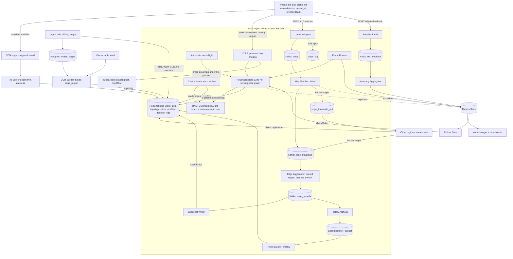

## 2. Every end-to-end path

### Path 1: Map view (read)

1. Phone fetches `/v1/map/manifest` (cached 60 s) and learns `map_version`.
2. It computes the visible `(z, x, y)` tiles and checks its disk LRU.
3. On a miss, it requests `/v123/z/x/y.pbf` from the CDN edge.
4. Edge miss goes to the regional shield. Shield miss goes to the Tile Server.
5. Tile Server range-reads the PMTiles archive in blob storage.
6. Each layer fills on the way back. The phone renders, and styling happens on the client.

```mermaid
sequenceDiagram
    participant P as Phone
    participant E as CDN Edge
    participant S as Shield
    participant T as Tile Server
    participant B as Blob Store
    P->>P: disk cache lookup
    P->>E: GET tile
    E->>S: miss, coalesced
    S->>T: miss
    T->>B: range read
    B-->>T: bytes
    T-->>S: 200 immutable
    S-->>E: 200
    E-->>P: 200
```

### Path 2: Route (read)

1. Phone sends `POST /routes` with origin, destination, and optional `depart_at`.
2. GeoDNS sends it to the nearest healthy region. The LB picks the less loaded of two replicas.
3. Admission control admits it or returns `503` with a jittered `Retry-After`.
4. The replica pins all five horizon weight sets.
5. It snaps both points and runs a rough CCH query on the nearest set.
6. It picks the set nearest `depart + ETA/2` and queries again.
7. It unpacks shortcuts, then walks the path with true arrival times for an exact ETA.
8. If origin and destination are in different serving areas, the LB forwards to the global pool.

```mermaid
sequenceDiagram
    participant P as Phone
    participant LB as Load Balancer
    participant R as Routing Replica
    P->>LB: POST /routes
    LB->>R: least-of-two
    R->>R: admit, pin Weights_all
    R->>R: snap, rough ch_query
    R->>R: pick horizon set near half ETA
    R->>R: ch_query, unpack
    R->>R: walk_path for exact ETA
    R-->>P: polyline, ETA, route_id, destination_node
```

### Path 3: Reroute

1. Phone sees 3 off-route fixes in a row. The tolerance is `max(30, 2 × accuracy)`, plus a heading check.
2. It sends `POST /routes/reroute` with 5 fixes, `destination_node`, `map_version`, and `reroute_seq`.
3. The replica admits it on the priority lane.
4. It map-matches the fixes with the V3 HMM and takes the last edge and offset.
5. It routes from that edge's head node and adds the leftover edge time.
6. Phone drops the reply if it is stale. Otherwise it swaps the route.

### Path 4: Traffic ingest (write)

1. Phone sends 6-point batches to the regional Location Ingest.
2. Ingest drops low-accuracy points and trims trip start and end, then writes `pings` keyed by device.
3. Map Matcher runs Viterbi per device and keeps fully crossed edges.
4. Owned edges go to `edge_traversals` keyed by `edge_id`. Border edges go to `edge_traversals_out`, which MirrorMaker copies to the owner.
5. Edge Aggregator keeps 60 s windows, requires 3 devices, takes the median, and applies EWMA.
6. Snapshot Writer publishes this region's slice, data file first, pointer last.

```mermaid
sequenceDiagram
    participant P as Phone
    participant I as Ingest
    participant M as Matcher
    participant A as Aggregator
    participant S as Snapshot Writer
    participant B as Blob Store
    P->>I: POST /v1/locations
    I->>M: pings, key=device
    M->>A: edge_traversals, key=edge_id
    A->>S: edge_speeds
    S->>B: speeds_ts.bin, then latest.json
```

### Path 5: Weight update

1. Each replica reads `latest.json` for every slice in its serving area.
2. It skips any slice older than 10 minutes, so those edges fall to free-flow.
3. It merges slices by `edge_region`. Each edge has one writer, so nothing conflicts.
4. It builds the live set every minute and the four future sets every 5 minutes. Forecast is typical shape plus a residual that fades over 30 minutes.
5. It customizes each set with the bottom-up triangle pass, then does one atomic swap.

### Path 6: Offline build and rollout

1. Ingest Job loads source data into Postgres and builds tiles.
2. CCH Builder runs nested dissection, adds all shortcuts, and bakes in `edge_region`.
3. Artifacts replicate to each region, all stamped with one `map_version`.
4. Each region does a rolling replacement gated by `/ready`, and pauses at 10% for the Rollout Gate.
5. If the gate passes, it warms the CDN and flips the manifest.

### Path 7: Accuracy loop

1. Phone drops trips under 5 min or with more than 2 min stopped, then sends predicted and actual time.
2. Accuracy Aggregator computes the median log-ratio per region, distance bucket, and version.
3. Groups under 20 trips are skipped.
4. Alertmanager pages on bias above 8% for 15 minutes.

### Path 8: Regional failover

1. Health checks fail 3 times in 10 s and DNS drops the region.
2. The next region serves its users from warm replicas, with shedding covering the first seconds.
3. The dead region's slice goes stale. After 10 minutes its edges fall to free-flow. Ownership never moves.

## 3. "Why not X" arsenal

| Question | Defensible answer |
|---|---|
| Why not A* or Dijkstra? | Both settle millions of nodes on long routes. Contraction does that work once, offline. |
| Why CCH and not plain CH? | CH shortcuts depend on weights, so traffic changes the structure. CCH fixes the structure and re-customizes only numbers. |
| Why not exact time-dependent routing? | Travel-time functions on every shortcut grow memory 10x or more. Five horizon sets keep the numeric pass. |
| Why not snap each GPS point to the nearest road? | Parallel roads and 15 m error make one dot ambiguous. An HMM scores whole trajectories. |
| Why does the phone detect off-route? | It holds the polyline and a 1 Hz fix stream, so it reacts in seconds. Server detection needs sessions and batched pings. |
| Why replicate the graph instead of sharding it? | It fits in RAM, so every request stays on one instance. Sharding adds cross-shard routing for nothing. |
| Why not cache routes? | Keys are nearly all unique and values go stale every minute. Tiles are the opposite, so tiles are cached. |
| Why not active-active on all edges? | Two regions would write different speeds for one road, and any merge rule is arbitrary. One owner per edge means no conflicts. |

## 4. Master recap

| Version | Concept | The Insight |
|---|---|---|
| V0 | Tiles | The `(zoom, x, y)` grid lets the client fetch only the viewport. |
| V0 | Tile storage | A tile is an immutable blob fetched by key. |
| V0 | Road graph | Intersections are nodes, segments are edges, weight is time. |
| V0 | Ingest vs. query | Relational for batch cleaning, in-memory adjacency for queries. |
| V0 | Guarantee | Exact route on simple, fresh data. |
| Tiles deep dive | Vector vs. raster | Vector stores geometry plus a shared property table, and the client styles it. |
| Tiles deep dive | Seams | Simplify first, quantize to a global grid, clip with a buffer. |
| Tiles deep dive | Tiles vs. graph | Tiles are for drawing, never for routing. |
| V1 | Why Dijkstra is slow | It explores a circle that grows with distance. |
| V1 | Contraction | Remove nodes by importance and add a shortcut only without a witness. |
| V1 | Query | Search upward from both ends, then unpack via nodes. |
| V1 | Cost | Weights are frozen at build time. |
| V2 | Why V1 breaks | Weights decide which shortcuts exist. |
| V2 | Split shape from numbers | Nested dissection orders by topology only. |
| V2 | Customization | One bottom-up triangle pass takes seconds. |
| V2 | Atomic swap | Each query pins one weights object. |
| V3 | A ping is not an edge | Match whole trajectories with an HMM. |
| V3 | Aggregation | Fully crossed edges, median, 3 devices, EWMA. |
| V3 | Keys | Key by device for matching, by edge for aggregation. |
| V4 | Who detects | The phone, with a tolerance tied to GPS accuracy and 3 misses. |
| V4 | Stateless reroute | Each request carries destination and recent fixes. |
| V4 | Directed start | Route from the head node of the matched edge plus leftover time. |
| V5 | Stateless enables scale | Any replica can answer any request. |
| V5 | Balancing | Power of two choices on in-flight work. |
| V5 | Bursts | Headroom, autoscale, and shed with jittered `Retry-After`. |
| V5 | Readiness | Traffic only reaches an instance after its first customization. |
| V6 | Cache layers | Phone saves the trip, CDN saves the distance. |
| V6 | Versioned URL | The `map_version` in the path replaces invalidation. |
| V6 | Stampede | Coalescing, a shield tier, and pre-warming. |
| V6 | Not cached | Routes and traffic colors. |
| V7 | Two pressures | Distance and blast radius, and blast radius forces regions. |
| V7 | Ownership | One home region per edge, so conflicts cannot happen. |
| V7 | Serving areas | The planet graph is too big per replica, so each region holds its area. |
| V7 | Failover | Stale slices decay to free-flow and ownership never moves. |
| V8 | Flaw in V2 | Roads are priced at departure time, not arrival time. |
| V8 | Forecast | Weekly typical shape plus a live residual that fades. |
| V8 | Horizon sets | Five customized arrays keep V2's fast query. |
| V8 | ETA/2 rule | Price with the horizon at about half the trip, then compute the exact ETA. |
| V9 | Healthy is not correct | Service metrics stay green while ETAs are wrong. |
| V9 | Trips are truth | Compare promised ETA to actual with a median log-ratio. |
| V9 | Fast signals | Reroute rate and synthetic probes. |
| V9 | Rollout gate | Probe regressions pause a rollout before users see it. |

## 5. What next?

**(a) Drill deeper** into one piece. Good candidates are the HMM transition math, nested dissection, CCH customization, or the traffic-forecast model.

**(b) Mock Q&A.** I play interviewer and pressure-test the whole design, with follow-ups that escalate the way a real L5 loop does.

Which one do you want?


-----------------------------------------------------------------------------------------------------------------------
-----------------------------------------------------------------------------------------------------------------------
-----------------------------------------------------------------------------------------------------------------------
-----------------------------------------------------------------------------------------------------------------------


-----------------------------------------------------------------------------------------------------------------------
-----------------------------------------------------------------------------------------------------------------------
-----------------------------------------------------------------------------------------------------------------------
-----------------------------------------------------------------------------------------------------------------------


-----------------------------------------------------------------------------------------------------------------------
-----------------------------------------------------------------------------------------------------------------------
-----------------------------------------------------------------------------------------------------------------------
-----------------------------------------------------------------------------------------------------------------------


-----------------------------------------------------------------------------------------------------------------------
-----------------------------------------------------------------------------------------------------------------------
-----------------------------------------------------------------------------------------------------------------------
-----------------------------------------------------------------------------------------------------------------------


-----------------------------------------------------------------------------------------------------------------------
-----------------------------------------------------------------------------------------------------------------------
-----------------------------------------------------------------------------------------------------------------------
-----------------------------------------------------------------------------------------------------------------------


-----------------------------------------------------------------------------------------------------------------------
-----------------------------------------------------------------------------------------------------------------------
-----------------------------------------------------------------------------------------------------------------------
-----------------------------------------------------------------------------------------------------------------------


-----------------------------------------------------------------------------------------------------------------------
-----------------------------------------------------------------------------------------------------------------------
-----------------------------------------------------------------------------------------------------------------------
-----------------------------------------------------------------------------------------------------------------------


-----------------------------------------------------------------------------------------------------------------------
-----------------------------------------------------------------------------------------------------------------------
-----------------------------------------------------------------------------------------------------------------------
-----------------------------------------------------------------------------------------------------------------------


-----------------------------------------------------------------------------------------------------------------------
-----------------------------------------------------------------------------------------------------------------------
-----------------------------------------------------------------------------------------------------------------------
-----------------------------------------------------------------------------------------------------------------------


-----------------------------------------------------------------------------------------------------------------------
-----------------------------------------------------------------------------------------------------------------------
-----------------------------------------------------------------------------------------------------------------------
-----------------------------------------------------------------------------------------------------------------------


-----------------------------------------------------------------------------------------------------------------------
-----------------------------------------------------------------------------------------------------------------------
-----------------------------------------------------------------------------------------------------------------------
-----------------------------------------------------------------------------------------------------------------------


-----------------------------------------------------------------------------------------------------------------------
-----------------------------------------------------------------------------------------------------------------------
-----------------------------------------------------------------------------------------------------------------------
-----------------------------------------------------------------------------------------------------------------------


