# Google Maps HLD: Chapter 1 of ~12: What are we building, and the first naive version

This is the roadmap. We go one chapter at a time, and I won't move on until you say you've got it.

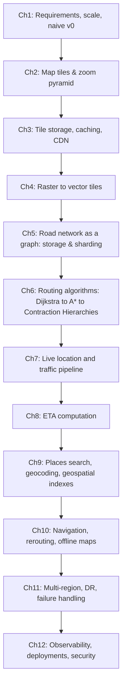

Today's chapter has four parts:
1. Requirements
2. Scale estimates
3. The first naive design
4. Why it breaks, which pushes us into Chapter 2

---

## 1. The three products hiding inside "Google Maps"

"Google Maps" is really three systems with very different shapes. Say this early in an interview; it shows you understand the problem.

| Subsystem | What it does | Nature of the workload |
|---|---|---|
| **Map display** | Shows the map as you pan and zoom | Huge read volume, mostly static data, very cacheable |
| **Routing / ETA** | Finds the best path A→B and predicts time | CPU-heavy graph computation, depends on live traffic |
| **Location / traffic** | Ingests phone GPS pings, computes traffic | Huge write volume, streaming, real-time |

Display is read-heavy and static, routing is compute-heavy, and traffic is write-heavy and streaming. That is why one architecture can't serve all three, and why the later chapters split them into separate services.

### Functional requirements (what we'll design)
- View the map, with pan and zoom
- Search for a place ("Starbucks near me", "Eiffel Tower")
- Get directions between two points (driving, walking, transit)
- Get an ETA that accounts for live traffic
- Turn-by-turn navigation with rerouting

### Non-functional requirements
- **Low latency**: map tiles in under ~100 ms, because panning must feel instant
- **High availability**: people navigate while driving, so an outage is dangerous
- **Scalability**: global, with millions of requests per second
- **Freshness**: traffic in seconds to minutes, road changes in hours to days
- **Accuracy**: a wrong route or a late "turn left" is a real-world failure
- **Mobile-friendly**: limited bandwidth and battery, flaky networks

### Out of scope (say so explicitly in interviews)
Street View, satellite imagery, ads, reviews, business listings management. Interviewers like it when you state the scope yourself.

---

## 2. Back-of-envelope estimation

These are assumptions, which is what you do in an interview. State them out loud.

- 1B monthly users, **250M daily active users (DAU)**
- Each user does ~50 map interactions per day (pan, zoom, open app)
- Each interaction loads ~10 *new* map pieces → 250M × 50 × 10 = **125B map-piece requests/day**
  - 125B / 86,400 s ≈ **~1.4M QPS average**, **~4M QPS at peak**
- **Navigation**: say 50M navigation sessions/day, and ~10M people navigating at the same moment at peak
  - Each phone sends a GPS ping every ~5 s → 10M / 5 = **~2M location writes/sec**
- **Route requests**: ~50M/day ≈ ~600 QPS average. That's low in count, but each request is expensive in CPU.

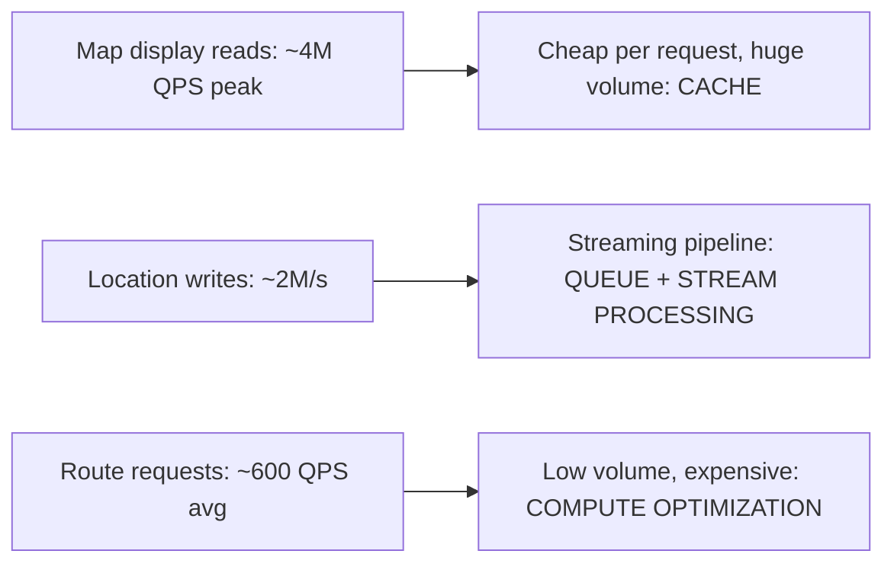

> **Interview takeaway:** the numbers decide the strategy. Millions of reads of static data means caching. Millions of writes means streaming. Few but expensive requests means algorithmic optimization. The next 11 chapters follow from this.

---

## 3. The story begins: version 0, the naive design

Imagine it's the early 2000s and you're building the first web map. The most natural idea: **the world is a picture, so let the server draw the picture for whatever the user asks for.**

- You store geographic data in a database: roads (as lines), buildings, parks and water (as polygons), and labels.
- When the user opens the map, the browser tells the server: *"I'm looking at latitude 12.9 to 13.1, longitude 77.5 to 77.7, at this size."*
- The server queries the DB for everything inside that rectangle (the **bounding box**), **draws** an image, and returns it.
- To pan or zoom, the user clicks an arrow button. The browser sends a new bounding box and the page reloads with a new image.

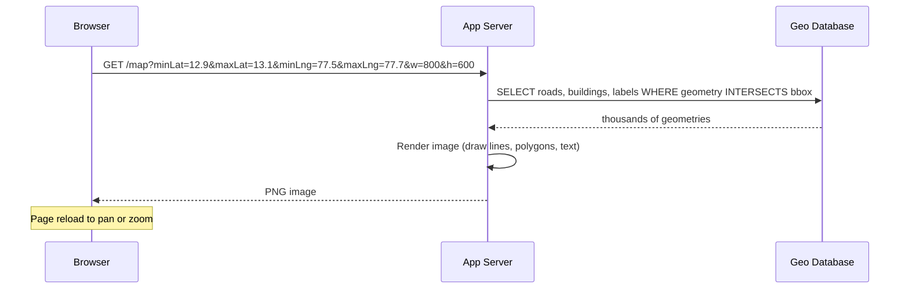

**Concrete example.** You search "Bangalore". The server computes a bounding box, finds 200,000 road segments, draws them into an 800×600 PNG (~150 ms to query, ~300 ms to render), and sends it back. You click "→" to move east. The server does the entire thing again.

For a tiny audience, this works.

---

## 4. Where v0 breaks

Launch day goes well. Then usage grows and the team notices problems. Each is a flaw that drives the next evolution.

### Problem 1: Rendering is the bottleneck
Every request runs a spatial DB query *and* draws an image. That's ~400 ms of CPU-heavy work per request. At 4M QPS you'd need roughly 4M × 0.4 s = **1.6 million cores busy just drawing pictures**. That is absurd.

### Problem 2: The cache hit rate is basically zero
You think, "Easy, cache the images." But look at the cache key: the bounding box. User A looks at `12.9000–13.1000`, and User B looks at `12.9001–13.1001`. Visually almost identical, but **different cache keys**. Bounding boxes are continuous, effectively infinite, so there is almost never a repeat. The server redraws what it already drew a second ago.

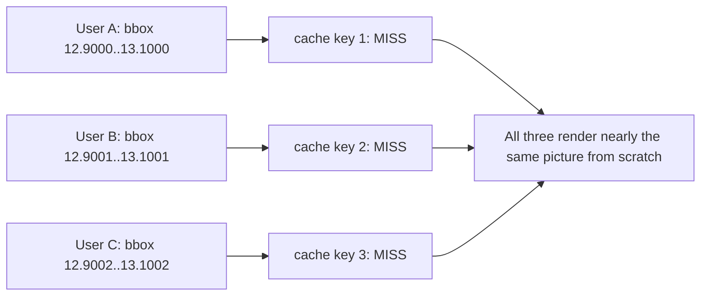

### Problem 3: Terrible user experience
Every pan means a full-page reload and waiting for a new image. Dragging a map smoothly, which feels normal today, is impossible.

### Problem 4: Wasted bandwidth
Moving the map 10 pixels sends an entire new 800×600 image where 98% of the pixels are identical to the previous one.

### Problem 5: Zoom levels explode the DB work
Zoomed out to a whole country, the server would have to fetch *every road in the country* and then draw only the highways. That is millions of rows scanned to draw a handful of lines.

> **The core insight we need:** the data is static, because a road doesn't move between two users' requests. The thing that kills caching is that **we let clients ask for arbitrary rectangles**. If every client asked for the *same predictable pieces*, we could draw each piece once and reuse it forever.

That sentence is the seed of Chapter 2: **cut the world into fixed square tiles at fixed zoom levels**.

---

## Summary of Chapter 1

- Google Maps = **display** (read-heavy, static) + **routing** (compute-heavy) + **traffic** (write-heavy, streaming)
- Estimation: ~4M tile QPS peak, ~2M location writes/s, ~600 route QPS average, and each number points to a different strategy
- Naive v0: the client sends an arbitrary bounding box, the server queries the DB, renders an image, and returns it
- It fails because of per-request rendering cost, a zero cache hit rate (arbitrary boxes), page reloads, wasted bandwidth, and unscalable DB scans at low zoom
- The key realization: **make requests predictable and cacheable**

---

## Check your understanding

1. Why does the arbitrary bounding-box approach make caching ineffective, even though the underlying map data rarely changes?
2. Why can't we just "add more servers" to solve the v0 problem?
3. Which of the three subsystems would you expect to need streaming infrastructure, and why?

Answer in your own words, or tell me what's still fuzzy. When you're comfortable, say **"next"** and we'll start **Chapter 2: Map Tiles and the Zoom Pyramid**, where the world gets cut into a grid that turns a 0% cache hit rate into 95%+.


-----------------------------------------------------------------------------------------------------------------------
-----------------------------------------------------------------------------------------------------------------------
-----------------------------------------------------------------------------------------------------------------------
-----------------------------------------------------------------------------------------------------------------------


# Chapter 2 of ~12: Map Tiles and the Zoom Pyramid

**Where we left off:** v0 let clients ask for arbitrary rectangles, so no two requests matched, the cache hit rate was ~0%, and every pan re-rendered the world.

---

## 1. The insight: stop letting clients choose the rectangle

An engineer on the team asks:

> "The data is static. The only reason caching fails is that every client asks for a different rectangle. What if **we** decide the rectangles, and the client must ask for ours?"

Imagine the world map cut into a **fixed grid of equal squares**. Each square is rendered once, stored, and given a name. Now:

- A client that wants to see Bangalore asks for squares by name: "give me squares #17, #18, #19, #20."
- Ten million users looking at Bangalore all ask for the same named squares, so the **cache key is identical** and the hit rate climbs.
- Panning means fetching only the **new squares** that slide into view. The old ones are already on screen.

These squares are **map tiles**, and this change is the foundation of every modern web map.

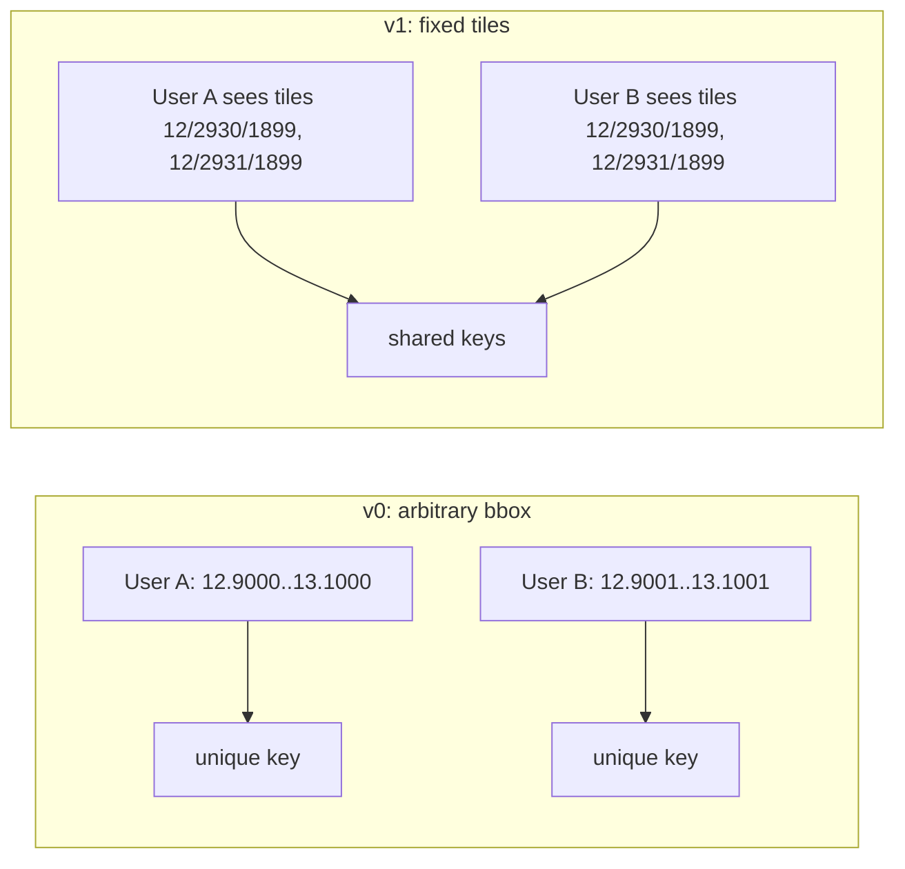

---

## 2. Zoom levels: the problem the grid creates

One grid isn't enough. A grid fine enough to show streets is useless when you zoom out to see a whole country, since you'd have to fetch and stitch millions of tiles. A grid coarse enough for a country view is useless for finding a street.

So we build **many grids, one per zoom level**, each four times finer than the previous:

- **Zoom 0**: the *entire world* is **1 tile**.
- **Zoom 1**: split each tile into 4 → **4 tiles** (2×2).
- **Zoom 2**: split again → **16 tiles** (4×4).
- **Zoom z**: **4^z tiles** (2^z × 2^z).

Every tile is the same size in pixels (classically **256×256**). Zooming in doesn't make tiles bigger. It makes each tile cover **less ground** at the same pixel size, so you see more detail.

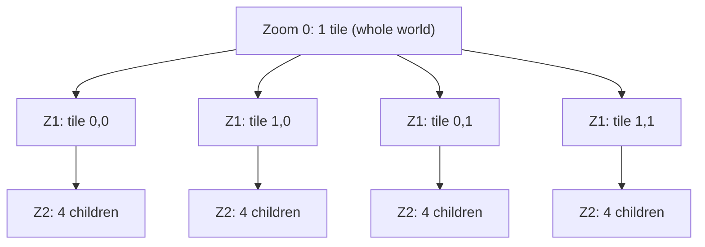

This is a **quadtree**: every tile has exactly 4 children and 1 parent. It's called the **tile pyramid** because stacking the levels (1, 4, 16, 64...) looks like a pyramid.

### What each zoom level shows (level of detail)

| Zoom | One 256px pixel ≈ (at equator) | Tiles at this level | What the map shows |
|---|---|---|---|
| 0 | ~156 km | 1 | Continents |
| 4 | ~10 km | 256 | Country borders, big cities |
| 10 | ~153 m | ~1 million | Highways, towns |
| 15 | ~4.8 m | ~1.07 billion | Streets, parks |
| 18 | ~0.6 m | ~68.7 billion | Buildings, footpaths |
| 21 | ~0.07 m | ~4.4 trillion | Maximum detail |

**Important:** each zoom level is a *different drawing*, not a magnified one. At zoom 4 you don't draw every lane of every road shrunk tiny. You draw only highways and borders. This is **cartographic generalization** (also called level-of-detail filtering), and it fixes v0's problem 5 (scanning millions of rows to draw a few lines): each zoom level has its own small, pre-filtered feature set.

---

## 3. Naming a tile: the z/x/y scheme

Every tile gets a unique address of **three integers**:

- **z** = zoom level
- **x** = column (0 at the far west, increasing eastward)
- **y** = row (0 at the north, increasing southward)

At zoom z, x and y each range from 0 to 2^z − 1. A request is simply:

```
GET /tiles/12/2930/1899.png
```

That URL **is** the cache key. It's short, deterministic, and identical for everyone.

### How does a phone know which tiles to fetch?

The map is on a sphere (lat/lon), but the screen is flat. We use the **Web Mercator projection**, which flattens the globe into a square, and then convert a lat/lon to a tile:

```
n = 2^z
x = floor( (lon + 180) / 360 × n )
y = floor( (1 − ln(tan(lat) + sec(lat)) / π) / 2 × n )      [lat in radians]
```

**Worked example:** Bangalore (lat 12.97°, lon 77.59°) at zoom 12:
- n = 4096
- x = (77.59 + 180)/360 × 4096 ≈ **2930**
- y ≈ **1899** (after the Mercator math)

→ the tile is roughly `12/2930/1899`. You won't compute this by hand in an interview, but you should know the **x formula is linear in longitude** and **y is nonlinear because of Mercator**.

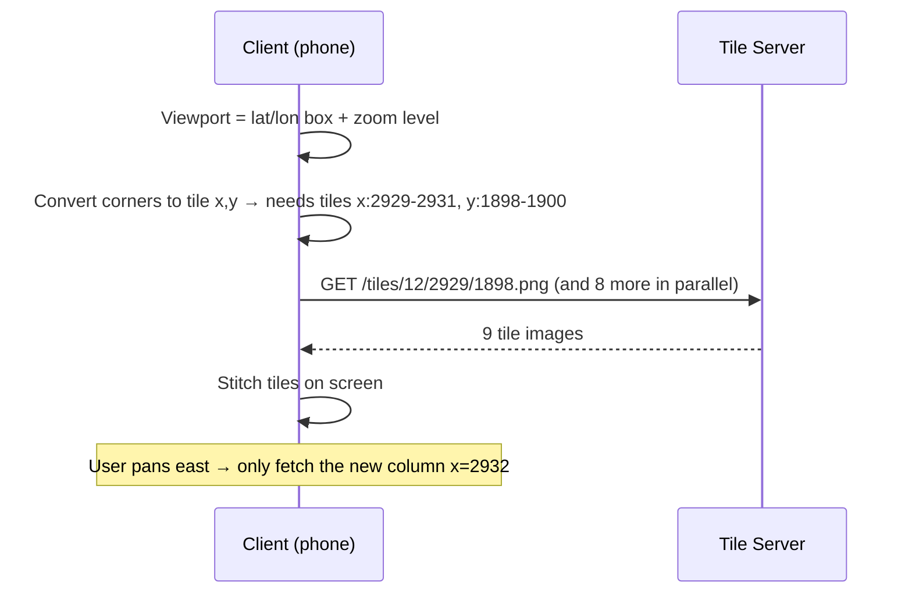

> **Key point:** the **client** does the lat/lon → tile math. The server never sees arbitrary coordinates, only tile addresses. That's what makes it cacheable.

### Why Web Mercator, and what's the catch?
- **Pro:** squares stay square, so streets look right at every zoom and the math is easy. It also makes the quadtree clean, since each tile splits exactly into 4.
- **Catch:** areas near the poles are distorted (Greenland looks as big as Africa), and the projection can't cover latitudes beyond ~85.05°. Maps accept this tradeoff.

---

## 4. Quadkey: a one-string tile ID

Instead of three numbers, you can encode a tile as a single string by recording **which quadrant you chose at each zoom level** (digits 0–3). A tile at zoom 3 might be `"213"`: quadrant 2, then 1 inside it, then 3 inside that.

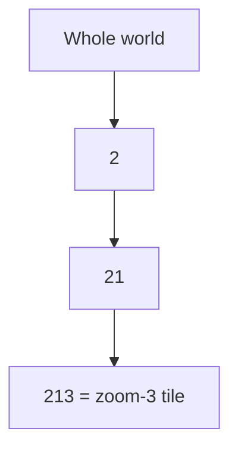

Why this matters in interviews:
- **A prefix means "inside".** Tile `213` is contained in `21`, which is contained in `2`. Finding a tile's parent or children is just trimming or appending a digit.
- **Nearby tiles often share long prefixes**, which is useful for storage and sharding keys (Chapter 3).
- The same idea powers geohash and Google's S2 (Chapter 9).

---

## 5. Who creates the tiles? Two strategies

Now we have a grid. The server still has to produce each tile's picture. There are two options.

### Option A: Pre-render everything offline
A batch job renders every tile at every zoom level in advance and stores it. A request is then just a file lookup, which is very fast.

### Option B: Render on demand and cache
Render a tile the first time anyone asks for it, store it, and serve the stored copy afterward.

Let's test Option A against the numbers:

- Tiles up to zoom 21 ≈ **5.9 trillion**
- At ~15 KB per tile → roughly **88 petabytes**
- Most of it would be **wasted**: ~71% of Earth is ocean, and the Sahara and Antarctica look nearly identical tile to tile. Almost nobody ever views zoom-21 tiles of the middle of the Pacific.

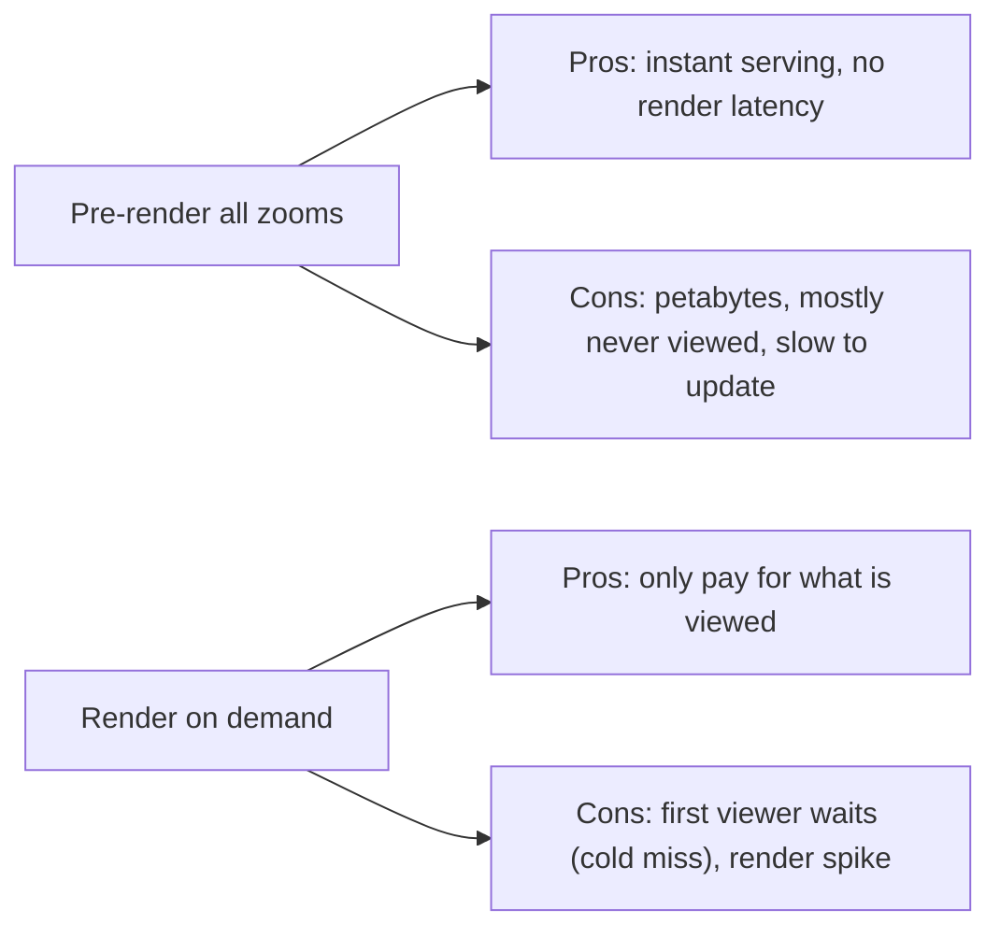

### The hybrid the real world settles on

| Zoom range | Strategy | Reason |
|---|---|---|
| Low (0 to ~12) | **Pre-render fully** | Few tiles (~22M at z12), viewed constantly, cheap to store |
| Medium/high (13–21) | **Pre-render popular areas** (cities), **render on demand** elsewhere | Counts explode, and most remote tiles are rarely viewed |
| Uniform tiles (ocean, desert) | **Store one copy, point many keys at it** (deduplication) | 71% of the world is ocean |

This reasoning pattern ("access is heavily skewed, so treat hot and cold data differently") shows up in every large system.

---

## 6. New problems with fixed tiles

Tiles solved caching and reloading, but the team soon runs into new problems.

### Problem 1: Features cut by tile borders
A road, a city label, or a building straddles two tiles. If each tile is rendered independently, **the label "Bangalore" may be cut in half**, or drawn twice, once in each tile, or a thick road may show a seam.
- **Fix:** render with a **buffer** (draw features slightly beyond the tile edge), and decide a **single owner tile** for each label so it isn't duplicated.

### Problem 2: Updates
A new road opens in Mumbai. Which tiles are stale? Not just one: **the same road appears in a different tile at every zoom level**, since it's drawn in zoom 12, 13, 14... up to 21. Invalidating by hand is painful.
- **Fix idea:** track *which features appear in which tile* (a feature → tile index), so a change produces an exact **invalidation list**, covered in Chapter 3.

### Problem 3: Tiles are baked images
A raster PNG has the style baked in: the road color, the font, the language of the labels.
- Want **dark mode**? Re-render the world.
- Want labels in **Hindi** instead of English? Re-render the world, and multiply by every language.
- Want **rotation** or **3D tilt** while navigating? A PNG can't be rotated cleanly without blurry text.
- On a **high-DPI (Retina) phone**, a 256px PNG looks blurry unless you serve 512px or 768px versions, which means **more bytes and more storage**.

This is the big one. It leads to **vector tiles** in Chapter 4: instead of sending a *picture* of the map, send the *data* and let the phone draw it.

### Problem 4: Storage and serving scale
We settled that popular tiles are pre-rendered, but we haven't said *where billions of tiny files live*, how to read them in a few ms, how to survive hot tiles (Manhattan at rush hour), or how to put them near users worldwide. That is Chapter 3.

---

## Summary of Chapter 2

- **Core idea:** replace arbitrary rectangles with a **fixed grid of tiles** addressed `z/x/y`, so the URL is the cache key.
- **Zoom pyramid:** 4^z tiles at zoom z. Each level is a different drawing with its own level of detail, which fixes the "scan millions of rows to draw few lines" problem.
- **Client computes tiles** from the viewport using Web Mercator math. The server only ever receives tile addresses.
- **Quadkey** turns z/x/y into a prefix-friendly string, which is useful for hierarchy, storage and sharding.
- **Rendering strategy:** pre-render low zooms, render popular areas ahead of time, render the rest on demand, and deduplicate uniform tiles.
- **New problems:** border cutting, invalidation across zoom levels, baked-in styles (dark mode, languages, rotation, Retina), and the storage and serving of billions of tiles.

### Interview Q&A you should now be able to answer
- *"Why tiles instead of rendering the viewport?"* → Predictable, fixed keys make the data cacheable, panning only loads new tiles, and each zoom has pre-filtered detail.
- *"How many tiles at zoom 15?"* → 4^15 ≈ 1.07 billion.
- *"Pre-render or on-demand?"* → Hybrid, driven by skewed access patterns.

---

## Check your understanding

1. If zoom 0 has 1 tile and each level splits tiles into 4, how many tiles are at zoom 6, and how many pixels wide is the whole world map at that zoom (256px tiles)?
2. Why must the *client* compute the tile coordinates rather than sending lat/lon to the server and letting the server pick the tile?
3. A new road is added. Why is invalidating the cache for it harder with tiles than it first appears?

Reply with your answers or point out what's unclear. When you're ready, say **"next"** for **Chapter 3: Tile Storage, Caching and CDN**, where we deal with billions of tiles, hot spots, and serving them in milliseconds worldwide.


-----------------------------------------------------------------------------------------------------------------------
-----------------------------------------------------------------------------------------------------------------------
-----------------------------------------------------------------------------------------------------------------------
-----------------------------------------------------------------------------------------------------------------------


# Chapter 3 of ~12: Tile Storage, Caching and CDN

**Quick answers to Chapter 2's check questions** (so we're aligned):
1. Zoom 6 has 4^6 = **4,096 tiles** (64×64), so the world is 64 × 256 = **16,384 px** wide.
2. The client computes tiles so the server only ever sees **fixed, shared keys**. If the client sent lat/lon, every URL would be unique again and the CDN couldn't cache anything.
3. One road appears in **tiles at every zoom level** (and in neighboring tiles via the border buffer), so a single change invalidates many tiles across many levels.

**Where we left off:** we have tiles named `z/x/y`, and a hybrid strategy of pre-rendering popular tiles and rendering the rest on demand. But we haven't said where billions of tiny files live, how to serve ~4M QPS, or what happens when the data changes.

---

## 1. Version 1: "just put the files on a disk"

The team's first instinct is the web server's file system:

```
/tiles/12/2930/1899.png
```

Nginx serves the files straight from disk, and it works for the first city.

**Problems appear quickly:**

| Problem | Why it hurts |
|---|---|
| **One disk, one machine** | At roughly 100 TB of tiles (see below), no single machine holds it. |
| **Billions of tiny files** | File systems struggle with billions of ~15 KB files: inode exhaustion, slow directory listings, slow backups. |
| **No redundancy** | The disk dies, and a chunk of the world disappears. |
| **Far-away users** | A user in Tokyo fetching from a server in Virginia waits 150+ ms per tile, and a screen needs ~12 tiles. |

**How big is it really?** (Ocean and empty tiles are deduplicated, so real storage is far smaller than the theoretical maximum.)
- Zoom 0–14: about 358M tiles × ~15 KB ≈ **~5 TB**. Small.
- Zoom 0–17: about 23B tiles × 15 KB ≈ 344 TB theoretical, and with ocean and desert dedup and land-only rendering, **~100 TB**.
- Zoom 18+: too big to pre-render everywhere, so it's on-demand.

This is where we introduce a **distributed storage layer** and, much more importantly, **a caching hierarchy in front of it**.

---

## 2. Version 2: a distributed tile store

### 2.1 What kind of storage?

Tiles are the ideal data for a **key-value / object store**:
- The key is the tile id (`z/x/y`, or the quadkey).
- The value is an immutable blob.
- Access is only "get by key". There are no joins, no range queries, no updates in place, just whole-tile replacement.

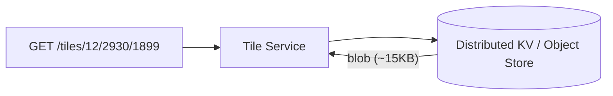

That access pattern (huge, write-once, read-many, point lookups) is why object stores and wide-column stores fit so well.

### 2.2 The "billions of tiny objects" trap

Object stores charge and perform **per request**, and they don't love 23 billion 15 KB objects. Each GET has fixed overhead. Moving one tile at a time makes bulk operations (re-render a region, back up, replicate) painfully slow.

**Evolution: tile packs.**
Group neighboring tiles into one larger file (say a **block of 8×8 = 64 tiles ≈ ~1 MB**), with an index at the front that maps `tile → (offset, length)`. Reading one tile then means:
1. Locate the pack (from the tile's coordinates).
2. Read only that tile's byte range (a **range read**).

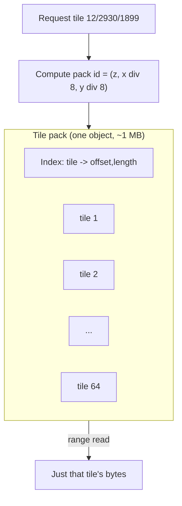

**Why this is good:**
- **Fewer objects**: 64× fewer keys to manage.
- **Locality**: a viewport is ~12 neighboring tiles, which often sit in the same pack or in one or two adjacent ones, so fewer round trips.
- **Cheap bulk ops**: copying or replicating a region means moving whole packs.

(Real systems use formats like MBTiles, a SQLite file per region, or PMTiles, a single archive with an index read by HTTP range requests. You don't need the details, just the idea: **pack neighbors together, index inside, range read.**)

### 2.3 Sharding: how to spread packs across machines

We need a **shard key**. The tile coordinates give us two natural options, and this is a classic trade-off discussion.

**Option 1: Shard by quadkey prefix (range sharding)**
- Neighboring tiles share a prefix, so they land on the **same shard**.
- ✅ Great locality: one viewport hits one or two shards.
- ❌ **Hot spots**: Manhattan, central London and Tokyo are all dense, popular areas. All of Manhattan's tiles live on one shard, which gets hammered while the shard holding the South Pacific sits idle.

**Option 2: Shard by hash of the pack id**
- `shard = hash(z, x/8, y/8) mod N`, or **consistent hashing**.
- ✅ Popular regions are spread evenly across shards.
- ❌ Adjacent packs land on different shards, so a viewport might touch several. But they're fetched **in parallel**, so this costs little.

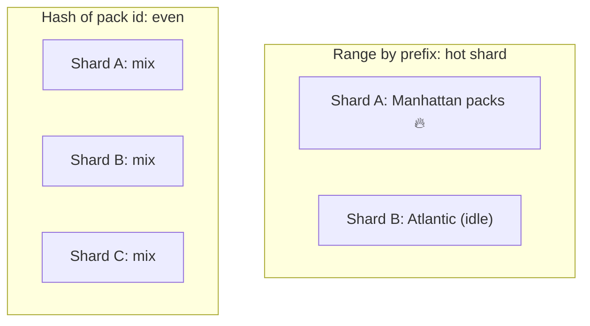

**What real systems do:** hash at the *pack* level. You keep intra-pack locality (64 neighboring tiles stay together) while spreading packs evenly. Using **consistent hashing** means adding or removing a node only reshuffles a small fraction of the keys instead of re-mapping everything. (If the interviewer asks "why not `mod N`?", the answer is that changing N moves almost every key.)

### 2.4 Replication

A storage node dies, and its tiles must still be served. Each shard keeps **3 replicas** across different racks or availability zones.

- Tiles are **immutable once written** (we replace, never edit), so replication is trivially simple: no conflicts, no write contention, and **eventual consistency is perfectly fine**. If one replica is a few seconds behind on a new tile version, nobody gets hurt.
- Reads go to **any healthy replica** (nearest or least loaded).
- Writes happen only from the **offline tile-build pipeline**, not from user traffic.

> **Interview point:** this is a **read-heavy, write-rarely, immutable** workload, which is the easiest replication scenario there is. Say that explicitly. It lets you pick eventual consistency without apology.

---

## 3. The real hero: caching in layers

The storage layer might handle 20K QPS, but users generate ~4M QPS. The gap is closed by **caches**. The idea is that every layer absorbs most of the traffic before it reaches the next.

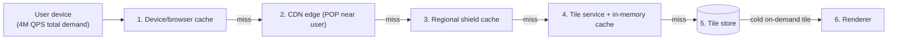

### Layer 1: the device
The phone keeps recently viewed tiles in memory and on disk. Go back to a place you just viewed and zero network requests happen. Reopening your commute area costs almost nothing. The server controls this with HTTP headers such as `Cache-Control: max-age=...`.

### Layer 2: the CDN edge
A **CDN** is a network of servers in hundreds of cities worldwide (**points of presence, POPs**). The user's request goes to the *nearest* POP.
- This is the **biggest win**: a hit is served from within ~10–30 ms, away from the origin.
- Because tile URLs are identical for everyone, a tile fetched by one user in Bangalore is cached for the next million users in Bangalore.
- Typical hit rate for popular tiles: **95%+**.

### Layer 3: regional shield (a.k.a. origin shield / mid-tier cache)
Thousands of POPs missing the same tile would each hit our origin separately. A **shield layer** sits between: all POPs in a region miss to *one* regional cache first. This collapses many POP misses into one.

### Layer 4: the tile service's in-memory cache
Hot tiles (city centers) are kept in RAM on the tile service nodes (an LRU cache, or Redis/Memcached), so we skip even the storage read.

### The math that makes it all work
- Total demand: **4M QPS**
- After the device cache and CDN at ~95% hit: **200K QPS** reach origin
- After the shield at ~90% hit: **20K QPS** reach the storage layer
- That's a **200× reduction**, and 20K reads/s across a sharded store is comfortable.

> If an interviewer asks "how do you handle 4M QPS?" the answer is **"we don't, our origin sees about 20K QPS"**, followed by this layered explanation.

---

## 4. Problems with caching, and their evolutions

### Problem A: Thundering herd (cache stampede)
A popular tile expires or is invalidated. At that instant 50,000 requests arrive and *all* miss, and all 50,000 go to the origin to render the same tile.

**Fix: request coalescing (a.k.a. request collapsing, "single-flight").**
The first request for a missing key goes to the origin. All others **wait on that same in-flight request** and share the result.

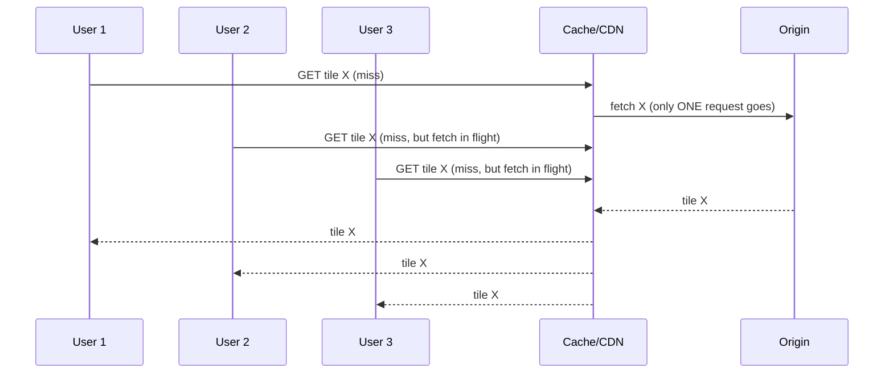

Also helpful is **`stale-while-revalidate`**: serve the slightly old tile immediately while quietly refreshing it in the background, so nobody waits.

### Problem B: Invalidation, the notorious hard problem
A new road opens. We rebuild the affected tiles. But the old versions are cached on devices, at 300 CDN POPs, in the shield, and in RAM. How do we make them all drop the stale ones?

**Naive approach: purge.**
Send purge requests for every affected tile to the CDN. It's slow and unreliable (propagation takes time), costly at scale, and **can't reach tiles cached on users' phones at all**.

**The better approach: versioned (immutable) URLs.**
Put a version in the URL:

```
/tiles/v847/12/2930/1899
```

- Tiles at a given version **never change**, so they can be cached with a very long TTL (`max-age=1 year, immutable`). That's the best possible caching.
- When the map updates, we publish **v848**. The client learns of the new version (from a small metadata/manifest endpoint) and starts requesting `/v848/...`.
- Old tiles simply stop being requested and fall out of caches naturally. **No purging.**

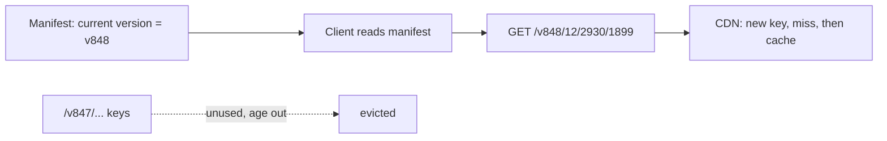

**One catch: cold start after a version bump.** If the *entire* map moves from v847 to v848 at once, every tile is a cache miss everywhere and the origin gets flooded. Mitigations:
- **Per-region versions**: only bump the version for tiles that actually changed, so most tiles keep their old version and stay warm. This needs a mapping from region to version, or a per-tile content hash in the manifest.
- **Content-hash keys**: unchanged tiles keep the same hash and stay cached.
- **Pre-warming** (see below).

### Problem C: Cold tiles are slow
A user opens a rural area at zoom 18 that nobody has viewed. It isn't pre-rendered, so the request goes: CDN miss → shield miss → store miss → **render on demand (~hundreds of ms)**.
- It's fine for rare tiles, since only the first viewer waits and the result is cached afterward.
- Use **request coalescing** here too, so a burst of first-time viewers triggers one render.
- Render **neighbors speculatively**: when tile X is requested, enqueue its adjacent tiles, because the user is likely to pan next.

### Problem D: Hot tiles
Tiles around a stadium during a match, or a city after a big event, can overload a single cache node.
- Replicate hot keys across **multiple cache nodes** (and let the CDN absorb the surge).
- Keep a small **local in-process cache** on every tile-service node for the hottest ~thousand tiles.

---

## 5. Pre-warming and bootup

Three situations call for pre-warming. Interviewers like this topic.

1. **New cache node joins** (autoscaling or deploy): it starts empty and the first minutes cause miss storms. **Warm it before sending traffic.** Load the top-N hot tiles for its region from a "popular tiles" list, or replay recent hot keys from a peer. Use **gradual traffic ramp-up** (1% → 10% → 100%).
2. **After a map version release**: before announcing the new version in the manifest, run a job that **fetches the hottest tiles of the new version through the CDN** (top cities, plus tiles from yesterday's access logs). Only then flip the manifest.
3. **Predictable events**: a marathon route, a major festival, New Year's Eve at Times Square. Pre-render and pre-cache those areas.

**How do we know what's hot?** Aggregate access logs into a "top tiles by region" job, run daily. Access is heavily skewed (the popular few percent of tiles take most of the traffic), so warming a small set pays off hugely.

---

## 6. Error handling for tile serving

| Failure | Handling |
|---|---|
| **Storage replica down** | Read from another replica, with timeouts and a **hedged request** (if the first replica is slow, send a second one after, say, the p95 latency and take whichever returns first). |
| **Renderer overloaded** | **Load shedding**: reject or queue low-priority renders (remote high-zoom tiles), protect hot paths. Use circuit breakers. |
| **Tile missing or can't be generated** | **Graceful degradation**: return the **parent tile** (one zoom level up) and let the client **upscale** it temporarily (blurry but present), then refresh when the real tile arrives. |
| **Whole origin down** | The CDN serves **stale** tiles (`stale-if-error`). Since tiles barely change, stale ones are almost always fine. The map keeps working. |
| **Slow or flaky network** | The client **retries with backoff**, uses on-device cache and shows lower-zoom tiles while higher-zoom ones load. |
| **Corrupt tile** | Checksums on packs, detect and re-read from another replica, and trigger a repair. |

> The beauty of immutable, cached, static-ish data is that **failures are mostly invisible**: stale or lower-resolution data is a perfectly acceptable fallback, unlike a banking system. State this explicitly in an interview.

---

## 7. Putting it all together (the architecture at the end of Chapter 3)

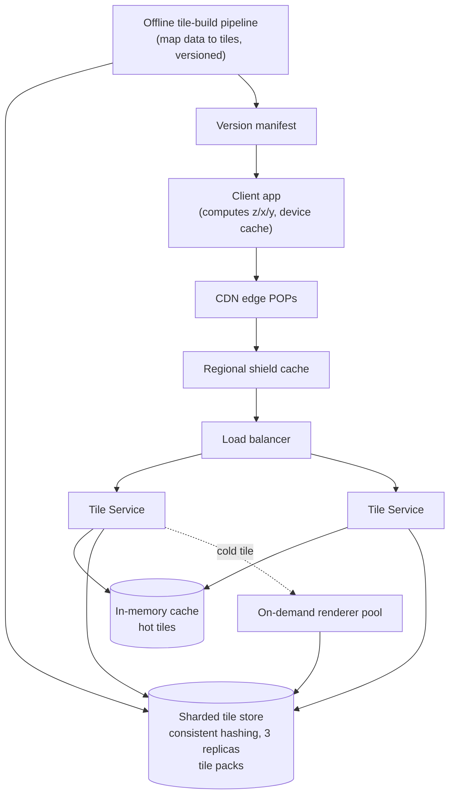

---

## Summary of Chapter 3

- **Storage:** tiles are immutable blobs, so use a **KV/object store**. To avoid the tiny-file problem, **pack neighboring tiles** (e.g., 8×8) with an index and read byte ranges.
- **Sharding:** hash the **pack id** with **consistent hashing**. Prefix/range sharding creates hot shards in dense cities, while hashing spreads them. Packs keep locality.
- **Replication:** 3 replicas across zones. Eventual consistency is fine because tiles are immutable and written only by the offline pipeline.
- **Caching layers:** device → CDN → regional shield → in-memory → store. This turns ~4M QPS into ~20K QPS at the store.
- **Thundering herd:** **request coalescing** plus `stale-while-revalidate`.
- **Invalidation:** avoid purges. Use **versioned/immutable URLs** with long TTLs, and avoid global version bumps with per-region versions or content hashes.
- **Pre-warming:** warm new cache nodes, warm hot tiles before a version flip, and warm known event areas.
- **Failure handling:** replica failover, hedged requests, load shedding, **parent-tile fallback**, **serve stale on error**.

### Interview Q&A you should now be able to answer
- *"How do you serve 4M QPS of tiles?"* → Layered caches, since the origin sees only ~0.5%.
- *"Shard by prefix or hash?"* → Hash at the pack level with consistent hashing. Prefix creates hot shards in cities.
- *"How do you roll out a map update without a cache storm?"* → Versioned immutable URLs, per-region versions or content hashes, and pre-warm before flipping the manifest.

---

## Check your understanding

1. Why does immutability of tiles make replication and caching so much easier than for, say, a user profile database?
2. Why does shard-by-quadkey-prefix create hot spots, and how does hashing the *pack id* keep locality without that problem?
3. A new map version is published and every tile URL changes. What goes wrong, and name two ways to avoid it?

Answer in your own words, or tell me what's still fuzzy. When you're ready, say **"next"** for **Chapter 4: From Raster to Vector Tiles**, where we fix the "baked-in picture" problem: dark mode, many languages, rotation, Retina screens and smaller downloads.


-----------------------------------------------------------------------------------------------------------------------
-----------------------------------------------------------------------------------------------------------------------
-----------------------------------------------------------------------------------------------------------------------
-----------------------------------------------------------------------------------------------------------------------


# Chapter 4 of ~12: From Raster to Vector Tiles

**Quick answers to Chapter 3's check questions:**
1. Immutable tiles never change in place, so there's nothing to keep coherent: every replica is identical, no write conflicts exist, and caches can hold a tile "forever" without invalidation. A user profile is mutable, so it needs consistency rules and invalidation.
2. Prefix sharding puts all of Manhattan on one shard (a hot spot). Hashing the **pack id** spreads packs evenly, while the 64 tiles inside each pack still stay together for locality.
3. If every URL changes at once, every cache misses and the origin is flooded. The fixes are per-region versions or content-hash keys (unchanged tiles stay warm), and pre-warming hot tiles before flipping the manifest. Request coalescing helps too.

**Where we left off:** tiles are fast, cached and well distributed, but each tile is a *finished picture* (PNG). The style, language and resolution are baked in.

---

## 1. The pain of baked-in pictures

Product requests start piling up, and each one hurts with raster tiles:

| Request | What it costs with PNG tiles |
|---|---|
| **Dark mode** for night driving | Re-render the **entire world** a second time, and store and cache both copies |
| **Labels in 40+ languages** | 40+ complete copies of the world |
| **Retina / high-DPI phones** | 256px PNGs look blurry. Serve 512px or 768px versions: **2–9× more pixels** to render, store and send |
| **Rotate the map** (heading-up navigation) | Rotating a bitmap makes text sideways or blurry |
| **Tilt (3D perspective)** | Impossible to do cleanly with flat pictures |
| **Smooth zooming** (pinch between levels) | The client stretches a bitmap and everything gets fuzzy until the next zoom level loads |
| **Highlight a route, hide POIs, show transit** | Another full re-render for each variation |

The number of renders is `styles × languages × resolutions × layers`, a combinatorial explosion. And every copy needs its own cache entries.

**The realization:** a raster tile is the *result* of drawing. What if we send the **ingredients** (the roads, buildings, water and labels as data) and let the **phone** do the drawing?

---

## 2. The idea: vector tiles

Same grid and same `z/x/y` addressing. Only the **payload** changes: instead of pixels, a tile carries **geometry plus attributes**.

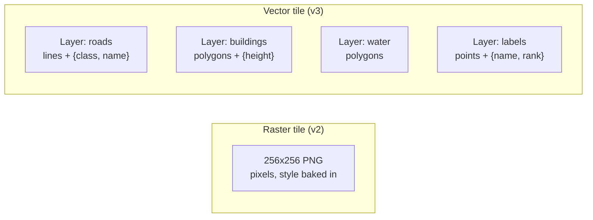

### What's inside one vector tile?

A tile is organized into **layers**, and each layer holds **features**:

```
Tile 15/5860/3798
 ├─ layer "road"
 │    ├─ feature: LineString [(120,300),(480,310),(900,305)...]
 │    │            props: {class:"primary", name:"MG Road", oneway:false}
 │    └─ ...
 ├─ layer "building"
 │    └─ feature: Polygon [...]  props: {height: 24}
 ├─ layer "water"
 └─ layer "poi_label"
      └─ feature: Point (2048,1900)  props: {name:"Cubbon Park", name_hi:"...", rank:2}
```

**Coordinates are tile-local.** Instead of lat/lon floats, each tile uses an integer grid (typically **4096×4096**) *relative to the tile's own corner*. Integers are compact, and tile-local numbers are small.

### How is it kept small? (Encoding)

The common format is **Mapbox Vector Tile (MVT)**, built on **Protocol Buffers**:
- Geometry is stored as a few drawing commands: `MoveTo`, `LineTo`, `ClosePath`.
- Coordinates are stored as **deltas** (the difference from the previous point), then **zigzag + varint** encoded. A road that moves a few units per vertex costs a byte or two per point.
- Repeated property keys and values are stored once in a **string table** per layer, and features point to them by index.
- The whole tile is then **gzip/brotli** compressed on the wire.

> **Interview-ready sentence:** "Vector tiles use tile-local integer coordinates, delta and varint encoding in Protobuf, a per-layer key/value dictionary and HTTP compression, which is why they're compact."

---

## 3. Who draws it now? The client

The phone downloads the tile and renders it itself on the **GPU**, using a **style** that says how to draw each layer.

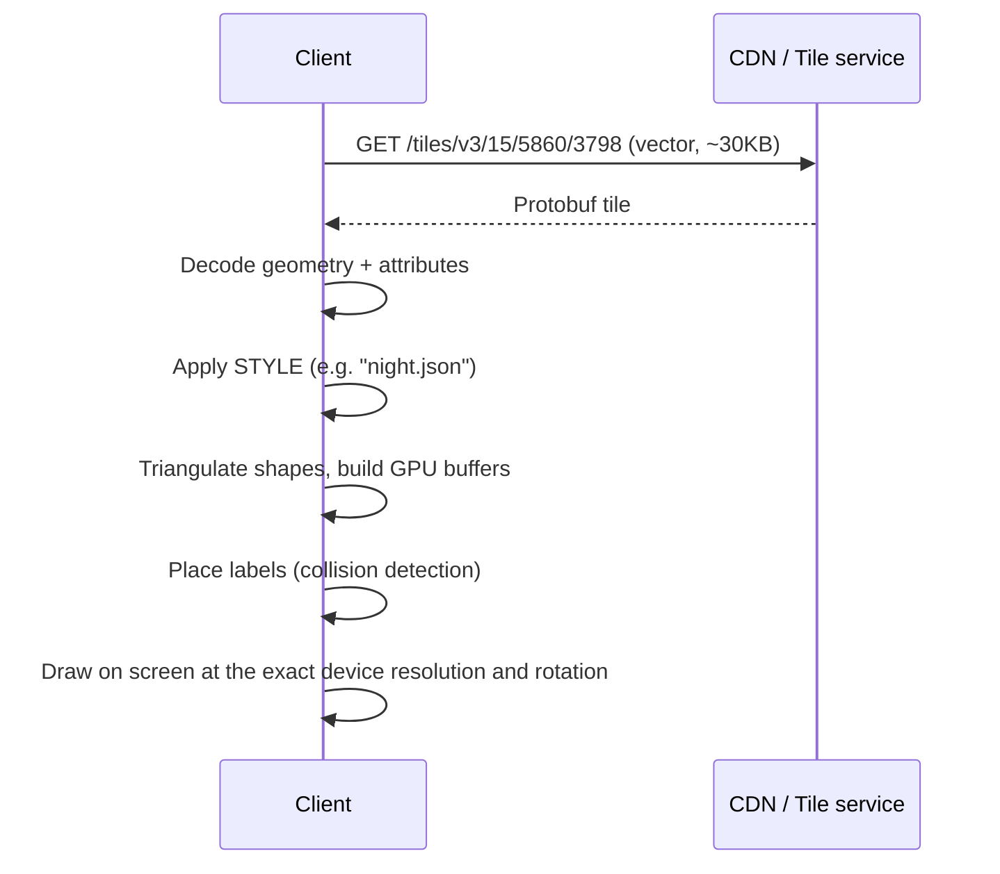

A **style** is a small JSON/config file with rules such as:
- "layer `road`, class `motorway` → orange, 6px wide at zoom 14, 10px at zoom 18"
- "layer `water` → blue"
- "layer `poi_label` → draw text using `name_<user_language>`, font X, only if `rank ≤ 3` at this zoom"

The **style is separate from the data**, which is the whole trick.

### What this unlocks

| Before (raster) | After (vector) |
|---|---|
| Dark mode = re-render the world | Swap the style file (a few KB). **Same tiles.** |
| 40 languages = 40 worlds | Tile carries `name_xx` attributes (or small per-language packs), and the client picks one. **Same tiles.** |
| Retina blur | Drawn at native resolution, always crisp |
| Rotation/tilt | Labels are re-drawn upright at every angle, and 3D buildings can be extruded using the `height` property |
| Pinch zoom | Geometry is rescaled mathematically, and the client **interpolates** between zoom levels for smooth animation |
| Highlight a route / hide POIs | Client-side styling, no server round trip |

### The overzoom bonus (a big storage win)

Raster tiles had to be pre-rendered or on-demand rendered for **every** zoom up to 21. With vectors, lines and polygons stay sharp when scaled, so you only store tiles up to a **maximum data zoom** (commonly ~14 to 16), and the client **overzooms**: it keeps using the z14 tile's geometry when displaying z15 through z22.

- Tiles at zoom 0–14 ≈ **358 million** (versus tens of billions to reach z17+ for raster).
- Dense cities can have deeper data tiles (z16) where buildings need more precision, while rural areas stop earlier.

This directly attacks the storage and pre-render problem from Chapters 2 and 3.

### Size comparison (typical, will vary by area)

A vector tile for a dense city block is often **comparable to or smaller than** a Retina raster tile, and it serves *every* style, language and resolution. The real win isn't one tile being smaller, it's that you stop multiplying the number of tile copies by styles, languages and resolutions.

---

## 4. The new problems vector tiles create

Moving work to the client solved the server-side explosion, but the team now meets a fresh set of problems.

### Problem 1: Geometry must be cut at tile borders (clipping)
A long road or a lake spans many tiles. The tile builder **clips** each geometry to the tile (plus a small **buffer**, e.g., 64 units beyond the edge) so line joins and polygon edges don't show seams. Clipped pieces need a consistent **feature id** so the client knows two pieces belong to the same real-world object.

### Problem 2: Labels across tile boundaries
"Bangalore" may be in 4 tiles. If each tile carries the label, the client draws it 4 times or in the wrong spot.
- **Fix:** the **client** does label placement across *all loaded tiles together*: collision detection, priority by `rank`, and dedupe by feature id.
- Cost: placement is CPU-heavy, so engineers run it on a background thread and fade labels smoothly.

### Problem 3: Too much detail at low zoom (simplification and generalization)
At zoom 5, sending every vertex of every coastline wastes bytes, and clients choke drawing it. The pipeline must **simplify per zoom level**:
- **Douglas-Peucker**-style line simplification with a tolerance that grows as you zoom out.
- **Feature dropping**: no individual buildings at zoom 8, no footpaths at zoom 10, only highways at zoom 6.
- **Merging** small adjacent polygons.

This is the vector version of Chapter 2's level-of-detail idea, and it's part of the offline tile-build pipeline.

### Problem 4: Client CPU, GPU and battery
Decoding and tessellating thousands of features is not free. On a low-end phone, vector maps can stutter and drain battery.
- **Mitigations:** decode on background threads, **cache decoded tiles** (not just the bytes), limit features per tile, do GPU-friendly batching, and offer a **lightweight mode** (see the migration section).

### Problem 5: Tile size can blow up in dense areas
Midtown Manhattan at zoom 15 has a huge number of features. A tile can reach hundreds of KB.
- **Fix:** a **per-tile size budget** (for example, around 500 KB). The pipeline drops the lowest-priority features (small buildings, minor POIs) until the tile fits, or **splits** detail into deeper zoom levels.

### Problem 6: Versioning between *data*, *style* and *client*
Now there are three moving parts: the tile schema, the style, and the app version. An old app that doesn't understand a new layer or attribute must not crash.
- **Fix:** **schema versioning in the URL** (`/v3/...`), strictly **additive** changes (new layers and attributes only, never renames), and the client **ignores unknown fields**. Styles are versioned too and can be updated **without an app release**, which is a useful operational lever.

---

## 5. Migration strategy: moving the world from raster to vector

Interviewers love "how would you migrate without breaking users?" Here is a realistic plan.

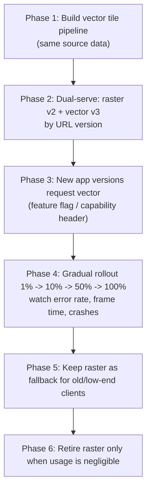

Key ideas:
- **Both formats share the source data**, so they're built from the same pipeline. Only the final step differs.
- **Different URL prefixes** (`/v2/` raster, `/v3/` vector) mean they cache independently and rollback is just "point clients back".
- **Capability negotiation**: the client says what it supports (vector, GPU tier, app version), and the manifest tells it which tile set to use.
- **Staged rollout with guardrails**: monitor tile fetch latency, client render time, crash rate, and battery metrics. Auto-pause the rollout on regression.
- **Satellite and some imagery stay raster** (they are photos, not geometry). Real maps use **both**: vector for the road map, raster for satellite.

---

## 6. Updated architecture after Chapter 4

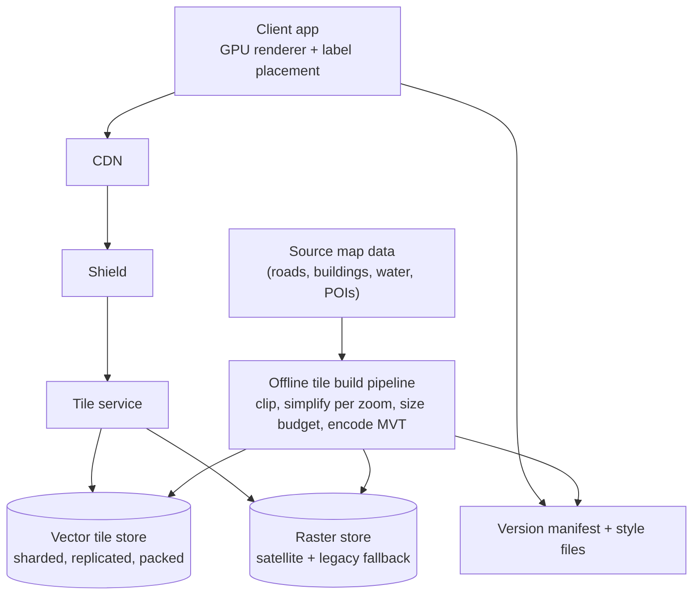

Note what disappeared: the **on-demand raster renderer** is no longer on the hot path for road maps. Tile build is fully offline, and rendering happens on users' phones. The server cost moves to *clients*.

---

## Summary of Chapter 4

- **Why:** raster tiles bake in style, language and resolution, causing `styles × languages × resolutions` copies, blurry Retina, and no clean rotation or tilt.
- **Idea:** same `z/x/y` grid, but each tile carries **layers of geometry plus attributes** in a compact format (MVT/Protobuf: tile-local integer coordinates, delta/varint, string tables, gzip).
- **Client renders** on the GPU using a separate **style** file. Dark mode, languages, rotation, tilt and smooth zoom become cheap or free.
- **Overzooming** lets us store only up to ~z14–16, a huge storage reduction.
- **New problems:** clipping at borders, label placement across tiles (client side), simplification per zoom, client CPU/battery, oversized dense tiles (per-tile size budget), and schema/style/app versioning (additive changes, ignore unknown fields).
- **Migration:** dual-serve under different URL versions, capability negotiation, staged rollout with guardrails, keep raster for imagery and as a fallback.

### Interview Q&A you should now be able to answer
- *"Why vector tiles over raster?"* → Style, language and resolution are decoupled from data, so one tile set serves all combinations. It's crisp at any DPI, supports rotation/tilt, and enables overzoom for storage savings.
- *"What's the downside?"* → Client CPU/GPU and battery cost, more complex clients, and tile schema versioning.
- *"How do you roll it out safely?"* → Dual-serve, versioned URLs, a feature flag with a capability check, staged rollout with metrics-driven auto-pause, and a raster fallback.

---

## Check your understanding

1. Dark mode and a new language both need to ship. Explain why this costs almost nothing in the vector design but a full re-render in the raster design.
2. What is overzooming, and how does it change the storage estimate from Chapter 3?
3. An old app version receives a vector tile with a brand-new layer it has never seen. What design rule prevents a crash, and what does it imply for how you evolve the tile schema?

Reply with your answers, or tell me what's unclear. When you're ready, say **"next"** for **Chapter 5: The Road Network as a Graph (storage and sharding)**, where we leave map *display* behind and start the hard part: modelling hundreds of millions of road segments so we can compute routes.


-----------------------------------------------------------------------------------------------------------------------
-----------------------------------------------------------------------------------------------------------------------
-----------------------------------------------------------------------------------------------------------------------
-----------------------------------------------------------------------------------------------------------------------


# Deep dive (Chapter 4 extension): Raster vs Vector Tiles, Edges, Building, and Zoom/Overzoom

This extends Chapter 4, and Chapter 5 will follow afterward. The order is raster, vector, how pieces connect across tile borders, how to build the tiles, and finally zoom and overzoom.

---

## 1. Raster tiles in detail

### 1.1 What is actually stored

A raster tile is an image: a 256×256 grid of pixels, each pixel a color.

- Format: usually **PNG** for maps (sharp edges and flat colors compress well) and **JPEG/WebP** for satellite photos.
- A map PNG is often stored as **8-bit palette (indexed)** instead of full RGBA. A map uses only ~30–200 distinct colors, so each pixel is one byte pointing into a palette, and this makes it 3–4× smaller.
- Then **DEFLATE compression** (inside PNG) removes repeated runs. Large flat areas such as water, parks or empty land compress to almost nothing. A tile of open ocean can be ~100 bytes, while a dense city tile might be 20–40 KB.

What the tile does **not** contain is any meaning. It holds no concept of "this is MG Road", "this building is 24 m high" or "this label says Cubbon Park". Those are only colored pixels. That is why you can't tap a road to select it, restyle it, or rotate the labels. The semantics were thrown away at render time.

### 1.2 How a raster tile is produced

A **renderer** takes the source map features (the same road and building geometry), applies a **style**, and draws pixels with anti-aliasing (smooth edges).

```mermaid
flowchart LR
    SRC["Source features<br/>roads, buildings, water, labels"] --> SEL["Select features intersecting<br/>this region at this zoom"]
    SEL --> DRAW["Rasterizer draws<br/>with style: colors, widths, fonts"]
    DRAW --> CUT["Slice canvas into 256x256 tiles"]
    CUT --> ENC["Encode PNG or WebP"]
    ENC --> ST[("Tile store")]
```

### 1.3 Edges in raster: metatiles

If you render each 256×256 tile independently, a wide road that crosses the border has its stroke cut, and a line cap or join exactly at the border looks wrong. Text that crosses the border is half-drawn in each tile and may be positioned differently in each.

**Fix: render a metatile.** Draw a larger canvas, say **8×8 tiles = 2048×2048 px** (plus a margin), as *one picture*, then slice it into 64 tiles.
- A road that crosses an internal tile border is simply continuous on the big canvas, and cutting it afterwards produces matching halves.
- Only the outer border of the metatile has the problem, and the **margin** (drawing a bit beyond the edge) handles line widths there.

**Labels across metatile borders** are the leftover problem. Two adjacent metatiles might place the label "Bangalore" in different positions, because collision decisions depend on what else is in the canvas. The fix is to decide label positions in a **global pre-pass**, store them in a label table, and have every renderer draw each label **in full, clipped by its own canvas**. The two halves then line up.

> A raster tile is a *cut-out of one consistent picture*. That's how raster achieves correctness at edges: draw big, then cut.

---

## 2. Vector tiles in detail

### 2.1 Structure of a tile

A vector tile stores **what to draw**, as structured data.

```mermaid
classDiagram
    class Tile {
        z x y address
    }
    class Layer {
        name e.g. road
        extent 4096
        keys list
        values list
    }
    class Feature {
        id
        type POINT or LINE or POLYGON
        tags key-value index pairs
        geometry encoded commands
    }
    Tile "1" --> "many" Layer
    Layer "1" --> "many" Feature
```

- **Layers** group feature kinds: `water`, `landuse`, `road`, `building`, `poi_label`, `transit`, and so on.
- The **style** later says how to draw each layer.
- **Extent** is the tile-local integer grid, usually **4096 × 4096**. The tile's top-left corner is `(0,0)`, `x` grows right and `y` grows down.

### 2.2 How coordinates are encoded (byte level)

Take a road with three points in tile-local units: `(2,2) → (2,10) → (10,10)`.

The geometry is stored as a small list of integers, commands plus parameters:

```
[ 9, 4, 4,   18, 0, 16, 16, 0 ]
```

Decoding:
- `9` = command **MoveTo**, count 1. Formula: `(count << 3) | commandId`, with MoveTo = 1 → `(1<<3)|1 = 9`.
- `4, 4` = the point `(2,2)`, **zigzag-encoded** (see below).
- `18` = command **LineTo**, count 2: `(2<<3)|2 = 18`.
- `0, 16` = move by **delta** `(0, +8)`, which gives `(2,10)`.
- `16, 0` = delta `(+8, 0)`, which gives `(10,10)`.
- Polygons end with **ClosePath**: `(1<<3)|7 = 15`.

**Zigzag encoding** maps signed integers to unsigned ones so small negative numbers stay small: `0→0, −1→1, 1→2, −2→3, 2→4 ...` (`(n<<1) ^ (n>>31)`). Then **varint** encoding stores small numbers in 1 byte, instead of a fixed 4.

Why deltas matter: consecutive vertices on a road are close together, so the deltas are tiny numbers. 100 vertices cost maybe 150–300 bytes before gzip.

**Attributes** are stored once per layer, not per feature:

```
layer "road":
   keys   = ["class", "name", "oneway"]
   values = ["primary", "MG Road", false]
   feature tags = [0,0,  1,1,  2,2]     // (key idx, value idx) pairs
```

A thousand "primary" roads all point to the same `"primary"` string, so repeated text is stored once.

**Polygon rings:** the outer ring has one winding direction (clockwise in tile coordinates) and holes have the opposite. That's how a park with a lake inside it (a hole) is expressed without extra flags.

### 2.3 Points, lines and polygons are all you need

| Real-world thing | Geometry | Example attributes |
|---|---|---|
| Road, river, rail | LineString | `class`, `name`, `oneway`, `bridge`, `layer` |
| Building, lake, park | Polygon | `height`, `kind` |
| Shop, bus stop, city name | Point | `name`, `rank`, `category` |

---

## 3. Making everything connect correctly across edges

This is the heart of your question. There are six mechanisms, and in an interview you should name all of them.

### 3.1 Everyone shares one global coordinate system

Every feature in the source data has **absolute positions** (lat/lon, or Web Mercator). For each tile, the builder maps world coordinates to that tile's local grid with a pure function:

```
local_x = (world_x − tile_origin_x) × (4096 / tile_width)
```

Two neighboring tiles use the *same world geometry* and the same formula, so a point exactly on their shared border becomes `x = 4096` in the left tile and `x = 0` in the right tile. The tiles agree by construction because they come from the same source and the same math.

### 3.2 Clipping with a buffer

A road crossing the border is **cut at the tile boundary**, but with a **buffer**: each tile keeps geometry slightly *outside* its own square (for example 64 units = 1.5% of the tile).

```
         Tile A                    |            Tile B
   0                       4096    |    0                        4096
   +---------------------------+-----+   +-----+---------------------------+
   |                           |/////|   |/////|                           |
   |   ========================|=====|===|=====|========================   |
   |   road (visible part)     |buffer   |buffer|  road (visible part)     |
   |                           |/////|   |/////|                           |
   +---------------------------+-----+   +-----+---------------------------+
                               ^ A keeps 64 extra units past its edge
                                         ^ B keeps 64 extra units before its edge
```

Why the buffer matters:
- A **thick stroke** (a road is drawn 10 px wide) has end caps and joins. If geometry stopped exactly at the edge, you'd see a flat cut or a hairline gap. With the buffer, the line extends beyond the visible area and the renderer clips at the screen, so the join is seamless.
- Polygon outlines are the same. When you clip a polygon you create an **artificial edge** along the tile border. If the style strokes polygon outlines, a bogus line shows along the border. With the buffer, that artificial edge lies *outside* the visible region.

### 3.3 Rounding consistency (no hairline cracks)

The clip intersection point is computed in high precision in world coordinates, and only then rounded to integers. Both tiles compute the **same intersection** from the **same segment**, so they round the same way. The buffer overlap hides any remaining 1-unit mismatch.

### 3.4 Feature IDs tie the pieces together

A road clipped into 4 tiles becomes 4 pieces. Each piece carries the **same feature `id`** (for instance the source road's ID).
- Highlighting "the route" or selecting "MG Road" works across all pieces.
- **Labels** are deduplicated by id and name, so we don't draw "MG Road" four times.

### 3.5 Labels: one owner, placed globally

- **Point labels** (a city, a shop) live in exactly **one tile**, the one that contains the point. No duplication problem.
- **Polygon labels** (a big park): the build step generates a single **label point** per polygon (for example its "pole of inaccessibility", the most interior point) in a separate `label` layer, so it exists in one tile only.
- **Line labels** (street names): the name is attached to each clipped piece. The *client* stitches the loaded tiles' geometries by id and places the text **along the combined line**, so the name flows across the border.
- All **collision detection** (which label wins when two overlap) happens on the client across *all loaded tiles*, using `rank` priority.

### 3.6 Junctions, bridges and draw order

A common worry is "how do two roads look connected at an intersection?" For *display*, roads are separate lines that simply overlap, and the look comes from the **drawing order**:
1. Draw every road's **casing** (a slightly wider dark outline) first.
2. Then draw every road's **fill** (lighter color) on top.

The fills of crossing roads merge visually, because every casing is below every fill. The outline appears only at the outer edges.

**Bridges and tunnels** need correct stacking, so roads carry a `layer` integer attribute and a `bridge` or `tunnel` flag. The style sorts them: tunnels below, ground roads in the middle, bridges above. Buildings sit above `landuse` and `water`, and labels go on top. The **style's layer order** is the z-order.

**Source topology matters too.** If two road endpoints that should meet are 2 cm apart in the source data, you get a visible gap. During the build, vertices are **snapped to the integer grid**, and near-duplicate points collapse. A segment that collapses to zero length is removed.

> **Important distinction for interviews.** Tile connectivity is for **drawing**. It makes the picture look continuous. It does **not** tell you which roads are *navigable* to each other (turn restrictions, one-ways, whether a road actually joins another). That requires a separate **routing graph**, which is Chapter 5. The routing graph is **not** built from tiles. It is built from the same source data, with explicit nodes and edges.

---

## 4. How to build the tiles, at a high level

The tile-build pipeline is an **offline batch job**: huge, parallel, and re-run whenever the map data changes.

```mermaid
flowchart TD
    A["1. Ingest raw sources<br/>OSM-like data, government data, imagery-derived, partner feeds, edits"] --> B["2. Clean and normalize<br/>fix invalid geometry, dedupe, snap endpoints"]
    B --> C["3. Classify into layers and attributes<br/>assign class, name_xx, height, rank"]
    C --> D["4. Assign min zoom to each feature<br/>motorway: z4, street: z12, footpath: z15"]
    D --> E["5. MAP: for each feature, for each zoom,<br/>list the tiles it touches"]
    E --> F["6. SHUFFLE: group pieces by tile id"]
    F --> G["7. REDUCE: build each tile<br/>clip with buffer, simplify, drop tiny features, quantize, size budget, encode MVT, gzip"]
    G --> H["8. Pack tiles into packs, write to store as version N+1"]
    H --> I["9. Validate: diff vs previous, visual checks, size stats"]
    I --> J["10. Publish manifest, pre-warm CDN"]
```

Step by step:

- **Step 4, minzoom/importance.** Each feature gets the zoom at which it first appears, which is how the level of detail from Chapter 2 is implemented. A country border may appear at z0 and a bench at z17.
- **Steps 5–7, the core: a "group by tile" job.** This is a standard MapReduce, Spark or Beam shape. The *map* phase takes each feature and emits `(tile_id, piece)` for every tile it overlaps. A long highway might emit pieces for thousands of tiles across zoom levels. The *shuffle* groups all pieces by `tile_id`. The *reduce* builds one tile at a time, completely independently, which makes this easy to parallelize across thousands of machines.
- **Per-tile build details:**
  - **Clip** to tile + buffer.
  - **Simplify** geometry. Use a tolerance of ~1 pixel at that zoom, with Douglas-Peucker or Visvalingam-style algorithms, because detail finer than a pixel is invisible and costly.
  - **Drop** features too small to see (for example, a polygon smaller than a few pixels), and merge neighboring small polygons.
  - **Quantize** to the 4096 grid and drop degenerate pieces.
  - **Enforce a size budget** (say ~500 KB). If it's exceeded, drop the lowest-`rank` features first.
  - **Encode** as MVT and gzip it.
- **Step 8, versioned write.** Tiles go into packs (Chapter 3) under a new version. Unchanged tiles (same content hash) are **not rewritten**.

### Incremental updates

A full-planet rebuild is slow, so daily changes use an **incremental** path:
1. A changed road produces an **old bounding box and a new bounding box**.
2. From these, compute the set of **affected tiles at every zoom level** (the inverse of the map phase).
3. Rebuild **only those tiles** and publish per-region version bumps or new content hashes. This feeds the invalidation strategy in Chapter 3.

### Raster tiles from the same pipeline

Raster is a **downstream product** of the same source data: a renderer applies the style to produce metatiles, which are sliced into PNGs. Satellite tiles come from an **imagery pipeline** instead (orthorectify, mosaic, color-balance, cut into JPEG/WebP tiles).

---

## 5. Zoom and overzoom, clearly

Two ideas get mixed up. Keep them separate.

### 5.1 Map zoom vs tile zoom

- **Map zoom** is what the user's screen is at. It is **continuous**: pinching can give 15.0, 15.7, 16.2.
- **Tile zoom** is an **integer**. Data only exists as tiles at z14, z15, and so on.

At map zoom 15.7, the client loads **z15 tiles** and **scales them up** by `2^0.7 ≈ 1.62`.
- Raster: a stretched bitmap, which is **blurry**.
- Vector: the geometry is rescaled mathematically, so lines and text are **crisp**, and the client re-draws at the exact size.

(Many clients use 512 px tiles instead of 256 px, which shifts the numbering by one, but the idea is identical.)

### 5.2 Each zoom level is more detail, not just more magnification

Going from z14 to z15 splits every tile into 4 and brings **new, finer features** (more roads, building shapes with more accuracy). That's the level-of-detail idea. Up to a point.

### 5.3 The limit: max data zoom

A tile at z14 is built with simplification tolerance of about *one pixel at z14*. So its geometry already contains **all the detail worth having at z14 precision** (about 0.6 m per unit at the equator: tile width ~2.4 km ÷ 4096).

Past some zoom, new tiles would not add information, they would add only **more tiles and more storage**. So we choose a **maximum data zoom** (e.g., z14 for sparse regions, z16 for dense cities) and stop generating tiles there.

### 5.4 Overzoom = display beyond the data's max zoom

When the user is at zoom 17.3 and data stops at z14, the client **reuses the z14 tile's geometry** and just scales it up. Concretely, let `k = displayed_zoom − maxzoom` (here 3):

- Needed z17 tile `(93763, 60770)`. Its **ancestor at z14** = `(93763 >> 3, 60770 >> 3) = (11720, 7596)`.
- Where in that tile? The z17 tile covers a **1/8 × 1/8 sub-square**. Its offset is `(93763 mod 8, 60770 mod 8) = (3, 2)`, so it spans `x: 3×512 .. 4×512 = 1536..2048` and `y: 2×512 .. 3×512 = 1024..1536` in the 4096 grid.
- The client draws just that sub-region, magnified 8×.

```mermaid
flowchart TD
    Z14["z14 data tile 11720,7596<br/>(highest tile that exists)"] --> VIEW1["Displayed at z14: 1x"]
    Z14 --> VIEW2["Displayed at z15: sub-square 1/2, magnified 2x"]
    Z14 --> VIEW3["Displayed at z17: sub-square 1/8, magnified 8x"]
    Z14 --> VIEW4["Displayed at z20: sub-square 1/64, magnified 64x (very coarse)"]
```

Why this works for vectors but not for raster:
- A vector line is `LineTo(x,y)` coordinates, so scaling it by 8 gives a perfect line, and **stroke width and text are set by the style at the displayed size**. They don't scale. Roads stay 10 px wide and labels stay readable.
- A raster tile magnified 8× is an 8×-blurred bitmap. So raster *must* store real tiles all the way to z21.

**Limits of overzoom:** the precision of the data is fixed (about 0.6 m per unit at z14). Magnify 64× and each unit is many screen pixels, so curves look faceted and small details are missing. That's why dense areas set max data zoom higher (z16) and why overzoom is capped (typically ~z22).

### 5.5 The storage consequence (the payoff)

| | Raster | Vector with overzoom |
|---|---|---|
| Highest tile level stored | z21 | z14 (z16 in dense areas) |
| Tile count (all levels, theoretical) | (4^22 − 1)/3 ≈ **5.9 trillion** | (4^15 − 1)/3 ≈ **358 million** |
| Ratio | | roughly **16,000× fewer** (that's 4^7) |

Real storage is much smaller than both (ocean and empty tiles are deduplicated and rendered only on land), but the **ratio** is what makes vector tiles feasible for global coverage.

### 5.6 A related trick: parent-tile fallback

When a tile hasn't loaded yet (or failed, Chapter 3), the client shows the **parent tile (one zoom level up) scaled 2×** as a placeholder, then swaps in the real tile when it arrives.
- With raster, this looks blurry.
- With vector, it looks sharp but with *less detail*. Small streets pop in a moment later.

This is the same mechanism as overzoom, used for latency hiding.

---

## 6. Raster vs vector: side by side

| Aspect | Raster tile | Vector tile |
|---|---|---|
| Payload | Pixels (PNG/WebP) | Features: geometry plus attributes (MVT) |
| Style, language | Baked in (copies per style or language) | Applied on the client (one data set) |
| Resolution | Fixed. Retina needs a bigger copy | Crisp at any DPI |
| Rotate / tilt | Poor | Natural |
| Semantics (click a road) | None | Full |
| Edge handling | Render a **metatile**, then cut | **Clip with buffer**, shared ids, client label placement |
| Max stored zoom | Up to z21 | z14–16, then **overzoom** |
| Server cost | Render and store many copies | Build once, offline |
| Client cost | Low (draw an image) | Higher (decode, tessellate, label placement) |
| Best for | Satellite, legacy and low-end clients | Road maps |

---

## Summary

- **Raster** = a pre-drawn picture. Edges are correct because we **render large and cut**. It carries no semantics.
- **Vector** = structured features in tile-local integers, encoded compactly (delta, zigzag, varint, key/value tables). The client draws them.
- **Edge correctness** comes from six things: a shared global coordinate system, **clip with buffer**, consistent rounding, **shared feature ids**, label ownership with client-side placement, and **style draw order** for junctions and bridges.
- **Tile connectivity is for drawing**, not for routing. Routing needs its own graph (Chapter 5).
- **Build pipeline** = ingest, clean, classify, assign minzoom, then **group features by tile**, build each tile (clip, simplify, drop, quantize, budget, encode), pack, version, validate, publish. Incremental updates rebuild only affected tiles.
- **Overzoom** = displaying beyond the max data zoom by reusing an ancestor tile (`x >> k`, `y >> k`) and magnifying a sub-square. It works for vector because geometry rescales, and it cuts tile count by ~16,000×.

---

## Check your understanding

1. A road crosses the border between two tiles. Without a buffer, what visual artifact appears, and how does the buffer fix it?
2. Why does a street name that spans four tiles not appear four times on screen?
3. The user is at zoom 18 and the data's max zoom is 15. Which tile do you fetch for z18 tile `(x, y)`, and which part of it do you draw?
4. Why can raster not use overzoom the same way, and what does that imply for storage?

Once you're comfortable (or after you've told me what to clarify), say **"next"** for **Chapter 5: The Road Network as a Graph (storage and sharding)**.


-----------------------------------------------------------------------------------------------------------------------
-----------------------------------------------------------------------------------------------------------------------
-----------------------------------------------------------------------------------------------------------------------
-----------------------------------------------------------------------------------------------------------------------


# Chapter 5 of ~12: The Road Network as a Graph (Storage and Sharding)

**Quick answers to the extension's check questions:**
1. Without a buffer, the stroke is cut exactly at the tile edge, so you see a flat end or a hairline gap where the two halves meet. With a buffer, each tile keeps geometry slightly past its edge, so the joins are continuous and the screen does the final clipping.
2. All four pieces share the same feature id. The client stitches them and places the name once along the combined line.
3. Fetch the ancestor tile at z15: `(x >> 3, y >> 3)`. Draw the 1/8 × 1/8 sub-square at offset `(x mod 8, y mod 8) × 512` in the 4096 grid, magnified 8×.
4. Raster pixels blur when magnified, so real tiles must be stored up to z21. That means trillions of tiles instead of hundreds of millions.

**Where we left off:** map display is solved: fixed tiles, caches and a CDN, with the phone drawing vector data. Now we start the other half of Google Maps, **directions**.

---

## 1. Why tiles can't give us directions

It's tempting to say "we already have all the roads in the vector tiles, so just route on those." Here is why that fails.

| What routing needs | What tiles give us |
|---|---|
| Which roads *connect* at an intersection | Lines that merely **overlap visually**. A flyover crosses another road without joining it. |
| One-way streets | A flag for drawing arrows |
| Turn restrictions ("no right turn 7–10 am") | Nothing |
| Speed, tolls, surfaces, access rules | Mostly dropped or simplified |
| Complete data at every road | **Simplified and dropped** per zoom level |
| Fast neighbor lookups | Cut into tiles, with clipped pieces |

Tiles are built for **drawing**, so they deliberately throw away connectivity, tiny roads and rules. Routing needs a separate, exact model built from the same raw source data.

---

## 2. Version 0: routing on raw polylines in a spatial database

The first attempt is natural. Roads live in a spatial database (think PostGIS) as polylines, and for each request we:
1. Find the road nearest the start.
2. Query "which roads touch this road's endpoint?" using a spatial intersection test.
3. Pick the next road, and repeat until we reach the destination.

**It fails fast:**
- A 20 km trip crosses ~100 intersections, and each step is a **geometric intersection query**. A route search explores *thousands to millions* of intersections, and a geometric query per step is far too slow.
- Geometry tests are fuzzy: do two lines touch, cross, or merely come within 1 mm? A flyover and the road below look identical to the test.
- There is nowhere to store "no left turn" or "one-way".

**Realization:** compute connectivity **once, offline**, and store it explicitly as a **graph**.

---

## 3. The road graph model

### 3.1 Nodes and edges

- **Node** = an **intersection or a dead end** (a place where you can choose to go somewhere else).
- **Edge** = a road stretch between two nodes with **no decisions in between**.

A winding road with 40 curves between two intersections is **one edge**. The 40 curve points are **shape points** stored as geometry attached to the edge. They don't become nodes, because nodes exist only where routing decisions happen.

```mermaid
flowchart LR
    A((A)) <-->|"400 m, 50 km/h"| B((B))
    B -->|"300 m, one-way, 30 km/h"| C((C))
    B <-->|"1.2 km, 80 km/h"| D((D))
    C <-->|"500 m, 40 km/h"| D
```

### 3.2 Edges are directed

A two-way road is **two directed edges** (A→B and B→A), each with its own attributes. A one-way street is a single directed edge. This matters because:
- Speeds can differ by direction (uphill, congestion on only one side).
- Traffic (Chapter 7) is measured **per direction**.

### 3.3 What an edge stores

| Group | Fields | Used for |
|---|---|---|
| **Core (hot)** | target node, length, base travel time, road class | The routing algorithm itself |
| **Rules** | one-way, access (car/bike/foot), toll, ferry, restrictions | Filtering and cost |
| **Geometry (cold)** | shape points | Drawing the route on screen |
| **Metadata (cold)** | street name, lanes, surface, speed limit | Turn-by-turn text, display |

The **hot/cold split** is a major design point: the routing algorithm touches only the core fields, so we keep them separate from the bulky geometry and names (see §6).

### 3.4 Edge weights

The algorithm minimizes a **cost**, usually travel time, and sometimes distance or a blend (avoid tolls, prefer highways).

```
base_time = length / speed_limit
cost      = base_time × traffic_factor + turn_penalty + toll_penalty
```

Notice that **traffic changes `cost` constantly, but the topology never changes.** That separation drives the storage layout later.

---

## 4. The turn restriction problem

A plain node-and-edge graph says "if you reached intersection X, you may leave on any road." Real life disagrees:

- "No left turn" at X.
- A **U-turn** is banned.
- Turning left across oncoming traffic is slower than going straight, and a traffic light adds a wait.

The restriction depends on **which road you arrived by**, but a node remembers nothing about how you got there.

**Fix: the edge-based graph (a.k.a. line graph).** Make every **directed road segment a node**, and add an edge only for each **allowed turn**.

```mermaid
flowchart LR
    WX["Arrive on W to X"] -->|"straight: +2 s"| XE["Leave X to E"]
    WX -->|"right turn: +5 s"| XS["Leave X to S"]
    WX -.->|"left turn banned: edge simply absent"| XN["Leave X to N"]
```

- The banned turn **has no edge**, so the algorithm can never choose it.
- Each turn edge carries a **turn cost**, which models traffic lights, left-turn delays and U-turn penalties.
- Cost: the graph gets bigger (roughly 2–3× the edges), so many systems keep the plain graph and apply restrictions during the search with a small per-node **restriction table**. You should know both and mention the trade-off.

---

## 5. How big is the graph? (Back-of-envelope)

Assumptions for a global driving graph:
- ~**300M nodes**, ~**700M directed edges**. IDs fit in **4 bytes**, since 2³² ≈ 4.3B.
- Core edge record: target (4 B) + cost (4 B) + flags and class (4 B) + length (4 B) ≈ **16 B**.

| Part | Estimate |
|---|---|
| Topology + core edge data | 700M × 16 B ≈ **~11 GB** |
| Node coordinates and offsets | 300M × 12 B ≈ **~3.6 GB** |
| **Routing-critical total** | **~15–20 GB** |
| Geometry + names + metadata (cold) | A few hundred GB |

> **Key insight:** the part the algorithm needs **fits in the RAM of a single machine**. That is surprising, and it shapes every decision below.

---

## 6. Where do we store the graph?

The team evaluates the obvious options.

| Option | Why it fails for routing |
|---|---|
| **Relational / PostGIS** | Every hop is a join or index lookup. A search expands ~1M nodes, which means millions of queries. |
| **Graph database (Neo4j-style)** | Great for flexible queries, but pointer-chasing and per-hop overhead are too slow for millions of expansions per route at hundreds of QPS. |
| **Key-value store, adjacency list** (`node → [edges]`) | Every neighbor lookup is a **network round trip** (~0.5 ms). 1M expansions × 0.5 ms = **500 seconds**. Impossible. |

**The rule that emerges:** a routing search touches *millions of nodes in a few milliseconds*, so the graph must live **in the memory of the machine running the search**. There can be no network hop inside the algorithm. A database is for the *source of truth* and for builds. The live routing graph is a **compact in-memory structure**.

### The in-memory layout: CSR (Compressed Sparse Row)

Instead of objects and pointers, use a few flat arrays. Example graph: edges `0→1, 0→2, 1→2, 1→3, 2→3, 3→4`:

```
first_edge[node] = [0, 2, 4, 5, 6, 6]     // where each node's edges start (last = total)
target[edge]     = [1, 2, 2, 3, 3, 4]     // edge's destination node
cost[edge]       = [ 60,  90,  40,  75,  30,  50 ]   // separate array: can change with traffic

neighbors of node 1 = target[ first_edge[1] .. first_edge[2] ) = target[2..4) = [2, 3]
```

Why this is excellent:
- **No pointers**, so it's compact (4 bytes per field) and CPU-cache friendly, because a node's edges are contiguous.
- **O(1)** to find a node's neighbors.
- It can be **memory-mapped** from a file (see boot-up in §10).
- `cost[]` is a **separate array**, so live traffic updates overwrite values in place without touching the topology.

### Node renumbering for locality

Source node ids are arbitrary, so the neighbors of node 5 might be nodes 90,000,000 and 12. A search then jumps all over memory, causing cache misses. **Renumber nodes along a space-filling curve (Hilbert or Z-order)**, so nodes that are physically close get nearby ids and are adjacent in RAM. Search speed often improves 2–3× from this alone.

---

## 7. Snapping a GPS point onto the graph

A user's location is a lat/lon, not a node. Before routing we need to **snap** it to the nearest road edge, then pick the edge's endpoints as the start.

- Keep a **spatial index over edges** (an R-tree, or a grid/S2 cell index, Chapter 9).
- Query: "edges within 50 m of this point", rank by distance **and direction of travel**, because the road behind you may be closer but you're heading along the one in front.
- Result: `(edge, fraction along edge)`. The search starts partway along that edge.

We'll revisit this index in Chapter 9 (places and geospatial indexes) and in Chapter 7, where map-matching places GPS pings on roads.

---

## 8. Story: replicate everything, then outgrow it

### Stage 1: every routing server loads the whole planet

Since the routing-critical graph is ~20 GB, the simplest design is:

```mermaid
flowchart LR
    C["Client"] --> LB["Load balancer"]
    LB --> R1["Routing server<br/>full planet graph in RAM"]
    LB --> R2["Routing server<br/>full planet graph in RAM"]
    LB --> R3["Routing server<br/>full planet graph in RAM"]
```

- Scale throughput by **adding identical replicas**.
- No sharding, no cross-machine coordination, trivially fault tolerant.
- The graph is **read-only per version**, so replication is easy (same story as immutable tiles).

This is a legitimate answer in an interview: **start by replicating, shard only when forced.** Now the team is forced.

### Stage 2: the graph stops fitting

| Pressure | Why |
|---|---|
| **Extra data per edge** | Historical traffic profiles: 700M edges × 2,016 five-minute slots per week × 1 B ≈ **~1.4 TB** |
| **Speed-up structures** (Chapter 6) | Precomputed shortcuts add 2–3× the edges |
| **Multi-modal data** | Transit schedules, bike and walking graphs, time-dependent costs |
| **Boot time** | Loading hundreds of GB takes many minutes per replica |
| **Cache efficiency** | A given machine only ever answers queries from some regions at a time, yet holds the whole planet |
| **Blast radius** | A bad graph version hits every server worldwide at once |

So the team decides to **shard**: each machine holds only part of the world.

---

## 9. How to shard a graph

### 9.1 Why hashing fails (and it's a trap)

For the tile store we hash the key to spread load evenly. For a graph this is a **disaster**:

- With `shard = hash(node_id) mod N`, a node's neighbors almost surely live on other shards.
- A route search hops node to node, so **nearly every hop becomes a cross-shard network call**. We've just rebuilt the key-value-store problem from §6.

**Rule:** shard a graph by **geography**, so neighbors live together. The goal is to **minimize edges that cross shards**.

### 9.2 Geographic partitioning

```mermaid
flowchart TD
    subgraph P1["Partition 1: Bangalore region"]
        A1((n1)) --- A2((n2)) --- A3((n3))
    end
    subgraph P2["Partition 2: Chennai region"]
        B1((n4)) --- B2((n5)) --- B3((n6))
    end
    A3 ==>|"cut edge: highway crosses partitions"| B1
```

- **Boundary nodes** are nodes touching a cut edge. We want them to be few, since they are where cross-partition routing happens.
- **Simple approach:** divide by grid or S2 cell. Problem: **unbalanced**. One cell is Manhattan, another is the Sahara.
- **Better:** **adaptive splitting**. A quadtree or k-d split keeps dividing until each partition has ≤ N nodes (for example, 5M). Dense cities get many small partitions and deserts get one big one.
- **Best quality:** true **graph partitioning** (METIS-style, or road-specific methods like inertial flow) that balances size **and** minimizes cut edges. These follow natural barriers like rivers and mountain ranges, where few roads cross.

### 9.3 Routing queries to shards

```mermaid
flowchart TD
    Q["Route request: origin O, destination D"] --> RT["Router: look up partition of O and D (cell → partition map)"]
    RT -->|"same partition (most trips)"| S1["Routing shard: answer fully locally"]
    RT -->|"different partitions"| X["Cross-partition path (preview below)"]
```

Real-world trips are overwhelmingly **short** (assume well over 90% stay inside a metro-sized partition). So the common case is a **single-shard** query, which is why geographic sharding wins here: **query locality matches data locality.**

### 9.3.1 Halo (overlap) regions

A trip that starts 2 km from a border but stays within 20 km might leave its partition. Store a **halo**, a margin of neighboring-partition edges (say 20–50 km deep), in each shard, so most near-border trips still resolve locally. Cost is duplicated data. This is the same trick as tile buffers.

### 9.4 Cross-partition queries (preview of Chapter 6)

A Bangalore-to-Delhi trip crosses many partitions, and we can't hop shard to shard for every node. The idea (developed in Chapter 6):

1. Inside each partition, **precompute** the best paths between its **boundary nodes** (a small matrix).
2. Build a **coarse overlay graph** out of only boundary nodes and the long-distance roads.
3. At query time: the source shard finds paths from O to *its* boundary nodes, the destination shard finds paths from *its* boundary nodes to D, and a **small overlay search** connects them.

This is the idea behind multi-level partition techniques such as **Customizable Route Planning**. The expensive work is moved offline and the live search touches only a few thousand nodes.

---

## 10. Building, versioning and operating the graph

### 10.1 The graph build pipeline (offline)

```mermaid
flowchart TD
    A["Raw map data + edits"] --> B["Clean: fix geometry, snap endpoints, dedupe"]
    B --> C["Split roads at intersections to create nodes and edges"]
    C --> D["Attach attributes: speed, class, one-way, access, restrictions"]
    D --> E["Build turn-restriction tables / edge-based expansion"]
    E --> F["Renumber nodes (Hilbert), write CSR arrays"]
    F --> G["Partition geographically, compute boundary data (Ch6)"]
    G --> H["Validate"]
    H --> I["Publish versioned snapshot to object store"]
```

**Validation is critical, because a bad graph routes people wrongly:**
- **Connectivity check:** find strongly connected components. A tiny isolated island (for example, one-way streets that trap you) is a bug unless it's real.
- **Sanity routes:** run thousands of sampled O/D pairs on the new version and compare their times and distances with the previous version. A big shift triggers a block.
- **Regression diffs:** what changed, and how many edges?

### 10.2 Versioning and consistency across shards

A cross-partition route uses *several* shards. If shard A has graph v10 and shard B has v11, the stitched route could include a road that exists in only one version.

- **Pin the version in the request context.** The router tags a request with `graph_version=v10`, and every shard answers with *that* version.
- Shards **keep two versions loaded** during a rollout (v10 and v11).
- Flip the "active version" pointer **only after** every shard has loaded and health-checked v11, the same atomic-manifest idea as tile versions. Roll back by flipping the pointer back.

### 10.3 Urgent changes without a rebuild

A bridge closes right now, and a full build takes hours. Use a **dynamic overlay**: a small set of `edge_id → closed` or `edge_id → cost multiplier`, pushed to shards in seconds and applied at query time. Later it's baked into the next graph version. Live traffic (Chapter 7) uses the same `cost[]` mechanism.

### 10.4 Boot-up and warm-up

Loading 20–100+ GB takes time, so:
- **Memory-map (`mmap`)** the graph file. The OS loads pages lazily, shares them among processes, and avoids a startup copy.
- **Pre-touch hot regions** (big city partitions, major highways) with a warm-up pass or a replay of recent queries, so the first real users don't pay page-fault latency.
- A **readiness probe** only reports healthy after warm-up and a self-test route succeeds. The load balancer sends no traffic before that.
- **Rolling deploys:** replace a small fraction of replicas at a time to preserve capacity, ramp traffic gradually (1% → 10% → 100%).

### 10.5 Error handling

| Failure | Handling |
|---|---|
| **Snapping fails** (no road within 50 m, e.g., a forest or lake) | Widen the radius progressively, then return a clear "no road nearby" error |
| **Origin and destination are disconnected** (island, ferry-only access) | Return "no route", with the reason if possible |
| **Shard replica down** | Load balancer fails over to another replica of the same partition |
| **Whole partition unavailable** | Degrade: serve routes that avoid it where possible, else return a graceful error (and alert) |
| **Corrupt or invalid graph version** | Checksums on load, validation gates before publishing, and instant rollback via the version pointer |
| **Slow query (pathological search)** | Per-request time or node-expansion limit, then return a fallback route or an error. Never let one query hog a core. |

---

## 11. Architecture at the end of Chapter 5

```mermaid
flowchart TD
    Client["Client"] --> API["Routing API"]
    API --> Snap["Snapping: spatial index over edges"]
    API --> Router["Partition router<br/>(cell to partition map, version pin)"]
    Router --> S1["Routing shard: Partition 1<br/>CSR graph in RAM (mmap) x replicas"]
    Router --> S2["Routing shard: Partition 2<br/>x replicas"]
    Router --> S3["Routing shard: Partition N<br/>x replicas"]
    Router --> OV["Overlay graph (boundary nodes + highways)"]
    Build["Graph build pipeline<br/>clean, split, attribute, renumber, partition, validate"] --> OS[("Versioned graph snapshots<br/>object store")]
    OS --> S1
    OS --> S2
    OS --> S3
    Dyn["Dynamic overlay: closures, cost multipliers (Ch7)"] --> S1
    Dyn --> S2
```

---

## Summary of Chapter 5

- **Tiles are for drawing, not routing.** They drop connectivity, rules and small roads.
- **Road graph:** nodes are intersections, edges are **directed** road stretches with attributes. Curves are shape points on an edge, and geometry and names are **cold** data kept apart from the **hot** routing fields.
- **Turn restrictions** need an **edge-based graph** (nodes are directed segments, edges are allowed turns) or a restriction table. Turn costs model lights and U-turns.
- **Size:** about 300M nodes and 700M edges, and the routing-critical part is only **~15–20 GB**. It fits in one machine's RAM.
- **Storage:** DBs and key-value stores are too slow (millions of hops per search). Use an **in-memory CSR** layout, renumber nodes with a **Hilbert curve** for locality, and keep **`cost[]` separate** so traffic changes are in-place.
- **Scaling story:** replicate the whole graph first (simple, legitimate), then **shard geographically** when traffic profiles, shortcuts, multi-modal data, boot time and blast radius outgrow a machine.
- **Sharding:** **never hash nodes.** Partition by geography with adaptive or graph-partitioning methods, minimize cut edges, add **halos**, and use an overlay for long trips (Chapter 6).
- **Operations:** versioned snapshots, version pinning for cross-shard queries, a dynamic overlay for urgent closures, `mmap` plus warm-up, readiness gating, and strict validation.

### Interview Q&A you should now be able to answer
- *"How do you model roads for routing?"* → A directed graph (intersections as nodes, road stretches as edges), an edge-based variant for turn restrictions, and hot/cold data separation.
- *"How would you shard the road graph?"* → Geographically, balanced by node count and minimizing cut edges, with halos and an overlay for cross-partition trips. Hashing would make every hop a network call.
- *"Why not store the graph in a database?"* → A route search does millions of neighbor lookups, which only works from local memory in a compact format like CSR.

---

## Check your understanding

1. Why is a curvy road with 40 bends a single edge, and what happens to its 40 points?
2. Why does hash-sharding nodes by id destroy routing performance, while hash-sharding tiles worked fine in Chapter 3?
3. During a graph rollout, shard A is on v11 and shard B is still on v10. What can go wrong for a cross-partition route, and how do we prevent it?
4. Why is it a good design choice to keep `cost[]` in a separate array from the topology?

Reply with your answers or tell me what's unclear. When you're ready, say **"next"** for **Chapter 6: Routing Algorithms**, the story of Dijkstra, why it's too slow at planet scale, and how A\*, bidirectional search, Contraction Hierarchies and the overlay techniques make a continent-wide route take milliseconds.


-----------------------------------------------------------------------------------------------------------------------
-----------------------------------------------------------------------------------------------------------------------
-----------------------------------------------------------------------------------------------------------------------
-----------------------------------------------------------------------------------------------------------------------


# Chapter 6 of ~12: Routing Algorithms

**Quick answers to Chapter 5's check questions:**
1. A curvy road with 40 bends has no *decisions* along it, so it is one edge. The 40 points are shape points stored as cold geometry on that edge, used only for drawing the route.
2. Hashing nodes scatters neighbors across shards, so almost every hop in a search becomes a network call. Tiles are independent point lookups (one request, one key), so hashing costs nothing there.
3. The stitched route can use a road that exists in one version but not the other, which means a closed or phantom road. The fix is to pin `graph_version` in the request context, keep two versions loaded during rollout, and flip the active pointer only after all shards are ready.
4. Topology almost never changes but costs change every minute. Separate arrays let traffic overwrite `cost[]` in place without touching or rebuilding the structure.

**Where we left off:** the road graph sits in memory as CSR arrays, sharded geographically. Now we need an algorithm that finds the best path through hundreds of millions of nodes in milliseconds.

---

## 1. Version 0: Dijkstra's algorithm

The team starts with the textbook answer.

**Idea:** grow a "settled" region outward from the source. Always settle the unsettled node with the smallest known distance next, then relax its outgoing edges. Use a priority queue (min-heap) to pick the next node.

### Worked example

Edges (undirected): S–A 4, S–B 2, B–A 1, A–C 5, B–C 8, C–T 3, A–T 9.

```mermaid
flowchart LR
    S((S)) ---|4| A((A))
    S ---|2| B((B))
    B ---|1| A
    A ---|5| C((C))
    B ---|8| C
    C ---|3| T((T))
    A ---|9| T
```

| Step | Settle | Distances after relaxing |
|---|---|---|
| 0 | | S=0, others ∞ |
| 1 | S (0) | A=4, B=2 |
| 2 | B (2) | A=min(4, 2+1)=**3**, C=10 |
| 3 | A (3) | C=min(10, 3+5)=**8**, T=12 |
| 4 | C (8) | T=min(12, 8+3)=**11** |
| 5 | T (11) | done |

Shortest path: **S → B → A → C → T = 11**. Note step 2: A's first estimate of 4 was beaten by the path through B. Dijkstra is correct because a node is final only when it is the *smallest* remaining, and with non-negative weights nothing later can improve it.

Complexity with a binary heap: **O((V + E) log V)**.

### Why it dies at planet scale

Dijkstra explores in **all directions equally**. It settles every node closer than the destination before it even reaches the destination.

```
ASCII sketch (Mermaid can't draw search areas):

          . . . . . . . .
        . . . . . . . . . .
      . . . . . . . . . . . .
     . . . . . . . . . . . . .
     . . . . S . . . . . . T .      Dijkstra settles the whole disk
     . . . . . . . . . . . . .      of radius = dist(S, T) around S
      . . . . . . . . . . . .
        . . . . . . . . . .
          . . . . . . . .
```

For a 1,000 km trip, that disk covers tens to hundreds of millions of nodes. That means **seconds** per query, and the search touches memory randomly. At ~600 QPS average and, say, 3 s each, you'd need ~1,800 cores doing nothing but Dijkstra, and users would wait seconds for every route. For a 10 km trip, Dijkstra is fine. The problem is the *long* trips, and users do ask for those.

> **The rest of this chapter is one repeated move:** shrink the search space, first with cheap tricks, then with heavy precomputation.

---

## 2. Improvement 1: bidirectional search

**Idea:** run one Dijkstra forward from S and another **backward from T** (on the reversed graph), and stop when they meet.

Area intuition: a disk of radius r has area ∝ r². Two disks of radius r/2 have total area 2 × (r/2)² = **r²/2**. So bidirectional settles about **half** the nodes.

```mermaid
flowchart LR
    S((S)) --> F["Forward frontier"] --> M["Meet"]
    T((T)) --> B["Backward frontier"] --> M
```

**The stop-condition trap** (interviewers love this): the first meeting node is *not* necessarily on the shortest path. Keep the best path found so far, μ, and stop only when `top(forward queue) + top(backward queue) ≥ μ`.

A solid 2× gain, but still millions of nodes for long trips.

---

## 3. Improvement 2: A\* (add a sense of direction)

**Idea:** rank nodes by `f(v) = g(v) + h(v)` instead of just `g(v)`.
- `g(v)` = known distance from the source.
- `h(v)` = an **estimate** of the remaining distance to the target.

The search is pulled toward the destination, so the disk becomes a narrow ellipse or cone.

For a distance cost, `h` = straight-line (haversine) distance. For a **time** cost, `h` = straight-line distance ÷ the **maximum speed** anywhere on the map.

**Admissibility:** `h` must never overestimate the true remaining cost, otherwise optimality is lost. Straight-line distance can't exceed any real road distance, so it is safe. (With `h = 0`, A\* *is* Dijkstra.)

### Where A\* disappoints

For time-based costs, the heuristic assumes you drive at the maximum speed (130 km/h) everywhere. Real trips mix slow streets and highways, so `h` is far too optimistic and the guidance is weak. The speed-up is real but modest, and it shrinks as trips get long.

### ALT: a better heuristic from landmarks

Precompute exact distances from/to ~16 **landmark** nodes (placed around the map's edges). Then the triangle inequality gives a much tighter bound:

```
h(v) = max over landmarks L of  | d(L, T) − d(L, v) |
```

This often cuts the search by roughly an order of magnitude. It's clever, and it's the first sign of the pattern **"spend offline work to make queries cheaper"**. But it is still not millisecond-fast for continental trips.

---

## 4. The big leap: Contraction Hierarchies (CH)

The team asks a different question:

> "When you drive 800 km, you don't think about every side street. You get on the highway, stay on it, and get off near the destination. Can the algorithm do the same?"

**Observation:** road networks have a **hierarchy of importance**. Local streets matter only near the start and the end, and highways matter in the middle. CH makes that hierarchy explicit.

### 4.1 Preprocessing: contract nodes from least to most important

1. **Order the nodes** by importance (local dead-end streets are unimportant, highway interchanges are very important).
2. **Contract** the least important node `v`: remove it from the graph, but make sure shortest paths *through* `v` aren't lost. For each pair of neighbors `(u, w)`, if the path `u → v → w` is the shortest way from `u` to `w`, add a **shortcut edge** `u → w` with cost `cost(u,v) + cost(v,w)`.
3. To decide whether the shortcut is needed, run a small **witness search**: is there another path `u ⇝ w` that avoids `v` and is at least as short? If yes, no shortcut is needed.
4. Repeat until all nodes are contracted. Each node gets a **rank** equal to its contraction order.

### Worked example

Undirected edges: A–B 3, B–C 4, A–C 10, C–D 5, B–D 20. We contract **B** first.

Pairs of B's neighbors:
- `(A, C)`: via B = 7. Is there a witness avoiding B? The direct A–C costs 10, which is worse. **No witness, so add shortcut A–C = 7** (remember its middle node is B).
- `(A, D)`: via B = 23. Witness A→C→D = 10 + 5 = 15 < 23. **Witness exists, no shortcut.**
- `(C, D)`: via B = 24. Direct C–D = 5. **Witness exists, no shortcut.**

```mermaid
flowchart LR
    subgraph Before["Before contracting B"]
        A1((A)) ---|3| B1((B))
        B1 ---|4| C1((C))
        A1 ---|10| C1
        C1 ---|5| D1((D))
        B1 ---|20| D1
    end
    subgraph After["After contracting B"]
        A2((A)) ---|"7 (shortcut via B)"| C2((C))
        A2 ---|10| C2
        C2 ---|5| D2((D))
    end
```

The graph keeps shrinking and gaining a few shortcuts, and we keep contracting until nothing remains. The final structure is the **original edges plus all shortcuts**, every node carrying its rank.

**How is the order chosen?** A priority per node, like *edge difference* (shortcuts that would be added minus edges removed), how many neighbors were already contracted (to spread contractions evenly), and the shortcut's "hop depth". Contract the lowest first, then **lazily re-evaluate** the neighbors' priorities after each contraction. You don't need the formula, but you should say "edge difference plus lazy updates".

### 4.2 Query: only go up

A query runs a **bidirectional Dijkstra** with one rule: **both searches may only relax edges that lead to a *higher-ranked* node.**

```mermaid
flowchart BT
    S["S (low rank, local street)"] --> U1["intersection"] --> U2["arterial road"] --> TOP["highway junction (highest rank on path)"]
    T["T (low rank, local street)"] --> V1["intersection"] --> V2["arterial road"] --> TOP
```

- The forward search climbs from S toward more and more important nodes.
- The backward search climbs from T the same way.
- They meet at the most important node on the path, and the answer is the best meeting point.

**Why is this correct?** CH guarantees that for any shortest path, there is an equal-cost path that first goes **up** in rank and then **down**. Shortcuts stand in for the nodes we skipped.

**Why is it fast?** From any node, the number of reachable higher-ranked nodes is tiny, because the top of the hierarchy is a small graph. A typical CH query settles **a few hundred to a few thousand nodes**, regardless of whether the trip is 5 km or 5,000 km. In published results on continental road networks this is **well under a millisecond to about a millisecond**, versus seconds for Dijkstra, a speed-up of **thousands of times**.

### 4.3 Getting the actual path (unpacking)

The query returns a path made of original edges **and shortcuts**. Each shortcut remembers its **middle node**, so we expand recursively: `A→C (via B)` becomes `A→B, B→C`, and so on down to real edges. Then we attach shape points for drawing.

### 4.4 Costs of CH

| Item | Rough cost |
|---|---|
| Preprocessing time | Tens of minutes to a few hours for a continent or planet (parallel). Offline. |
| Extra space | Shortcuts add on the order of the original edge count |
| Query time | ~1 ms |
| **Weakness** | Preprocessing **bakes in the edge costs** |

That last row is where the story turns.

---

## 5. The twist: live traffic breaks CH

Contractions and shortcuts were decided using specific edge costs. A shortcut's value is `cost(u,v) + cost(v,w)`, and the witness searches assumed particular costs. When traffic changes the weights:

- Shortcut costs are now wrong.
- Worse, **a shortcut that was unnecessary may now be necessary**: a witness path that used to be fast is now jammed.

Rebuilding CH after every traffic update (every minute, for the whole planet) is impossible, since it takes hours.

Options teams consider:

| Option | Verdict |
|---|---|
| Ignore traffic in routing, adjust ETA afterwards | Gives bad routes in jams. The best route *changes* with traffic. |
| Rebuild CH frequently | Too slow |
| **Separate the structure from the weights** | ✅ The winning idea |

### 5.1 Customizable approaches: CCH and CRP / MLD

The idea is to split preprocessing into two phases:

1. **Metric-independent phase** (slow, rare): build the structure. It depends only on the **topology**, so it's valid for the whole map version.
2. **Customization phase** (fast, frequent): plug in the current edge costs and compute whatever depends on them.

Two well-known families:
- **Customizable Contraction Hierarchies (CCH):** the node ordering comes from the graph's structure (separators), and customization just recomputes shortcut costs.
- **Customizable Route Planning (CRP), a.k.a. multilevel Dijkstra (MLD):** built on the **graph partitioning** from Chapter 5. (The CRP paper came out of Microsoft Research. Open-source engines such as OSRM offer both CH and MLD modes. Google's exact internals are not public, so in an interview present these as "the known approaches", not "what Google does".)

Chapter 5 already gave us the geographic partition, so CRP slots in naturally. Here's how it works.

### 5.2 CRP in three phases

```mermaid
flowchart TD
    P1["Phase 1: Partition (once per map version)<br/>multi-level cells; boundary nodes"] --> P2["Phase 2: Customization (per traffic update, seconds to a minute, parallel)<br/>for each cell, compute shortest paths between all its boundary nodes using CURRENT costs → a 'clique' of shortcut edges"]
    P2 --> P3["Phase 3: Query (milliseconds)<br/>bidirectional Dijkstra on a small overlay"]
```

**Phase 1:** partition the graph into cells, then recursively into smaller cells (levels). Boundary nodes of each cell are the nodes touching a cut edge.

**Phase 2 (customization):** for every cell, precompute the cost of getting from each boundary node to each other boundary node *through the cell*, and store the results as a **clique**. A cell with 1 million nodes but 200 boundary nodes becomes a 200×200 table, so we throw away a million nodes' worth of detail. This is the expensive step, but it's **embarrassingly parallel** (every cell is independent) and cheap enough to rerun with new weights in seconds to about a minute.

**Phase 3 (query):** run bidirectional Dijkstra, but only descend into full detail where necessary:
- In the **source cell** and the **destination cell**, search the real edges.
- Everywhere else, **jump across whole cells** using their boundary cliques at the coarsest level possible.

```mermaid
flowchart LR
    S["Source cell<br/>(full detail)"] --> B1["Boundary"]
    B1 -->|"clique jump"| B2["Boundary of cell 2"]
    B2 -->|"clique jump"| B3["Boundary of cell 3"]
    B3 -->|"clique jump"| B4["Boundary of dest cell"]
    B4 --> T["Destination cell<br/>(full detail)"]
```

Queries settle tens of thousands of nodes and finish in about **a few milliseconds**, a bit slower than a pure CH query but with a huge benefit: **re-customization after traffic changes is fast**.

### 5.3 Reacting to traffic efficiently

Traffic on one highway changes. Only the **cells containing changed edges** (and the upper levels covering them) are "dirty". We re-customize just those, which is far cheaper than doing the whole planet. This is the hand-off to Chapter 7: the live traffic pipeline produces a stream of `edge → new cost` updates, and shards re-customize their dirty cells every minute or so.

### 5.4 How this connects to sharding (Chapter 5)

Remember the cross-partition preview: boundary-node matrices and an overlay graph. **CRP is exactly that idea, made rigorous and multilevel.** A shard owns a region's cells and cliques, and the top overlay levels (small) are replicated everywhere, so a long trip becomes a short chain of shard lookups.

### 5.5 The practical comparison

| Algorithm | Query time | Preprocessing | Handles live traffic? | Memory |
|---|---|---|---|---|
| Dijkstra | seconds | none | ✅ trivially | low |
| Bidirectional | ~half of Dijkstra | none | ✅ | low |
| A\*/ALT | 2–10× faster than Dijkstra | minutes (ALT) | ✅ | low-moderate |
| **CH** | **~1 ms** | hours | ❌ (rebuild needed) | moderate |
| **CCH / CRP (MLD)** | **~1–5 ms** | hours once, then **seconds per traffic update** | ✅ | moderate |

> **Interview-ready summary:** "Dijkstra is too slow for long trips, so we preprocess. CH gives ~1 ms queries but freezes the weights. Since traffic changes weights every minute, we use a customizable scheme (CRP/MLD): a one-time partition-based structure, a fast parallel re-customization when traffic changes, and millisecond queries."

---

## 6. Real-world details interviewers probe

### 6.1 Start and end are mid-road
The user isn't at a node. After snapping (Chapter 5), they're at `(edge, fraction)`. The search starts with **two initial labels**: the edge's end node at cost `(1 − fraction) × edge_cost`, and, if the road is two-way, its start node at `fraction × edge_cost`. The destination is handled symmetrically.

### 6.2 Alternative routes
Users see 2–3 route options. Approaches:
- **Penalty method:** find the best route, **inflate the cost of its edges** (say by 20–50%), search again, and repeat.
- **Plateau / via-node:** find nodes on the "plateau" where the forward and backward trees run together, which suggests a genuine alternative.
- **Filter** the candidates: reject routes that share too much with the best, take too much longer (a stretch limit like 1.3× the best), or contain silly detours.

### 6.3 Different modes and preferences
Driving, walking, cycling, and "avoid tolls or highways" all need **different cost functions or edge filters**. Each distinct profile needs its **own** preprocessing (a CH or CRP structure per mode). That's why systems build **a graph per mode** and handle options like "avoid tolls" through customization (set toll edges to a high cost) rather than a whole new build.

### 6.4 Time-dependent routing (leave at 5 pm vs 8 pm)
Costs depend on departure time. Two ideas:
- **Exact:** time-dependent Dijkstra, where each edge's cost is a function `cost(e, t)` (a piecewise-linear profile). It works when travel obeys **FIFO** (leaving later never lets you arrive earlier). It's slower and harder to accelerate.
- **Practical:** build **time-bucketed cost snapshots** (for example, 15-minute buckets of predicted speed, blending historical patterns with live data) and run the fast static algorithm on the right snapshot. The trade-off is more memory (one cost array per bucket) and a small error when a trip spans buckets.

### 6.5 Matrices and many-to-many
"Which of these 20 drivers is closest to the rider?" needs many distance computations. CH-style structures make **many-to-many** queries cheap (compute the upward searches once and combine). Chapter 8 covers this for ETA.

---

## 7. Serving architecture and capacity

```mermaid
sequenceDiagram
    participant C as Client
    participant API as Routing API
    participant SN as Snap service
    participant R as Router
    participant S as Routing shard(s)
    participant TR as Traffic/cost layer
    C->>API: route(origin, dest, mode, options, depart_time)
    API->>SN: snap origin and dest to edges
    SN-->>API: (edge, fraction) x2
    API->>R: pick partitions, pin graph_version
    R->>S: bidirectional search using current costs
    S->>TR: read current cost[] snapshot
    S-->>R: path (with shortcuts)
    R->>R: unpack shortcuts, build alternatives, attach geometry
    R-->>API: routes + polyline + steps
    API-->>C: response
```

**Capacity check.** ~600 QPS average, say ~2,000 at peak. If a query takes ~3 ms of one core, a core handles ~300 QPS, so **a few cores per region** carry the load. We run **many more replicas** than that for availability, regional latency, and headroom. Compare with Dijkstra's ~1,800 cores *just for the average*. This is the payoff.

**Caching:** whole-route caching has a low hit rate (origin/destination pairs are nearly unique and traffic changes). Better places to cache:
- **Snap results** for frequent locations (home, work).
- **Popular O/D pairs** (airport ↔ city center) with a short TTL tied to the traffic version.
- Preprocessed structures themselves (already in RAM).

---

## 8. Error handling and operations

| Failure | Handling |
|---|---|
| **Pathological or very slow query** | Cap the number of settled nodes and the time, then fall back to a coarser (highway-only) search or return an error. Never let one request starve a core. |
| **No route exists** (islands, closed roads, ferry-only) | Return a clear "no route" reason. Where meaningful, offer "closest reachable point". |
| **Suspicious result** (route is 3× longer than straight-line distance × typical ratio, or crosses a restricted zone) | **Sanity checks** on detour ratio and restrictions before returning. Log and sample these for review. |
| **Customization lags behind traffic** | Serve with the last good cost snapshot, mark freshness, and alert if staleness exceeds a threshold. Routing remains *available* but a bit less current. |
| **A shard or replica is down** | Fail over to another replica of the partition. If a partition is entirely unavailable, route around it where possible, otherwise degrade gracefully. |
| **New preprocessing version looks wrong** | Pre-publish gates: compare thousands of sampled routes against the old version, and block on big shifts. Canary and ramp up gradually, then rollback by flipping the version pointer. |
| **Cold start** | `mmap` the structures, pre-touch hot regions, and report ready only after a test route succeeds (Chapter 5). |

---

## Summary of Chapter 6

- **Dijkstra** is correct but settles a disk around the source: seconds for long trips on a planet graph, far too slow at scale.
- **Bidirectional** halves the work (careful with the stop condition). **A\*** adds guidance with an admissible heuristic, but time-based heuristics are weak. **ALT** strengthens it with landmarks.
- **Contraction Hierarchies:** order nodes by importance, contract the least important first, add **shortcuts** (using witness searches to avoid unnecessary ones), and query by going only **upward** from both ends. Result: ~1 ms queries at any distance. Unpack shortcuts to get the real path.
- **Traffic breaks CH** because shortcut costs are frozen. The fix is **customizable** schemes. **CRP/MLD** partitions the graph into multilevel cells, **customizes** each cell's boundary-to-boundary cliques whenever costs change (parallel, seconds), and answers queries with a small overlay search in a few ms. Only dirty cells are recomputed.
- It builds directly on Chapter 5's geographic partitions and boundary nodes.
- **Extras:** mid-edge start and end, alternative routes (penalty or plateau, with stretch and sharing filters), a separate structure per travel mode, and time-bucketed costs for departure-time routing.
- **Serving:** a few cores per region handle the load, whole-route caching is weak, and sanity checks, search limits and version gating keep results safe.

### Interview Q&A you should now be able to answer
- *"How do you make routing fast at global scale?"* → Preprocess. Walk through Dijkstra → bidirectional → CH (upward search, shortcuts), then explain why live traffic forces a customizable variant (CRP/MLD).
- *"How does traffic affect your preprocessing?"* → Split the structure (metric-independent) from the weights (customization). Re-customize only dirty cells.
- *"How do you give alternative routes?"* → Penalty or plateau methods, filtered by stretch and overlap.

---

## Check your understanding

1. Why does bidirectional Dijkstra settle about half the nodes of the unidirectional version, and why can't you stop at the first meeting node?
2. In the CH example, why did we add the shortcut A–C (7) but not A–D or C–D?
3. Why does a CH query have to go only to *higher-ranked* nodes, and why is the search space tiny?
4. A major highway gets jammed. Explain why plain CH breaks and how CRP handles it in seconds.

Reply with your answers or tell me what's unclear. When you're ready, say **"next"** for **Chapter 7: The Live Location and Traffic Pipeline**, where millions of phones send GPS pings every few seconds, and we turn that firehose into the `edge → current speed` updates that today's chapter consumes.


-----------------------------------------------------------------------------------------------------------------------
-----------------------------------------------------------------------------------------------------------------------
-----------------------------------------------------------------------------------------------------------------------
-----------------------------------------------------------------------------------------------------------------------


# Chapter 7 of ~12: The Live Location and Traffic Pipeline

**Quick answers to Chapter 6's check questions:**
1. Two searches of radius r/2 cover about half the area of one search of radius r (2·(r/2)² = r²/2). You can't stop at the first meeting node because that node may not be on the shortest path. Keep the best candidate μ, and stop only when `top(forward) + top(backward) ≥ μ`.
2. Contracting B, the pair (A,C) via B costs 7 and the only alternative (direct, 10) is worse, so the shortcut is needed. For (A,D) via B (23) and (C,D) via B (24), witnesses exist (A→C→D = 15, direct C–D = 5), so no shortcut.
3. CH guarantees that every shortest path has an equal-cost path that goes up in rank and then down. The set of higher-ranked nodes reachable from any node is tiny, so the search space is a few hundred or thousand nodes.
4. CH shortcut costs and witness decisions are frozen at build time, so a jam makes them wrong. CRP keeps a metric-independent structure and just recomputes the boundary cliques of the dirty cells, which takes seconds.

**Where we left off:** routing consumes `edge → current cost`. Now we build the machine that produces it from millions of phones.

---

## 1. What are we building?

**Goal:** turn a firehose of raw GPS points into a continuously refreshed table:

```
edge_id → { speed, confidence, last_updated }
```

**Input:** location pings from phones that are navigating or sharing location (opt-in). From Chapter 1: ~10M phones at peak × 1 ping per ~5 s ≈ **2M pings/s**.

**What is a ping?**

| Field | Example | Bytes |
|---|---|---|
| anonymous session id | `a91f…` | 8–16 |
| latitude, longitude | 12.9716, 77.5946 | 8 |
| speed, heading | 42 km/h, 87° | 4 |
| accuracy radius | 12 m | 2 |
| timestamp | 1762412101 | 8 |
| **Total (protobuf)** | | **~50–100 B** |

At 2M/s × ~100 B = **~200 MB/s ≈ 17 TB/day** of raw pings. That's the scale we must absorb.

---

## 2. Version 0: write each ping to a database

```mermaid
flowchart LR
    P["Phone"] -->|"POST /ping"| API["API server"] -->|"INSERT"| DB[("SQL DB")]
    DB --> J["Cron job every 15 min:<br/>average speed per road"]
```

**What breaks:**
- **2M inserts/s** is far beyond one relational DB, and sharding it just to hold throwaway data is wasteful.
- **Synchronous coupling:** if the DB hiccups, phones get errors and the API backs up.
- **15-minute-old traffic is not traffic.** A crash blocks a highway now, and users need the reroute in a minute.
- **Raw pings aren't roads.** There is no `edge_id` anywhere in the data.

**Realizations:** (1) pings are a *stream*, not rows to query, so we need a durable log and stream processing. (2) We need to convert coordinates to roads. (3) Latency must be about a minute, not 15.

---

## 3. Version 1: ingestion through a log

```mermaid
flowchart LR
    P["Phones"] --> GW["Ingestion gateways<br/>(stateless, autoscaled)"] --> K[("Distributed log (Kafka-like)<br/>partitioned, replicated x3")] --> SP["Stream processors"]
```

- **Gateways are stateless:** validate, authenticate, drop obviously bad data, batch, and append to the log. They scale horizontally behind a load balancer.
- **The log decouples producers and consumers.** If processing slows down, pings pile up in the log (retained for hours) instead of failing at the phone. It is **replicated 3×**, so a broker failure loses nothing. Consumers can **replay** after a bug fix.
- **Client side matters too:** phones **batch** several samples into one upload (for example, every 10–30 s), use compact protobuf, and use **adaptive sampling** (fewer pings on a straight highway, more near turns, none when stationary). This saves battery and cuts the server load, with the trade-off of slight delay.

### The partition key question (a classic interview moment)

| Key | Good for | Bad for |
|---|---|---|
| **session/user id** | Keeping one trip's pings **in order** on one processor (needed for map matching) | Computing per-road speed (a road's data is spread over all partitions) |
| **Geographic cell** (S2/geohash) | All data for an area on one processor | Map matching still needs trip order, and hot cities overload one partition |

Neither key serves both jobs, so the pipeline has **two stages with a re-key in between**:

```mermaid
flowchart LR
    A["Stage 1: key = session id<br/>MAP MATCHING<br/>(needs trip order)"] -->|"emit (edge_id, speed, time)"| R["Re-partition by edge_id / road-cell"]
    R --> B["Stage 2: key = edge_id<br/>AGGREGATION<br/>(needs all cars on a road)"]
```

Stage 1 turns messy coordinates into clean `(edge, speed)` observations. Stage 2 turns many observations into one speed per road.

---

## 4. Stage 1: map matching (coordinates → roads)

### 4.1 Why nearest-road snapping fails

GPS is noisy: **5–20 m** in the open, worse in tall-building areas (urban canyons) and near flyovers.

- A service road runs 10 m beside a highway. The GPS dot lands 6 m from the service road and 14 m from the highway, so nearest-road snapping puts a 100 km/h car on the slow service road.
- Under a flyover, the road above and below are nearly the same location.
- At an intersection, a noisy point may snap to the wrong arm.

We'd attribute fast speed to a slow road and vice versa, and the traffic data would be garbage.

### 4.2 The idea: use the whole trajectory (an HMM)

Treat matching as a **Hidden Markov Model**:
- **Hidden state** = which road edge the car is really on.
- **Observation** = the noisy GPS point.
- **Emission probability:** how likely is this GPS point if the car were on candidate edge *e*? It decays with the distance from the point to the edge, a Gaussian with σ ≈ the GPS error.
- **Transition probability:** how likely is it to go from candidate edge *e₁* (at ping *t*) to *e₂* (at ping *t+1*)? Compare the **route distance** along the graph between the two candidates with the **straight-line distance** between the two pings. They should be similar. A big mismatch means an implausible jump.

```
transition ∝ exp( − | route_dist(e1→e2) − straight_dist(p_t, p_t+1) | / β )
```

Then **Viterbi** finds the most likely sequence of edges.

### Worked example

Two pings, 1.5 s apart, car moving ~100 km/h (≈ 42 m apart).

- Ping 1 candidates: highway H (14 m away), service road S (6 m away).
- Ping 2 candidates: H (13 m), S (7 m).

If we looked at each ping alone, S wins both (closer). But now look at transitions:
- S→S: route distance along S is about 42 m, which matches the straight distance, so it's plausible *geometrically*. Hmm, but the **speed** implied (42 m in 1.5 s ≈ 100 km/h) is impossible on a 30 km/h service road. We include a **speed plausibility** term (observed speed vs the edge's speed limit) in the transition or emission score.
- H→H: 42 m route distance, 100 km/h on an 80–100 km/h road, so it's consistent.

Combined with the next several pings (the service road ends at a dead end after 80 m, while the car keeps going), the highway sequence wins overall.

```mermaid
flowchart LR
    subgraph t1["Ping 1"]
        H1["Candidate: Highway"]
        S1["Candidate: Service road"]
    end
    subgraph t2["Ping 2"]
        H2["Candidate: Highway"]
        S2["Candidate: Service road"]
    end
    subgraph t3["Ping 3"]
        H3["Candidate: Highway"]
        S3["Candidate: Service road"]
    end
    H1 -->|"consistent"| H2 --> H3
    S1 -->|"low emission + speed mismatch"| S2 --> S3
```

### 4.3 Making it run as a stream

- Candidate edges come from the **spatial index** (Chapter 5): all edges within ~50 m of a ping, so a handful per ping.
- Keep a **sliding window** of the last ~5–10 pings per session in processor state. Run Viterbi on the window, and **commit** an edge only for older pings that are now confident, accepting a small lag (a few seconds).
- Use the **heading** field and the previous matched edge to break ties.
- Compute observed speed as **matched distance along the edge ÷ time** (more reliable than the phone's reported speed, though we can cross-check them).
- **Output:** `(edge_id, direction, speed, event_time)`, keyed by edge for stage 2.

**Cost:** map matching is the most CPU-heavy part of the pipeline, but it parallelizes perfectly by session.

---

## 5. Stage 2: aggregating observations into an edge speed

### 5.1 Windows and event time

Compute a speed per edge per **window** (for example, a 5-minute sliding window updated every minute).

- **Event time vs processing time:** a ping created at 10:00:05 may arrive at 10:00:40 (batching, bad network). Windows must use **event time**.
- **Out-of-order and late data:** use **watermarks** ("we assume everything older than 2 min has arrived"). Late pings past the watermark are dropped for live traffic but still stored for historical analysis.
- **Delivery semantics:** the log gives at-least-once. Observations carry `(session, timestamp)` so the aggregator can **dedupe**, making the computation effectively idempotent.

### 5.2 Which statistic?

A plain mean is dangerous:
- A **bus** stopping every 200 m drags the average down.
- A **parked or stuck** car at 0 km/h.
- A **speeding** outlier or a faulty GPS.

Use **robust statistics**: median or trimmed mean, filter obvious outliers (vs the edge's speed limit and recent history), and weight recent observations more.

### 5.3 Confidence and the sparse-data problem

Most edges get no data in a given minute (a quiet residential lane). Others have a thousand samples (a highway). So every output carries a **confidence**.

```
live_speed = α × observed + (1 − α) × historical_expected
α = f(sample count, recency)      // more fresh samples → trust live more
```

- Few samples → lean on the **historical profile** for that edge, day of week and time of day (§7).
- **Spatial smoothing:** if one short edge has no data but its neighbors on the same road are jammed, infer a similar slowdown.
- **Privacy threshold:** publish a live value only if **at least k distinct devices** contributed (k-anonymity, §9). This also reduces noise.

### 5.3.1 Hysteresis to protect downstream systems

Chapter 6 said customization is triggered by cost changes. If we published every tiny fluctuation (53 → 54 km/h), we'd re-customize constantly. Only emit an update when the speed changes beyond a **threshold** (for example 10%) or a **congestion class** changes. This cuts update volume by a large factor.

---

## 6. Delivering traffic to routing

### 6.1 The traffic store

Output of stage 2: `edge_id → (speed, confidence, ts)`.

**Size:** if ~100M edges are "active" at a time and each record is ~16 B, that's **~1.6 GB**. It's tiny, so it fits in memory. A replicated in-memory store (Redis-like or a wide-column store with a memory cache) works, and it's **sharded by region** (the same geographic partitions as Chapter 5).

### 6.2 Push, not pull

Routing shards need the data in their own RAM (no per-hop network calls, Chapter 5). So:

```mermaid
flowchart LR
    AGG["Stage 2 aggregator"] --> PUB["Pub/sub topic per region/partition<br/>(delta updates: edge, new cost)"]
    PUB --> R1["Routing shard replica 1"]
    PUB --> R2["Routing shard replica 2"]
    R1 --> C1["Apply to cost[] array<br/>→ re-customize dirty cells (Ch6)"]
    PUB --> SNAP[("Periodic full snapshot<br/>for new/restarted replicas")]
```

- Shards receive **deltas** (only changed edges) and apply them to `cost[]` in place (Chapter 5's separate array), then re-customize the dirty cells (Chapter 6).
- **Snapshots:** a replica that boots up (or missed messages) loads the **last full snapshot**, then replays deltas from its offset. That is the same pattern as database checkpoint + log.
- **Versioning:** each delta batch has a **traffic version**. A routing request records which traffic version it used, which is useful for debugging ("why did you send me this way?") and consistency across shards.
- **Staleness TTL:** every live value expires after, say, 10–15 minutes. If the pipeline is down, the router falls back to the historical profile instead of trusting stale data.

---

## 7. Historical traffic (the pipeline's second customer)

Every observation is also **archived** to cheap storage (a data lake). A **batch job** builds a **speed profile** per edge:

```
profile[edge][day_of_week][5-min slot]  →  typical speed (and variance)
```

- 7 days × 288 slots = **2,016 slots** per edge. With ~1 byte per slot (quantized speed) × 700M edges ≈ **~1.4 TB** (the figure we used in Chapter 5).
- Sparse edges are smoothed using neighbors and road class, and holidays and special events get separate profiles.
- **Uses:** the fallback for sparse live data, **predicting** traffic for future departure times (Chapter 8), and anomaly detection (today is much slower than a typical Friday, so something's wrong).

---

## 8. Incidents and closures

Pure speed averages are slow to notice sudden events. Add **detectors**:

- **Sharp speed drop** on a fast road across many devices simultaneously suggests an accident or closure.
- **Zero throughput:** an edge that normally sees many cars and now sees none (cars are being diverted) suggests a closure.
- **User reports** ("accident ahead") are accepted as *hints*, then **verified** by multiple independent reports or speed data before being trusted.
- Output goes to the **dynamic overlay** (Chapter 5): `edge → closed` or a cost multiplier, applied in seconds without waiting for a graph rebuild.

---

## 9. Privacy (always mention this for location data)

Location history is highly sensitive.

- **Opt-in only:** pings come from users who are navigating or sharing.
- **Anonymous, rotating session ids:** no stable user id on the traffic path, and ids are rotated periodically so a long history can't be linked.
- **Trip trimming:** strip the first and last few hundred meters of each trip, so home and work locations aren't revealed.
- **Aggregate only:** the traffic store holds per-edge statistics, never individual trajectories. Apply **k-anonymity** (publish only when ≥ k devices) so a single car on an empty road is invisible.
- **Short retention** for raw pings (hours to days), longer only for aggregates.
- **Access controls and audit logs** on the raw stream.

An interviewer who sees privacy mentioned without prompting takes it as a sign of maturity.

---

## 10. Failure, abuse and edge cases

| Problem | Handling |
|---|---|
| **Spike in pings** (a stadium empties, rush hour) | Log buffers it. **Autoscale** processors by consumer lag. Backpressure at the gateway. |
| **Hot partitions** (Manhattan) | Stage 2 keyed by `edge_id` spreads load, and very hot keys can be **salted** (split in sub-keys, merged later). |
| **Processor crash** | **Checkpointed state** (window and Viterbi buffers) plus replay from the log offset. At-least-once plus dedupe gives correct results. |
| **Overload / lag too large** | **Load shedding:** sample pings on well-covered roads (we don't need 5,000 samples on one highway), prioritize sparse areas. Drop low-quality pings first. |
| **Bad GPS** (low accuracy, jumps, tunnels) | Discard pings with accuracy > threshold, detect impossible jumps (teleporting 5 km in 1 s), and let the client do **dead reckoning** in tunnels and upload buffered data later (it arrives late, so it goes to historical only). |
| **Malformed or malicious data** | Schema validation at the gateway, bad records go to a **dead-letter queue** for inspection. |
| **Fake traffic** (someone moves 100 phones slowly to fake a jam, or tries to clear a road) | Require **k distinct devices**, use **robust statistics** (median), weight by device reputation or trip plausibility, and detect clustered, non-moving "devices". |
| **Pipeline outage** | Values expire by TTL and routing falls back to **historical profiles**. Routes are slightly worse, but the app keeps working. |
| **Bug in map matching** | Replay from the log with the fixed code (the benefit of a durable log), and canary the new version on a slice of traffic. |

Pre-warming and deployment points for this pipeline:
- **Stream processor deploys:** roll out gradually, restore state from checkpoints, and let new instances catch up on lag before they count as "ready".
- **Spatial index and graph versions** must be loaded by processors before consuming (map matching needs the same graph version the routers use, or edge ids won't line up).

---

## 11. Architecture and capacity at the end of Chapter 7

```mermaid
flowchart TD
    PH["Phones (opt-in)<br/>batched protobuf, adaptive sampling"] --> GW["Ingestion gateways<br/>validate, drop junk"]
    GW --> K1[("Log: raw pings<br/>key = session id")]
    K1 --> MM["Stage 1: Map matching (HMM/Viterbi)<br/>uses spatial index + graph version"]
    MM --> K2[("Log: edge observations<br/>key = edge_id")]
    K2 --> AG["Stage 2: Windowed aggregation<br/>robust stats, dedupe, k-anonymity, hysteresis"]
    AG --> TS[("Live traffic store<br/>edge to speed, TTL")]
    AG --> PUB["Delta pub/sub per region"]
    PUB --> RT["Routing shards<br/>cost[] update → re-customize (Ch6)"]
    K2 --> LAKE[("Data lake archive")]
    LAKE --> HB["Batch: historical profiles"]
    HB --> HS[("Historical speed store")]
    HS --> AG
    HS --> RT
    AG --> INC["Incident detector"] --> OVL["Dynamic overlay: closures (Ch5)"]
    OVL --> RT
```

**Capacity sanity check:**
- Ingestion: 2M pings/s × 100 B = 200 MB/s. A Kafka-like cluster handles this with a few dozen brokers and ~1–2K partitions.
- Map matching: if one core matches ~10K pings/s, we need **~200 cores**, a small fleet.
- Live traffic state: ~1.6 GB (tiny).
- Update traffic to routers: with hysteresis, say a few million changed edges per minute at peak, which is tens of thousands of deltas/s, easy.
- Raw archive: ~17 TB/day before compression, so keep only short-term and rely on aggregates.

---

## Summary of Chapter 7

- **Goal:** turn ~2M pings/s into `edge → speed` with about a minute of latency.
- **Story:** DB inserts fail on throughput, coupling and latency → a **durable partitioned log** decouples ingestion → raw coordinates aren't roads, so we need **map matching**.
- **Two-stage pipeline** because no single partition key works for both jobs: key by **session** for map matching, then **re-key by edge** for aggregation.
- **Map matching** uses an **HMM/Viterbi**. Emission comes from distance, transitions compare route and straight-line distance (plus speed plausibility), over a sliding window. Nearest-road snapping fails on parallel roads and flyovers.
- **Aggregation:** event-time windows with watermarks, dedupe, **robust statistics**, a **confidence** blend of live and historical data, k-anonymity, and **hysteresis** to avoid update storms.
- **Delivery:** push **deltas** to routing shards (which apply them to `cost[]` and re-customize), with snapshots for bootstrapping, versioning, and a **TTL** that falls back to historical data.
- **Historical profiles** (2,016 weekly slots per edge) cover sparse data and power future predictions (Chapter 8).
- **Incidents** are detected from speed and throughput drops and pushed through the dynamic overlay.
- **Privacy:** opt-in, rotating ids, trip trimming, aggregate-only, short retention.
- **Resilience:** autoscaling on lag, load shedding, checkpoint and replay, dead-letter queues, anti-spam statistics, and degradation to historical data.

### Interview Q&A you should now be able to answer
- *"How do you handle 2M location updates per second?"* → Client batching and adaptive sampling, stateless gateways, a partitioned replicated log, and a two-stage stream pipeline.
- *"How do you match GPS to roads?"* → An HMM over candidate edges using emission (distance) and transition (route vs straight-line distance) with Viterbi on a sliding window.
- *"What if the traffic pipeline goes down?"* → TTL expiry falls back to historical profiles, and the log replays when we recover.
- *"How do you protect user privacy?"* → Anonymous rotating ids, trip trimming, k-anonymity aggregation, and short retention.

---

## Check your understanding

1. Why can't one partition key serve both map matching and per-road aggregation? What do we do about it?
2. A 100 km/h car is 6 m from a parallel service road and 14 m from the highway. Why does nearest-road snapping fail here, and what extra information lets the HMM decide correctly?
3. Why do we use `α × observed + (1 − α) × historical` rather than only live data, and what should drive α?
4. What are two different defenses against someone faking a traffic jam?

Reply with your answers, or tell me what's unclear. When you're ready, say **"next"** for **Chapter 8: ETA Computation**, where we combine the graph, live traffic and historical patterns to predict how long a trip will actually take, including trips that start later and traffic that will change before you get there.


-----------------------------------------------------------------------------------------------------------------------
-----------------------------------------------------------------------------------------------------------------------
-----------------------------------------------------------------------------------------------------------------------
-----------------------------------------------------------------------------------------------------------------------


# Chapter 8 of ~12: ETA Computation

**Quick answers to Chapter 7's check questions:**
1. Map matching needs all of one trip's pings in order, so it must be keyed by **session id**. Per-road aggregation needs all cars on one road together, so it must be keyed by **edge id**. We use two stages and re-partition between them.
2. Nearest-road snapping picks the service road because it's closer (6 m vs 14 m). The HMM adds **trajectory context**: the implied speed (100 km/h) is impossible on the service road, route distances between consecutive pings match the highway, and the service road dead-ends while the car keeps going.
3. Most edges have few or no fresh samples, so a live-only value would be noisy or missing. α is driven by **sample count and recency**: more fresh samples means trusting live data more, and fewer means leaning on the historical profile.
4. Any two of: require **k distinct devices**, use **robust statistics** (median or trimmed mean), weight by device or trip plausibility, and detect clusters of slow, non-moving "devices".

**Where we left off:** we have a routing engine (Ch6) and a live `edge → speed` feed (Ch7). Now we answer the question users care about most: **"When will I get there?"**

---

## 1. What is an ETA service used for?

| Use case | Shape of the request |
|---|---|
| Route preview ("32 min") | One route, departing now |
| Live navigation ("arrive 6:42 pm") | Re-estimate the remaining route as the trip progresses |
| "Leave at 8 am / arrive by 9 am" | Departure time in the future, or a deadline |
| Ride-hailing, delivery ("nearest of 20 drivers") | **Many origins × few destinations** |
| Ranking search results ("3 min away") | Thousands of cheap approximate ETAs |

Each use has different accuracy and latency needs, and that shapes the design.

---

## 2. Version 0: distance ÷ speed limit

```
ETA = Σ over edges ( length(e) / speed_limit(e) )
```

**Where it fails:**
- Nobody drives at the speed limit. Lights, intersections and turns, school zones and parked cars all slow you down.
- Turning left across traffic costs 10–40 s, but v0 charges nothing.
- It ignores traffic entirely.

### Quick upgrade: add turn and signal costs

```
edge_time = length / free_flow_speed          // free-flow = what drivers do on an empty road
turn_cost = f(turn type, signal present, road classes)
```

Free-flow speeds are **learned from data** (for example, the 85th percentile of observed speeds at night), not taken from signs. This fixes the "empty road" case, but a Friday 6 pm trip is still wildly off.

---

## 3. Version 1: use live traffic, the "snapshot" ETA

Use Chapter 7's feed:

```
edge_time = length / live_speed(e)
ETA = Σ edge_time + Σ turn_costs
```

This is much better, and it's what you get if you plug the live `cost[]` into the router and read off the total. But it has a **fundamental flaw**.

### The snapshot fallacy

You are **not** driving through the road as it is *now*. You reach the 40th kilometer **40 minutes from now**, and traffic there will be different by then.

**Worked example.** Departure 4:30 pm, three segments:

| Segment | Length | Live speed (4:30) |
|---|---|---|
| A: highway | 30 km | 90 km/h |
| B: arterial | 10 km | 40 km/h |
| C: downtown | 5 km | 30 km/h |

Snapshot ETA: 30/90 = 20 min, 10/40 = 15 min, 5/30 = 10 min, so **45 min**.

But rush hour builds from 5 pm. You reach B at 4:50, and the evening peak is starting there. You reach C at 5:10, when downtown is deep in peak. Reality is closer to **60 minutes**, so the snapshot is 33% off. And the longer the trip, the worse it gets.

```mermaid
flowchart LR
    N["Now 4:30<br/>Segment A sampled"] -->|"20 min"| T1["4:50<br/>reach B, but traffic data is from 4:30"]
    T1 -->|"..."| T2["5:10<br/>reach C, traffic data is 40 min stale"]
```

**Realization:** ETA is a *time-dependent* problem. The cost of an edge depends on **when you arrive at it**.

---

## 4. Version 2: time-dependent ETA

### 4.1 The model

Walk the route in order. Each edge uses the speed predicted for **the time you will be on it**:

```
t₀ = departure time
for each edge eᵢ on the route:
    speed   = predicted_speed(eᵢ, tᵢ)          // tᵢ = arrival time at eᵢ
    tᵢ₊₁   = tᵢ + length(eᵢ)/speed + turn_cost
ETA = t_end − t₀
```

Redoing the example with predicted speeds:

| Edge | Arrive at | Predicted speed | Time taken |
|---|---|---|---|
| A | 4:30 | 90 km/h (live, near-term) | 20 min |
| B | 4:50 | 30 km/h (rush building) | 20 min |
| C | 5:10 | 15 km/h (peak) | 20 min |
| **Total** | | | **60 min** |

### 4.2 Where does `predicted_speed(e, t)` come from?

Two sources, blended by **how far into the future** `t` is:

- **Near term (next ~15–30 min):** live traffic is still informative. If a road is slow now, it'll probably still be slow shortly.
- **Far term:** live data is almost useless, so lean on the **historical profile** (Chapter 7: 2,016 weekly slots per edge).

A clean way to blend is to keep *today's deviation* from normal, and let it fade:

```
ratio_now   = live(e) / hist(e, now)             // "today is 20% slower than usual here"
predicted   = hist(e, t) × ( 1 + (ratio_now − 1) × decay(Δ) )
Δ = t − now,    decay(Δ) = e^(−Δ/τ),   τ ≈ 15–30 min (tuned per road class)
```

Example: Segment B normally runs 40 km/h at 4:50 and 30 km/h at 5:00. Today it runs 10% slower than usual now (ratio 0.9). For arrival at 4:50 (Δ = 20 min, decay ≈ 0.5): `40 × (1 + (0.9 − 1) × 0.5) = 38 km/h`. The anomaly is carried forward, but only partly.

| Time into the future | Dominant signal |
|---|---|
| 0–15 min | Live speed |
| 15–60 min | Historical profile shifted by a fading live anomaly |
| Hours to days ahead | Historical profile (plus events, holidays, weather) |

### 4.3 The FIFO property

Time-dependent routing is only well-behaved if **leaving later never makes you arrive earlier** (FIFO). Speed predictions that fall sharply and then jump up can violate this, so predicted profiles are **smoothed** to keep it true. Without it, shortest-path algorithms can give wrong answers.

### 4.4 How it combines with routing (Chapter 6)

Two choices:

| Approach | How | Trade-off |
|---|---|---|
| **A. Search with time-dependent costs** | Make the router itself time-aware | Most accurate, but harder to accelerate and slower |
| **B. Search, then re-time** ✅ | Find a few candidate routes using fast static or blended costs, then **walk each candidate edge by edge** with `predicted_speed(e, tᵢ)` | Cheap (linear in the route length), keeps routing at ~ms |

Real systems mostly use **B**. Routing gets us the candidates quickly, and the **ETA engine** evaluates them properly. The trade-off is that the "best" route for the departure time might not be among the candidates in extreme cases, but alternatives plus time-bucketed cost snapshots (Chapter 6.4) cover almost all of it.

```mermaid
flowchart LR
    R["Router<br/>(Ch6): candidate routes"] --> RT["ETA engine:<br/>re-time each route edge-by-edge<br/>using predicted_speed(e, arrival time)"]
    TS[("Live traffic<br/>(Ch7)")] --> RT
    HS[("Historical profiles")] --> RT
    RT --> ML["ML correction (next section)"] --> OUT["Ranked routes<br/>with ETA + range"]
```

Walking the route costs roughly one array lookup per edge. A 50 km route might have ~2,000 edges, so it takes microseconds to a millisecond.

---

## 5. Why a formula still isn't enough: the learned correction

The edge-by-edge model is a sum of independent guesses, and it misses things that are real but not in the formula:

- **Queues spill back:** a jam on one edge slows the edges *behind* it, a spatial correlation.
- **Signals:** actual waiting depends on the cycle and on whether you arrive on green.
- **Weather, events, school terms, holidays, a stadium letting out.**
- **Driver behavior and vehicle type.**
- **Systematic biases:** for example, the model consistently underestimates downtown lights on Fridays.

### 5.1 Add a machine-learning layer

Treat the physical model as a strong **baseline**, then learn the **residual**:

```
ETA_final = ETA_baseline × correction   (or: ETA_baseline + predicted_error)
```

**Features:**
- Baseline ETA, route length, mix of road classes, number of turns and signals
- Live traffic summary along the route (min, mean, and variance of the speed ratio)
- Time of day and day of week, holiday flag, weather, known events nearby
- Historical error of the baseline for similar routes at this time

**Models:** gradient-boosted trees are a strong, cheap choice. More advanced setups use **graph neural networks** that model the road network directly. Google has publicly described using GNNs over groups of adjacent road segments ("supersegments") to improve ETA. In an interview, present it as "a known approach", not as a statement about exact internals.

**Why predict the residual instead of the whole ETA?** The baseline carries the physics (distance, speeds, turns). The model only has to learn the smaller systematic error. That needs less data, generalizes better, and fails more gracefully (if the model is unavailable, the baseline still works).

### 5.2 Training data: we have ground truth

Every completed navigation trip is a labeled example: **predicted ETA at the start** vs **actual travel time**, from the map-matched pings of Chapter 7. Also segment-level labels: actual time spent on each edge.

- **Metrics:** MAPE (mean absolute percentage error), median and p90 error, and **bias** (are we systematically early or late?). Slice by trip length, region, road type and time of day, because an average hides bad spots.
- **Privacy:** train on anonymized, aggregated trip data (Chapter 7 rules).

### 5.3 A subtle trap: the feedback loop

The ETA we show **influences which route people choose**, which influences the traffic we later observe, which becomes training data. This can bias the data (we mostly observe routes we recommended). Mitigations: log which options were shown and chosen, hold out some traffic for evaluation, and be careful about training on only the recommended route's outcomes.

---

## 6. ETAs have uncertainty

A single number hides risk. "32 min" with a ±3 min spread on a quiet road is very different from "32 min" on a road that could take 55 when it jams.

- Keep **per-edge variance** in the historical profile (Chapter 7), and combine along the route. Don't treat edges as independent: if one edge is jammed, the neighbors probably are too, so errors are **correlated**, and the route-level spread is larger than a naive sum of variances.
- Present an **ETA range** ("30–38 min") for longer trips.
- For **"arrive by 9:00"**, plan with a **high percentile** (p90), not the median. Being 10 minutes early costs little, while being 10 minutes late may be a missed flight. You compute the **departure time** so that `P(arrival ≤ deadline) ≥ 90%`.

Model this directly: train quantile predictions (p50, p90), or predict a mean and a variance.

---

## 7. ETA while you are driving (live updates)

Ten million people are driving at peak. Recomputing the whole route's ETA on the server every few seconds for all of them would be wasteful (10M / 60 s ≈ **167K recomputes per second**). A better design:

```mermaid
sequenceDiagram
    participant C as Client
    participant S as Navigation/ETA service
    C->>S: start trip (route request)
    S-->>C: route + per-edge expected times + traffic_version
    Note over C: Client advances along route,<br/>subtracts elapsed time locally
    loop every ~30-60 s or on events
        C->>S: progress update (position, current edge)
        S->>S: re-time ONLY the remaining edges with fresh traffic
        S-->>C: updated remaining ETA (+ maybe "faster route found")
    end
```

Key ideas:
- The **server sends a time-annotated route** (expected seconds per edge). The client tracks progress and updates the ETA locally between refreshes, so there's no round trip per second.
- A server refresh **re-times only the remaining edges** (cheap) rather than doing a full search. A separate process (Chapter 10) decides when a *reroute* is worth searching for.
- **Event-driven refresh:** if a delta from the traffic feed touches edges on a user's remaining route (an incident ahead), push an update immediately instead of waiting for the next poll. This needs an index from `edge → active trips`, kept per region.
- **Smoothing:** an ETA flickering 41 → 44 → 40 → 43 feels broken. Apply **hysteresis**: change the displayed ETA only if the new value differs by more than a threshold (say 1 minute), and smooth with an exponential moving average. Also keep the arrival clock time stable when nothing important changed.
- **The final few minutes:** the ETA should converge smoothly. Don't let the model reduce it to "2 min" while the user is still in a jam.

---

## 8. Many-to-many ETA (ride-hailing, "nearest store")

**Problem:** 20 candidate drivers and 1 rider, or 50 stores and 1 user, or a matrix of 100 origins × 100 destinations. Running 10,000 separate route searches is too expensive.

### 8.1 Two-step funnel

1. **Cheap filter** using straight-line distance or a geospatial index (Chapter 9) to keep the nearest, say, 30 candidates. Straight-line distance is a poor predictor across rivers and one-way systems, but good enough to discard the obviously far ones.
2. **Exact ETA** for the survivors using the real routing engine.

### 8.2 The bucket algorithm (CH-style many-to-many)

Remember CH queries only go *upward* in rank (Chapter 6), so each search space is tiny. For a matrix of sources S and targets T:

1. For each **target** t, run the small backward upward search. At every node v it visits, store `(t, dist(v→t))` in **v's bucket**.
2. For each **source** s, run the small forward upward search. At every node v it visits, scan v's bucket: for each `(t, d)` there, candidate `dist(s→t) = dist(s→v) + d`. Keep the minimum per t.

Cost is **|S| + |T| small searches** instead of |S| × |T| full ones. For 100×100, that is 200 searches instead of 10,000.

### 8.3 Approximation for ranking: precomputed cell-to-cell tables

For search ranking ("5 min away"), precision matters less than speed. Precompute average travel times between **coarse geographic cells** (for example, S2 cells) for each time bucket, and look them up in memory. Then refine only the top few results with real ETAs.

---

## 9. Serving architecture and capacity

```mermaid
flowchart TD
    API["Routing / Navigation API"] --> ETA["ETA service (stateless)"]
    ETA --> RTR["Routing shards: candidate routes (Ch5/6)"]
    ETA --> TS[("Live traffic store (Ch7)")]
    ETA --> HP[("Historical profile store<br/>edge x 2016 slots")]
    ETA --> FS[("Feature store: weather, events, holidays")]
    ETA --> ML["Model serving<br/>(GBT / GNN), batch + low-latency"]
    ETA --> CACHE[("ETA cache: (origin cell, dest cell, time bucket, mode)<br/>short TTL")]
    LOGS[("Completed trips + predicted ETAs")] --> TRAIN["Training pipeline"] --> REG["Model registry (versioned)"] --> ML
```

**Capacity:** ETA runs on every route request (~600 QPS avg, ~2K peak) plus live refreshes (~167K/s if each navigating client refreshes every minute). Re-timing is O(edges in route), roughly a millisecond, plus ML inference at ~1–5 ms. A few hundred cores covers it, and the stateless service **scales horizontally** per region.

**Caching:** exact route results have a low hit rate, but **coarse keys** (origin cell × destination cell × 5-minute time bucket × mode) work well for popular pairs (airport ↔ downtown) and for approximate ETAs. Use a short TTL tied to the traffic version.

**Sharding:** by region, like the routing and traffic data. Cross-region long trips are stitched from per-region segments using the overlay, then re-timed.

---

## 10. Rollout, safety and error handling

### Releasing a new ETA model

An ETA model that is wrong is a user-visible failure ("you said 20 minutes and it took 40"), so the release process is careful:

1. **Offline evaluation** on held-out trips, with sliced metrics and checks for bias.
2. **Shadow mode:** the new model runs in parallel and logs predictions, but users see the old one. Compare both against actuals.
3. **Canary:** 1% → 10% → 50% → 100% of traffic by region, with auto-rollback if error metrics regress.
4. **Pre-warm:** load models, feature caches and profile pages before taking traffic (cold models cause latency spikes).
5. **Rollback** is a pointer flip in the model registry.

### Failure handling

| Failure | Handling |
|---|---|
| **ML model slow or down** | Timeout, then serve the **physics baseline** (still decent). Alert. |
| **Live traffic feed stale** | TTL expiry, then use **historical profiles** for the time-dependent estimate. Widen the displayed range. |
| **Historical profile missing** (new road) | Fall back to road-class defaults and free-flow speed, with low confidence. |
| **Implausible result** (ETA shorter than distance ÷ max speed, or negative) | Clamp to physical bounds, log, and sample for review. |
| **Feature store or weather API down** | Drop those features (the model is trained to tolerate missing values) or use the baseline. |
| **Sudden regime change** (storm, big event, holiday not in the calendar) | **Drift monitoring** compares predicted vs actual error in near real time. If error spikes in a region, scale up reliance on live data and trigger alerts. |
| **Hot region overload** | Autoscale, shed load by serving cached or approximate ETAs to low-priority callers (for example, search ranking). |

**Monitoring to name in interviews:** the distribution of `(actual − predicted)` per region, bias by time of day, calibration of the ranges (does the "p90" estimate really cover 90% of trips?), and freshness of the traffic feed.

---

## Summary of Chapter 8

- **v0:** length ÷ speed limit is wrong because nobody drives at the limit and it ignores turns, signals and traffic. Upgrade with learned **free-flow speeds and turn/signal costs**.
- **v1:** live-traffic snapshot is better but has the **snapshot fallacy**: you reach far edges *later*, under different traffic (a 45 min vs 60 min example).
- **v2: time-dependent ETA.** Walk the route and use `predicted_speed(edge, arrival time)`, blending **live data for the near term** (fading anomaly) with **historical profiles for the far term**. Keep the speed model smooth (FIFO). In practice, **search first, then re-time** the candidate routes.
- **ML correction:** learn the residual over the physical baseline from features like live and historical summaries, weather and events, trained on completed-trip ground truth. Watch the **feedback loop**.
- **Uncertainty:** correlated errors, ETA ranges, and **percentile-based planning** for "arrive by".
- **Live ETA:** send a time-annotated route, let the client advance it locally, **re-time only the remaining edges** on refresh or on events, and **smooth** the display with hysteresis.
- **Many-to-many:** filter by geo distance, then use the **CH bucket algorithm** (|S| + |T| searches), or coarse cell-to-cell tables for approximate ranking.
- **Serving:** stateless regional ETA service, short-TTL coarse-key cache, versioned model registry, **shadow → canary → rollback**, and **graceful degradation** (ML → baseline → historical → free-flow).

### Interview Q&A you should now be able to answer
- *"Why isn't the sum of current edge speeds a good ETA?"* → Because you arrive at later edges later. Use time-dependent speeds (live near-term, historical far-term).
- *"How do you blend live and historical data?"* → Keep the live anomaly ratio and fade it with the time offset, applied on top of the historical profile.
- *"How would you compute ETAs from 20 drivers to one rider?"* → Geo-filter, then a CH many-to-many with buckets, exact only for the top candidates.
- *"How do you roll out a new ETA model safely?"* → Shadow, canary by region, drift monitoring and a rollback pointer, with fallback to the baseline.

---

## Check your understanding

1. In the 4:30 pm example, why does the snapshot ETA underestimate by 15 minutes, and what exactly does the time-dependent method change?
2. Why do we predict the *residual* on top of a physical baseline, instead of letting the ML model predict the full ETA from scratch?
3. Why can't we just show the p50 ETA for an "arrive by 9:00" request? What do we use instead?
4. 10M drivers are navigating. Why is it a bad idea to run a full ETA computation for each one every few seconds, and what is the better design?

Reply with your answers, or tell me what's unclear. When you're ready, say **"next"** for **Chapter 9: Places Search, Geocoding and Geospatial Indexes**, where we answer "Starbucks near me" and "221B Baker Street" using geohash, quadtrees, S2 cells and inverted indexes, and see how the same spatial-index ideas from snapping and tiles all fit together.


-----------------------------------------------------------------------------------------------------------------------
-----------------------------------------------------------------------------------------------------------------------
-----------------------------------------------------------------------------------------------------------------------
-----------------------------------------------------------------------------------------------------------------------


# Chapter 9 of ~12: Places Search, Geocoding and Geospatial Indexes

**Quick answers to Chapter 8's check questions:**
1. The snapshot used 4:30 speeds for segments you actually reach at 4:50 and 5:10, when rush hour has built up. The time-dependent method evaluates each edge with `predicted_speed(edge, arrival time)`, so later edges get later, slower speeds (45 min becomes ~60 min).
2. The physical baseline already carries the physics (distance, speeds, turns). The model only learns the smaller systematic error, which needs less data, generalizes better, and degrades gracefully (if the model is down, the baseline still works).
3. p50 means a 50% chance of being late. For "arrive by 9:00" we plan with a high percentile (e.g. p90): choose the departure time so that `P(arrival ≤ deadline) ≥ 90%`.
4. 10M drivers refreshing every few seconds is a huge, mostly wasted load. Better: send a time-annotated route, let the client advance it locally, re-time only the *remaining* edges on a slower refresh, and push updates when traffic deltas touch a user's route.

**Where we left off:** we can draw maps, route and predict ETAs. But users start with questions like *"coffee near me"*, *"Eiffel Tower"* and *"221B Baker Street"*. This chapter answers them.

---

## 1. Four problems hiding under "search"

| Problem | Example | Output |
|---|---|---|
| **Places search** | "coffee near me", "Starbucks" | A ranked list of places |
| **Autocomplete** | typing "star…" | Suggestions in under ~100 ms |
| **Geocoding** | "221B Baker St, London" | Latitude and longitude |
| **Reverse geocoding** | (51.5238, −0.1586) | An address or place name |

All four share one need: **"find things by location efficiently."** So most of this chapter is the story of spatial indexes. The text and address parts come after.

### Scale (assumptions)
- ~200M places, ~2 KB each → **~400 GB** of place data.
- 250M DAU × ~3 searches ≈ 750M searches/day ≈ **~9K QPS average, ~30K peak**.
- Autocomplete fires on each keystroke, roughly 5× the search volume → **~150K QPS peak**, so it needs its own design.

---

## 2. Version 0: latitude/longitude columns in SQL

```sql
SELECT * FROM places
WHERE lat BETWEEN 12.90 AND 13.00
  AND lon BETWEEN 77.55 AND 77.65;
```

With B-tree indexes on `lat` and `lon`:

- A B-tree orders data in **one dimension**. The database can use the `lat` index to grab a horizontal band covering **the whole world's longitudes**, or the `lon` index to grab a vertical strip around the whole world's latitudes. It can't narrow both dimensions at once.
- It scans millions of candidate rows and then filters them.
- Distance isn't a rectangle either. We want *within 1 km*, a circle.

**The realization:** we need a way to turn 2D locations into a **1D key that preserves locality**, so nearby places get nearby keys. Then an ordinary sorted index works.

---

## 3. Idea 1: Geohash (the grid, encoded in a string)

Recursively halve the world, alternating longitude and latitude. Write 0 or 1 for each halving, then encode the bits in base-32.

### Worked example: Bangalore (lat 12.97, lon 77.59)

Start with lon ∈ [−180, 180], lat ∈ [−90, 90]. Bits alternate lon, lat, lon, lat…

| Step | Dimension | Range | Mid | Point is | Bit |
|---|---|---|---|---|---|
| 1 | lon | [−180, 180] | 0 | above | **1** |
| 2 | lat | [−90, 90] | 0 | above | **1** |
| 3 | lon | [0, 180] | 90 | below | **0** |
| 4 | lat | [0, 90] | 45 | below | **0** |
| 5 | lon | [0, 90] | 45 | above | **1** |
| 6 | lat | [0, 45] | 22.5 | below | **0** |
| 7 | lon | [45, 90] | 67.5 | above | **1** |
| 8 | lat | [0, 22.5] | 11.25 | above | **1** |
| 9 | lon | [67.5, 90] | 78.75 | below | **0** |
| 10 | lat | [11.25, 22.5] | 16.875 | below | **0** |

Bits: `11001 01100` → base-32 values 25 and 12 → characters **`t`** and **`d`** → geohash prefix **`td`**. (Longer prefixes, like `tdr1`, keep narrowing to the city and then the neighborhood.)

### Cell size by precision

| Length | Cell size (approx) |
|---|---|
| 3 | 156 km × 156 km |
| 4 | 39 km × 19.5 km |
| 5 | 4.9 km × 4.9 km |
| 6 | 1.2 km × 0.6 km |
| 7 | 153 m × 153 m |
| 8 | 38 m × 19 m |

**Key property:** a *longer shared prefix means a smaller shared region*. So we store each place with its geohash and index it in a normal sorted index. "Everything in this cell" becomes a **prefix range scan**, which is exactly what B-trees and sorted key-value stores do well.

### The query algorithm

```mermaid
flowchart LR
    Q["Query: lat/lon + radius 1 km"] --> P["Pick precision where cell size ≥ radius (e.g. 5)"]
    P --> C["Compute user's cell + its 8 neighbors"]
    C --> S["Prefix scan 9 cells"]
    S --> F["Exact distance filter (haversine)"]
    F --> R["Rank and return"]
```

### Gotcha 1: the boundary problem (an interview favorite)

```
        Cell A | Cell B
          ...  X|Y  ...        X and Y are 10 m apart
                ^ cell boundary
```

Two points a few meters apart can sit on opposite sides of a boundary, so their geohashes can differ in the *first* character (worst case on the equator or the prime meridian). **Sharing a prefix implies "close", but "close" doesn't imply a shared prefix.** That is why we always search the cell **plus its 8 neighbors**.

### Gotcha 2: cells aren't uniform
Cells shrink in east-west width toward the poles, and they're rectangles, not circles, so distances are uneven. It is tolerable but annoying.

### Gotcha 3: uneven density
A precision-5 cell is ~25 km². In Manhattan it holds tens of thousands of places, so the "9-cell query" returns an enormous candidate set. In the Sahara it holds zero. A **fixed-size grid can't adapt**.

---

## 4. Idea 2: Quadtree (adapt the grid to density)

Instead of a fixed grid, **subdivide only where there's a lot of data.**

- Start with one node covering the whole map.
- If a node holds more than **N places** (say 100), split it into **4 children** (NW, NE, SW, SE) and push the places down.
- Repeat. Dense Manhattan ends up deeply subdivided, and the ocean stays one big empty leaf.

```mermaid
flowchart TD
    R["Root: whole map (too many places, split)"] --> NW["NW: 40 places (leaf)"]
    R --> NE["NE: split (dense)"]
    R --> SW["SW: 0 places (leaf)"]
    R --> SE["SE: 70 places (leaf)"]
    NE --> NE1["NE-NW: 90 (leaf)"]
    NE --> NE2["NE-NE: split"]
    NE --> NE3["NE-SW: 60 (leaf)"]
    NE --> NE4["NE-SE: 95 (leaf)"]
```

**Search "places within 1 km":** descend from the root, only into children whose boxes intersect the search circle, and collect places from the leaves you reach. Every leaf has a bounded size (≤ N), so work is bounded in dense areas too.

**Size:** 200M places / ~100 per leaf ≈ **2M leaves**. Add the internal nodes and the whole tree is a **few GB**, so it fits in memory on one machine.

**Updates:** inserting a place may split a leaf, and deleting may merge siblings. Updates are rare relative to reads (places change slowly), so we can batch them or rebuild periodically.

**Relationship to what we've seen:** the **tile pyramid is a quadtree**, and the **quadkey (Chapter 2) is exactly a quadtree path**. The same idea shows up again.

**Weakness:** it's an in-memory structure. It doesn't plug into a database's sorted index as neatly as geohash prefixes do, and you must build, serialize and shard it yourself.

---

## 5. Idea 3: S2 cells (what Google uses for geospatial indexing)

Google's open-source **S2 library** is a more refined version of the same idea.

1. Project the sphere onto the **six faces of a cube**, which avoids Mercator's polar distortion.
2. Subdivide each face as a quadtree up to level 30.
3. Order the cells along a **Hilbert curve**, a space-filling curve with *better locality than geohash's Z-order*: consecutive IDs are always adjacent cells, so there are fewer long "jumps".
4. Every cell has a **64-bit integer ID**. A parent's ID range *contains* all its descendants' IDs.

Sizes: level 0 is a cube face (~85M km² average), each level divides area by 4, **level 12 ≈ 5 km²**, level 30 ≈ 1 cm².

### Covering a region with cells

To query a circle or polygon, S2's **region coverer** returns a small set of cells (of *mixed sizes*) that cover it: big cells in the middle and small ones along the edge.

```mermaid
flowchart LR
    REG["Search circle (1 km)"] --> COV["S2 RegionCoverer: ~8 cells, mixed levels"]
    COV --> RNG["Each cell = one contiguous ID range"]
    RNG --> SCAN["~8 range scans on sorted index"]
    SCAN --> FIL["Exact distance filter"]
```

Each cell maps to a **contiguous range** `[range_min, range_max]` of leaf IDs. So we store each place keyed by its **level-30 cell ID**, and a covering becomes just **a handful of range scans** on a sorted key-value store (Bigtable/Spanner-style). Adjacent cells are numerically close, so the scans are cheap, and the quadtree's adaptiveness is gained by choosing the cell levels to match the region.

### Also worth naming: H3 (Uber)
H3 uses **hexagons**. Every neighbor of a hexagon is the same distance away (unlike square cells, where diagonal neighbors are farther), which is great for smooth density maps and "ring" queries such as surge pricing. It's a good alternative to mention in interviews.

### Comparison

| | Geohash | Quadtree | S2 | H3 |
|---|---|---|---|---|
| Shape | Rectangles | Rectangles (adaptive) | Quads on a sphere | Hexagons |
| Adapts to density | No (fixed per precision) | **Yes** | Via mixed-level coverings | Fixed per resolution |
| Plays well with sorted DB index | **Yes (prefix)** | Not directly | **Yes (ID ranges)** | Yes |
| Polar distortion | Yes | Depends on projection | **Minimal** | Minimal |
| Neighbor handling | 8 neighbors, boundary gotcha | Tree traversal | Coverings handle it | Uniform neighbors |
| Typical use | Simple apps, Redis/DB | In-memory indexes | Google-scale systems | Mobility, analytics |

> **Interview line:** "I'd use a hierarchical cell index like S2 or geohash for storage and sharding, because cell IDs make spatial queries into range scans. Within a dense cell, I'd use a finer level or an in-memory quadtree."

### Where this primitive already appeared
- **Tiles:** quadkey = a quadtree path (Ch2).
- **Edge snapping:** an index over road edges to find candidates near a GPS point (Ch5, Ch7).
- **Traffic partitioning:** geographic cells as partition keys (Ch5, Ch7).
- **Places** (today). It's the same idea each time: "turn 2D proximity into an ordered 1D key."

---

## 6. Places search is more than "nearest"

"Coffee near me" involves **text, category, distance, popularity and filters**, not just geometry. And "Starbucks" and "coffee" need different handling.

### 6.1 Evolution

| Stage | Approach | Problem |
|---|---|---|
| A | Nearest N places by distance | Returns a dentist when you searched "coffee" |
| B | Geo candidates, then filter by text | Slow when the geo area is dense and the term is rare |
| C ✅ | **Unified index:** inverted index for text and category, plus geo cell tokens, intersected | Fast either way |

### 6.2 Inverted index plus geo tokens

An **inverted index** maps a term to the list of documents containing it (a posting list):

```
"coffee"     → [place 17, 42, 98, 311, ...]
"starbucks"  → [place 42, 311, ...]
geo cell c9  → [place 5, 42, 77, 311, ...]
```

Query "coffee near me" = **intersect** `posting("coffee")` with the posting lists of the cells in the S2 covering. Because posting lists are sorted, intersection is fast, and we start from the *shortest* list. Engines like Lucene/Elasticsearch work this way (with BKD-tree or cell-based geo fields).

**Text handling:** tokenization, lowercasing, synonyms ("cafe" ≈ "coffee shop"), multilingual analyzers and transliteration, and **typo tolerance** via n-gram or edit-distance matching.

### 6.3 Two-phase ranking

```mermaid
flowchart LR
    Q["Query + location + user context"] --> RET["Phase 1: Retrieval<br/>inverted index + geo → ~500-1000 candidates (cheap)"]
    RET --> RANK["Phase 2: Ranking<br/>ML model over rich features → top 20"]
    RANK --> POST["Post-process: dedupe, diversity, 'open now' badge"]
```

**Ranking features:**
- Distance (and *travel time*, not just straight-line)
- Text relevance, and category match
- Popularity (visits, searches), rating, review count
- **Open now**, price level, attributes
- Personalization (history, language), and the **map viewport** if the search came from the map
- Quality and spam signals

The reason for two phases is cost: you can't run an expensive ML model over 200M places, but you can over 1,000.

### 6.4 Viewport vs "near me" vs global

- **Near me:** center = the user's location, radius is adaptive (expand until you have enough results).
- **Map viewport:** restrict to the visible region.
- **Named landmark ("Eiffel Tower"):** no location needed. Use a small **global index of prominent places** first, and fall back to broader search.

---

## 7. Sharding and replication of the places index

200M places, 400 GB of data, ~30K peak QPS. It could fit on a big machine, but we'll want throughput, availability and low latency by region.

### 7.1 Shard by what?

| Option | Pros | Cons |
|---|---|---|
| **Hash of place_id** | Perfectly even distribution | **Every query goes to every shard** (scatter-gather). Tail latency is the max across shards, and cost scales with shard count. |
| **Geographic (S2 cell range)** ✅ | Most queries are *local*, so they hit 1–2 shards | Hot spots (Manhattan), and uneven sizes unless split carefully |

Nearly all place searches are geographically bounded, so **geographic sharding wins.** Mitigations:
- **Adaptive splitting:** the same balancing as Chapter 5. Dense cities are cut into many small shards, so each shard has a bounded number of places *and* bounded query load.
- **Hot shard:** add more replicas, and rely on caching.
- **Global or no-location queries** ("Starbucks" with no location, or a landmark) use a **small global popularity index**, and a limited fan-out as a fallback.
- A **router** maps cell ranges to shards, and the query's covering tells it which shards to hit.

### 7.2 Replication
- **3 replicas** per shard across zones. Reads go to any healthy replica.
- Place data is **read-heavy with slow, async updates**, so eventual consistency is fine. A new coffee shop appearing a few minutes late isn't a problem.
- Writes come from an **ingestion pipeline** (see §10), not from users, and are applied to a primary and replicated (or each replica applies the same update stream).

### 7.3 Index structure on a shard
Search engine style: data is stored in **immutable segments**, new updates go into small new segments (a near-real-time refresh every few seconds to minutes), and background **merges** compact them. Deletes are marked and cleaned during merges.

---

## 8. Autocomplete (typeahead)

Requirements: **under ~100 ms end to end**, ~150K QPS peak, results that adapt to the user's location.

### 8.1 Naive attempts
- Run the full search on every keystroke → far too heavy and slow.
- `LIKE 'star%'` on SQL → slow and not ranked.

### 8.2 Prefix structure: a trie with precomputed top-K

A **trie** stores strings by shared prefixes. Each node holds the **top-K completions** (say 10) by popularity, precomputed. Then typing "star" is: walk 4 nodes, read the list. No scanning.

```mermaid
flowchart LR
    ROOT["(root)"] --> S["s"] --> T["st"] --> A["sta"] --> R["star"]
    R --> L1["top-K: starbucks, star bazaar, starlight cinema, ..."]
```

Memory: tries get big, so use compressed forms (radix tries, or **finite-state transducers**, as Lucene's suggesters do).

### 8.3 Making it location-aware

"star" in Seattle should suggest Starbucks. In Tirupati it shouldn't suggest a Seattle-only café. Options:
- **Per-region tries** (sharded by region), merged with a small global one.
- Retrieve more candidates (top ~50) from the regional trie and **re-rank** by distance and personalization.

### 8.4 Freshness
Popularity comes from **query logs**. A batch or streaming job aggregates counts (hourly/daily), rebuilds the top-K lists, and publishes a new versioned trie. New places are added from the places pipeline.

### 8.5 Latency tricks
- **Client debounce** (~100–150 ms after the last keystroke) and **cancel stale requests**.
- **Cache hot prefixes** at the edge, keyed by `(prefix, region cell, language)`. Short prefixes are extremely repetitive.
- **Typo tolerance**: fuzzy lookup with n-grams or edit distance. This is costlier, so use it when exact prefix results are few.
- Return *minimal* data (name, id, rough location), and fetch full details when the user selects one.

---

## 9. Geocoding and reverse geocoding

### 9.1 Geocoding: address string → coordinates

"221B Baker Street, London NW1 6XE"

```mermaid
flowchart LR
    A["Raw string"] --> N["1. Parse and normalize<br/>house no, street, city, postcode, country<br/>St → Street"]
    N --> H["2. Hierarchical lookup<br/>country → locality → street"]
    H --> M["3. Match house number<br/>exact point, or interpolation"]
    M --> RK["4. Rank candidates + confidence"]
```

**Step 1: parsing** is surprisingly hard. Address formats vary by country (order of fields, no street names at all in some places, landmarks like "opposite the bus stand"). Typically a trained **address parser** (CRF/transformer) labels each token.

**Step 3: how to get the point:**
- **Rooftop/address points:** where we have exact coordinates for each address, return them (the most accurate).
- **Range interpolation:** the street segment stores a range (e.g. odd numbers 1–99, even 2–98) and endpoints. For house 50 on a segment spanning numbers 2–98, `fraction = (50 − 2)/(98 − 2) = 0.5`, so the point is halfway along the segment (offset a little to the correct side).
- **Fallback:** the street's midpoint, then the postcode centroid, then the city center.

Each result carries an **accuracy type** (rooftop, interpolated, street-level, approximate). Google's own API exposes values like `ROOFTOP`, `RANGE_INTERPOLATED`, `GEOMETRIC_CENTER`, `APPROXIMATE`, which is a good concept to quote.

**Ambiguity:** "Springfield" exists in dozens of states. Use **location bias** (user location, map viewport), prominence, and return multiple ranked candidates when unsure.

**Places without addresses:** many regions have informal addressing. Systems rely on **place names, landmarks, and grid-style codes such as Plus Codes (Open Location Code)**, which encode a location in a short string.

### 9.2 Reverse geocoding: coordinates → address

Two parts:
1. **Nearest road and address:** reuse the **edge spatial index from Chapter 5**. Find the nearest street segment and address point, then reverse the interpolation to estimate the house number.
2. **Administrative hierarchy** (neighborhood, city, state, country): this is a **point-in-polygon** problem.
   - Polygons (like a coastline-hugging country boundary) have *thousands of vertices*, so testing every polygon is far too slow.
   - Index each polygon by an S2 covering. A query point's cell lookup yields a **handful of candidate polygons**, and only those get the exact ray-casting test.
   - Optimization: cells that lie **entirely inside** one polygon are labeled directly, so most lookups need no geometry test at all.
   - Simplify polygons per zoom level where precision isn't needed.

**Caching:** reverse geocoding by rounded cell (e.g., an S2 level-17 cell, ~ tens of meters) caches extremely well, because many requests are for the same spots.

---

## 10. Data ingestion: where do 200M places come from?

```mermaid
flowchart TD
    SRC["Sources: business owners, partner feeds,<br/>government data, imagery-derived, user edits"] --> NORM["Normalize and validate"]
    NORM --> ER["Entity resolution<br/>(block by geo cell + name similarity; merge duplicates)"]
    ER --> QA["Quality and abuse checks<br/>fake or spam listings, moderation"]
    QA --> GOLD[("Canonical places store")]
    GOLD --> IDX["Index build: inverted index, geo cells, tries, ranking features"]
    IDX --> VER["Versioned index snapshots"]
```

- **Entity resolution (dedup):** two "Starbucks" records 20 m apart with slightly different names are probably the same. Compare only places in the same cell (**blocking**), score name, address and phone similarity, then merge with **source-trust** rules.
- **Freshness is a first-class concern:** closed businesses and changed opening hours frustrate users more than slightly wrong ranking. Fast-path updates (opening hours, "permanently closed") flow into the near-real-time index segments, while heavier changes wait for the periodic rebuild.
- **Abuse:** fake listings, review spam and "address spoofing" need moderation and anomaly detection.

---

## 11. Caching, deployment and failure handling

### Caching

| Layer | Key | Notes |
|---|---|---|
| **Place details** | `place_id → details` | Heavily skewed popularity. In-memory cache or CDN, long TTL, invalidated by version. |
| **Search results** | `(normalized query, cell, filters, language)` | Short TTL (a minute or two), great for repetitive queries like "pharmacy" in a busy cell. |
| **Autocomplete** | `(prefix, region cell, language)` | Edge cache, high hit rate on short prefixes. |
| **Geocode / reverse geocode** | Normalized address, or rounded cell | Long TTL. |

Results that depend on personalization or live "open now" status can't be cached globally. Cache the *candidate set* and personalize or re-filter afterward.

### Deployment and pre-warming
- Index builds are **versioned snapshots**. A new version is loaded alongside the old one and traffic is switched by an **alias pointer** (blue/green), with **canary** shards first and instant rollback.
- **Warm-up before serving:** `mmap` segment files, run a replay of recent hot queries to fill the OS page cache and query caches, then pass a health check. Ramp traffic 1% → 10% → 100%.
- **Ranking model releases** follow the shadow → canary → rollback process from Chapter 8, with metrics such as click-through rate, result quality and latency.
- **Schema changes** to the index are additive, and old versions keep serving until the new one is healthy.

### Failure handling

| Failure | Handling |
|---|---|
| **A shard is slow or down** | Per-shard timeouts, **hedged requests** to another replica, and **partial results** (return what we have and flag that coverage is reduced). |
| **Ranking service down or slow** | Fall back to a simple heuristic ranker (distance + popularity). |
| **Hot region overload** | Add replicas, serve from cache, shed low-priority traffic (e.g., autocomplete for rare prefixes). |
| **Geocoder can't parse the address** | Return lower-confidence matches (street-level or postcode-level), clearly labeled, or ask the user to refine. |
| **Index version looks bad** (recall drops, weird results) | Automated **golden-query tests** before promotion. Rollback by flipping the alias. |
| **Stale data** (closed business shown) | Prioritize the fast-update path for closures, use signals from users (reports, navigation to a closed place) to demote. |
| **Spelling errors or empty results** | Fuzzy matching, "did you mean", relax filters step by step (widen the radius, drop optional filters). |

---

## 12. Architecture at the end of Chapter 9

```mermaid
flowchart TD
    C["Client (search box, map)"] --> GW["Search API gateway"]
    GW --> AC["Autocomplete service<br/>regional tries + re-rank"]
    GW --> SS["Search service"]
    GW --> GC["Geocoding service"]
    SS --> RT["Shard router (S2 cell range → shard)"]
    RT --> P1["Places shard A (Bangalore region)<br/>inverted index + geo cells, 3 replicas"]
    RT --> P2["Places shard B"]
    RT --> PG["Global landmark/popular index"]
    SS --> RK["Ranking service (ML)"]
    SS --> CACHE[("Result / details cache")]
    GC --> AD[("Address index: streets, address points, admin polygons<br/>S2-indexed")]
    GC --> EDGE["Edge index from Ch5 (for reverse geocoding)"]
    ING["Ingestion + entity resolution + quality"] --> GOLD[("Canonical places store")]
    GOLD --> BLD["Index builders"] --> P1
    BLD --> P2
    BLD --> PG
    LOGS[("Query logs")] --> TB["Trie and popularity builders"] --> AC
```

**Capacity check:** ~30K peak search QPS spread across geographic shards, each with 3 replicas, is easy. Autocomplete at ~150K QPS peak is served mostly from edge caches and in-memory tries. Total index data (~hundreds of GB) is small compared with tiles, which is why the *latency* and *relevance* problems matter more than raw storage here.

---

## Summary of Chapter 9

- **Four problems:** places search, autocomplete, geocoding, reverse geocoding. All depend on spatial indexing.
- **v0 SQL on lat/lon** fails because B-trees are 1D. We need a **locality-preserving 1D key**.
- **Geohash** interleaves lat/lon bits (the Bangalore example gives `td…`), and a prefix means a region. You must query the **cell + 8 neighbors** (boundary problem), and fixed cells don't adapt to density.
- **Quadtree** splits dense areas, with bounded leaf sizes. It is a few GB in memory but isn't a natural fit for DB indexes.
- **S2** uses cube-face projection, a **Hilbert curve**, 64-bit cell IDs, and **region coverings** that turn a circle into a few ID-range scans. H3 uses hexagons with uniform neighbors.
- **Places search** = inverted index (text/category) ∩ geo cells, then **two-phase** (retrieve ~1K, ML-rank top ~20).
- **Sharding:** by **geographic cell range** (queries are local), balanced adaptively, 3 replicas, eventual consistency, segment-based updates. Hash sharding forces scatter-gather.
- **Autocomplete:** a trie with precomputed **top-K per node**, regional tries plus re-ranking, debounce, edge caching, fuzzy matching, and log-driven freshness.
- **Geocoding:** parse, then hierarchical match, then rooftop or **range interpolation**, with confidence and ambiguity handling. **Reverse geocoding** = nearest edge plus **point-in-polygon** accelerated by S2 coverings.
- **Ingestion:** normalize, **entity resolution** (block by cell), quality checks, freshness fast-path.
- **Operations:** layered caches, versioned index snapshots with alias switching and warm-up, partial results, hedged requests and fallback rankers.

### Interview Q&A you should now be able to answer
- *"How do you find nearby places efficiently?"* → A hierarchical cell index (geohash or S2), query the covering cells, then filter by exact distance. Mention the boundary problem and density.
- *"Geohash vs quadtree vs S2?"* → Fixed rectangles that are DB-friendly; adaptive but in-memory; sphere-based with Hilbert-ordered IDs and mixed-level coverings. Pick S2 for large-scale systems.
- *"How would you shard the places index?"* → Geographically, with adaptive splitting, because queries are local. Hash sharding forces scatter-gather.
- *"How do you build autocomplete?"* → A trie with top-K, regional sharding, location re-ranking, caching, debounce.
- *"How does reverse geocoding find the city?"* → Index polygons by S2 cells, fetch candidates, run point-in-polygon only on those.

---

## Check your understanding

1. Why are two points 10 m apart sometimes in geohash cells with completely different prefixes, and how do we make search correct anyway?
2. What problem does a quadtree (or S2's mixed-level covering) solve that a fixed-precision geohash grid doesn't?
3. Why is geographic sharding better than hash sharding for the places index, and what new problem does it create?
4. In "coffee near me", what is the point of splitting into a retrieval phase and a ranking phase?
5. How does reverse geocoding avoid testing a point against every country and city polygon?

Reply with your answers, or tell me what's unclear. When you're ready, say **"next"** for **Chapter 10: Navigation, Rerouting and Offline Maps**, where we put everything together for a live trip: how the client stays on the route with a flaky connection, how the server decides when a reroute is worth it, and how maps and routing work with no internet at all.


-----------------------------------------------------------------------------------------------------------------------
-----------------------------------------------------------------------------------------------------------------------
-----------------------------------------------------------------------------------------------------------------------
-----------------------------------------------------------------------------------------------------------------------


# Chapter 10 of ~12: Navigation, Rerouting and Offline Maps

**Quick answers to Chapter 9's check questions:**
1. Geohash interleaves bits along a Z-order curve, so two points near a major boundary (equator, prime meridian, or any cell edge) can differ in the *first* character. A shared prefix implies "close", but "close" does not imply a shared prefix. We query the user's cell **plus its 8 neighbors**, then filter by exact distance. S2 coverings handle this more cleanly.
2. Fixed cells give huge candidate sets in dense areas and empty cells in sparse ones. A quadtree splits until each leaf is bounded. S2's mixed-level covering uses big cells in the interior of the search region and small ones along its edge.
3. Queries are almost always local, so geographic sharding touches 1–2 shards, while hash sharding forces **scatter-gather** (tail latency is the slowest shard). The new problem is **hot or uneven shards** (Manhattan vs the ocean), solved by adaptive splitting, more replicas and caching.
4. We can't run an expensive ML ranker over millions of places. Cheap retrieval narrows to ~1,000 candidates, and the ranker works on those.
5. Index the polygons by S2 coverings. The point's cell yields a handful of candidates, cells fully inside one polygon are labeled directly, and ray casting runs only on the remaining candidates.

**Where we left off:** we can route, predict ETAs and search. Now we put it all together for what users actually do: *drive with it*, possibly with a bad signal or none.

---

## 1. What navigation requires

| Requirement | Why it's hard |
|---|---|
| Position updates about **every second** | 10M concurrent drivers means 10M updates/s if the server handled them |
| Turn instructions **at the right moment** | Too early confuses people, and too late means a missed exit |
| Detect a missed turn and give a new route in **~1–2 s** | The driver is moving at 30 m/s |
| Suggest a faster route when traffic changes, **without being annoying** | Wrong suggestions destroy trust |
| Keep working in **tunnels, dead zones, and offline** | Connectivity is unreliable exactly where you need it |
| Low battery and data use | The screen and GPS run for hours |

---

## 2. Version 0: a server-driven navigator

The phone sends its location every second, and the server replies with the next instruction.

```mermaid
sequenceDiagram
    participant P as Phone
    participant S as Server
    loop every 1 second
        P->>S: here is my lat/lon
        S->>S: match to route, decide next instruction
        S-->>P: "turn left in 200 m"
    end
```

**What breaks:**
- **10M requests per second** of pure control traffic.
- **Latency:** a 300 ms round trip means the instruction arrives late. At 100 km/h (27.8 m/s) that's ~8 m of road.
- **No signal means no guidance.** Tunnels and mountain roads are exactly where it's needed.
- **Battery and data:** the radio stays awake constantly.
- **Server state:** every driver's progress has to live on a server.

**Realization:** the route does not change second to second. Send it **once**, and let the phone do the real-time work.

---

## 3. Version 1: client-driven navigation

```mermaid
sequenceDiagram
    participant C as Client
    participant S as Routing/Nav service
    C->>S: route request (origin, dest, mode, options)
    S-->>C: route payload: geometry, steps, per-edge times, graph_version
    Note over C: Store route locally.<br/>Track position, trigger instructions, show ETA.
    loop every ~30-60 s (or on events)
        C->>S: progress (position, route progress)
        S-->>C: ETA update / incident / "faster route" (only if something changed)
    end
```

### 3.1 The route payload

| Part | Content |
|---|---|
| **Geometry** | The route polyline, compressed with delta + varint encoding (the idea behind Google's *encoded polyline*). A 50 km route has a few thousand points and compresses to tens of KB. |
| **Steps** | Structured maneuvers: type (turn, merge, exit, roundabout), roundabout exit number, street name, distance to next, and position along the polyline. |
| **Lane guidance, speed limits** | Per step or per segment |
| **Per-edge expected times** | For client-side ETA updates (Chapter 8) |
| **Metadata** | `route_id`, `graph_version`, `traffic_version`, destination |

**The server sends structured maneuvers, not sentences.** The client builds the text ("In 500 meters, turn left onto MG Road") in the user's language and speaks it with the device's text-to-speech. This works offline, supports every language without server work, and keeps payloads small.

### 3.2 Staying on the route: on-device positioning

GPS alone is noisy (5–20 m error, worse between buildings) and updates ~1/s. Navigation needs a smoother and more robust position:

- **Sensor fusion:** a **Kalman filter** (or similar) blends GPS with the accelerometer, gyroscope and compass. It smooths jitter and keeps estimating between GPS fixes.
- **Dead reckoning:** if GPS drops (tunnels), integrate speed and heading to keep estimating position for a while. Error grows with time, so the app marks the position as approximate.
- **Route snapping:** matching against a **single known polyline** is far easier than the global HMM of Chapter 7. We only consider the route (and edges near it), project the position onto it, and keep a monotonic **distance-along-route** value (you don't jump backward unless you actually turned around).

### 3.3 Instruction timing

Announce a maneuver a **fixed time before** you reach it, not a fixed distance. Distance should be derived from speed:

```
announce_distance = speed × lead_time
```

**Worked example:** a highway exit at 100 km/h (27.8 m/s).
- Early heads-up: 40 s → **~1.1 km** ("In 1 kilometer, take the exit")
- Main prompt: 15 s → **~420 m**
- Final: 5 s → **~140 m** ("Now")

In a city at 30 km/h (8.3 m/s), the main prompt at 15 s is ~125 m. Same logic, different distance.

Other details: don't talk over a previous instruction (queue and prioritize), suppress an instruction if two maneuvers are very close and merge them ("turn left, then immediately right"), and let lane guidance appear earlier for complex junctions.

### 3.4 Detecting that you are off route

A naive rule ("distance to route > 20 m means off route") fires constantly because of GPS jitter, parallel roads and wide intersections. A robust rule combines:

- Deviation larger than `max(30 m, 2 × reported GPS accuracy)`
- Sustained over **N consecutive fixes** (say 3), unless the deviation is huge (> 100 m)
- Heading inconsistent with the route direction (the car is moving *away*)
- Allow for legal alternatives (the car is on the opposite carriageway of a divided road, or in a parking-lot shortcut)

That is **hysteresis**: slow to declare "off route" (avoids false positives), but not too slow (avoids a long wait after a real miss).

---

## 4. Rerouting

### 4.1 Reactive reroute (you missed the turn)

```mermaid
sequenceDiagram
    participant C as Client
    participant S as Routing service
    C->>C: off-route detected
    C->>C: show "Recalculating", try on-device rejoin if available
    C->>S: reroute(position, heading, speed, destination, route_id)
    S->>S: snap with HEADING (right direction of travel!)
    S->>S: search from current edge to destination
    S-->>C: new route (starts consistent with where the car is going)
    C->>C: swap route, resume guidance
```

Important details:

- **Heading is critical.** Snapping to the nearest road might pick the *opposite direction* of a two-way road, producing "make a U-turn now" instructions. Use heading plus the recent path to choose the correct directed edge, and forbid illegal U-turns.
- **Latency budget ~1–2 s.** The routing itself is a few ms (Chapter 6), so most of the time is network and snapping. While waiting, the client keeps drawing the car moving along the most likely road.
- **Prefer routes that make sense:** a new route that sends you back through the same intersection is jarring. Add a mild penalty for immediate U-turns and favor reconnecting with the original route when the cost is similar.

### 4.2 The "rejoin" trick (cheap local reroute)

Often the best fix for a missed turn is simply getting back onto the original route a bit further on. That is a *tiny* search: from your current edge to **any point on the original route a few km ahead**, using the local road network.

```mermaid
flowchart LR
    A["You (missed turn)"] -.->|"rejoin search, small radius"| R1["Original route point +1 km"]
    A -.-> R2["Original route point +2 km"]
    A -.-> R3["Original route point +3 km"]
    R1 --> D["...to destination along original route"]
    R2 --> D
    R3 --> D
```

- Do a multi-target search whose targets are the downstream route nodes, with the **remaining cost** along the original route added to each. Choose the best.
- This can run **on the device** using the local road data cached for the route corridor (or the offline graph, §8), so the user gets an instant fallback with no network. The server's full route can replace it when it arrives.

### 4.3 Proactive reroute (traffic changed ahead)

The server watches traffic and tells you about a better route.

```mermaid
flowchart TD
    D["Traffic delta (Ch7): edges got slower"] --> IDX["Index: edge → active trips whose REMAINING route includes it"]
    IDX --> CAND["Candidate trips (usually a small subset)"]
    CAND --> EVAL["Re-time remaining route; search alternatives (Ch6/8)"]
    EVAL --> DEC{"Saving ≥ threshold<br/>and confident?"}
    DEC -->|yes| PUSH["Push suggestion to client"]
    DEC -->|no| NONE["Do nothing"]
```

**The efficiency trick:** do **not** re-evaluate all 10M trips on every update. Keep an index `edge → trips with that edge in their remaining route` (sharded by region). A delta touches only the trips that care.

**Capacity sanity check:** suppose a traffic wave affects 5% of trips (500K), spread over a minute ≈ 8K evaluations/s × ~5 ms each ≈ 40 core-seconds per second, so **~40 busy cores**. That is manageable.

**When to suggest:** only if all of these hold:
- Time saving above a threshold (say ≥ 3 minutes, or ≥ 10% of the remaining time).
- High confidence in the new route's ETA.
- The new route isn't wildly more complex for a small gain.
- We haven't recently suggested another change (**cooldown**).
- Show it as a choice ("Faster route, saves 6 min"), often with a short countdown for auto-accept.

### 4.4 The herd problem

If a jam appears and the server tells **everyone** to take the same bypass, the bypass becomes the new jam, and the suggestion was wrong the moment it was given. Mitigations:

- **Predict the induced load.** Include the expected effect of rerouted drivers when estimating the alternative's travel time.
- **Diversify:** offer different alternatives to different drivers, and give some drivers the suggestion later or not at all.
- **Add randomness and hysteresis:** a small cost perturbation or probabilistic acceptance, so the crowd splits.
- **Cap flow onto small roads** by penalizing capacity-limited residential edges.

This is a real production issue, and mentioning it in an interview is a strong signal.

---

## 5. Server-side state and the push channel

### 5.1 Keep the server as stateless as possible

The **client owns the route**, so most requests are self-contained (the client sends the destination and position). But proactive reroute needs the server to know what each active trip's remaining route is. So we keep a **light session record** (not a per-second state):

```
trip_id → { remaining edge list (or route id + progress), destination,
            last coarse position/progress, graph_version, client capabilities }
TTL: a few minutes after the last progress update
```

- Stored in a sharded in-memory KV store, partitioned by region or trip id, replicated for availability.
- Anonymous trip ids (privacy rules from Chapter 7), with a short TTL so abandoned trips disappear.
- If the record is lost, the **client resends** its route state on the next progress update, so loss only delays suggestions.

### 5.2 How does the server reach the phone?

Mobile push notifications are slow and unreliable for this. Use a **persistent connection** (gRPC stream or WebSocket) while navigating, with a polling fallback.

```mermaid
flowchart LR
    NS["Nav/ETA services"] --> BUS["Event bus"] --> GW["Connection gateways<br/>~200K connections each"] --> PH["Phones"]
    PH -->|"progress, heartbeat"| GW
```

- 10M concurrent connections ÷ ~200K per gateway ≈ **50+ gateways** (plus headroom).
- A connection registry maps `trip_id → gateway`.
- **Reconnect with jittered exponential backoff.** After a gateway failure, 200K phones reconnecting at the same instant is a thundering herd (Chapter 3's idea again).
- Heartbeats detect dead connections, and the progress message itself is the heartbeat.

### 5.3 Graph version changes mid-trip

A route's edges refer to graph version v10, but the fleet moved to v11 and one of those roads changed. Options:
- The route carries `graph_version`, and the server keeps recent versions loaded (Chapter 5) so progress and ETA calls still resolve.
- Use **stable edge identifiers** across versions where possible, and let the server translate or force a reroute if an edge no longer exists.
- Closures and live changes arrive through the dynamic overlay, so a fresh route request always uses the newest data.

---

## 6. Poor connectivity during a trip

| Situation | What the client does |
|---|---|
| **Slow or intermittent network** | Everything essential is already on the device: the route, steps and per-edge times. Retries use exponential backoff with jitter. |
| **Needs map tiles ahead** | **Prefetch the route corridor** when the route is chosen. |
| **No connection for a while** | Navigation continues. Progress and location uploads **queue locally** and flush later (they arrive late, so they feed historical data only, Chapter 7). |
| **Reconnects** | Fetch the current traffic and ETA, and check for a faster route. |

### Corridor prefetch: rough size

Corridor of ~2 km each side (~4 km wide) along a 50 km route ≈ 200 km². Using vector tiles (Chapter 4) around z14–z16: tens to a few hundred tiles per level, about 400 tiles in total × ~30 KB ≈ **~10–20 MB** (an estimate). That's small, and the CDN-friendly versioned tiles (Chapter 3) make it cheap. Prefetch at the start on Wi-Fi or a good signal, and keep prefetching ahead of the car as it progresses.

---

## 7. Battery and data

- **Adaptive GPS rate:** high accuracy near maneuvers, lower on a long straight highway. Use the platform's navigation location mode.
- **Adaptive reporting:** progress updates every 30–60 s normally, and more often near decisions or when the ETA moves fast.
- **Batching:** group uploads, and use compact protobuf (≈ a few MB per hour total).
- **Rendering:** reduce frame rate when idle, simplify the map in a low-power mode, and keep the screen off while still giving **voice-only** guidance (a foreground service on Android, the corresponding background location mode on iOS).
- **App killed or backgrounded:** persist the route and progress locally so the session can resume.

---

## 8. Offline maps

### 8.1 What "offline" has to include

A user downloads "Karnataka" at home on Wi-Fi, then drives with no signal. The phone needs everything we've built, locally:

| Capability | Offline equivalent |
|---|---|
| Map display (Ch2–4) | Vector tiles and styles for the region |
| Search and geocoding (Ch9) | A compact local places and address index |
| Routing (Ch5–6) | An on-device road graph and CH |
| ETA (Ch8) | A static speed profile (no live traffic) |
| Navigation (this chapter) | Already client-driven, so it works unchanged |

### 8.2 Region selection and packaging

- Regions are chosen by **admin boundary** or a user-drawn rectangle, expressed as a set of tiles or S2 cells.
- The **tile data is just the tile packs of Chapter 3**, clipped to the region: neighboring tiles are grouped with an index, so the download is a few big files instead of millions of tiny ones.
- Downloads are **resumable** (HTTP range requests), chunked, checksummed, served from the CDN, and run on Wi-Fi and charging by default.

**Rough sizes (orders of magnitude, they vary a lot with data density and compression):**

| Region | Vector tiles | Search/geocode index | Routing graph | Total |
|---|---|---|---|---|
| A metro area | tens to ~100+ MB | tens of MB | tens of MB | ~100–300 MB |
| A large state or country | several hundred MB | a few hundred MB | ~100–300 MB | ~0.5–1.5 GB |

### 8.3 Offline routing: the payoff for CH

With no live traffic, edge costs are static, and this is **exactly the case where plain Contraction Hierarchies shine** (Chapter 6). The phone stores:
- The CSR graph for the region (Chapter 5), in **drivable mode only** to save space (the walking graph is a separate download).
- The CH shortcuts and node ranks.
- A cost model from **static road-class speeds plus a compact time-of-day profile** (e.g., per road class and region, not per edge), because the 1.4 TB per-edge profile from Chapter 7 cannot ship to a phone.

Queries take milliseconds even on a phone, memory-mapped from flash.

**Edge of the downloaded region:** a route that leaves it can't be fully computed.
- **Overlapping regions** (neighboring downloads share a border strip).
- A small **country-wide highway-only overlay** (a coarse graph) for long-distance planning, with detail inside downloaded regions only.
- The app tells the user clearly: "route continues outside your offline area".

### 8.4 Keeping offline data fresh

Maps change (new roads, closures), so an offline pack ages.

```mermaid
flowchart LR
    M["Manifest: pack versions + per-tile content hashes"] --> D["Client compares its hashes"]
    D --> U["Download ONLY changed tiles/chunks (delta update)"]
    U --> A["Apply atomically: write new files, then switch the pointer"]
```

- **Delta updates**, not full re-downloads: the content-hash manifest from Chapter 3 tells the client exactly which tiles changed. The routing graph is updated per partition cell (Chapter 5).
- **Atomic swap:** keep the old pack usable until the new one is verified, so a half-finished update never breaks navigation.
- **Staleness policy:** show the pack's age, and prompt for updates on Wi-Fi. Packs can expire after a long period.
- **Storage hygiene:** the offline packs are **pinned**, while the ordinary tile cache is **LRU** and separate, so eviction never removes a pack the user explicitly downloaded.

### 8.5 Hybrid behavior

- **Offline-first, online-enhanced:** use local data immediately. If a connection exists, add live traffic, fresh places and online search ranking.
- When connectivity returns mid-trip, the client can ask for a better route using current traffic, without interrupting guidance.

---

## 9. Failure handling and releases

| Failure | Handling |
|---|---|
| **GPS lost** (tunnel, canyon) | Dead reckoning along the route, marked as approximate. Resume normal snapping when the signal returns. |
| **GPS jumps or drift** | Reject updates with low accuracy or impossible speed. Smooth with the filter. |
| **Reroute request fails or times out** | Use the on-device rejoin route, or keep the old route and retry with backoff. |
| **Server unreachable** | Navigation continues entirely locally. ETA is computed from the stored per-edge times, and updates resume later. |
| **Reroute request storm** (after an outage or a big event) | Jittered retries, a **priority queue** (reactive reroutes first, proactive suggestions are shed first), and load shedding. |
| **Gateway failure** | Clients reconnect to another gateway with jitter. Session records are replicated. |
| **Corrupt route or tile data** | Checksums, re-fetch, or fall back to a re-request. |
| **App killed by the OS** | Persist state, and restart as a foreground service. Resume from the saved route and progress. |
| **Bad proactive suggestion** (suggested a worse route) | Telemetry on **acceptance rate and realized time saved**, kill-switch feature flag, quick rollback. |

**Releasing client logic is harder than releasing a server.** You can't update every phone at once, so:
- **Version the route payload schema**, keep changes additive, and have older clients ignore unknown fields (the same lesson as vector tiles).
- Use **feature flags** and remote config for thresholds (off-route sensitivity, reroute saving thresholds), so behavior can be tuned or reverted without an app release.
- **Staged rollout** with guardrails on crash rate, off-route false positives, instruction timing complaints and battery drain.
- Support **old and new clients** simultaneously on the server for a long time.

---

## 10. Architecture at the end of Chapter 10

```mermaid
flowchart TD
    subgraph Phone["Phone (does the real-time work)"]
        POS["Position engine<br/>GPS + sensor fusion + dead reckoning"] --> NAV["Navigation engine<br/>route snapping, instruction timing, off-route detection"]
        NAV --> TTS["Localized instructions / TTS"]
        NAV --> RJ["Local rejoin router"]
        OFF[("Offline packs: tiles, search index, CH graph")] --> RJ
        CACHE[("Corridor tile cache (prefetched)")] --> UI["Map renderer"]
    end
    Phone <-->|"persistent stream: progress, push"| GW["Connection gateways"]
    GW --> NS["Navigation service"]
    NS --> SESS[("Trip session store<br/>edge → trips index")]
    NS --> RTE["Routing shards (Ch5/6)"]
    NS --> ETA["ETA service (Ch8)"]
    TRAF["Traffic deltas (Ch7)"] --> EVAL["Proactive reroute evaluator"]
    SESS --> EVAL
    EVAL --> RTE
    EVAL --> NS
    CDN["CDN: tiles, offline packs, deltas (Ch3)"] --> Phone
```

**Division of labor:** the phone handles anything real-time (positioning, instructions, off-route detection, local rejoin). The server handles anything that needs global knowledge (live traffic, full-quality routing, population-level effects).

---

## Summary of Chapter 10

- **v0 server-driven navigation** fails on scale (10M req/s), latency, offline use, battery and server state. **v1: send the route once, and let the client drive.**
- **Route payload:** compressed geometry, structured maneuvers (localized on the client), per-edge times, versions.
- **On-device positioning:** sensor fusion, dead reckoning, snapping to a *known* polyline (easier than global map matching). **Instruction timing** is speed-based (`speed × lead time`). **Off-route detection** uses a threshold tied to accuracy, a consecutive-sample requirement and heading, with hysteresis.
- **Reactive reroute:** use heading to pick the right directed edge, avoid silly U-turns, keep it under ~1–2 s, and use a cheap **rejoin search** that can run on the device.
- **Proactive reroute:** an `edge → trips` index makes evaluation event-driven (about 40 cores in our estimate), with saving thresholds, confidence checks and cooldowns. Beware the **herd effect**: predict induced load, diversify, add hysteresis.
- **State:** the client owns the route, and the server keeps a light TTL'd session record. A **persistent connection** (about 50+ gateways for 10M) with jittered reconnects pushes updates.
- **Flaky networks:** corridor **prefetch** (~10–20 MB), queued uploads, and retries with backoff.
- **Battery:** adaptive GPS and reporting, batching, voice-only mode, persistence across kills.
- **Offline maps:** reuse the **Chapter 3 tile packs**, a compact local search index, an on-device **CSR + CH graph** (no live traffic, so CH works perfectly), class-level speed profiles, a highway overlay beyond the region, **delta updates** by content hash with atomic swap, and pinned storage.
- **Operations:** priority queues shed proactive work first, versioned payloads, feature flags and remote config, and staged client rollouts.

### Interview Q&A you should now be able to answer
- *"How does turn-by-turn navigation work at scale?"* → The route lives on the client. The client tracks position and triggers instructions locally, and the server only handles reroutes, ETA and traffic-driven suggestions.
- *"How do you detect and handle a missed turn?"* → Deviation beyond an accuracy-based threshold, sustained over a few fixes, with heading. Reroute with heading-aware snapping, plus a local rejoin as a fast fallback.
- *"How do you avoid sending everyone to the same bypass?"* → Predict the induced load, diversify suggestions, and add hysteresis and randomness.
- *"How would you design offline maps?"* → Region packs (tile packs + search index + CH graph), delta updates by content hash, an atomic swap, and pinned storage separate from the cache.
- *"Why does CH work offline but not online?"* → Offline has static weights, and CH's weakness was frozen weights (Chapter 6).

---

## Check your understanding

1. Why is a distance-based announcement ("500 m before the turn") a worse rule than a time-based one, and what changes at 100 km/h vs 30 km/h?
2. Why does reactive reroute need the car's heading, and what goes wrong without it?
3. How does the `edge → trips` index keep proactive rerouting affordable for 10M navigating users?
4. What is the herd problem in proactive rerouting, and name two mitigations.
5. Why can offline routing use plain Contraction Hierarchies, even though that failed for the online system?

Reply with your answers, or tell me what's unclear. When you're ready, say **"next"** for **Chapter 11: Multi-Region Deployment, Disaster Recovery and Failure Handling**, where we take every component so far and ask: *what happens when a data center, a region, or a whole dependency goes down?* We'll cover traffic routing, data replication across regions, failover, and graceful degradation for the whole system.


-----------------------------------------------------------------------------------------------------------------------
-----------------------------------------------------------------------------------------------------------------------
-----------------------------------------------------------------------------------------------------------------------
-----------------------------------------------------------------------------------------------------------------------


# Chapter 11 of ~12: Multi-Region Deployment, Disaster Recovery and Failure Handling

**Quick answers to Chapter 10's check questions:**
1. A distance rule gives different reaction times at different speeds. 500 m is ~18 s at 100 km/h (too late for a lane change) but ~60 s at 30 km/h (too early, and the driver forgets). A time rule (`speed × lead time`) gives a consistent warning, such as ~420 m on the highway and ~125 m in the city.
2. Without heading, snapping may pick the opposite direction of a two-way road, producing "make a U-turn now" and a route that starts the wrong way. Heading plus the recent path selects the correct directed edge.
3. The index maps each edge to the trips whose *remaining* route contains it, so a traffic delta touches only the trips that care (about 40 cores in our estimate) instead of re-evaluating all 10M.
4. The herd problem: everyone is told to take the same bypass and it becomes the new jam. Mitigations: predict the induced load, diversify suggestions, add hysteresis or randomness, and penalize small capacity-limited roads.
5. Offline routing has static weights, and CH's weakness was frozen weights. With no live traffic, plain CH is ideal.

**Where we left off:** every component works. Now we ask: **what happens when things break?** A data center, a whole region, a dependency, or our own bad deploy.

---

## 1. Why availability matters for this product

People use Maps **while driving**, on **unfamiliar roads**, and **at night in rain**. An outage isn't an inconvenience but a safety problem. Hence the targets:

| Availability | Downtime per month |
|---|---|
| 99.9% | ~43.8 min |
| 99.95% | ~21.9 min |
| 99.99% | ~4.4 min |
| 99.999% | ~26 s |

**The math problem:** dependencies multiply. If a request needs 5 services in series, each at 99.9%, the total is 0.999⁵ ≈ **99.5%** (~3.6 hours/month). So you can't reach 99.99% by making each part "pretty reliable". You need **redundancy** and **graceful degradation**, so a request doesn't die when one part is unhealthy.

### Vocabulary you must use in interviews
- **SLO**: the target (for example, 99.99% of route requests succeed within 1 s).
- **RTO (Recovery Time Objective)**: how long we may be down.
- **RPO (Recovery Point Objective)**: how much recent data we may lose.
- **Blast radius**: how many users one failure affects.
- **Failure domain**: a unit that fails together (a server, rack, AZ, region, or one bad config).

---

## 2. The story: how the architecture evolves

### v0: one data center
Everything runs in one place. A power or network failure takes down the world. Unacceptable.

### v1: multiple availability zones (AZs) in one region
An **AZ** is an isolated data center within a region (separate power, cooling and network), a few ms apart. Run every service across **3 AZs**, behind load balancers, with data replicated synchronously across AZs.

```mermaid
flowchart TD
    LB["Regional load balancer"] --> A1["AZ-1: all services"]
    LB --> A2["AZ-2: all services"]
    LB --> A3["AZ-3: all services"]
    A1 <-->|"sync replication"| A2
    A2 <-->|"sync replication"| A3
```

This survives a server, rack or entire AZ failure. It does **not** survive:
- A **regional control-plane outage** (a cloud provider bug, a bad network config).
- A **region-wide dependency failure** (DNS, identity, a shared database).
- **Natural disasters** and large power or fiber events.
- A **bad deployment** pushed to the whole region.
- **Latency**: a user in Tokyo talking to a region in Virginia pays ~150+ ms on every call.

### v2: active-passive disaster recovery (DR)
Keep a second region as a **standby**. Replicate data to it asynchronously, and if the primary dies, switch over.

```mermaid
flowchart LR
    U["Users"] --> P["Primary region (serves 100%)"]
    P -->|"async replication"| S["Standby region (idle or scaled-down)"]
    U -.->|"only after failover"| S
```

**What goes wrong in practice:**

| Problem | Why it hurts |
|---|---|
| **Standby is cold** | Caches empty, graph not in RAM, services scaled down, so failover means a slow warm-up under full load |
| **Standby is untested** | It silently rotted: wrong config, missing secrets, old versions. First use is during a disaster. |
| **Async lag** | Some recent writes are lost (RPO > 0) |
| **Capacity** | The standby has to take 100% of the traffic instantly, but is sized for ~0% |
| **Cost** | Paying for a whole region that serves nobody |
| **Latency** | Far users stay slow in normal times |
| **Slow, manual failover** | RTO of tens of minutes to hours |

> "A backup you've never restored is a hope, not a backup." The fix is to make the second region **carry real traffic every day**.

### v3: active-active multi-region
Run **several regions, all serving live traffic**. Each user goes to the nearest healthy region. If one region fails, the others absorb its traffic.

```mermaid
flowchart TD
    U1["Users: Asia"] --> G["Global traffic management<br/>(anycast / GeoDNS + health checks)"]
    U2["Users: Europe"] --> G
    U3["Users: Americas"] --> G
    G --> R1["Region: Asia"]
    G --> R2["Region: Europe"]
    G --> R3["Region: Americas"]
    R1 <-->|"data and event replication"| R2
    R2 <-->|"data and event replication"| R3
    R1 <-->|"data and event replication"| R3
```

Benefits: lower latency everywhere, no idle capacity, and failover is routine rather than an emergency, because **each region is exercised every day**. The cost is complexity: the hard part of active-active is **data**, and we'll do it per subsystem.

---

## 3. Getting users to the right region

### 3.1 Global traffic management

| Mechanism | How it works | Trade-offs |
|---|---|---|
| **GeoDNS / latency-based DNS** | DNS returns the nearest healthy region's address | Easy, but DNS caching (TTL) delays failover, and some resolvers ignore TTLs |
| **Anycast** | The same IP is announced from many regions, and the network (BGP) routes each user to the nearest one. If a region stops announcing, traffic shifts automatically in seconds | Fast failover, but coarse control and BGP-level complexity |
| **Edge/CDN layer** | Users terminate TLS at a nearby edge POP, which forwards to a healthy region over the provider backbone | Fast, and also the first line of caching |
| **Client-side failover** | The app has a **list of regional endpoints**, and retries another after timeouts | Most robust, since the app doesn't depend on DNS. Needs careful backoff. |

Real systems combine them: anycast or edge for entry, health-aware routing behind it, and a **multi-endpoint client** as the last resort.

### 3.2 Health checks and detection

- **Layered signals:** low-level (process up), **synthetic transactions** (a probe that actually requests a tile, a route and a search), and **real-traffic error rates and latency**.
- **Multiple vantage points:** probe from many networks, so one broken link doesn't look like a dead region.
- **Hysteresis against flapping:** require N consecutive failures before ejecting, and a stable period before restoring. Flapping is as dangerous as being down.
- **Gray failures** are the nasty ones: a region is "up" but slow, or failing 5% of requests. Binary health checks miss them. Use **error-rate and latency SLO burn alerts**, and let traffic management shift a *percentage* (weighted routing) instead of all-or-nothing.

### 3.3 Capacity: the N+1 math

If one region dies, the others must carry its load.

```
Max safe utilization per region = (N − 1) / N
```

| Regions | Max steady-state utilization | Overprovisioning |
|---|---|---|
| 2 | 50% | 2.0× |
| 3 | 66.7% | 1.5× |
| 4 | 75% | 1.33× |
| 5 | 80% | 1.25× |

**More regions make redundancy cheaper.** This is a good interview insight. And note the failover load isn't uniform: when Asia fails, its neighbors may take the load. Plan for the actual failover map, not an average.

Also keep **autoscaling headroom** and a **pre-approved emergency capacity** plan, since cloud capacity itself can run out during a regional event.

---

## 4. Data strategy: component by component

The key insight: **most of Google Maps data is immutable, derived, or soft state**, which makes active-active far easier than in a typical OLTP system. Walk through each subsystem and classify it.

| Subsystem | Data nature | Multi-region strategy | Consistency need |
|---|---|---|---|
| **Map tiles** (Ch3–4) | Immutable, versioned, built offline | Build once, **replicate packs to every region's object store**, CDN everywhere | Eventual is fine. Version pointers flip after replication is complete. |
| **Routing graph and CH/CRP** (Ch5–6) | Immutable snapshots per version | **Every region loads the full planet snapshot** | Version pinned per request. Flip active version only after all regions are ready. |
| **Live traffic** (Ch7) | Soft state, rebuildable in minutes | Ingest regionally, **replicate small aggregated deltas to all regions** | Eventual, with TTL fallback |
| **Raw location pings** | Sensitive, high volume | **Stay in their region** | None needed across regions |
| **Historical profiles** (Ch7) | Batch-derived | Replicate the snapshot | Eventual |
| **Places index** (Ch9) | Snapshot + incremental updates | Index snapshots replicated, update log replicated async | Eventual (seconds to minutes) |
| **Trip sessions** (Ch10) | Soft, TTL'd, client can resend | **Regional only**, no cross-region sync | Loss is tolerable |
| **ML models / feature data** (Ch8) | Versioned artifacts | Replicate via the registry | Versioned |
| **User data** (saved places, history, settings) | **Mutable, personal, durable** | **The real replicated database** (see §4.2) | Stronger |

```mermaid
flowchart LR
    subgraph Easy["Easy to replicate"]
        T["Tiles, graphs, models, indexes<br/>immutable versioned snapshots"]
    end
    subgraph Medium["Rebuildable soft state"]
        L["Live traffic, trip sessions"]
    end
    subgraph Hard["Hard: real mutable data"]
        U["User accounts, saved places, history"]
    end
```

### 4.1 Immutable data: ship and flip

The same pattern as Chapters 3 and 5:
1. The build pipeline writes **version N+1** to a primary object store.
2. A replicator copies it to each region (async, checksummed).
3. Each region **loads and health-checks** it (the graph into RAM, the index warmed).
4. A **global manifest pointer** flips to N+1 only when every region reports ready.
5. Rollback = flip the pointer back, because N is still there.

A region that is partitioned from the others simply keeps serving the last version it has. Stale but consistent, which is fine for maps.

### 4.2 Live traffic across regions

```mermaid
flowchart LR
    subgraph Asia["Asia region"]
        A1["Gateways, map matching, aggregation"] --> A2[("Traffic store")]
    end
    subgraph EU["Europe region"]
        E1["Gateways, map matching, aggregation"] --> E2[("Traffic store")]
    end
    A2 -->|"small edge-speed deltas"| E2
    E2 -->|"small edge-speed deltas"| A2
```

- **Ingestion is regional:** pings go to the nearest region, so there's no cross-region transatlantic firehose.
- **Aggregated output is tiny** (~1.6 GB of state, deltas of thousands per second), so every region receives deltas for *every* area. Any region can route or ETA anywhere in the world. That matters when a region fails and a neighbor serves its users.
- **Raw pings stay local**, which is good for privacy and **data residency** laws (for example, GDPR may restrict raw location data leaving a jurisdiction). Only anonymous, k-anonymized aggregates cross borders.
- **On region loss:** phones reconnect to another region, which begins ingesting and aggregating their pings (map matching needs the graph, which every region has). The traffic store for the dead region's area is rebuilt from fresh pings in **minutes**. Meanwhile, the **TTL + historical fallback** (Chapter 7) keeps routes reasonable.

### 4.3 User data: the genuinely hard part

Saved places, starred locations, timeline and settings are small but **mutable and precious**. Options:

| Approach | How | Trade-off |
|---|---|---|
| **Home region + async replica** | Each user has a home region, writes go there, and an async copy lives in a second region | Simple and low latency. **RPO > 0** (seconds of lag), and failover needs a promotion step. |
| **Globally consistent database** (Spanner-style, synchronous consensus across regions) | Writes commit via a quorum across regions | **RPO = 0** and automatic failover, but higher write latency (cross-region round trips) and cost |
| **Multi-master with conflict resolution** | Writes accepted in any region and merged | Great availability, but conflicts need a rule: last-writer-wins, or **CRDTs** (a saved-places set can be merged without conflicts) |

Think **PACELC**: during a *Partition*, choose Availability or Consistency. *Else* (normal operation), choose Latency or Consistency. For user data like "saved places", being a few seconds stale is fine, so choose availability and low latency with async replication and mergeable data structures. For something like account security changes or billing, choose consistency.

**Split-brain protection:** if two regions both think they own a user's data, writes diverge. Prevent it with a **single owner per record at a time**, **epoch or fencing tokens** (a stale primary's writes are rejected), and quorum-based leader election. Promoting a standby for *stateful* data is deliberately gated: **automatic for stateless traffic, controlled (or automated with strict safeguards) for stateful promotion**.

---

## 5. What a region failover actually looks like

```mermaid
sequenceDiagram
    participant H as Health monitors (multi-vantage)
    participant G as Global traffic mgmt
    participant R1 as Region A (failing)
    participant R2 as Region B (healthy)
    participant C as Clients
    H->>R1: probes fail / error budget burning fast
    H->>G: region A unhealthy (after N confirmations)
    G->>G: drain: shift weights away from A in steps (10% → 50% → 100%)
    G->>R2: now receives A's users
    C->>R2: reconnect (jittered backoff), CDN misses fill from shield
    R2->>R2: autoscale, warm caches, absorb load
    Note over R2: Stateful promotion (if needed) is gated: fence old primary, then promote
```

### Hazards during failover, and fixes

| Hazard | Cause | Mitigation |
|---|---|---|
| **Cold caches** | Region B's CDN and tile caches don't hold A's users' hot areas, so misses hit the origin | Request coalescing and the shield layer (Chapter 3), **shift traffic gradually**, and keep tiles replicated to B's storage so misses are served locally. B's cache is already warm for its *own* area, and neighboring areas are partially warm. |
| **Reconnect storm** | 5M navigating clients lose their connection at once | **Jittered exponential backoff** (Chapter 10), connection admission control at gateways |
| **Retry amplification** | Clients and services retry aggressively against a struggling region | Retry budgets and circuit breakers (§6) |
| **Capacity shortfall** | Neighbors weren't sized for the extra load | N+1 sizing (§3.3), priority-based load shedding (§7) |
| **Flapping** | Region oscillates between healthy and unhealthy | Hysteresis and minimum time before failback |
| **Failback** | Returning traffic to the recovered region | Do it **gradually**, only after it's warm and verified. Never snap back instantly. |
| **In-flight work** | Trips and requests mid-flight | Idempotent operations, and clients that resend state (the route lives on the client) |

**Failover is only as good as the system's static stability.** Prefer designs where the **data plane keeps working when the control plane is down.** Examples here: navigation runs on the client with a locally stored route, tiles are served from CDN caches, and routing shards have the graph in memory. A control-plane outage (config service, deployment system) shouldn't break serving.

---

## 6. Failures that aren't "a region is down"

Most real incidents are partial, slow or self-inflicted.

### 6.1 Cascading failure and retry storms

Service B gets slow, so A's calls to B time out. A retries, which **multiplies B's load by 3×**, so B gets slower, so more timeouts. A's threads are all stuck waiting, and now A is down too. The failure spreads upstream.

**Defenses (know all of these):**

| Technique | Purpose |
|---|---|
| **Timeouts** on every call | Never wait forever. Timeouts should be shorter as you go deeper (a deadline propagates down the call chain). |
| **Retry with exponential backoff and jitter** | Avoid synchronized retries |
| **Retry budgets** | Cap retries to, say, 10% of traffic, so retries can't multiply the load |
| **Circuit breakers** | After N failures, stop calling the sick dependency for a while (fail fast), then probe with a trickle |
| **Bulkheads** | Separate thread and connection pools per dependency, so one slow dependency can't consume all resources |
| **Load shedding** | When overloaded, reject excess work *early* and cheaply (HTTP 503) rather than slowing everyone down |
| **Backpressure** | Propagate "slow down" signals instead of buffering unboundedly |
| **Hedged requests** | For tail latency: send a second request after the p95 time (only for idempotent reads, and counted against the retry budget) |

**Metastable failures:** a system can stay broken *after* the trigger is gone. For example, a brief overload fills caches with errors and queues with stale work, and the recovery load keeps it overloaded. The cure is **shedding load and draining queues**, not just "waiting for it to recover". Also drop *stale* requests: if a request has been queued longer than the user would wait, don't process it.

### 6.2 Dependency failure and graceful degradation

For each dependency, decide ahead of time: *when this is down, what do we serve instead?*

```mermaid
flowchart TD
    N["Normal: full-quality result"] --> D1["Level 1: stale or cached data<br/>(CDN serve-stale, last traffic version)"]
    D1 --> D2["Level 2: simpler model<br/>(ETA baseline, heuristic ranker)"]
    D2 --> D3["Level 3: historical or static data<br/>(historical speeds, free-flow)"]
    D3 --> D4["Level 4: reduced features<br/>(no autocomplete, no alternatives, no live traffic layer)"]
    D4 --> D5["Level 5: client-only<br/>(offline packs, locally stored route)"]
```

| Failed component | Degraded behavior |
|---|---|
| CDN origin down | Serve **stale tiles** (`stale-if-error`) and parent-tile fallback (Chapter 3) |
| Live traffic pipeline down | Use TTL expiry, then **historical profiles** for ETA and routing |
| ML ETA model down | Physics baseline ETA |
| Ranking service down | Distance plus popularity ranker |
| Places shard down | Partial results, flagged as incomplete |
| Alternative-route computation slow | Return the single best route |
| Autocomplete overloaded | Disable for rare prefixes, serve only cached hot prefixes |
| Whole backend unreachable | **Client keeps navigating** from the stored route, and uses offline packs if present |

**Design rule:** degradation should be **automatic and tested**, not a heroic manual step. Every feature should have a "fail-soft" mode and a feature flag to force it.

### 6.3 Priority-based load shedding

When capacity is truly short (a region has failed and neighbors are saturated), shed in order of *least user harm*:

| Priority | Traffic | Action under overload |
|---|---|---|
| **P0** | Active navigation (reroutes, ETA refresh) | Protect at all costs |
| **P1** | Map tiles for the viewport, route requests | Protect, but serve stale or lower-detail |
| **P2** | Search and place details | Degrade (simpler ranking, smaller result sets) |
| **P3** | Autocomplete, proactive suggestions, background syncs | Shed first |
| **P4** | Batch and analytics traffic, prefetch | Pause entirely |

Implement via request **priority labels** at the gateway, separate queues, and quotas per class. A user who is driving matters more than one browsing restaurants.

---

## 7. Limiting the blast radius

### 7.1 Cell-based architecture

Instead of one giant shared fleet per region, split into **independent cells**: each cell is a complete copy of the stack serving a **slice of users or geography**, with no shared state between cells.

```mermaid
flowchart TD
    R["Router (thin, simple)"] --> C1["Cell 1: full stack, serves slice 1"]
    R --> C2["Cell 2: full stack, serves slice 2"]
    R --> C3["Cell 3: full stack, serves slice 3"]
    R --> C4["Cell 4: full stack, serves slice 4"]
```

- A bad deployment, a poison request, or a runaway tenant takes down **one cell (say 5–10% of users)**, not everyone.
- The **router** is the only shared component, so keep it very simple and very reliable.
- Combine with **shuffle sharding** for multi-tenant APIs (each customer is assigned a random small subset of cells, so one noisy or poisonous customer can't take down all the others).
- Geographic partitioning (Chapter 5) naturally aligns with cells for routing, places and traffic.

### 7.2 Safe change management: the real top cause of outages

Most large outages come from **our own changes** (deployments, configs, schema or data pushes), not hardware. Defenses (covered in depth in Chapter 12):
- Staged rollouts (one cell, one region, then more), with automatic rollback on SLO regressions.
- **Config changes treated like code** (reviewed, versioned, staged, with a kill switch).
- Never deploy to **all regions at once**, and keep the previous version loaded for instant rollback (as with graph and tile versions).
- "Bake time" between stages to catch slow-burning problems.

---

## 8. Disaster recovery beyond failover

Replication copies **mistakes** too. If a bad pipeline writes corrupt tiles or a bug deletes places, every region faithfully replicates the damage in seconds. Failover doesn't help. You need **backups and versioning**.

| Threat | Protection |
|---|---|
| **Bad map data version** (corrupt tiles, broken graph) | Immutable versions plus **validation gates** and **pointer rollback** (Chapters 3, 5). Keep several prior versions. |
| **Accidental or malicious deletion** | **Point-in-time recovery**, soft deletes, object versioning, and delete protection (multi-party approval for destructive operations) |
| **Corrupted user data** | Periodic **immutable backups**, plus a change log for replay. Restore to the point just before the corruption. |
| **Ransomware / compromised credentials** | Backups in a **separate account or administrative domain**, write-once (WORM) storage, least-privilege access |
| **Loss of a whole provider or region family** | For the most critical assets (the map source data and the build pipeline), keep an **offline or cross-provider copy** |
| **Source-of-truth map data lost** | The raw map database is the crown jewel. Versioned, replicated, and backed up independently from the serving data. |

Because tiles, graphs and indexes are all **derived** from the source map data, a catastrophic loss of serving stores can be rebuilt (slowly) from the source. That's a nice property to point out: **protect the sources and keep serving data replaceable.**

**RPO / RTO targets by subsystem** (illustrative):

| Subsystem | RPO | RTO |
|---|---|---|
| Tiles, graph, indexes (immutable) | 0 (versioned) | Minutes (traffic shifts to another region holding the data) |
| Live traffic | N/A (rebuildable) | Minutes (re-aggregates from fresh pings) |
| Trip sessions | N/A (client resends) | Seconds (reconnect) |
| User data | Seconds (async) or 0 (consensus) | Minutes |
| Map source data | Near 0 (replicated) plus periodic immutable backups | Hours (full rebuild is acceptable) |

---

## 9. Practice: proving it works

- **Regular failover drills ("region evacuation"):** deliberately drain a region in production, during business hours, on a schedule. If it's scary, you need to do it *more*.
- **Game days and chaos engineering:** inject failures (kill instances, add latency, drop a dependency, corrupt a cache) and verify the system degrades as designed. Start in staging, then in production with a small blast radius.
- **Restore tests:** regularly restore backups into a scratch environment and verify them. Measure the real RTO.
- **Capacity tests:** load-test the failover map (can Region B absorb Region A?) before you need it.
- **Runbooks and ownership:** clear, tested, short runbooks, on-call rotations, and **blameless postmortems** with tracked follow-ups.
- **Dependency inventory:** know your hard dependencies (DNS, auth, certificates, config, clocks). Shared infrastructure often turns out to be the secret single point of failure (a certificate that expires, a DNS provider outage).
- **Error budgets:** if reliability is burning the budget, slow feature releases and invest in resilience.

---

## 10. Final multi-region architecture

```mermaid
flowchart TD
    U["Users and phones (multi-endpoint clients)"] --> EDGE["Global edge: anycast / CDN / GeoDNS<br/>health-aware, weighted routing"]
    EDGE --> RA["Region A (cells)"]
    EDGE --> RB["Region B (cells)"]
    EDGE --> RC["Region C (cells)"]
    subgraph RA_["Inside each region"]
        direction TB
        GW["Gateways with priority queues"] --> SV["Tile, Routing, ETA, Search, Nav services<br/>3 AZs, autoscaled"]
        SV --> LD[("Local data: graph in RAM, tile store, search index,<br/>traffic store, trip sessions")]
        ING["Ingestion: regional pings, map matching, aggregation"] --> LD
    end
    RA --- RA_
    SRC[("Source map data<br/>versioned plus immutable backups")] --> BLD["Global build pipelines"]
    BLD --> SNAP[("Versioned snapshots: tiles, graph, indexes, models")]
    SNAP -->|"replicate, validate, then flip pointer"| RA
    SNAP --> RB
    SNAP --> RC
    RA <-->|"traffic deltas, user-data replication"| RB
    RB <-->|"traffic deltas, user-data replication"| RC
    CP["Control plane: config, deploys, flags"] -.->|"data plane keeps running if it is down"| RA
```

---

## Summary of Chapter 11

- **Why:** navigation is safety-critical, and dependencies multiply (five 99.9% services in series give ~99.5%), so we need redundancy and graceful degradation.
- **Evolution:** single DC → **multi-AZ** (survives AZ loss, not region loss) → **active-passive DR** (cold, untested, lossy, expensive, slow) → **active-active multi-region** (nearest region, every region exercised daily, failover is routine).
- **Traffic management:** anycast / GeoDNS / edge plus **multi-endpoint clients**, layered health checks with **synthetic probes**, multiple vantage points, hysteresis, and weighted shifts for **gray failures**.
- **Capacity:** each region may run at most **(N−1)/N** utilization. More regions make redundancy cheaper (3 regions need 1.5× versus 2× for two).
- **Data strategy by subsystem:** immutable versioned data (tiles, graph, indexes, models) replicates trivially with a **ship, validate, flip-pointer** pattern. Live traffic is **soft state**: ingest regionally, replicate small aggregates, and rebuild in minutes. Raw pings stay in region (privacy and residency). Trip sessions are regional and client-recoverable. **User data** is the hard part: home region plus async, a globally consistent DB, or CRDT-style multi-master. Prevent **split-brain** with fencing and quorum, and gate stateful promotion.
- **Failover hazards:** cold caches, reconnect storms, retry amplification, flapping and failback. Mitigate with request coalescing, gradual shifts, jitter and hysteresis.
- **Beyond region loss:** cascading failures and **retry storms** (timeouts, jittered backoff, retry budgets, circuit breakers, bulkheads, load shedding, backpressure, and **metastable failure** awareness).
- **Graceful degradation ladder:** stale cache → simpler model → historical data → fewer features → client-only. Plus **priority-based shedding** (navigation first, analytics last).
- **Blast radius:** **cells**, shuffle sharding, and staged rollouts. Most outages are self-inflicted changes. Keep the **data plane static-stable** when the control plane fails.
- **DR proper:** replication copies corruption, so use immutable versions, point-in-time recovery, isolated immutable backups and delete protection. Protect the **source map data**, and keep serving data replaceable.
- **Proof:** regular region evacuations, chaos and game days, restore tests, capacity tests, runbooks and blameless postmortems.

### Interview Q&A you should now be able to answer
- *"How do you make Google Maps survive a region outage?"* → Active-active across regions with the full immutable dataset replicated everywhere, traffic deltas shared, health-aware global routing, N+1 capacity, and gradual failover with jitter and request coalescing.
- *"What's hard about multi-region?"* → Mutable user data (consistency vs latency, split-brain), plus cold caches and capacity during failover. Most of the maps data is immutable or rebuildable, which makes it easy.
- *"Active-passive vs active-active?"* → Passive is cheap in theory but cold, untested and slow to fail over. Active-active exercises every region daily, improves latency, and is cheaper with more regions.
- *"How do you prevent cascading failures?"* → Timeouts, jittered backoff, retry budgets, circuit breakers, bulkheads, load shedding and priority classes.
- *"Replication already copies data, why do we need backups?"* → Replication copies corruption and deletions. We need versioned and point-in-time backups, isolated from the main system.

---

## Check your understanding

1. Why does a standby region that serves no traffic tend to fail when you finally need it, and how does active-active change that?
2. With 4 regions, what's the maximum steady-state utilization per region if you want to survive losing one, and why is this cheaper than 2 regions?
3. Which parts of Google Maps data are easy to replicate across regions and why? Which part is genuinely hard, and what are two ways to handle it?
4. Explain a retry storm and name three techniques that prevent it.
5. Replication keeps three regions in sync. A buggy pipeline writes corrupt place data. Why doesn't failover help, and what does?

Reply with your answers, or tell me what's unclear. When you're ready, say **"next"** for **Chapter 12: Observability, Deployments and Security**, the final chapter, where we cover how we *see* what the system is doing (metrics, logs, traces, SLOs and alerting), how we *change* it safely (canaries, blue-green, data and schema migrations, rollbacks), and how we *protect* it (authentication, API abuse, scraping, privacy and encryption).


-----------------------------------------------------------------------------------------------------------------------
-----------------------------------------------------------------------------------------------------------------------
-----------------------------------------------------------------------------------------------------------------------
-----------------------------------------------------------------------------------------------------------------------


# V9: Knowing Whether the Answers Are Right

V8 made ETAs worth trusting. This version proves they are right and tells us fast when they stop being right. Only observability is covered here. Privacy retention and cost tuning are not.

## Break it

It is 7:40 pm. A new matcher build ships to `ap-south`. It has a bug: its grid index lookup is off by one cell near cell borders.

Pings near those borders now match the wrong parallel road. This is the V3 flyover problem, back again. Speeds on a few thousand edges in Bengaluru read about 25% too fast.

Look at the dashboards.

- Routing Service: 200s, p95 38 ms, no sheds.
- Kafka lag: zero.
- Snapshot Writer: published on time.
- Customizer: finished in 3 s.

Every service-health number is green. The answer is wrong anyway.

By 8:30 pm, drivers in Bengaluru are arriving 12 minutes later than promised. The first signal is an app-store review. Nobody paged, because nothing was broken. The system was only wrong.

That is the whole problem. Health metrics say the system is running. They cannot say the system is correct.

## The crux: walking the naive attempts

### Attempt 1: alert on latency, errors, and lag

*Why it looked reasonable:* It is the standard on-call setup and it catches crashes.

*How it breaks:* The bug above produces none of those. A stale slice that falls back to free-flow (V7) also looks healthy, because the fallback is working as designed.

### Attempt 2: compare our ETA to a competitor's

> **Asha:** Query a third-party maps API for the same trip. Alert on a gap.
> **Dev:** Their ETA is their guess, not the truth. And we'd be paying per call.
> **Asha:** And if both are wrong the same way...
> **Dev:** We'd never know.

*How it breaks:* It measures disagreement, not error. It costs money per probe and breaks the terms of most providers.

### Attempt 3: store every trip's full path and audit offline

*Why it looked reasonable:* Complete data answers every question.

*How it breaks:* It keeps location trails, which V3's privacy rules deliberately avoid. It is also a nightly batch, so the 7:40 pm bug is found the next morning.

All three miss that **the ground truth is already walking around**. Every finished trip knows its true duration.

## Solve it: three layers, with trips as the truth

**Layer 1, service health.** Rate, errors, and duration per component. It catches crashes.

**Layer 2, pipeline quality.** Freshness, coverage, and match quality at each stage. It catches silent staleness, like a dead slice or a matcher that stopped matching.

**Layer 3, outcome accuracy.** For each finished trip, compare the ETA we promised with the time it took. It catches wrong-but-healthy.

Two helpers make layer 3 reliable:

- **Reroute rate per 1,000 navigating minutes.** A bad route makes people leave it. This is a fast leading signal, because it needs no trip to finish.
- **Synthetic probes.** A fixed set of origin and destination pairs is routed every minute. It works where no real trips exist, and it gates map rollouts.

**Analogy.** A restaurant checks the oven temperature (layer 1), the freshness of ingredients (layer 2), and what customers leave on their plates (layer 3). Only the last one tells you the food is bad.

### Comparing the real options

| Option | Catches wrong-but-healthy | Latency to detect | Privacy cost | Verdict |
|---|---|---|---|---|
| Layer 1 only | No | Seconds, for crashes | None | Necessary, not enough |
| Competitor ETA diff | Partly | Minutes | None | Rejected |
| Full trip audit | Yes | Hours | High | Rejected |
| Trip feedback, aggregated | Yes | 10 to 15 min | Low, with rules | Chosen |
| Synthetic probes | Version regressions | 1 to 2 min | None | Chosen, as a complement |

- ✅ **What we gained:**
  - Accuracy is a first-class, alertable number per region, road class, and version.
  - The 7:40 pm bug alerts at about 8:00 pm, not at an app review.
  - Rollouts are gated by probe regressions, not by hope.
  - No location trails are stored.
- ⚠️ **What we gave up:**
  - Feedback arrives only after trips end, so short windows are noisy.
  - Drivers stop for tea, so feedback needs filtering.
  - Rural cells have too few trips, and must be pooled.
  - Probes cover only chosen pairs.
  - Another pipeline and another store to run.
- ❌ **Considered and rejected:**
  - *Latency and error alerts only:* blind to this bug.
  - *Competitor ETA comparison:* measures disagreement, costs money.
  - *Full trip logs:* a privacy liability, too slow.
  - *Metrics labeled by `edge_id`:* 70M series would sink the metrics store. Labels stay coarse.

## Implement it

### New stores

**1. Metrics store.** A time-series database (Prometheus with long-term storage).

This is a new storage class. The access pattern is appending numeric samples, then range queries and aggregation by label. A relational table would be slow at that, and Kafka cannot aggregate.

**2. `eta_feedback` topic.** A Kafka topic in each region.

**3. Decision log.** Parquet in the regional blob store (reusing V8's columnar class), written by the routing replica for about 1% of routes, for debugging.

**Who writes and who reads**

| Structure | Lives in | Written by | Read by |
|---|---|---|---|
| Service and pipeline metrics | Metrics store | Every component's exporter | Dashboards, Alertmanager |
| `eta_feedback` topic | Regional Kafka | Feedback API | Accuracy Aggregator |
| Accuracy metrics | Metrics store | Accuracy Aggregator | Dashboards, Alertmanager |
| Probe results | Metrics store | Probe Runner | Alertmanager, Rollout Gate |
| Decision log (1% of routes) | Regional blob store | Routing replica | Engineers, when debugging |

### Step 1: layer 2 metrics (pipeline quality)

Each component exports a few gauges. None carries an edge id.

```
speed_slice_age_seconds{region}                     # Snapshot Writer: now - snapshot time
live_edge_coverage_ratio{region,road_class}         # edges with live data / edges expected busy
match_rate{region}                                  # matched pings / accepted pings
match_gap_rate{region}                              # windows with no viable candidate
kafka_consumer_lag_seconds{group}
customize_duration_seconds{replica}
weights_age_seconds{replica,horizon}
replica_skew_seconds{region}                        # max weights age - min weights age
```

```yaml
- alert: SpeedSliceStale
  expr: speed_slice_age_seconds > 300
  for: 2m
  labels: {severity: page}      # V7 drops to free-flow at 600 s, so we must beat it

- alert: MatchRateDrop
  expr: match_rate < 0.85 * avg_over_time(match_rate[1d] offset 1d)
  for: 10m
  labels: {severity: page}
```

The second rule is the one that catches a broken matcher. It compares against the same hour yesterday, so rural dips don't fire.

### Step 2: layer 3 (outcome accuracy)

The phone keeps `route_id`, the promised ETA, and the departure time. At arrival, it sends one small event.

`POST /v1/eta-feedback`

```json
{
  "route_id": "r_91c2",
  "predicted_s": 10320,
  "actual_s": 10980,
  "dist_bucket": "100-250km",
  "region": "ap-south",
  "map_version": "v123",
  "horizon_k": 3,
  "rerouted": false,
  "stopped_s": 40
}
```

The phone drops the event if the trip was under 5 minutes, or if the car was stationary for more than 2 minutes in total. The latter filters out tea breaks and parking.

**Privacy rules:**
- No device id and no coordinates. `route_id` is a random value.
- `region` is a coarse area, never a cell.
- The Accuracy Aggregator never exports a group with fewer than 20 trips.

The Accuracy Aggregator uses 10-minute tumbling windows:

```python
def on_window_close(group, events):            # group = (region, dist_bucket, map_version)
    if len(events) < 20:
        return                                 # too few to trust, and too few to export
    err = sorted(math.log(e.actual_s / e.predicted_s) for e in events)
    bias = err[len(err) // 2]                  # median log-ratio: >0 means we promised too little time
    p90  = sorted(abs(x) for x in err)[int(0.9 * len(err))]
    emit("eta_bias",    bias, group)
    emit("eta_abs_err_p90", p90, group)
    emit("eta_sample_count", len(events), group)
```

The median is used because one stuck driver should not decide a region's score. The log ratio makes a 10% underestimate and a 10% overestimate equal in size.

```yaml
- alert: EtaBiasHigh
  expr: abs(eta_bias{dist_bucket!="<5km"}) > 0.08 and eta_sample_count > 100
  for: 15m
  labels: {severity: page}

- alert: EtaBiasVersionRegression
  expr: abs(eta_bias{map_version="v124"}) - abs(eta_bias{map_version="v123"}) > 0.03
  for: 10m
  labels: {severity: page}
```

Comparing versions side by side lets us tell "the world got worse" from "we got worse".

### Step 3: the reroute-rate signal

This metric needs no finished trips, so it reacts in minutes.

```
reroutes_per_1000_nav_min{region}   # reroute requests / navigating minutes (phones report counts in V4's request)
```

```yaml
- alert: RerouteSpike
  expr: reroutes_per_1000_nav_min > 2.5 * avg_over_time(reroutes_per_1000_nav_min[7d] offset 1d)
  for: 5m
```

A closure also spikes it, as V5's burst showed. So this alert opens an investigation and does not page by itself.

### Step 4: synthetic probes and the rollout gate

```python
PROBES = load("probe_pairs.json")    # ~5,000 O/D pairs per region, mixed distances

def probe_cycle(replica, version):
    for p in PROBES:
        r = replica.route(p.origin, p.destination, depart_at=p.depart)   # same code path
        emit("probe_eta_seconds", r.eta, pair=p.id_bucket, version=version)

def rollout_gate(new, old):
    d = [abs(log(new[p] / old[p])) for p in PROBES if p in new and p in old]
    return median(d) < 0.03 and percentile(d, 99) < 0.20
```

The V5 rolling replacement now pauses at 10% of traffic. It proceeds only when `rollout_gate` passes and the live `EtaBiasVersionRegression` is quiet. A failing gate stops the rollout. It does not roll back automatically, since a human should decide.

### Step 5: decision log

For about 1% of routes, each replica writes one row. It is enough to reproduce a surprising ETA.

```json
{"route_id":"r_91c2","ts":1793988300,"map_version":"v123","region":"ap-south",
 "snapshot_ts":{"k0":"19:05","k1":"19:00","k3":"19:00"},"k_chosen":3,
 "eta_rough_s":11400,"eta_final_s":10320,"nodes":214,"replica":"rs-17"}
```

Rows carry no device id and no coordinates beyond the coarse region. They expire in 14 days.

### Flow H: the accuracy loop

```mermaid
sequenceDiagram
    participant P as Priya's Phone
    participant F as Feedback API
    participant K as Kafka: eta_feedback
    participant A as Accuracy Aggregator
    participant M as Metrics Store
    participant AM as Alertmanager
    P->>P: arrive, drop if under 5 min or stopped over 2 min
    P->>F: POST /v1/eta-feedback
    F->>K: produce(key=region+bucket)
    K->>A: 10-min window
    A->>A: median log-ratio, p90, skip groups under 20
    A->>M: eta_bias, eta_abs_err_p90
    M->>AM: eta_bias above 8% for 15 min
    AM-->>AM: page, with map_version and horizon_k in the labels
```

Back at 7:40 pm: the bad matcher raises bias in `ap-south` for `v123` only on trips using the affected roads. `MatchRateDrop` doesn't fire, because the matcher still matches, just wrongly. `EtaBiasHigh` fires at about 8:05 pm. The decision log shows the speeds came from the new matcher build, and the rollback is clear.

## Current state (after V9)

```mermaid
graph TD
    Phone[Phone: off-route detector, tile disk cache, depart_at, ETA feedback] -->|GeoDNS: nearest healthy region| LBA
    Phone -->|manifest + tiles| CDN[CDN Edge + Shield, global]
    CDN --> TS[Tile Server origin, per region]
    TS --> BlobA

    subgraph RegionA[Region A: ap-south, owns its cells]
        LBA[L7 LB: P2C least-request] --> RSA[Routing replicas: serving area graph, 12-40]
        ASA[Autoscaler] --> RSA
        LIA[Location Ingest] --> K1A[(Kafka: pings)]
        K1A --> MMA[Map Matcher]
        MMA --> K2A[(Kafka: edge_traversals)]
        MMA -->|border edges| K2OA[(Kafka: edge_traversals_out)]
        K2A --> AGA[Edge Aggregator, owned edges only]
        AGA --> K3A[(Kafka: edge_speeds)]
        K3A --> SWA[Snapshot Writer]
        K3A --> HA[History Archiver]
        HA --> HIST[(Speed history: Parquet)]
        HIST --> PB[Profile Builder: weekly]
        PB --> BlobA
        SWA --> BlobA[(Regional Blob Store: tiles, topology, slices, profiles, decision logs)]
        CustA[Customizer: merge slices, forecast, 5 horizon sets] --> RSA
        CustA --> BlobA
        FB[Feedback API]:::new --> K4A[(Kafka: eta_feedback)]:::new
        K4A --> ACC[Accuracy Aggregator]:::new
        PR[Probe Runner]:::new --> RSA
        RSA -->|1 percent decision log| BlobA
    end

    ACC --> TSDB[(Metrics Store: time series)]:::new
    PR --> TSDB
    RSA -.exporters.-> TSDB
    MMA -.exporters.-> TSDB
    SWA -.exporters.-> TSDB
    TSDB --> AM[Alertmanager + Dashboards]:::new
    AM -->|page| ONC[On-call]
    TSDB --> GATE[Rollout Gate]:::new
    GATE -->|pause or proceed| RSA
    Phone -->|POST /v1/eta-feedback| FB

    subgraph RegionB[Region B: eu-west, same shape, owns other cells]
        RB[Full regional stack]
    end

    LBA -->|cross-area trips| GP[Global pool: planet graph, big RAM]
    K2OA -->|MirrorMaker| RB
    RB -->|border edges| K2A
    BlobA <-->|object replication| RB
    OWN[Owner table: etcd] --> CCHB
    Ingest[Ingest Job: single, offline] --> PG[(Postgres)]
    PG --> CCHB[CCH Builder: bakes edge_region]
    Ingest -->|tiles| BlobA
    CCHB -->|topology| BlobA

    classDef new stroke:#d33,stroke-width:2px
```

Red-outlined nodes are new in V9: **Feedback API**, **`eta_feedback` topic**, **Accuracy Aggregator**, **Probe Runner**, **Metrics Store**, **Alertmanager and dashboards**, and the **Rollout Gate**. The routing replica also writes the **1% decision log** now.

**Every current flow**

1. **Map view:** unchanged. Phone to CDN to shield to Tile Server to blob store.
2. **Route:** unchanged. Nearest region, LB, replica picks a horizon set, exact ETA walk. Now also writes a 1% decision log row.
3. **Ingest (offline, per map version):** unchanged, except V5's rolling replacement now pauses at 10% for the Rollout Gate.
4. **Weight update:** unchanged. Live set every ~60 s, future sets every ~5 min, one atomic swap.
5. **Traffic ingest:** unchanged.
6. **Reroute:** unchanged. Its rate is now also a metric.
7. **Regional failover:** unchanged.
8. **Profile build (weekly):** unchanged.
9. **Accuracy loop (new, continuous):** Phone sends feedback at arrival, Feedback API to `eta_feedback`, Accuracy Aggregator to the metrics store, Alertmanager pages on bias.
10. **Probe and gate (new, every minute and at each rollout):** Probe Runner routes the fixed pairs, the metrics store records them, the Rollout Gate compares versions before shifting more traffic.

## Interview follow-ups

**Q: Everything is green but users complain. How do you find out what's wrong?**
Service health measures whether the system runs, not whether it is right. I'd check trip feedback for ETA bias by region and version, then reroute rate, then pipeline-quality metrics such as match rate and slice coverage. The 1% decision log then shows which weight snapshot and horizon a bad ETA used.

**Q: Won't feedback be biased by drivers who stop for tea?**
Yes, so the phone drops trips with more than 2 minutes of stationary time and trips under 5 minutes. The aggregator uses a median of log ratios, not a mean, so a few outliers cannot move it. Groups under 20 trips are neither alerted on nor exported.

## Recap

| Concept | The Insight |
|---|---|
| Healthy is not correct | Latency, errors, and lag stay green while ETAs are wrong. |
| Three layers | Service health, pipeline quality, and outcome accuracy each catch a different failure. |
| Trips are ground truth | Every finished trip knows its true duration, so compare it with the promise. |
| Median log-ratio | Robust to stragglers, and symmetric between early and late. |
| Reroute rate | A fast leading signal that needs no finished trips. |
| Probes gate rollouts | A fixed set of pairs run through old and new versions catches regressions before users do. |

**Interview arc:** *"If asked how you know the maps are right: error rates and latency stay green when a matcher bug makes speeds wrong, and a competitor's ETA only measures disagreement, so I treat finished trips as ground truth, send anonymous predicted-versus-actual feedback, alert on the median log-ratio per region and version, watch reroute rate for a faster signal, and gate each map rollout on synthetic probe pairs."*

**Next:** the design now covers the scoped requirements end to end. Say "next" for the final wrap-up: the full architecture, every end-to-end path, the "why not X" arsenal, and the stitched master recap.


-----------------------------------------------------------------------------------------------------------------------
-----------------------------------------------------------------------------------------------------------------------
-----------------------------------------------------------------------------------------------------------------------
-----------------------------------------------------------------------------------------------------------------------


# Chapter 12 of 12: Observability, Deployments and Security

**Quick answers to Chapter 11's check questions:**
1. A standby that serves no traffic drifts: stale config and secrets, cold caches, capacity sized for ~0, and untested runbooks. Active-active serves real traffic every day, so drift is caught early, caches are warm, and failover is just a weight shift.
2. (4−1)/4 = **75%** utilization, an overprovisioning factor of ~1.33×. Two regions need 50% utilization (2×), so more regions make redundancy cheaper.
3. Easy: **immutable versioned data** (tiles, graphs, indexes, models) and **rebuildable soft state** (traffic, trip sessions). Hard: **mutable user data**. Options: home region plus async replica, a globally consistent database, or CRDT multi-master, with fencing tokens against split-brain.
4. A failing dependency causes timeouts, clients retry, the retries multiply its load, and it fails harder. Defenses: exponential backoff with jitter, retry budgets, circuit breakers, timeouts, load shedding.
5. Replication faithfully copies the corruption to every region. What helps is **immutable versions, validation gates, pointer rollback, and point-in-time or isolated backups**.

**Where we left off:** the system survives failures. This final chapter covers three questions:
- **Observability:** how do we *see* what it's doing?
- **Deployments:** how do we *change* it safely?
- **Security:** how do we *protect* it, and the people who use it?

---

# Part A: Observability

## 1. The story: from `grep` to SLOs

**v0: SSH into a box and read logs.** With 10 servers, fine. With 10,000 servers across 3 regions and 5 services, a single user's slow route touches a dozen machines, and nobody knows which.

**v1: centralized logging.** Ship every log line to a search system.
- *New problems:* volume (a tile service logging every request at 4M QPS is ~350B lines/day, which is unaffordable), and logs answer "what happened to request X?" but not "is the system healthy right now?"

**v2: metrics.** Numeric time series (counters, gauges, histograms) are cheap, aggregatable and alertable.
- *New problem:* "p99 latency of routing doubled." But *where*? Routing calls snapping, a shard, the traffic store and the ML model. Metrics don't show the path of one request.

**v3: distributed tracing.** A trace follows one request across services as a tree of timed spans.

**Together, the three pillars:** metrics tell you *that* something is wrong, traces show *where*, and logs explain *why*.

```mermaid
flowchart LR
    M["Metrics: is something wrong? (cheap, aggregated, alertable)"] --> T["Traces: where is the time or error? (per-request path)"]
    T --> L["Logs: why? (detailed context)"]
    L --> FIX["Root cause and fix"]
```

### Trace example: a slow route request

```
route request            total 410 ms
 ├─ snap origin+dest            8 ms
 ├─ partition router            2 ms
 ├─ routing shard (Bangalore)  45 ms
 ├─ ETA re-timing              12 ms
 │   └─ ML model call         280 ms   ← culprit (normally 5 ms)
 └─ build response             15 ms
```

One glance shows the ML model dependency, not routing, is the problem. Propagate a **trace id** in request headers across every hop.

---

## 2. What to measure

### 2.1 Golden signals for every service
**Latency** (as percentiles, never averages), **traffic** (QPS), **errors** (rate by type), **saturation** (CPU, memory, queue depth, connection pools).

> Always report **p50, p95, p99**. An average hides the tail. If 1% of requests take 5 s, the average barely moves, but with a screen needing ~12 tiles, many users hit that tail on every screen load.

### 2.2 Domain metrics: what to say in an interview

| Subsystem | Metrics that matter |
|---|---|
| **Tiles** | CDN hit ratio, shield hit ratio, origin QPS, tile p99 latency, on-demand render queue depth, parent-tile fallback rate |
| **Routing** | Route p99, nodes settled per query, no-route rate, shard load skew, customization duration and lag |
| **Traffic pipeline** | **Consumer lag**, map-matching match rate, **traffic freshness** (age of newest data per region), observations per edge, dropped or late pings |
| **ETA** | **Prediction error** (MAPE, p50 and p90), **bias** (consistently early or late), range calibration (does the "p90" cover 90%?) |
| **Search** | Zero-result rate, click-through, autocomplete latency, index freshness |
| **Navigation** | Reroute latency, off-route false-positive rate, **proactive-suggestion acceptance and realized time saved**, connection count per gateway |
| **Clients** | Crash rate, frame time, battery drain, tile load time as experienced (real user monitoring) |

### 2.3 Correctness observability (the unusual, important part)

For many systems, "up and fast" means healthy. For Maps, a service can be 100% available and **return wrong answers**: a corrupted graph, a bad traffic feed, or an ETA model that drifted. So add:

- **Golden queries / sanity routes:** a fixed set of thousands of O/D pairs run continuously in production, compared against expected distance, time and path shape. A sudden change pages someone.
- **Data-quality metrics:** the fraction of edges with fresh traffic, strongly connected component count, tile size distribution, share of places with a recent update.
- **Prediction-versus-actual joins:** every completed trip compares the promised ETA with the real time. This is the system's ground truth (Chapter 8).
- **Drift detection:** a shift in input features or error distribution (a storm, a holiday, an event) triggers investigation.

---

## 3. Watch out: metrics have costs too

**Cardinality explosion.** Each unique combination of label values is a separate time series. A metric labeled with `edge_id` (700M values) or `user_id` would destroy the metrics system. Rules:
- Label with **bounded** dimensions: region, cell, service, version, road class, status code.
- Per-edge or per-user detail goes in **logs, traces or analytical stores**, never metric labels.

**Trace sampling:** tracing 4M QPS fully is unaffordable. Use:
- **Head sampling** (a fixed fraction, like 0.1%) for baseline coverage.
- **Tail-based sampling:** keep *all* traces that were slow or errored, since those are the interesting ones. It needs buffering spans until the trace completes.

**Log hygiene:** structured logs (JSON with fields), levels (debug off in production by default), sampling for noisy lines, retention tiers (hot for days, cold for months), and **no sensitive data in logs** (see the privacy rules below).

---

## 4. SLOs and alerting that doesn't burn out the on-call

- **SLI** is the measurement ("fraction of route requests that succeed in under 1 s"). **SLO** is the target (99.9% over 30 days). **Error budget** is what's left: 100% − SLO.

For 99.9% over 30 days, the budget is 0.1% of 43,200 minutes = **43.2 minutes** of "badness".

### Burn-rate alerts

Alert on **how fast the budget is being consumed**, not on every blip:

```
burn rate = (current error rate) / (allowed error rate)
```

| Burn rate | Meaning | Action |
|---|---|---|
| 1× | Using the budget exactly over 30 days | Nothing |
| **14.4× for 1 h** | 2% of the monthly budget gone in an hour | **Page now** |
| **6× for 6 h** | 5% gone | Page |
| 1× for 3 days | Slow leak | Ticket, no page |

Use **multi-window** checks (a long window to confirm, a short window to confirm it's still happening) to avoid flapping.

### Alert hygiene
- **Page on symptoms** users feel (SLO burn), **not causes** (CPU at 85%). Causes go to dashboards.
- Every page has a **runbook link** and a clear owner.
- Review noisy alerts regularly. **Alert fatigue** causes missed real incidents.
- Track MTTD (time to detect) and MTTR (time to recover).

### Black-box and white-box
- **White-box:** internal metrics and traces.
- **Black-box:** **synthetic probes** from outside, from multiple regions and networks, that run real tile, route and search requests (Chapter 11's health checks). They catch what internal metrics miss, such as DNS or certificate problems.
- **Real user monitoring:** the app reports tile load times, crash rates and failed requests, since the network between us and the user is part of the experience.

---

# Part B: Deployments and Migrations

## 5. The story: how deploys evolved

| Stage | Approach | Pain |
|---|---|---|
| v0 | Big-bang deploy at 3 am to all servers | A bug hits 100% of users. Rollback means redeploying, which takes as long as the outage. |
| v1 | **Rolling deploy** (replace servers in batches) | Gradual, but if the bug only shows under real load, half the fleet is already bad. Two versions run at once. |
| v2 | **Blue-green** (a full parallel stack, flip the router) | Instant rollback, but doubles capacity and flips *all* users at once |
| v3 | **Canary** (new version on ~1% of traffic, compare metrics against the baseline, then ramp) | Needs good metrics and automation |
| v4 | **Progressive delivery by cell and region** plus feature flags and automatic rollback | The modern standard |

### The progressive pipeline

```mermaid
flowchart LR
    B["Build + tests + signed artifact"] --> S["Staging / shadow traffic"]
    S --> C1["Canary: 1 cell, 1 region (~1%)"]
    C1 -->|"bake 30-60 min, auto-compare SLOs"| C2["More cells, same region"]
    C2 -->|"bake"| R2["Second region"]
    R2 -->|"bake"| ALL["All regions"]
    C1 -.->|"SLO regression"| RB["Auto-rollback"]
    C2 -.-> RB
    R2 -.-> RB
```

- **Canary analysis** compares the canary against a concurrent baseline (not "yesterday"), across error rate, latency, saturation *and domain metrics* (ETA error, route-quality checks).
- **Bake time** between stages catches slow problems: memory leaks, cache effects, behavior at the daily peak.
- **Order regions** by risk: start with a low-traffic region, do the biggest last, and **never deploy to all regions at once** (the Chapter 11 rule).
- **Cells** (Chapter 11) bound the blast radius at each step.
- **Automatic rollback** when guardrails trip, with no human judgement needed at 3 am.
- **Deploy freezes** during peak events (a holiday, a big sports final), and a clear process for emergency fixes.

### Decouple deploy from release with feature flags
Ship code **dark** (disabled), turn it on for 1% of users, then ramp. A flag also acts as a **kill switch**: turning a feature off takes seconds, while redeploying takes much longer. Remote config can tune thresholds (off-route sensitivity, reroute savings threshold, Chapter 10) without a release. **Clean up old flags**, because stale flags become a source of bugs.

### Config is code
A large share of outages are bad config pushes. Config gets version control, review, staged rollout, validation (schema checks, "will this load?") and rollback, like any other deploy.

---

## 6. Different artifacts, different deployment strategies

Maps has several kinds of artifacts. A strong answer treats each separately.

| Artifact | Strategy | Key details |
|---|---|---|
| **Stateless services** (API, tile service, ETA) | Canary → progressive rollout | Connection draining, readiness probes |
| **Graph servers** (huge in-memory state) | Rolling, **a small fraction at a time** | The warm-up problem (below) |
| **Tile / graph / index data** | **Immutable versions + pointer flip** (Chapters 3, 5, 9) | Validate, replicate, load everywhere, then flip. Rollback = flip back. |
| **ML models** | Shadow → canary → ramp, with a model registry (Chapter 8) | Monitor error and bias by slice |
| **Stream processors** (map matching, aggregation) | Roll out with **checkpoint restore**; verify new instances catch up on lag | State compatibility across versions |
| **Mobile clients** | Staged app-store rollout (1% → 100%), plus remote config and feature flags | You can't force updates, so the server must support **old clients for a long time** |
| **Databases and schemas** | **Expand/contract** migrations (below) | Never a breaking change in one step |

### 6.1 Warm-up and bootup (a favorite interview topic)

A new routing server must load 20–100+ GB of graph. If it joins the load balancer immediately, its first requests are slow (page faults, cold caches) and can cause a mini-outage.

1. **Start in "not ready" state**: `mmap` the graph, load the overlay.
2. **Warm the hot regions**: touch major highways and big-city partitions, or replay recent real queries.
3. **Self-test**: run a handful of golden routes and check results.
4. **Report ready**, and the load balancer applies **slow start** (a gradual traffic ramp: 1% → 10% → 100%).
5. **Roll only a small fraction at a time** so total capacity never dips below demand.
6. **Connection draining** on shutdown: stop new requests, let in-flight ones finish, then terminate. For persistent navigation connections, signal clients to reconnect elsewhere gradually (jittered).

The same pattern applies to cache nodes (pre-load hot tiles, Chapter 3), search shards (replay hot queries, Chapter 9) and ETA services (load models and profile pages).

### 6.2 Compatibility during rollouts

In any rolling deploy, **old and new versions run simultaneously**, and old clients talk to new servers. So:
- **Backward and forward compatibility** on every interface: protobuf with additive changes only (new optional fields), never repurpose a field number, and **ignore unknown fields**.
- **Version APIs and payloads** explicitly (`/v3/tiles`, `graph_version`, `schema_version`).
- Rule: **N and N−1 must interoperate**, because that's the state during any rollout and any rollback.

### 6.3 Schema and data migrations: expand → migrate → contract

You can't change a data format in one step while two versions are running. The safe pattern:

```mermaid
flowchart LR
    E["1. EXPAND<br/>add new column / index / format alongside old (readers ignore it)"] --> D["2. DUAL-WRITE<br/>writers populate both old and new"]
    D --> BF["3. BACKFILL<br/>migrate existing data in the background (throttled)"]
    BF --> SR["4. SHADOW-READ<br/>read both, compare, log mismatches, serve old"]
    SR --> CUT["5. CUTOVER<br/>serve from new (flag), keep old as fallback"]
    CUT --> CON["6. CONTRACT<br/>stop writing old, remove it after a safe period"]
```

**Example: moving the places index to a new schema or a new engine.**
- Build the new index in parallel from the canonical store (Chapter 9).
- **Shadow traffic:** send copies of real queries to the new index, compare results with the old one (overlap, latency), and do not return the new results to users yet.
- Canary a small percentage of real users to the new index with metrics guardrails.
- Ramp, keep the old index warm for rollback, and decommission only after weeks of stable operation.

**Rollback safety trick (two-phase format change):** first deploy code that can *read* the new format (everywhere), and only later deploy the code that *writes* it. Then a rollback of the writer never leaves data that old readers can't parse.

**Example already seen: raster → vector migration** (Chapter 4) used the same ideas: dual-serve, version in the URL, capability negotiation, staged rollout, and retiring the old format last.

---

# Part C: Security and Privacy

## 7. Threat model: what are we protecting from whom?

| Asset | Threat | Section |
|---|---|---|
| **Map data and APIs** (expensive to produce) | Bulk scraping, license abuse, cost attacks | §8 |
| **Availability** | DDoS, abusive clients, retry storms | §8 |
| **User location history** (extremely sensitive) | Breach, insider misuse, over-collection, legal exposure | §9 |
| **Traffic and navigation integrity** | GPS spoofing, fake jams, fake closures, vandalized edits (could divert real drivers) | §10 |
| **The platform itself** | Credential theft, supply-chain attacks, lateral movement | §11 |

---

## 8. Protecting the APIs: identity, quotas and abuse

### 8.1 Authentication and authorization

- **Third-party developers:** **API keys**, restricted by allowed referrers, app bundle identifiers or IP ranges, so a leaked key pasted into a public website can't be used from elsewhere. Keys are tied to billing and quotas, and are rotatable.
- **Signed-in users:** **OAuth 2.0 / OIDC**, **short-lived access tokens** plus refresh tokens, scoped permissions (read saved places vs edit them).
- **Tile access:** many setups require a **session token or signed URL** (expiring, bound to the key and region). A plain public URL gets scraped. Careful: signed URLs fragment cache keys, so sign the *access*, not the tile content (the token is validated at the edge, and the cache key stays the same, Chapter 3).
- **Service to service:** **mutual TLS** with short-lived workload identities, authorization policies ("only the ETA service may call the traffic store"), and network segmentation. No implicit trust inside the data center ("zero trust").

### 8.2 Rate limiting and quotas

**Token bucket** (the standard answer): each key has a bucket holding up to `B` tokens, refilled at `R` tokens/s. Each request costs a token. Bursts up to `B` are allowed, with a sustained rate of `R`.

**Example:** `R = 50/s`, `B = 200`. A client can burst 200 requests instantly, then settles to 50/s. Beyond that it receives **HTTP 429** with a `Retry-After` header.

Design points:
- **Where:** at the edge and gateway, before expensive services. Cheap rejection protects the backend.
- **Dimensions:** per API key, per user, per IP, per device, and **per endpoint** (a route request costs 100× a tile, so cost-weight the tokens).
- **Distributed counters:** exact global counting is expensive. Use **local buckets with periodic sync** or sharded counters (approximate, but good enough). Fail **open or closed** deliberately: for expensive endpoints, fail closed. For safety-critical navigation traffic, prefer failing open with tighter local limits.
- **Quotas** (per day or month) for billing and abuse, distinct from rate limits (per second).
- **Priority classes** (Chapter 11): navigation traffic is protected, bulk callers are throttled first.

### 8.3 Scraping defense

Map data is valuable, and bulk-downloading all tiles or geocoding millions of addresses is a business and licensing threat.

- **Behavioral detection:** unnatural patterns such as sequential enumeration of tile coordinates in a grid, no viewport-like locality, thousands of geocode lookups from one key, and headless-browser fingerprints.
- **Anomaly scoring** per key and IP, with progressive responses: slow down, challenge (CAPTCHA for web), then block.
- **Quota and pricing** structure that makes bulk extraction costly.
- **Legal and licensing terms**, and **trap entries** (deliberately fictitious data points, a known cartographic technique) to prove copying.
- Accept that determined scrapers get *some* data. The goal is to make it uneconomical.

### 8.4 DDoS and edge protection

- **Anycast and a CDN** absorb volumetric attacks across hundreds of POPs. Tiles being cacheable is a big advantage, since attack traffic for the same tile URL just hits the cache.
- **WAF rules**, connection limits, TLS offload at the edge, and SYN-flood protections.
- **Application-layer attacks** (expensive route requests, cache-busting random tile URLs): rate limits, cost-based limits, request validation (reject tile coordinates outside valid ranges and unknown query parameters, so attackers can't create unlimited unique cache keys).
- **Input validation everywhere:** bounded sizes, coordinate ranges, string lengths, and protection against injection in search and geocoding text.
- Tie in with Chapter 11's load shedding so overload degrades gracefully.

---

## 9. Location privacy (the heart of Maps security)

A location history reveals home, workplace, health visits, religion, relationships and routines. A breach or misuse here is the worst-case event for the product.

### 9.1 Principles
1. **Data minimization:** collect only what a feature needs, and process on-device where possible. Navigation is client-driven (Chapter 10), so the server never needed a second-by-second trace.
2. **Purpose limitation and consent:** opt-in traffic contribution, clear controls to pause, delete or auto-delete history, and an incognito mode that disables personalization and history.
3. **Short retention:** raw pings for hours to days, aggregates longer (Chapter 7).
4. **Anonymization the right way:** rotating session ids, **trip trimming** (cut the start and end of trips), and **k-anonymity** thresholds before publishing aggregates. For published statistics, techniques like **differential privacy** add calibrated noise so individuals can't be inferred.
5. **Data residency:** raw location data stays in-region where laws require (Chapter 11), and only anonymized aggregates cross borders.

### 9.2 Technical controls

| Layer | Control |
|---|---|
| **In transit** | TLS 1.2+/1.3 everywhere, including internal hops. Certificate pinning on mobile where appropriate. |
| **At rest** | Encryption on every store, with keys in a **KMS/HSM**, per-service or per-dataset keys, and **rotation**. **Envelope encryption** (a data key per object, wrapped by a master key) makes rotation cheap. |
| **Access** | Least privilege, short-lived credentials, **just-in-time access** for engineers, **no standing access to raw location data**, and approval workflows. |
| **Audit** | Immutable access logs with alerting on unusual queries (an engineer querying one person's history is a red flag). |
| **Secrets** | A secrets manager, never in code or config repos, automatic rotation, scanning for leaked keys. |
| **Separation** | Raw pings live in a restricted environment, while aggregated traffic and routing systems cannot read user-linked data. |

### 9.3 Deletion and "right to be forgotten"
Deleting a user's history must propagate across **replicas, caches, derived datasets, analytics tables and backups**. Practical designs: a **deletion pipeline** with tracked completion, **crypto-shredding** (delete the user's encryption key so any leftover ciphertext, including in backups, becomes unreadable), and bounded backup retention so deleted data ages out.

### 9.4 Telemetry privacy
Logs, traces and metrics must not leak locations or identifiers. Scrub and hash identifiers, and avoid logging raw coordinates (round them, or log only a cell id), since observability systems often have wider access than production databases.

---

## 10. Integrity: abuse of the data itself

### 10.1 Fake traffic and GPS spoofing
Covered in Chapter 7: k distinct devices, robust statistics (median or trimmed mean), plausibility checks on speed and trajectory, and device reputation. Additional ideas: detect devices whose sensor readings (accelerometer, cell, Wi-Fi) disagree with the claimed GPS, and cap each device's influence on any single edge.

### 10.2 Malicious map edits and reports
Fake closures, bogus "accident ahead" reports or edited road attributes can **divert real drivers** (some people do this to clear their own street), or worse, route people into danger.

- **Trust scoring** for contributors and reports, with high-impact changes (closures, one-way flips) requiring **corroboration** from independent signals (speed data, multiple reports) or **review** before going live.
- Rate limits and anomaly detection on edit patterns.
- Rollback and audit trail for every edit, so a vandalized area can be reverted in bulk.
- **Business listing abuse** (fake listings, hijacked phone numbers, review spam): verification (postcards or phone), moderation pipelines, and reporting.

### 10.3 Data pipeline integrity
A poisoned source feed can corrupt the whole map. Use the validation gates (Chapters 3, 5, 9): sanity routes, diff-based checks (a sudden mass change of speed limits is suspicious), and human review thresholds.

---

## 11. Platform and supply-chain security

- **Build integrity:** reproducible builds, **signed artifacts**, provenance attestation, and deploy only artifacts that came from the trusted pipeline (the pipeline from §5 enforces it).
- **Dependencies:** pin versions, scan for vulnerabilities, and review upgrades. Supply-chain attacks target libraries and base images.
- **Least privilege** for CI/CD, human approvals for production changes, and two-person review for sensitive operations (deleting data, changing access policies).
- **Insider risk:** the access controls and audit above, plus separation of duties.
- **Patch management** and automated vulnerability scanning of hosts and containers.
- **Incident response:** a security on-call, tested playbooks, forensics-friendly immutable logs, and breach notification processes.

---

# Part D: The Whole System, Put Together

## 12. Final architecture

```mermaid
flowchart TD
    subgraph Clients["Clients"]
        APP["Mobile / Web app<br/>vector renderer, nav engine, offline packs"]
    end
    APP --> EDGE["Global edge: anycast, CDN, WAF, rate limits, auth"]
    EDGE --> GW["Regional gateways (priority queues)"]
    subgraph Display["Map display"]
        TS["Tile service"] --> TST[("Vector tile store<br/>packed, sharded, replicated")]
    end
    subgraph Routing["Routing and ETA"]
        RT["Routing shards<br/>CSR + CRP in RAM"] --- ETA["ETA service<br/>time-dependent + ML"]
    end
    subgraph Traffic["Live traffic"]
        ING["Ingestion → log → map matching → aggregation"] --> TRS[("Traffic store")]
    end
    subgraph Search["Search"]
        SS["Places search / autocomplete / geocoding<br/>S2-sharded indexes"]
    end
    subgraph Nav["Navigation"]
        NS["Nav service + trip sessions + connection gateways"]
    end
    GW --> TS
    GW --> RT
    GW --> SS
    GW --> NS
    TRS --> RT
    TRS --> ETA
    TRS --> NS
    NS --> RT
    SRC[("Source map data<br/>versioned + immutable backups")] --> BLD["Offline build pipelines<br/>tiles, graph, indexes, profiles, models"]
    BLD --> SNAP[("Versioned snapshots<br/>validate → replicate → flip pointer")]
    SNAP --> TST
    SNAP --> RT
    SNAP --> SS
    OBS["Observability: metrics, traces, logs, SLOs, synthetic probes, golden queries"] -.-> Display
    OBS -.-> Routing
    OBS -.-> Traffic
    OBS -.-> Search
    OBS -.-> Nav
```

## 13. The story in one page (use this as your mental index)

| Chapter | Problem faced | Evolution |
|---|---|---|
| **1** Scope | Three systems in one: display, routing, traffic | Estimate: ~4M tile QPS, ~2M pings/s, ~600 route QPS |
| **2** Tiles | Arbitrary bounding boxes can't be cached | Fixed `z/x/y` tile pyramid, client computes tiles |
| **3** Storage/CDN | Billions of tiny files, 4M QPS | Tile packs, hash-sharded KV, layered caches, versioned immutable URLs |
| **4** Vector tiles | Baked styles, languages and resolutions | Vector tiles, client rendering, overzoom |
| **5** Graph | Tiles can't route | Directed graph, CSR in RAM, geographic sharding, halos |
| **6** Routing | Dijkstra is too slow | Bidirectional → A\*/ALT → CH → customizable CRP/MLD for live traffic |
| **7** Traffic | 2M GPS pings/s, noisy | Log + two-stage stream pipeline, HMM map matching, windowed aggregation |
| **8** ETA | Snapshot speeds are wrong later in the trip | Time-dependent ETA, ML residual, uncertainty, many-to-many |
| **9** Search | 1D indexes can't answer 2D proximity | Geohash / quadtree / S2, inverted index + geo, tries, geocoding |
| **10** Navigation | Server-driven nav doesn't scale | Client-driven, reroute with heading, proactive reroute, offline maps |
| **11** Resilience | Regions fail, dependencies cascade | Active-active, N+1, data classification, degradation ladder, cells |
| **12** Operations | Blind, risky changes, abuse, privacy | Observability + SLOs, progressive delivery, expand/contract, layered security |

**The recurring ideas** (these are the patterns interviewers want to hear):
1. **Make requests predictable, then cache them** (tiles).
2. **Precompute offline what you can't afford online** (tiles, CH/CRP, indexes).
3. **Separate structure from weights** (CSR + `cost[]`, CRP customization).
4. **Turn 2D into ordered 1D** (quadkey, geohash, S2).
5. **Immutable, versioned data plus pointer flips** (rollouts, rollbacks, replication).
6. **Shard by how data is queried** (geography for graphs and places, hash for independent tile packs).
7. **Do the real-time work on the client** (rendering, navigation) and use the server for global knowledge.
8. **Degrade gracefully**, with a fallback for every dependency.
9. **Limit the blast radius** (cells, staged rollouts, kill switches).
10. **Privacy by design** for location data.

## 14. How to run this in a 45-minute interview

| Time | What to do |
|---|---|
| 0–5 min | Clarify scope (display, routing, ETA, search?), state non-functional goals, **do the estimates** (Ch1) |
| 5–15 min | **Map display:** tiles, vector, CDN, storage (Ch2–4) |
| 15–28 min | **Routing:** graph, why Dijkstra fails, CH → CRP, sharding, traffic feed, ETA (Ch5–8) |
| 28–35 min | The part the interviewer picks: search/geocoding or navigation/offline (Ch9–10) |
| 35–42 min | **Scale and failure:** multi-region, caching, degradation, observability, deployment (Ch11–12) |
| 42–45 min | Trade-offs, what you'd do next, and questions |

Tips:
- **Lead with the numbers** and let them justify each choice ("4M QPS, so the origin must see ~0.5%").
- **Narrate the evolution**: "the naive approach fails because X, so we do Y." That is exactly what you've been practicing.
- **Ask which area to go deep in**, rather than covering everything shallowly.
- **State trade-offs explicitly** (consistency vs latency, client vs server cost, precompute vs freshness).
- Where you describe approaches, say "a known approach is…", not "Google does…". Exact internals aren't public.

### Common follow-up questions and where to find the answer
- "What if a tile is wrong?" → Ch3 versioned invalidation, Ch12 rollback.
- "How would you support 100 languages?" → Ch4 style plus `name_xx` attributes.
- "How do you add bike or walking routes?" → Ch5/6 separate graph and cost profile per mode.
- "How do you handle a stadium event spike?" → Ch3 hot tiles and pre-warm, Ch10 herd problem, Ch11 shedding.
- "How do you test routing changes?" → Ch5 sanity routes, Ch12 shadow and canary.
- "How would you reduce cost?" → Overzoom, cache hit rate, hysteresis on updates, sampling, tiered storage.

---

## Summary of Chapter 12

- **Observability:** logs → metrics → traces evolved because each answered a different question. Use the **golden signals**, domain metrics, and **correctness observability** (golden queries, ETA error and bias). Avoid cardinality explosions, sample traces (tail-based for errors), and **alert on SLO burn rate** (14.4× for 1 h pages), not on causes.
- **Deployments:** big-bang → rolling → blue-green → canary → **progressive delivery by cell and region** with bake time, automatic rollback, feature flags and config-as-code. Each artifact type has its own strategy: stateless services, graph servers (**warm-up, slow start, draining**), versioned data (pointer flip), ML models (shadow, canary), clients (staged, old versions supported for a long time).
- **Compatibility and migrations:** N and N−1 must interoperate, additive protobuf changes, **expand → dual-write → backfill → shadow-read → cutover → contract**, and a two-phase read-then-write format change for safe rollback.
- **Security:** layered API protection (API keys, OAuth, signed access, mTLS), **token-bucket rate limits** with cost-weighted tokens, scraping detection, edge DDoS absorption and input validation.
- **Privacy:** minimization, opt-in, short retention, rotating ids, trip trimming, k-anonymity or differential privacy, encryption in transit and at rest with KMS, least-privilege and audited access, **crypto-shredding** for deletion, and scrubbed telemetry.
- **Integrity:** defend against GPS spoofing, fake reports and vandalized edits with corroboration, trust scores, rollback, and pipeline validation gates. Secure the supply chain with signed artifacts and least-privilege CI/CD.

---

## Final check-in questions

1. Why alert on error-budget burn rate rather than "error rate > 1% for one minute", and what does a 14.4× burn rate for an hour mean?
2. Why is a ready-to-serve routing server not the same as a *started* routing server, and what steps stand between the two?
3. You want to move the places index to a new schema with zero downtime. Walk through the steps from expand to contract.
4. Why do signed tile URLs need care, and how do you protect tiles from scraping without destroying the CDN hit rate?
5. How would you honor a user's "delete my location history" request across caches, replicas, derived data and backups?

---

## You've completed the series

You now have the complete story of Google Maps: displaying the map, routing, live traffic, ETA, search, navigation, resilience, and operations. A few ways to continue:

- **Answer the questions above**, and I'll give feedback on gaps in your explanations.
- **Mock interview:** I play the interviewer on "Design Google Maps" and push on follow-ups, and you answer as you would in the real thing.
- **Rapid-fire quiz** across all 12 chapters to find weak spots.
- **Deep dive** into any chapter you want more depth on (for example, CRP customization in detail, the HMM map-matching math, or S2 coverings).
- **A new system:** tell me the next design you want to learn, such as Uber or ride-hailing (it reuses a lot of this geospatial machinery).

Which would you like?


-----------------------------------------------------------------------------------------------------------------------
-----------------------------------------------------------------------------------------------------------------------
-----------------------------------------------------------------------------------------------------------------------
-----------------------------------------------------------------------------------------------------------------------


-----------------------------------------------------------------------------------------------------------------------
-----------------------------------------------------------------------------------------------------------------------
-----------------------------------------------------------------------------------------------------------------------
-----------------------------------------------------------------------------------------------------------------------


-----------------------------------------------------------------------------------------------------------------------
-----------------------------------------------------------------------------------------------------------------------
-----------------------------------------------------------------------------------------------------------------------
-----------------------------------------------------------------------------------------------------------------------


-----------------------------------------------------------------------------------------------------------------------
-----------------------------------------------------------------------------------------------------------------------
-----------------------------------------------------------------------------------------------------------------------
-----------------------------------------------------------------------------------------------------------------------


-----------------------------------------------------------------------------------------------------------------------
-----------------------------------------------------------------------------------------------------------------------
-----------------------------------------------------------------------------------------------------------------------
-----------------------------------------------------------------------------------------------------------------------


-----------------------------------------------------------------------------------------------------------------------
-----------------------------------------------------------------------------------------------------------------------
-----------------------------------------------------------------------------------------------------------------------
-----------------------------------------------------------------------------------------------------------------------


-----------------------------------------------------------------------------------------------------------------------
-----------------------------------------------------------------------------------------------------------------------
-----------------------------------------------------------------------------------------------------------------------
-----------------------------------------------------------------------------------------------------------------------


-----------------------------------------------------------------------------------------------------------------------
-----------------------------------------------------------------------------------------------------------------------
-----------------------------------------------------------------------------------------------------------------------
-----------------------------------------------------------------------------------------------------------------------


-----------------------------------------------------------------------------------------------------------------------
-----------------------------------------------------------------------------------------------------------------------
-----------------------------------------------------------------------------------------------------------------------
-----------------------------------------------------------------------------------------------------------------------


-----------------------------------------------------------------------------------------------------------------------
-----------------------------------------------------------------------------------------------------------------------
-----------------------------------------------------------------------------------------------------------------------
-----------------------------------------------------------------------------------------------------------------------


