# Ad Click & Impression Aggregation Platform

## 1. Opening hook

In 1994, HotWired ran the first banner ad on the web. Advertisers instantly asked how many people saw it and how many clicked.

Once Google AdWords started charging per click in 2000, those counts became invoices. A wrong count meant either overbilling an advertiser or giving away free traffic.

Today the same question runs at billions of events a day, and every number is somebody's money.

## 2. Clarifying questions

1. **Is this billing-grade or dashboard-grade?**
   Billing-grade pushes you toward exactly-once semantics and reconciliation. Dashboard-grade allows approximate counts and cheaper sketches.

2. **How fresh must the numbers be?**
   Seconds-fresh pushes toward stream processing. Hourly-fresh lets batch do the job.

3. **What do queries look like?**
   Fixed rollups (ad, campaign, minute) lead to pre-aggregation. Arbitrary slicing (country x device x hour) leads to an OLAP engine.

4. **How late can an event arrive?**
   Mobile clients buffer offline, so events can show up hours late. This decides your watermark policy and whether you need a correction path.

5. **Are duplicates possible, and who dedups?**
   SDK retries and double-taps are real. This decides whether you need an event-ID dedup stage and how long you hold dedup state.

6. **Is fraud filtering inline or after the fact?**
   Inline adds latency but keeps bad clicks out of the counts. After the fact means counts must be reversible.

7. **Does anything act on these counts in real time?**
   Budget caps ("stop serving after $500") turn this into a feedback loop into ad serving. If not, the pipeline is one-way.

8. **How are clicks captured?**
   A redirect through our own click endpoint is reliable and authoritative. Client-side SDK beacons are lossy.

9. **Is this single-region or global?**
   Global means regional ingestion plus a merge step. Single-region keeps one pipeline.

## Defaults if you say "go"

- Billing-grade accuracy for clicks, with a small tolerance for impressions.
- Rollups per ad, per campaign, per minute, with dashboards fresh within about a minute.
- Events can arrive up to a few hours late.
- Duplicates are possible. Fraud is flagged after the fact.
- Clicks go through a redirect endpoint.
- Single region first. Multi-region comes later as its own version.
- About 100K events/s average and 500K/s peak.

## 3. Scope

**P0**
- Ingest impression and click events durably with no loss.
- Aggregate counts per ad and campaign per minute.
- Serve queries on those aggregates, filtered by time range.

**P1**
- Dedup duplicate events.
- Handle late and out-of-order events with correction.

**Cut (P2s)**
- **Ad hoc OLAP slicing.** It is a separate storage problem and doesn't change the core pipeline.
- **Conversion attribution.** It needs a stateful click-to-purchase join and deserves its own session.
- **ML fraud detection.** We keep a hook for it, but the model is out of scope.
- **Real-time budget pacing.** It is a feedback-loop system, not an aggregation one.
- **Invoicing.** It is downstream of the numbers we produce.

**The crux:** counting each event exactly once in the aggregate, despite retries, crashes, duplicates, and late arrivals.

Most of our time goes there. Hot ads (one viral campaign taking 10% of traffic) will show up as a sub-problem.

Answer any of the questions above, or say "go" to accept the defaults, and confirm the scope. Then I'll start V0.


-----------------------------------------------------------------------------------------------------------------------
-----------------------------------------------------------------------------------------------------------------------
-----------------------------------------------------------------------------------------------------------------------
-----------------------------------------------------------------------------------------------------------------------


# V0: One server, one Postgres

## The scenario

Priya runs ads for a shoe brand. She launches a campaign at 9:00 and refreshes her dashboard at 9:05.

She wants to see 4,812 impressions and 37 clicks. Every one of those clicks costs her money, so the 37 has to be right.

The simplest honest system is a cashier's tally. Every sale gets a numbered receipt, and the receipt book refuses a number it has already seen. A running total sits next to it. Both are updated in one motion, so they can never disagree.

That is V0.

## What V0 guarantees

V0 gives us two properties for free, and later versions will deliberately trade both away.

- **Exactly-once counting.** The receipt book is a unique constraint on `event_id`. A retry or a double-tap hits the constraint and is ignored.
- **Correct late handling.** We bucket by when the event happened, not when it arrived. A two-hour-late click lands in the right minute.

## Design choices

✅ **What we gained**
- One transaction makes the event row and the counter move together, so they can't drift.
- Dedup and late-arrival handling cost zero extra components.
- Anyone can reason about it on a whiteboard in 30 seconds.

⚠️ **What we gave up / what new problem this creates**
- Every event is a synchronous write to one machine. That machine is the throughput ceiling.
- Ingestion latency is now tied to database health. If Postgres stalls, the ad server's calls stall.

❌ **What we considered and rejected**
- **Kafka plus a stream processor on day one.** It is the right answer later. Right now it adds two systems before we've seen a number that demands them.
- **Redis counters.** Fast, but a crash between "INCR" and the durable write loses or double-counts events. That breaks our billing-grade promise.

## Implement it

### Where it lives

A single Postgres primary, with one stateless ingest service in front of it. Postgres is the right storage class here for one reason. We need a transactional write that rejects a duplicate key, plus a range query by key. Relational databases do both natively.

### Schema (first appearance, shown in full)

```sql
CREATE TABLE events (
  event_id    UUID        PRIMARY KEY,
  type        SMALLINT    NOT NULL,        -- 1 = impression, 2 = click
  ad_id       BIGINT      NOT NULL,
  campaign_id BIGINT      NOT NULL,
  event_time  TIMESTAMPTZ NOT NULL,        -- when it happened (client/ad server)
  ingest_time TIMESTAMPTZ NOT NULL DEFAULT now()
);

CREATE TABLE ad_minute_counts (
  ad_id         BIGINT      NOT NULL,
  campaign_id   BIGINT      NOT NULL,
  minute_bucket TIMESTAMPTZ NOT NULL,      -- event_time truncated to the minute
  impressions   BIGINT      NOT NULL DEFAULT 0,
  clicks        BIGINT      NOT NULL DEFAULT 0,
  PRIMARY KEY (ad_id, minute_bucket)
);

CREATE INDEX ON ad_minute_counts (campaign_id, minute_bucket);
```

### Who writes, who reads

| Structure | Who writes | When | Who reads | When |
|---|---|---|---|---|
| `events` | Ingest Service | Every event, inside the transaction | Nobody yet (audit and replay later) | Rarely |
| `ad_minute_counts` | Ingest Service | Same transaction, only if the event was new | Query Service | Every dashboard request |

### Write path: impressions

**API call**

```
POST /v1/events
{
  "event_id": "0b6e5c1e-7c1a-4d54-9a40-3f1d2b9c8a11",
  "type": "impression",
  "ad_id": 777,
  "campaign_id": 42,
  "event_time": "2026-11-16T09:04:31Z"
}
```

The ad server generates `event_id` at serve time. That is what makes retries safe.

**Steps**

1. Ingest Service validates the payload and computes `minute_bucket = date_trunc('minute', event_time)`.
2. It opens a transaction on the Postgres primary.
3. It runs the dedup insert:
   ```sql
   INSERT INTO events (event_id, type, ad_id, campaign_id, event_time)
   VALUES ($1, 1, 777, 42, $2)
   ON CONFLICT (event_id) DO NOTHING;
   ```
4. **Branch A, rows affected = 0.** This is a duplicate. Roll back, return `200 OK`. The retry is harmless.
5. **Branch B, rows affected = 1.** It is new. Continue:
   ```sql
   INSERT INTO ad_minute_counts (ad_id, campaign_id, minute_bucket, impressions)
   VALUES (777, 42, $3, 1)
   ON CONFLICT (ad_id, minute_bucket)
   DO UPDATE SET impressions = ad_minute_counts.impressions + 1;
   ```
6. Commit. Return `200 OK`.

### Write path: clicks

Clicks go through our own redirect, so we see every one.

1. The ad server embeds a click URL in the ad: `GET /c/{click_id}`. The `click_id` is a signed token holding `ad_id`, `campaign_id`, the landing URL, and a UUID that becomes the `event_id`.
2. The user taps. The browser calls the Click endpoint on the Ingest Service.
3. Ingest Service verifies the signature, then runs the same transaction as above with `type = 2` and `SET clicks = clicks + 1`.
4. It returns `302 Location: <landing URL>`.

Because the UUID lives inside the token, a double-tap carries the same `event_id`. The constraint rejects the second one. Priya is not charged twice.

### Read path

**API call**

```
GET /v1/stats?campaign_id=42&from=2026-11-16T09:00Z&to=2026-11-16T09:05Z
```

1. Query Service runs:
   ```sql
   SELECT minute_bucket, SUM(impressions) AS impressions, SUM(clicks) AS clicks
   FROM ad_minute_counts
   WHERE campaign_id = 42
     AND minute_bucket >= $1 AND minute_bucket < $2
   GROUP BY minute_bucket
   ORDER BY minute_bucket;
   ```
2. It returns JSON, one row per minute.

### Sequence diagram

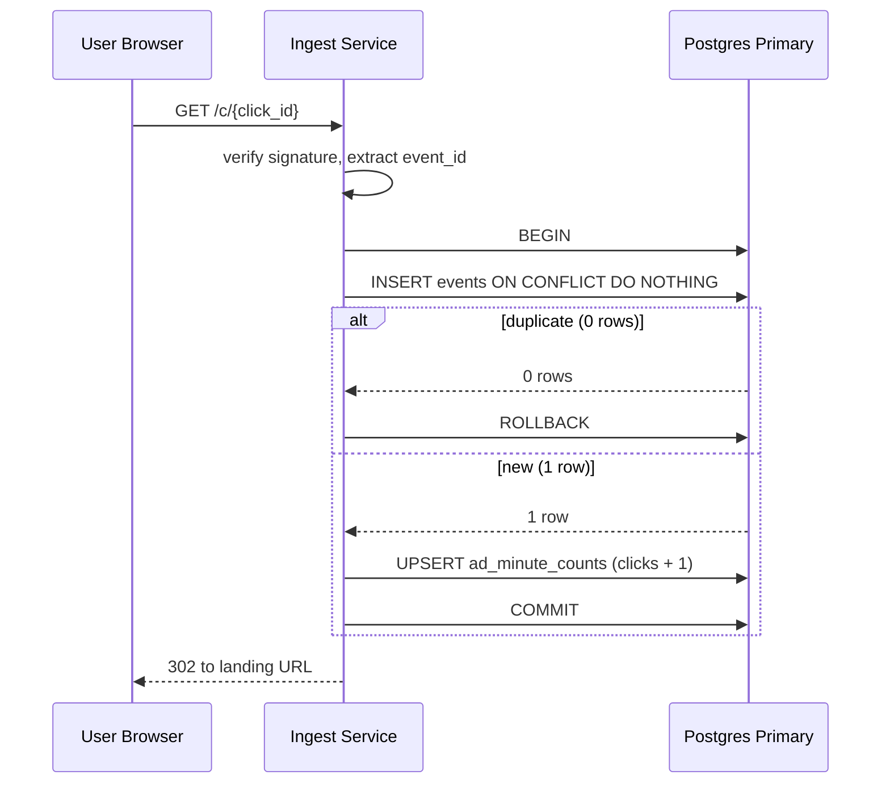

## Current state after V0

### Full architecture

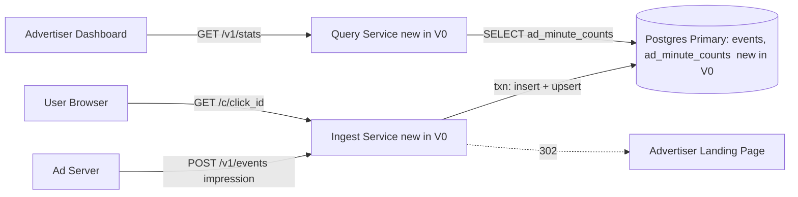

### Every current flow

1. **Impression write.** Ad Server calls `POST /v1/events` on the Ingest Service. The Ingest Service runs one transaction on Postgres: dedup insert into `events`, then upsert into `ad_minute_counts`. It returns `200`.
2. **Click write.** Browser calls `GET /c/{click_id}` on the Ingest Service. The Ingest Service verifies the token and runs the same transaction with `type = 2`. It returns `302` to the landing page.
3. **Read.** Dashboard calls `GET /v1/stats` on the Query Service. The Query Service runs a range `SELECT` on `ad_minute_counts` in Postgres and returns per-minute rows.
4. **Duplicates and late events.** There is no separate path. The unique `event_id` rejects duplicates. `minute_bucket` comes from `event_time`, so late events fall into the right minute.

## Interview follow-ups

**"Why start with Postgres? You know it won't hit 500K/s."**
Because I can only justify a component against a number that breaks the simpler one. V0 is correct and small. I'll show the exact load where it fails, and that failure picks the next component.

**"Why bucket by `event_time` and not `ingest_time`?"**
Advertisers bill by when the ad was shown, not when our server heard about it. Bucketing by `ingest_time` would smear a mobile client's offline backlog into the wrong minutes. With `event_time`, a late event is just an upsert into an older row.

## Recap

| Concept | The Insight |
|---|---|
| Receipt-book dedup | A unique `event_id` makes retries and double-taps harmless. |
| Atomic count | The event row and the counter move in one transaction, so they can't disagree. |
| Event-time bucketing | Late events need no special path in V0. They upsert into an older bucket. |
| Signed click token | The `event_id` rides inside the redirect URL, so a double-tap reuses the same ID. |
| V0's price | Every event is a synchronous write to one machine. |

**Interview arc:** *"I start with one Postgres where a unique event ID plus an upsert in one transaction gives exactly-once counts for free, and then I scale it only when a real throughput number breaks it."*

## Next

Black Friday arrives at 500K events/s, and one Postgres primary tops out around 20K. Worse, one viral ad (777) tries to update a single counter row 50,000 times a second. V1 puts a durable buffer in front of the database.

Say "next" when ready.


-----------------------------------------------------------------------------------------------------------------------
-----------------------------------------------------------------------------------------------------------------------
-----------------------------------------------------------------------------------------------------------------------
-----------------------------------------------------------------------------------------------------------------------


# V1: A durable buffer in front of Postgres

## Break it

It's Black Friday, 9:00. Priya's shoe campaign is live, and so are thousands of others.

Traffic hits 500K events/s at peak and averages 100K/s. One Postgres primary does about 20K single-row transactions/s. Batching might stretch that to 50K rows/s.

Two things break at once, but they share one root cause: the ingest call is welded to the database write.

- **Stalls spread.** Postgres hiccups for 3 seconds (a checkpoint, a vacuum). Every Ingest Service thread blocks, the Ad Server's calls time out, and events are dropped on the floor. A dropped click is lost revenue that can never be recovered.
- **Spikes have nowhere to go.** A 500K/s burst has no place to wait, so it either overloads Postgres or gets rejected.

V1 fixes the weld. Sustained throughput is a separate problem, and I'll show you where it still bites at the end.

*Deferred on purpose:* the 50,000/s hot counter row for ad 777. That is a counting problem, and it gets its own version.

## The analogy

Picture a restaurant where waiters hand each order straight to the one cook and stand there until it's cooked. One slow dish freezes the whole floor.

Now add an order rail above the pass. Waiters clip tickets to the rail and walk away. The cook pulls tickets at their own pace. Nothing is lost while the cook is slow, because the tickets are still on the rail.

The rail is a durable log.

## Solve it

The Ingest Service stops talking to Postgres. It validates the event, appends it to a replicated log, and returns. A separate Writer service reads from the log and does the database work.

The log is Kafka. It fits because our access pattern is append-only writes, sequential reads, and the ability to replay history. A log is built for exactly that, and a row store is not.

✅ **What we gained**
- Ingest latency no longer depends on Postgres health.
- A database stall just means the log grows. Nothing is dropped.
- Spikes are absorbed. The log accepts 500K/s while the Writer drains at its own speed.
- Replay is free. A bug in the Writer can be fixed and re-run from an old offset.

⚠️ **What we gave up / new problems**
- **Delivery is now at-least-once.** A Writer can crash after the database commit but before it records its place. The batch is redelivered. V0's unique `event_id` is exactly what makes this safe, but it is now doing real work.
- **Dashboards lag.** Freshness is now "ingest time plus consumer lag," not instant.
- **A new system to run.** Kafka needs brokers, partitions, and monitoring.
- **Throughput is not fixed.** The Writer drains at about 50K rows/s while the average inflow is 100K/s. Lag grows by roughly 50K events every second. The buffer buys time, not capacity.

❌ **What we considered and rejected**
- **Batch in memory inside the Ingest Service.** A crash loses the in-memory batch. Billing-grade means no.
- **Just buy a bigger Postgres.** It raises the ceiling, but the stall coupling stays, and 500K/s is still out of reach.

| Option | Durable on ack | Replay | Ordering per key | Ops burden | Verdict |
|---|---|---|---|---|---|
| In-memory batch in Ingest | No | No | n/a | None | Rejected |
| SQS | Yes | No | Weak (FIFO caps throughput) | Low | Rejected |
| Kinesis | Yes | Yes | Per shard | Low (managed) | Viable on AWS |
| Kafka | Yes | Yes | Per partition | Higher | Chosen |

Kinesis would be a fair answer in an AWS shop. I pick Kafka because replay, partition control, and consumer groups map cleanly onto what the next versions need.

## Implement it

### The topic

```
topic:               ad-events
partitions:          64
replication.factor:  3
min.insync.replicas: 2
retention:           7 days
partition key:       event_id
```

I key by `event_id` so load spreads evenly, even when one ad is viral. I'll revisit this key when the counting problem arrives.

### Producer settings (Ingest Service)

```
acks=all
enable.idempotence=true
linger.ms=5
compression.type=lz4
```

`acks=all` with `min.insync.replicas=2` means an ack is sent only after two brokers hold the event. A single broker dying cannot lose an acknowledged event.

### Message payload (first appearance, shown in full)

```json
{
  "event_id": "0b6e5c1e-7c1a-4d54-9a40-3f1d2b9c8a11",
  "type": 1,
  "ad_id": 777,
  "campaign_id": 42,
  "event_time": "2026-11-16T09:04:31Z",
  "ingest_time": "2026-11-16T09:04:32Z"
}
```

### Who writes, who reads

| Structure | Who writes | When | Who reads | When |
|---|---|---|---|---|
| Kafka `ad-events` | Ingest Service | Every valid event, before it replies | Writer service (consumer group `pg-writer`) | Continuously, in batches |
| `events` (Postgres) | Writer | Per batch, inside the transaction | Nobody yet | Rarely |
| `ad_minute_counts` (Postgres) | Writer | Same transaction, new events only | Query Service | Every dashboard request |

Kafka lives on its own broker cluster. Postgres is unchanged and now has exactly one writer service.

### Write path: impressions and clicks

**API call (unchanged shape)**

```
POST /v1/events
{ "event_id": "0b6e5c1e-...", "type": "impression", "ad_id": 777,
  "campaign_id": 42, "event_time": "2026-11-16T09:04:31Z" }
```

1. Ingest Service validates the payload.
2. It produces the message to `ad-events` and waits for the `acks=all` acknowledgment.
3. **Branch A, ack received.** It returns `202 Accepted`.
4. **Branch B, produce times out.** It returns `503`. The Ad Server retries with the same `event_id`, so a duplicate is harmless.

**Clicks.** `GET /c/{click_id}` verifies the signature, then follows the same produce step with `type = 2`. If Kafka does not ack within 200 ms, the Ingest Service appends the event to a local spool file and redirects anyway. A background task replays the spool into Kafka. The user is never stuck on a broken redirect, and the click is not lost.

### The Writer

The Writer polls up to 5,000 events, runs one transaction, and only then commits its Kafka offsets.

```sql
BEGIN;

WITH new AS (
  INSERT INTO events (event_id, type, ad_id, campaign_id, event_time)
  SELECT * FROM unnest($1::uuid[], $2::smallint[], $3::bigint[],
                       $4::bigint[], $5::timestamptz[])
  ON CONFLICT (event_id) DO NOTHING
  RETURNING ad_id, campaign_id, type,
            date_trunc('minute', event_time) AS minute_bucket
)
INSERT INTO ad_minute_counts (ad_id, campaign_id, minute_bucket, impressions, clicks)
SELECT ad_id, campaign_id, minute_bucket,
       count(*) FILTER (WHERE type = 1),
       count(*) FILTER (WHERE type = 2)
FROM new
GROUP BY ad_id, campaign_id, minute_bucket
ON CONFLICT (ad_id, minute_bucket) DO UPDATE
SET impressions = ad_minute_counts.impressions + EXCLUDED.impressions,
    clicks      = ad_minute_counts.clicks      + EXCLUDED.clicks;

COMMIT;
-- only now:
-- consumer.commitSync(offsets)
```

The `RETURNING` clause is the key. Only rows that were actually new reach the counter upsert.

**Crash walk-through.** The Writer commits the Postgres transaction, then dies before committing offsets. A new Writer gets the same batch. Every `event_id` hits the unique constraint, `new` comes back empty, and the counters do not move. At-least-once delivery plus an idempotent write gives effectively-once counting.

### Read path

Unchanged. The Query Service still runs the range `SELECT` on `ad_minute_counts`. The only difference is that the numbers trail reality by the consumer lag.

### Sequence diagram

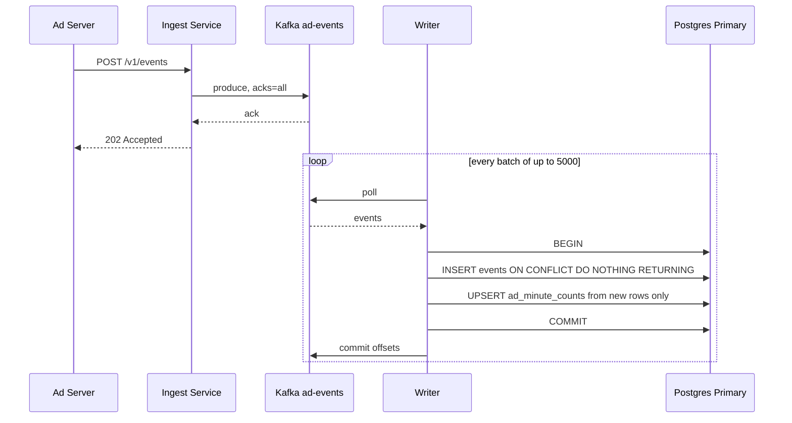

## Current state after V1

### Full architecture

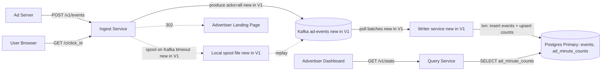

### Every current flow

1. **Impression write.** The Ad Server calls `POST /v1/events`. The Ingest Service produces to Kafka `ad-events` with `acks=all` and returns `202`. It never touches Postgres.
2. **Click write.** The browser calls `GET /c/{click_id}`. The Ingest Service verifies the token, produces to Kafka, and returns `302`. On a Kafka timeout it spools locally and still redirects.
3. **Count update.** The Writer polls Kafka in batches and runs one Postgres transaction per batch (dedup insert, then upsert from new rows only). After the commit it commits its Kafka offsets.
4. **Read.** Unchanged. The Dashboard calls `GET /v1/stats`, and the Query Service runs the range `SELECT` on `ad_minute_counts`. Results now lag by the consumer lag.
5. **Duplicates and late events.** Unchanged in behavior. The `event_id` constraint rejects duplicates, and `event_time` bucketing handles late arrivals. Redelivered Kafka batches are the new source of duplicates.

## Interview follow-ups

**"Kafka gives exactly-once semantics. Why not rely on that instead of the unique constraint?"**
Kafka's exactly-once covers reads and writes inside Kafka. Our side effect is a write to Postgres, which Kafka's transactions can't atomically include. The unique `event_id` makes that last hop idempotent, and it also catches duplicates the Ad Server created by retrying before Kafka ever saw them.

**"What if Kafka itself goes down?"**
Ingest cannot ack, so for impressions it returns `503` and the Ad Server retries or buffers. For clicks, the local spool absorbs events and replays them later. With replication factor 3 and `min.insync.replicas=2`, one broker failure does not interrupt writes.

## Recap

| Concept | The Insight |
|---|---|
| Order rail | A durable log decouples accepting an event from counting it. |
| `acks=all` plus ISR 2 | An acknowledged event survives a broker loss. |
| At-least-once plus idempotent write | Redelivery is safe because the unique `event_id` ignores repeats. |
| Offset commit after DB commit | A crash causes a replay, never a loss. |
| V1's honest limit | The log absorbs bursts but not sustained load: 100K/s in against 50K/s out grows lag forever. |

**Interview arc:** *"Synchronous writes to one database couple ingest to its health and cap throughput, so I put a replicated Kafka log in front and keep counting exactly-once by making the Postgres write idempotent on `event_id`."*

## Next

Lag is growing by about 50K events every second, so the dashboard falls minutes, then hours, behind. The deeper waste is that Postgres is inserting every raw event just to bump a counter. V2 moves the counting out of Postgres into a stream aggregation layer that rolls events up before they ever touch the database.

Say "next" when ready.


-----------------------------------------------------------------------------------------------------------------------
-----------------------------------------------------------------------------------------------------------------------
-----------------------------------------------------------------------------------------------------------------------
-----------------------------------------------------------------------------------------------------------------------


# V2: Stream aggregation before the database

## Break it

It's 9:30 on Black Friday. Arjun, the on-call engineer, opens the Writer dashboard and sees that consumer lag is 30 minutes.

The math is simple. Inflow is 100K events/s and the Writer drains 50K/s. The backlog grows by 50K events every second. After 30 minutes that is 90M events, which is 30 minutes of drain time.

Priya refreshes her dashboard at 9:30 and sees numbers from 9:00. Adding Writers doesn't help, because they all hit the same Postgres primary.

The deeper waste is that Postgres inserts 100K raw rows a second just to add 1 to a counter. Priya doesn't need 6 million rows a minute. She needs one row per ad per minute.

*Deferred on purpose:* the viral ad 777 problem, per-event dedup, and late events. V2 makes the first two worse before later versions fix them. I'll show exactly where at the end.

## The analogy

A toll plaza used to hand every driver a receipt and file each one in a central office. The office drowned in paper.

Now each booth keeps a tally sheet. At the top of every minute, the booth sends one number to the central office. Ten thousand receipts become one line.

The tally sheet is a windowed aggregation. The booth holds the sheet in its own drawer, and that drawer is state.

## Solve it

Between Kafka and Postgres we put a stream processor. It groups events by `(ad_id, minute)`, keeps running counts in local state, and writes one row per key per minute when the minute closes.

Output volume now depends on distinct active ads, not on event rate. With roughly 500K active ads, that is about 500K rows a minute, or about 8K rows/s. This holds at 100K events/s and at 500K events/s alike. Postgres is no longer the bottleneck.

### Three naive attempts at counting correctly

The crux gets the full walk here. The question is how a stream processor counts each event exactly once through crashes.

**Attempt 1: a plain consumer with an in-memory counter.** It flushes to Postgres every minute and commits offsets right after. It looked reasonable because it is simple. It breaks on a crash before the flush: offsets say "done" but the counts are gone, so events vanish.

**Attempt 2: flush first, then commit offsets.** This fixes the loss. It breaks on a crash between flush and commit. The batch is redelivered and the `+ N` is applied twice.

> **Meera:** So we do the add, then commit offsets. Crash in between and we double-add.
> **Arjun:** And the other order loses events. Either way the counter and the offset are two separate writes.

**Attempt 3: Redis `INCR` per event.** This was rejected in V0. The increment and the offset are still two writes.

All three fail for the same reason. The counts and the read position change at different moments. The real fix is to snapshot them together.

### The real fix: checkpoints plus an overwriting sink

Flink periodically injects a marker into the stream, called a checkpoint barrier. When a task sees the barrier, it saves its window state and its Kafka offsets as one snapshot. On a crash, Flink restores the last snapshot and re-reads Kafka from the saved offsets. Counts and position always agree.

The sink handles the last hop. Postgres writes can still repeat after a restore, so the sink must be safe to repeat. The V1 upsert said `clicks = clicks + N`, which is not safe to repeat. The V2 upsert says `clicks = N`, which is. A closed window's total is a fact, so writing it twice leaves the same row.

### Options compared

| Option | Exactly-once state | Event-time windows | Ops burden | Verdict |
|---|---|---|---|---|
| Hand-rolled consumer | No (see attempts 1-3) | You build it | Low | Rejected |
| Kafka Streams | Yes | Yes | Low (a library) | Viable |
| Spark Structured Streaming | Yes | Yes | Medium (micro-batch latency) | Viable |
| Flink | Yes | Yes, first-class watermarks | Higher (a cluster) | Chosen |

I pick Flink because event-time windows, watermarks, and keyed state are its core model. The next versions lean on all three. Kafka Streams would also be defensible for this size.

✅ **What we gained**
- Postgres load drops from about 100K rows/s to about 8K rows/s, and it stays flat under spikes.
- Lag stops growing. Flink keeps pace with Kafka.
- Crash recovery restores state and position together.
- Raw events stay replayable in Kafka for 7 days.

⚠️ **What we gave up / new problems**
- **Per-event dedup is gone.** Postgres no longer sees raw events, so the `event_id` unique constraint no longer protects us. An Ad Server retry that lands twice in Kafka is counted twice. This breaks our billing-grade promise.
- **Late events are dropped.** A window closes when the watermark passes it. Anything later goes to a side output and is not counted.
- **Freshness is about a minute.** A minute shows up only after it closes.
- **A new stateful system to run.** State has to be sized, checkpointed, and monitored.
- **The `events` table is retired.** There is no raw audit table in Postgres anymore.

❌ **What we considered and rejected**
- **Pre-aggregate in the Ingest Service.** Ingest is stateless and horizontally scaled. Local counters die with the pod.
- **Keep Postgres as the counter and add partitioned tables.** This still pays one row per event.

## Implement it

### Storage that appears

Two new stores appear, both inside Flink. Window state lives in an embedded RocksDB on each task manager's local disk. It is a key-value store because the access pattern is point reads and updates by `(ad_id, window)`, at high rate.

Checkpoints go to S3, a new blob-store class. Checkpoints are large, immutable, sequentially written snapshots that are read only on recovery. That is a good fit for object storage and a poor fit for a database.

### Who writes, who reads

| Structure | Who writes | When | Who reads | When |
|---|---|---|---|---|
| Kafka `ad-events` | Ingest Service | Every valid event | Flink Source (group `flink-agg`) | Continuously |
| RocksDB window state | Flink window operator | Every event | Flink window operator | On every event and when a window fires |
| S3 checkpoints | Flink task managers | Every 30 s | Flink JobManager | Only on recovery |
| `ad_minute_counts` | Flink JDBC sink | When a window closes | Query Service | Every dashboard request |

The Writer service is retired. Flink replaces it as the only consumer of Kafka and the only writer to Postgres.

### The Flink job

```java
env.setParallelism(64);                              // one task per Kafka partition
env.enableCheckpointing(30_000, CheckpointingMode.EXACTLY_ONCE);
env.getCheckpointConfig().setCheckpointStorage("s3://adagg/checkpoints");
env.setStateBackend(new EmbeddedRocksDBStateBackend());

WatermarkStrategy<AdEvent> wm = WatermarkStrategy
    .<AdEvent>forBoundedOutOfOrderness(Duration.ofSeconds(30))
    .withTimestampAssigner((e, ts) -> e.eventTimeMs);

OutputTag<AdEvent> lateTag = new OutputTag<>("late"){};

SingleOutputStreamOperator<WindowResult> counts = env
    .fromSource(kafkaSource, wm, "ad-events")
    .keyBy(e -> e.adId)
    .window(TumblingEventTimeWindows.of(Time.minutes(1)))
    .sideOutputLateData(lateTag)                     // dropped for now, counted by a metric
    .aggregate(new CountByType());                   // (impressions, clicks) accumulator

counts.addSink(jdbcOverwriteSink);                   // batch 1000 rows or 1 s
counts.getSideOutput(lateTag).addSink(lateCounterMetric);
```

The watermark is the max `event_time` seen minus 30 seconds. The 09:04 window closes when an event stamped 09:05:30 or later arrives. At that point Flink emits the final `(ad_id, 09:04, impressions, clicks)`.

### The sink statement (the delta from V1)

The table is unchanged. Only the upsert changes, from add to overwrite.

```sql
INSERT INTO ad_minute_counts (ad_id, campaign_id, minute_bucket, impressions, clicks)
VALUES ($1, $2, $3, $4, $5)
ON CONFLICT (ad_id, minute_bucket) DO UPDATE
SET impressions = EXCLUDED.impressions,
    clicks      = EXCLUDED.clicks;
```

### Crash walk-through

1. The checkpoint at 09:04:30 stores window state and Kafka offsets together in S3.
2. At 09:05:10 the 09:04 window fires and the sink writes rows to Postgres.
3. At 09:05:20 a task manager dies, before the next checkpoint.
4. Flink restores the 09:04:30 snapshot and rewinds Kafka to the saved offsets.
5. It re-reads the events from 09:04:30 onward and rebuilds the same state.
6. The 09:04 window fires again with the same totals. The sink overwrites the same rows with the same values. Nothing is double-counted.

### Read path

The Query Service query is unchanged. The numbers now trail reality by about a minute (window length plus watermark delay) instead of by a growing backlog.

### Sequence diagram

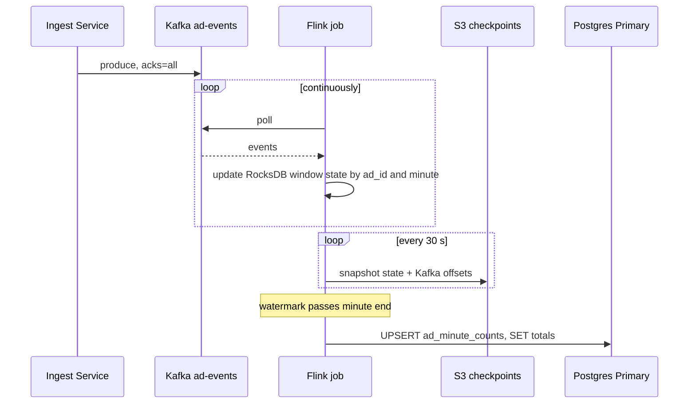

## Current state after V2

### Full architecture

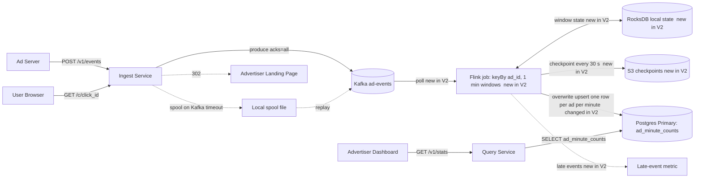

The Writer service and the `events` table are removed in V2.

### Every current flow

1. **Impression write.** Unchanged. The Ad Server calls `POST /v1/events`, and the Ingest Service produces to Kafka `ad-events` with `acks=all` and returns `202`.
2. **Click write.** Unchanged. The browser calls `GET /c/{click_id}`, and the Ingest Service produces to Kafka and returns `302`. It spools locally on a Kafka timeout.
3. **Count update (changed).** Flink reads Kafka and keeps per-`(ad_id, minute)` counts in RocksDB. When the watermark passes a minute, it overwrite-upserts one row into `ad_minute_counts`. Every 30 seconds it checkpoints state and offsets to S3.
4. **Read.** Unchanged query. Freshness is about one minute.
5. **Duplicates.** Regressed. Nothing dedups by `event_id` anymore, so a duplicate in Kafka is counted twice. V3 fixes this.
6. **Late events.** Regressed. Anything older than the watermark goes to the late-event side output and is not counted. A later version fixes this.

## Interview follow-ups

**"Why Flink and not Kafka Streams?"**
Both give exactly-once state. I pick Flink because event-time windows, watermarks, and large keyed state with checkpointing are its core model. Later I need dedup state and late-data correction, and those are first-class in Flink. For a small team that wants no new cluster, Kafka Streams is a fair choice.

**"What if Postgres is down when a window fires?"**
The JDBC sink retries with backoff and the pressure travels back up the job. Flink slows its reads from Kafka while events wait in the log. Checkpoints keep going, so no data is lost. When Postgres returns, the sink writes the buffered windows, and the overwrite makes any replay harmless.

## Recap

| Concept | The Insight |
|---|---|
| Tally sheet | Output rate depends on distinct `(ad, minute)` keys, not on event rate. |
| Checkpoint barrier | State and Kafka offsets are saved as one snapshot, so a crash can't split them. |
| Overwrite, not add | Writing a closed window's total twice leaves the same row, so the sink is idempotent. |
| Watermark | It decides when a minute is finished, and it is the price of event-time windows. |
| V2's honest limit | Raw events no longer reach Postgres, so the `event_id` dedup is gone and duplicates now over-count. |

**Interview arc:** *"Writing every raw event to Postgres can't keep up, so I aggregate per ad per minute in Flink with checkpointed state and an overwriting upsert, which cuts database load by 10x or more and stays exactly-once across crashes, but it costs me the per-event dedup I had for free."*

## Next

Meera's QA team replays a bad ad-server batch, and 400 clicks on ad 777 are counted twice. Priya is billed for clicks that never happened. V3 brings dedup back into the stream, with the state sized for hundreds of thousands of events per second.

Say "next" when ready.


-----------------------------------------------------------------------------------------------------------------------
-----------------------------------------------------------------------------------------------------------------------
-----------------------------------------------------------------------------------------------------------------------
-----------------------------------------------------------------------------------------------------------------------


# V3: Dedup inside the stream

## Break it

It's 11:00 on Black Friday. Meera's QA team replays a batch from a flaky ad server to test a fix. The batch holds 400 clicks on ad 777, and every one of them is counted twice.

Nothing in the pipeline objects. Kafka accepts the duplicates, Flink counts them, and Postgres stores 400 extra clicks. Priya's 37 clicks just became 437, and she pays for all of them.

Replays aren't the only source. An Ad Server sends a click, Kafka acks it, and the response is lost on the way back. The Ad Server retries with the same `event_id`. Both copies land in Kafka. At about 100K events/s and a 0.5% retry rate, that is roughly 500 duplicates every second.

In V0 and V1, the unique constraint on `event_id` caught all of this. V2 stopped sending raw events to Postgres, so that guard is gone. V3 brings it back inside the stream.

*Deferred on purpose:* the viral ad 777 problem and late events. Both are untouched by this version.

## The analogy

A club doorman keeps a guest list. Each guest arrives with a numbered wristband, and the doorman crosses the number off. If the same number shows up again, the doorman doesn't let the second person in.

Nobody keeps wristband numbers forever. After closing time the list is thrown out, because nobody walks in with last week's band. So the list needs a time limit, and that limit is the main design decision.

## Solve it

Before the window operator, we add a dedup operator. It is keyed by `event_id` and remembers which IDs it has seen. The first sighting passes through. Every repeat is dropped.

### How long do we remember?

Duplicates come from retries (seconds to minutes) and replays (can be hours). Events can arrive up to a few hours late. So I set the dedup window to 6 hours.

This is a case where the math picks the architecture. Each remembered ID costs about 40 bytes in RocksDB (16-byte UUID, key-group prefix, a flag, and a TTL timestamp).

- 6 hours at 100K/s is about 2.2B IDs, or about 90 GB.
- Planning for peak hours, call it 150 GB.
- Spread over 64 tasks, that is about 2.5 GB each on local SSD.

That fits easily inside Flink's own state. We don't need an external store.

### Four naive attempts

**Attempt 1: a Bloom filter.** It looked perfect because it is tiny and fast. It breaks because Bloom filters have false positives. Some real clicks get flagged as "seen" and dropped. Dropping a real click is a billing error, and we promised billing-grade.

**Attempt 2: Redis `SETNX event_id` before counting.** It looked reasonable because it is a shared, fast, battle-tested dedup store. It breaks on a Flink restore.

> **Meera:** Redis says "seen," so we drop the repeat. Good.
> **Arjun:** Now Flink crashes and restores its checkpoint from 30 seconds ago. It re-reads those events from Kafka. Redis already has their IDs, so every one is dropped as a duplicate. But the window state we restored never counted them.
> **Meera:** So we undercount. Redis and Flink restore to different moments.

This is the same flaw as V2's naive attempts. The dedup set and the counts have to snapshot together.

**Attempt 3: put the unique constraint back in Postgres.** It brings back raw per-event writes, which is the V0 bottleneck. It's rejected.

**Attempt 4: key the whole job by `ad_id` and keep a set of IDs per ad.** It avoids a second shuffle. It breaks because ad 777 would hold a huge set on one task, and it makes the hot-key problem worse.

### The real fix

Dedup state lives in Flink's keyed state, in the same checkpoint as the window counts and the Kafka offsets. On a restore, all three roll back to the same instant. A replayed event is "first seen" again, because the restored set never contained it.

The price is one extra network shuffle. We re-key from `event_id` to `ad_id` after dedup. At 500K/s and about 100 bytes per event, that is about 50 MB/s spread over 64 tasks. It's trivial.

### Options compared

| Option | Correct after crash | False drops | Extra hop per event | Verdict |
|---|---|---|---|---|
| Bloom filter | Yes | Yes (billing error) | No | Rejected |
| Redis `SETNX` | No (restore mismatch) | No | Yes, network call | Rejected |
| Postgres unique constraint | Yes | No | Yes, 100K writes/s | Rejected |
| Per-ad ID set in window state | Yes | No | No | Rejected (hot key) |
| Flink keyed state by `event_id`, TTL 6 h | Yes | No | One shuffle | Chosen |

✅ **What we gained**
- Duplicates from retries and replays are dropped before they touch a count.
- Dedup state restores in lockstep with counts and offsets.
- No new system. Dedup is one operator inside the existing job.
- The dedup stage has no hot key. `event_id` is uniformly distributed.

⚠️ **What we gave up / new problems**
- **Checkpoints get heavier.** State grows from megabytes to roughly 150 GB, so we need incremental checkpoints.
- **Dedup has a horizon.** A duplicate that arrives after 6 hours is counted twice. A longer window costs linear state.
- **One more shuffle** adds a little latency and network load.
- **Stable IDs are required.** If an upstream system regenerates `event_id` on retry, this cannot catch it.

❌ **What we considered and rejected**
- **A 24-hour window.** It would cost about 4x the state for duplicates that almost never arrive that late. I'd cover that gap with a batch reconciliation instead.
- **Dedup in the Ingest Service.** Ingest is stateless and horizontally scaled, so each pod would see only a slice of the traffic.

## Implement it

### The new state

One new keyed state appears inside Flink, in the same class as V2's RocksDB (key-value, point lookups by key at high rate).

| Structure | Who writes | When | Who reads | When |
|---|---|---|---|---|
| RocksDB `seen` state (key `event_id`, value boolean, TTL 6 h) | Dedup operator | On the first sighting of an ID | Dedup operator | Every event |
| RocksDB window state | Window operator | Every deduped event | Window operator | Every event and at window fire |
| S3 checkpoints | Flink task managers | Every 30 s, now incremental | JobManager | Only on recovery |
| `ad_minute_counts` | Flink JDBC sink | When a window closes | Query Service | Every dashboard request |

### The dedup operator

```java
public class Dedup extends KeyedProcessFunction<String, AdEvent, AdEvent> {
  private ValueState<Boolean> seen;
  private transient Counter dupDropped;

  @Override public void open(Configuration c) {
    StateTtlConfig ttl = StateTtlConfig.newBuilder(Time.hours(6))
        .setUpdateType(StateTtlConfig.UpdateType.OnCreateAndWrite)
        .setStateVisibility(StateTtlConfig.StateVisibility.NeverReturnExpired)
        .cleanupInRocksdbCompactFilter(1000)   // expire entries during compaction
        .build();
    ValueStateDescriptor<Boolean> d = new ValueStateDescriptor<>("seen", Boolean.class);
    d.enableTimeToLive(ttl);
    seen = getRuntimeContext().getState(d);
    dupDropped = getRuntimeContext().getMetricGroup().counter("dup_dropped");
  }

  @Override public void processElement(AdEvent e, Context ctx, Collector<AdEvent> out)
      throws Exception {
    if (seen.value() == null) {     // first sighting
      seen.update(true);
      out.collect(e);               // pass downstream
    } else {
      dupDropped.inc();             // repeat: drop
    }
  }
}
```

### The pipeline delta from V2

```java
env.getCheckpointConfig().enableUnalignedCheckpoints(false);
env.setStateBackend(new EmbeddedRocksDBStateBackend(true));   // true = incremental checkpoints

env.fromSource(kafkaSource, wm, "ad-events")
   .keyBy(e -> e.eventId)                  // new in V3
   .process(new Dedup()).setParallelism(64)// new in V3
   .keyBy(e -> e.adId)                     // re-key: shuffle
   .window(TumblingEventTimeWindows.of(Time.minutes(1)))
   .sideOutputLateData(lateTag)
   .aggregate(new CountByType())
   .addSink(jdbcOverwriteSink);            // unchanged
```

The watermark assigner, window, sink, and Postgres schema are unchanged.

### Crash walk-through

1. The checkpoint at 11:00:00 saves `seen`, window counts, and Kafka offsets together.
2. At 11:00:10 click E arrives. Dedup marks it seen and passes it on. The window count for ad 777 goes up by 1.
3. At 11:00:12 the ad server's retry of E arrives. Dedup finds it in `seen` and drops it. The count stays correct.
4. At 11:00:20 a task manager dies, before the next checkpoint.
5. Flink restores 11:00:00 and rewinds Kafka. The restored `seen` does not contain E, and the restored count does not include it.
6. E is replayed and counted once. The retry is dropped again. Counts, `seen`, and offsets agree at every moment.

### Sequence diagram

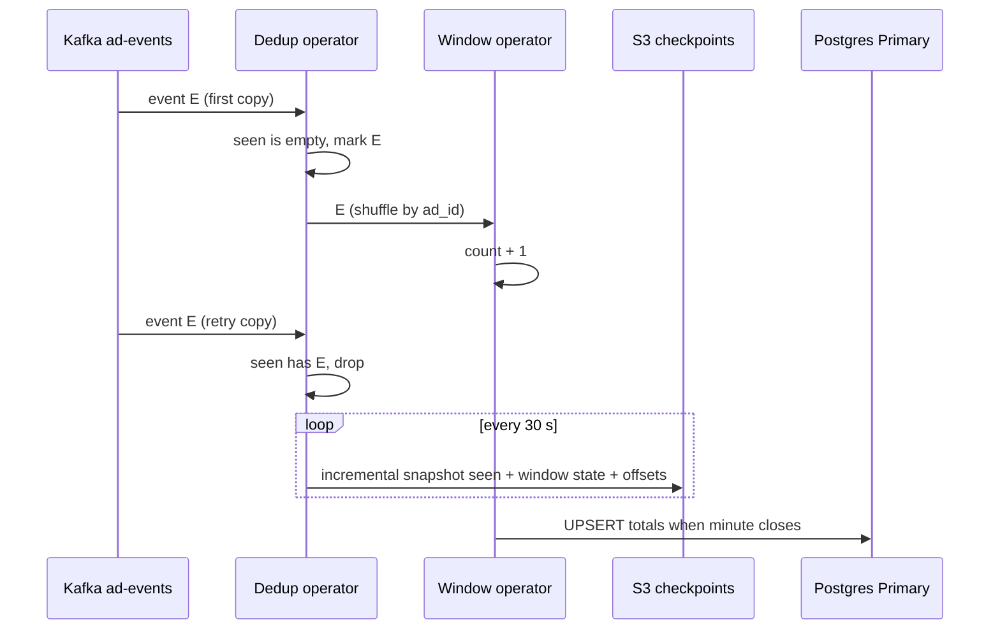

## Current state after V3

### Full architecture

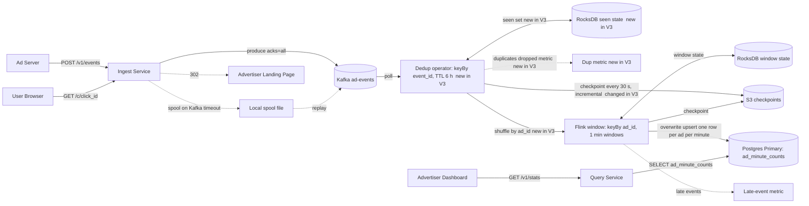

### Every current flow

1. **Impression write.** Unchanged. The Ad Server calls `POST /v1/events`, and the Ingest Service produces to Kafka `ad-events` with `acks=all` and returns `202`.
2. **Click write.** Unchanged. The browser calls `GET /c/{click_id}`, and the Ingest Service produces to Kafka and returns `302`. It spools locally on a Kafka timeout.
3. **Dedup (new).** The Dedup operator reads Kafka, keyed by `event_id`. It checks the `seen` state in RocksDB. A first sighting is passed on. A repeat is dropped and counted in `dup_dropped`.
4. **Count update (changed upstream).** Only deduped events are shuffled by `ad_id` into the window operator. Window and sink behavior are unchanged. Checkpoints now cover `seen`, window state, and offsets together.
5. **Read.** Unchanged. The Dashboard calls `GET /v1/stats`, and the Query Service runs the range `SELECT` on `ad_minute_counts`. Freshness is about one minute.
6. **Duplicates.** Fixed within the 6-hour dedup horizon.
7. **Late events.** Still regressed. Events older than the watermark go to the late side output and are not counted. A later version fixes this.

## Interview follow-ups

**"Why not just use Kafka's idempotent producer for dedup?"**
It only dedups retries from one producer session inside Kafka. It can't see an Ad Server that retried after a lost response, a replay from QA, or a second Ingest pod handling the same retry. Those all arrive as distinct Kafka messages with the same business `event_id`, so dedup has to key on `event_id`.

**"What about duplicates older than your dedup window?"**
They're counted twice. For billing, I'd run a nightly batch job over the raw Kafka or archived data that dedups by `event_id` with no time limit. If its totals differ from the stream's, it corrects the rows. The stream gives fast numbers, and the batch gives final ones.

## Recap

| Concept | The Insight |
|---|---|
| Doorman's guest list | A set of seen `event_id`s drops repeats before they reach a count. |
| TTL horizon | Dedup memory is bounded by how late a duplicate can realistically arrive. |
| State beside the counts | Dedup state restores in the same checkpoint as counts and offsets, so a crash can't split them. |
| Why not Redis | An external set survives a restore that the counts don't, and the mismatch undercounts. |
| V3's honest limit | Late events are still dropped, and the hot key still hits the window operator. |

**Interview arc:** *"Moving to stream aggregation lost per-event dedup, and Bloom filters or Redis either drop real clicks or disagree with a restored checkpoint, so I keep a TTL'd `event_id` set in Flink keyed state that snapshots with the counts and the offsets."*

## Next

Ad 777 goes viral at 3:00 pm. It takes 150K events/s on a single window key, and one task sustains only about 40K/s. That task backs up, checkpoints stall, and every other advertiser's dashboard slows down with it. V4 splits the hot key so no single task carries it.

Say "next" when ready.


-----------------------------------------------------------------------------------------------------------------------
-----------------------------------------------------------------------------------------------------------------------
-----------------------------------------------------------------------------------------------------------------------
-----------------------------------------------------------------------------------------------------------------------


# V4: Splitting the hot key

## Break it

It's 3:00 pm on Black Friday. Ad 777, Priya's shoe ad, goes viral on social media. It now takes 150K events/s, about 30% of all traffic.

After dedup, every event for ad 777 is shuffled to the one window task that owns `keyBy(adId)` for that key. That task can process about 40K events/s. The other 63 tasks are nearly idle.

The damage spreads in three steps.

- **The hot task falls behind.** It receives 150K/s and drains 40K/s. Its input buffers fill within seconds.
- **Backpressure travels upstream.** Each dedup task sends to all 64 window tasks. When its channel to the hot task is full, it blocks. It stops forwarding events for every other ad too.
- **Checkpoints stall.** A checkpoint barrier has to pass through the slow channel. A 30-second checkpoint now takes minutes. Every advertiser's dashboard slows down, not just Priya's.

The Postgres side is fine. Ad 777 still produces one row per minute.

*Deferred on purpose:* late events. They are still dropped, and the next version fixes that.

## The analogy

A supermarket has 64 checkout lanes. A coach party of 150 shoppers arrives, and the store's rule says "everyone from this bus uses lane 12." Lane 12 backs up into the aisles and blocks other customers.

The fix is to let the bus split across 16 lanes. Each lane rings up its share and prints a subtotal. One clerk at the exit adds the 16 subtotals into one receipt.

Counting is additive, so splitting is safe. Subtotals can be merged in any order.

## Solve it

We split the hot key in two stages. Stage 1 counts per `(adId, salt)`, so the load spreads over many tasks. Stage 2 sums the partial counts per `adId`. The salt is `hash(eventId) % factor`. We apply a factor above 1 only to ads that are currently hot.

### Four candidate fixes

**1. Salt every ad, always.** Every ad becomes 16 keys. It looks simple, but state and stage-2 traffic grow 16x for the 499,000 ads that were never hot. Rejected.

**2. Local pre-aggregation (a combiner).** Each upstream task keeps a small in-memory map and flushes partial counts every second. This shrinks the shuffle for every key. It is a good technique, but the in-memory buffer must be flushed on every checkpoint barrier. Flink's DataStream API has no built-in operator for it, so we would write a custom one. It also still funnels all partials for ad 777 into one task, just at a lower rate. Viable as a later optimization, but not the primary fix.

**3. Salt only the hot ads.** A broadcast list says which ads are hot and by what factor. Normal ads keep factor 1 and behave exactly as in V3. Chosen.

**4. Round-robin the hot ad's events across tasks without a key.** This breaks keyed windows. There would be no window state to count in. Rejected.

| Option | Fixes the hot task | Cost for normal ads | New moving parts | Verdict |
|---|---|---|---|---|
| Salt every ad | Yes | 16x state and shuffle | None | Rejected |
| Local combiner | Partly | None, saves shuffle | Custom operator | Later optimization |
| Salt hot ads only | Yes | None | Hot-ad list, 2nd window stage | Chosen |
| Keyless round-robin | Breaks windows | n/a | n/a | Rejected |

### Why the salt is derived from `event_id`

I use `hash(eventId) % factor` and not a random number. After a crash, a replayed event lands in the same partial as before. Counts are the same either way, but deterministic routing makes replays easier to reason about and debug. Dedup has already run, so `event_id` is unique per event and spreads evenly across the salts.

### How many salts

One task handles about 40K/s. I target about 10K/s per salt for headroom. At 150K/s that means `ceil(150K / 10K) = 15`, rounded up to a power of two, so 16. Each salt then carries about 9.4K/s. At a 500K/s spike on this one ad, each carries about 31K/s, which is still under the limit.

✅ **What we gained**
- The hot ad's load spreads over 16 tasks instead of one.
- The backpressure chain breaks. Other advertisers are no longer slowed down.
- Checkpoints go back to about 30 seconds.
- Normal ads pay nothing. They stay on factor 1.

⚠️ **What we gave up / new problems**
- **A control plane appears.** Something has to decide which ads are hot, and detection lags by about 10 to 15 seconds. Kafka absorbs that gap, but ad 777's task is slow during it.
- **A second window stage.** It adds a little state and one more shuffle, but only 16 partials per minute for a hot ad.
- **Flapping risk.** An ad hovering around the threshold could change factor every few seconds. We add a cool-down.
- **The stage-2 key is still `adId`.** That is fine at 16 partials a minute, but it would not survive a factor of thousands.

❌ **What we considered and rejected**
- **Enabling unaligned checkpoints.** That treats the symptom. Checkpoints would finish, but the hot task would still be overloaded and still cause backpressure.
- **Just adding parallelism.** More tasks don't help, because one key still maps to one task.

## Implement it

### New structures

One new store appears. It is a compacted Kafka topic, because we need a latest-value-per-key table that Flink tasks can read from the start. Compaction gives exactly that.

```
topic:      hot-ads
partitions: 1
cleanup:    compact
key:        ad_id
value:      {"ad_id": 777, "factor": 16, "set_at": "2026-11-16T15:00:20Z"}
```

A `factor` of 1 means "not hot." It acts as the delete marker.

| Structure | Who writes | When | Who reads | When |
|---|---|---|---|---|
| Kafka `hot-ads` (compacted) | Hot-ad detector job | When an ad crosses a threshold or cools down | Salt assigner (as broadcast state) | Continuously, on every task |
| Broadcast state `hotAds` (ad_id to factor) | Salt assigner | On each `hot-ads` update | Salt assigner | Every event |
| RocksDB stage-1 window state, key `(adId, salt)` | Stage-1 window | Every deduped event | Stage-1 window | Every event and at fire |
| RocksDB stage-2 window state, key `adId` | Stage-2 window | When a partial arrives | Stage-2 window | At fire |
| `ad_minute_counts` | Flink JDBC sink | When stage 2 fires | Query Service | Every dashboard request |

Stage-1 and stage-2 state live in the existing RocksDB and the existing S3 checkpoints. The `seen` state is unchanged.

### The hot-ad detector

A small separate Flink job reads `ad-events` with its own consumer group, `hot-detector`. It counts events per ad over 10-second tumbling windows. It does not need exactness, so it skips dedup. When one ad's rate exceeds 20K/s, it writes `factor = nextPow2(ceil(rate / 10_000))` to `hot-ads`. After 5 consecutive quiet windows, it writes `factor = 1`. The 5-window cool-down stops flapping.

For ad 777 at 150K/s, that writes `factor = 16`.

### The salt assigner

```java
public class SaltAssigner
    extends BroadcastProcessFunction<AdEvent, HotAdUpdate, SaltedEvent> {

  static final MapStateDescriptor<Long, Integer> HOT =
      new MapStateDescriptor<>("hotAds", Long.class, Integer.class);

  @Override
  public void processElement(AdEvent e, ReadOnlyContext ctx, Collector<SaltedEvent> out)
      throws Exception {
    Integer f = ctx.getBroadcastState(HOT).get(e.adId);
    int factor = (f == null) ? 1 : f;
    int salt = Math.floorMod(Hashing.murmur3_32().hashString(e.eventId, UTF_8).asInt(), factor);
    out.collect(new SaltedEvent(e, salt));
  }

  @Override
  public void processBroadcastElement(HotAdUpdate u, Context ctx, Collector<SaltedEvent> out)
      throws Exception {
    if (u.factor <= 1) ctx.getBroadcastState(HOT).remove(u.adId);
    else               ctx.getBroadcastState(HOT).put(u.adId, u.factor);
  }
}
```

### The pipeline delta from V3

```java
BroadcastStream<HotAdUpdate> hot = env.fromSource(hotAdsSource, noWm, "hot-ads")
                                      .broadcast(SaltAssigner.HOT);

deduped                                            // output of the V3 Dedup operator
  .connect(hot)
  .process(new SaltAssigner())                     // new in V4
  .keyBy(s -> Tuple2.of(s.adId, s.salt))           // stage 1 key
  .window(TumblingEventTimeWindows.of(Time.minutes(1)))
  .sideOutputLateData(lateTag)
  .aggregate(new CountByType(), new EmitPartial()) // emits Partial(adId, campaignId, windowStart, imp, clk)
  .keyBy(p -> p.adId)                              // stage 2 key
  .window(TumblingEventTimeWindows.of(Time.minutes(1)))
  .reduce(Partial::merge, new EmitFinal())         // sums partials
  .addSink(jdbcOverwriteSink);                     // unchanged
```

A normal ad has `salt = 0` and a single partial. Stage 2 passes it through with no change.

### Why stage 2 fires at the right time

Stage 1 emits its partial with the window's end timestamp, then Flink forwards the watermark. So every partial for minute M reaches stage 2 before the watermark passes the end of M. Stage 2 uses the same one-minute boundaries and fires when that watermark arrives. No extra delay is added.

### Changing the factor mid-window

Say ad 777 moves from factor 1 to 16 at 15:00:20, in the middle of the 15:00 window. Some events were counted under salt 0, and the rest were counted under salts 0 to 15. Stage 2 sums every partial for `(777, 15:00)` no matter which salt it came from. The total is still correct.

### Sink and schema

Unchanged. The overwrite upsert and `ad_minute_counts` are the same as in V2. The hot ad still writes one row per minute.

### Sequence diagram

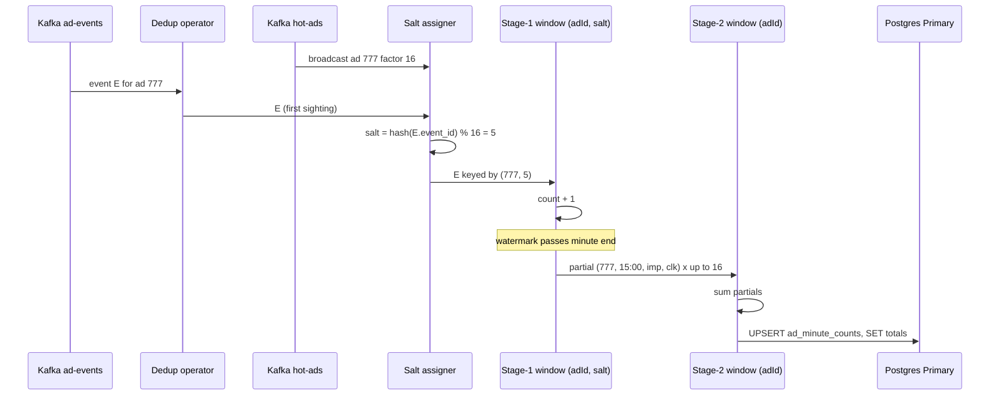

## Current state after V4

### Full architecture

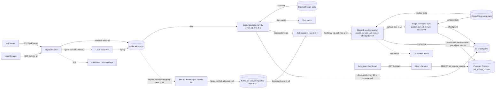

### Every current flow

1. **Impression write.** Unchanged. The Ad Server calls `POST /v1/events`, and the Ingest Service produces to Kafka `ad-events` with `acks=all` and returns `202`.
2. **Click write.** Unchanged. The browser calls `GET /c/{click_id}`, and the Ingest Service produces to Kafka and returns `302`. It spools locally on a Kafka timeout.
3. **Dedup.** Unchanged. The Dedup operator, keyed by `event_id`, drops repeats using the 6-hour `seen` state.
4. **Hot-key control (new).** The detector job watches per-ad rates and writes factors to `hot-ads`. The salt assigner receives them as broadcast state.
5. **Count update (changed).** Deduped events get a salt and are counted per `(adId, salt, minute)` in stage 1. When a minute closes, stage 1 emits partials. Stage 2 sums them per `(adId, minute)` and overwrite-upserts one row into `ad_minute_counts`. Checkpoints cover `seen`, both window stages, and offsets together.
6. **Read.** Unchanged. The Dashboard calls `GET /v1/stats`, and the Query Service runs the range `SELECT` on `ad_minute_counts`. Freshness is about one minute.
7. **Duplicates.** Fixed within the 6-hour horizon.
8. **Late events.** Still regressed. Events older than the watermark go to the late side output and are not counted.

## Interview follow-ups

**"Why not just salt every ad from the start?"**
Because most ads are cold. Salting 500K ads by 16 multiplies state, partials, and shuffle by 16 for no benefit. Detecting hot keys and salting only those keeps the common case identical to the simple design.

**"What if the detector is slow or down?"**
There is a 10 to 15 second gap before the first factor is applied. During it, Kafka buffers the surge and the hot task is slow, but nothing is lost. If the detector is down, the system falls back to V3 behavior, where the hot task is overloaded but counts stay correct. For known events like a Super Bowl ad, we can write the factor into `hot-ads` by hand ahead of time.

## Recap

| Concept | The Insight |
|---|---|
| Coach party at one lane | One key maps to one task, so a viral ad can saturate a task while 63 others sit idle. |
| Backpressure spreads | A single slow channel blocks every sender, so one hot ad slows everyone. |
| Two-stage count | Counts are additive, so partial counts per salt merge into the exact total. |
| Salt only hot ads | Cold ads keep factor 1 and pay nothing for the fix. |
| V4's honest limit | A mobile click that arrives after the watermark is still dropped and never counted. |

**Interview arc:** *"One viral ad pinned a single window task and backpressure slowed every advertiser, so I salt only the hot ads by `hash(event_id) % factor`, count partials in stage 1, and sum them in stage 2, which is exact because counting is additive."*

## Next

Dev's phone goes through a tunnel at 3:10 pm with 3,000 clicks buffered. It reconnects two hours later. The watermark passed those minutes long ago, so all 3,000 clicks go to the late side output and are never billed. V5 adds a correction path for late events.

Say "next" when ready.


-----------------------------------------------------------------------------------------------------------------------
-----------------------------------------------------------------------------------------------------------------------
-----------------------------------------------------------------------------------------------------------------------
-----------------------------------------------------------------------------------------------------------------------


# V5: A correction path for late events

## Break it

It's 5:10 pm on Black Friday. Dev's phone has been in a tunnel since 3:10. The ad SDK in his app queued 3,000 impression beacons while offline, and now it reconnects.

Those events are stamped 3:10 pm. Flink's watermark passed minute 15:10 two hours ago. The window closed, its row went to Postgres, and its state was dropped.

Every one of the 3,000 events goes to the late side output. The late-event metric ticks up, and nothing else happens. They are never counted.

Dev is not special. Clicks that Ingest spooled during a Kafka timeout (V1) arrive minutes late. SDK offline queues arrive hours late. Say about 1% of traffic is late. That is 1K events/s, or 3.6M events an hour, silently uncounted.

*Deferred on purpose:* Postgres read load and availability. Dashboards are fine for now.

## The analogy

An accountant closes the books on the last day of the month. A taxi receipt turns up a week later.

She doesn't reopen the closed ledger and rewrite its total. She starts a "late receipts" ledger, with one line per month. The reader adds the two ledgers together.

Each ledger has one writer and holds totals. That is the whole fix.

## Solve it

Late events leave the main job through a durable topic. A small second job totals them per `(ad_id, minute)` and writes them to a second table. The Query Service sums both tables.

### Three naive attempts

This is the crux, so each attempt gets the full walk.

**Attempt 1: widen the watermark to 3 hours.** It looked reasonable because the late events would simply be on time. It breaks freshness. Every window now waits 3 hours to close. Priya's dashboard shows nothing for the current hour. We would have traded the late problem for a latency problem on 100% of traffic.

**Attempt 2: `allowedLateness(3h)` on the window.** It looked reasonable because Flink supports it natively. The window state stays alive, and a late event refires the window. It breaks in our two-stage pipeline.

> **Meera:** Stage 1 refires with the new total for `(777, salt 5, 15:10)`. That's a cumulative value.
> **Arjun:** And stage 2 sums partials. It already holds the old partial of 100 and now gets 101. It adds both and reports 201.
> **Meera:** So the late event is counted twice, and the original is counted twice as well.

It has two more costs. Three hours of window state for 500K ads is about 90M entries per stage. A burst of 3,000 late events also causes 3,000 refires and 3,000 Postgres writes.

**Attempt 3: `UPDATE ... SET clicks = clicks + 1` straight from the side output.** It looked reasonable because it is a one-line fix. It breaks twice.

- A crash replays the side output, and the `+ 1` is applied twice. This is V1's flaw again.
- A crash can also refire the window from a restored checkpoint. The overwrite sets `clicks = N` and erases the late increments.

Two writers on one row, one of them adding, is the problem. The real fix is to give each row exactly one writer and make that writer overwrite with a total.

### The real fix

- The main job's stage 1 writes late events to a Kafka topic, `late-events`, using a transactional sink.
- A correction job keeps a cumulative late total per `(ad_id, minute)` in keyed state. Every 10 seconds, it overwrites that total into `ad_minute_late`.
- The Query Service reads a view that adds `ad_minute_counts` and `ad_minute_late`.

Both writers overwrite and each owns its table. A replay writes the same totals again. Counts, late state, and offsets still checkpoint together.

### Options compared

| Option | Keeps freshness | Exact after crash | Write cost | Verdict |
|---|---|---|---|---|
| Widen watermark to 3 h | No | Yes | None | Rejected |
| `allowedLateness` | Yes | No (stage 2 double counts) | Refire per late event | Rejected |
| Direct `+ 1` to Postgres | Yes | No | One write per event | Rejected |
| Late topic, correction job, second table | Yes | Yes | One write per key per 10 s | Chosen |

✅ **What we gained**
- Late events are counted. Dev's 3,000 events land in minute 15:10, where they belong.
- On-time freshness stays at about one minute.
- Each table has one writer and holds totals, so replays are harmless.
- A late burst becomes one row update per key every 10 seconds, not thousands of writes.

⚠️ **What we gave up / new problems**
- **A closed minute can still change.** Numbers for past minutes only grow, but invoicing must wait for a settlement cutoff.
- **Lateness has a horizon.** Dedup remembers IDs for 6 hours (V3). An event more than 6 hours late could be a duplicate we can no longer detect. We divert those to a separate topic and do not count them.
- **A second job and a second table.** Reads now go through a view that unions two tables.
- **Late visibility lags by up to about 45 seconds.** That is the 30-second checkpoint (when the transactional sink commits) plus the 10-second timer.

❌ **What we considered and rejected**
- **Mutating `ad_minute_counts` in place.** Two writers on one row is the Attempt 3 bug.
- **A batch-only correction.** Dashboards would be wrong until the nightly job runs. We keep batch as the safety net for events beyond 6 hours.

## Implement it

### New structures

| Structure | Who writes | When | Who reads | When |
|---|---|---|---|---|
| Kafka `late-events` | Main job, stage-1 side output | Each late event | Correction job (`read_committed`) | Continuously |
| Kafka `too-late-events` | Correction job | Event more than 6 h late | Nightly batch job (later version) | Nightly |
| RocksDB late-total state | Correction job | Each late event | Correction job | On the 10 s timer |
| S3 checkpoints (correction job) | Correction task managers | Every 30 s | JobManager | Only on recovery |
| `ad_minute_counts` | Main job, stage 2 | When a minute closes | Query Service, through the view | Every dashboard request |
| `ad_minute_late` | Correction job | Every 10 s per touched key | Query Service, through the view | Every dashboard request |

Kafka is the same log class as `ad-events`, now with transactions. The late-total state is RocksDB keyed state, the same class as V2's. The late table is Postgres, unchanged.

### The topics

```
topic: late-events       partitions: 16  replication: 3  min.insync: 2  retention: 7 d  key: ad_id
topic: too-late-events   partitions: 4   replication: 3  min.insync: 2  retention: 7 d  key: ad_id
```

The payload is the V1 message with no new fields. `ingest_time` is already there, and the correction job uses it to measure lateness.

### Main job delta

The window, sink, and Postgres writes are unchanged. Only the side output now has a real destination.

```java
// V2 defined lateTag. In V2-V4 it went to a metric. Now it goes to Kafka.
DataStream<AdEvent> late = stage1.getSideOutput(lateTag);

late.sinkTo(KafkaSink.<AdEvent>builder()
    .setBootstrapServers(BROKERS)
    .setRecordSerializer(/* topic "late-events", key = adId, JSON value */)
    .setDeliveryGuarantee(DeliveryGuarantee.EXACTLY_ONCE)   // transactional, commits on checkpoint
    .setTransactionalIdPrefix("late-sink")
    .build());
```

Lateness is judged at stage 1 only. Stage 2 never sees late data, because stage 1 emits partials with the window's end timestamp.

### New table

```sql
CREATE TABLE ad_minute_late (
  ad_id         BIGINT      NOT NULL,
  campaign_id   BIGINT      NOT NULL,
  minute_bucket TIMESTAMPTZ NOT NULL,
  impressions   BIGINT      NOT NULL DEFAULT 0,
  clicks        BIGINT      NOT NULL DEFAULT 0,
  updated_at    TIMESTAMPTZ NOT NULL DEFAULT now(),
  PRIMARY KEY (ad_id, minute_bucket)
);
CREATE INDEX ON ad_minute_late (campaign_id, minute_bucket);

CREATE VIEW ad_minute_totals AS
SELECT ad_id, campaign_id, minute_bucket,
       SUM(impressions) AS impressions, SUM(clicks) AS clicks
FROM (
  SELECT ad_id, campaign_id, minute_bucket, impressions, clicks FROM ad_minute_counts
  UNION ALL
  SELECT ad_id, campaign_id, minute_bucket, impressions, clicks FROM ad_minute_late
) u
GROUP BY ad_id, campaign_id, minute_bucket;
```

`UNION ALL` handles a minute where every event was late. It has a late row and no on-time row.

### The correction job

A separate Flink job, with its own checkpoints, reading `late-events` with `isolation.level=read_committed`.

```java
env.enableCheckpointing(30_000, CheckpointingMode.EXACTLY_ONCE);
env.setStateBackend(new EmbeddedRocksDBStateBackend(true));

OutputTag<AdEvent> tooLateTag = new OutputTag<>("too-late"){};

SingleOutputStreamOperator<LateRow> rows = env
    .fromSource(lateSource, WatermarkStrategy.noWatermarks(), "late-events")
    .keyBy(e -> Tuple2.of(e.adId, minuteOf(e.eventTimeMs)))
    .process(new LateAccumulator());

rows.addSink(jdbcOverwriteLateSink);
rows.getSideOutput(tooLateTag).sinkTo(tooLateKafkaSink);
```

```java
public class LateAccumulator
    extends KeyedProcessFunction<Tuple2<Long, Long>, AdEvent, LateRow> {
  private ValueState<LateTotals> total;    // campaignId, impressions, clicks; TTL 12 h
  private ValueState<Boolean> timerSet;

  @Override
  public void processElement(AdEvent e, Context ctx, Collector<LateRow> out) throws Exception {
    if (e.ingestTimeMs - e.eventTimeMs > Duration.ofHours(6).toMillis()) {
      ctx.output(tooLateTag, e);           // beyond dedup horizon: not counted here
      return;
    }
    LateTotals t = total.value() == null ? new LateTotals(e.campaignId) : total.value();
    if (e.type == 1) t.impressions++; else t.clicks++;
    total.update(t);
    if (timerSet.value() == null) {
      ctx.timerService().registerProcessingTimeTimer(
          ctx.timerService().currentProcessingTime() + 10_000);
      timerSet.update(true);
    }
  }

  @Override
  public void onTimer(long ts, OnTimerContext ctx, Collector<LateRow> out) throws Exception {
    LateTotals t = total.value();
    out.collect(new LateRow(ctx.getCurrentKey().f0, t.campaignId,
                            ctx.getCurrentKey().f1, t.impressions, t.clicks));  // cumulative
    timerSet.clear();
  }
}
```

The emitted value is the cumulative total, not a delta.

### The sink statement

```sql
INSERT INTO ad_minute_late (ad_id, campaign_id, minute_bucket, impressions, clicks)
VALUES ($1, $2, $3, $4, $5)
ON CONFLICT (ad_id, minute_bucket) DO UPDATE
SET impressions = EXCLUDED.impressions,
    clicks      = EXCLUDED.clicks,
    updated_at  = now();
```

### The read path delta

The Query Service reads the view instead of the table.

```sql
SELECT minute_bucket, SUM(impressions) AS impressions, SUM(clicks) AS clicks
FROM ad_minute_totals
WHERE campaign_id = 42
  AND minute_bucket >= $1 AND minute_bucket < $2
GROUP BY minute_bucket
ORDER BY minute_bucket;
```

### Crash walk-through

1. The correction job checkpoints at 17:10:00, saving late totals and Kafka offsets together.
2. At 17:10:05, Dev's 3,000 events arrive for `(777, 15:10)`. The total reaches 3,000. At 17:10:15 the timer writes that total to `ad_minute_late`.
3. At 17:10:20 a task manager dies.
4. Flink restores the 17:10:00 snapshot. The total is back to 0, and Kafka rewinds to the saved offset.
5. The 3,000 events are re-read, and the total is rebuilt to 3,000.
6. The timer overwrites the row with 3,000 again. Nothing is double-counted.

### Sequence diagram

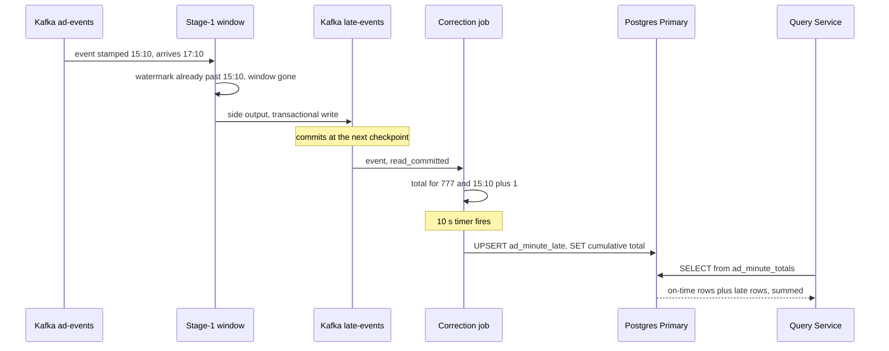

## Current state after V5

### Full architecture

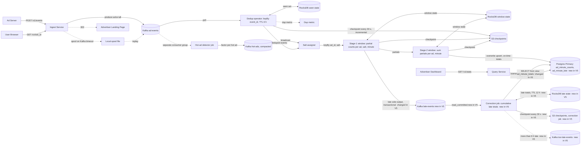

### Every current flow

1. **Impression write.** Unchanged. The Ad Server calls `POST /v1/events`, and the Ingest Service produces to Kafka `ad-events` with `acks=all` and returns `202`.
2. **Click write.** Unchanged. The browser calls `GET /c/{click_id}`, and the Ingest Service produces to Kafka and returns `302`. It spools locally on a Kafka timeout, and spooled clicks arrive late.
3. **Dedup.** Unchanged. The Dedup operator, keyed by `event_id`, drops repeats using the 6-hour `seen` state.
4. **Hot-key control.** Unchanged. The detector writes factors to `hot-ads`, and the salt assigner reads them as broadcast state.
5. **On-time count update.** Unchanged. Stage 1 counts per `(adId, salt, minute)`, stage 2 sums partials, and the sink overwrite-upserts one row into `ad_minute_counts`.
6. **Late count update (new).** An event behind the watermark leaves stage 1 on a side output into Kafka `late-events`. The correction job keeps a cumulative total per `(adId, minute)` and overwrites `ad_minute_late` every 10 seconds. Events more than 6 hours late go to `too-late-events` instead.
7. **Read (changed).** The Dashboard calls `GET /v1/stats`. The Query Service queries the view `ad_minute_totals`, which sums the on-time and late tables. A past minute can grow after it was first shown.
8. **Duplicates and late events.** Duplicates are fixed within the 6-hour horizon. Late events are counted up to 6 hours late. Anything beyond is parked for batch reconciliation.

## Interview follow-ups

**"Why not just use Flink's `allowedLateness`?"**
It refires the window with a cumulative value. Our stage 2 sums partials, so it would add the old and new partials and double count. It also holds hours of window state for every ad, and it writes once per late event. A separate late path totals late events per key and writes at most once per 10 seconds.

**"When is a minute final for billing?"**
At event time plus 6 hours plus a small margin. After that, the stream can no longer change that minute. The nightly batch (events beyond 6 hours and a full dedup) can still adjust it, so invoices should be cut from the settled, batch-reconciled numbers, not the live ones.

## Recap

| Concept | The Insight |
|---|---|
| Late receipts ledger | Late events go to their own table, so a closed minute is never rewritten under a reader. |
| One writer per row | Each table has one owner that writes totals, so replays can't double count. |
| Cumulative, not delta | The correction job overwrites the running late total, which makes every write idempotent. |
| Sum at read time | The view adds the on-time and late tables, so freshness and completeness no longer trade off. |
| V5's honest limit | The whole read path hangs off one Postgres primary. Dashboard load and a primary failure are untouched so far. |

**Interview arc:** *"Widening the watermark kills freshness and `allowedLateness` double counts through my two-stage aggregate, so I send late events to a transactional Kafka topic, total them per `(ad, minute)` in a second job, overwrite a separate late table, and sum both tables at read time."*

## Next

It's 4 pm on Black Friday and 200K advertisers refresh their dashboards every 10 seconds. That is about 20K queries/s against the one Postgres primary that also takes every Flink write. When the primary hiccups, every dashboard errors out. V6 adds read replicas, if the read:write ratio really justifies them.

Say "next" when ready.


-----------------------------------------------------------------------------------------------------------------------
-----------------------------------------------------------------------------------------------------------------------
-----------------------------------------------------------------------------------------------------------------------
-----------------------------------------------------------------------------------------------------------------------


# V6: Read replicas

## Break it

It's 4:00 pm on Black Friday. 200K advertisers have a dashboard open, and each refreshes every 10 seconds. That is about 20K queries/s, all aimed at the one Postgres primary.

Each query is a range scan over a campaign's recent minute rows, read through the `ad_minute_totals` view. It touches a few hundred rows across two tables. That is roughly 6M rows read per second.

The same primary takes the Flink sink writes. Those are about 8K rows/s, sent as batches of 1,000.

The failure chain goes like this.

- **Primary CPU hits 95%.** Sink upserts wait behind dashboard scans, and p99 goes from 20 ms to 2 s.
- **Flink feels it.** The sink batches back up, backpressure climbs to the window operators, and checkpoints slow down.
- **Priya sees nothing.** Her dashboard shows "no data" for three minutes, even though Kafka and Flink are healthy.

A second problem sits behind it. If the primary stalls or dies, every dashboard errors at once, because every read goes through it.

*Deferred on purpose:* repeated identical queries and storage growth. Caching and retention each get their own version.

## Are replicas justified here?

I won't assume yes. Let me check the ratio.

- By statements, it is 20K read queries/s against about 10 batched write statements/s.
- By rows touched, it is about 6M rows read/s against 8K rows written/s. That is roughly 750:1.

That is strongly read-heavy, so replicas are justified. The more important reason is isolation. Dashboard reads must never be able to slow the sink.

Sharding is not justified. Write volume is tiny, and replication ships only a few MB/s of WAL.

## The analogy

A town has one reference librarian who also files every new book. Visitors queue at her desk all day, and filing stops.

The library installs reading-room copies. New books are filed at the main desk, and a clerk copies the shelf updates to the reading rooms within a second. Visitors read in the reading room, and the filing desk stays free.

The reading rooms are replicas. The one-second delay between the main desk and the reading rooms is replication lag.

## Solve it

We add three Postgres read replicas fed by streaming replication. The Query Service reads only from replicas. Flink keeps writing only to the primary.

### How many replicas

One replica sustains about 10K of these indexed range queries per second. Peak is 20K/s, which needs 2. I add one more so that losing a replica still leaves capacity. That makes 3 replicas.

### Sync, async, or semi-sync

| Option | Write latency | Sink coupled to replica health | Data loss on primary death | Verdict |
|---|---|---|---|---|
| Async | None | No | Last ~1 s of WAL | Chosen |
| Semi-sync (one replica must ack) | +1 to 3 ms per commit | Yes, a slow replica stalls the sink | None | Rejected |
| Sync (all replicas) | Highest | Yes, any replica | None | Rejected |

I choose async because everything in Postgres is reproducible. The rows come from Flink, Flink replays from checkpoints, and Kafka keeps 7 days of raw events. Paying sink latency and coupling to avoid losing one second of reproducible rows is a bad trade.

### Which flows can tolerate staleness

- **Dashboard reads: yes.** Data is already about one minute fresh. One more second of lag is invisible.
- **Billing and invoice reads: no.** They read the primary, or settled data later. This is a rule for any future consumer.

### Replica lag: three candidate fixes

Dashboards have one real problem with lag. A refresh can hit replica A, and the next refresh can hit replica B, which is a second behind. The number then goes backwards.

**1. Sticky routing by `campaign_id`.** Each advertiser always reads from the same replica, so their view only moves forward.
```python
def pick(campaign_id, healthy):
    return max(healthy, key=lambda r: mmh3.hash(f"{campaign_id}:{r}"))  # rendezvous hashing
```

**2. LSN tokens for read-your-writes.** The writer returns its WAL position, and the reader waits until a replica has replayed it.
```sql
SELECT pg_last_wal_replay_lsn() >= $token;
```

**3. Lag-aware fallback.** Eject any replica whose lag is over a threshold, and fall back to the primary if none are left.

I use 1 and 3. Option 2 is for read-your-writes, but our writers are Flink jobs and no user is waiting to see their own write. Sticky routing with rendezvous hashing also means that ejecting one replica moves only that replica's campaigns.

✅ **What we gained**
- Dashboard load is off the primary, so the sink is isolated from read spikes.
- Read capacity scales by adding replicas.
- A replica dying costs capacity, not availability.
- The primary has a promotion target if it fails.

⚠️ **What we gave up / new problems**
- **Reads are eventually consistent.** Typical lag is under a second, but it can reach several seconds during minute-boundary bursts.
- **Async failover can lose about 1 s of acknowledged rows.** I cover this under failover below.
- **Replica query conflicts.** Vacuum on the primary can cancel long queries on a replica. Ours are milliseconds, so I keep the standby delay short.
- **More moving parts.** There are now health checks, a router, and a failover manager.

❌ **What we considered and rejected**
- **A bigger primary.** It raises the ceiling, but reads and the sink still share a machine, and the primary stays a single point of failure.
- **Sharding Postgres.** Writes are only 8K rows/s. This is a read problem, not a write problem.
- **Serving dashboards from Flink state.** It couples dashboard load to the streaming job. A query spike could slow counting.

## Implement it

### Replication config

Primary:
```
wal_level = replica
max_wal_senders = 6
max_replication_slots = 6
synchronous_commit = on          # local fsync only
synchronous_standby_names = ''   # empty = async replicas
wal_keep_size = 2GB
```

Each replica, with its own slot:
```
hot_standby = on
primary_slot_name = 'replica_1'
max_standby_streaming_delay = 5s
hot_standby_feedback = off
```

Slots stop the primary from deleting WAL a replica still needs. `hot_standby_feedback` stays off so replicas can't cause bloat on the primary.

### Who writes, who reads

| Structure | Who writes | When | Who reads | When |
|---|---|---|---|---|
| Postgres primary: `ad_minute_counts`, `ad_minute_late` | Flink JDBC sink, correction job sink | Window close, every 10 s per late key | Replicas (WAL), fallback reads | Continuously |
| Postgres replicas 1 to 3 | Primary, through WAL streaming | Continuously, async | Query Service | Every dashboard request |
| Replica health table (in-memory in Query Service) | Health checker thread | Every 1 s | Replica router | Every request |
| Patroni state in etcd | Patroni agents | Leader lease, every 10 s | Patroni agents | Continuously |

Schema is unchanged.

### Read path

**API call (unchanged)**
```
GET /v1/stats?campaign_id=42&from=2026-11-16T15:00Z&to=2026-11-16T16:00Z
```

1. Query Service reads its in-memory list of healthy replicas.
2. It picks one with rendezvous hashing on `campaign_id`.
3. It runs the same view query as V5, with `statement_timeout = 500ms`.
4. **Branch A, success.** It returns the rows.
5. **Branch B, timeout or connection error.** It retries once on the next-best replica after a short jittered delay, 20 to 50 ms.
6. **Branch C, no healthy replicas.** It falls back to the primary through a bulkhead, a pool capped at 200 connections. Reads can queue there, but they cannot starve the sink.

### Health checker

Each replica is polled every second.
```sql
SELECT EXTRACT(EPOCH FROM now() - pg_last_xact_replay_timestamp()) AS lag_s;
```

A replica is ejected when `lag_s > 5` and re-admitted when `lag_s < 2`. The gap between the two thresholds stops flapping. This lag query is reliable here because writes are continuous, so an idle gap won't look like lag.

### Failover

Patroni manages the primary role, with etcd holding the leader lease.

1. The primary stops renewing its lease.
2. Patroni promotes the replica with the highest replayed LSN, but only if its lag is within `maximum_lag_on_failover`. I set 16 MB, which is a few seconds of our WAL.
3. The old primary is fenced. When it returns, it rejoins as a replica.
4. Patroni's `on_role_change` hook restarts the main Flink job and the correction job from their latest checkpoints.

Step 4 is what makes async safe. The lost rows were windows fired in roughly the last second. A checkpoint is at most 30 seconds old, so restoring it re-fires those windows. The overwrite sinks write the same totals again. Replicas that are behind the new primary re-sync from it.

Without step 4, Flink's sink would just reconnect to the new primary. The last second of fired windows would stay missing until the nightly batch repaired it.

### Sequence diagram

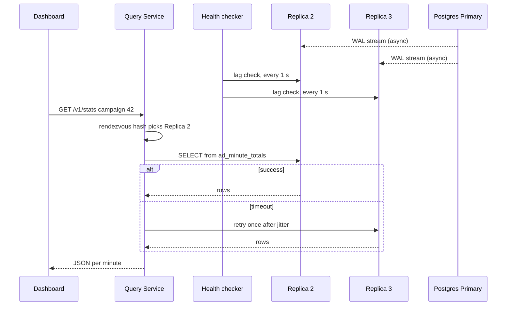

## Current state after V6

### Full architecture

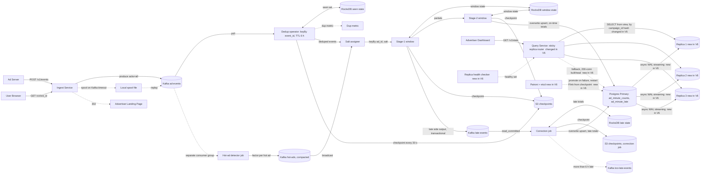

### Every current flow

1. **Impression write.** Unchanged. The Ad Server calls `POST /v1/events`, and the Ingest Service produces to Kafka `ad-events` with `acks=all` and returns `202`.
2. **Click write.** Unchanged. The browser calls `GET /c/{click_id}`, and the Ingest Service produces to Kafka and returns `302`. It spools locally on a Kafka timeout.
3. **Dedup.** Unchanged. The Dedup operator drops repeats using the 6-hour `seen` state.
4. **Hot-key control.** Unchanged. The detector writes factors to `hot-ads`, and the salt assigner reads them as broadcast state.
5. **On-time count update.** Unchanged. Stage 1 and stage 2 aggregate, and the sink overwrite-upserts into `ad_minute_counts` on the primary.
6. **Late count update.** Unchanged. Late events go through `late-events` to the correction job, which overwrites `ad_minute_late` on the primary.
7. **Replication (new).** The primary streams WAL asynchronously to three replicas. Typical lag is under 1 s.
8. **Read (changed).** The Dashboard calls `GET /v1/stats`. The Query Service hashes `campaign_id` to a healthy replica and queries the `ad_minute_totals` view there. It retries once on timeout. If no replica is healthy, it uses the primary through a capped pool.
9. **Failover (new).** Patroni promotes the most caught-up replica within the lag limit, then restarts both Flink jobs from their latest checkpoints so recently fired windows are rewritten.
10. **Duplicates and late events.** Unchanged. Duplicates are fixed within 6 hours. Late events are counted up to 6 hours late.

## Interview follow-ups

**"Why async replication? Aren't you risking billing data?"**
The data in Postgres is derived and replayable. Flink checkpoints plus 7 days of Kafka can rebuild any row. Async can lose roughly the last second of fired windows on failover. A restart from the last checkpoint rewrites them, and the nightly batch is the backstop. Sync would couple the sink to replica health to protect data that is cheap to regenerate.

**"Why not just add a cache instead of replicas?"**
A cache cuts repeated reads but does nothing for misses, for the primary being a single point of failure, or for isolating the sink. Replicas fix those. A cache then reduces how many replicas I need, so it comes next as its own version.

## Recap

| Concept | The Insight |
|---|---|
| Reading rooms | Dashboards read copies, so read load can't starve the sink on the primary. |
| 750:1 by rows | The read:write ratio is what justifies replicas, and the sink's isolation is the real prize. |
| Async is safe here | Rows are derived from Kafka and checkpoints, so losing 1 s of WAL is repairable. |
| Sticky routing | Hashing `campaign_id` to one replica keeps each advertiser's numbers from going backwards. |
| V6's honest limit | 5 of every 6 dashboard refreshes return identical data, yet each one still runs a query. |

**Interview arc:** *"Dashboard scans saturated the one primary and slowed the Flink sink, so I add three async replicas with sticky routing and lag ejection, which is safe because every row is reproducible from checkpoints and Kafka."*

## Next

Counts change once a minute, but dashboards refresh every 10 seconds. At 20K queries/s, about 16K are asking for a number that hasn't changed. A marketing push could triple traffic, and 3 replicas become 9. V7 adds a cache, and decides what to cache, at which layer, and whether a CDN is warranted.

Say "next" when ready.


-----------------------------------------------------------------------------------------------------------------------
-----------------------------------------------------------------------------------------------------------------------
-----------------------------------------------------------------------------------------------------------------------
-----------------------------------------------------------------------------------------------------------------------


# V7: A cache in front of the replicas

## Break it

It's 6:00 pm on Black Friday. A retailer sends a push notification, and dashboard traffic triples from 20K to 60K queries/s.

Three replicas sustain about 30K/s. At 60K/s their CPU pins, and query p99 goes from 15 ms to 1.5 s. The Query Service's 500 ms timeout starts firing.

Timeouts trigger retries, and retries add load. Dashboards fall back to the primary through the 200-connection bulkhead. That keeps the sink alive but not the dashboards.

The fix on paper is 7 replicas. That is 4 more machines for a spike that lasts a few hours, and most of the work they do is pointless.

- **Counts change once a minute.** Flink closes a minute, and the row lands.
- **Dashboards refresh every 10 seconds.** So about 5 of 6 queries ask for a number that hasn't changed.
- **Many viewers share one answer.** Priya's agency has 12 people watching the same campaign on a wall of screens. That is 12 identical queries every 10 seconds.

*Deferred on purpose:* table growth and retention, and multi-region. Both come later.

## Is a cache justified here?

I check the read pattern first.

- **Repeat rate is high.** About 5 of 6 requests repeat an answer that hasn't changed.
- **Keys are skewed.** Big campaigns have many viewers, and small ones have one.
- **Staleness is cheap.** The data is already about a minute behind reality, so 30 more seconds is invisible.
- **Misses are cheap to repair.** Any replica can rebuild any answer.

All four say yes.

## The analogy

Go back to the library. Twenty thousand visitors a minute ask the reading-room clerk, "How many people entered today?" The answer changes once a minute.

So the clerk pins the number on a board by the door and re-prints it each minute. Visitors read the board and leave the clerk alone.

The danger is the moment the sheet comes down. Everyone rushes the desk at once. The fix is to keep the old sheet up while one person prints the new one.

## Solve it

We add a Redis cache between the Query Service and the replicas. It stores answers in hour-sized blocks per campaign. Expiry is time-based, and the TTL depends on how likely the block is to still change.

### What do we cache

Dashboard queries ask for arbitrary `from` and `to` values. If the cache key contained those, almost no two requests would match.

So we cache one block per campaign per hour, holding that hour's per-minute rows. A request is split into blocks. A request for 14:20 to 15:20 reads the 14:00 block and the 15:00 block, then trims the result. Every viewer of a campaign shares the same keys.

### Which layer

| Layer | Hit ratio for this traffic | Staleness control | Load removed from replicas | Verdict |
|---|---|---|---|---|
| Browser | None. The 10 s poll is longer than any safe `max-age` | Weak | None | Rejected |
| CDN | Low. Responses are private and viewers per key are few | Weak | Some | Rejected |
| Redis in the Query Service path | High. Pods share one cache, and keys are per campaign | Full control | Most | Chosen |
| Postgres buffer cache | Already on | n/a | Not CPU | Already have it |

**CDN decision: no.** Dashboard responses are authenticated and advertiser-specific. A CDN can't safely share them across users, so each cached entry would serve one viewer. It would also add an invalidation surface and a privacy risk. A CDN is worth it for public data like a public leaderboard.

Redis is the right storage class for one reason. The access pattern is point lookups by key at 20K/s on small, short-lived values. That is the opposite of the range scans we are avoiding.

### Invalidation: the TTL depends on how mutable the block is

Data changes in two ways. The current hour gets a new row every minute. Past hours get late rows for up to 6 hours (V5). After that, only the nightly batch changes them.

| Block | Soft TTL | Hard TTL | Why |
|---|---|---|---|
| Current hour | 30 s | 5 min | A new minute closes every 60 s |
| Ended within the last 6 h | 60 s | 10 min | Only late rows can change it |
| Older than 6 h | 1 h | 6 h | Settled. Only the nightly batch changes it |

The soft TTL is when a value counts as stale. The hard TTL is when Redis actually deletes it. In between, we may serve it while one request refreshes it.

At these TTLs, a viewer polling every 10 seconds hits about 2 of 3 times on the current block and 5 of 6 on older blocks. Across a typical request that is about 80%. Agencies with many viewers do better.

At 80%, replicas see about 8K block queries/s. At triple traffic that is about 24K, and the three replicas can still take 30K. **We keep 3 replicas.**

### Why not invalidate on write

The cheaper-looking option is for the sink to delete the cache keys whenever it writes a row. It fails for two reasons.

- **Volume.** The sink writes about 8K rows/s. That means about 8K invalidations per second.
- **A lag race.** The primary commits and the cache key is deleted. A reader misses and refills from a replica that is 800 ms behind. The cache now holds the old value as if it were fresh.

TTLs avoid both problems. When the nightly batch exists, it will explicitly delete only the blocks it touched.

### Cache stampede: four candidate fixes

A stampede is many requests missing the same key at once and all hitting the replicas. It is real here. Twelve agency viewers share a key, and our data changes on the minute, so entries tend to expire together.

**1. Per-pod single-flight.** Within one pod, concurrent misses for a key share one in-flight query.
```python
inflight = {}
def load_once(key, fn):
    if key not in inflight:
        inflight[key] = executor.submit(fn)
    return inflight[key].result()
```
It is cheap. But 50 pods still means 50 queries, and it doesn't help a cold key.

**2. Distributed lock.** One request wins `SET lock NX` and refills. The rest wait.
```
SET lock:stats:v1:42:20261116T15 pod-7 NX PX 3000
```
It collapses misses to one query. But waiters add latency, and a dead winner stalls them until the lock expires.

**3. Soft expiry (stale-while-revalidate).** After the soft TTL, keep serving the old value. One request refreshes it in the background. Nobody waits.

**4. TTL jitter.** Randomize each soft TTL by plus or minus 20%, so entries don't expire in lockstep.
```python
soft_ms = base_ms * random.uniform(0.8, 1.2)
```

I use 3 plus 2, with 4 on top. Soft expiry means viewers never wait on a refresh. The lock means each refresh is one query. Jitter spreads the refreshes. A true miss on a cold key has no stale value to serve, so waiters poll for up to 300 ms and then fall through to a replica. That cap bounds the worst case.

✅ **What we gained**
- Replica load drops about 5x. A 3x traffic spike fits inside the replicas we already have.
- Most dashboard reads are served in about a millisecond, with no replica involved.
- A stampede on a popular campaign becomes one query, not twelve.
- If all replicas are briefly unavailable, we can serve stale blocks (up to the hard TTL) instead of an error.

⚠️ **What we gave up / new problems**
- **Dashboards are staler.** Worst case adds about 30 to 60 s on top of the pipeline's roughly one minute. Anything that needs exactness reads Postgres directly.
- **A cold cache is dangerous.** If Redis loses its keys, 100% of traffic lands on the replicas at once. I cover this under failure handling.
- **A cache filled from a lagging replica holds old data.** Replicas lagging over 5 s are already ejected (V6), and TTLs bound the damage.
- **A new system to run.** Redis needs sizing, failover, and monitoring.

❌ **What we considered and rejected**
- **Scaling replicas to 7.** It works, but we'd pay for 4 extra machines to repeat the same work.
- **Per-pod in-process caches only.** The hit ratio is poor, because 50 pods each warm their own copy.
- **Caching raw query results by `from` and `to`.** The key space is huge, and almost nothing would match.

## Implement it

### Where it lives

A Redis Cluster with 3 shards, each with one replica in a different availability zone. Sizing is about 10 GB, from roughly 2 KB per block across the blocks that active campaigns touch. Redis here is a cache. Async replication and losing a shard's keys are both acceptable.

### Keys

```
block:  stats:v1:{campaign_id}:{yyyyMMddTHH}      value: JSON, PX = hard TTL
lock:   lock:stats:v1:{campaign_id}:{yyyyMMddTHH} value: pod id, PX 3000
```

The `v1` prefix lets us invalidate everything at once by bumping to `v2`.

Block value (first appearance, shown in full):
```json
{
  "soft_exp": 1794841260000,
  "rows": [
    ["2026-11-16T15:00Z", 1203, 9],
    ["2026-11-16T15:01Z", 1187, 11]
  ]
}
```

### Who writes, who reads

| Structure | Who writes | When | Who reads | When |
|---|---|---|---|---|
| Redis block `stats:v1:...` | Query Service (the request that wins the refresh or fills a miss) | On a miss or soft expiry | Query Service, any pod | Every dashboard request |
| Redis lock `lock:stats:v1:...` | Query Service pod | Before a refresh | Redis (`NX` check) | Before each refresh |
| Postgres replicas | Primary, through WAL | Continuously | Query Service | Only on a miss or refresh |

Everything else is unchanged.

### Read path

**API call (unchanged)**
```
GET /v1/stats?campaign_id=42&from=2026-11-16T14:20Z&to=2026-11-16T15:20Z
```

1. Query Service splits the range into hour blocks: `14` and `15`.
2. It runs one pipelined call with a 20 ms timeout:
   ```
   MGET stats:v1:42:20261116T14 stats:v1:42:20261116T15
   ```
3. For each block, it takes one of these branches.
   - **A, fresh hit** (`now < soft_exp`). Use it.
   - **B, soft-expired.** Use the stale value now. Then try the lock, and only the winner refreshes in the background.
   - **C, miss.** Try the lock. The winner fills synchronously. Losers poll `GET` every 50 ms for up to 300 ms, then query a replica themselves.
   - **D, Redis error or timeout.** Treat it as a miss and skip the write-back.
4. It merges the blocks, trims to `[from, to)`, and returns JSON.

### The code

```python
def get_stats(campaign_id, start, end):
    hours = hour_blocks(start, end)
    keys = [block_key(campaign_id, h) for h in hours]
    try:
        raws = redis.mget(keys)                      # 20 ms timeout
    except RedisError:
        raws = [None] * len(keys)                    # branch D

    rows = []
    for h, key, raw in zip(hours, keys, raws):
        blk = json.loads(raw) if raw else None
        if blk is None:
            blk = fill_blocking(campaign_id, h, key)             # branch C
        elif now_ms() >= blk["soft_exp"]:
            try_refresh_async(campaign_id, h, key)               # branch B
        rows += blk["rows"]
    return trim(rows, start, end)

def load_block(campaign_id, h, key):
    replica = pick(campaign_id, healthy)                         # V6 sticky routing
    rows = replica.query(BLOCK_SQL, campaign_id, h)
    soft, hard = ttl_for(h)                                      # from the TTL table
    soft *= random.uniform(0.8, 1.2)
    blk = {"soft_exp": now_ms() + soft, "rows": rows}
    redis.set(key_for(campaign_id, h), json.dumps(blk), px=hard)
    return blk

def try_refresh_async(campaign_id, h, key):
    if redis.set(f"lock:{key}", POD_ID, nx=True, px=3000):
        executor.submit(load_block, campaign_id, h, key)

def fill_blocking(campaign_id, h, key):
    if redis.set(f"lock:{key}", POD_ID, nx=True, px=3000):
        return load_block(campaign_id, h, key)
    for _ in range(6):                                           # up to 300 ms
        time.sleep(0.05)
        raw = redis.get(key)
        if raw:
            return json.loads(raw)
    return load_block(campaign_id, h, key)                       # bounded fallback
```

The block query is the V5 view query, bounded to one hour:
```sql
SELECT minute_bucket, SUM(impressions) AS impressions, SUM(clicks) AS clicks
FROM ad_minute_totals
WHERE campaign_id = $1
  AND minute_bucket >= $2 AND minute_bucket < $2 + interval '1 hour'
GROUP BY minute_bucket
ORDER BY minute_bucket;
```

### Failure handling

If Redis dies, every request becomes a miss and goes to the replicas. Two guards stop that from becoming an outage.

- **A circuit breaker.** After repeated Redis timeouts, the Query Service stops calling it for 10 s and goes straight to replicas.
- **A concurrency cap.** Each pod allows at most N concurrent replica queries. Excess requests get `503` with `Retry-After: 10`. Dashboards poll every 10 s anyway, so a skipped refresh is invisible.

The replicas are still sized for 20K/s. A Redis outage at normal traffic costs latency, not availability.

### Sequence diagram

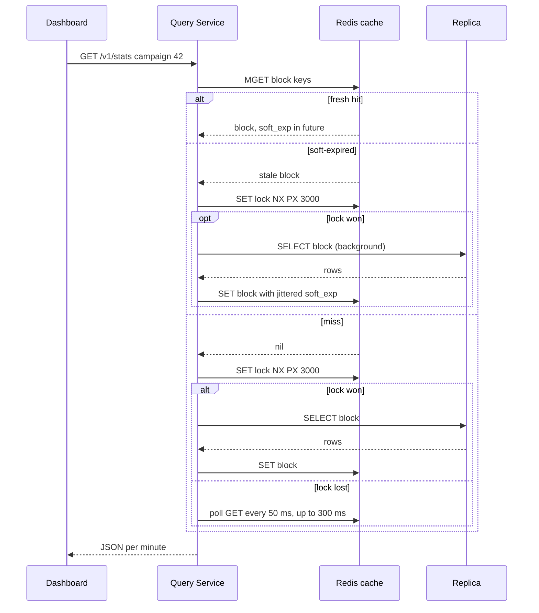

## Current state after V7

### Full architecture

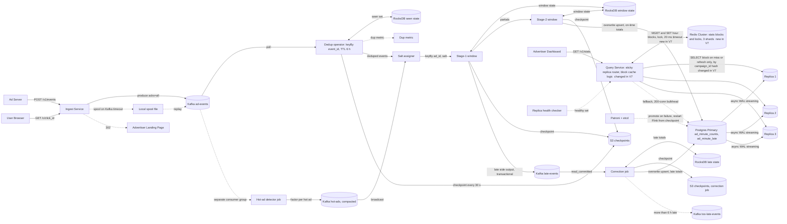

### Every current flow

1. **Impression write.** Unchanged. The Ad Server calls `POST /v1/events`, and the Ingest Service produces to Kafka `ad-events` with `acks=all` and returns `202`.
2. **Click write.** Unchanged. The browser calls `GET /c/{click_id}`, and the Ingest Service produces to Kafka and returns `302`. It spools locally on a Kafka timeout.
3. **Dedup.** Unchanged. The Dedup operator drops repeats using the 6-hour `seen` state.
4. **Hot-key control.** Unchanged. The detector writes factors to `hot-ads`, and the salt assigner reads them as broadcast state.
5. **On-time count update.** Unchanged. Stage 1 and stage 2 aggregate, and the sink overwrite-upserts into `ad_minute_counts` on the primary.
6. **Late count update.** Unchanged. Late events go through `late-events` to the correction job, which overwrites `ad_minute_late` on the primary.
7. **Replication.** Unchanged. The primary streams WAL asynchronously to three replicas.
8. **Read (changed).** The Dashboard calls `GET /v1/stats`. The Query Service splits the range into hour blocks and reads them from Redis in one `MGET`. Fresh blocks are returned directly. Soft-expired blocks are served stale while one request refreshes them. Missing blocks are filled from a sticky-routed replica. If Redis is down, every block is treated as a miss, and a concurrency cap sheds excess load.
9. **Cache refresh (new).** The winner of `SET lock NX` queries a replica for one hour block. It writes the block to Redis with a jittered soft TTL and a hard TTL based on the block's age.
10. **Failover.** Unchanged. Patroni promotes the most caught-up replica, then restarts both Flink jobs from their latest checkpoints.
11. **Duplicates and late events.** Unchanged. Duplicates are fixed within 6 hours, and late events are counted up to 6 hours late. A late row can take up to the block's soft TTL to appear on a dashboard.

## Interview follow-ups

**"Why TTL expiry and not invalidate-on-write?"**
The sink writes about 8K rows/s, so invalidation would be about 8K deletes/s. It also races with replica lag. A reader can miss right after the delete, refill from a replica that is still behind, and cache the old value as fresh. A TTL is bounded, simple, and tuned to how often each block can change.

**"What happens when Redis goes down?"**
Every request becomes a miss, so replicas see full load. I keep them sized for 20K/s, so normal traffic is fine. A circuit breaker skips Redis after repeated timeouts. A per-pod concurrency cap sheds the excess with `503 Retry-After`. Dashboards poll every 10 s, so a shed request is retried before anyone notices.

## Recap

| Concept | The Insight |
|---|---|
| Notice board | The answer changes once a minute but is asked 20K times a second, so most queries are wasted work. |
| Hour blocks per campaign | Caching by `(campaign, hour)` lets every viewer share keys, which arbitrary `from` and `to` ranges would not. |
| TTL by mutability | The current hour changes every minute, recent hours only through late rows, and old hours almost never. |
| Soft expiry, lock, jitter | Viewers never wait on a refresh, each refresh is one query, and refreshes don't line up. |
| No CDN | Responses are private and per-advertiser, so a CDN would barely share anything. |
| V7's honest limit | Everything still lives on one Postgres primary, and the tables only grow. |

**Interview arc:** *"A 3x traffic spike would have needed 7 replicas to repeat answers that change once a minute, so I cache per-campaign hour blocks in Redis with TTLs matched to how mutable each block is, using soft expiry, a refresh lock, and jitter to stop stampedes, which keeps the replicas at three."*

## Next

Every active ad writes a row every minute, so the tables gain up to about 700M rows a day. In a month that is around 20B rows. Indexes stop fitting in memory, vacuum runs for hours, and a one-week query slows down.

V8 adds time partitioning and rollups, with hourly and daily tables and a retention policy. That decides what old data costs us and when we can drop it.

Say "next" when ready.


-----------------------------------------------------------------------------------------------------------------------
-----------------------------------------------------------------------------------------------------------------------
-----------------------------------------------------------------------------------------------------------------------
-----------------------------------------------------------------------------------------------------------------------


# V8: Time partitioning

## Break it

It's four weeks after Black Friday. Arjun, the on-call engineer, opens the Postgres dashboard and sees three problems.

- **Size.** `ad_minute_counts` now holds about 20B rows. At about 150 bytes per row including both indexes, that is roughly 3 TB.
- **Memory.** The `(campaign_id, minute_bucket)` index alone is about 700 GB. The replicas have 256 GB of RAM, so the index no longer fits.
- **Vacuum.** Autovacuum on the one giant table now runs for 9 hours, and it competes with the sink for I/O.

Priya feels it as one slow query. She opens a 7-day view for her campaign, which has 20 ads. That is about 200K rows (20 ads × 1,440 minutes × 7 days). The rows were inserted in time order, so they are scattered across the heap. The query does about 200K random reads, and on a cold cache it takes 8 seconds.

Two related problems sit behind this.

- **Retention.** Someone will ask "do we keep minute rows forever?" `DELETE`ing 720M rows a day creates dead tuples, bloat, and a WAL flood.
- **Growth.** The table gains about 100 GB a day with no end.

The dominant pressure is table size and its maintenance cost. That is one mechanism, partitioning. Hourly and daily rollups solve a different problem, long-range query cost. They get their own version next.

*Deferred on purpose:* rollups, multi-region, and the nightly batch reconciliation job.

## Is this partitioning or sharding?

I check the write side first. The sink writes about 8K rows/s. One primary handles that easily, so **sharding across machines is not justified**. Storage is the only thing growing, and one node holds a few TB.

What we need is smaller physical units inside one database. That is partitioning.

## The analogy

A records office keeps every transaction in one ever-growing ledger. Finding anything means flipping through thousands of pages. Throwing out old entries means erasing lines one at a time.

Now the office keeps one binder per day. Today's binder sits on the desk. Last week's binders sit on a nearby shelf. Old binders go into boxes in a warehouse. To discard a year of records, you remove the boxes. You never erase a line.

Each daily binder is a partition. Moving a binder off the shelf is a metadata change.

## Solve it

We partition `ad_minute_counts` and `ad_minute_late` by `minute_bucket`, one partition per UTC day. A nightly job creates future partitions, and a retention job detaches old ones.

### Candidate partition keys

| Key | Optimizes | Breaks | Verdict |
|---|---|---|---|
| Time range (`minute_bucket`) | Today's partition stays small and hot. Old data is detachable. Queries with a time range prune to few partitions. | All writes hit one partition (fine at 8K rows/s) | Chosen |
| Hash of `campaign_id` | Spreads writes evenly | Every partition holds every day, so retention needs `DELETE`. Memory locality does not improve. | Rejected |
| Time range, then hash sub-partitions | Both benefits | Many partitions and more planning cost, for a write rate that doesn't need it | Rejected |

Time range wins because it matches how the data ages. Today's rows are written and read. Last week's rows are only read. Last quarter's rows are almost never touched.

### Hotspots and resharding

Time partitioning creates a write hotspot on today's partition. That is acceptable. 8K rows/s into one partition is small, and today's indexes are about 50 GB, which fits in RAM.

Resharding costs nothing. Partitions are created ahead of time, so changing granularity only changes how future partitions are cut. Old ones stay as they are.

### Partition size

- **Hourly.** About 30M rows and 4 GB each. It has better cache locality, but a 7-day query plans across 168 partitions, and there are 48 new tables a day.
- **Daily.** About 720M rows and 100 GB each. A 7-day query touches 7 partitions. Only today's is hot.
- **Weekly.** About 700 GB each. Today's indexes would not fit in memory.

I choose daily. It is the smallest unit that keeps partition counts low. Hot indexes stay in RAM, because only today's partition takes writes.

✅ **What we gained**
- Today's indexes (about 50 GB) fit in memory, so writes and fresh reads stay fast.
- Queries prune to the partitions their time range touches.
- Retention becomes a metadata operation. Detaching a partition takes milliseconds and creates no dead tuples.
- Vacuum works on small pieces. Old partitions are static, so they need one freeze and no more.

⚠️ **What we gave up / new problems**
- **Partition maintenance is now ours.** If tomorrow's partition doesn't exist at midnight, the sink's insert fails. I cover this under failure handling.
- **Keys must include the partition column.** `(ad_id, minute_bucket)` already does, so the upsert still works.
- **Replicas replay DDL.** A `DROP` on the primary takes a heavy lock on replicas, so we detach first and drop later.
- **No fix for long-range queries yet.** A 90-day query still sums millions of rows. That is the next version.

❌ **What we considered and rejected**

| Option | Retention cost | New system | Verdict |
|---|---|---|---|
| One table plus `DELETE` | Bloat, WAL flood, long vacuum | None | Rejected |
| Daily range partitions | Detach and drop, near free | None | Chosen |
| TimescaleDB hypertables | Near free, plus compression | New extension on managed Postgres | Viable |
| Citus or another sharded Postgres | Near free | A distributed cluster for 8K writes/s | Rejected |
| Moving to ClickHouse | Near free | A new store, and OLAP is a cut P2 | Later |

## Implement it

### Where it lives

Everything stays on the Postgres primary and flows to the replicas by WAL. The archive goes to S3, the same blob-store class as the checkpoints. It holds large, immutable, rarely read files. I use Parquet because the data is columnar and tools can scan it directly.

### The partitioned tables

First appearance of the DDL, shown in full for the main table.

```sql
CREATE TABLE ad_minute_counts_new (
  ad_id         BIGINT      NOT NULL,
  campaign_id   BIGINT      NOT NULL,
  minute_bucket TIMESTAMPTZ NOT NULL,
  impressions   BIGINT      NOT NULL DEFAULT 0,
  clicks        BIGINT      NOT NULL DEFAULT 0,
  PRIMARY KEY (ad_id, minute_bucket)          -- includes the partition key
) PARTITION BY RANGE (minute_bucket);

CREATE INDEX ON ad_minute_counts_new (campaign_id, minute_bucket);  -- propagates to partitions

CREATE TABLE ad_minute_counts_20261201 PARTITION OF ad_minute_counts_new
  FOR VALUES FROM ('2026-12-01 00:00+00') TO ('2026-12-02 00:00+00');

CREATE TABLE ad_minute_counts_default PARTITION OF ad_minute_counts_new DEFAULT;
```

`ad_minute_late` gets the same shape. Only the delta is shown from here on.

### Migration with no data copy

The existing table becomes the first partition. Its rows already fit a date range.

```sql
-- 1. Prove the range, without a long lock
ALTER TABLE ad_minute_counts
  ADD CONSTRAINT legacy_range CHECK (minute_bucket >= '2026-11-01+00'
                                 AND minute_bucket <  '2026-12-01+00') NOT VALID;
ALTER TABLE ad_minute_counts VALIDATE CONSTRAINT legacy_range;

-- 2. Swap in one short transaction
BEGIN;
ALTER TABLE ad_minute_counts RENAME TO ad_minute_counts_legacy;
ALTER TABLE ad_minute_counts_new RENAME TO ad_minute_counts;
ALTER TABLE ad_minute_counts ATTACH PARTITION ad_minute_counts_legacy
  FOR VALUES FROM ('2026-11-01 00:00+00') TO ('2026-12-01 00:00+00');
DROP VIEW ad_minute_totals;                 -- views bind to table OIDs, so recreate it
CREATE VIEW ad_minute_totals AS ...;        -- same definition as V5
COMMIT;
```

The `CHECK` lets `ATTACH` skip a full scan. The Flink sinks see a short lock and retry with backoff (V2). The sink SQL is unchanged. `ON CONFLICT (ad_id, minute_bucket)` still works because the primary key contains the partition key.

### Who writes, who reads

| Structure | Who writes | When | Who reads | When |
|---|---|---|---|---|
| Partitions of `ad_minute_counts` | Flink JDBC sink (routed by Postgres) | Window close | Query Service, replicas | Every miss or refresh |
| Partitions of `ad_minute_late` | Correction job sink | Every 10 s per touched key | Query Service, through the view | Every miss or refresh |
| Partition DDL | Partition manager (nightly job on the primary) | Once a day | Postgres | Always |
| S3 `archive/ad_minute_counts/dt=YYYY-MM-DD/` | Archive job | When a partition ages out | Nobody yet (rollup backfill and audits) | Rare |

### The partition manager

A nightly job on the primary, with an alert on any failure.

```python
for d in range(today, today + 8):                    # 7 days ahead
    for t in ("ad_minute_counts", "ad_minute_late"):
        exec(f"""CREATE TABLE IF NOT EXISTS {t}_{d:%Y%m%d}
                 PARTITION OF {t}
                 FOR VALUES FROM ('{d} 00:00+00') TO ('{d+1} 00:00+00')""")
```

### Settling old partitions

Late rows and the batch reconciliation can still change a day for a while. After the settlement cutoff (event time plus 6 hours plus a margin), I treat a partition as read-only except for batch corrections. At that point the job runs one `VACUUM (FREEZE)` on it. It will never be vacuumed again.

### Retention lifecycle

Minute rows stay online for 35 days. The job runs on a daily schedule.

1. **Detach.** The job runs this outside a transaction block:
   ```sql
   ALTER TABLE ad_minute_counts DETACH PARTITION ad_minute_counts_20261026 CONCURRENTLY;
   ```
2. **Archive.** The Archive job exports the detached table to S3 as Parquet, partitioned by date.
3. **Verify.** It compares row count and a checksum of the sums against the table.
4. **Drop.** Only after verification: `DROP TABLE ad_minute_counts_20261026;`.

Detach and drop are separate steps so a replica query can't hold a conflicting lock. A detached table is invisible to the view immediately.

**Retention starts disabled.** Dropping minute data before rollups exist would leave dashboards with no history. We have 35 days of runway, and the next version builds the rollups and backfills them from these partitions first.

### Failure handling: the missing partition

If the job fails and tomorrow's partition doesn't exist, the sink's insert would error and block the job. Three guards prevent that.

- **7 days of runway.** A failed job has a week to be noticed.
- **A `DEFAULT` partition.** Rows with no home land there instead of failing. An alert fires if it ever holds a row.
- **Ingest validation.** Events with an `event_time` too far in the future or past are rejected at Ingest, so garbage timestamps can't poison a partition range.

### Read path

The API is unchanged.

```
GET /v1/stats?campaign_id=42&from=2026-12-01T14:20Z&to=2026-12-01T15:20Z
```

1. The Query Service and Redis cache (V7) work as before.
2. A cache miss runs the V7 one-hour block query on a replica.
3. The planner prunes to the one partition for that day, so it scans only the 20261201 partition's index.
4. For a 7-day range, 7 partitions are touched. I verify pruning with `EXPLAIN`, and the plan should list only those partitions.

### Sequence diagram

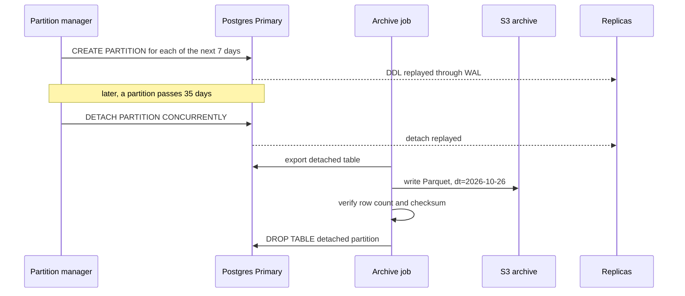

## Current state after V8

### Full architecture

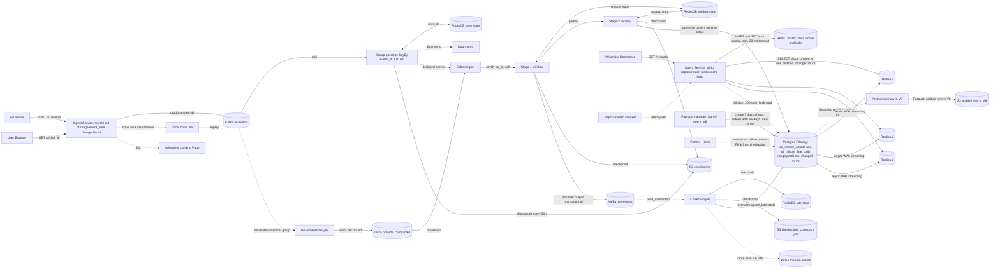

### Every current flow

1. **Impression write.** Unchanged. The Ad Server calls `POST /v1/events`. The Ingest Service now also rejects events with an `event_time` far outside the valid range. It produces to Kafka `ad-events` with `acks=all` and returns `202`.
2. **Click write.** Unchanged. The browser calls `GET /c/{click_id}`, and the Ingest Service produces to Kafka and returns `302`. It spools locally on a Kafka timeout.
3. **Dedup.** Unchanged. The Dedup operator drops repeats using the 6-hour `seen` state.
4. **Hot-key control.** Unchanged. The detector writes factors to `hot-ads`, and the salt assigner reads them as broadcast state.
5. **On-time count update.** Unchanged in logic. The sink overwrite-upserts into `ad_minute_counts`, and Postgres routes each row to its daily partition.
6. **Late count update.** Unchanged in logic. The correction job overwrites `ad_minute_late`, and rows land in their daily partition. A late row for yesterday touches yesterday's partition.
7. **Replication.** Unchanged. WAL streams to three replicas and now carries partition DDL too.
8. **Read.** Unchanged in shape. The Query Service reads Redis hour blocks first. On a miss it queries a sticky-routed replica, and the planner prunes to the partitions that overlap the range.
9. **Cache refresh.** Unchanged. The lock winner queries a replica for one hour block and writes it to Redis.
10. **Partition lifecycle (new).** A nightly job creates the next 7 days of partitions for both tables. After 35 days, it detaches a partition, archives it to S3 as Parquet, verifies it, and drops it. This is disabled until rollups exist.
11. **Failover.** Unchanged. Patroni promotes the most caught-up replica and restarts both Flink jobs from their latest checkpoints.
12. **Duplicates and late events.** Unchanged. Duplicates are fixed within 6 hours, and late events are counted up to 6 hours late.

## Interview follow-ups

**"Why not shard Postgres by `campaign_id`?"**
The write rate is only about 8K rows/s, so one primary has plenty of headroom. The real problem is that data grows with time and ages. Hashing by campaign spreads writes we don't need to spread, and every shard still accumulates every day. Time partitioning matches how the data ages. If writes ever grew 50x, I would revisit sharding, probably after moving the aggregate store to a columnar engine.

**"What if the partition manager fails and tomorrow's partition is missing?"**
There is a week of runway, because the job creates partitions 7 days ahead. A `DEFAULT` partition catches stray rows so the sink never errors, and an alert fires if anything lands there. Ingest also rejects events with absurd timestamps, so a bad client can't create demand for a partition that shouldn't exist.

## Recap

| Concept | The Insight |
|---|---|
| Binder per day | Data ages, so partitioning by time keeps the hot part small and the cold part detachable. |
| Partition, not shard | 8K writes/s fits one node. The problem is table size, not write capacity. |
| Daily granularity | Hourly means too many partitions per query, and weekly means indexes that don't fit in RAM. |
| Detach, archive, drop | Retention is a metadata change plus a verified export, not millions of `DELETE`s. |
| Retention starts off | Dropping minute data before rollups exist would erase history dashboards still need. |
| V8's honest limit | A 90-day query still sums millions of minute rows, and minute data now disappears after 35 days. |

**Interview arc:** *"A single 20-billion-row table can't keep its indexes in memory, takes 9-hour vacuums, and can't drop old data without bloat, so I partition by day on `minute_bucket`, which keeps today's indexes hot and makes retention a detach-archive-drop instead of a `DELETE`."*

## Next

Priya's agency asks for a 90-day performance report. That is 20 ads × 1,440 minutes × 90 days, or about 2.6M rows summed per request. Minute rows also disappear after 35 days, so quarterly history won't exist at all.

V9 adds hourly and daily rollup tables. They are built from the minute data, backfilled before the first drop, and chosen by the Query Service based on the requested range.

Say "next" when ready.


-----------------------------------------------------------------------------------------------------------------------
-----------------------------------------------------------------------------------------------------------------------
-----------------------------------------------------------------------------------------------------------------------
-----------------------------------------------------------------------------------------------------------------------


# V9: Hourly and daily rollups

## Break it

It's a Monday in January. Priya's agency asks for a 90-day performance report on one campaign with 20 ads.

- **Rows summed.** 20 ads × 1,440 minutes × 90 days is about 2.6M rows. A replica spends 4 to 6 seconds on it, and the Query Service's 500 ms timeout fires first.
- **The cache can't help.** V7 caches one block per campaign per hour. A 90-day range is 2,160 blocks, so a single `MGET` asks for 2,160 keys. Most are cold, and each miss is another replica query.
- **The data isn't there.** Minute rows are kept for 35 days. A 90-day report has no source rows for 55 of its days.

Multiply by 200K advertisers who each open a monthly or quarterly view once a day. That is a heavy, bursty read load. Every one of those queries returns a few hundred points of a chart, and nobody needs minute detail at that range.

*Deferred on purpose:* multi-region, observability, and the nightly batch reconciliation job.

## The analogy

A shop owner keeps a till tape with every sale. At the end of each hour, she writes one line in an hourly book. At the end of each day, she writes one line in a daily book. Last year's tapes go into boxes.

To answer "how did we do this quarter?", she reads 90 lines in the daily book. She does not re-add 90 days of till tape.

Each book is built from the finer one below it. If a late receipt turns up, she re-adds that one hour from the tape and rewrites the line. She never adjusts a line by adding a number on top of it.

## Solve it

We add two rollup tables, hourly and daily. A rollup job builds them from the minute tables. The Query Service picks the coarsest table that still gives enough points for the requested range.

### The numbers that decide it

- Minute rows: about 720M/day.
- Hourly rows per ad: 24/day, so about 12M/day. That is 60x fewer.
- Daily rows per ad: 1/day, so about 500K/day. That is 1,440x fewer.
- The 90-day report becomes 20 × 90 = 1,800 daily rows.

### Who builds the rollups

| Option | Handles late rows | Exact after a rerun | Cost | Verdict |
|---|---|---|---|---|
| Query-time sum on bigger replicas | Yes | Yes | Same scan every request, and minute data expires | Rejected |
| Flink emits hourly and daily windows | No (the V5 problem again, plus 24 h window state) | Partly | Another stateful stage | Rejected |
| Materialized view with `REFRESH` | Yes | Yes | Full recompute over billions of rows | Rejected |
| Incremental `+ N` into the rollup | No | No (a rerun double counts) | Cheap | Rejected |
| Rollup job recomputes a bucket from the level below and overwrites it | Yes | Yes | Only touched buckets | Chosen |

The chosen design reuses a rule from earlier versions. A table holds totals, one job owns it, and every write overwrites. A rerun after a crash writes the same value.

### When is a bucket recomputed

Late rows change a minute for up to 6 hours (V5). So the rollup has to follow them.

- **Hour closes.** The job computes the hour a few minutes after it ends, once the watermark has passed it.
- **Late row arrives.** `ad_minute_late` already carries `updated_at` (V5). The job finds keys touched since its last run and recomputes only those `(ad, hour)` buckets. Late traffic is about 1%, so this stays small.
- **Day settles.** At 07:00 UTC the next day, every hourly row for the day is final. The job computes the daily row from those 24 hourly rows.

This keeps rollup cost proportional to what changed, not to everything that exists.

### Choosing the table per request

| Requested span | Table | Points per ad | Why |
|---|---|---|---|
| Up to 48 hours | Minute (V8 partitions) | Up to 2,880 | Detail is useful at this range |
| 48 hours to 31 days | Hourly | Up to 744 | A chart can't show more |
| Over 31 days | Daily | Up to 400 or so | Same reason |

A caller can pass `granularity` to override. Minute beyond 35 days returns `400`, because that data has moved to the archive.

✅ **What we gained**
- A 90-day report reads about 1,800 rows, not 2.6M.
- Quarterly and yearly history exists after minute rows expire.
- Retention can finally be switched on, because history is preserved at coarser grain.
- Cache blocks get coarser too. One cached block covers a day of hourly rows or a month of daily rows.

⚠️ **What we gave up / new problems**
- **Rollups can disagree with minutes.** For a short time after a late row, the hourly row is behind the minute rows. The job closes that gap within about a minute, and we monitor it.
- **Daily is in UTC.** A day in India or California doesn't match a UTC day. For local-time days, the Query Service sums hourly rows at read time, which works only for zones on whole-hour offsets. Half-hour zones like IST are a known gap. I'd name it in the interview and defer it.
- **Granularity is fixed per ad.** Rollups are per ad. Slicing by country or device is the cut P2.
- **More tables and a job to run.** The job needs a schedule, a lag alert, and a verification check.

❌ **What we considered and rejected**
- **Rollups per campaign only.** Per-ad reports are common, so we'd lose them.
- **Storing only daily.** Hourly gives time-of-day charts for the last month, at a small cost.

## Implement it

### Where it lives

Rollup tables sit on the same Postgres primary, partitioned by time as in V8. Hourly uses monthly partitions, since there are about 12M rows a day. Daily uses yearly partitions. The job reads minute rows from a replica and writes rollups to the primary, so its scans stay off the primary.

### Schema (first appearance, shown in full)

```sql
CREATE TABLE ad_hour_counts (
  ad_id        BIGINT      NOT NULL,
  campaign_id  BIGINT      NOT NULL,
  hour_bucket  TIMESTAMPTZ NOT NULL,
  impressions  BIGINT      NOT NULL DEFAULT 0,
  clicks       BIGINT      NOT NULL DEFAULT 0,
  computed_at  TIMESTAMPTZ NOT NULL DEFAULT now(),
  PRIMARY KEY (ad_id, hour_bucket)
) PARTITION BY RANGE (hour_bucket);
CREATE INDEX ON ad_hour_counts (campaign_id, hour_bucket);

CREATE TABLE ad_day_counts (
  ad_id        BIGINT      NOT NULL,
  campaign_id  BIGINT      NOT NULL,
  day_bucket   DATE        NOT NULL,        -- UTC day
  impressions  BIGINT      NOT NULL DEFAULT 0,
  clicks       BIGINT      NOT NULL DEFAULT 0,
  computed_at  TIMESTAMPTZ NOT NULL DEFAULT now(),
  PRIMARY KEY (ad_id, day_bucket)
) PARTITION BY RANGE (day_bucket);
CREATE INDEX ON ad_day_counts (campaign_id, day_bucket);

-- Delta on V5's late table: find touched keys quickly
CREATE INDEX ON ad_minute_late (updated_at);
```

The partition manager from V8 creates the monthly and yearly partitions ahead of time.

### Who writes, who reads

| Structure | Who writes | When | Who reads | When |
|---|---|---|---|---|
| `ad_hour_counts` | Rollup job | Hour close, and each late-dirty bucket | Daily rollup step, Query Service | Daily build, every hourly or daily-range miss |
| `ad_day_counts` | Rollup job | Once a day, 07:00 UTC | Query Service | Every long-range miss |
| `ad_minute_counts`, `ad_minute_late` | Flink sinks (unchanged) | Window close, every 10 s | Rollup job (from a replica) | Every run |
| Redis blocks `stats:v1:h:...`, `stats:v1:d:...` | Query Service | On a miss or soft expiry | Query Service | Every request |

### The rollup job

A scheduled job, not a streaming one. It runs every minute and has three steps.

**Step 1: close hours.** For each hour that ended more than 5 minutes ago and has no rollup yet:

```sql
-- read from a replica
SELECT ad_id, campaign_id, date_trunc('hour', minute_bucket) AS hour_bucket,
       SUM(impressions) AS impressions, SUM(clicks) AS clicks
FROM ad_minute_totals
WHERE minute_bucket >= $1 AND minute_bucket < $1 + interval '1 hour'
GROUP BY ad_id, campaign_id, hour_bucket;
```

```sql
-- write to the primary, in batches of 5,000 rows
INSERT INTO ad_hour_counts (ad_id, campaign_id, hour_bucket, impressions, clicks)
SELECT * FROM unnest($1::bigint[], $2::bigint[], $3::timestamptz[],
                     $4::bigint[], $5::bigint[])
ON CONFLICT (ad_id, hour_bucket) DO UPDATE
SET impressions = EXCLUDED.impressions,
    clicks      = EXCLUDED.clicks,
    computed_at = now();
```

**Step 2: follow late rows.** Remember a high-water mark `last_seen` (stored in a one-row `rollup_state` table):

```sql
SELECT DISTINCT ad_id, date_trunc('hour', minute_bucket) AS hour_bucket
FROM ad_minute_late
WHERE updated_at > $last_seen;
```

For each pair, rerun the Step 1 read, limited to that ad and hour. Then overwrite with the same upsert. Advance `last_seen` only after the writes commit. A crash before that point repeats the same overwrites, and nothing is double-counted.

**Step 3: build days.** At 07:00 UTC, for yesterday:

```sql
INSERT INTO ad_day_counts (ad_id, campaign_id, day_bucket, impressions, clicks)
SELECT ad_id, campaign_id, $day, SUM(impressions), SUM(clicks)
FROM ad_hour_counts
WHERE hour_bucket >= $day AND hour_bucket < $day + interval '1 day'
GROUP BY ad_id, campaign_id
ON CONFLICT (ad_id, day_bucket) DO UPDATE
SET impressions = EXCLUDED.impressions, clicks = EXCLUDED.clicks, computed_at = now();
```

At 07:00, the last hour of the day (23:00 to 24:00) ended 7 hours ago, which is past the 6-hour late horizon. So every hour is settled.

### Backfill and enabling retention

Retention is still switched off from V8. Before turning it on, we run this once.

1. Run Steps 1 and 3 over every minute partition still online. That covers about 35 days.
2. Verify each day. The sum of `clicks` and `impressions` in `ad_day_counts` must equal the sum over that day's minute partitions. Any mismatch blocks the day.
3. Only after all days pass, enable the V8 retention job.

### Read path

**API call (unchanged shape, new optional parameter)**
```
GET /v1/stats?campaign_id=42&from=2026-10-18T00:00Z&to=2027-01-16T00:00Z&granularity=auto
```

1. Query Service computes the span (90 days) and picks `day`.
2. It snaps `from` and `to` to UTC day boundaries.
3. It splits the range into month blocks and reads Redis:
   ```
   MGET stats:v1:d:42:202610 stats:v1:d:42:202611 stats:v1:d:42:202612 stats:v1:d:42:202701
   ```
4. Each block follows the V7 branches (fresh hit, soft-expired, miss with lock, Redis error). On a miss, it runs on a sticky-routed replica:
   ```sql
   SELECT day_bucket, SUM(impressions) AS impressions, SUM(clicks) AS clicks
   FROM ad_day_counts
   WHERE campaign_id = $1 AND day_bucket >= $2 AND day_bucket < $2 + interval '1 month'
   GROUP BY day_bucket ORDER BY day_bucket;
   ```
5. For the day still open, which has no daily row yet, it reads hourly rows for completed hours, plus the V7 minute block for the current hour. It sums them and appends one point.

Hourly requests work the same way. Their blocks are one day per campaign, with key `stats:v1:h:{campaign_id}:{yyyyMMdd}`.

### Cache TTLs for the new blocks

| Block | Soft TTL | Hard TTL | Why |
|---|---|---|---|
| Hourly block for today | 5 min | 30 min | Hours close and late rows land |
| Hourly or daily block, older than 7 h past its end | 1 h | 6 h | Settled |
| Anything touched by a batch correction | Deleted explicitly | n/a | Same as V7's plan |

Stampede handling is unchanged from V7: soft expiry, lock, and jitter.

### Retention after V9

| Data | Online | Then |
|---|---|---|
| Minute rows | 35 days | Detach, archive to S3 as Parquet, verify, drop (V8) |
| Hourly rows | 400 days | Same lifecycle, monthly partitions |
| Daily rows | 7 years | Same lifecycle, yearly partitions |

Hourly at 12M rows/day and about 150 bytes is roughly 1.8 GB/day, so about 720 GB at 400 days. That is comfortable for one primary.

### Sequence diagram

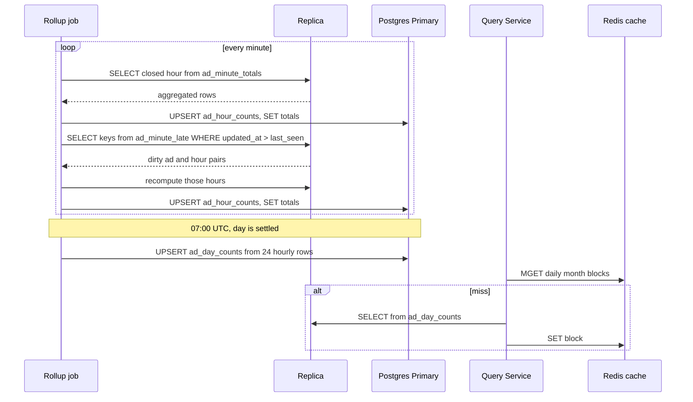

## Current state after V9

### Full architecture

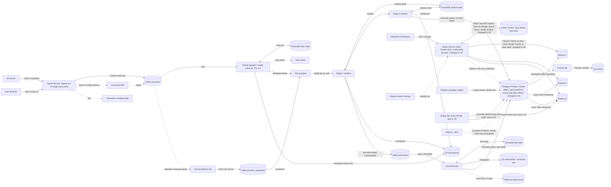

### Every current flow

1. **Impression write.** Unchanged. The Ad Server calls `POST /v1/events`. Ingest rejects out-of-range timestamps, produces to Kafka `ad-events` with `acks=all`, and returns `202`.
2. **Click write.** Unchanged. The browser calls `GET /c/{click_id}`, and Ingest produces to Kafka and returns `302`. It spools locally on a Kafka timeout.
3. **Dedup.** Unchanged. The Dedup operator drops repeats using the 6-hour `seen` state.
4. **Hot-key control.** Unchanged. The detector writes factors to `hot-ads`, and the salt assigner reads them as broadcast state.
5. **On-time count update.** Unchanged. Stage 1 and stage 2 aggregate, and the sink overwrite-upserts into `ad_minute_counts`.
6. **Late count update.** Unchanged. Late events go through `late-events` to the correction job, which overwrites `ad_minute_late`.
7. **Rollup build (new).** The rollup job reads closed hours from a replica and overwrites `ad_hour_counts`. It also finds late-touched `(ad, hour)` pairs through `ad_minute_late.updated_at` and recomputes only those. At 07:00 UTC it builds yesterday's `ad_day_counts` from the hourly rows.
8. **Read (changed).** The Dashboard calls `GET /v1/stats`. The Query Service picks minute, hourly, or daily by span, splits the range into blocks, and reads Redis. On a miss, it queries a sticky-routed replica on the chosen table. For the still-open bucket it adds a point from finer data.
9. **Cache refresh.** Unchanged in mechanism. The lock winner queries a replica and writes the block with a jittered soft TTL. Block shape now depends on granularity.
10. **Partition lifecycle.** Unchanged in mechanism. The nightly job creates partitions and detaches old ones. Retention for minute rows can now be enabled, once the backfill verification passes.
11. **Replication and failover.** Unchanged. Patroni promotes the most caught-up replica and restarts both Flink jobs. The rollup job restarts from its stored `last_seen` and overwrites safely.
12. **Duplicates and late events.** Unchanged. Duplicates are fixed within 6 hours, and late events are counted up to 6 hours late. Rollups follow late rows within about a minute.

## Interview follow-ups

**"Why not have Flink emit the hourly and daily aggregates directly?"**
Late events are the problem. Flink closes a window and drops its state, so a late event can't update the hourly total without bringing back V5's two-writer problem. A daily window would also hold state for 24 hours across 500K ads. A job that recomputes a bucket from finer data and overwrites it is simple and idempotent, and it handles late rows by finding the touched keys.

**"How do you know the rollups are correct?"**
Each backfilled day is verified by summing rollups and minute rows and requiring equality before any minute partition is dropped. Going forward, a monitor compares the hourly row to the sum of its minute rows for a sample of buckets and alerts on drift. Because every rollup write is an overwrite from the level below, a mismatch is fixed by rerunning the bucket, not by hand-editing a number.

## Recap

| Concept | The Insight |
|---|---|
| Hourly and daily books | Long-range questions need fewer, coarser rows, and each level is built from the one below. |
| Recompute and overwrite | A rerun writes the same total, so crashes and late rows can't double count. |
| Dirty keys from `updated_at` | Rollup cost follows what changed, not what exists. |
| Granularity by span | A chart can't show more points than pixels, so a 90-day view reads about 1,800 rows. |
| Backfill before retention | Minute data is dropped only after rollups verify equal to it. |
| V9's honest limit | The whole system lives in one region, so far-away ad servers are slow and a regional outage stops everything. |

**Interview arc:** *"A 90-day report summed 2.6M minute rows and minute data expires at 35 days, so I add hourly and daily rollup tables that a job recomputes from the finer level and overwrites, chasing late rows through `updated_at`, and the Query Service picks the table by requested span."*

## Next

It's 2 am in Mumbai. Ad servers there send every event to a US region, and every round trip costs about 250 ms. When that region has a bad hour, ad events from three continents stop at once.

V10 goes multi-region. The decision is who owns the counts for each ad, and how regions merge their numbers without counting an event twice.

Say "next" when ready.


-----------------------------------------------------------------------------------------------------------------------
-----------------------------------------------------------------------------------------------------------------------
-----------------------------------------------------------------------------------------------------------------------
-----------------------------------------------------------------------------------------------------------------------


# V10: Multi-region

## Break it

It's 2:00 am in Mumbai. Kavya taps a shoe ad on her phone, and the click goes to our one region in us-east.

- **Click latency.** The round trip is about 250 ms. A cold connection needs TCP, TLS and the HTTP request, so three round trips, about 750 ms. The redirect to the landing page is delayed by that much, and users bounce.
- **Impression latency.** Impression calls are asynchronous, but the Ad Server's connection pools and retries still spend a quarter second on every call.
- **Regional outage.** us-east has a bad hour. Ingest, Kafka, Flink, Postgres and the dashboards are all in that one region. Ad events from three continents stop at once. Ad servers buffer in memory for a few minutes, then drop impressions. Clicks have nowhere to go, so users see errors.

Traffic splits roughly 40% US, 30% EU and 30% APAC. So 60% of the world pays the latency tax, and 100% of it shares one failure domain.

*Deferred on purpose:* reconciliation against raw events, observability, and per-region dashboard caches.

## The analogy

A company keeps all its books at a New York head office. Customers in Mumbai and Frankfurt must stand in line at a counter across the ocean.

The fix is branch counters that stamp each receipt locally and hand the customer a confirmation. Then a courier carries the receipt to the one office that keeps that account's ledger. Every account has exactly one ledger and one clerk who writes in it.

Two clerks never write to the same ledger. That is why there is nothing to reconcile.

## Solve it

Ingest becomes regional. Counting does not. Every campaign has one home region, picked by hashing `campaign_id`. That region runs the whole V1 to V9 pipeline for the campaign: dedup, windows, Postgres, rollups, cache.

An event ingested in Mumbai is acked locally. A forwarder then carries it to the campaign's home region.

### Why ownership by `campaign_id`

The crux here is how to avoid cross-region conflicts. Dedup is the hard part, because the same `event_id` can arrive in two regions when an Ad Server fails over and retries.

| Option | Local ingest | Cross-region dedup | Reads | Region loss | Verdict |
|---|---|---|---|---|---|
| Single region, passive standby | No (latency unchanged) | Yes | One table | Cold failover | Rejected |
| Each region counts what it ingested, sum at read | Yes | Breaks. Two regions can count the same event. | Query fans out to 3 regions | Its counts freeze until it returns | Rejected |
| Multi-master with per-region counter slots (G-counter) | Yes | Breaks, same as above. Merge is clean, dedup is not. | Merge on read | Partial | Rejected |
| Regional ingest, one owner per campaign | Yes | Yes. All copies of an event reach one dedup operator. | One region per campaign | Failover to a backup region | Chosen |

Counting is additive, so merging is never the hard part. Dedup is, and a single owner keeps it in one place. Campaign is the right key because dashboards, cache blocks and rollups are all per campaign. It also puts every ad of a campaign in one region.

I rejected owning by advertiser location. Events come from users all over the world, and the advertiser's location says nothing about where traffic originates.

### Hotspots

Hashing by campaign makes regions uneven. At the 500K/s peak, the viral campaign (about 30% of traffic) puts roughly 267K/s on its home region, against a 167K/s average. Each regional Flink cluster is sized for about 1.6x the average. V4's salting still handles the hot ad inside that region. A campaign known to be huge in advance can be placed explicitly at creation.

### Region failover: three candidate approaches

| Option | Mechanism | Cost | Recovery time for counting |
|---|---|---|---|
| Warm standby | Backup region runs a second Flink job on a mirrored feed | 2x Flink | Seconds |
| Cold standby plus replay | Backup replays the last 7 h of the mirrored log into a fresh job | 1x Flink | About 15 to 30 minutes |
| Restore the replicated checkpoint | Copy checkpoints cross-region and resume | 1x Flink | Minutes, but offsets point into a dead Kafka cluster |

I choose cold standby plus replay. Regions fail rarely. Ingestion never stops under any option, and no accepted event is lost beyond the mirror lag. Paying double compute to turn 30 minutes into 30 seconds of dashboard delay is a poor trade. Checkpoint restore sounds cheap but needs Kafka offset translation, which is fragile.

✅ **What we gained**
- Click redirects and impression acks happen in the caller's nearest region, about 20 to 50 ms instead of 750 ms.
- A regional failure no longer stops ingestion everywhere. Geo-DNS moves callers in 1 to 2 minutes.
- Every campaign has one writer and one dedup domain, so there is no merge and no conflict.
- V2 to V9 are untouched. Each region runs an identical stack on its own slice of campaigns.

⚠️ **What we gave up / new problems**
- **Freshness for remote events** gets worse by the forwarding hop, about 0.3 to 1 s.
- **Dashboards for a foreign campaign** pay one cross-region proxy hop, about 100 to 250 ms.
- **Counting recovery takes 15 to 30 minutes** after losing a region.
- **A destroyed region can lose about 1 to 2 s of events.** Acks are local, and mirroring is async. A merely down region loses nothing, because its logs survive.
- **Split-brain is possible.** A partitioned region might keep counting while others take over its campaigns. We need fencing.
- **Regions are uneven**, and we pay for 1.6x headroom everywhere.
- **Three full stacks to operate.**

❌ **What we considered and rejected**
- **Cross-region produce from Ingest.** It puts the 250 ms back on the request path, and a remote outage would break local ingest.
- **Synchronous cross-region replication of Kafka or Postgres.** Every ack would cost a round trip.
- **Moving a campaign between regions live.** It needs window and dedup state handover. I avoid it entirely and only change ownership at a region failure.

## Implement it

### New structures

Where each lives: Kafka topics sit in the region named in the table. `region_alias` is a tiny key-value item in a globally replicated table. It is read every 5 s and written only during incidents, and it must be readable even when another region is gone. That is why it is not Redis.

| Structure | Who writes | When | Who reads | When |
|---|---|---|---|---|
| Kafka `ad-ingest` (each region, local) | Ingest Service | Every valid event, before it replies | Lane forwarders | Continuously |
| Kafka `ad-events` (owner region) | Lane forwarder, local or remote | After reading `ad-ingest` | Dedup source (V3), MirrorMaker 2 | Continuously |
| Kafka `<region>.ad-events` (backup region) | MirrorMaker 2 | Continuously, async | Recovery Flink job | Only on failover |
| `region_alias` item | Failover controller | On region loss | Forwarders, Query Service, region watchdog | Poll every 5 s |
| Postgres standby of each region's primary, in its backup region | Primary, through WAL | Continuously, async | Patroni on promotion | Only on failover |

Everything else stays regional and unchanged. Postgres, Redis, Flink state, S3 checkpoints and the S3 archive each hold only the region's own campaigns. The archive bucket gets cross-region replication.

### Ownership rule

```python
REGIONS = ["us-east", "eu-west", "ap-south"]

def home(campaign_id):                       # static, no lookup
    return REGIONS[mmh3.hash(str(campaign_id)) % 3]

def backup(region):                          # ring
    return REGIONS[(REGIONS.index(region) + 1) % 3]

# region_alias = {"epoch": 7, "alias": {}}   normally empty
# during a us-east loss: {"epoch": 8, "alias": {"us-east": "eu-west"}}
def resolve(region):
    return region_alias["alias"].get(region, region)
```

Payload delta, `ad-events` and `ad-ingest` messages:

```json
{ "ingest_region": "ap-south" }
```

### Write path: impressions

**API call (same shape, new hostname)**

```
POST https://ingest.example.com/v1/events      // geo-DNS picks the nearest healthy region
{ "event_id": "0b6e5c1e-...", "type": "impression", "ad_id": 777,
  "campaign_id": 42, "event_time": "2026-11-16T20:34:31Z" }
```

1. Geo-DNS routes Mumbai to the ap-south Ingest Service.
2. Ingest validates, then produces to the local `ad-ingest` with `acks=all` (V1 settings). It returns `202`.
3. One forwarder lane per destination region reads `ad-ingest`, each with its own consumer group (`fwd-us-east`, `fwd-eu-west`, `fwd-ap-south`).
4. Each lane keeps only events where `resolve(home(campaign_id))` equals its destination.
5. **Branch A, owner is local.** The lane produces to the local `ad-events`.
6. **Branch B, owner is remote.** The lane produces to the remote `ad-events` with `acks=all`, idempotence on, `linger.ms=50`, lz4, and `delivery.timeout.ms=120000`. About 120 to 250 ms.
7. **Branch C, remote unreachable.** Only that lane stalls. `ad-ingest` retains 7 days, so nothing is lost, and the other lanes keep moving. An alert fires on lane lag.
8. The lane commits its offsets only after the flush succeeds.

```python
def lane(dest):
    c = Consumer(group=f"fwd-{dest}", topic="ad-ingest")
    while True:
        batch = c.poll(500)
        mine = [e for e in batch if resolve(home(e.campaign_id)) == dest]
        send_with_retry(dest, mine)       # re-resolves owner on each retry
        c.commit()                        # after every flush has been acked
```

Redelivery after a crash is harmless. The owner's V3 dedup drops repeats by `event_id`.

### Write path: clicks

`GET /c/{click_id}` lands in the nearest region. The signing keys are replicated to every region's secret store, so any Ingest can verify the token. It then follows the same produce step and returns `302`. The V1 spool-on-timeout rule applies per region.

### Read path

**API call (unchanged)**

```
GET /v1/stats?campaign_id=42&from=2026-11-16T14:00Z&to=2026-11-16T15:00Z
```

1. A London dashboard reaches the eu-west Query Service.
2. It computes `resolve(home(42))`, which is us-east.
3. **Branch A, owner is local.** The V7 to V9 path runs unchanged.
4. **Branch B, owner is remote.** It proxies the request to the owner's Query Service with a `X-Hop: 1` header, which that service refuses to forward again. The owner runs the normal cache-then-replica path.

There are no cross-region caches yet, and I'm deferring that deliberately.

### MirrorMaker 2 and the standby database

```
# on each region's MM2: replicate only ad-events to the backup region
us-east->eu-west.topics   = ad-events        # appears as us-east.ad-events
eu-west->ap-south.topics  = ad-events
ap-south->us-east.topics  = ad-events
sync.group.offsets.enabled = false           # we replay by timestamp, not offsets
```

Each region's Postgres primary also streams WAL asynchronously to one standby node in its backup region. It does not serve reads. It is a promotion target.

### Region failover runbook (us-east lost)

Automation triggers only when 2 of 3 regions' health probes agree for 60 s.

1. **Flip.** The controller writes `{"epoch": 8, "alias": {"us-east": "eu-west"}}`. Within 5 s every forwarder routes us-east's campaigns to eu-west's `ad-events`.
2. **Rewind the lanes.** In each surviving region, reset the `fwd-eu-west` group to the committed offsets of `fwd-us-east`. This catches events that were stuck behind the dead destination, and dedup absorbs any overlap.
3. **Promote.** Patroni promotes the eu-west standby of the us-east database. It lags us-east by about 1 s.
4. **Repair the window.** The promoted database zeroes the late rows for the last 7 hours, and sets `updated_at` so the rollup job rebuilds those hours.
   ```sql
   UPDATE ad_minute_late
   SET impressions = 0, clicks = 0, updated_at = now()
   WHERE minute_bucket >= now() - interval '7 hours';
   ```
5. **Replay.** Start the main Flink job in eu-west, subscribed to both `us-east.ad-events` (the mirror) and the live `ad-events`. It starts from `now - 7h`, which covers the dedup horizon, with a 6-hour watermark delay. That delay makes every replayed event on-time. Window totals overwrite rows, as in V2.
6. **Cut over.** When the job catches up, restart it from its own checkpoint with the normal 30 s watermark. Start the correction, hot-ad detector, rollup and partition jobs, which resume from state stored in the promoted database.
7. **Serve.** Query Services resolve us-east's campaigns to eu-west. Dashboards show data up to the replay position until it catches up.

### Fencing

A region watchdog polls `region_alias` every 5 s. If its own region is aliased away, it cancels all local Flink jobs, so a partitioned region cannot keep writing. When it heals, its database is wiped and rebuilt as a standby of the new owner.

### Sequence diagram

```mermaid
sequenceDiagram
    participant AS as Ad Server Mumbai
    participant I as Ingest ap-south
    participant KI as ad-ingest ap-south
    participant L as Lane fwd-us-east
    participant KE as ad-events us-east
    participant F as Flink us-east
    participant P as Postgres us-east

    AS->>I: POST /v1/events
    I->>KI: produce, acks=all
    KI-->>I: ack
    I-->>AS: 202 Accepted (about 20 ms)
    L->>KI: poll
    L->>L: resolve(home(42)) is us-east
    L->>KE: cross-region produce, acks=all
    KE-->>L: ack
    L->>KI: commit offsets
    F->>KE: poll
    F->>F: dedup, window, count
    F->>P: UPSERT totals when minute closes
```

## Current state after V10

### Full architecture

Every region runs an identical copy of the stack inside the box. Cross-region links are drawn to peers.

```mermaid
graph LR
    AS["Ad Server"] --> GD["Geo DNS: nearest healthy region  new in V10"]
    BR["User Browser"] --> GD
    subgraph REG["Each region runs this stack: us-east, eu-west, ap-south  changed in V10"]
        ING["Ingest Service, local to the caller  changed in V10"]
        ING -->|"produce acks=all  changed in V10"| KI[("Kafka ad-ingest  new in V10")]
        ING -.->|"spool on Kafka timeout"| SP["Local spool file"]
        SP -.->|"replay"| KI
        KI -->|"one group per destination  new in V10"| FW["Lane forwarders  new in V10"]
        AL[("region_alias, global table  new in V10")] -.->|"owner lookup every 5 s  new in V10"| FW
        FW -->|"owner is this region  new in V10"| KF[("Kafka ad-events, owned campaigns only  changed in V10")]
        KF -->|"poll"| DD["Dedup operator: keyBy event_id, TTL 6 h"]
        DD <-->|"seen set"| RS[("RocksDB seen state")]
        DD -.->|"dup metric"| DM["Dup metric"]
        KF -.->|"separate consumer group"| HD["Hot-ad detector job"]
        HD -->|"factor per hot ad"| HA[("Kafka hot-ads, compacted")]
        HA -->|"broadcast"| SA["Salt assigner"]
        DD -->|"deduped events"| SA
        SA -->|"keyBy ad_id, salt"| W1["Stage-1 window"]
        W1 <-->|"window state"| RDB[("RocksDB window state")]
        W1 -->|"partials"| W2["Stage-2 window"]
        W2 <-->|"window state"| RDB
        DD -->|"checkpoint every 30 s"| S3[("S3 checkpoints")]
        W1 -->|"checkpoint"| S3
        W2 -->|"checkpoint"| S3
        W2 -->|"overwrite upsert, on-time totals"| PG[("Postgres Primary: minute, hourly, daily tables for owned campaigns")]
        W1 -->|"late side output, transactional"| LK[("Kafka late-events")]
        LK -->|"read_committed"| CJ["Correction job"]
        CJ <-->|"late totals"| LRS[("RocksDB late state")]
        CJ -->|"checkpoint"| S3C[("S3 checkpoints, correction job")]
        CJ -->|"overwrite upsert, late totals"| PG
        CJ -.->|"more than 6 h late"| TL[("Kafka too-late-events")]
        PM["Partition manager, nightly"] -->|"create ahead, detach old"| PG
        PG -.->|"detached partition"| AJ["Archive job"]
        AJ -->|"Parquet, verified"| AR[("S3 archive, cross-region replicated  changed in V10")]
        PG -->|"async WAL streaming"| R1[("Replica 1")]
        PG -->|"async WAL streaming"| R2[("Replica 2")]
        PG -->|"async WAL streaming"| R3[("Replica 3")]
        RJ["Rollup job, every minute"] -->|"read minute rows"| R3
        RJ -->|"overwrite upsert hourly and daily"| PG
        PAT["Patroni + etcd"] -.->|"promote on failure, restart Flink from checkpoint"| PG
        WD["Region watchdog: stop jobs if aliased away  new in V10"] -.->|"cancel Flink jobs"| W2
        DASH["Advertiser Dashboard"] -->|"GET /v1/stats"| QS["Query Service: resolve owner, proxy if remote  changed in V10"]
        QS <-->|"MGET and SET blocks, lock"| RC[("Redis Cluster: stats blocks and locks")]
        HC["Replica health checker"] -.->|"healthy set"| QS
        QS -->|"SELECT block on miss"| R1
        QS --> R2
        QS --> R3
        QS -.->|"fallback, 200-conn bulkhead"| PG
    end
    GD --> ING
    FW -->|"owner is a peer region, cross-region produce  new in V10"| PKF[("Peer region ad-events  new in V10")]
    QS -->|"proxy to owner region, X-Hop 1  new in V10"| PQS["Owner region Query Service  new in V10"]
    KF -->|"MirrorMaker 2, async  new in V10"| MIR[("Backup region: mirror topic region.ad-events  new in V10")]
    PG -->|"async WAL, standby only  new in V10"| DR[("Backup region: Postgres standby  new in V10")]
    AL -.->|"poll every 5 s"| WD
    ING -.->|"302"| LP["Advertiser Landing Page"]
```

### Every current flow

1. **Impression write (changed).** The Ad Server calls `POST /v1/events`. Geo-DNS sends it to the nearest healthy region. Ingest produces to the local `ad-ingest` with `acks=all` and returns `202`.
2. **Click write (changed).** The browser calls `GET /c/{click_id}`, served by the nearest region. Ingest verifies the token with the replicated keys, produces to the local `ad-ingest`, and returns `302`. It spools locally on a Kafka timeout.
3. **Routing (new).** Lane forwarders read `ad-ingest`, resolve the campaign's owner through `region_alias`, and produce to the owner's `ad-events`. They commit offsets only after the produce is acked.
4. **Dedup.** Unchanged. The owner region's Dedup operator drops repeats using the 6-hour `seen` state. Every copy of an event now reaches one dedup domain.
5. **Hot-key control.** Unchanged, inside each region.
6. **On-time count update.** Unchanged. The owner's Flink overwrite-upserts into the owner's Postgres.
7. **Late count update.** Unchanged, inside the owner region.
8. **Replication (within a region).** Unchanged. WAL streams to three local replicas.
9. **Rollup build.** Unchanged, inside the owner region.
10. **Read (changed).** The Dashboard reaches the nearest Query Service. It resolves the owner and proxies once if the owner is remote. The owner runs the V7 to V9 path.
11. **Cache refresh.** Unchanged, inside the owner region.
12. **Partition lifecycle.** Unchanged, per region. Archive buckets replicate across regions.
13. **In-region failover.** Unchanged. Patroni promotes a local replica and restarts both Flink jobs.
14. **DR copy (new).** MirrorMaker 2 copies `ad-events` to the backup region, and Postgres streams WAL to a standby there.
15. **Region failover (new).** The controller flips the alias, the lanes rewind, the backup promotes the standby, repairs the last 7 hours of late rows, replays the mirrored log into a fresh Flink job, and cuts over. The watchdog fences the lost region.
16. **Duplicates and late events.** Unchanged. Duplicates are fixed within 6 hours, and late events are counted up to 6 hours late.

## Interview follow-ups

**"Why not let every region count its own events and sum at read time? It's simpler and fully active-active."**
Counting merges fine, but dedup does not. During a regional failover an Ad Server retries against a different region, and both regions count the same `event_id`. Billing-grade counts can't allow that. With one owner per campaign, every copy of an event reaches the same dedup state, and the read path never merges.

**"What stops two regions from counting the same campaign during a network partition?"**
The alias map has an epoch, and flips need 2 of 3 regions to agree the target is unreachable. The isolated region's watchdog sees it has been aliased away and cancels its Flink jobs. Query Services read only from the resolved owner, so the old region's rows are never served. When it heals, it is rebuilt as a standby of the new owner.

## Recap

| Concept | The Insight |
|---|---|
| Branch counters, one ledger | Accept events near the caller, but count each campaign in exactly one region. |
| Dedup is the crux | Counts merge easily across regions, but duplicate detection needs a single place to look. |
| Lanes per destination | A dead region stalls only its own lane, and the log buffers for 7 days. |
| Cold standby plus replay | Rare region loss doesn't justify 2x compute. A 7-hour replay rebuilds dedup and window state. |
| Fencing | A region that was aliased away must stop writing. |
| V10's honest limit | Every "the nightly batch would fix it" so far is still unbuilt. |

**Interview arc:** *"One region put 750 ms on every Mumbai click and made one outage global, so I ingest in every region but count each campaign in one home region, forwarding events there, which keeps dedup in one place and turns failover into a replay of a mirrored log."*

## Next

Four times so far we've said "the nightly batch would catch it": duplicates past 6 hours, events over 6 hours late, the 1 to 2 s lost when a region is destroyed, and rollup drift. Meera asks who actually checks, and there is no answer yet.

V11 builds the reconciliation job. It recounts settled days from raw events and compares them with what the stream produced. It also adds the metrics that tell us when they disagree.

Say "next" when ready.


-----------------------------------------------------------------------------------------------------------------------
-----------------------------------------------------------------------------------------------------------------------
-----------------------------------------------------------------------------------------------------------------------
-----------------------------------------------------------------------------------------------------------------------


# V11: Reconciliation and observability

## Break it

It's December 9. Meera, who owns billing, asks one question: "When the stream is wrong, who tells us?"

Nobody does. Here is the case that proves it.

On December 2 at 14:00, a deploy changes how stage 2 merges partials. When ad 777's salt factor changes mid-window (V4), one salt's partial gets dropped. Ad 777 flaps between factor 1 and 16 as its traffic rises and falls. For three hours its counts run about 6% low.

Every health signal stays green. Consumer lag is zero, checkpoints finish in 30 s, the sink succeeds and replicas are 1 s behind. A week later Priya's agency compares our numbers to their own server logs. At ad 777's volume, that is roughly 40M impressions and 400K clicks that were never billed.

We also left four known gaps unmeasured, each time saying "the nightly batch would catch it."

| Gap | Where it came from | Rough size |
|---|---|---|
| Duplicates more than 6 h apart | V3 dedup horizon | Counted twice |
| Events more than 6 h late | V5 `too-late-events` | About 20 events/s, 1.7M a day, never counted |
| Events lost when a region is destroyed | V10 async mirror | About 1 to 2 s of traffic |
| Rollup drift | V9 | Unmeasured |

That nightly batch does not exist. Nobody compares the stream to anything.

*Deferred on purpose:* per-region caches for remote dashboards. Also deferred: proving that events never reached Ingest, because that boundary sits outside this pipeline.

## The analogy

A company's accountant keeps the daily books. She is careful, but she uses the same method every day. If her method has a flaw, every page carries it.

So the company hires an auditor. He works from his own copy of the till tapes, with his own method. Once a day he recounts and compares. Between audits, the accountant does a quick cross-foot: does what came in equal what went out?

The cross-foot catches arithmetic slips in minutes. The audit catches everything the accountant's method cannot see.

## Solve it

We add two controls.

- **Cross-foot.** The Flink jobs count events at each stage, and conservation checks run every few minutes.
- **Audit.** An independent recount from archived raw events runs daily. It compares to the stream by `(ad, hour)` and writes any difference to its own table.

The audit is the judge. The cross-foot is the early warning.

### Four naive attempts

**Attempt 1: run a second Flink job in parallel and compare.** It looked reasonable because two jobs give two answers. It breaks because both jobs run the same code on the same input. The Dec 2 bug would be in both, and they would agree with each other.

**Attempt 2: check that hourly rows equal the sum of their minute rows.** It looked reasonable because the check is cheap. It only tests the rollup job (V9). A bug upstream of Postgres produces consistent wrong numbers at every level.

**Attempt 3: replay the same Flink job over Kafka in batch mode.**

> **Meera:** Same operators, same keys, same salting. If the salt merge is wrong, the replay is wrong the same way.
> **Arjun:** And Kafka only keeps 7 days. Settlement needs longer.

A replay checks that the stream is repeatable. It does not check that it is right.

**Attempt 4: sample 1% of events and trace each one through the pipeline.** It looked reasonable because it gives end-to-end evidence. It only proves presence, not counts. A 6% loss on one ad in one window is invisible at a 1% sample unless you look in exactly the right place.

All four share one flaw. The checker shares code, input or assumptions with the thing it checks. The real fix is a different implementation over a separate copy of the raw events.

### Options compared

| Option | Independent code | Independent input | Catches Dec 2 bug | Verdict |
|---|---|---|---|---|
| Second Flink job | No | No | No | Rejected |
| Rollup consistency check | n/a | No | No | Kept, but not enough |
| Batch replay of Flink on Kafka | No | No | No | Rejected |
| Sampled tracing | Partly | Yes | Rarely | Rejected |
| Spark SQL recount from a raw archive | Yes | Yes | Yes | Chosen |
| In-stream conservation counters | Partly | No | Some classes, in minutes | Chosen as the early warning |

### Two passes, because the settlement rules differ

The stream has rules. Late events count up to 6 hours, and dedup remembers 6 hours. Billing has a policy of its own: an event counts if it arrives within 72 hours of its event time, and dedup has no time limit.

So the audit runs twice for each day.

- **Pass 1, "like for like."** It runs at 07:30 UTC the next day, after the 6-hour horizon. It applies the stream's own rules, but with global dedup. A correct stream should match it almost exactly. Any mismatch is a bug, so this pass drives alerts.
- **Pass 2, "billing truth."** It runs four days after the day ends, with the 72-hour policy. Its difference from the stream includes the four known gaps. This pass writes the adjustments.

Both passes overwrite and can be rerun.

✅ **What we gained**
- Silent bugs are found within about 8 hours by pass 1, and within minutes for the classes the cross-foot covers.
- Every known gap now has a number and a correction path.
- Billing reads settled numbers, with an explicit status per day.
- A rerun fixes any bad result. Nothing is hand-edited.

⚠️ **What we gave up / new problems**
- **Final numbers lag by four days.** The 72-hour late window plus the run time sets that floor.
- **Two implementations can drift apart.** We pay for that with a shared written spec and a test dataset that both must match.
- **A raw archive of about 15 TB.** It is a new store we have to secure and age out.
- **Minute-grain views never show adjustments.** Adjustments are hourly, so they apply to hourly and daily views only.
- **Alert fatigue is possible.** Every threshold needs a baseline.

❌ **What we considered and rejected**
- **Letting the batch replace the stream.** Dashboards would be a day old. The stream stays for freshness and the batch for settlement.
- **Writing the batch's totals straight into `ad_hour_counts`.** That table has one writer, the rollup job. A second writer brings back the V5 problem.
- **Auto-applying every difference.** A large, unexplained gap is a bug signal. We hold the day and page instead.

## Implement it

### New structures

The raw archive is the blob-store class already in use (S3). It holds large, immutable files that are scanned in bulk and almost never read by key. Parquet fits that access pattern. The other two stores are small Postgres tables on each region's primary.

Size: about 100K events/s at 100 bytes is roughly 860 GB a day as JSON, and about 170 GB a day as Parquet. We keep 90 days, which is about 15 TB.

| Structure | Who writes | When | Who reads | When |
|---|---|---|---|---|
| S3 `adagg-raw-<region>`, Parquet | Kafka Connect S3 sink, group `archive-sink` | Continuously, from `ad-ingest` | Reconciler | Each pass |
| `ad_hour_adjustments` | Reconciler (pass 2 only) | Daily, per settled day | Query Service, rollup job, through the view | Hourly or daily-range misses, day builds |
| `day_settlement` | Reconciler | After each pass | Query Service, invoicing (later), alerts | Every response and every alert check |
| Flink conservation counters | Dedup, stage 1, stage 2 and sink operators | Every event or window fire | Prometheus | Every 15 s scrape |
| Redis blocks | Query Service, plus reconciler deletes | On miss, or on adjustment | Query Service | Every request |

The `too-late-events` topic from V5 stays as a 7-day debugging tap. The reconciler does not use it. Late events are already in the raw archive.

### Payload delta

Ingest adds the owner, computed by the static V10 function.

```json
{ "owner": "us-east" }
```

### Raw archive sink

One connector per region, reading the local `ad-ingest`. That topic is the earliest durable point, so it holds every acked event before any forwarder or Flink bug can touch it.

```
connector.class        = io.confluent.connect.s3.S3SinkConnector
topics                 = ad-ingest
format.class           = ParquetFormat
partitioner.class      = FieldAndTimeBasedPartitioner
partition.field.name   = owner
path.format            = 'dt'=YYYY-MM-dd/'hr'=HH
timestamp.extractor    = RecordField
timestamp.field        = ingest_time
flush.size             = 500000
rotate.interval.ms     = 600000        # record time, not wall clock, so file names stay deterministic
s3.bucket.name         = adagg-raw-<region>
```

Files are named by topic, partition and offset range. A restart rewrites the same object. The recount also dedups by `event_id`, so a stray double write would be harmless anyway.

The `owner=` prefix comes first in the path. S3 replication rules copy `owner=eu-west/` from every region into eu-west's bucket, and the same for the other two. That moves about two thirds of the archive, roughly 110 GB a day in total, and each reconciler reads only local data.

### Tables

```sql
CREATE TABLE ad_hour_adjustments (
  ad_id         BIGINT      NOT NULL,
  campaign_id   BIGINT      NOT NULL,
  hour_bucket   TIMESTAMPTZ NOT NULL,
  d_impressions BIGINT      NOT NULL,        -- batch minus stream, may be negative
  d_clicks      BIGINT      NOT NULL,
  run_id        TEXT        NOT NULL,
  computed_at   TIMESTAMPTZ NOT NULL DEFAULT now(),
  PRIMARY KEY (ad_id, hour_bucket)
) PARTITION BY RANGE (hour_bucket);          -- monthly, same lifecycle as ad_hour_counts

CREATE TABLE day_settlement (
  region        TEXT        NOT NULL,
  day           DATE        NOT NULL,
  status        TEXT        NOT NULL,        -- pending | provisional_ok | provisional_drift
                                             -- final_clean | final_adjusted | blocked
  stream_impr   BIGINT, batch_impr   BIGINT,
  stream_clicks BIGINT, batch_clicks BIGINT,
  mismatch_rows BIGINT,
  run_id        TEXT,
  updated_at    TIMESTAMPTZ NOT NULL DEFAULT now(),
  PRIMARY KEY (region, day)
);
```

### The cross-foot counters

Each Flink operator increments a counter by the number of events it handled.

```java
// Dedup:    events_in, dup_dropped, passed_dedup
// Stage 1:  late_diverted, partial_events_emitted += p.impressions + p.clicks   (at window fire)
// Stage 2:  final_events_emitted   += f.impressions + f.clicks                  (at window fire)
// Sink:     events_written         += f.impressions + f.clicks
```

Two identities hold exactly, and both are checked over 10-minute windows.

1. `events_in = dup_dropped + passed_dedup`
2. `partial_events_emitted = final_events_emitted = events_written`

An alert fires when either is off by more than 0.01% for two consecutive windows. The Dec 2 bug breaks identity 2, because stage 1 emits 100 and stage 2 emits 94. That pages within about 20 minutes.

The cross-foot cannot see loss at stage 1 itself, or events dropped between Kafka and Flink. Pass 1 covers those.

### The audit (Spark SQL on an ephemeral cluster)

The reconciler first checks its input. It lists the archive files for every needed `dt` and `hr` and confirms that the offset ranges in the file names are contiguous per partition. **A gap means it refuses to run.** A missing file would otherwise look like a stream overcount, and pass 2 would adjust good numbers down.

The recount for one owner region and one day:

```sql
WITH first_copy AS (
  SELECT event_id,
         min_by(struct(type, ad_id, campaign_id, event_time, ingest_time), ingest_time) AS e,
         COUNT(*) AS copies
  FROM raw_events
  WHERE owner = :owner
    AND dt BETWEEN :from_dt AND :to_dt          -- pass 1: day to day+1, pass 2: day to day+3
  GROUP BY event_id                             -- global dedup, no time limit
)
SELECT e.ad_id, e.campaign_id,
       date_trunc('hour', e.event_time)        AS hour_bucket,
       count_if(e.type = 1)                    AS impressions,
       count_if(e.type = 2)                    AS clicks
FROM first_copy
WHERE e.event_time >= :day AND e.event_time < :day + INTERVAL 1 DAY
  AND e.ingest_time <= e.event_time + :max_late   -- pass 1: 6 hours, pass 2: 72 hours
GROUP BY e.ad_id, e.campaign_id, date_trunc('hour', e.event_time);
```

Pass 2 reads about 230 GB per owner and runs in roughly 20 minutes.

The stream side is read from a replica, from the raw `ad_hour_counts` table and not the adjusted view:

```sql
SELECT ad_id, campaign_id, hour_bucket, impressions, clicks
FROM ad_hour_counts
WHERE hour_bucket >= :day AND hour_bucket < :day + interval '1 day';
```

A full outer join finds rows that exist on only one side:

```sql
SELECT COALESCE(b.ad_id, s.ad_id)                     AS ad_id,
       COALESCE(b.campaign_id, s.campaign_id)         AS campaign_id,
       COALESCE(b.hour_bucket, s.hour_bucket)         AS hour_bucket,
       COALESCE(b.impressions, 0) - COALESCE(s.impressions, 0) AS d_impressions,
       COALESCE(b.clicks, 0)      - COALESCE(s.clicks, 0)      AS d_clicks
FROM batch_hour b FULL OUTER JOIN stream_hour s
  ON b.ad_id = s.ad_id AND b.hour_bucket = s.hour_bucket;
```

### What each pass does with the diff

| | Pass 1 (day + 1, 07:30 UTC) | Pass 2 (day + 4, 02:00 UTC) |
|---|---|---|
| Rules | Stream's rules, global dedup | 72 h late policy, global dedup |
| Expected diff | Almost zero | Small, from the known gaps |
| Writes adjustments | No | Yes |
| Writes `day_settlement` | `provisional_ok` or `provisional_drift` | `final_clean`, `final_adjusted` or `blocked` |
| Alert | Mismatched rows above 0.01% of rows | Any campaign off by more than 0.5% of its batch total |
| Debug output | Top 1,000 mismatches to S3 | Same |

Pass 2 writes adjustments with an overwrite, so a rerun repeats the same values. It also writes zeros for any key that had a nonzero adjustment earlier, so a corrected stream clears its old adjustment.

```sql
INSERT INTO ad_hour_adjustments (ad_id, campaign_id, hour_bucket, d_impressions, d_clicks, run_id)
SELECT * FROM unnest($1::bigint[], $2::bigint[], $3::timestamptz[],
                     $4::bigint[], $5::bigint[], $6::text[])
ON CONFLICT (ad_id, hour_bucket) DO UPDATE
SET d_impressions = EXCLUDED.d_impressions,
    d_clicks      = EXCLUDED.d_clicks,
    run_id        = EXCLUDED.run_id,
    computed_at   = now();
```

If any campaign exceeds 0.5% in pass 2, the day is set to `blocked` and a page goes out. A person investigates, fixes the cause, reruns the pass and clears the status. Nothing downstream may treat a `blocked` day as settled.

### Read path delta

Hourly and daily reads now go through a view that adds adjustments. A full outer join covers an `(ad, hour)` that the stream never wrote at all.

```sql
CREATE VIEW ad_hour_totals AS
SELECT COALESCE(c.ad_id, a.ad_id)               AS ad_id,
       COALESCE(c.campaign_id, a.campaign_id)   AS campaign_id,
       COALESCE(c.hour_bucket, a.hour_bucket)   AS hour_bucket,
       COALESCE(c.impressions, 0) + COALESCE(a.d_impressions, 0) AS impressions,
       COALESCE(c.clicks, 0)      + COALESCE(a.d_clicks, 0)      AS clicks
FROM ad_hour_counts c
FULL OUTER JOIN ad_hour_adjustments a USING (ad_id, hour_bucket);
```

Two other readers change.

- The Query Service's hourly block query reads `ad_hour_totals`.
- The rollup job's Step 3 (V9) builds the daily row from `ad_hour_totals`. Steps 1 and 2 still write only `ad_hour_counts`.

The API response gains a status per day.

```json
{ "points": [ ... ],
  "settlement": { "2026-12-02": "final_adjusted", "2026-12-08": "provisional_ok" } }
```

An explicit `granularity=minute` request returns stream-only data, and the response says so.

### After pass 2 writes

1. The reconciler asks the rollup job to rebuild that day's `ad_day_counts` row. It is the same overwrite as V9 Step 3.
2. For each campaign with a nonzero delta, it deletes the touched Redis blocks. This is the explicit invalidation promised in V7.
   ```
   DEL stats:v1:h:42:20261202
   DEL stats:v1:d:42:202612
   ```
   Deletes are sent as individual pipelined commands, because the keys sit on different Redis Cluster slots.
3. It writes `day_settlement` last, so a status of `final_*` always means steps 1 and 2 are done.

### The few signals that matter

| Signal | Source | Page when |
|---|---|---|
| Consumer lag on `ad-events` | Kafka | Over 2 min for 5 min |
| Watermark lag | Flink | Over 3 min |
| Checkpoint duration or failures | Flink | Over 2 min, or 3 failures in a row |
| Cross-foot identity error | Flink counters | Over 0.01% for two windows |
| Dup rate: `dup_dropped / events_in` | Flink counters | Outside 0.2 to 1% (baseline 0.5%). Zero means dedup is broken. |
| Late rate and too-late rate | Flink counters | Late over 3%, too-late over 0.1% (baselines 1% and 0.02%) |
| Lane lag | Forwarders | Over 5 min |
| Rows in the `DEFAULT` partition | Postgres | Any |
| Pass 1 mismatch, and settlement age | Reconciler, `day_settlement` | Over 0.01% of rows, or a day still `pending` after 5 days |

The dup-rate band is worth remembering. A rate that falls to zero is as alarming as a spike.

### Failure handling

- **The reconciler is down.** The day stays `pending`, and the dashboards show it as provisional. An age alert fires on `day_settlement`. Runs are idempotent, so a retry after backoff is safe.
- **The archive has a gap.** The reconciler refuses to run and pages. Nothing is written.
- **The audit is wrong.** Adjustments carry a `run_id`. We can delete one run's rows and rebuild the affected days, which restores the stream-only numbers.
- **Write load.** The reconciler writes in batches of 5,000 rows, throttled, and reads only from a replica.

### Sequence diagram

```mermaid
sequenceDiagram
    participant KI as Kafka ad-ingest
    participant CN as Connect S3 sink
    participant RAW as S3 raw archive
    participant REC as Reconciler Spark job
    participant R as Replica
    participant P as Postgres Primary
    participant RC as Redis cache
    participant M as Alerts

    KI->>CN: events, group archive-sink
    CN->>RAW: Parquet by owner, dt, hr
    Note over REC: day + 1, 07:30 UTC, pass 1
    REC->>RAW: check offset ranges are contiguous
    REC->>RAW: recount, 6 h rule, global dedup
    REC->>R: SELECT ad_hour_counts for the day
    REC->>REC: full outer join, count mismatches
    REC->>P: UPSERT day_settlement, provisional status
    REC->>M: page if mismatches exceed 0.01%
    Note over REC: day + 4, 02:00 UTC, pass 2
    REC->>RAW: recount, 72 h rule, global dedup
    REC->>R: SELECT ad_hour_counts
    REC->>P: UPSERT ad_hour_adjustments, SET deltas
    REC->>P: rebuild ad_day_counts for the day
    REC->>RC: DEL touched hour and day blocks
    REC->>P: UPSERT day_settlement, final status
```

## Current state after V11

### Full architecture

Every region runs an identical stack. Cross-region links go to peers.

```mermaid
graph LR
    AS["Ad Server"] --> GD["Geo DNS: nearest healthy region"]
    BR["User Browser"] --> GD
    subgraph REG["Each region runs this stack: us-east, eu-west, ap-south"]
        ING["Ingest Service, local to the caller: adds owner field  changed in V11"]
        ING -->|"produce acks=all"| KI[("Kafka ad-ingest")]
        ING -.->|"spool on Kafka timeout"| SP["Local spool file"]
        SP -.->|"replay"| KI
        KI -->|"one group per destination"| FW["Lane forwarders"]
        AL[("region_alias, global table")] -.->|"owner lookup every 5 s"| FW
        FW -->|"owner is this region"| KF[("Kafka ad-events, owned campaigns only")]
        KF -->|"poll"| DD["Dedup operator: keyBy event_id, TTL 6 h, conservation counters  changed in V11"]
        DD <-->|"seen set"| RS[("RocksDB seen state")]
        KF -.->|"separate consumer group"| HD["Hot-ad detector job"]
        HD -->|"factor per hot ad"| HA[("Kafka hot-ads, compacted")]
        HA -->|"broadcast"| SA["Salt assigner"]
        DD -->|"deduped events"| SA
        SA -->|"keyBy ad_id, salt"| W1["Stage-1 window, counters  changed in V11"]
        W1 <-->|"window state"| RDB[("RocksDB window state")]
        W1 -->|"partials"| W2["Stage-2 window, counters  changed in V11"]
        W2 <-->|"window state"| RDB
        DD -->|"checkpoint every 30 s"| S3[("S3 checkpoints")]
        W1 -->|"checkpoint"| S3
        W2 -->|"checkpoint"| S3
        W2 -->|"overwrite upsert, on-time totals"| PG[("Postgres Primary: minute, hourly, daily tables, ad_hour_adjustments, day_settlement  changed in V11")]
        W1 -->|"late side output, transactional"| LK[("Kafka late-events")]
        LK -->|"read_committed"| CJ["Correction job"]
        CJ <-->|"late totals"| LRS[("RocksDB late state")]
        CJ -->|"checkpoint"| S3C[("S3 checkpoints, correction job")]
        CJ -->|"overwrite upsert, late totals"| PG
        CJ -.->|"more than 6 h late, debug tap  changed in V11"| TL[("Kafka too-late-events")]
        PM["Partition manager, nightly"] -->|"create ahead, detach old"| PG
        PG -.->|"detached partition"| AJ["Archive job"]
        AJ -->|"Parquet, verified"| AR[("S3 aggregate archive, cross-region replicated")]
        PG -->|"async WAL streaming"| R1[("Replica 1")]
        PG -->|"async WAL streaming"| R2[("Replica 2")]
        PG -->|"async WAL streaming"| R3[("Replica 3")]
        RJ["Rollup job, every minute: day build reads ad_hour_totals  changed in V11"] -->|"read minute rows"| R3
        RJ -->|"overwrite upsert hourly and daily"| PG
        KI -->|"consumer group archive-sink  new in V11"| CN["Kafka Connect S3 sink  new in V11"]
        CN -->|"Parquet by owner, dt, hr  new in V11"| RAW[("S3 raw event archive, 90 days  new in V11")]
        RAW -->|"local read, includes replicated owner prefixes  new in V11"| REC["Reconciler Spark job: pass 1 and pass 2  new in V11"]
        R3 -->|"stream hourly rows  new in V11"| REC
        REC -->|"overwrite adjustments and day_settlement  new in V11"| PG
        REC -->|"rebuild day  new in V11"| RJ
        REC -.->|"DEL touched blocks  new in V11"| RC
        PAT["Patroni + etcd"] -.->|"promote on failure, restart Flink from checkpoint"| PG
        WD["Region watchdog: stop jobs if aliased away"] -.->|"cancel Flink jobs"| W2
        DASH["Advertiser Dashboard"] -->|"GET /v1/stats"| QS["Query Service: resolve owner, proxy if remote, returns settlement status  changed in V11"]
        QS <-->|"MGET and SET blocks, lock"| RC[("Redis Cluster: stats blocks and locks")]
        HC["Replica health checker"] -.->|"healthy set"| QS
        QS -->|"SELECT block on miss, via ad_hour_totals for hourly and daily  changed in V11"| R1
        QS --> R2
        QS --> R3
        QS -.->|"fallback, 200-conn bulkhead"| PG
        MET[("Prometheus and Alertmanager: cross-foot, dup rate, lag, drift  new in V11")]
        DD -.->|"counters  new in V11"| MET
        W2 -.->|"counters  new in V11"| MET
        FW -.->|"lane lag  new in V11"| MET
        QS -.->|"hit ratio  new in V11"| MET
        REC -.->|"drift and settlement age  new in V11"| MET
    end
    GD --> ING
    FW -->|"owner is a peer region, cross-region produce"| PKF[("Peer region ad-events")]
    QS -->|"proxy to owner region, X-Hop 1"| PQS["Owner region Query Service"]
    KF -->|"MirrorMaker 2, async"| MIR[("Backup region: mirror topic region.ad-events")]
    PG -->|"async WAL, standby only"| DR[("Backup region: Postgres standby")]
    RAW -->|"replicate owner prefixes to peer regions  new in V11"| PRAW[("Peer region raw archive  new in V11")]
    AL -.->|"poll every 5 s"| WD
    ING -.->|"302"| LP["Advertiser Landing Page"]
```

### Every current flow

1. **Impression write.** Mostly unchanged. The Ad Server calls `POST /v1/events`. Geo-DNS picks the nearest region. Ingest adds the `owner` field, produces to the local `ad-ingest` with `acks=all` and returns `202`.
2. **Click write.** Unchanged. The browser calls `GET /c/{click_id}`, and the nearest Ingest verifies the token, produces to `ad-ingest` and returns `302`. It spools on a Kafka timeout.
3. **Routing.** Unchanged. Lane forwarders resolve the owner through `region_alias` and produce to the owner's `ad-events`.
4. **Dedup.** Unchanged in behavior. It now also increments the counters `events_in`, `dup_dropped` and `passed_dedup`.
5. **Hot-key control.** Unchanged.
6. **On-time count update.** Unchanged in behavior. The window operators and the sink now increment the conservation counters.
7. **Late count update.** Unchanged. `too-late-events` is now only a debugging tap.
8. **Replication within a region.** Unchanged.
9. **Rollup build.** Mostly unchanged. The daily build now reads `ad_hour_totals`, so adjustments reach the daily rows.
10. **Read (changed).** The Dashboard calls `GET /v1/stats`. The Query Service resolves the owner and reads Redis blocks. On a miss, it queries a replica, and hourly and daily queries go through `ad_hour_totals`. The response includes a settlement status per day.
11. **Cache refresh.** Unchanged, plus explicit deletes from the reconciler after pass 2.
12. **Partition lifecycle.** Unchanged.
13. **In-region failover.** Unchanged.
14. **DR copy.** Unchanged.
15. **Region failover.** Unchanged. The replay now has an audit that measures its loss.
16. **Raw archiving (new).** The Connect sink copies `ad-ingest` to the local raw bucket by `owner`, `dt` and `hr`. S3 replication copies each owner's prefix to its home region.
17. **Provisional audit (new).** At 07:30 UTC the reconciler checks archive contiguity, recounts the previous day with the stream's rules and joins to `ad_hour_counts`. It writes `day_settlement` and pages on drift.
18. **Final audit (new).** Four days later it recounts with the 72 h policy, overwrites `ad_hour_adjustments`, rebuilds the daily row, deletes touched cache blocks and sets the final status.
19. **Monitoring (new).** Flink counters, lag, hit ratio and reconciler results flow to Prometheus. The cross-foot identities run every 10 minutes.
20. **Duplicates and late events.** The stream is unchanged, with 6 h horizons. The audit now corrects the remainder, up to 72 h.

## Interview follow-ups

**"Why not just make the batch the source of truth and drop the streaming job?"**
Because dashboards need numbers in about a minute, and the batch runs on a daily cycle. The stream serves freshness, and the batch serves settlement. When they disagree, the batch wins for billing, and the disagreement itself is the bug signal.

**"The audit and the stream both assume the same rules. What if the rules are wrong?"**
That is the residual risk. The two implementations use different code and different inputs, so an implementation bug shows up as a mismatch. A mistake in the shared spec, such as bucketing by `event_time` or deduping by `event_id`, would not. A separate boundary check would also be needed to prove that every ad the Ad Server showed reached Ingest. That is outside this pipeline.

## Recap

| Concept | The Insight |
|---|---|
| Auditor with his own tapes | A check is only useful if it shares no code and no input with the thing it checks. |
| Cross-foot | Conservation counters catch whole classes of bugs in minutes, but only the ones they can see. |
| Two passes | Pass 1 applies the stream's rules and should show zero drift, which makes it an alarm. Pass 2 applies billing policy and writes the corrections. |
| Adjustments table | The audit gets its own table and its own overwriting writer, so it never competes with the stream for a row. |
| Check the input first | A gap in the archive looks like a stream overcount, so the reconciler refuses to run on incomplete data. |
| V11's honest limit | The audit proves we counted what we accepted. It cannot prove everything shown was accepted. |

**Interview arc:** *"A silent stage-2 bug under-billed a hot ad while every health check stayed green, because nothing compared the stream to an independent source, so I archive raw events from `ad-ingest`, recount each day in Spark with global dedup, and write the differences to a separate adjustments table, with in-stream conservation counters as the early warning."*

## Next

I think the core design is now interview-complete. One item is still open from V10. A London dashboard viewing a us-east campaign pays a cross-region hop on every cache miss, about 100 to 250 ms.

Say "next" if you want V12 on that remote-dashboard path, or "wrap up" for the final summary: full diagram, every path, the "why not X" arsenal and the master recap.


-----------------------------------------------------------------------------------------------------------------------
-----------------------------------------------------------------------------------------------------------------------
-----------------------------------------------------------------------------------------------------------------------
-----------------------------------------------------------------------------------------------------------------------


# V12: Edge caches for remote dashboards

## Break it

It's 9:00 am in London. Kavya's agency opens its home page, which shows 20 campaigns. Campaign ownership is a hash (V10), so it has nothing to do with where the advertiser sits. About 2 of every 3 campaigns are owned by another region.

- **Fan-out.** Roughly 13 of the 20 panels are remote. The eu-west Query Service proxies each one to the owner, in parallel.
- **Latency.** Each remote panel costs one cross-region round trip, about 100 to 250 ms. A cold connection adds three more round trips for TCP and TLS. The page waits for the slowest panel, so p95 is about 800 ms, against about 15 ms for a local panel.
- **Wasted work.** At 20K dashboard queries/s, about 13K/s cross the ocean. Most ask for a block that has not changed since the last request. Twelve agency viewers on one campaign each pay the hop.
- **Owner load.** The owner's Query Service now serves its own viewers plus two regions' worth of proxied requests.

The dominant pressure is remote read latency and repeated cross-region work. That is one mechanism, a cache near the viewer.

*Deferred on purpose:* nothing is left in the scoped requirements. After this version I'd wrap up.

## Is a cache justified here?

The read pattern is the same as in V7, with one new fact. The owner already serves these blocks from its own Redis in about a millisecond. The cost is the distance, not the work. So the remote cache holds the owner's answers, not database rows. Staleness is cheap for the same reason as before: the data is already about a minute behind.

## The analogy

Head office in New York keeps the ledgers. The Mumbai branch has a customer who asks about the same account all day.

Every time, the branch clerk phones New York. The call is quick for New York, but the line is long and slow.

Now the clerk keeps a photocopy of the page, stamped with the time New York says it goes out of date. She hands out the copy until the stamp passes. Then she phones once for a fresh page. New York still owns the ledger, and the copy never outlives New York's own stamp.

## Solve it

Each region caches blocks it fetched from a remote owner, in its own Redis, under a separate key prefix. The cache stores the owner's block together with the owner's expiry times. Staleness therefore does not stack on top of the owner's TTL.

### Candidate approaches

| Option | Removes the RTT | Staleness | New moving parts | Verdict |
|---|---|---|---|---|
| Pooled, HTTP/2 connections to the owner only | No. It removes handshakes, not distance. | None | None | Kept as a baseline |
| Edge block cache in the viewer's region | Yes, on a hit | Bounded by the owner's TTL | Key prefix, invalidation fan-out | Chosen |
| Cross-region read replicas of each owner's Postgres | Yes, on every query | Replication lag | 6 more replica sets, 2 more WAL feeds per region | Rejected |
| Send the user's browser straight to the owner region | No. The user's RTT is the same. | None | Per-campaign endpoints | Rejected |
| CDN | Some | Weak | Private responses can't be shared (V7) | Rejected |

The replicas option does not pay off. Advertisers touch a small hot set of blocks, which a cache serves well. Replicas copy everything, including the minute tables, and add a cross-region lag and failover problem for each pair of regions. The CDN is rejected for the V7 reason: responses are per-advertiser and private.

### The key rule: carry the owner's expiry

The owner already puts `soft_exp` in every block (V7). The edge stores that same `soft_exp`.

- If the owner's block was 29 s into a 30 s soft TTL, the edge copy is fresh for 1 s. Worst-case staleness stays at the owner's TTL plus one transfer.
- If the owner served a stale block while refreshing, it marks the response `stale`. The edge then uses a floor soft TTL of 3 s, so it does not refetch on every request.

### Stampede across regions

Within a region, V7's lock, single-flight and jitter still apply to the edge key. Across regions, the owner's lock collapses concurrent fetches. Each foreign region sends about one fetch per block per soft TTL, so the owner sees at most 2 extra fetches per block, not one per viewer.

✅ **What we gained**
- A remote panel hit costs about 1 to 5 ms, the same as a local one.
- Cross-region calls drop from about 13K/s to about 2.5K/s, at the same ~80% hit ratio as V7.
- The owner's Query Service load from remote viewers drops by the same factor.
- No new store. The edge cache lives in each region's existing Redis Cluster.
- Stale blocks can be served during an owner outage, up to the hard TTL.

⚠️ **What we gave up / new problems**
- **Misses are slower than before.** A miss pays the cross-region fetch plus one local Redis lookup, about 5 ms more than V10.
- **Another invalidation target.** The reconciler's cache deletes (V11) must now reach foreign regions.
- **Staleness is the owner's TTL plus the edge's fetch time.** Up to about 30 to 60 s for current-hour blocks.
- **More Redis memory** in each region, roughly one extra copy of the foreign hot set. I estimate about 5 GB each, which fits.
- **Failover cache confusion.** After an alias flip, an edge may hold blocks from the old owner until they expire.

❌ **What we considered and rejected**
- **Caching whole `from` and `to` responses at the edge.** The key space is huge. This is V7's rejection again.
- **Pushing every new block to every region.** The sink writes about 8K rows/s. Push fan-out would copy data nobody is viewing.
- **Longer TTLs at the edge to improve hit ratio.** It adds staleness that billing views would notice.

## Implement it

### Where it lives

Each region's existing Redis Cluster (V7). Owned campaigns keep the `stats:v1:` prefix. Foreign campaigns use `edge:v1:`. The class is the same key-value cache, justified by the same point-lookup pattern.

### Keys and value

```
edge:v1:{kind}:{campaign_id}:{block}      kind = m | h | d, same block shapes as V7 and V9
lock:edge:v1:{kind}:{campaign_id}:{block}
```

The value gains two fields.

```json
{
  "soft_exp": 1794841260000,
  "stale_at_owner": false,
  "owner": "us-east",
  "settlement": {"2026-11-16": "provisional_ok"},
  "rows": [["2026-11-16T15:00Z", 1203, 9]]
}
```

### Who writes, who reads

| Structure | Who writes | When | Who reads | When |
|---|---|---|---|---|
| Redis `edge:v1:...` (foreign region) | Query Service, lock winner | On a miss or soft expiry | Query Service, any pod in that region | Every remote panel |
| Redis `lock:edge:v1:...` | Query Service pod | Before an owner fetch | Redis (`NX` check) | Before each fetch |
| Owner Query Service `/internal/block` | Serves V7 to V11 path | On each edge fetch | Foreign Query Services | Only on edge miss or refresh |
| Reconciler cross-region `DEL` | Reconciler, after pass 2 | Daily, per touched campaign | Foreign Redis | Only after pass 2 |

Everything in the owner region is unchanged.

### New internal API

Between Query Services only, over mutual TLS and pooled HTTP/2.

```
GET /internal/block?kind=h&campaign_id=42&block=20261116
X-Hop: 1
-> 200 { "soft_exp": ..., "stale": false, "settlement": {...}, "rows": [...] }
```

The owner returns a block it would have cached for its own viewers. It runs the unchanged V7 to V11 path, including single-flight on its own miss. A request with `X-Hop: 1` is never forwarded again.

### Read path

**API call (unchanged)**

```
GET /v1/stats?campaign_id=42&from=2026-11-16T14:00Z&to=2026-11-16T15:00Z
```

1. The London dashboard reaches the eu-west Query Service.
2. It computes `resolve(home(42))`, which is us-east.
3. **Branch A, owner is local.** The V7 to V11 path runs unchanged.
4. **Branch B, owner is remote.** It picks the block granularity (V9 rule) and splits the range into blocks. Then it runs:
   ```
   MGET edge:v1:m:42:20261116T14
   ```
   with a 20 ms timeout.
5. **B1, fresh hit.** Use it.
6. **B2, soft-expired.** Serve the stale copy now. The lock winner fetches from the owner in the background.
7. **B3, miss.** The lock winner fetches synchronously. Losers poll every 50 ms up to 300 ms, then fetch themselves.
8. **B4, owner unreachable.** The fetch times out at 400 ms. If a stale copy exists within its hard TTL, serve it with `"degraded": true`. Otherwise return a per-campaign error. The dashboard shows the other panels normally.
9. **B5, Redis error.** Treat as a miss and skip the write-back, as in V7.

```python
def get_remote_block(kind, campaign_id, block, owner):
    key = f"edge:v1:{kind}:{campaign_id}:{block}"
    blk = redis_get(key)                                  # 20 ms timeout
    if blk and now_ms() < blk["soft_exp"]:
        return blk                                        # B1
    if blk:                                               # B2
        try_refresh_async(owner, kind, campaign_id, block, key)
        return blk
    return fill_remote(owner, kind, campaign_id, block, key)   # B3

def fetch_and_store(owner, kind, campaign_id, block, key):
    resp = http2.get(f"https://qs.{owner}.internal/internal/block",
                     params=dict(kind=kind, campaign_id=campaign_id, block=block),
                     headers={"X-Hop": "1"}, timeout=0.4)
    soft_exp = resp["soft_exp"] if not resp["stale"] else now_ms() + 3000   # floor rule
    soft_exp = max(soft_exp, now_ms() + 1000)
    hard_ms  = hard_ttl_for(kind, block)                  # same table as V7 and V9
    redis.set(key, json.dumps({**resp, "soft_exp": soft_exp}), px=hard_ms)
    return resp
```

A per-owner circuit breaker opens after repeated timeouts. For 10 s, every remote miss goes straight to the degraded branch, so a slow owner can't tie up threads.

### Invalidation

TTLs handle almost everything. One case needs an explicit delete: the reconciler's adjustment pass (V11).

1. After pass 2 writes adjustments and rebuilds the day, the reconciler deletes the owner's blocks, as before.
2. It also sends the same deletes, with the `edge:v1:` prefix, to the other two regions' Redis Clusters.
   ```
   DEL edge:v1:h:42:20261202
   DEL edge:v1:d:42:202612
   ```
3. If a cross-region delete fails, it retries with backoff and alerts after 3 attempts.
4. As a backstop, the hard TTL for settled blocks at the edge is capped at 1 hour, so a missed delete is stale for at most that long.

This runs once a day, so the cost is trivial. Invalidate-on-write would have been 8K deletes/s, which is why V7 rejected it.

### Failover interaction

When the alias flips (V10), `resolve()` returns the backup region as the owner. Edge entries from the old owner stay until their soft TTL. During the replay, the new owner serves partial, still-catching-up data. Those blocks carry short TTLs, so edge copies refresh within seconds of the replay advancing. We accept that dashboards show data up to the replay position during recovery.

### Sequence diagram

```mermaid
sequenceDiagram
    participant D as Dashboard London
    participant Q as Query Service eu-west
    participant E as Redis eu-west edge keys
    participant O as Query Service us-east
    participant OC as Redis us-east

    D->>Q: GET /v1/stats campaign 42
    Q->>Q: resolve owner, us-east
    Q->>E: MGET edge block key
    alt fresh hit
        E-->>Q: block, soft_exp in future
    else soft-expired
        E-->>Q: stale block
        Q->>E: SET lock NX PX 3000
        opt lock won
            Q->>O: GET /internal/block, X-Hop 1
            O->>OC: MGET block, V7 path
            OC-->>O: block
            O-->>Q: block with soft_exp
            Q->>E: SET edge block with owner soft_exp
        end
    else miss
        E-->>Q: nil
        Q->>E: SET lock NX PX 3000
        Q->>O: GET /internal/block
        O-->>Q: block
        Q->>E: SET edge block
    end
    Q-->>D: JSON per minute
```

## Current state after V12

### Full architecture

Every region runs an identical stack. Cross-region links go to peers.

```mermaid
graph LR
    AS["Ad Server"] --> GD["Geo DNS: nearest healthy region"]
    BR["User Browser"] --> GD
    subgraph REG["Each region runs this stack: us-east, eu-west, ap-south"]
        ING["Ingest Service, local to the caller: adds owner field"]
        ING -->|"produce acks=all"| KI[("Kafka ad-ingest")]
        ING -.->|"spool on Kafka timeout"| SP["Local spool file"]
        SP -.->|"replay"| KI
        KI -->|"one group per destination"| FW["Lane forwarders"]
        AL[("region_alias, global table")] -.->|"owner lookup every 5 s"| FW
        FW -->|"owner is this region"| KF[("Kafka ad-events, owned campaigns only")]
        KF -->|"poll"| DD["Dedup operator: keyBy event_id, TTL 6 h, conservation counters"]
        DD <-->|"seen set"| RS[("RocksDB seen state")]
        KF -.->|"separate consumer group"| HD["Hot-ad detector job"]
        HD -->|"factor per hot ad"| HA[("Kafka hot-ads, compacted")]
        HA -->|"broadcast"| SA["Salt assigner"]
        DD -->|"deduped events"| SA
        SA -->|"keyBy ad_id, salt"| W1["Stage-1 window, counters"]
        W1 <-->|"window state"| RDB[("RocksDB window state")]
        W1 -->|"partials"| W2["Stage-2 window, counters"]
        W2 <-->|"window state"| RDB
        DD -->|"checkpoint every 30 s"| S3[("S3 checkpoints")]
        W1 -->|"checkpoint"| S3
        W2 -->|"checkpoint"| S3
        W2 -->|"overwrite upsert, on-time totals"| PG[("Postgres Primary: minute, hourly, daily tables, ad_hour_adjustments, day_settlement")]
        W1 -->|"late side output, transactional"| LK[("Kafka late-events")]
        LK -->|"read_committed"| CJ["Correction job"]
        CJ <-->|"late totals"| LRS[("RocksDB late state")]
        CJ -->|"checkpoint"| S3C[("S3 checkpoints, correction job")]
        CJ -->|"overwrite upsert, late totals"| PG
        CJ -.->|"more than 6 h late, debug tap"| TL[("Kafka too-late-events")]
        PM["Partition manager, nightly"] -->|"create ahead, detach old"| PG
        PG -.->|"detached partition"| AJ["Archive job"]
        AJ -->|"Parquet, verified"| AR[("S3 aggregate archive, cross-region replicated")]
        PG -->|"async WAL streaming"| R1[("Replica 1")]
        PG -->|"async WAL streaming"| R2[("Replica 2")]
        PG -->|"async WAL streaming"| R3[("Replica 3")]
        RJ["Rollup job, every minute: day build reads ad_hour_totals"] -->|"read minute rows"| R3
        RJ -->|"overwrite upsert hourly and daily"| PG
        KI -->|"consumer group archive-sink"| CN["Kafka Connect S3 sink"]
        CN -->|"Parquet by owner, dt, hr"| RAW[("S3 raw event archive, 90 days")]
        RAW -->|"local read"| REC["Reconciler Spark job: pass 1 and pass 2"]
        R3 -->|"stream hourly rows"| REC
        REC -->|"overwrite adjustments and day_settlement"| PG
        REC -->|"rebuild day"| RJ
        REC -.->|"DEL touched blocks, own keys"| RC
        PAT["Patroni + etcd"] -.->|"promote on failure, restart Flink from checkpoint"| PG
        WD["Region watchdog: stop jobs if aliased away"] -.->|"cancel Flink jobs"| W2
        DASH["Advertiser Dashboard"] -->|"GET /v1/stats"| QS["Query Service: resolve owner, owned path or edge path  changed in V12"]
        QS <-->|"MGET and SET stats blocks, lock"| RC[("Redis Cluster: stats blocks, edge blocks, locks  changed in V12")]
        QS <-->|"MGET and SET edge blocks for foreign campaigns  new in V12"| RC
        HC["Replica health checker"] -.->|"healthy set"| QS
        QS -->|"SELECT block on miss, via ad_hour_totals for hourly and daily"| R1
        QS --> R2
        QS --> R3
        QS -.->|"fallback, 200-conn bulkhead"| PG
        IQS["Internal block endpoint  new in V12"] -->|"serves owned blocks, X-Hop 1  new in V12"| QS
        MET[("Prometheus and Alertmanager: cross-foot, dup rate, lag, drift, edge hit ratio  changed in V12")]
        DD -.->|"counters"| MET
        W2 -.->|"counters"| MET
        FW -.->|"lane lag"| MET
        QS -.->|"hit ratio, edge hit ratio, degraded serves  changed in V12"| MET
        REC -.->|"drift and settlement age"| MET
    end
    GD --> ING
    FW -->|"owner is a peer region, cross-region produce"| PKF[("Peer region ad-events")]
    QS -->|"on edge miss or refresh only, pooled HTTP/2, X-Hop 1  changed in V12"| PIQS["Owner region internal block endpoint  changed in V12"]
    REC -.->|"DEL edge keys in peer regions  new in V12"| PRC[("Peer region Redis edge keys  new in V12")]
    KF -->|"MirrorMaker 2, async"| MIR[("Backup region: mirror topic region.ad-events")]
    PG -->|"async WAL, standby only"| DR[("Backup region: Postgres standby")]
    RAW -->|"replicate owner prefixes to peer regions"| PRAW[("Peer region raw archive")]
    AL -.->|"poll every 5 s"| WD
    ING -.->|"302"| LP["Advertiser Landing Page"]
```

### Every current flow

1. **Impression write.** Unchanged. The Ad Server calls `POST /v1/events`. Geo-DNS picks the nearest region. Ingest adds `owner`, produces to the local `ad-ingest` with `acks=all` and returns `202`.
2. **Click write.** Unchanged. The browser calls `GET /c/{click_id}`, and the nearest Ingest verifies the token, produces to `ad-ingest` and returns `302`. It spools on a Kafka timeout.
3. **Routing.** Unchanged. Lane forwarders resolve the owner through `region_alias` and produce to the owner's `ad-events`.
4. **Dedup.** Unchanged. The owner region's Dedup operator drops repeats using the 6-hour `seen` state and increments its counters.
5. **Hot-key control.** Unchanged.
6. **On-time count update.** Unchanged. The owner's Flink overwrite-upserts into the owner's Postgres.
7. **Late count update.** Unchanged. `too-late-events` is a debugging tap.
8. **Replication within a region.** Unchanged.
9. **Rollup build.** Unchanged. The daily build reads `ad_hour_totals`.
10. **Read, owned campaign.** Unchanged. The Query Service reads Redis `stats:v1:` blocks, and on a miss queries a sticky replica through the right table for the span.
11. **Read, remote campaign (changed).** The Query Service resolves a remote owner. It reads `edge:v1:` blocks from its own Redis. On a miss or soft expiry, the lock winner fetches the block from the owner's `/internal/block`, and stores it with the owner's `soft_exp`. If the owner is unreachable, it serves a stale copy within its hard TTL or a per-campaign error.
12. **Cache refresh.** Unchanged within a region. The lock winner fills one block. Remote fetches are collapsed by the edge lock and the owner's own single-flight.
13. **Partition lifecycle.** Unchanged.
14. **In-region failover.** Unchanged.
15. **DR copy.** Unchanged.
16. **Region failover.** Unchanged. Edge copies of the lost owner's blocks expire within their soft TTL and are refetched from the new owner.
17. **Raw archiving.** Unchanged.
18. **Provisional audit.** Unchanged.
19. **Final audit (changed).** After pass 2, the reconciler deletes touched blocks in the owner region and sends the `edge:v1:` deletes to the other two regions.
20. **Monitoring.** Adds edge hit ratio and degraded-serve count to the existing signals.
21. **Duplicates and late events.** Unchanged. The stream has 6 h horizons, and the audit corrects the remainder up to 72 h.

## Interview follow-ups

**"Why not cache the full response at the edge, or put a CDN in front?"**
The key would include arbitrary `from` and `to` values, so almost nothing would match. Responses are also private to each advertiser, so a CDN would share almost nothing across users. Hour, day and month blocks per campaign are shared by every viewer of that campaign, so they hit.

**"Doesn't an edge cache on top of the owner's cache double your staleness?"**
No, because the edge copies the owner's `soft_exp` instead of starting its own TTL. A block that is 29 seconds old at the owner is fresh for one more second at the edge. The only additions are the transfer time and a 3-second floor when the owner itself served a stale block.

## Recap

| Concept | The Insight |
|---|---|
| Photocopy with a stamp | A remote copy is safe if it carries the owner's expiry and never outlives it. |
| Cache the answer, not the data | The owner's block is already cheap to serve, so the edge only removes distance. |
| Same blocks, new prefix | Hour, day and month blocks per campaign are shared by every viewer, so one Redis cluster serves both roles. |
| Replicas rejected | Copying every owner's database to every region is a heavy way to fix a small hot set. |
| Explicit delete once a day | Only the reconciler's adjustments need cross-region invalidation, and that is rare. |
| V12's honest limit | Staleness is bounded but not zero, and exact billing views must read settled data. |

**Interview arc:** *"Each remote dashboard panel paid a 100 to 250 ms hop to the owner region, so I cache the owner's hour, day and month blocks in the viewer's region with the owner's own expiry attached, which cuts cross-region calls about 5x without adding staleness."*

## Next

Every scoped requirement now has a design, a failure story and an audit. I'd stop adding versions here.

Say "wrap up" for the final summary: the full architecture diagram, every end-to-end path, the "why not X" arsenal, the master recap table, and the offer to run a mock interview.


-----------------------------------------------------------------------------------------------------------------------
-----------------------------------------------------------------------------------------------------------------------
-----------------------------------------------------------------------------------------------------------------------
-----------------------------------------------------------------------------------------------------------------------


-----------------------------------------------------------------------------------------------------------------------
-----------------------------------------------------------------------------------------------------------------------
-----------------------------------------------------------------------------------------------------------------------
-----------------------------------------------------------------------------------------------------------------------


-----------------------------------------------------------------------------------------------------------------------
-----------------------------------------------------------------------------------------------------------------------
-----------------------------------------------------------------------------------------------------------------------
-----------------------------------------------------------------------------------------------------------------------


-----------------------------------------------------------------------------------------------------------------------
-----------------------------------------------------------------------------------------------------------------------
-----------------------------------------------------------------------------------------------------------------------
-----------------------------------------------------------------------------------------------------------------------


-----------------------------------------------------------------------------------------------------------------------
-----------------------------------------------------------------------------------------------------------------------
-----------------------------------------------------------------------------------------------------------------------
-----------------------------------------------------------------------------------------------------------------------


-----------------------------------------------------------------------------------------------------------------------
-----------------------------------------------------------------------------------------------------------------------
-----------------------------------------------------------------------------------------------------------------------
-----------------------------------------------------------------------------------------------------------------------


-----------------------------------------------------------------------------------------------------------------------
-----------------------------------------------------------------------------------------------------------------------
-----------------------------------------------------------------------------------------------------------------------
-----------------------------------------------------------------------------------------------------------------------


-----------------------------------------------------------------------------------------------------------------------
-----------------------------------------------------------------------------------------------------------------------
-----------------------------------------------------------------------------------------------------------------------
-----------------------------------------------------------------------------------------------------------------------


-----------------------------------------------------------------------------------------------------------------------
-----------------------------------------------------------------------------------------------------------------------
-----------------------------------------------------------------------------------------------------------------------
-----------------------------------------------------------------------------------------------------------------------


-----------------------------------------------------------------------------------------------------------------------
-----------------------------------------------------------------------------------------------------------------------
-----------------------------------------------------------------------------------------------------------------------
-----------------------------------------------------------------------------------------------------------------------


