# Ad Click & Impression Aggregation Platform: The Story

## The roadmap

I'll teach this in chapters, one concept at a time. I'll move on only when you say you've understood the current one.

| # | Chapter | The question it answers |
|---|---|---|
| 1 | **The problem and the first naive system** | What are we building, and what do the numbers look like? |
| 2 | Why a database per click breaks (write scaling, batching) | How do we survive billions of events? |
| 3 | Introducing a log/queue (Kafka) and partitioning | How do we decouple and absorb spikes? |
| 4 | Stream aggregation and windowing | How do we compute "clicks per ad per minute"? |
| 5 | Late and out-of-order events (watermarks) | What if events arrive late? |
| 6 | Exactly-once, deduplication and idempotency | What if events are duplicated or lost? |
| 7 | Click fraud and bot filtering | What if the clicks are fake? |
| 8 | Lambda to Kappa: the reconciliation story | How do we get *correct* numbers, not just fast ones? |
| 9 | Storage: OLAP store, sharding, replication, hot keys | Where do aggregates live, and how do we query them? |
| 10 | Query serving, caching and the dashboard API | How do advertisers read the data quickly? |
| 11 | Multi-region and disaster recovery | What if a whole region dies? |
| 12 | Observability, deployments and security (one chapter) | How do we run this safely in production? |
| 13 | Capacity estimation recap and interview cheat sheet | How do we present it all in 45 minutes? |

Where relevant I'll also cover pre-warmup/bootup, state migration and backfills.

---

# Chapter 1: The Problem and the First Naive System

## 1.1 What is an ad platform, and why does it need aggregation?

Imagine you run a company like Google Ads or Meta Ads. The business works like this:

- **Advertisers** (Nike, Swiggy, a small bakery) pay you to show their ads.
- **Publishers/apps** (a news website, a mobile game) show those ads to users.
- Two events matter most:
  - **Impression:** an ad was shown to a user (it appeared on screen).
  - **Click:** the user tapped or clicked the ad.

**Why do these events matter so much? Because they are money.**

- Many ads are billed **CPC (cost per click)**. Nike pays ₹10 per click.
- Others are billed **CPM (cost per 1000 impressions)**.
- Advertisers want dashboards: "How many impressions and clicks did my campaign get in the last hour? What was my CTR?"
- Budgets are enforced from these numbers: "Stop showing the ad once ₹1 lakh is spent."

> **CTR (click-through rate)** = clicks ÷ impressions. If 1000 people saw your ad and 20 clicked, CTR = 2%.

So our platform has one job: **take a firehose of raw events and turn them into accurate, queryable aggregates.** Examples:

- "Ad #4521 got 1,203,442 impressions and 18,030 clicks yesterday."
- "Campaign #77 got 540 clicks between 10:05 and 10:06."
- "Show me clicks per country for this ad over the last 7 days."

## 1.2 The two kinds of events

**Impression event (raw):**
```json
{
  "event_id": "e-8f3a...",
  "type": "impression",
  "ad_id": 4521,
  "campaign_id": 77,
  "advertiser_id": 12,
  "user_id": "u-991",
  "publisher_id": 305,
  "country": "IN",
  "device": "android",
  "event_time": "2026-11-16T11:03:12.481Z"
}
```

**Click event (raw):** the same shape, with `type: "click"`, plus the `impression_id` it came from.

**Aggregate (what we want to produce):**

| ad_id | window_start | impressions | clicks | country |
|---|---|---|---|---|
| 4521 | 11:03:00 | 5,230 | 61 | IN |

## 1.3 Requirements, the first thing to say in an interview

Always start by clarifying. Here is how I'd state it.

**Functional requirements**
1. Ingest impression and click events from many sources (web, mobile SDK, ad servers).
2. Aggregate by ad, campaign and advertiser over time windows (per minute, hour, day).
3. Support filtering and grouping by dimensions (country, device, publisher).
4. Serve a dashboard/API for advertisers and for internal billing.
5. Keep raw events for audit, replay and dispute resolution.

**Non-functional requirements**
1. **Scale:** billions of events per day.
2. **Low latency for dashboards:** a query returns in a few hundred ms, and data is fresh within seconds to a minute.
3. **Accuracy:** this is billing. A 2% error on ₹100 crore is ₹2 crore.
4. **High availability:** we can't drop events when a server dies.
5. **Fault tolerance and replayability:** if we find a bug, we can recompute.
6. **Scalability:** handle 10x traffic on a big sale day (think a festival ad rush).

> **Interview tip:** Say out loud that this system is **write-heavy** (billions of writes) and the reads are comparatively tiny and aggregated. That single observation drives most of the design.

## 1.4 Back-of-the-envelope numbers

Let's size the problem.

- Assume **10 billion impressions/day** and a 1% CTR, so **100 million clicks/day**.
- Total ≈ **10.1 billion events/day**.
- Seconds per day = 86,400.

**Average QPS** = 10.1B ÷ 86,400 ≈ **117,000 events/sec**.

Traffic isn't flat. Peaks are usually 3-5x the average, so plan for **~500,000 events/sec** at peak.

**Storage per day (raw):** an event is ~500 bytes.
10.1B × 500 B ≈ **5 TB/day**, or about **1.8 PB/year** raw (before compression).

**Aggregate storage** is far smaller. Say 10 million active ads × 1,440 minutes × a few dimension combinations — still gigabytes to low terabytes per day. Aggregation shrinks the data by orders of magnitude, and that is the whole point of the system.

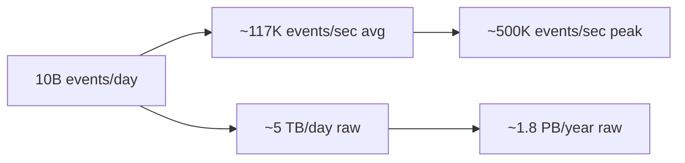

## 1.5 The Story Begins: Version 1, the naive system

It's day one at a startup called **AdSpark**. There are 5 advertisers and 50,000 events per day. The founding engineer builds the obvious thing.

### The design

- A **web server** exposes `POST /track` (the ad SDK calls it on every impression/click).
- The server runs `INSERT INTO events (...)` into a **MySQL** table.
- A dashboard runs a SQL query:

```sql
SELECT ad_id, COUNT(*) AS clicks
FROM events
WHERE type = 'click'
  AND ad_id = 4521
  AND event_time BETWEEN '2026-11-16 10:00' AND '2026-11-16 11:00'
GROUP BY ad_id;
```

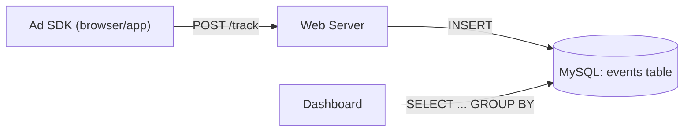

### Why this works at first

- Simple and easy to reason about.
- 50,000 events/day is ~0.6 events/sec. MySQL doesn't notice.
- Every query is exact because it counts the raw rows.
- Debugging is easy: just look at the table.

Everyone is happy. AdSpark signs more advertisers.

## 1.6 The first cracks

Six months later AdSpark has 2,000 advertisers and **200 million events/day**, around 2,300 events/sec average. Things start going wrong.

**Problem A: writes can't keep up.**
Each event is one `INSERT`. Every insert touches the table, the indexes (`ad_id`, `event_time`), the transaction log and the replication log. A single MySQL server comfortably does a few thousand simple inserts/sec, and at peak the load exceeds that. The tracking API starts timing out and **events are lost**. Lost events mean lost billing revenue.

**Problem B: dashboard queries get slower every day.**
`COUNT(*)` over 200 million rows a day, times 180 days, is a huge scan. The dashboard that took 50 ms now takes 40 seconds, and those heavy scans also slow down the inserts (they compete for the same disk and CPU).

**Problem C: one machine is a single point of failure.**
If MySQL dies, tracking stops, the dashboard stops and data is lost.

**Problem D: the table is a disk monster.**
At 5 TB/day we'd fill any single disk within days.

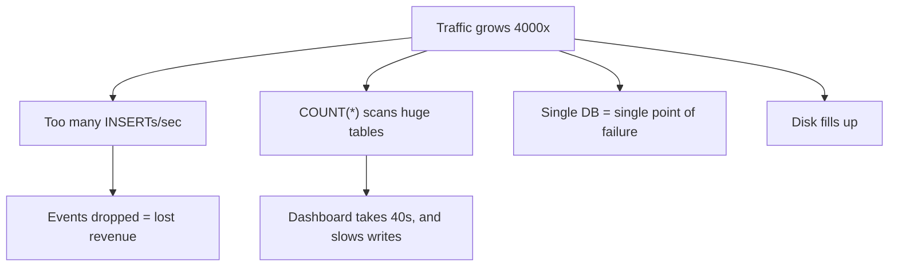

## 1.7 Key ideas to take away from Chapter 1

1. **The system exists because events = money.** Accuracy matters as much as speed.
2. **It's write-heavy, with a huge gap between ingest volume and query volume.** The answer is to **pre-aggregate** instead of scanning raw rows at query time.
3. **Raw events must still be stored** (audit, replay, fraud investigation), but not in the database that serves dashboards.
4. The naive design fails on four fronts: write throughput, query latency, availability and storage.
5. Every later chapter fixes one of these failures, and each fix creates a new problem. That is the pattern of the whole story.

## 1.8 Check your understanding

Before we move on, try answering these in your own words:

1. Why can't we just add a bigger MySQL server (vertical scaling) and call it done? Think about what happens at 500K events/sec peak, and about cost.
2. Why is the dashboard query slowing down the *writes* too?
3. What is the difference between **storing raw events** and **storing aggregates**, and why do we need both?

**Sneak peek of Chapter 2:** AdSpark's engineers will try the obvious fixes, **batching inserts, read replicas and sharding the database**, and we'll see why even these hit a wall. That wall is what leads to the idea of putting a durable log in front of everything.

---

Tell me **"understood"** when you're comfortable, or answer the questions above and I'll check your reasoning. If you'd like, I can also re-explain any part of this chapter with a different example (for instance, the numbers or CPC vs CPM billing) before we continue.


-----------------------------------------------------------------------------------------------------------------------
-----------------------------------------------------------------------------------------------------------------------
-----------------------------------------------------------------------------------------------------------------------
-----------------------------------------------------------------------------------------------------------------------


# Chapter 2: Fighting the Database (and Why It Hits a Wall)

## 2.1 Where we left off

AdSpark is now at **200M events/day** (~2,300/sec average, ~10K/sec at peak). The single MySQL box is drowning. The engineers hold an emergency meeting, and what follows is exactly what most real teams go through. They try the cheapest fix first, then the next, and each one buys time but exposes a deeper issue.

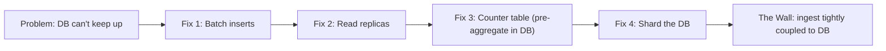

---

## 2.2 Fix 1: Batch the inserts

### The insight
Why is one `INSERT` per event so expensive? Each single-row insert pays a fixed overhead:
- A network round trip from app to DB
- Parsing and planning the statement
- A transaction commit, which forces an **fsync** to the redo log (the slowest part, since it waits for the disk)
- Updating every index

Inserting 1,000 rows in **one** statement pays most of that overhead **once**, not 1,000 times.

```sql
-- Before: 1000 round trips, 1000 commits
INSERT INTO events VALUES (...);   -- x1000

-- After: 1 round trip, 1 commit
INSERT INTO events VALUES (...), (...), (...), ... ;  -- 1000 rows
```

Rough numbers (they vary by hardware, but the order of magnitude holds):
- Single-row inserts: ~1,000-5,000 rows/sec
- Batched inserts (500-1000 rows): ~30,000-100,000 rows/sec

That is a **10-30x** improvement from a code change.

### How the team implements it
Each web server keeps an **in-memory buffer**. Events pile into it, and a background thread flushes when either condition hits first:
- the buffer reaches **N events** (say 1,000), or
- **T milliseconds** have passed (say 500 ms)

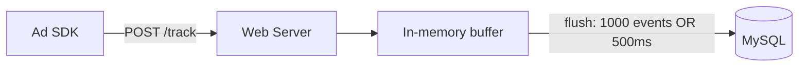

This **size-or-time** flush trigger is a pattern you'll see everywhere (Kafka producers use `batch.size` and `linger.ms` for the same reason). Remember it.

### The new problem: the buffer is a liability
Suppose a web server holds 800 un-flushed events and then **crashes** (OOM, deployment restart, hardware failure). Those 800 events are **gone forever**.

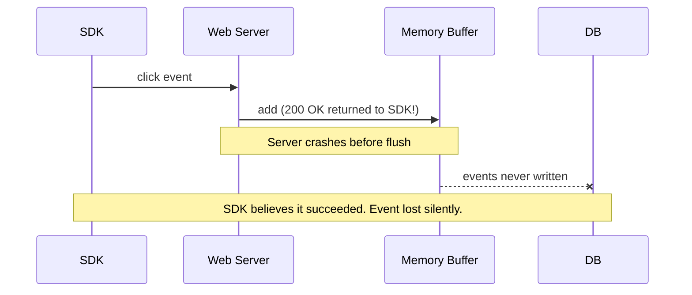

Notice the worst part: the SDK already got a `200 OK`, so it will never retry. **We silently lost billable data.**

**Lesson:** batching in volatile memory trades **durability for throughput**. We need the buffer to be durable, and that idea returns in Chapter 3.

---

## 2.3 Fix 2: Read replicas (for the dashboard)

The dashboard's heavy `GROUP BY` queries slow down writes. So the team adds **read replicas** and points the dashboard at them.

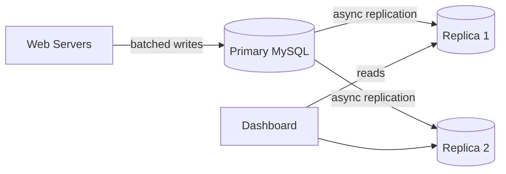

### What replication does (in depth)
The primary writes every change to a **binary log (binlog)**. Replicas pull that log and **replay** the changes in order. Replication is usually **asynchronous**: the primary commits without waiting for replicas.

### What it fixes
- Dashboard scans no longer compete with the primary's writes.
- Reads scale horizontally. Add more replicas for more dashboard users.
- It gives some availability: if the primary dies, promote a replica.

### What it does NOT fix
1. **Write throughput is untouched.** Every replica replays *all* writes, so each replica carries the same write load as the primary. Replicas multiply read capacity, never write capacity.
2. **Replication lag.** Under heavy write load the replicas fall behind. An advertiser sees "0 clicks" for 3 minutes after a campaign starts and files a support ticket.
3. **Async failover can lose data.** If the primary crashes before the replica received the last few seconds of binlog, promoting that replica **loses those events**. This is the classic **RPO > 0** problem (RPO = how much data you can afford to lose).
4. The dashboard queries still scan millions of rows, just on a different machine.

**Lesson:** replication scales **reads**, not **writes**. Our problem is write-heavy, so we need to attack the writes differently.

---

## 2.4 Fix 3: Stop scanning, pre-aggregate in the database

A senior engineer says: *"Why store 200M rows and count them every time? Keep a running counter!"*

```sql
CREATE TABLE ad_stats_minute (
  ad_id BIGINT,
  minute_bucket TIMESTAMP,
  impressions BIGINT,
  clicks BIGINT,
  PRIMARY KEY (ad_id, minute_bucket)
);

-- on every click:
INSERT INTO ad_stats_minute (ad_id, minute_bucket, clicks)
VALUES (4521, '2026-11-16 11:03:00', 1)
ON DUPLICATE KEY UPDATE clicks = clicks + 1;
```

Now the dashboard reads **a handful of rows** instead of scanning millions. Queries drop from 40 seconds to 5 ms. This is a genuine breakthrough, and **pre-aggregation is the central idea of the whole platform.** We'll keep it for the rest of the story.

### The new problem: the hot row
On Diwali, a famous brand launches a viral ad. Ad #9001 receives **50,000 clicks/sec**, and every one of them tries to update **the same row**: `(9001, 11:03:00)`.

A row update needs an **exclusive row lock**. Updates to the same row happen **one at a time**:

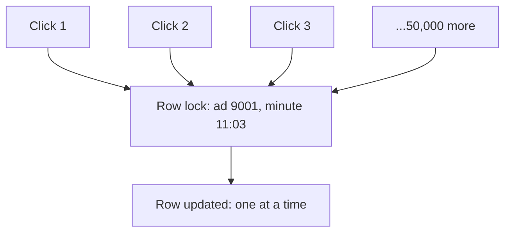

Each update holds the lock for a fraction of a millisecond, but 50,000 of them per second queue up behind it. Throughput for that key is capped at maybe a few thousand/sec, and the queue grows and then **transactions time out**.

This is the **hot key / hot row / hot partition** problem. You will meet it again at every layer (database, Kafka partitions, cache, aggregation workers), so name it clearly in interviews.

### The standard mitigation: split the counter (sharded counters)
Instead of one row per `(ad, minute)`, keep **K rows** (say K = 10) and spread updates randomly:

```sql
-- add a 'slot' column to the key
PRIMARY KEY (ad_id, minute_bucket, slot)

-- on every click, pick slot = random(0..9)
INSERT ... (4521, '11:03:00', slot=7, 1) ON DUPLICATE KEY UPDATE clicks = clicks + 1;
```

Now 50K/sec spreads across 10 rows, so each row sees ~5K/sec. To read the total, `SUM(clicks)` across the 10 slots (a tiny scan).

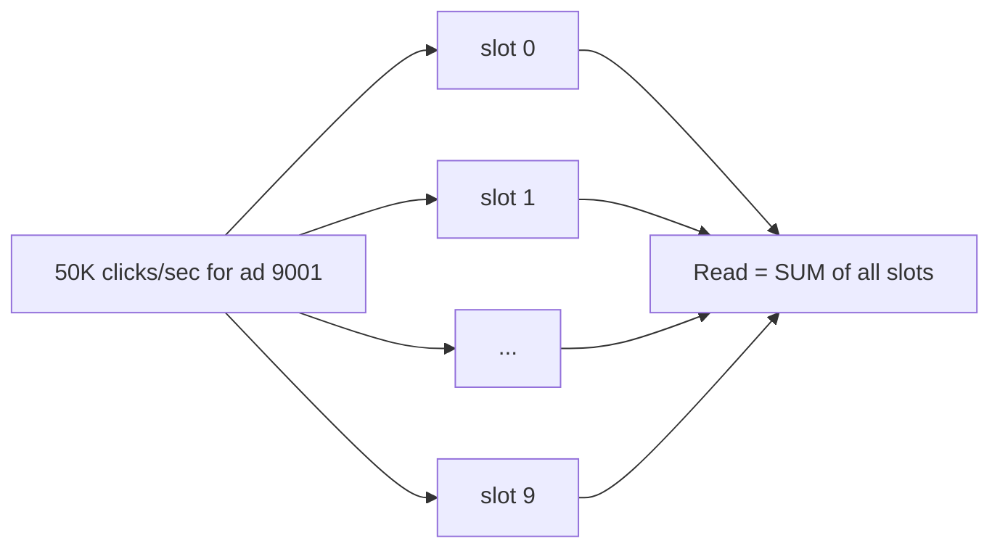

**Trade-off:** writes get K times more spread, but reads must sum K rows. For heavy-write/light-read workloads like ours, that is a great trade. We'll see this exact pattern again in the aggregation layer.

The raw-event table and counter table also cost two writes per event, which doubles the DB load. We're still limited by one machine.

---

## 2.5 Fix 4: Shard the database

The only way left to scale **writes** is to split data across multiple databases. This is **sharding** (horizontal partitioning): each shard holds a subset of rows, and each shard has its own CPU, disk and write capacity.

The big question: **what is the shard key?** It determines everything. Let's test the candidates.

### Option A: Shard by `ad_id` (hash)
`shard = hash(ad_id) % N`

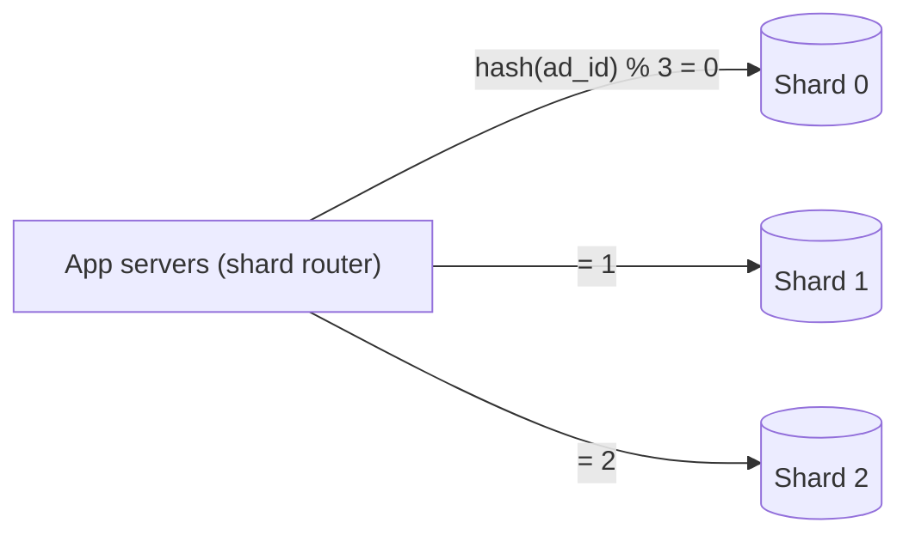

**Good:**
- Even spread of data and writes across ads.
- All events for one ad live on one shard, so "stats for ad 4521" is a single-shard query.

**Bad:**
- **Hot ad problem:** the viral ad #9001 still lands on one shard and overloads it, while the others idle.
- **Cross-shard queries:** "all ads for campaign 77" or "all ads for advertiser 12" touch many shards, which needs **scatter-gather** (ask every shard, merge the results). Latency equals the slowest shard.

### Option B: Shard by `advertiser_id`
**Good:** a dashboard for one advertiser hits one shard.
**Bad:** a giant advertiser (Amazon) dwarfs a bakery. That gives an uneven **data skew** and a hot shard.

### Option C: Shard by time (e.g., one shard per day)
**Good:** easy to drop old data (delete the whole shard).
**Bad:** **all current writes hit the newest shard.** That is the worst hot spot, because every write goes to a single machine.

### Comparison

| Shard key | Write spread | Single-advertiser query | Main weakness |
|---|---|---|---|
| `ad_id` hash | Good | Scatter-gather | Hot viral ad |
| `advertiser_id` | Skewed | One shard | Giant advertisers |
| time | Terrible | Depends | All writes hit the newest shard |

The team picks `hash(ad_id)` and mitigates the hot ad with the sharded-counter trick.

### The resharding nightmare
With 4 shards and `hash(ad_id) % 4`, traffic doubles and they need 8 shards. Now `hash % 8` changes the shard for roughly **half of all keys**. Millions of rows must move while the system is live.

**Example:** ad 13. `13 % 4 = 1` (shard 1), but `13 % 8 = 5` (shard 5). The data has to physically migrate.

The fix is **consistent hashing**, where keys and nodes are placed on a ring and adding a node moves only ~1/N of keys. We'll dig into it in the storage chapter. For now, remember that **naive modulo sharding makes scaling painful.**

### Other pains of sharded MySQL
- The app now holds routing logic, and every service must know the shard map.
- No cross-shard transactions or joins.
- Each shard needs its own replicas and failover, so operations multiply.
- Schema changes must be rolled out to every shard.

---

## 2.6 The Wall: the deeper design flaw

Even with batching, replicas, counters and shards, a more fundamental flaw remains. Look at what the request path is:

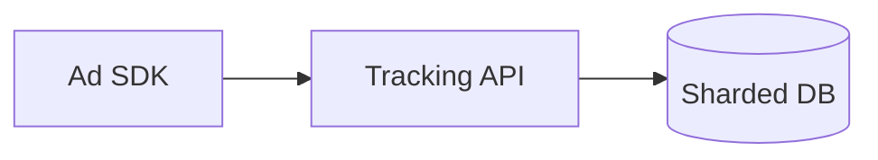

The **tracking API is synchronously coupled to the database.** Let's watch what happens on a bad day.

**Scenario: a shard slows down (a bad disk, or a big replica lag).**

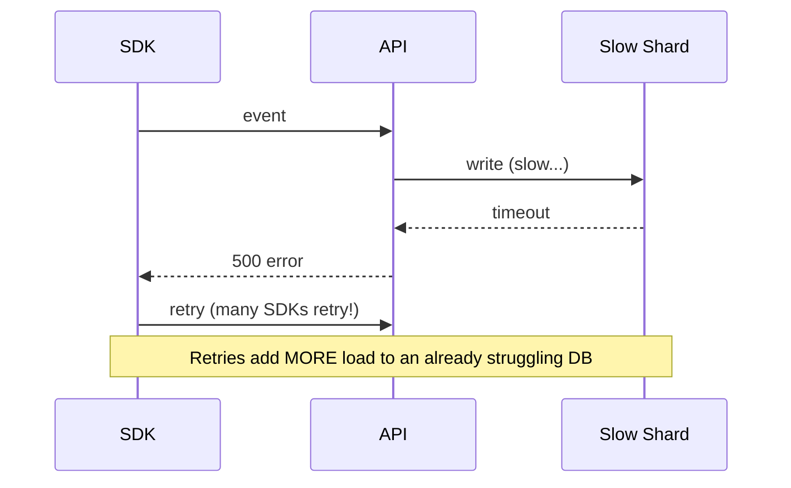

This is a **retry storm**: failures trigger retries, retries increase load, increased load causes more failures. A small problem in one shard becomes an outage of the whole ingest path.

Four structural problems remain:

1. **No buffer for spikes.** A 5x traffic burst goes straight to the DB. A database cannot absorb that; it has no shock absorber.
2. **No replay.** If a bug corrupts the counters (a wrong dedup rule, a bad deploy), the raw data may be gone or hard to recompute. We can't "rewind and reprocess."
3. **Failure coupling.** DB trouble means ingest trouble means **lost events** and **lost money**.
4. **One write path for everything.** The same DB is used for durable storage, counting and analytics, but each of those has very different needs.

> **The key realization:** we shouldn't make the user-facing tracking API wait for the database. We need something that **accepts events at any speed, stores them durably, and lets slower consumers process them at their own pace.** In other words, a **durable log** sitting between producers and consumers. That is the topic of Chapter 3.

---

## 2.7 Key ideas to take away from Chapter 2

1. **Batching** reduces per-event overhead (round trips, fsync, indexing). It follows the **size-or-time flush** pattern, but an in-memory buffer risks **data loss** on a crash.
2. **Read replicas** scale reads only. They suffer from **replication lag** and can lose data on async failover.
3. **Pre-aggregation** (counters instead of scanning raw rows) is the central idea of the platform. In a DB it creates a **hot row**, mitigated by **sharded counters** (write to K slots, read by summing).
4. **Sharding** scales writes, but the **shard key** choice is critical: `ad_id` hash is the best of the three here, though hot keys, scatter-gather queries and the resharding cost (`% N` changes) remain.
5. **Synchronous coupling between the tracking API and the DB** leads to retry storms, no spike absorption and no replay. That is the root problem solved in the next chapter.

## 2.8 Interview angle

If an interviewer asks, *"Why not just shard MySQL?"*, a strong answer is:

> "Sharding helps write throughput, but it doesn't fix the structural issues: no buffering for traffic spikes, no replay if we need to recompute counters after a bug, and tight coupling between ingest and the database that causes retry storms. Also, resharding and hot keys remain operational pain. A durable log in front of the processing layer solves these problems more fundamentally."

## 2.9 Check your understanding

1. Why do read replicas **not** help with write throughput? (Think about what each replica must do.)
2. With `hash(ad_id) % 4` going to `% 8`, why do so many keys move, and what would you want instead?
3. In the sharded-counter trick, what do you gain and what do you pay?
4. Why is an in-memory batching buffer on the web server dangerous, even though it's fast?
5. In your own words, what is a **retry storm** and what component is missing that would have prevented it?

**Sneak peek of Chapter 3:** AdSpark introduces **Kafka** (a distributed, durable, partitioned commit log). We'll learn how it works internally (topics, partitions, offsets, replication, ISR, consumer groups) and why partition key choice is yet another version of the hot-key problem.

---

Tell me **"understood"** when ready for Chapter 3, or answer the questions above and I'll check your reasoning. I can also re-explain any section (for example sharded counters or consistent hashing) with another example first.


-----------------------------------------------------------------------------------------------------------------------
-----------------------------------------------------------------------------------------------------------------------
-----------------------------------------------------------------------------------------------------------------------
-----------------------------------------------------------------------------------------------------------------------


# Chapter 3: The Durable Log (Kafka) Enters the Story

## 3.1 Where we left off

AdSpark's pain points from Chapter 2:

1. No shock absorber for traffic spikes.
2. No replay when a bug corrupts the counters.
3. The tracking API is tightly coupled to the database, which causes retry storms.
4. Batching in memory loses data when a server crashes.

A principal engineer draws one box on the whiteboard and says:

> "The API should not talk to the database at all. It should do one thing: **append the event to a durable log and return**. Everything else happens later, at its own pace."

## 3.2 The core idea: a commit log

Forget Kafka for a moment and think about the data structure. A **log** is an **append-only sequence of records**, where each record gets a sequential number called an **offset**.

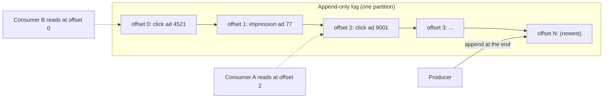

Why is this structure so powerful?

| Property | What it gives us |
|---|---|
| **Append-only, sequential disk writes** | Extremely fast. Sequential I/O on disk can be close to RAM speed, far faster than random DB updates. |
| **Immutable records** | Nothing is overwritten, so replay is natural. |
| **Consumers track their own offset** | The log doesn't care how many consumers read it or how fast. Each one has a bookmark. |
| **Retention by time or size** | Keep 7 days of events, so you can rewind. |

**The mental shift:** a database is "the current state". A log is "the history of everything that happened", and state can be **derived** from history at any time. This is the foundation of event-driven architecture.

## 3.3 Kafka: the log, but distributed

A single log on a single machine has the same limits as before (one disk, one machine). **Kafka** takes the log idea and spreads it across many machines.

### The vocabulary (learn it precisely, since interviews probe it)

- **Broker:** one Kafka server. A cluster has many.
- **Topic:** a named stream, e.g. `ad-events`.
- **Partition:** a topic is split into N partitions. **Each partition is its own independent log** with its own offsets. Partitions are the unit of parallelism.
- **Producer:** writes records to a topic.
- **Consumer group:** a set of consumers that together read a topic. Each partition is read by **exactly one consumer in the group** at a time.
- **Offset:** a record's position within **one partition** (ordering is guaranteed only within a partition, not across the topic).

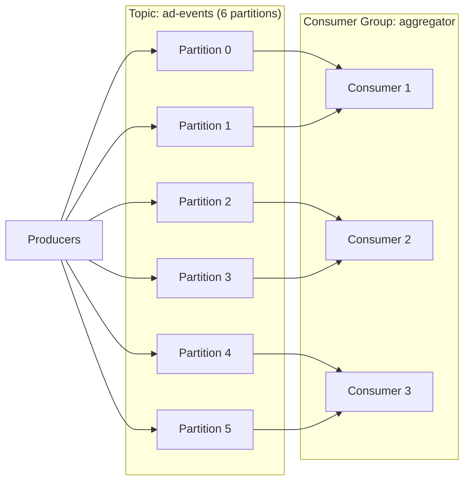

### The new ingest architecture

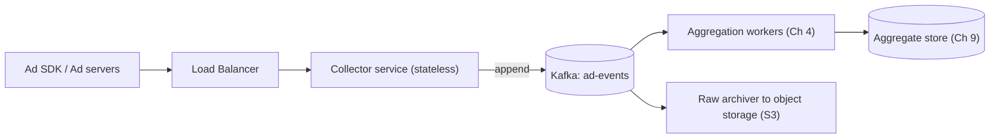

Notice how this fixes the previous problems:

- **Spike absorption:** a 5x burst just makes the log longer. Consumers are a bit behind (**consumer lag**), but nothing is lost.
- **Replay:** a bug in the aggregation code? Fix it, reset the consumer offset to 3 days ago, and **reprocess**.
- **Decoupling:** if the DB or aggregator is down for an hour, producers don't notice. Events wait in Kafka.
- **Multiple consumers:** the aggregator, the fraud detector and the raw archiver each read the same stream independently, with no extra load on the producers.

## 3.4 Durability: how Kafka doesn't lose data

Remember Chapter 2's "buffer in memory, server crashes, events lost"? Kafka solves this with **replication**.

### Leader and followers
Each partition has a **replication factor** (typically 3). One replica is the **leader** (it handles all reads and writes for that partition). The others are **followers** that copy the leader's log.

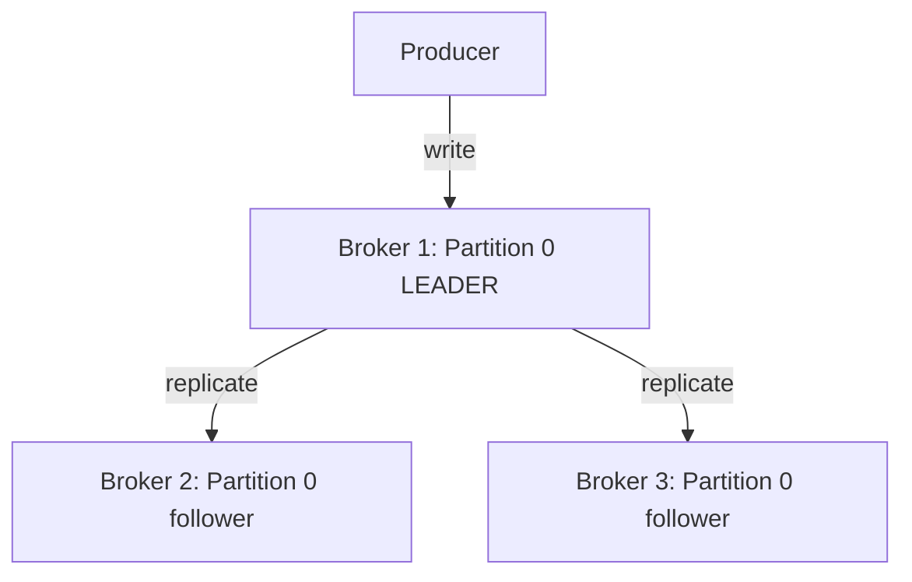

Different partitions have their leaders on different brokers, so the write load spreads evenly:

| Partition | Leader | Followers |
|---|---|---|
| P0 | Broker 1 | Broker 2, 3 |
| P1 | Broker 2 | Broker 3, 1 |
| P2 | Broker 3 | Broker 1, 2 |

### ISR (In-Sync Replicas)
The **ISR** is the set of replicas that are fully caught up with the leader. A follower that lags too far is dropped from the ISR. **Only ISR members are eligible to become the new leader**, which is what prevents electing a stale replica and losing data.

### The producer's `acks` setting: the durability vs latency dial

| `acks` | Meaning | Risk |
|---|---|---|
| `0` | Fire and forget. Don't wait. | Lose data on any failure. Never for billing. |
| `1` | Wait for the leader to write. | If the leader crashes *before* followers copy it, the event is lost. |
| `all` | Wait for **all ISR members** to write. | Slowest, but safest. |

Pair `acks=all` with **`min.insync.replicas=2`** (with replication factor 3). This means a write succeeds only if **at least 2 replicas** have it. Then one broker can die without losing any acknowledged event.

**Worked example:**

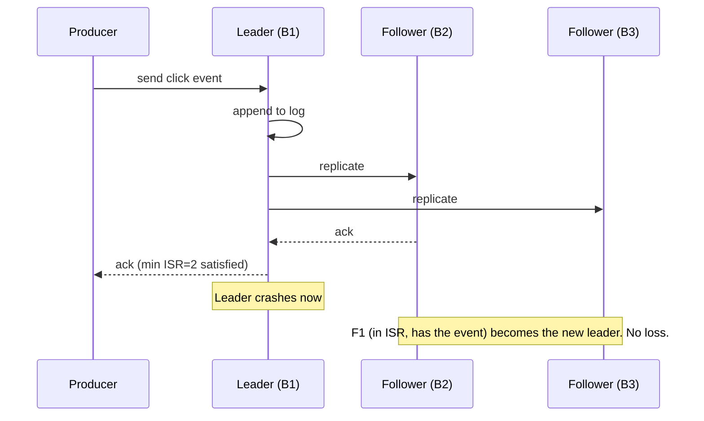

**Trade-off to state in interviews:** if only 1 replica is alive (ISR=1) and `min.insync.replicas=2`, producers get errors and **writes are rejected**. This is a deliberate choice of **consistency over availability** for the failure case. For billing data, that's right. The collector needs a plan for that case (see 3.8).

## 3.5 Why the log is so fast

Interviewers love "why is Kafka fast?":

1. **Sequential disk I/O.** Appending to the end of a file avoids the slow random seeks of a DB.
2. **OS page cache.** Kafka relies on the OS cache instead of its own heap, so recent data is served from RAM.
3. **Zero-copy.** Using `sendfile`, data moves from the page cache to the network socket without being copied through application memory.
4. **Batching and compression.** Producers batch many records into one request and compress them (LZ4, Snappy, zstd). That gives fewer requests and less network traffic.

## 3.6 Partitioning: the key decision (and the hot key problem again)

The producer decides which partition a record goes to:

- **With a key:** `partition = hash(key) % numPartitions`. All records with the same key go to the same partition, so their **ordering is preserved**.
- **Without a key:** records are spread round-robin or sticky-batch style, for the best balance.

What should the key be? Let's evaluate with real consequences.

### Option 1: key = `ad_id`
**Good:** all events for one ad land on one partition and reach one consumer, so counting is local. **Bad:** the viral ad #9001 sends 50K events/sec to one partition. A single partition can only handle roughly 10 MB/s or so, and a single consumer can only process so many records per second. That partition gets **hot** and its consumer **lags**, while the others sit idle. It is the same hot key problem as Chapter 2, one layer up.

### Option 2: key = `event_id` (or no key)
**Good:** perfectly even spread. **Bad:** events for one ad are scattered over all partitions, so each consumer holds only a *partial* count. We'd need a second stage to merge them (that's the **two-stage aggregation** in Chapter 4). It also costs us ordering per ad.

### Option 3: key = `ad_id` + salt (a bounded random suffix)
Use `key = ad_id + "#" + random(0..K-1)`. Each ad is spread over K partitions, so a hot ad is split and a quiet ad still stays in a handful of places.

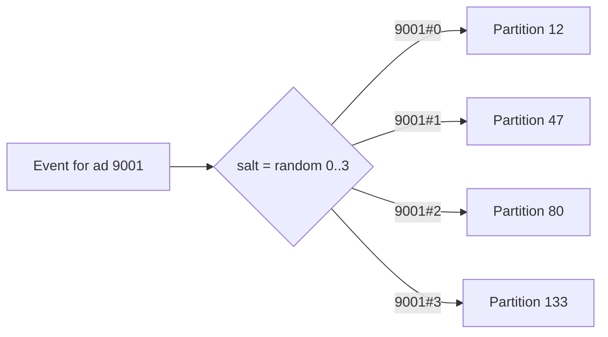

### Do we even need ordering?
For **counting**, no. Addition is **commutative and associative**: `3 + 5 + 2 = 2 + 5 + 3`. The order in which click events arrive doesn't change the total. This is why we can freely spread an ad over many partitions. (Ordering would matter for something like a user session or a click-after-impression attribution, so name that exception.)

**Where does that leave us?** The team picks **a random or salted key** for the main topic, and plans for a **two-level aggregation** (partial counts per worker, then a merge). We'll build that in Chapter 4. **Deduplication** needs same-event routing, so we'll revisit key choice in Chapter 6.

## 3.7 Consumer groups and scaling consumers

Within a consumer group, **each partition is assigned to exactly one consumer**. This gives two rules to remember:

1. **Max parallelism = number of partitions.** With 200 partitions you can use at most 200 active consumers in one group. A 201st sits idle.
2. **More consumers than partitions is pointless;** fewer means some consumers handle several partitions.

### Rebalancing (and why it hurts)
When a consumer joins, dies or is deployed, Kafka **rebalances** and reassigns partitions. During a classic "stop-the-world" rebalance, consumption pauses, which creates **lag spikes**. Mitigations:

- **Cooperative/incremental rebalancing** (only moved partitions pause).
- **Static group membership** (`group.instance.id`), so a quick restart doesn't trigger a full rebalance.
- **Rolling deployments** rather than restarting everything at once (we'll revisit this in the deployment chapter).

### Offsets and commits: the first taste of delivery semantics
A consumer periodically **commits its offset** ("I've processed up to here"). When it crashes, the replacement resumes from the last committed offset.

| Commit strategy | On a crash | Result |
|---|---|---|
| Commit **before** processing | Events between commit and crash are skipped | **At-most-once** (data loss) |
| Commit **after** processing | Events processed but not committed get reprocessed | **At-least-once** (duplicates) |

For billing, **loss is unacceptable**, so we choose **at-least-once**, which means **duplicates will happen**, and we must deal with them. That's the exact problem of Chapter 6. Remember this: *at-least-once delivery + idempotent processing = effectively exactly-once.*

## 3.8 The collector: protecting the front door

The collector is the stateless service that receives SDK events and produces to Kafka. Design points interviewers like:

- **Stateless and horizontally scalable** behind a load balancer. Add instances to absorb load.
- **Validate cheaply.** Check the schema and required fields, and reject garbage here, but do **no heavy logic** (that belongs downstream).
- **Assign an `event_id` and a server-side timestamp** (UUID or the SDK-provided ID) for dedup and for the clock-skew problem later.
- **Acknowledge only after Kafka acks** (`acks=all`). This answers the earlier "200 OK before the data was safe" flaw. The SDK now only treats the event as delivered when it's truly durable.
- **Idempotent producer** (`enable.idempotence=true`): Kafka dedups **producer retries** within a session, using producer ID and sequence numbers.
- **Producer batching:** `linger.ms` (e.g. 5-20 ms) and `batch.size` (e.g. 64-256 KB), plus compression. It's the same size-or-time pattern from Chapter 2, but now it flushes into a **replicated** log.

### What if Kafka is unavailable or slow?
Never make the user's page wait on our tracking. Options:

1. **Client-side retry with exponential backoff and jitter.** *Jitter* (random delay) prevents all clients from retrying at the same instant and creating a retry storm.
2. **A local spill buffer.** The collector falls back to a local disk queue and drains later, for short outages.
3. **Backpressure and load shedding.** If everything is overloaded, a controlled **429** tells clients to slow down, and low-priority events (impressions) can be sampled or delayed before clicks (the revenue-critical events). Always protect the high-value event type first.

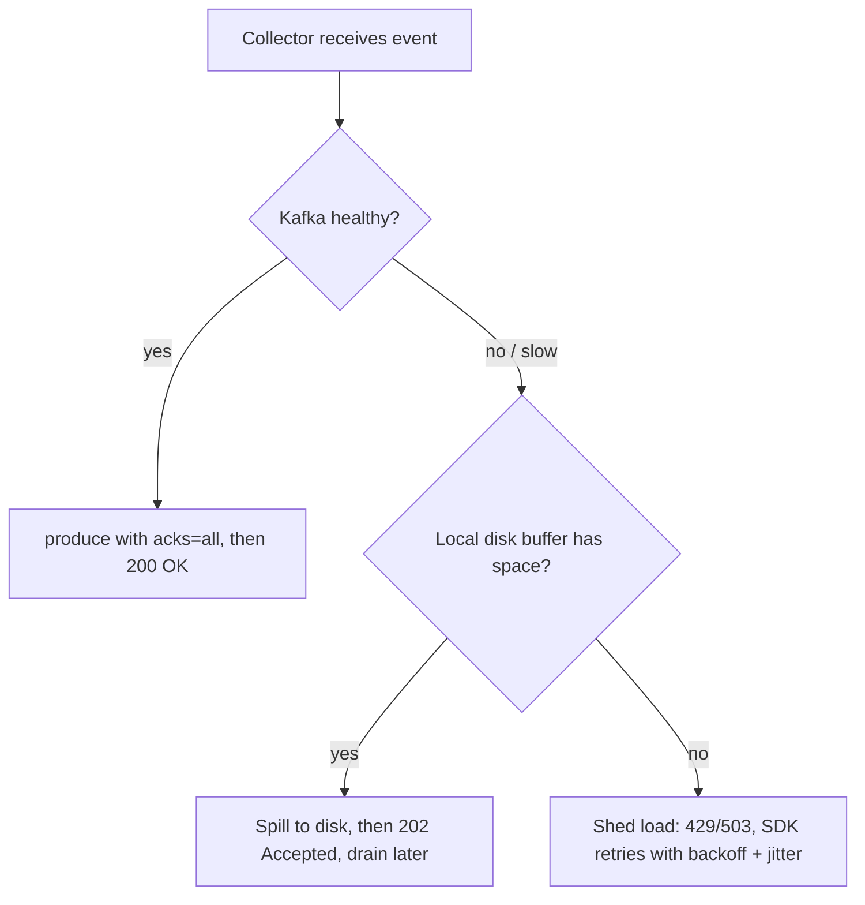

## 3.9 Capacity planning for Kafka (do this out loud in interviews)

From Chapter 1: peak **500K events/sec × 500 B ≈ 250 MB/s** ingest.

- **Replication factor 3:** the cluster writes ~750 MB/s total.
- **Per-partition throughput:** assume a safe ~10 MB/s per partition, so we need at least **25 partitions**. We choose **~200** for headroom, parallelism and hot-key slack.
- **Brokers:** if each broker comfortably handles ~100 MB/s of mixed traffic, **8-10 brokers** is a reasonable start.
- **Retention:** 7 days × 5 TB/day × 3 replicas ≈ **105 TB** of disk, which is spread across the brokers (compression usually cuts this substantially).

**Why not 10,000 partitions?** More partitions mean more open files, longer leader elections after a failure, more replication overhead and a higher metadata load. Pick enough for throughput and consumer parallelism, plus headroom.

> **Partition count is hard to change later.** Increasing it changes `hash(key) % N`, which breaks the key-to-partition mapping (the resharding pain again). So plan for 2-3 years of growth up front.

## 3.10 Key ideas to take away from Chapter 3

1. A **durable, append-only, partitioned log** decouples producers from consumers, absorbs spikes and enables **replay**.
2. **Partitions** give parallelism. Order is only guaranteed **within** a partition, and consumer parallelism is capped by the partition count.
3. **Replication + ISR + `acks=all` + `min.insync.replicas=2`** means acknowledged events survive a broker failure, at the cost of rejecting writes when too few replicas are alive (consistency over availability).
4. **Choosing the partition key** is a hot key decision. For counting, order doesn't matter (sums are commutative), so we use a random or salted key and aggregate in two stages.
5. **Commit offsets after processing** gives at-least-once delivery, which means **duplicates**, so we'll need idempotency (Chapter 6).
6. The collector must be stateless, ack only after the durable write, use backoff with jitter, and have a spill and load-shedding plan.

## 3.11 Interview angle

If asked *"Why Kafka and not just a queue like RabbitMQ or SQS?"*:

> "We need very high sustained throughput, **multiple independent consumers** reading the same events (aggregation, fraud, archival), and above all the ability to **replay** history after a bug or to backfill. Kafka retains the log, so consumers just rewind offsets. A traditional queue deletes messages once consumed, so you lose replay and fan-out unless you duplicate the stream."

## 3.12 Check your understanding

1. Why is ordering guaranteed only *within a partition*, and why is that acceptable for click counting?
2. With replication factor 3, `acks=all` and `min.insync.replicas=2`, what happens when two brokers fail? Is that the right trade-off for billing data?
3. Why must the number of consumers in a group not exceed the number of partitions, and what does that imply for choosing the partition count?
4. If you key by `ad_id`, what goes wrong on Diwali? What are two ways to fix it?
5. Why does "commit offset after processing" create duplicates?

**Sneak peek of Chapter 4:** Events are now safely in Kafka. How do we turn them into "clicks per ad per minute"? We'll meet **stream processing** (Flink/Spark Streaming), **tumbling, sliding and session windows**, **two-stage aggregation**, and the question of what the aggregator does with its in-memory **state** when it crashes (checkpointing).

---

Tell me **"understood"** when you're ready for Chapter 4, or answer the questions above and I'll check your reasoning. I'm happy to dig deeper into any part first (ISR and leader election, rebalancing, or partition sizing).


-----------------------------------------------------------------------------------------------------------------------
-----------------------------------------------------------------------------------------------------------------------
-----------------------------------------------------------------------------------------------------------------------
-----------------------------------------------------------------------------------------------------------------------


# Chapter 4: Turning the Firehose into Numbers (Stream Aggregation and Windowing)

## 4.1 Where we left off

Events now flow safely into Kafka: durable, replicated and replayable. But a Kafka topic is just a long list of raw events. Advertisers want **"clicks per ad per minute"**, so someone has to **read the stream and count**. This chapter is about who does that and how.

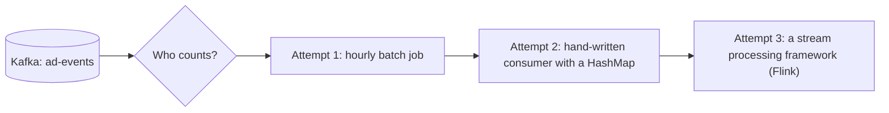

---

## 4.2 Attempt 1: the nightly/hourly batch job

The team's first instinct is to reuse what they know. Dump Kafka into object storage (S3/HDFS) and run a **batch job** (Spark/Hive SQL) every hour:

```sql
SELECT ad_id, date_trunc('minute', event_time) AS minute,
       SUM(CASE WHEN type='click' THEN 1 ELSE 0 END) AS clicks,
       SUM(CASE WHEN type='impression' THEN 1 ELSE 0 END) AS impressions
FROM raw_events
WHERE event_time >= '2026-11-16 10:00' AND event_time < '2026-11-16 11:00'
GROUP BY ad_id, date_trunc('minute', event_time);
```

**Why it's attractive:** it is simple, exact, cheap, and the full hour's data is available, so the numbers are complete.

**Why it fails the business:**
- **Staleness:** the dashboard is 1+ hours behind. A campaign launches and the advertiser sees zeros for an hour.
- **Budget overspend:** an advertiser sets a ₹1 lakh daily budget. With hourly numbers, the system keeps serving ads for up to an hour after the budget is exhausted, and the platform ends up **giving away free ad slots**. Real money lost.
- **Spiky compute:** a huge job every hour (a thundering herd on the cluster) instead of smooth, continuous work.

**Lesson:** we need **seconds-level freshness**, so we need to compute *as events arrive*. (The batch job isn't useless, though. It returns in Chapter 8 as the source of truth.)

---

## 4.3 Attempt 2: a hand-written streaming consumer

An engineer writes a Kafka consumer that keeps counts in memory and flushes to the DB:

```python
counts = defaultdict(lambda: [0, 0])      # (ad_id, minute) -> [impressions, clicks]

for event in consumer:
    key = (event.ad_id, minute_of(event.event_time))
    counts[key][0 if event.type == 'impression' else 1] += 1

    if time_to_flush():                    # every 10 seconds
        write_to_db(counts)
        consumer.commit()
        counts.clear()
```

It works in the demo. In production, five problems appear.

| # | Problem | What happens |
|---|---|---|
| 1 | **Crash = lost state** | The consumer dies with 8 seconds of counts in memory. Offsets were not yet committed, so it replays, but counts already flushed *before* the commit get written twice (duplicates). |
| 2 | **Rebalance = state in the wrong place** | When partitions move to another consumer, the in-memory counts for those partitions are stranded on the old consumer. |
| 3 | **Hot key** | One ad gets 50K events/sec and one consumer chokes. |
| 4 | **Windows by hand** | When is minute 11:03 "done"? What if an event for 11:03 arrives at 11:05? You'd have to invent all of that logic. |
| 5 | **Scaling and recovery** | No clean way to add workers, redistribute state, or restart without losing track of in-flight counts. |

The team is re-implementing, badly, what a **stream processing framework** already provides: managed state, fault tolerance, windowing and scaling. They adopt **Apache Flink** (Spark Structured Streaming and Kafka Streams are alternatives; we'll compare them at the end).

---

## 4.4 Enter the stream processor: the mental model

A stream processing job is a **dataflow graph** of operators. Data flows continuously through it, and some operators keep **state**.

```mermaid
flowchart LR
    SRC["Source: read Kafka (parallelism = 200)"] --> PRE["Parse + validate + filter"]
    PRE --> KEY["keyBy(ad_id, window)  [network shuffle]"]
    KEY --> WIN["Window + aggregate (keeps STATE)"]
    WIN --> SINK["Sink: upsert to aggregate store"]
```

Key concepts:

- **Parallelism:** each operator runs as many parallel instances (**tasks**), each on a **task slot** of a worker (**TaskManager**). A coordinator (**JobManager**) schedules and monitors them.
- **`keyBy`:** repartitions the stream by a key so that **all events with the same key reach the same task**. This is the **shuffle**, the expensive network step.
- **Keyed state:** after `keyBy`, each task keeps state **per key**, such as "the running click count for (ad 4521, minute 11:03)". Only that key's events touch it, so there are no locks or races.

---

## 4.5 Windows: slicing infinite time into countable pieces

A stream never ends, so "count clicks" is meaningless without a boundary. A **window** groups events into finite buckets.

### Three window types

```
TUMBLING (fixed size, no overlap)   size = 1 min
|---11:00---|---11:01---|---11:02---|---11:03---|
 Each event belongs to exactly ONE window.

SLIDING / HOPPING (size 5 min, slide 1 min)
|------------- 11:00-11:05 -------------|
      |------------- 11:01-11:06 -------------|
            |------------- 11:02-11:07 -------------|
 Each event belongs to MANY windows (5 here).

SESSION (closes after a gap of inactivity, e.g. 30 min)
 u1: [click click click]   ...gap > 30min...   [click click]
     |-------session 1---|                      |--session 2--|
 Window size varies per key.
```

| Type | Typical use in ads | Notes |
|---|---|---|
| **Tumbling** | "Clicks per ad per minute" (our core) | Simple, cheap, non-overlapping |
| **Sliding** | "Clicks in the last 5 minutes, updated every minute" (live monitoring, fraud spikes) | A single event updates many windows, so more compute and state |
| **Session** | User-journey analysis, frequency capping insights | State per user, mostly not needed for core billing |

**Our decision:** compute **1-minute tumbling windows** as the base unit and **roll up** from them.

### Hierarchical rollup: the trick that keeps costs low
Counts are **additive**, so:

```
hour_clicks = sum of 60 minute_clicks
day_clicks  = sum of 24 hour_clicks
```

We do **not** recompute hours from raw events. We compute minutes once and add them up, which saves enormous work. The query layer (Chapter 9-10) rolls up on read, or a second job writes hourly and daily tables.

> **Caution (a great interview point):** additivity works for **counts and sums**. It does **not** work for **distinct counts** ("unique users who saw this ad"), because a user in minute 1 and minute 2 would be counted twice. For that we use **mergeable sketches** (HyperLogLog), which can be combined across windows with small, bounded error. We'll come back to this in the storage chapter.

---

## 4.6 Event time vs processing time (the seed of the next chapter)

Every event carries two clocks:

- **Event time:** when the click *actually happened* (stamped on the device).
- **Processing time:** when our system *sees* it.

A user on a flaky mobile network clicks at 11:03:58, but the event reaches us at 11:05:20. Which minute does it belong to?

- If we window by **processing time**, it lands in the 11:05 window. That is **wrong for billing and reporting**, because the click happened in 11:03, and results change depending on network delays and on whether we replay yesterday's data.
- If we window by **event time**, it lands in 11:03. That is **correct and deterministic** (replaying gives the same answer), but now we face a hard question: *when can we declare window 11:03 complete*, when stragglers may still arrive?

That question is the subject of **Chapter 5 (watermarks and late data)**. For now, the decision is: **we window by event time.**

---

## 4.7 The hot key problem, third time: two-stage aggregation

We now fix the hot ad problem properly. If we `keyBy(ad_id)` directly, all 50K events/sec of ad #9001 funnel into one task.

### The solution: aggregate locally first, then merge

**Stage 1 (local pre-aggregation, also called a "combiner")** Each source task accumulates partial counts in memory for a short interval (say 1-5 seconds) *before* the shuffle. Instead of sending 50,000 individual events across the network, it sends **one partial record**: `(ad 9001, minute 11:03, +4,100 clicks)`.

**Stage 2 (global merge)** `keyBy(ad_id, window)` and **sum the partials**. The task now receives, at most, `#source tasks` records per second per ad, not 50,000.

```mermaid
flowchart LR
    subgraph S1["Stage 1: local combine (200 tasks)"]
    T1["Task 1: ad 9001 -> +260"]
    T2["Task 2: ad 9001 -> +255"]
    T3["Task 3: ad 9001 -> +248"]
    T4["... 197 more"]
    end
    T1 --> M["Stage 2: keyBy(ad_id, window) -> SUM partials"]
    T2 --> M
    T3 --> M
    T4 --> M
    M --> OUT["ad 9001, 11:03: total = 50,000"]
```

**The math:** 50,000 raw events/sec shrink to ~200 partial records/sec per ad, a **250x reduction** in shuffle traffic and in load on the stage-2 task.

### If even that is too hot: salting
For extreme skew, add a random salt in stage 1: key = `(ad_id, salt 0..K-1)`, aggregate per salted key, then in stage 2 strip the salt and merge. It's the same idea as the sharded counters from Chapter 2, now applied inside the stream job.

**Trade-off:** a bit more latency (the local buffering interval) and slightly more complexity, in exchange for removing the hot spot. For counts and sums this is free correctness-wise, because addition is commutative and associative.

---

## 4.8 State and fault tolerance: what happens when a worker dies?

This is the heart of Attempt 2's failure, and the main reason to adopt Flink. The windows' running counts live in **state**. Let's see how Flink protects it.

### Local state, durable snapshots
- State lives **locally** in each task (heap memory, or **RocksDB** on local SSD for state larger than memory).
- Periodically (say every **30-60 seconds**) Flink takes a **checkpoint**: a consistent snapshot of **all operators' state plus the Kafka offsets**, saved to durable storage (S3/HDFS).

### How the snapshot stays consistent: barriers
Flink injects special **checkpoint barrier** markers into the stream at the sources. As a barrier passes each operator, the operator snapshots its state. Everything before the barrier is included in the snapshot, and everything after is not. This is based on the **Chandy-Lamport** distributed snapshot algorithm, and it works **without stopping the stream**.

```mermaid
sequenceDiagram
    participant JM as JobManager
    participant SRC as Source tasks
    participant AGG as Aggregation tasks
    participant S3 as Durable storage
    JM->>SRC: trigger checkpoint #42
    SRC->>SRC: record Kafka offsets, emit barrier 42
    SRC->>AGG: barrier 42 flows with the data
    AGG->>AGG: on barrier, snapshot state
    AGG->>S3: upload state (incremental for RocksDB)
    SRC->>S3: upload offsets
    S3-->>JM: all acks received
    JM->>JM: checkpoint #42 complete
```

### Recovery: restore and rewind
A worker crashes at 11:03:45:

```mermaid
flowchart TD
    A["Worker crashes"] --> B["JobManager detects failure"]
    B --> C["Restart tasks on healthy workers"]
    C --> D["Restore state from checkpoint #42"]
    D --> E["Rewind Kafka offsets to those stored in checkpoint #42"]
    E --> F["Reprocess events since the checkpoint"]
```

**This is the payoff of Chapter 3:** because Kafka keeps the data, we can rewind to the exact offsets saved **atomically with the state**. State and position always match, so nothing is skipped and nothing is double-counted *inside* the job.

### The remaining gap
Events processed between checkpoint #42 and the crash are **reprocessed**. If we already wrote those results to the external DB before crashing, the reprocessed results get written **again**. The framework's internal state is exact, but the **sink (the database)** can see duplicates. If the sink does `clicks = clicks + 4100`, replay double-counts.

### Our immediate rule: write idempotent upserts, never increments
The sink writes the **final value for a key**, not a delta:

```sql
-- IDEMPOTENT: running it twice gives the same result
INSERT INTO ad_stats_minute (ad_id, minute, clicks, impressions)
VALUES (9001, '11:03', 50000, 1200000)
ON DUPLICATE KEY UPDATE clicks = VALUES(clicks), impressions = VALUES(impressions);

-- NOT idempotent (replay breaks it)
UPDATE ad_stats_minute SET clicks = clicks + 4100 WHERE ...
```

This is a core principle: **overwrite with the window's total, keyed by (ad_id, window)**. We'll formalize it as exactly-once in Chapter 6.

---

## 4.9 Emission: when do we output results?

Waiting until a window closes means a minute-old number at best. Advertisers and budget enforcement want to see the **in-progress minute** too.

- **Final firing:** when the window is complete (decided by watermarks, Chapter 5), emit the final value.
- **Early/periodic firing:** emit the **current partial total every ~5-10 seconds** while the window is open. These are overwritten by later upserts (that's why idempotent overwrites matter), so the dashboard stays fresh.

Result: the dashboard sees the open minute's count climb in near real-time, and the final value is correct once the window closes.

---

## 4.10 The cardinality trap: how many dimensions to pre-aggregate?

Advertisers slice by country, device, publisher, placement, and so on. Suppose we pre-aggregate by `(ad, country, device, publisher, minute)`:

```
10M ads × 200 countries × 5 devices × 100K publishers = 10^15 potential combinations
```

Most combinations never occur, but the number that **do** occur can still be huge, and each is a row of state and a stored aggregate. This is the **cardinality explosion**.

Practical strategies:

1. **Pre-aggregate a fixed set of common combinations** ("cuboids"): `(ad)`, `(ad, country)`, `(ad, device)`, `(campaign)`, and so on. Fast reads, but inflexible.
2. **Pre-aggregate at a moderate grain** and let an **OLAP store** (Druid/Pinot/ClickHouse) aggregate further at query time, with its own rollup. That's the plan for Chapter 9.
3. **Always keep raw events** in cheap storage for ad-hoc analysis.

Our team picks #2 and #3: the stream job writes one-minute aggregates at a reasonable dimension grain, and the OLAP store handles flexible slicing.

---

## 4.11 Backpressure: when the sink is slow

If the aggregate store slows down, the sink operator slows, then upstream buffers fill, then the stream job **slows its Kafka consumption** (credit-based flow control). Nothing breaks; **consumer lag grows** while Kafka holds the unread events safely. That is the shock absorber from Chapter 3 working as designed.

**What to watch:** consumer lag (in messages and in seconds). Alert on *lag in seconds* because it directly tells you data freshness. We'll cover it in the observability chapter.

---

## 4.12 Scaling, rescaling and bootup behavior

### Parallelism and capacity
- Peak 500K events/sec. A well-tuned task handles roughly 20-50K simple events/sec per core (a rough planning number, so measure it), so the minimum is about **20-25 cores**. With 3-4x headroom and matching the **200 Kafka partitions**, run **~100-200 parallel source tasks**.
- Source parallelism **cannot exceed the Kafka partition count** (the Chapter 3 rule).
- State is small, because we hold **aggregates and not raw events**: say 10M active ads × a few open windows × ~100 B ≈ a few GB, spread over the cluster.

### Rescaling state
To change parallelism, Flink uses **key groups**: keys are first hashed into a fixed number of groups (the **max parallelism**, e.g. 4096), and groups are assigned to tasks. Rescaling moves **whole key groups**, not individual keys, so it's far cheaper than the modulo resharding pain of Chapter 2. **Set max parallelism generously on day one**, because it's hard to change later (the same lesson as Kafka partition count).

### Bootup / warm-up
When a job (re)starts, it **restores state from the latest checkpoint or savepoint** before processing. With large state this takes minutes, and meanwhile **lag builds**. Mitigations:
- **Incremental checkpoints** (RocksDB uploads only changed files), so snapshots stay small and fast.
- **Local recovery**: tasks keep a local copy of their state, so a restart on the same machine skips the download.
- **Savepoints** (manual, portable snapshots) are the safe way to deploy a new version of the job: stop with a savepoint, deploy, resume from it. We'll treat deployment strategy fully in Chapter 12.

---

## 4.13 Flink vs Spark Streaming vs Kafka Streams (a quick comparison)

| | Flink | Spark Structured Streaming | Kafka Streams |
|---|---|---|---|
| Model | True record-at-a-time streaming | Micro-batches (continuous mode exists) | Library embedded in your app |
| Latency | Lowest (ms-sec) | Seconds (micro-batch interval) | Low |
| State and event-time support | Very strong | Good | Good |
| Ops | Needs a cluster | Needs a cluster | No cluster, scales as an app |
| Best fit here | **Large-scale, low-latency, stateful windowing** | Teams already on Spark, higher latency OK | Smaller, simpler Kafka-to-Kafka jobs |

We choose **Flink** for event-time windows, large managed state and strong checkpointing at 500K events/sec.

---

## 4.14 The architecture so far

```mermaid
flowchart LR
    SDK["SDK / Ad servers"] --> LB["LB"] --> COL["Collectors"] --> K[("Kafka: ad-events")]
    K --> FL["Flink job: parse, local combine, keyBy, 1-min event-time windows"]
    K --> ARC["Raw archiver to S3"]
    FL -->|"idempotent upserts"| STORE[("Aggregate store")]
    FL -.->|"checkpoints"| CP[("S3: checkpoints")]
    STORE --> DASH["Dashboard / Billing"]
```

---

## 4.15 Key ideas to take away from Chapter 4

1. **Batch alone is too stale** (and causes budget overspend), while a **hand-rolled consumer is fragile** (lost state, no windows, hard to scale). A **stream processor** provides state, windows, fault tolerance and scaling.
2. **Windows** make infinite streams countable: **tumbling** for per-minute counts, **sliding** for rolling metrics, **session** for user journeys. Use **hierarchical rollup** because counts are additive (but distinct counts need sketches).
3. Window by **event time**, not processing time, for correctness and replayability.
4. **Two-stage aggregation** (local combine, then global merge, with optional salting) solves the hot key problem for commutative operations.
5. **Checkpoints** (state + Kafka offsets, saved atomically via barriers) allow recovery without loss. Replays can still cause duplicates at the **sink**, so write **idempotent overwrites keyed by (ad, window)**.
6. **Early firings** keep dashboards fresh while the window is open.
7. Control **cardinality**: pre-aggregate a sensible grain, push flexible slicing to an OLAP store, and keep raw data.
8. **Backpressure** turns downstream slowness into harmless Kafka lag. Plan max parallelism up front and use savepoints for deployments.

## 4.16 Interview angle

If asked *"How do you compute real-time per-minute counts at this scale?"*:

> "Collectors write to Kafka. A Flink job reads it, does local pre-aggregation to cut shuffle and handle hot ads, then keys by (ad, window) and sums into one-minute event-time tumbling windows, emitting early results every few seconds and a final result at window close. State is checkpointed with Kafka offsets, so a failure restores and rewinds consistently. Results go to the store as idempotent upserts keyed by (ad, window), so replays don't double-count. Larger windows are derived by rolling up minutes."

## 4.17 Check your understanding

1. Why does a batch job cause *budget overspend* in an ad system?
2. Why is it safe to randomly spread one ad's events across many tasks for counting, and when would it not be safe?
3. What exactly is stored in a checkpoint, and why must the Kafka offsets be stored *together with* the state?
4. After a crash and restore, why can the sink still see duplicates, and why does an idempotent upsert fix it where `clicks = clicks + delta` doesn't?
5. Why can we roll minute counts up into hours but not minute *unique-user* counts?
6. A click happens at 11:03:58 and arrives at 11:05:20. Which window should it count in, and what new problem does that create?

**Sneak peek of Chapter 5:** Mobile networks, retries and offline devices mean events show up **late and out of order**. We'll learn **watermarks** (the system's estimate of "no more events older than T"), **allowed lateness**, **side outputs** for very late events, and how corrections flow to the dashboard and to billing.

---

Tell me **"understood"** for Chapter 5, or answer the questions above and I'll check your reasoning. I can also go deeper on any part first (checkpoint barriers, two-stage aggregation with a worked numeric example, or HyperLogLog for unique users).


-----------------------------------------------------------------------------------------------------------------------
-----------------------------------------------------------------------------------------------------------------------
-----------------------------------------------------------------------------------------------------------------------
-----------------------------------------------------------------------------------------------------------------------


# Chapter 5: Late and Out-of-Order Events (Watermarks)

## 5.1 Where we left off

In Chapter 4 we chose to window by **event time**, because it gives correct, replayable results. That choice left one question open:

> When can we declare the 11:03 window **complete** and emit its final value, if stragglers might still arrive?

If we close too early, we undercount and **lose billable clicks**. If we wait too long, dashboards go stale and memory fills with open windows. This chapter is about finding the right balance.

---

## 5.2 Why events arrive late and out of order

In a perfect world, events reach Kafka in event-time order. In reality:

| Cause | Example |
|---|---|
| **Mobile network flakiness** | A user clicks in a tunnel at 11:03:58. The phone's SDK retries and the event reaches us at 11:05:20. |
| **Offline buffering** | A mobile game stores events while offline and uploads them 2 hours later. |
| **Client clock skew** | A phone's clock is 3 minutes fast or slow, so `event_time` is wrong. |
| **Multi-path ingestion** | Collectors in different regions, with different latencies, feed one topic. |
| **Partition imbalance** | A lagging Kafka partition delivers old events long after the others moved on. |
| **Retries** | A failed delivery retries later with the original timestamp. |

**Two related terms:**
- **Out-of-order:** event B (time 11:03:10) arrives *after* event C (time 11:03:30). This is common and usually small.
- **Late:** the event arrives after we have *already closed* its window. This is the dangerous case.

### Concrete example
```
Arrival order at Flink:        Event time:
 1. click A                     11:03:05
 2. click B                     11:03:40
 3. click C                     11:04:02   <- minute 11:04 has started
 4. click D                     11:03:58   <- belongs to 11:03, but arrives AFTER C
 5. click E                     11:03:20   <- also 11:03, arrives even later
```
If we closed window 11:03 the moment we saw C (11:04:02), then D and E would be dropped, an undercount of 2 clicks for that minute. At 100M clicks/day, even a 1% loss is 1M unbilled clicks.

---

## 5.3 First idea: "just wait N seconds" (and why it's naive)

The simplest approach is to close window `[11:03, 11:04)` at **processing time** 11:04 + 30s, treating 30 seconds as the grace period.

**Problems:**
- It relies on **wall-clock time**, so results aren't deterministic. During a backlog (say Flink was down for an hour and is catching up), the processor *thinks* it is 11:05, but it is replaying events from 10:00. Its wall clock says "windows are long closed" and it drops or mishandles everything.
- **Replay breaks.** Re-running yesterday's data gives different results than the original run.

We need a notion of "how far has *event time* progressed", measured from the **data itself**, not from the clock on the wall. That is the **watermark**.

---

## 5.4 The watermark: the system's clock for event time

> A **watermark W(t)** is a declaration in the stream: *"I believe no more events with event-time ≤ W will arrive."*

When the watermark passes the end of a window, the window is considered complete and fires its final result.

### The common strategy: bounded out-of-orderness
Watermark = (**max event time seen so far**) − (**allowed delay**)

With an allowed delay of 30 seconds:

```
Max event time seen = 11:04:02  ->  watermark = 11:03:32
```

The system says "I'm fairly sure everything up to 11:03:32 has arrived." Window `[11:03:00, 11:04:00)` has not closed yet (the watermark hasn't reached 11:04:00). Walking through our example:

| Arrival | Event time | Max seen | Watermark (max - 30s) | What happens |
|---|---|---|---|---|
| A | 11:03:05 | 11:03:05 | 11:02:35 | goes into window 11:03 |
| B | 11:03:40 | 11:03:40 | 11:03:10 | window 11:03 |
| C | 11:04:02 | 11:04:02 | 11:03:32 | goes into window 11:04. Watermark < 11:04:00, so 11:03 stays **open** |
| D | 11:03:58 | 11:04:02 | 11:03:32 | **still counted** in 11:03 (window open) |
| E | 11:03:20 | 11:04:02 | 11:03:32 | **still counted** in 11:03 |
| later... F | 11:04:35 | 11:04:35 | **11:04:05** | watermark passes 11:04:00, so window 11:03 **closes and emits final** |

```mermaid
flowchart LR
    A["Event stream with event times"] --> B["Track max event time seen"]
    B --> C["Watermark = max - allowed delay"]
    C --> D{"Watermark >= window end?"}
    D -->|"no"| E["Keep window open, keep accumulating"]
    D -->|"yes"| F["Close window, emit FINAL result, release state"]
```

### Why this is better
- **Deterministic:** it depends only on the data's timestamps, so replays give the same results.
- **Works during catch-up:** while replaying old data, the watermark advances with the old timestamps, not the wall clock.

### The trade-off, stated simply
| Allowed delay | Completeness | Freshness | Memory |
|---|---|---|---|
| Small (5s) | Lower (more late drops) | Fast finals | Low |
| Large (5 min) | Higher | Slow finals | High (many open windows) |

There is **no free lunch**. You tune it from data: look at the **latency distribution** of your events (p50, p99, p99.9) and pick a delay that captures most events, then handle the remaining tail with other mechanisms (below).

---

## 5.5 The problem of multiple partitions and idle sources

Each Kafka partition (source task) produces its own watermark. An operator downstream with multiple inputs uses the **minimum** of its inputs' watermarks (it can only be as advanced as its slowest input).

```mermaid
flowchart LR
    P0["Partition 0: watermark 11:05:00"] --> OP["Window operator: watermark = MIN = 11:02:10"]
    P1["Partition 1: watermark 11:04:30"] --> OP
    P2["Partition 2 (lagging/idle): watermark 11:02:10"] --> OP
```

Two real failure modes:

1. **A lagging partition** holds back the whole job's watermark. Windows stay open and results go stale. This is correct behavior (we really can't be sure about partition 2's data), but it hurts freshness.
2. **An idle partition** (no events at all, like a quiet topic at 3 AM) **never advances its watermark**, so it blocks the minimum forever and *no windows ever close*.

**Fix: idle source detection** (`withIdleness(...)` in Flink). If a source emits nothing for X seconds, mark it idle so it is **excluded** from the minimum until it produces data again. The trade-off is that if the "idle" partition suddenly delivers old events, they'll be late.

---

## 5.6 Handling events that are still late: the three-tier strategy

Even with a good watermark, some events arrive *after* the window closes (the offline phone uploading 2 hours later). Real systems layer three mechanisms.

### Tier 1: Allowed lateness (update the result in place)
After the watermark closes a window and emits the final result, **keep the window's state around for an extra period** (say 10 minutes). If a late event arrives within that period, **update the aggregate and re-emit** a corrected value.

```mermaid
sequenceDiagram
    participant W as Window 11:03
    participant S as Sink (upsert store)
    Note over W: Watermark passes 11:04:00
    W->>S: FINAL: clicks=1000 (upsert)
    Note over W: State kept for 10 more min
    Note over W: Late click arrives (event time 11:03:50)
    W->>S: UPDATE: clicks=1001 (upsert overwrites)
    Note over W: After 10 min, state is dropped
```

This works smoothly *because* our sink does **idempotent overwrites keyed by (ad, window)** (Chapter 4), so a corrected value simply replaces the older one.

**Cost:** state for every window must live (delay + allowed lateness) before being purged. With 1-minute windows and 10 minutes of lateness, that is roughly 11 windows of state per active key. This is still tiny, as we hold aggregates, not raw events.

### Tier 2: Side output (never silently drop)
Events later than watermark + allowed lateness are **not discarded**. They go to a **side output**, a separate stream (a "late events" Kafka topic), where we can:
- count them (a metric: *late events per hour*, which is an important health signal),
- store them for the batch correction path (Tier 3),
- investigate (is one SDK version buggy?).

```mermaid
flowchart TD
    E["Incoming event"] --> Q{"Compare event time to watermark"}
    Q -->|"window still open"| A["Normal path: add to window"]
    Q -->|"window closed, within allowed lateness"| B["Update state and re-emit corrected result"]
    Q -->|"later than allowed lateness"| C["Side output: late-events topic"]
    C --> D["Metrics and alerts"]
    C --> R["Batch reconciliation (Chapter 8)"]
```

### Tier 3: Batch reconciliation (the safety net)
Extremely late events (hours or days) are handled by a **periodic batch job** that recomputes from the **raw event store** and **overwrites** the aggregates with the exact numbers. This is the foundation of the **Lambda-style reconciliation** in Chapter 8. It is why we keep raw events in S3.

**The honest principle:** the streaming layer gives **fast, approximately complete** numbers; the batch layer gives **slow, authoritative** numbers.

---

## 5.7 What do advertisers and billing see during all this?

Numbers change after being shown, and that has product and financial consequences.

| Consumer | Needs | Approach |
|---|---|---|
| **Live dashboard** | Freshness; small corrections are OK | Show the latest upserted values, marked "provisional" for recent windows |
| **Budget pacing** | Speed, to stop overspend | Use near-real-time (early-firing) numbers; slightly stale or low is acceptable, with a safety margin |
| **Invoicing and billing** | **Exactness and finality** | Bill only from **finalized** data (after the batch reconciliation closes the day), and never from provisional numbers |

A common practice is a **"settlement delay"**: yesterday's numbers are marked final only after, say, 24-48 hours, after late data and fraud filtering have been applied. Many ad platforms literally say "data may take up to 48 hours to finalize." Now you know why.

---

## 5.8 Clock skew: when the device's `event_time` can't be trusted

A phone's clock can be wrong by minutes (or set deliberately to the future/past by a malicious client).

Defenses:
1. **Record both timestamps:** `client_time` (device) and `server_receive_time` (collector).
2. **Sanity-clamp:** if `client_time` is more than X minutes in the future, or more than Y hours in the past versus the server time, either correct it (for example, use `server_receive_time`) or flag the event as suspicious.
3. **Compute and apply a clock offset** when the SDK sends its own clock reading alongside the request (`offset = server_time - client_send_time`) so the event time can be corrected.
4. **Use server time for money-critical decisions** such as budget windows. This also blocks fraud attempts to backdate clicks into a cheaper time period.

**Interview point:** say explicitly that event time based on client clocks is *untrusted input*.

---

## 5.9 A second type of "late": the click that arrives before its impression

A click can only follow an impression. But the two events may travel on different paths and arrive **out of order**: the click lands in Kafka before the impression it belongs to. If our logic joins click-to-impression (to validate that the click is real, or to attribute it), the join must **buffer and wait** for the matching partner within a time bound (an **interval join**, for example "match a click to an impression within the previous 30 minutes"). Unmatched clicks after the bound are flagged as suspicious or orphaned. We'll revisit this under fraud detection in Chapter 7.

---

## 5.10 Choosing numbers: a worked example

Suppose we measure the lateness distribution of our events:

| Percentile | Delay between event time and arrival |
|---|---|
| p50 | 0.4 s |
| p95 | 4 s |
| p99 | 25 s |
| p99.9 | 4 min |
| p99.99 | 3 hours (offline uploads) |

A reasonable design:
- **Watermark delay: 30 s** → covers ~p99 for timely finals. Windows close ~30s after their end, so finals appear about 90 seconds after the minute starts.
- **Allowed lateness: 10 min** → captures p99.9 via in-place correction.
- **Side output → batch reconciliation** → handles the p99.99 tail within the 24-48 h settlement window.

Each layer catches what the previous one misses, which is the key to "layered defenses" answers.

---

## 5.11 Key ideas to take away from Chapter 5

1. Events are **late and out of order** because of networks, offline devices, clock skew and multi-path ingestion. **Event-time windows** need a way to know when to close.
2. **Watermark** = "no more events older than W are expected", computed from the data (usually max event time − allowed delay). It is deterministic and replay-safe, unlike wall-clock waiting.
3. The **delay trade-off** is completeness vs freshness vs memory. Tune it from the **measured lateness distribution**.
4. With multiple partitions, the watermark is the **minimum** across inputs, so a **lagging partition** stalls everything and an **idle partition** must be marked idle.
5. **Three tiers** handle lateness: **watermark** for normal stragglers, **allowed lateness with re-emission** for moderate lateness (which works thanks to idempotent upserts), and **side output + batch reconciliation** for the long tail. **Never silently drop events.**
6. Dashboards show **provisional** numbers, while **billing uses finalized** numbers after a settlement delay.
7. Treat **client timestamps as untrusted**. Keep a server timestamp, clamp or correct skew, and use server time for money-critical logic.

## 5.12 Interview angle

If asked *"How do you handle late-arriving events?"*:

> "We window by event time with watermarks. The watermark is max event time minus a delay chosen from the measured p99 lateness. Windows emit early results for freshness and a final result when the watermark passes. We keep window state for an allowed-lateness period and re-emit corrected totals as idempotent upserts. Anything later goes to a side output for monitoring and for a batch reconciliation job that recomputes from raw events. Billing only uses finalized, reconciled data."

## 5.13 Check your understanding

1. Why does using the wall clock to close windows break when the job is catching up from a backlog?
2. With a watermark delay of 30 s, in the example table, why did window 11:03 stay open when click C (11:04:02) arrived?
3. Why does one idle Kafka partition stall all window closings, and what is the fix and its risk?
4. What is the difference between "allowed lateness" and the "watermark delay"? When does each apply?
5. Why does re-emitting a corrected value only work safely because of an earlier design decision?
6. Why shouldn't invoices be generated from the live streaming numbers?

**Sneak peek of Chapter 6:** Duplicates are everywhere: SDK retries, producer retries, consumer replays after a crash, and even replays of side-output events. We'll build up **exactly-once semantics** from scratch: **idempotency keys, deduplication with state and Bloom filters, Kafka transactions, Flink's two-phase commit sink**, and what "exactly-once" really means (and doesn't).

---

Tell me **"understood"** when ready for Chapter 6, or answer the questions above and I'll check your reasoning. I can also work through another watermark example with multiple partitions in detail first.


-----------------------------------------------------------------------------------------------------------------------
-----------------------------------------------------------------------------------------------------------------------
-----------------------------------------------------------------------------------------------------------------------
-----------------------------------------------------------------------------------------------------------------------


# Chapter 6: Duplicates, Loss and "Exactly-Once"

## 6.1 Where we left off

We now have a pipeline that is fast, replayable and handles late data. But there's a quiet danger running through it. In Chapter 3 we chose **at-least-once** delivery because losing a billable click is unacceptable. The price of that choice is that **duplicates will happen**.

The business impact is direct:

- **Overcounting** clicks means **overbilling advertisers**. They notice, dispute invoices and leave. It can also trigger legal and trust issues.
- **Undercounting** means **lost revenue** for the platform and for publishers.

In an ad platform, both directions cost money. That is why this chapter exists.

---

## 6.2 Where duplicates come from

Duplicates can appear at **every hop** of the pipeline. Let's map them.

```mermaid
flowchart LR
    SDK["SDK / Browser"] -->|"(1) client retry"| COL["Collector"]
    COL -->|"(2) producer retry"| K[("Kafka")]
    K -->|"(3) consumer replay after crash"| FL["Flink"]
    FL -->|"(4) sink write after restore"| DB[("Aggregate store")]
    USER["Human user"] -.->|"(5) double-click / refresh"| SDK
    BOT["Bots"] -.->|"(6) deliberate fake clicks"| SDK
```

| # | Source | Example |
|---|---|---|
| 1 | **Client retry** | The SDK sends a click, the response times out (the event actually arrived), so the SDK retries. Two copies exist. |
| 2 | **Producer retry** | The collector sends to Kafka, the broker writes it but the ack is lost, and the collector retries. Duplicate in the log. |
| 3 | **Consumer replay** | Flink crashes after processing events but before the next checkpoint. On restart it rewinds and **reprocesses** them. |
| 4 | **Sink replay** | The replayed results get written to the database a second time. |
| 5 | **User behavior** | A user double-clicks an ad or refreshes the landing page. Is that one click or two? That is a **business rule**, not a technical one. |
| 6 | **Malicious** | Bots deliberately repeat clicks (Chapter 7). |

These fall into **two families**, and they need different solutions:

- **Technical duplicates** (1-4): the *same event* delivered more than once. Fix: **idempotency and dedup by event ID**.
- **Semantic duplicates** (5-6): *different events* that shouldn't all count. Fix: **business rules and fraud detection** (Chapter 7).

This chapter handles the first family.

---

## 6.3 The delivery semantics ladder

Before solutions, the vocabulary. You must be able to state these precisely.

| Semantic | Meaning | How it happens | Verdict for ads |
|---|---|---|---|
| **At-most-once** | Delivered 0 or 1 time | Don't retry, or commit before processing | Loses data, so no |
| **At-least-once** | Delivered 1 or more times | Retry until acked, commit after processing | No loss, but duplicates |
| **Exactly-once** | Effect happens exactly once | Needs extra machinery | What we want |

### The honest truth about "exactly-once"
In a distributed system, a message can't be *delivered* exactly once over an unreliable network. What we can achieve is **exactly-once *effects*** (also called *effectively-once*):

> **At-least-once delivery + idempotent processing = exactly-once effect.**

If an operation applied twice has the same result as applied once, duplicates become harmless. Interviewers love it when you state this distinction clearly instead of just saying "Kafka gives exactly-once."

---

## 6.4 Idempotency: the master concept

An operation is **idempotent** if repeating it doesn't change the result beyond the first application.

```
Idempotent:      SET clicks = 1001                (run 5 times, still 1001)
                 INSERT row with key K, if absent (run 5 times, one row)
NOT idempotent:  clicks = clicks + 1              (run 5 times, +5)
                 append a row without a key       (5 rows)
```

We've already used this twice: Chapter 4's sink writes **absolute totals keyed by (ad, window)**, not deltas. That handles duplicates at hop (4) *as long as the total itself is correct*. But hop (3) is the harder one: if the **same raw event** is counted twice *inside* the aggregation, the total is wrong before it ever reaches the sink. For that we need **per-event deduplication**.

---

## 6.5 Layer 1: fix the producer side (hop 2)

**Kafka's idempotent producer** (`enable.idempotence=true`) fixes duplicates caused by *producer retries*:

- Each producer gets a **Producer ID (PID)**.
- Each record to a partition carries a **monotonically increasing sequence number**.
- The broker remembers the last sequence per (PID, partition). If a retry arrives with a sequence it already stored, the broker **discards the duplicate** and acks anyway.

```mermaid
sequenceDiagram
    participant P as Producer (PID 7)
    participant B as Broker
    P->>B: record seq=41
    B->>B: store seq=41
    B--xP: ack lost in network
    P->>B: retry record seq=41
    B->>B: seq 41 already seen: ignore, but ack
    B-->>P: ack
    Note over B: Log contains ONE copy
```

**Limits to remember** (a classic interview trap):
- It covers only retries **within one producer session** to one partition. If the collector **restarts** it gets a new PID, so the dedup memory is lost.
- It does **not** protect against the **SDK** sending the same event twice (hop 1), because to Kafka those are two different, legitimate records.

---

## 6.6 Layer 2: the event ID and dedup in the stream

For hop 1 and everything the idempotent producer can't see, we need an identity **intrinsic to the event itself**.

### The idempotency key
Every event gets a globally unique **`event_id`**, generated **at the source** (by the SDK, at the moment the impression or click happens), not by the collector. This matters because retries re-send the *same* event with the *same* ID, whereas a collector-generated ID would differ on each retry and be useless for dedup.

```json
{ "event_id": "01HF3K9...-uuid-or-ulid", "type": "click", "ad_id": 4521, ... }
```

Good ID choices: a **UUIDv4**/**ULID**, or a deterministic hash of (impression_id, user, type). Deterministic IDs are great for clicks: `click_id = hash(impression_id + "click")` means "at most one click per impression" is enforced structurally.

### Stream dedup: remember what you've seen
In Flink, partition the stream by `event_id` and keep **keyed state**: "have I seen this ID?"

```python
# conceptually, per event_id key:
if state.seen(event_id):
    drop(event)            # duplicate
else:
    state.mark_seen(event_id)   # with a TTL
    emit(event)
```

### The memory problem
10 billion events/day × a 16-byte ID = 160 GB/day of IDs. We can't keep IDs forever, so we apply a **TTL (time to live)** window: remember IDs only for the period in which a duplicate can realistically appear.

How long is that? Use the Chapter 5 lateness numbers: duplicates from retries appear within seconds to minutes, offline replays within hours. A **24-hour dedup window** is common. State size: if we hold IDs for 24 hours, that's ~160 GB (more with overhead), which fits in RocksDB spread across the cluster, but it's expensive. Let's reduce it.

### Option A: Bloom filter (probabilistic)
A **Bloom filter** is a compact bit-array structure that answers "have I seen X?" with:
- **"definitely not seen"** (always correct), or
- **"probably seen"** (small chance of a **false positive**).

For 10B IDs at a 0.1% false-positive rate, it needs roughly 15 bits per ID, about 18 GB, vs ~160+ GB for exact storage.

**The catch in ads:** a false positive means a **genuine event is wrongly dropped as a duplicate**, a small undercount (≈0.1%). Is that acceptable?
- For **fraud/analytics approximations**, usually yes.
- For **billing**, often **no**, so use a Bloom filter as a **fast pre-check** and confirm "probably seen" against an exact store.

```mermaid
flowchart TD
    E["Event with event_id"] --> BF{"Bloom filter: seen?"}
    BF -->|"definitely NOT seen"| NEW["Process it, add ID to the filter + exact store"]
    BF -->|"probably seen"| EX{"Check exact store"}
    EX -->|"found"| DROP["Drop as duplicate"]
    EX -->|"not found (false positive)"| NEW
```

Since "definitely not seen" is the overwhelmingly common case (~99%+ of events are new), most events skip the expensive exact lookup.

### Option B: exact state with TTL in RocksDB
Simple and exact, at the cost of more state. RocksDB's disk-backed storage and per-key TTL make 100s of GB workable. Many teams do exactly this when correctness matters.

### Option C: external dedup store (Redis / key-value)
`SET event_id 1 NX EX 86400` ("set if not exists, expire in 24 h"). The result tells you atomically whether you were first. Downsides: a network call per event (latency and load at 500K/sec, though pipelining helps), and **a second system's state can drift out of sync** with the Flink checkpoint (the next section shows why this is dangerous).

---

## 6.7 The subtle trap: dedup state and checkpoints must agree

Suppose dedup state lives in an **external Redis**, and Flink crashes and rewinds to a checkpoint.

```mermaid
sequenceDiagram
    participant F as Flink
    participant R as Redis (dedup)
    participant D as DB
    F->>R: event e1: SETNX -> new
    F->>F: counted in window state
    Note over F: CRASH before next checkpoint
    Note over F: Restore: window state rolls back (e1 not counted)
    F->>R: replay e1: SETNX -> already exists!
    Note over F,R: e1 is dropped as "duplicate" but the restored state never counted it
    Note over F: PERMANENT LOSS of e1
```

The window state rolled back, but Redis remembered. The event was never counted. This is a real **undercount bug**. The lesson is a general principle:

> **Dedup state must be rolled back together with the aggregation state**, and the cleanest way is to keep both in the **same checkpointed state backend** (Flink keyed state), so one checkpoint covers them atomically.

This is one of the best reasons to prefer in-framework state over external stores for correctness-critical dedup.

---

## 6.8 Where to partition for dedup (revisiting Chapter 3's key choice)

Dedup by `event_id` in keyed state needs **all copies of the same event to reach the same task**, so we must `keyBy(event_id)`. But earlier we used random keys to avoid the hot-ad problem. Can they coexist? Yes, with a **two-step shuffle**:

```mermaid
flowchart LR
    K[("Kafka: any partitioning")] --> S1["Source tasks"]
    S1 -->|"keyBy(event_id) shuffle"| DD["Dedup operator: keyed state per event_id"]
    DD -->|"keyBy(ad_id + salt) shuffle"| LC["Local combine and window aggregate"]
    LC -->|"keyBy(ad_id, window) shuffle"| MG["Merge partials"]
    MG --> SINK["Idempotent sink"]
```

`event_id` is **uniformly random**, so keying by it spreads load evenly (no hot key!). The cost is **one extra network shuffle**. Alternatively, key the Kafka topic itself by `event_id` at the collector, and skip the first shuffle if dedup runs directly after the source. The trade-off is that partition-by-`event_id` removes per-ad locality, which we already gave up for counting.

**Trade-off summary:** correctness through dedup costs extra state (GBs to 100s of GB) and one extra shuffle. At billing scale that is a price worth paying.

---

## 6.9 Layer 3: exactly-once at the sink (hop 4)

Even with perfect dedup, restarts replay output. We need the **sink** to be safe. There are two approaches, and you should know both.

### Approach 1: idempotent sink (our default)
Write **absolute totals keyed by (ad, window)**, with upsert semantics. A replay overwrites the same key with the same value. This needs no coordination.

**It requires:** a store with an upsert primitive and deterministic output (the same input produces the same totals). Also, with early firings, later writes must not be overtaken by earlier ones, so include a **version** (e.g. watermark or sequence) and apply "write only if version is newer."

### Approach 2: transactional sink with two-phase commit (2PC)
When the sink can't be made idempotent (appending to a Kafka output topic, writing files), Flink uses a **two-phase commit sink**, tied to checkpoints:

1. **Pre-commit:** during a checkpoint, the sink writes data to the destination in a **pending/uncommitted** transaction (e.g. a Kafka transaction, or a temp file).
2. **Commit:** only after the *whole* checkpoint is confirmed successful does Flink tell the sink to **commit** the transaction, making the data visible.
3. **On failure:** uncommitted transactions are **aborted**, and the replay rewrites them.

```mermaid
sequenceDiagram
    participant JM as Flink JobManager
    participant S as Sink
    participant D as Destination (Kafka / files)
    S->>D: write records in open transaction T42 (invisible to readers)
    JM->>S: checkpoint 42 barrier: pre-commit T42
    S->>D: flush and prepare T42
    JM->>JM: all tasks acked: checkpoint 42 complete
    JM->>S: notify: commit T42
    S->>D: COMMIT T42 (records become visible)
    Note over S,D: If a crash happens before commit, T42 is aborted and replay redoes it
```

Downstream consumers must read with **`isolation.level=read_committed`** so they never see data from aborted transactions.

**Trade-off:** results become visible only at checkpoint boundaries, so **latency increases to the checkpoint interval** (say 10-30 s). It's exactly-once visibility in exchange for some delay.

**Which do we choose?** For a key-value/OLAP aggregate store, **idempotent upserts** (simple, fast). For Kafka-to-Kafka stages and file/archive sinks, **transactional/2PC**.

---

## 6.10 What "Flink exactly-once" actually guarantees (and doesn't)

A common interview trap. When people say "Flink provides exactly-once," precisely they mean:

- **Exactly-once state consistency:** each event affects Flink's *internal state* exactly once, thanks to checkpoint barriers and offset-state atomicity.
- **End-to-end exactly-once:** this requires the **source to be replayable** (Kafka ✓), **and the sink to be idempotent or transactional** (✓ by Sections 6.9 and 6.4).

What it does **not** guarantee on its own:
- **Duplicates generated before Kafka** (SDK retries): you need an `event_id` and dedup (Section 6.6).
- **Side effects outside Flink**, like calling an external API or sending an email from inside the job. Those can run twice on replay, so make them idempotent too.
- **Semantic duplicates** (double-click rules, bots).

```mermaid
flowchart LR
    A["SDK retry dupes"] -->|"event_id + dedup state"| OK1["Handled"]
    B["Producer retry dupes"] -->|"idempotent producer"| OK2["Handled"]
    C["Crash and replay inside Flink"] -->|"checkpoint: state + offsets"| OK3["Handled"]
    D["Sink replay"] -->|"idempotent upsert / 2PC"| OK4["Handled"]
    E["Double-click, bots"] -->|"business rules and fraud (Ch 7)"| OK5["Next chapter"]
```

---

## 6.11 The opposite danger: loss

Exactly-once isn't only about duplicates; "at-least-once" exists to prevent **loss**. A quick checklist of where loss could sneak in, and the guard at each point:

| Loss point | Guard |
|---|---|
| Collector acks before data is durable | Ack only after Kafka `acks=all` |
| Single broker dies | RF=3, `min.insync.replicas=2` |
| Consumer commits offset before processing | Offsets managed in **checkpoints**, after state update |
| Dedup state out of sync (6.7) | Dedup state inside the checkpointed backend |
| Bloom filter false positives | Confirm against exact store for billing |
| Event dropped for being late | Side output + batch reconciliation (Chapter 5) |
| Bug drops data silently | **Reconciliation counts** (next section) |

---

## 6.12 Verifying correctness: reconciliation counters

How do you *know* you aren't losing or duplicating? **Measure at the boundaries and compare.** Track counts at each stage:

```
collector_accepted  =  kafka_produced  =  flink_read
flink_read  -  dedup_dropped  -  late_side_output  -  invalid_dropped  =  flink_aggregated
sum(aggregates in store)  ≈  flink_aggregated
```

If `collector_accepted` and the sum of aggregates diverge beyond a small tolerance, **alert**, because there's a bug or a leak. A daily batch job also compares **raw-event counts in S3** with **aggregates in the store**. This audit loop is a hallmark of billing-grade systems, and interviewers love hearing it.

---

## 6.13 Key ideas to take away from Chapter 6

1. **Duplicates arise at every hop** (client retry, producer retry, consumer replay, sink replay). They split into **technical** (same event twice) and **semantic** (different events that shouldn't count).
2. **Exactly-once delivery is impossible**; we build **exactly-once effects** from **at-least-once delivery + idempotent processing**.
3. **Kafka's idempotent producer** (PID + sequence numbers) removes producer-retry dupes only within one session and doesn't cover SDK dupes.
4. The **event ID generated at the source** is the key to dedup. Keep seen-ID state with a **TTL** (about 24 h); choose among **exact RocksDB state**, **Bloom filter + exact confirmation**, or an external store, and know their trade-offs (memory, false positives, latency).
5. **Dedup state must be checkpointed with the aggregation state**, or replays cause permanent undercounts.
6. **Sinks must be idempotent** (upsert absolute totals by key, versioned) or **transactional (2PC tied to checkpoints)**, and consumers must read committed data.
7. **Flink's exactly-once** covers internal state and replayable-source/idempotent-sink pipelines, not duplicates created upstream or external side effects.
8. **Prove it with reconciliation counters** at stage boundaries and a daily raw-vs-aggregate audit.

## 6.14 Interview angle

If asked *"How do you guarantee exactly-once counting?"*:

> "I don't claim exactly-once delivery; I build exactly-once effects. Events get a source-generated ID. The collector uses an idempotent Kafka producer with acks=all. In Flink I deduplicate by event ID using checkpointed keyed state with a 24-hour TTL, so dedup state and aggregation state roll back together. Checkpoints store offsets and state atomically, and the sink writes absolute totals keyed by (ad, window) as idempotent upserts, or uses two-phase commit for non-idempotent sinks. I then verify with stage-by-stage reconciliation counts and a daily raw-versus-aggregate audit."

## 6.15 Check your understanding

1. Why must the `event_id` be generated by the SDK and not by the collector?
2. The idempotent Kafka producer is on, yet duplicates still appear in the topic. Name two ways this can happen.
3. Walk through why keeping dedup IDs in an external Redis (outside the checkpoint) can cause **permanent undercounting** after a Flink restart.
4. A Bloom filter says "probably seen." Why can't we simply drop the event in a billing pipeline, and what do we do instead?
5. Compare an idempotent upsert sink with a two-phase-commit sink: what does each need, and what does 2PC cost in latency?
6. Name one thing "Flink exactly-once" does **not** protect you from.

**Sneak peek of Chapter 7:** Not every click is a human. **Click fraud** (bots, click farms, competitors draining a rival's budget, publishers inflating their own clicks) can account for a meaningful share of traffic. We'll build a fraud pipeline: **rule-based filters, rate limits, velocity checks, IP/device reputation, click-to-impression validation, ML scoring**, and how to handle the fact that fraud decisions can be **real-time vs retroactive**, including refunds.

---

Tell me **"understood"** when ready for Chapter 7, or answer the questions above and I'll check your reasoning. I can also walk through a Bloom filter example with real numbers, or do a step-by-step trace of a 2PC checkpoint failure, before we continue.


-----------------------------------------------------------------------------------------------------------------------
-----------------------------------------------------------------------------------------------------------------------
-----------------------------------------------------------------------------------------------------------------------
-----------------------------------------------------------------------------------------------------------------------


# Chapter 7: Click Fraud and Invalid Traffic

## 7.1 Where we left off

Our pipeline now counts accurately: no loss, no technical duplicates, and late data is handled. But "accurate" only means we count **what was sent to us**. Not every click is a genuine human interested in the ad.

Why this is a money problem:

- **Advertisers pay per click.** A bot click costs them real money and brings no customer.
- **Publishers earn a share of the click revenue.** A dishonest publisher has a direct incentive to fake clicks on the ads shown on their own site.
- **Competitors** can click a rival's ads to drain their daily budget, so the ads stop showing by noon.
- If advertisers conclude that the platform bills for fake traffic, they leave. **Trust is the product.**

The industry calls this **invalid traffic (IVT)**. It's usually split into:
- **GIVT (General IVT):** easy to detect, like known crawlers and data-center IPs.
- **SIVT (Sophisticated IVT):** hard to detect, like click farms, hijacked devices and bots that mimic humans.

---

## 7.2 The fraud zoo

| Fraud type | How it works | What it looks like in data |
|---|---|---|
| **Simple bots / scripts** | A script hits the click URL in a loop | Thousands of clicks from one IP, identical user agent, no impressions before them |
| **Botnets** | Many hijacked machines click slowly | Each IP clicks only a few times, but the pattern is coordinated |
| **Click farms** | Low-paid humans click manually | Real devices, but abnormal timing, geography and zero conversions |
| **Competitor budget drain** | A rival repeatedly clicks your ad | Many clicks on one ad from a narrow set of sources |
| **Publisher fraud** | A site owner clicks their own ads, or hides ads in invisible frames | A publisher's CTR is far above its peers |
| **Click injection / hijacking (mobile)** | Malware fires fake clicks to steal install attribution | Click happens milliseconds before an app install |
| **Forged clicks** | Fake events sent straight to our tracking API, with no real ad shown | Clicks with **no matching impression** |
| **Accidental / low-intent** | Fat-finger taps, double-clicks | Click with a sub-second time-to-click or repeated within seconds |

An important point for interviews: **fraud detection is an adversarial problem.** Attackers adapt to whatever you block, so the system must evolve continuously. That fact shapes the whole architecture.

---

## 7.3 The story: how the defenses evolved

```mermaid
flowchart LR
    A["V1: Trust everything"] --> B["V2: IP blacklist"]
    B --> C["V3: Streaming rules: rate limits and validation"]
    C --> D["V4: Feature store and ML scoring"]
    D --> E["V5: Retroactive batch detection and refunds"]
```

### V1: Trust everything
AdSpark counts every click. An advertiser notices 40,000 clicks from a single IP overnight and zero sales. They demand a refund and tweet about it.

### V2: Blacklist IPs
The team adds a table of "bad IPs" and drops clicks from them.

**What breaks:**
- Attackers rotate IPs (cloud instances, proxies, botnets), so the list is always behind.
- **NAT and shared IPs:** a university, a corporate office or a mobile carrier puts thousands of **real users behind one IP**. Blacklisting it blocks genuine customers (a **false positive**).
- The list grows forever and needs manual curation.

**Lesson:** a single identifier (IP) is weak. Fraud signals are **behavioral and combined**, not a static list.

### V3: Streaming rules (cheap, fast, inline)
We add checks inside the stream job, using the state and windows we already know how to build.

**Rule 1: Click-to-impression validation (the big one)**
A real click must follow a real impression **that we served**. We give each impression a signed token, which is the core of **forgery protection**:

```
impression_token = base64( impression_id | ad_id | user/device hash | timestamp ) + HMAC(secret, ...)
```

The click URL includes this token. When the click arrives, we verify:
1. The **signature is valid** (an attacker can't invent tokens without the secret key).
2. The `impression_id` **exists** in our impression records.
3. The click is within a plausible **time window** after the impression (say 30 min).
4. This impression **hasn't already produced a click** (one click per impression, so the deterministic click ID from Chapter 6 enforces this).

Clicks failing any check are marked **invalid**. This single mechanism kills most forged and replayed clicks.

*Implementation:* an **interval join** in Flink between the click stream and the impression stream, keyed by `impression_id`, buffering impressions for ~30 min (consistent with Chapter 5's note about clicks arriving before impressions). State size: impressions are 99% of traffic, so keep only a compact record `(impression_id, ad_id, ts)`.

**Rule 2: Velocity / rate limits (sliding windows per key)**
Count events per key over a window and flag those above a threshold:

| Key | Threshold example | Catches |
|---|---|---|
| `(ip, ad_id)` clicks / minute | > 5 | Scripted clicking |
| `device_id` clicks / hour | > 30 | Device farms |
| `(user_id, ad_id)` clicks / day | > 3 | Repeat clicking |
| `publisher_id` CTR vs peers | > 5x median | Publisher fraud |

**Rule 3: Time-to-click anomalies**
`time_to_click = click_time - impression_time`. Humans take **seconds** to read and tap. A click within **<200 ms** of the impression is almost certainly automated (or an accidental tap). The distribution is also a fraud fingerprint: bots tend to click at **suspiciously uniform** delays.

**Rule 4: Static reputation checks**
Data-center IP ranges, known-bot user agents, outdated or inconsistent device fingerprints, and mismatches such as a "mobile" user agent with desktop screen sizes.

**Rule 5: Geo and behavior consistency**
Country from IP vs the device's language and timezone, and "impossible travel" (clicks from two continents within a minute).

```mermaid
flowchart TD
    E["Raw click event"] --> V1{"Valid signed impression token?"}
    V1 -->|"no"| X1["INVALID: forged"]
    V1 -->|"yes"| V2{"Matching impression exists and within window?"}
    V2 -->|"no"| X2["INVALID: orphan click"]
    V2 -->|"yes"| V3{"Already clicked? (dup / double click)"}
    V3 -->|"yes"| X3["INVALID: duplicate click"]
    V3 -->|"no"| V4{"Velocity limits OK?"}
    V4 -->|"no"| X4["INVALID: rate exceeded"]
    V4 -->|"yes"| V5{"Time-to-click and reputation OK?"}
    V5 -->|"no"| X5["INVALID or SUSPICIOUS"]
    V5 -->|"yes"| OK["VALID click, counts for billing"]
```

### Where rate-limit state lives, and the hot key problem again
To count clicks per IP per minute we `keyBy(ip)` and keep a sliding window counter in keyed state. Two problems:

- **Hot key:** a big carrier NAT IP can have **huge legitimate volume**. Counting that against a threshold flags real users. The fix is to **normalize thresholds** (use higher limits for known NAT/shared IPs, or combine the IP with more signals such as `(ip, user_agent, device_id)`), because a single key rarely tells the story.
- **Cost of sliding windows:** exact sliding windows store every event timestamp. A cheaper standard technique is **bucketed counters** (split the minute into 6 ten-second buckets and sum them), giving approximate but memory-bounded sliding windows.

An interview-worthy aside: for *synchronous* inline rate limiting (rejecting at the collector), people use **Redis** with a **token bucket** or sliding-window counter. For our *analytical* flagging pipeline, in-stream state is better, because it lives inside the checkpoint (Chapter 6.7's lesson).

---

## 7.4 The key design decision: flag, don't delete

A crucial principle: **never drop suspected events. Label them.**

Why?
1. **False positives are costly.** If we delete a genuine click, we can't get it back. A flag can be reversed.
2. **Rules get updated.** Next month a better model may reclassify last week's clicks.
3. **Auditing and disputes.** Advertisers and regulators may ask "why was this charged or not charged?" We need the evidence.
4. **Training data.** ML models need labeled historical traffic.

So the event stream gets an enriched field:

```json
{ "event_id": "...", "ad_id": 4521, "fraud_status": "VALID | INVALID | SUSPICIOUS",
  "fraud_reasons": ["TIME_TO_CLICK_TOO_SHORT", "IP_RATE_EXCEEDED"], "fraud_score": 0.93 }
```

And **aggregates carry both counts**:

| ad_id | window | clicks_raw | clicks_valid | clicks_invalid | impressions |
|---|---|---|---|---|---|
| 4521 | 11:03 | 1,200 | 1,090 | 110 | 52,300 |

- **Billing** uses `clicks_valid`.
- **Advertiser dashboards** can show valid clicks (and often "invalid clicks filtered", which builds trust).
- **Fraud analysts** use raw and invalid breakdowns.

This also fits our additive aggregation model, because each count is a sum.

---

## 7.5 V4: Machine learning and the feature store

Rules catch known patterns. Sophisticated fraud needs **learned models**: gradient-boosted trees or neural nets scoring the probability a click is fraudulent.

### Features (inputs to the model)
- Click velocity per IP, device, user, publisher, over several windows (1 min, 1 h, 24 h).
- Time-to-click, historical CTR of the device, session behavior before clicking.
- Device/browser attributes and their rarity.
- Publisher and placement historical quality scores.
- Network features: ASN, proxy/VPN probability, data-center flag.

### The feature-store architecture
Features come from two worlds with different freshness:

```mermaid
flowchart LR
    subgraph STREAM["Streaming features (seconds)"]
    F1["Flink: rolling counts per IP/device/user"] --> ONL[("Online feature store: Redis / DynamoDB-like")]
    end
    subgraph BATCH["Batch features (hours)"]
    B1["Spark: 30-day publisher quality, device history"] --> OFF[("Offline store: data lake")]
    OFF -->|"periodic sync"| ONL
    end
    EV["Incoming click"] --> SCORE["Scoring service / Flink async operator"]
    ONL -->|"fetch features by key"| SCORE
    SCORE --> LABEL["Attach fraud_score, fraud_status"]
    OFF --> TRAIN["Model training pipeline"] --> MODEL["Model registry"] --> SCORE
```

**Training-serving skew** is a classic trap: features computed one way offline and a slightly different way online give a model that performs worse in production than in testing. The fix is to **define each feature once** and compute it through shared logic (or the same feature store) for both paths.

### Latency and scale concerns
- Scoring every one of **500K events/sec** with an ML call is expensive, so we **tier** the pipeline:
  1. **Cheap rules first** (signature, dedup, velocity). These eliminate most bad traffic quickly.
  2. **ML scoring only on clicks** (about 1% of events, ~5K/sec peak), not on impressions. This is a huge saving: **score the rare, valuable event, not the common one.**
  3. **Impression fraud** (fake views) uses cheaper aggregate-level statistical detection (per-publisher anomalies).
- **Model serving inside Flink** (an embedded lightweight model) avoids a network hop, while a separate scoring service is easier to update and scale independently. We'd pick embedded or async-batched calls for latency, with a timeout fallback.

### Fail-open vs fail-closed
What if the scoring service is down or slow?

| Policy | Behavior | Risk |
|---|---|---|
| **Fail-open** | Mark the click "unscored" and let it pass | Some fraud slips through (but is caught later, see V5) |
| **Fail-closed** | Reject or hold all clicks | Real clicks lost, so revenue and trust lost |

For billing pipelines the common answer is **fail-open + label "unscored"**, then **re-score later**. This is the right call because Section 7.6 gives us a second chance. Say that explicitly in an interview.

---

## 7.6 V5: Retroactive detection and refunds

Some fraud only shows up **in hindsight**:
- A botnet's coordination is visible only when you look at **hours of data across many IPs**.
- Conversion data (did the click ever lead to a purchase?) arrives **days later**.
- A publisher's fraud shows up as a CTR trend over a week.

So we add an **offline fraud pipeline**:

```mermaid
flowchart LR
    RAW[("Raw events in S3 (immutable)")] --> SPARK["Daily/hourly batch detection: clustering, graph analysis, CTR outliers"]
    CONV["Conversion data (late)"] --> SPARK
    SPARK --> LABELS[("Fraud labels table: event_id -> INVALID + reason")]
    LABELS --> RECON["Reconciliation job (Chapter 8)"]
    RECON --> AGG[("Aggregates: recompute clicks_valid")]
    RECON --> CREDIT["Billing adjustment / refund"]
```

- Batch jobs run **graph and clustering** methods that are impractical in real time (for example, "these 5,000 IPs all click the same 3 ads within seconds of each other").
- They write **fraud labels** for specific event IDs.
- A **reconciliation job** applies those labels and **recomputes `clicks_valid`**, overwriting aggregates idempotently, and issues **credits** if the advertiser had already been charged. This is why billing uses a **settlement delay** (Chapter 5.7): most retroactive fraud is removed before an invoice is final.

This is the first real appearance of the **Lambda-style fast + slow path**, which is the subject of Chapter 8.

---

## 7.7 Protecting the front door

Some defenses belong at the **edge**, before events reach Kafka:

- **Click redirect through our domain:** the ad's link points at `click.adspark.com/c?token=...`, which logs the click then **302-redirects** to the advertiser's site. This makes the click a **server-side event** we observe directly, harder to forge than a client-side beacon.
- **Edge rate limiting and WAF/CDN protections:** block obvious floods and known-bad sources cheaply (Chapter 10 covers CDN placement).
- **Challenges:** CAPTCHAs or proof-of-work for suspicious sessions (used carefully, since they hurt UX).
- **Request authentication:** SDK keys per publisher, so traffic can be attributed to an account that can be **suspended**.

Cheap edge filtering protects Kafka and Flink from being flooded by junk, and it saves compute. Deep, expensive analysis happens later on the far smaller set of surviving events.

---

## 7.8 Operating a fraud system

### Measuring quality
Fraud is a classification problem, so use precision and recall:

- **Precision:** of the clicks we flagged, how many were truly fraud? (Low precision means we wrongly deny real clicks, hurting publishers.)
- **Recall:** of the truly fraudulent clicks, how many did we catch? (Low recall means advertisers get overcharged.)

You can't maximize both. The business sets the balance, and it can differ by segment. **Ground truth is hard**: you rarely know with certainty. Proxies include **conversion rates, advertiser disputes, manual review samples, and honeypot ads** (ads deliberately served only to suspicious traffic).

### Shadow mode and rollout
Never deploy a new rule or model straight to production blocking. Run it in **shadow mode**: it computes decisions and logs them without affecting billing. Compare against the live system, review the diffs, then promote. A bad rule can silently stop billing a whole publisher, so also add **guardrails**: alert if the invalid percentage for any publisher or the system as a whole jumps suddenly.

### The adversarial feedback loop
Attackers probe: they test what gets through and adapt. Mitigations: **don't reveal exactly why** a click was filtered (publishers see only aggregate "invalid traffic" reports), rotate and combine features, and retrain regularly.

---

## 7.9 The architecture so far

```mermaid
flowchart LR
    SDK["SDK / Click redirects"] --> EDGE["Edge: WAF, rate limits"] --> COL["Collectors"] --> K[("Kafka: ad-events")]
    K --> FL["Flink: dedup, join click-impression, velocity rules, ML scoring, windows"]
    K --> ARC[("Raw archive S3")]
    FL -->|"labeled events"| K2[("Kafka: enriched-events")]
    FL -->|"raw/valid/invalid aggregates"| STORE[("Aggregate store")]
    FS[("Online feature store")] <--> FL
    ARC --> BATCH["Batch fraud detection and ML training"]
    BATCH --> LABELS[("Fraud labels")] --> RECON["Reconciliation"] --> STORE
    STORE --> DASH["Dashboards / Billing"]
```

---

## 7.10 Key ideas to take away from Chapter 7

1. Fraud is **a trust and revenue problem**: bots, click farms, competitors, malicious publishers, forged clicks. It's **adversarial**, so the defenses must keep evolving.
2. **A single signal (IP blacklist) fails**: IP rotation and NAT false positives. Combine **behavioral signals**.
3. **Signed impression tokens + click-to-impression interval join** stop forged, orphan and replayed clicks. It's the highest-value inline check.
4. **Velocity rules, time-to-click analysis and reputation checks** are cheap, in-stream defenses. Use bucketed counters for bounded memory, and beware hot/shared IPs.
5. **Flag, never delete**: keep a `fraud_status`, reasons and score, and store `clicks_raw`, `clicks_valid` and `clicks_invalid` in aggregates.
6. **Tier the pipeline**: cheap rules first, ML only on clicks (about 1% of volume), and watch for training-serving skew via a shared feature store (online + offline).
7. **Fail-open + re-score later** for fraud-scoring outages, because retroactive correction exists.
8. **Retroactive batch detection and reconciliation** catch coordinated and conversion-based fraud, update aggregates idempotently and issue credits. Billing's **settlement delay** makes this possible.
9. Operate with **precision/recall trade-offs, shadow mode and guardrails**.

## 7.11 Interview angle

If asked *"How would you detect click fraud?"*:

> "In layers. At the edge, rate limiting and signed click redirects. In the stream, I verify a signed impression token via an interval join, so every click maps to a real, unused impression, then apply velocity limits, time-to-click checks and reputation rules. Clicks, only about 1% of traffic, get ML scoring with features from an online feature store. I never delete events; I label them and keep raw, valid and invalid counts in the aggregates, and billing uses valid. A batch pipeline over raw events finds coordinated fraud in hindsight and a reconciliation job updates aggregates and issues credits during a settlement window. New rules run in shadow mode first, and I monitor precision and recall since false positives cost publishers and false negatives cost advertisers."

## 7.12 Check your understanding

1. Why does an IP blacklist fail, in both directions (misses fraud *and* blocks real users)?
2. How does a signed impression token stop a script that posts fake click events directly to our API?
3. Why do we run ML scoring on clicks but not on every impression?
4. Why is "flag, don't delete" the right principle, and what do we store in the aggregates because of it?
5. The scoring service is down. Compare fail-open and fail-closed, and say why fail-open is acceptable here.
6. Give an example of fraud that **can't** be detected in real time but can be caught retroactively, and name the component that fixes the numbers afterwards.

**Sneak peek of Chapter 8:** We now have two paths computing the numbers: a fast streaming path (approximate, provisional) and a slow batch path (exact, authoritative). We'll tell the story of the **Lambda architecture** (and its pain: two codebases that must agree), then the **Kappa architecture** (one streaming path, with replay for corrections), and how real ad platforms **reconcile** the two to produce billing-grade numbers.

---

Tell me **"understood"** when ready for Chapter 8, or answer the questions above and I'll check your reasoning. I can also walk through an interval-join example with real timestamps, or a rate-limiter bucket example, before we continue.


-----------------------------------------------------------------------------------------------------------------------
-----------------------------------------------------------------------------------------------------------------------
-----------------------------------------------------------------------------------------------------------------------
-----------------------------------------------------------------------------------------------------------------------


# Chapter 8: Lambda, Kappa and Reconciliation (Getting Billing-Grade Numbers)

## 8.1 Where we left off

By now we have two ways of producing numbers, and they don't always agree:

| Path | Strength | Weakness |
|---|---|---|
| **Streaming (Flink)** | Fresh in seconds | Approximate: late events, fraud labels not yet final, bugs in the job |
| **Batch (Spark over raw S3)** | Complete and exact (has all late data, fraud labels, conversions) | Slow: hours |

The question of this chapter: **how do we organize these two paths into one coherent architecture, so that dashboards are fresh *and* invoices are exact?**

---

## 8.2 The story: how architectures evolved

```mermaid
flowchart LR
    A["Batch only (stale)"] --> B["Streaming only (fast, but who checks it?)"]
    B --> C["Lambda: run both"]
    C --> D["Pain: two codebases"]
    D --> E["Kappa: one streaming codebase, replay for fixes"]
    E --> F["Practical hybrid: stream + scheduled reconciliation"]
```

### Era 1: Batch only
Hourly Spark jobs. Exact, but we saw in Chapter 4 that hourly staleness causes budget overspend and angry advertisers.

### Era 2: Streaming only
Flink alone. Fresh, but:
- A **bug in the Flink job** (a wrong filter, a bad dedup rule) silently corrupts numbers. Nobody notices for days.
- Very late events and retroactive fraud labels (Chapter 7) change the truth after the fact.
- There is **no independent check**. The same code that made the mistake is the only source of numbers.

---

## 8.3 Lambda architecture: run both, merge at read time

Nathan Marz's idea: keep an immutable raw log, and compute views from it **twice**:

- **Batch layer:** periodically recomputes *everything* from raw data. Slow, exact, authoritative.
- **Speed layer:** processes only the **recent** events in real time. Fast, approximate.
- **Serving layer:** answers queries by **merging** batch results (old data) with speed results (recent data).

```mermaid
flowchart TD
    K[("Kafka / immutable raw log")] --> BATCH["Batch layer (Spark): recompute from S3 every few hours"]
    K --> SPEED["Speed layer (Flink): real-time, recent window only"]
    BATCH --> BV[("Batch view: exact up to T")]
    SPEED --> SV[("Real-time view: after T")]
    BV --> SERVE["Serving layer: query = batch view (up to T) + real-time view (T to now)"]
    SV --> SERVE
```

### A worked example
It's 14:30. The batch job last finished through **12:00** (T). A dashboard asks for "clicks today":

```
clicks_today = batch_view[00:00 → 12:00]   (exact, includes fraud filtering)
             + speed_view[12:00 → 14:30]   (approximate)
```

At 16:00 a new batch run completes through **15:00**. It overwrites the batch view up to 15:00, and the speed layer discards its data older than 15:00. **Any error in the speed layer self-heals** when the batch run replaces it.

### Why Lambda is attractive
- **Human-fault tolerance:** a bug in the streaming code? Fix it, and the next batch run overwrites the damage.
- Late data and retroactive fraud labels are naturally absorbed by the batch recompute.
- Each layer uses the tool it's best at.

### Why Lambda hurts: the two-codebase problem
- You write the **same business logic twice**: Spark SQL for batch, Flink for streaming. Dedup rules, fraud filters, window definitions and rounding must match **exactly**.
- The two implementations **drift**. A rule is changed in one place and forgotten in the other, so the dashboard number (speed) disagrees with the invoice (batch) and nobody knows which one is right.
- Double the operational burden: two clusters, two sets of tests, two on-call runbooks.
- The merge logic at read time is delicate (overlap, gaps and double counting at the boundary T).

**A famous interview line:** "Lambda's cost isn't compute, it's *keeping two implementations semantically identical*."

---

## 8.4 Kappa architecture: one streaming codebase, replay for corrections

Jay Kreps (Kafka's co-creator) asked: if our log is replayable and our stream processor is good, why have a batch layer at all?

> **Kappa:** keep **one** streaming pipeline. When you need to fix history or change the logic, **deploy the new job version and replay the log from the beginning (or from a chosen point)**, building a new output, then switch consumers over.

```mermaid
flowchart LR
    K[("Long-retention log (Kafka / tiered storage)")] --> V1["Job v1 (live)"]
    K -->|"replay from offset 0"| V2["Job v2 (fixed logic), running in parallel"]
    V1 --> T1[("Output table v1")]
    V2 --> T2[("Output table v2")]
    T1 --> Q["Serving layer"]
    T2 -.->|"swap when v2 has caught up and validated"| Q
```

### How a fix works in Kappa (step by step)
1. Discover the dedup bug that has been undercounting since last Tuesday.
2. Fix the code (v2).
3. Start v2 reading from the log at the offset for last Tuesday (or from the S3 archive, see below), writing to a **new** table.
4. v2 processes fast (replay runs far above live speed, often 10-50x), and catches up with live traffic.
5. **Validate** v2 vs v1 (expected differences only in the affected period).
6. Atomically **switch the serving layer** to the new table (a pointer or view swap). Retire v1.

### Why Kappa is attractive
- **One codebase**, so no drift.
- Reprocessing is just "replay", which is operationally the same as normal processing.

### Why pure Kappa struggles in ads
1. **Retention cost.** To replay a month of data, Kafka must retain a month: 5 TB/day × 30 × RF 3 is **~450 TB** on expensive broker disks. Fix: **tiered storage** (recent data on brokers, older on S3, still readable through the same API) or replay from the S3 archive using the same stream job in "batch/bounded" mode.
2. **Replay needs the same event-time semantics.** Replaying with old timestamps works only because we used **event time** (Chapter 4-5), which is why that decision mattered so much.
3. **Side inputs change.** Fraud labels and conversions arrive **later** from other systems. Replaying events alone doesn't include those, so the stream job must also **join** against a labels dataset as of the correct time.
4. **Cost and capacity of large replays.** Replaying a month needs a big temporary cluster and careful throttling so it doesn't starve live jobs or overload the sink.
5. **Different failure/consistency expectations for money.** Finance teams want an independent, auditable, frozen computation, rather than "the same pipeline said so".

---

## 8.5 What real ad platforms do: stream for freshness, reconciliation for truth

The practical answer is a **hybrid**. It keeps Kappa's single logic and Lambda's independent audit:

```mermaid
flowchart TD
    RAW[("Raw events in Kafka and archived to S3 (immutable, partitioned by hour)")]
    RAW --> STREAM["Streaming job: provisional aggregates, seconds latency"]
    STREAM --> PROV[("Provisional aggregates")]
    RAW --> RECON["Reconciliation job: bounded run of the SAME logic over raw hour/day, plus fraud labels and late data"]
    LABELS[("Fraud labels / conversions")] --> RECON
    RECON --> FINAL[("Finalized aggregates")]
    PROV --> MERGE{"Serving: prefer FINAL if present for that period, else PROVISIONAL"}
    FINAL --> MERGE
    MERGE --> DASH["Dashboards"]
    FINAL --> BILL["Billing / invoicing"]
```

### Key design ideas

**1. Share the logic.** Write the business logic once as a library or as a unified-API job (Flink's DataStream/Table API runs in both **streaming** and **batch/bounded** mode; Spark has a similar story). The streaming job and the reconciliation job use the **same code**, so there's no drift (the core Lambda wound is healed).

**2. Partition finalization by time.** Reconcile **hour by hour** (and re-reconcile day by day) once the settlement delay has passed (Chapter 5.7), so late data and fraud labels are in.

**3. Write results idempotently, with a "finality" marker.**
Each aggregate row has a **version/state**: `PROVISIONAL → RECONCILED → FINAL`.

```
(ad_id, window) | clicks_valid | status       | version
(4521, 11:03)   | 1,090        | PROVISIONAL  | stream-run
(4521, 11:03)   | 1,074        | FINAL        | recon-run-2026-11-18
```

The finalized write **replaces** the provisional one (upsert by key, "only if the new version beats the old one"). Late streaming updates must **never overwrite a FINAL row**, which is a version check at the sink.

**4. Atomic partition swap.** Reconciliation writes an hour's results to a **staging** location, validates them, then **swaps** the partition atomically (a table-format commit like Iceberg/Delta, or a pointer swap). Readers see either the old or the new hour, never half of each.

**5. Compare and alert.** The reconciliation job doubles as an **audit**: compute `|provisional - final| / final` per hour and alert if the drift exceeds a threshold (say 1-2%). A big jump usually means a streaming bug, a pipeline outage or a fraud wave. This is the "independent check" Era 2 lacked.

```mermaid
sequenceDiagram
    participant S as Streaming job
    participant ST as Aggregate store
    participant R as Reconciliation job
    participant A as Alerting
    S->>ST: upsert (4521, 11:03) clicks=1090 status=PROVISIONAL
    Note over R: T+48h: late data and fraud labels settled
    R->>R: recompute hour from raw S3 + labels (same logic)
    R->>ST: upsert (4521, 11:03) clicks=1074 status=FINAL (swap partition)
    R->>A: drift = 1.5% (within tolerance)
    Note over S,ST: Later streaming writes to this key are rejected (FINAL wins)
```

---

## 8.6 Backfills, migrations and bug fixes

Real systems must handle "we need to recompute the past" regularly. Cases:

| Situation | Approach |
|---|---|
| Bug found in the streaming logic | Fix, then re-run reconciliation over the affected hours. Finals get overwritten with correct values (a new `version`). |
| New metric/dimension added (e.g. add `device_os`) | Deploy the new job version for new data. **Backfill** history from raw S3 in bounded mode into a new table or columns. |
| Change of aggregation schema (migration) | **Dual-write / shadow** period: v1 and v2 tables fill in parallel, validate, then switch readers (blue/green data swap). |
| Fraud model retrained | Re-score the history, write new labels, re-reconcile the affected period, issue credits for differences. |

### Backfill safety rules
- **Throttle** the backfill so it doesn't compete with live traffic (separate cluster or lower priority).
- Write into **new, versioned tables/partitions**, not in-place over live data.
- Make it **resumable and idempotent**, processing hour partitions as independent units, so a failure re-runs only that hour.
- **Validate before switching**: row counts, sum comparisons, spot checks against raw data.
- **Keep the old output** for a rollback window.

---

## 8.7 Where the truth lives: the immutable raw store

All of this works because of one decision made in Chapter 1: **raw events are kept**. Design details worth stating in interviews:

- **Format:** columnar (Parquet) with compression, **partitioned by event-date and hour** so a bounded job reads only the hours it needs.
- **Table format** (Iceberg/Delta/Hudi) gives **atomic commits, schema evolution and time travel** ("what did the data look like when we invoiced?").
- **Immutability:** append-only, never edited. Corrections are new data (labels), not edits to history. This is what makes audits possible.
- **Retention:** raw for 1-2 years (compliance and disputes), then cheaper cold storage (or deletion, subject to privacy law: remember GDPR-style deletion requests, so user identifiers should be easy to purge or pseudonymize).
- **Cost:** 5 TB/day raw, with ~5-10x Parquet compression, is roughly 0.5-1 TB/day stored, around 200-350 TB per year, which is entirely manageable on object storage.

---

## 8.8 Comparison: which architecture, and when?

| | Batch only | Streaming only | Lambda | Kappa | **Hybrid (ours)** |
|---|---|---|---|---|---|
| Freshness | Hours | Seconds | Seconds (speed layer) | Seconds | Seconds |
| Exactness | High | Medium | High (batch layer) | High after replay | High after reconciliation |
| Codebases | 1 | 1 | **2 (drift risk)** | 1 | **1 shared library, 2 run modes** |
| Independent audit | Weak | None | Yes | Weak | **Yes** |
| Ops complexity | Low | Medium | **High** | Medium | Medium |
| Late/retroactive data | Easy | Hard | Easy | Replay needed | Easy (scheduled) |

**Interview framing:** don't just say "Lambda" or "Kappa". Say: *"Streaming gives provisional numbers; I reconcile from the immutable raw store with the same shared logic, finalize after a settlement window, version the results, and audit the drift."*

---

## 8.9 Key ideas to take away from Chapter 8

1. **Streaming alone has no independent check**, and batch alone is stale. We need both freshness and exactness.
2. **Lambda** (batch + speed + serving merge) heals streaming errors automatically but suffers **two codebases that drift** and complicated merging.
3. **Kappa** (one stream codebase, replay to fix) removes drift but strains on **long retention cost, side-input joins (labels), replay capacity, and the need for an independent audit**.
4. The **practical hybrid**: shared logic, run **streaming for provisional** data and **bounded reconciliation for final** data over an immutable raw store.
5. Use **status/version** per aggregate row (`PROVISIONAL → FINAL`), upserts that reject stale or lower-status writes, and **atomic partition swaps**.
6. Reconciliation is also an **audit**: measure provisional-vs-final drift and alert.
7. **Backfills and migrations** run throttled, idempotent, in versioned outputs, with validate-then-switch and a rollback window.
8. The **immutable, partitioned, columnar raw store with a table format** is the foundation for replay, audits and disputes.

## 8.10 Interview angle

If asked *"Lambda or Kappa for this system?"*:

> "Neither purely. Streaming gives provisional numbers within seconds for dashboards and budget pacing. The raw events are in an immutable partitioned lake. After the settlement window, a reconciliation job re-runs the same business logic, packaged as a shared library, in bounded mode over raw events plus fraud labels and late data, and writes FINAL versioned aggregates with an atomic swap. Billing reads only FINAL. The job also reports provisional-versus-final drift, which catches streaming bugs. This keeps one logic implementation like Kappa, and the independent audit and late-data handling of Lambda."

## 8.11 Check your understanding

1. In Lambda, what happens at the boundary time T when serving merges batch and speed views, and what bugs could occur there?
2. Why is "two codebases" the biggest practical problem with Lambda?
3. Give two reasons pure Kappa is hard for an ad-billing system.
4. How does the sink make sure a late streaming update can't overwrite a FINAL value?
5. Why is event-time windowing (Chapter 4) a prerequisite for replay and backfill?
6. You discover the fraud model had a bug last week. Walk through the steps to fix the numbers and the invoices.

**Sneak peek of Chapter 9:** Where do the aggregates actually *live*, and how do we query them in milliseconds? We'll compare a relational DB, a NoSQL key-value store (Cassandra/DynamoDB) and a real-time OLAP engine (Druid/Pinot/ClickHouse). We'll cover **data modeling, sharding and partitioning (consistent hashing), replication and consistency, hot partitions, rollups and retention tiers, and approximate unique counts with HyperLogLog**.

---

Tell me **"understood"** when ready for Chapter 9, or answer the questions above and I'll check your reasoning. I can also walk through a full reconciliation-run example with numbers before we continue.


-----------------------------------------------------------------------------------------------------------------------
-----------------------------------------------------------------------------------------------------------------------
-----------------------------------------------------------------------------------------------------------------------
-----------------------------------------------------------------------------------------------------------------------


# Chapter 9: Where the Numbers Live (Storage, Sharding and Replication)

## 9.1 Where we left off

Our pipeline now produces correct aggregates, and each row looks like this:

| ad_id | window | country | device | impressions | clicks_valid | clicks_invalid | unique_users | status |
|---|---|---|---|---|---|---|---|---|
| 4521 | 11:03 | IN | android | 52,300 | 1,074 | 126 | ? | PROVISIONAL |

They have to be stored in a system that can accept them and answer questions quickly. Let's size the problem first, then run the story of attempts.

### Sizing (assumptions you should state out loud)

- Assume about **1 million distinct keys per minute** (ad × country × device × publisher bucket) get at least one event.
- Rows per day: 1M × 1,440 = **~1.44 billion rows/day**. At ~100 B each, that is ~144 GB/day uncompressed, and about 15-30 GB/day after columnar compression.
- **Write rate:** with early firings every ~10 s, the open window's keys are re-upserted, so roughly **100K row-updates/sec on average, a few hundred thousand at peak**.
- **Retention:** minute grain for ~7-30 days, coarser grain for years.

### The query patterns (the schema must serve these)

| # | Query | Latency target |
|---|---|---|
| Q1 | "Ad 4521, last 60 minutes, per minute" | < 100 ms |
| Q2 | "Campaign 77, last 30 days, per day" | < 300 ms |
| Q3 | "Ad 4521, last 7 days, grouped by country" | < 500 ms |
| Q4 | "Top 10 ads by clicks for advertiser 12 today" | < 500 ms |
| Q5 | "Unique users reached by campaign 77" | < 1 s |
| Q6 | "Remaining budget of campaign 77 right now" | **< 10 ms**, read by the ad server |
| Q7 | "Exact charges for advertiser 12, last month" | Correctness over speed (invoice) |

Notice that these queries are **very different**. That is a hint that one database may not fit all of them.

---

## 9.2 The story of three attempts

```mermaid
flowchart LR
    A["Attempt 1: relational DB"] --> B["Attempt 2: key-value / wide-column"]
    B --> C["Attempt 3: real-time OLAP engine"]
    C --> D["Reality: use each store for what it is best at"]
```

### Attempt 1: back to a relational database

Now the table holds **aggregates**, not raw events, so the Chapter 2 problems are much smaller. The team uses sharded Postgres/MySQL with `PRIMARY KEY (ad_id, window, country, device)`.

**What works:** upserts by key are trivial and idempotent, and Q1 is a fast primary-key range scan.

**What breaks:**
- **Q3/Q4 (flexible group-bys):** "group by country across 7 days" scans millions of rows with row-oriented storage, reading every column even though only two are needed.
- **Sharded joins/aggregates:** Q4 spans many shards, so the app must scatter-gather and merge by hand.
- **Index explosion:** to speed each query you add another index, which slows the writes.
- **Resharding pain** (Chapter 2) returns as data grows to billions of rows per day.

**Verdict:** fine for *small* tables (we'll use it for billing in 9.10), but not for the analytics firehose.

### Attempt 2: a key-value / wide-column store (Cassandra, DynamoDB, HBase)

These are built for massive write throughput and predictable key lookups. The design principle is **model the table around the query**.

**Data model for Q1 (per-ad time series):**

```
Partition key : (ad_id, day)
Clustering key: minute        (rows sorted by minute inside the partition)
Columns       : impressions, clicks_valid, clicks_invalid, ...
```

Q1 becomes: read one partition, slice a sorted range. That's one node, one sequential read, a few milliseconds.

**For Q2 (campaign by day)** we need a *second* table keyed by `(campaign_id, month)` with a day clustering key, and for Q3 another keyed by `(ad_id, country)`. Each query pattern gets its **own denormalized table**, and the stream job writes every table.

**What works:**
- Huge, linear write scalability.
- Predictable low-latency lookups.
- Easy replication across nodes and data centers.

**What breaks:**
- **Every new question needs a new table** and a backfill. "Group by device and country" for the product team means a new pipeline.
- **No flexible aggregation:** `GROUP BY` over many partitions isn't something the store does well, so you do it in app code.
- **Wide/hot partitions:** a mega advertiser's `(advertiser_id, day)` partition grows unbounded and becomes a hot, slow partition. The fix is **bucketing** the key, for example `(advertiser_id, day, hour)`.
- **Write amplification:** N query tables means N writes per aggregate.

**Verdict:** excellent for key-based lookups like Q1 and Q6, but too rigid for exploratory dashboards.

### Attempt 3: a real-time OLAP engine (Druid, Apache Pinot, ClickHouse)

OLAP (online analytical processing) engines are designed for exactly this: **ingest streams continuously and answer flexible group-by queries in milliseconds to seconds.** This becomes the heart of our read path.

---

## 9.3 Why columnar OLAP is fast (understand this deeply)

**Row store:** rows are stored together on disk: `[ad, win, country, device, imps, clicks]`, then the next row, and so on. A query "sum clicks by country" must read **every column of every row**.

**Column store:** each column is stored contiguously:

```
country column : IN IN IN US IN IN US BR ...
clicks column  : 12 40  3  9 11  0  7  2 ...
```

"Sum clicks by country" reads **only two columns**, which might be 2% of the bytes.

Three more tricks multiply the benefit:

1. **Compression works brilliantly on columns.** A column holds one type of repetitive data. *Dictionary encoding* turns `"IN"`, `"US"`, `"BR"` into integers 0, 1, 2. *Run-length encoding* turns `IN IN IN IN IN` into `(IN, ×5)`. Typical ratios are 5-10x.
2. **Vectorized execution.** The CPU processes thousands of values at a time in tight loops, making good use of caches and SIMD.
3. **Indexes and pruning.** Inverted indexes (`country = 'IN'` returns the row IDs directly), sorted columns and **time-based segment pruning** skip data that cannot match.

**Worked example.** Q3: "ad 4521, last 7 days, by country". The engine:
1. Prunes to the 7 days of segments (it ignores 99% of data using time metadata).
2. Uses the `ad_id` inverted index to find the matching rows.
3. Reads only the `country` and `clicks` columns for those rows.
4. Aggregates, and merges partial results from servers.

---

## 9.4 OLAP architecture and ingestion

```mermaid
flowchart TD
    K[("Kafka: aggregates topic")] --> RT["Real-time servers: consume and build in-memory segments"]
    RT -->|"seal and upload"| DEEP[("Deep storage: S3, immutable segments")]
    DEEP -->|"load"| HIST["Historical servers: serve sealed segments"]
    CTRL["Controller / coordinator: assigns segments, tracks metadata"] --- RT
    CTRL --- HIST
    CLIENT["Dashboard API"] --> BR["Broker: routes query, merges results"]
    BR --> RT
    BR --> HIST
```

**The pieces:**

- **Segment:** the unit of storage. A chunk of data (e.g. one hour, a few hundred MB to ~1 GB) in columnar form with its indexes. Once sealed, a segment is **immutable**.
- **Real-time servers:** consume from Kafka into a **mutable in-memory segment** that is **queryable immediately** (seconds of freshness). When it reaches a size or time limit it is sealed and flushed.
- **Deep storage (S3):** the **durable source of truth** for segments. Servers are just caches of it. This is what makes recovery and scaling easy.
- **Historical servers:** load sealed segments from deep storage and serve queries.
- **Broker:** receives a query, figures out which segments and servers hold relevant data, **scatter-gathers** (fans out the query), and merges partial results.
- **Controller / coordinator:** cluster brain that assigns segments to servers and keeps metadata (usually backed by ZooKeeper or similar).

**Query flow (scatter-gather):**

```mermaid
sequenceDiagram
    participant D as Dashboard
    participant B as Broker
    participant S1 as Server 1
    participant S2 as Server 2
    D->>B: SUM(clicks) by country, ad 4521, last 7 days
    B->>B: prune: which segments overlap 7 days and ad 4521?
    B->>S1: partial query on its segments
    B->>S2: partial query on its segments
    S1-->>B: partial aggregates
    S2-->>B: partial aggregates
    B->>B: merge by country
    B-->>D: result
```

### Rollup at ingestion

The OLAP engine can pre-aggregate rows that share the same dimensions and time bucket (ingestion-time **rollup**), further shrinking storage. This works for additive metrics (counts and sums) and for sketches (9.8).

---

## 9.5 The upsert problem: immutable segments vs idempotent overwrites

Here is a tension that is worth being able to explain.

- Our pipeline's **core safety rule** (Chapters 4, 6 and 8): *write absolute totals keyed by (ad, window), and later writes overwrite earlier ones* (early firings, late corrections, FINAL replacing PROVISIONAL).
- OLAP segments are **immutable and append-friendly**. You can't edit a row in a sealed segment.

If we simply append every early firing, a naive `SUM(clicks)` would **double count** (the 11:03 window appended 6 times with totals 100, 250, ...).

Ways to resolve it (know that these exist, since they differ per engine):

| Approach | How it works | Engines |
|---|---|---|
| **Upsert tables** | Declare a primary key `(ad, window, dims)` plus a **version/comparison column**. The engine keeps only the **latest version per key** at query time (in an in-memory key to row map). | Pinot upsert; ClickHouse `ReplacingMergeTree` (dedup on merge, so use `FINAL`/`argMax` for exact reads) |
| **Emit deltas, not totals** | Stream job emits only *new increments*, and the OLAP engine sums them. | Works with rollup/sum engines, but **breaks idempotency** (replays double count) unless protected by dedup and 2PC. |
| **Segment replacement** | Re-publish a whole time interval as new segments that **atomically replace** the old ones. | Druid/Pinot batch ingestion; it matches the **atomic partition swap** of Chapter 8. |
| **Hybrid table** | A **real-time table** (provisional, upserts) for recent data plus an **offline table** (finalized segments from reconciliation) for older data. A **time boundary** tells queries which table to read for which range. | Pinot hybrid tables |

**Our choice:** the **hybrid pattern**. The real-time table gets fast provisional upserts, while the reconciliation job (Chapter 8) builds **FINAL segments** and swaps them in. Queries on old data hit finalized segments, and queries on the latest hours hit the real-time table. This gives the benefits of Lambda's merge, but with **one shared logic** library.

```mermaid
flowchart LR
    FL["Flink job"] -->|"provisional upserts"| RT[("Real-time table")]
    RECON["Reconciliation job"] -->|"FINAL segments, atomic swap"| OFF[("Offline table")]
    Q["Query"] --> BR["Broker: time boundary"]
    BR -->|"older than boundary"| OFF
    BR -->|"newer than boundary"| RT
```

**Write-amplification tip:** emitting 100K+ early-firing upserts/sec is costly. If the dashboard doesn't need 10 s freshness for everything, emit early firings **less often** (every 30-60 s), or serve the **in-progress minute** from a small fast layer and send only *completed windows* to OLAP. It's a freshness-vs-cost dial.

---

## 9.6 Partitioning and sharding (in depth)

Data must be spread across many machines in two ways at once.

### Dimension 1: partition by time
Segments are cut by time (hourly/daily). Benefits:
- **Time pruning:** a "last 7 days" query ignores everything else.
- **Cheap retention:** dropping old data means deleting whole segments, with no expensive row deletes.
- **Natural unit of finalization** (the reconciliation job swaps one hour at a time).
- **Hot spot warning:** all *new* writes go to the newest segment. As we saw in Chapter 2, time-only partitioning creates a write hot spot, so within a time slice we **also partition by key** (below).

### Dimension 2: partition by key (hash)
Within each time slice, rows are split by `hash(ad_id)` (or `advertiser_id`) into N partitions, each handled by one or more servers.

**Choosing the key (a reasoning exercise):**

| Key | Pros | Cons |
|---|---|---|
| `ad_id` | Even spread, a single ad's data on one partition so Q1 is single-server | Q4 ("all ads for advertiser 12") fans out to many servers |
| `advertiser_id` | Q4 and "all my campaigns" hit one server | Giant advertisers skew load |
| `campaign_id` | A good middle ground for hierarchy queries | Skew for huge campaigns |

Many teams partition by `advertiser_id` (or `campaign_id`) because **dashboards and billing are advertiser-centric**, and then handle giant tenants by splitting them across multiple partitions.

### A key insight: aggregation already tamed the hot key

Remember the viral ad with 50K clicks/sec? By the time it reaches storage, it has been compressed to **one row per (window, dimension combination)**, perhaps tens of rows per minute. **The write hot key mostly disappears after aggregation.** The remaining hot spots are **read hot spots**: one popular advertiser's dashboard being refreshed constantly by many users. Those are solved by **caching and replicas** (Chapter 10), not by sharding.

### Consistent hashing (the fix for Chapter 2's resharding pain)

Naive `hash(key) % N` reshuffles about half the keys when N changes. **Consistent hashing** fixes this by placing both **nodes and keys on a ring** (here the ring is positions 0-100 for simplicity; in practice 0 to 2^32 or 2^64; a ring is hard to draw in Mermaid, so ASCII):

```
                 0/100
               .---*---.
          80  /    A    \  20          Nodes: A=20  B=50  C=80
        C *  |           |  * A        Rule: a key goes CLOCKWISE
              \         /              to the first node it meets.
           65  '--*----'  35
                 50 B

 key hash 30  -> next node clockwise = B (50)
 key hash 60  -> next node clockwise = C (80)
 key hash 90  -> wraps around        -> A (20)
```

**Add node D at position 65:** only keys in the range **(50, 65]** move (from C to D). Everything else stays put. On average adding one node to N moves just **~1/N of the keys**, versus ~half with modulo.

**Virtual nodes (vnodes):** each physical server owns **many** ring positions (e.g. 128-256). This:
- evens out the load (random placement of single points is lumpy),
- spreads a failed node's load across **many** survivors, rather than dumping it all on one neighbour (which would then overload and fail too, a **cascading failure**),
- lets stronger machines take more vnodes.

Systems differ in detail (Cassandra and DynamoDB use rings with vnodes; Druid and Pinot assign **segments** to servers through a controller, so they get similar flexibility via metadata), but the principle to state in interviews is the same: **minimize data movement when the cluster changes.**

---

## 9.7 Replication and consistency

**Replication factor (RF) = 3**: every segment (or partition) lives on 3 servers, placed in **different racks / availability zones**, so a rack or AZ failure doesn't lose data or availability.

```mermaid
flowchart TD
    SEG["Segment 2026-11-16-11h"] --> R1["Server 1 / AZ-a"]
    SEG --> R2["Server 2 / AZ-b"]
    SEG --> R3["Server 3 / AZ-c"]
    BR["Broker"] -.->|"load-balance reads across replicas"| R1
    BR -.-> R2
    BR -.-> R3
```

### Why OLAP replication is relatively simple
- **Sealed segments are immutable**, so replicas are byte-identical and there's no write conflict to resolve. Any replica can answer any read.
- **Consuming (real-time) segments:** each replica **consumes the same Kafka partition independently** and the replicas agree on where to seal the segment. There is no heavy replication traffic, because **Kafka acts as the replicated log**.

### Replication in a key-value store (for the budget store, 9.10)
In Cassandra-style systems we choose **quorums**. With N = 3 replicas, W = replicas that must acknowledge a write, R = replicas read:

| W | R | Guarantee | Notes |
|---|---|---|---|
| 2 | 2 | **W + R > N**, so reads overlap the latest write (strong-ish) | Slower, tolerates 1 node down |
| 1 | 1 | Fast, but **stale reads possible** | Highest availability |
| 3 | 1 | Fast reads, slow writes, writes fail if any node is down | Rare |

Supporting repair mechanisms: **hinted handoff** (a neighbour holds writes for a down node), **read repair** (fix stale replicas when a read notices a mismatch), and **anti-entropy repair** (periodic background comparison, using Merkle trees).

### CAP and PACELC, applied to our stores

- **CAP:** during a network **P**artition, you must choose **C**onsistency or **A**vailability.
- **PACELC** adds the everyday case: **E**lse (no partition), the trade is **L**atency vs **C**onsistency.

| Store | Choice | Why |
|---|---|---|
| Dashboard OLAP | **AP / favor latency** | A dashboard that's 5 seconds stale is fine, but one that's down is not |
| Budget counters | AP with **self-healing** (9.10) | Next absolute write overwrites any staleness |
| Billing ledger | **CP / favor consistency** | Money must not be double-charged or lost, so accept lower availability |

---

## 9.8 Unique counts: HyperLogLog (and why sums don't work)

Q5 asks for **unique users reached**. Recall from Chapter 4: **distinct counts are not additive**. A user who saw the ad in minute 1 and again in minute 2 would be counted twice if we added the minute counts. Storing the actual user IDs per window is far too big: billions of IDs.

### The solution: probabilistic sketches

**HyperLogLog (HLL)** estimates the number of distinct items using a tiny, fixed-size structure.

**Intuition (a coin-flip analogy):** hash every user ID into a random-looking binary string. If you look at a million random strings, the **longest run of leading zeros** you'll see is about log₂(1,000,000) ≈ 20. Seeing a hash starting with 20 zeros suggests you've seen about 2²⁰ ≈ 1M distinct items. One observation is noisy, so HLL splits items into **many buckets** (using the first few bits of the hash), tracks the max leading-zero count per bucket, and combines them with a harmonic mean to reduce variance.

**Numbers worth remembering:**
- Precision 14 means 16,384 registers × 6 bits ≈ **12 KB** per sketch.
- Standard error ≈ 1.04/√16384 ≈ **0.8%**.
- 12 KB can count **billions** of distinct users.

**The killer feature: sketches are mergeable.**

```
unique(campaign, 7 days) = merge( HLL(day1), HLL(day2), ..., HLL(day7) )
```

The merge is a register-wise **max**, which is commutative, associative and idempotent (so replays are harmless). We store one HLL per `(window, dimension combination)` and merge at query time. Unlike a naive sum, **no double counting**.

**Limits to state:**
- Approximate (~1% error), so **not for billing** (clicks are exact counts anyway; uniques are for reach reporting).
- HLL supports **union** well, but **not intersection/difference**. For "users who saw both ad A and ad B", use **Theta sketches** (supported by Druid/Pinot via DataSketches).
- Merged sketches of small sets are accurate; memory grows with the number of sketches, so keep high-cardinality dimension combinations in check.

---

## 9.9 Retention tiers and rollups

Storing minute-level data for years is wasteful: nobody asks for per-minute data from 18 months ago.

| Tier | Granularity | Retention | Storage | Rows relative to minute grain |
|---|---|---|---|---|
| **Hot** | 1 minute | 7-30 days | SSD on OLAP servers | 1x |
| **Warm** | 1 hour | ~90-180 days | SSD/HDD | typically 10-30x fewer rows |
| **Cold** | 1 day | 2+ years | S3, loaded on demand | far fewer |
| **Raw** | per event | 1-2 years | S3 Parquet (Chapter 8) | n/a |

**How rollup tiers are produced:** compaction/rollup jobs read finalized minute segments, merge them by hour or day (summing counts, **merging sketches**), and write coarser segments. It's the same additive property that Chapter 4 made central.

**Query planner rule:** the broker/API picks granularity from the requested range, for example:
- ≤ 6 hours → minute data,
- ≤ 30 days → hourly,
- longer → daily.

This keeps queries fast regardless of range. Drop expired segments by deleting whole files (time partitioning makes that cheap).

**Cardinality guard:** don't put `user_id` (billions of values) as a dimension in the OLAP table. Rollup would stop shrinking data and the index/dictionary would explode. High-cardinality fields stay in raw storage and are summarized with sketches.

---

## 9.10 Polyglot persistence: the right store for each job

No single database is best at Q1-Q7. The mature answer is to use **several**, each fed from the same pipeline, with each one's rules chosen for its job.

```mermaid
flowchart LR
    FL["Flink / Reconciliation"] --> OLAP[("Real-time OLAP: dashboards, Q1-Q5")]
    FL --> KV[("Low-latency KV / Redis: budget counters, Q6")]
    RECON["Reconciliation FINAL"] --> LEDGER[("Relational ledger: billing, Q7")]
    FL --> LAKE[("S3 lake: raw and aggregates")]
```

### Store 1: OLAP for analytics (Q1-Q5)
As designed above.

### Store 2: budget pacing store (Q6)
**Requirement:** the ad server must know "how much of campaign 77's budget is spent?" in single-digit milliseconds, to stop serving when exhausted.

- A **Redis cluster** (or a DynamoDB/Cassandra-style store) keyed by `campaign_id:day`.
- The stream job writes **absolute cumulative spend** with `SET` (and a version), **not `INCRBY`**, which keeps the idempotency rule from Chapter 6.
- **Replication is async**, so a failover could lose a few seconds of writes, but since each new write carries the **absolute** total, the next write **self-heals** the value. (If we had used increments, the lost writes would be lost forever.)
- **Safety margin:** the ad server stops serving at, say, 98-99% of budget, because the number is a few seconds old (and at-risk spend is in flight). Slight overspend is bounded, and it's usually absorbed by the platform.
- Sharding: by `campaign_id` hash slot (Redis Cluster uses 16,384 hash slots, a cousin of consistent hashing).

### Store 3: billing ledger (Q7)
**Requirement:** exact, auditable, strongly consistent.

- **Relational (Postgres/MySQL)**, **sharded by `advertiser_id`**. The volume is small (FINAL rows per campaign per day, millions per day, not billions), so a relational DB is comfortable.
- **Append-only ledger design:** never `UPDATE` a charge. Corrections are **new rows** (credit/adjustment entries) referencing the original, so the audit trail is complete.
- Fed **only from FINAL** reconciled data, written in **transactions**, with an idempotency key `(advertiser_id, day, run_id)` so a re-run of the job can't charge twice.
- Strong consistency (CP). If the ledger is briefly unavailable, billing waits, because **correct is better than available** here.

### Store 4: the raw data lake (S3)
Source of truth for replay, audits and ML (Chapter 8).

---

## 9.11 Failure handling, bootup/warm-up and migrations

### Failure scenarios

| Failure | What happens | Recovery |
|---|---|---|
| **A server dies** | Broker stops routing to it, and replicas serve its segments | Controller assigns replacement replicas, which **download segments from deep storage** |
| **A whole AZ fails** | Replicas in other AZs serve (rack/AZ-aware placement) | Reduced redundancy until re-replication completes |
| **Real-time server dies mid-segment** | Its in-memory segment is lost, but Kafka still has the data | A replacement (or another replica) **re-consumes from the last committed offset** |
| **Deep storage hiccup** | Existing loaded segments keep serving. New loads and uploads wait | Retry and alert |
| **Controller down** | Queries continue (brokers cache routing). Cluster changes pause | Run multiple controllers with leader election |
| **OLAP sink is slow/down** | Flink applies backpressure, Kafka lag grows (Chapter 4), nothing is lost | Catch up after recovery |
| **Partial query failure** | One server times out during scatter-gather | Query **replica**, or return partial results flagged as partial, per product choice |

Recovery works so smoothly because of the principle **"servers are disposable caches; S3 and Kafka are the truth."**

### Bootup and warm-up (a classic interview follow-up)

When a new or restarted server joins, it has **empty caches**. If it's immediately put into rotation, its first queries are very slow (cold disk reads, empty page cache) and **latency spikes for users**. Practices:

1. **Don't register as "serving" until segments are loaded.** The server downloads its assigned segments and reports ready only when done.
2. **Pre-warm:** read hot segments (recent days) into the OS page cache or memory-map them up front. Some systems replay recent popular queries.
3. **Gradual traffic ramp:** the load balancer/broker slowly increases the share of queries a new server gets, rather than a sudden full share.
4. **Throttle rebalancing:** moving many segments at once saturates the network and disks, hurting live queries, so limit concurrent segment moves.
5. **Rolling restarts:** restart one server (or one AZ) at a time, waiting for health before the next. With RF=3, the others handle the load. This is the basis of the zero-downtime deployments in Chapter 12.

### Migrations and schema evolution

| Change | Safe approach |
|---|---|
| **Add a column/metric** | Most OLAP engines support it for new segments immediately. Old segments return null/default, then **backfill** from raw if needed (Chapter 8). |
| **Change a dimension's meaning or the rollup grain** | **Build a new table** in parallel (v2), dual-ingest, validate against v1, then switch the broker/API alias (**blue/green data swap**). Keep v1 for rollback. |
| **Repartition / change shard key** | New table with the new partitioning, backfill from the lake, validate, switch. Avoid in-place reshuffles. |
| **Cluster expansion** | Add servers, and the controller moves a fraction of segments in the background (throttled) |

---

## 9.12 The architecture so far

```mermaid
flowchart LR
    SDK["SDK"] --> EDGE["Edge"] --> COL["Collectors"] --> K[("Kafka")]
    K --> FL["Flink: dedup, fraud, windows"]
    K --> LAKE[("S3 raw lake")]
    FL -->|"provisional upserts"| OLAP[("Real-time OLAP, RF=3, time + key partitioned")]
    FL -->|"absolute spend"| KV[("Budget KV store")]
    LAKE --> RECON["Reconciliation (Chapter 8)"]
    RECON -->|"FINAL segments"| OLAP
    RECON -->|"ledger entries"| LEDGER[("Billing ledger, sharded SQL")]
    OLAP --> API["Query API (Chapter 10)"]
    KV --> ADS["Ad servers"]
    LEDGER --> INV["Invoicing"]
```

---

## 9.13 Key ideas to take away from Chapter 9

1. Different queries have different needs, so **start from the access patterns and sizing**, not from a favorite database.
2. **Relational** fits small, transactional data (billing). **Wide-column/KV** fits key lookups and high write throughput but needs a table per query. **Real-time OLAP** fits flexible slice-and-dice analytics.
3. **Columnar storage is fast** through reading only needed columns, strong compression, vectorized execution, indexes and time-based pruning.
4. OLAP design: **segments** (immutable, columnar), **real-time servers** (queryable within seconds), **deep storage** (source of truth), **brokers** (scatter-gather), and a **controller**.
5. **Immutable segments vs idempotent overwrites:** solve it with upsert tables (version column), segment replacement, or a **hybrid real-time + offline table** with a time boundary, which pairs with Chapter 8's reconciliation.
6. **Partition by time** (pruning, cheap retention, finalization) **and by key** (parallelism). Aggregation already neutralizes write hot keys. Read hot spots are for caching and replicas.
7. **Consistent hashing with virtual nodes** moves only ~1/N keys on resizing and avoids cascading failures. Know the ring.
8. **RF=3 across AZs.** Immutable segments make replicas simple; quorums (W+R>N) apply to KV stores. Choose **AP for dashboards, CP for billing** (CAP/PACELC).
9. **HyperLogLog** (~12 KB, ~0.8% error, mergeable by max) gives unique counts where sums fail. Theta sketches for intersections.
10. **Retention tiers** (minute, hour, day, raw) with additive rollups and a granularity-aware query planner, plus a guard against high-cardinality dimensions.
11. **Polyglot persistence:** OLAP (analytics), KV with absolute-value writes (budget), relational append-only ledger (billing), S3 lake (truth).
12. **Operations:** servers are disposable caches, **pre-warm** before serving, ramp traffic, throttle rebalances, do rolling restarts, and migrate with **blue/green data swaps**.

## 9.14 Interview angle

If asked *"What database would you use to store the aggregates?"*:

> "It depends on the access pattern, so I'd use a few stores. For dashboards with flexible group-bys I'd use a real-time OLAP engine like Pinot or Druid: columnar segments, time plus key partitioning, RF 3 across AZs, a real-time table for provisional data and an offline table of finalized segments swapped in by reconciliation. For budget pacing, a Redis or KV store written with absolute values so replays self-heal. For billing, a sharded relational append-only ledger written only from finalized data. Unique reach uses HyperLogLog sketches that merge across windows. Older data is rolled up into hourly and daily tiers, and raw events stay in S3 for replay and audits."

## 9.15 Check your understanding

1. Why does a wide-column store need one table per query pattern, and what does that cost the pipeline?
2. Explain in two or three sentences why a columnar engine reads far less data for "sum clicks by country".
3. Our sink writes absolute totals, but OLAP segments are immutable. Name two ways to reconcile that and say which we chose and why.
4. With `hash(key) % N`, going from 10 to 11 servers moves roughly what fraction of keys? What fraction does consistent hashing move, and what do virtual nodes add?
5. Why is the hot-key problem mostly gone at the storage layer, and what kind of hot spot remains?
6. Why can't we sum per-minute unique-user counts, and how does HLL fix it? What can't HLL do?
7. A new server joins the cluster. Why is it dangerous to send it full traffic immediately, and what are three ways to avoid the problem?
8. Why does the budget store use `SET total` instead of `INCRBY`, and what failure does that make harmless?

**Sneak peek of Chapter 10:** Now we serve the data. We'll design the **query API and dashboard path**: **caching at several layers** (browser, CDN, API cache, OLAP result cache), **cache invalidation for provisional vs final data**, **handling the "thundering herd" on popular dashboards**, **pagination and query limits**, **multi-tenancy and rate limiting per advertiser**, **pre-computed materialized views**, and where a **CDN** helps and where it doesn't (both for serving the dashboard and for the ad/click tracking edge).

---

Tell me **"understood"** when ready for Chapter 10, or answer the questions above and I'll check your reasoning. I can also work through a consistent hashing example with virtual nodes and a node failure in more detail, or a worked HyperLogLog example, before we continue.


-----------------------------------------------------------------------------------------------------------------------
-----------------------------------------------------------------------------------------------------------------------
-----------------------------------------------------------------------------------------------------------------------
-----------------------------------------------------------------------------------------------------------------------


# Chapter 10: Serving the Data (Query API, Caching, CDN and Tenant Protection)

## 10.1 Where we left off

The numbers now sit safely in the OLAP store, with Q1-Q5 answerable in tens to hundreds of milliseconds. Next question: **what happens when real humans, and real programs, start reading them?**

### Sizing the read path

Assumptions to state in an interview:

- **500K advertisers** are active on a typical day, and **200K dashboards** are open at the busiest moment.
- Each dashboard has **~8 widgets** (impressions chart, clicks chart, CTR, spend, top ads, country breakdown, and so on).
- Dashboards **auto-refresh every 30 seconds**.

```
200,000 dashboards × 8 widgets / 30 s ≈ 53,000 queries/sec
```

Earlier we said reads are tiny compared to writes. That's true in *rows touched per second*, but **53K QPS of group-by queries is heavy** for an OLAP cluster. Complex OLAP queries typically sustain hundreds to a few thousand QPS per cluster. So the read path needs its own design.

Other readers exist too:

| Reader | Pattern |
|---|---|
| Advertiser dashboards | Bursty, interactive, many repeats |
| Public reporting API (agencies, tools) | Programmatic, can be abusive (tight loops) |
| Internal analytics and finance | Heavy, long-range queries |
| Ad servers (budget, Q6) | Ultra-low latency, a separate path (10.10) |
| Scheduled reports and exports | Large, can be asynchronous |

---

## 10.2 The story of the read path

```mermaid
flowchart LR
    A["V1: dashboard queries OLAP directly"] --> B["V2: add a Query API layer"]
    B --> C["V3: cache (and get stampeded)"]
    C --> D["V4: smarter caching + materialized views"]
    D --> E["V5: multi-tenant isolation and graceful degradation"]
```

### V1: the dashboard talks straight to OLAP

The frontend sends SQL-like queries directly to the OLAP broker. It works with 50 testers. At launch:

1. **Auto-refresh multiplies load.** 53K QPS arrives, mostly the *same* queries repeated every 30 seconds.
2. **Noisy neighbors.** One agency's script requests "all ads, last 2 years, group by publisher and device". That query scans huge ranges, hogs CPU, and **every other advertiser's dashboard slows down**.
3. **Security hole.** If the client sends `advertiser_id=12`, someone can edit it to 13 and read a competitor's numbers.
4. **No control.** Nothing limits time ranges, result sizes or query cost.

### V2: a Query API layer in front of OLAP

We never expose the database. A stateless **Query API service** does:

- **Authentication and authorization:** the advertiser ID comes from the **verified token**, never from client input. The API injects `WHERE advertiser_id = <from token>` itself (**server-side tenant scoping**). It's the first line of defense against cross-tenant data leaks.
- **Query templates, not raw SQL:** clients request named reports (`/reports/performance?campaign=77&from=...&to=...&groupBy=country`). The API maps them to a **fixed set of safe, optimized queries**. Free-form SQL is how one bad query takes down the cluster.
- **Validation and cost limits:** max time range per granularity (for example, minute data only for ≤ 48 h), max group-by cardinality, max rows returned, a hard query **timeout**.
- **Granularity routing:** picks minute, hour or day tables based on the range (the planner rule from Chapter 9.9).
- **Pagination** for large result sets.

```mermaid
flowchart LR
    UI["Dashboard / API clients"] --> GW["API gateway: auth, TLS, coarse rate limit"]
    GW --> QA["Query API (stateless)"]
    QA -->|"validated, tenant-scoped query template"| OLAP[("OLAP brokers")]
```

This fixes security and the worst abuse, but the repeated-query load remains. Enter caching.

---

## 10.3 V3: caching, layer by layer

Think of caching as a **stack of layers**, each cutting load before the next.

```mermaid
flowchart TD
    B["Browser cache and in-memory state"] --> CDN["CDN / edge (static assets only, see 10.8)"]
    CDN --> L1["Query API local cache (L1, in process, ~1-5 s)"]
    L1 --> L2["Distributed cache (L2, Redis cluster)"]
    L2 --> OB["OLAP broker result cache"]
    OB --> SEG["Segment-level caches and OS page cache"]
    SEG --> DISK[("Segments on SSD / deep storage")]
```

| Layer | What it caches | Typical TTL | Why it exists |
|---|---|---|---|
| **Browser** | Last response, ETag/`If-None-Match` revalidation | Seconds | Avoid re-sending identical data |
| **L1 in-process** | Hottest query results | 1-5 s | Zero network hops, protects Redis from hot keys |
| **L2 Redis** | Serialized query results | Depends on freshness (10.4) | Shared across all API instances |
| **OLAP result cache** | Per-query/segment results | Short | Built-in safety net |
| **OS page cache** | Hot segment files | Automatic | Makes disk reads memory reads |

### Making cache keys actually hit

The cache is only useful if repeated queries produce the **same key**. Consider "last 60 minutes" asked at 11:03:27 and again at 11:03:41. If the key contains literal timestamps, they differ and **nothing ever hits**.

**Normalization rules:**

1. **Align time ranges to the granularity boundary.** "Last 60 minutes" at 11:03:27 becomes `[10:04, 11:03]`, floored to the minute. For slow-moving data, floor to 10 or 30 seconds. All requests in that bucket share one key.
2. **Canonicalize parameters:** sort fields, lowercase values, normalize defaults.
3. **Include the schema/query version** in the key so a deploy that changes semantics can't read old results.

Example key:

```
q:v3:adv=12:report=perf:camp=77:gran=min:from=10:04:to=11:03:groupBy=country
```

### The big idea: split-and-merge caching by data freshness

A dashboard asking for "last 7 days, per day" really contains **two kinds of data**:

- **Days 1-6 (complete and FINAL):** immutable (Chapter 8's finalization). Cache for hours or days.
- **Today (provisional, changing every few seconds):** cache for 10-30 s.

If we cache the **whole response** with a short TTL, we recompute six unchanging days every 30 seconds for nothing. Instead, split the query by time bucket:

```mermaid
flowchart TD
    Q["Query: last 7 days, per day"] --> SPLIT["Split by time range"]
    SPLIT --> H["Days 1-6: FINAL"]
    SPLIT --> T["Today: PROVISIONAL"]
    H --> HC{"Cache hit? TTL = long"}
    T --> TC{"Cache hit? TTL = 10-30 s"}
    HC -->|"hit"| MERGE["Merge partial results"]
    HC -->|"miss"| OLAP1["Query OLAP for missing days, then cache"]
    TC -->|"hit"| MERGE
    TC -->|"miss"| OLAP2["Query OLAP for today only, then cache"]
    OLAP1 --> MERGE
    OLAP2 --> MERGE
    MERGE --> R["Response"]
```

The OLAP store now only handles the **tiny "today" slice** on most refreshes. This single technique is what turns 53K QPS of heavy queries into a few thousand cheap ones. It's analogous to how Prometheus and Grafana use "step-aligned" cached chunks.

### TTL by freshness: a policy table

| Data range | Status | TTL | Reason |
|---|---|---|---|
| Older than the settlement window | FINAL | Hours-days | Immutable unless a version bump |
| Past full hours today | Provisional, mostly stable | 1-5 min | Only late events change it |
| Current hour / current minute | Provisional, changing | 10-30 s | Freshness expectation |

### Cache invalidation (the famously hard problem)

When reconciliation finalizes a day (Chapter 8), cached provisional values for that day become stale. Strategies:

1. **TTL-only:** just wait. Simple, but old numbers linger.
2. **Versioned keys (best here):** the key contains a **data version** for the partition, e.g. `day=2026-11-14:v=17`. When reconciliation swaps in new segments, it **bumps the version** in a small metadata store (and publishes an event). The API reads the current version (cached locally for a few seconds), so new requests automatically use new keys and old entries simply expire unused. **No explicit delete needed**, and there's no race where a stale value is re-cached under the new state.
3. **Event-driven purge:** reconciliation publishes "partition changed" and subscribers delete matching keys. Faster, but a missed event leaves stale data, so combine it with TTLs.

> **Say this in interviews:** "I prefer versioned keys over explicit invalidation because invalidation has race conditions, while versioning makes stale entries unreachable."

---

## 10.4 The thundering herd (cache stampede)

A popular dashboard's cache entry expires at 11:03:30. In the next 100 ms, **500 API instances/requests** all see a miss and fire the same expensive query at OLAP. OLAP slows down, so responses take longer, more requests pile up, and entries that finish late are expired again. This is a **cache stampede**, and it's one of the favorite interview topics.

```mermaid
sequenceDiagram
    participant U as 500 concurrent requests
    participant C as Cache
    participant O as OLAP
    Note over C: key expires at 11:03:30
    U->>C: GET key
    C-->>U: miss (x500)
    U->>O: same query (x500)
    Note over O: overload, slow responses
```

**Defenses (use several together):**

1. **Request coalescing / single-flight.** Within one API instance, the first miss starts the query, and all other identical requests **wait for that same result**. Across instances, use a short **distributed lock** (e.g. `SET lock:key NX EX 5`). One instance recomputes, and the rest wait briefly or serve stale data.
2. **Stale-while-revalidate.** Keep entries past their soft TTL. When soft TTL passes, **serve the stale value immediately** and refresh in the background. Users never wait, and OLAP sees one refresh.
3. **Probabilistic early refresh.** As expiry nears, each request has a small, growing chance of refreshing early, so the entry is renewed *before* it expires, with no synchronized cliff.
4. **TTL jitter.** Add random ±10-20% to TTLs so thousands of keys don't all expire in the same second.
5. **Negative caching.** Cache "no data" results briefly too, so queries for empty ranges or non-existent IDs don't hit OLAP every time (this also blunts **cache penetration**, where attackers query random keys on purpose).
6. **Hot key replication.** A very hot Redis key can overload one shard. Use the local L1 cache, or replicate hot keys under suffixes `key#0..k` and read a random one (the same trick as sharded counters in Chapter 2).

```mermaid
sequenceDiagram
    participant R as Requests
    participant A as API (single-flight)
    participant C as Redis
    participant O as OLAP
    R->>A: 500 requests for the same key
    A->>C: lookup: miss (soft-expired)
    A-->>R: serve stale value instantly
    A->>O: ONE background refresh query
    O-->>A: fresh result
    A->>C: store with new TTL (jittered)
```

---

## 10.5 V4: materialized views and pre-aggregation

Some queries are expensive *and* extremely common. Examples: "top 10 ads by clicks today for each advertiser", or the default overview card every dashboard loads first.

Instead of asking OLAP to compute them on demand, **compute them continuously** and store the answer, a **materialized view**:

- The stream/reconciliation job (or OLAP's own rollup) maintains a table `advertiser_top_ads_today`.
- The API reads **one small row set** by key. This becomes a cheap key-value read (Redis/KV or a small OLAP table).

Trade-offs:

| | On-demand query + cache | Materialized view |
|---|---|---|
| Flexibility | Any filter combination | Only the pre-defined shape |
| Freshness cost | Computed at read time | Computed at write time (extra pipeline work and storage) |
| Best for | Long-tail exploratory queries | The top ~20 most common widgets |

Rule of thumb: **materialize the head, cache the middle, compute the tail on demand.** Use the query logs to find the head.

---

## 10.6 V5: multi-tenancy, fairness and protection

The system serves 500K advertisers, from a local bakery to a company spending millions per day. Without controls, the biggest or the most careless tenant can hurt everyone.

### Rate limiting (per tenant and per API key)

Use a **token bucket**: each tenant has a bucket with capacity C (the burst size) that refills at rate R per second. A request consumes a token. No tokens means **429 Too Many Requests** with a `Retry-After` header.

- Implemented at the API gateway, with counters in Redis (an atomic Lua script) or locally with periodic sync for lower latency.
- **Tiers:** free, standard and enterprise tenants get different R and C.
- **Cost-based limiting:** a 2-year group-by costs far more than a 1-hour query, so charge tokens in proportion to **estimated query cost** (range × cardinality), not per request.

### Workload isolation

Rate limits stop *volume*, but one heavy query can still hog shared CPU. Options, from light to strong:

1. **Query timeouts and result-size caps** at the broker (kill runaway queries).
2. **Priority queues / admission control:** interactive dashboards get priority over exports and internal analytics.
3. **Separate broker/server pools** (resource groups): large enterprise tenants or heavy internal users get **dedicated capacity**, so they can't starve the main pool and vice versa (the **bulkhead pattern**).
4. **Asynchronous path for heavy work:** see below.

### The async path for heavy reports

Large exports (a year of data, many dimensions) shouldn't be synchronous HTTP calls:

```mermaid
sequenceDiagram
    participant C as Client
    participant API as Report API
    participant Q as Job queue
    participant W as Report workers
    participant S3 as S3
    C->>API: POST /reports/export (params)
    API->>Q: enqueue job
    API-->>C: 202 Accepted, job_id
    W->>Q: pick job
    W->>W: run on the lake (Spark/Trino) or OLAP offline path
    W->>S3: write CSV/Parquet
    C->>API: GET /reports/export/job_id
    API-->>C: status = done, pre-signed download URL (via CDN)
```

This protects the interactive path, and heavy jobs run on cheaper, separate compute.

### Pagination and limits
- **Cursor-based pagination** (`next_cursor` token encoding the last seen key), not `OFFSET`, which gets slower the deeper you page and breaks when data changes underneath.
- **Top-N with a hard cap** (e.g. the top 1,000 rows). "Group by publisher" over millions of values is never something a human reads.

---

## 10.7 Push vs pull: how dashboards stay fresh

Polling every 30 s from 200K dashboards is simple and cache-friendly. Alternatives:

| Approach | How | Pros | Cons |
|---|---|---|---|
| **Polling (current)** | Client re-requests on a timer | Simple, works with caches and CDNs, stateless | Wasteful when nothing changed, freshness limited by the interval |
| **Conditional polling** | `ETag`/`If-None-Match`, server replies 304 | Saves bandwidth and serialization | Still one request per refresh |
| **Server-Sent Events / WebSockets** | Server pushes updates | Lower latency, fewer wasted requests | Stateful connections: 200K open sockets need connection-gateway tiers, sticky routing, reconnect storms after a deploy |

For a billing-grade analytics product, **polling with caching** is the pragmatic default, because the data only changes in 10-60 second steps anyway. SSE/WebSockets are an optional upgrade for the "live now" widget, and we would fan out from a small cache-update event, not from OLAP queries. One more good practice: **pause polling when the browser tab is hidden** (the Page Visibility API), which can cut load meaningfully.

---

## 10.8 Where a CDN helps (and where it doesn't)

Be precise here, since "use a CDN" is often said without thinking.

### Where the CDN does NOT help much: per-tenant analytics
Dashboard API responses are **private, per-advertiser, frequently changing**. A shared CDN cache keyed by URL would be dangerous: a mistake in `Vary`/auth handling could serve **one advertiser's data to another**. Standard practice:
- Send `Cache-Control: private` (or `no-store`) for personalized analytics, so only the browser caches.
- Cache inside **our own** layers (Redis/L1), where we control the tenant-scoped key.
- CDNs *can* cache authenticated content with careful signed-token or tenant-keyed rules, but the risk is rarely worth it for data this fresh.

### Where the CDN helps a lot

1. **Static dashboard assets:** JS, CSS, fonts. Long TTL, content-hashed filenames (`app.3fa9c1.js`).
2. **Ad creatives** (images, video) served to end users. This is the CDN's classic job, and it keeps heavy bytes off the ad servers. It's a neighbouring system, but a good one to mention.
3. **The tracking edge (this is where it matters for *our* system):**
   - **Impression pixels and click redirects** get millions of requests per second from users all over the world. Terminating TLS and accepting these at **edge PoPs near the user** cuts latency, so the user is redirected fast and the page isn't blocked.
   - Edge nodes run **cheap validation and rate limiting** (Chapter 7.7), absorbing floods before they reach our Kafka collectors.
   - Edge logs can feed back as an additional, independent source of click counts, a handy **cross-check** during reconciliation.
   - Note this is **dynamic traffic**: the CDN acts as a smart reverse proxy and request router (geo/latency-based routing to the nearest healthy region), not as a content cache. It sets up the multi-region story of Chapter 11.
4. **Large exports:** pre-signed S3 URLs delivered through the CDN for fast, scalable downloads, with expiry for security.

---

## 10.9 Graceful degradation: when things go wrong

| Failure | Wrong response | Right response |
|---|---|---|
| **Redis down** | All traffic hits OLAP and it collapses | Fall back to the in-process L1 cache, apply **stricter rate limits**, serve stale where possible, and let the circuit breaker protect OLAP |
| **OLAP slow or partially down** | Everything times out, users hammer refresh | **Serve stale cached data** with an "as of 11:02" label, a **circuit breaker** stops piling more queries, and **shed low-priority load** (exports, internal) first |
| **Latest data delayed (streaming lag)** | Silently show old numbers as if current | Show a **data freshness indicator** ("Data as of 11:02, delayed"), driven by the pipeline's lag metric (Chapter 4.11) |
| **One tenant misbehaves** | Everyone suffers | 429 for that tenant only, with cost-based limits and isolation |

**Circuit breaker:** after N failures or timeouts to a dependency, the breaker **opens**, so calls fail fast (or return fallbacks) for a cooldown, then lets a few **probe** requests through (half-open) before closing again. It prevents a struggling dependency from being buried under retries, the same retry-storm lesson as Chapter 2.

**Be honest about numbers:** responses should carry `as_of` and a **status flag** (`PROVISIONAL` vs `FINAL`), so advertisers understand why a number may change slightly. This is the product-level expression of Chapter 5's settlement delay.

---

## 10.10 The separate fast path: the ad server's budget read (Q6)

The ad server decides, for **every ad request** (hundreds of thousands per second), whether a campaign may still be shown. It can't go through the Query API. Design:

- It reads the **budget KV store** (Chapter 9.10) directly, keyed by `campaign_id`.
- Each ad-server instance keeps a **local in-memory cache with ~1-5 s TTL**, so a hot campaign costs one KV read per second per instance, not one per request.
- **Safety margins:** stop serving at ~98-99% of budget, since the number is a few seconds old (some spend is already in flight).
- **Failure mode:** if the KV is unreachable, the ad server uses its **last known value** and a conservative **local pacing estimate**. It's better to under-serve briefly than to overspend without limit.
- **Hot keys:** the same hot-key issue as before, solved with local caching and key replication.

---

## 10.11 Cache warm-up and cold starts

A cold cache after a Redis restart, a deploy that changes the key version, or a new region going live means **every request misses at once**, which is a stampede that arrives on schedule.

Mitigations:

1. **Persistence/replication** for Redis (replicas with automatic failover), so a restart isn't totally cold. Cached data is rebuildable, so durability isn't critical, but a warm replica takes over instantly.
2. **Proactive warming:** after a deploy or version bump, a job replays the **top-N most frequent queries** (from query logs) to prefill the cache before sending traffic.
3. **Gradual ramp:** shift traffic to a new cache/API fleet in steps (5%, 25%, 50%, 100%), watching hit rate and OLAP load.
4. **Keep the stampede defenses on** (single-flight, stale-while-revalidate), since they matter *most* during cold starts.
5. **Don't change key formats casually.** A key-version bump is effectively a cache flush, so schedule it away from peak and warm first.

---

## 10.12 Capacity check

After the layers, what reaches OLAP?

```
Initial demand:                        ~53,000 queries/sec
After L1/L2 hits on "today" slices
 (say 90% hit)                          ~5,300 qps
Historical slices (FINAL, long TTL)     ~99% hit: negligible
Net effect:                             a few thousand cheap, short-range queries/sec on OLAP
```

That's within what a modest OLAP cluster (with RF=3 replicas load-balanced across by brokers) can serve. Cache sizing: 500K advertisers × ~8 widgets × a few KB per result ≈ **~10-20 GB**, which fits comfortably in a small Redis cluster. Sharding the Redis cluster uses hash slots (consistent-hashing-style, Chapter 9.6), with replicas for availability.

---

## 10.13 The architecture so far (with the read path)

```mermaid
flowchart LR
    U["Advertisers / API clients"] --> CDN["CDN: static assets only"]
    U --> GW["API gateway: auth, per-tenant token bucket"]
    GW --> QA["Query API: tenant scoping, templates, cost checks, single-flight"]
    QA --> L1["L1 local cache"]
    QA --> L2[("L2 Redis cache (versioned keys)")]
    QA -->|"miss: only recent slice"| BR["OLAP brokers (pools: interactive / heavy / enterprise)"]
    BR --> OLAP[("Real-time OLAP")]
    QA -->|"async exports"| JQ["Job queue to Report workers to S3"]
    META[("Data-version metadata")] --> QA
    RECON["Reconciliation"] -->|"bump partition version"| META
    ADS["Ad servers"] --> KV[("Budget KV store")]
```

---

## 10.14 Key ideas to take away from Chapter 10

1. **Reads are small in rows but large in QPS.** Auto-refreshing dashboards generate tens of thousands of repeated queries per second, so size the read path separately.
2. Never expose the database. A **Query API** gives **server-side tenant scoping, query templates, cost limits and timeouts**.
3. **Layered caching** (browser, L1, Redis, OLAP caches) works only with **normalized cache keys** (time-aligned ranges, canonical parameters, schema version).
4. **Split-and-merge caching by freshness:** FINAL history is cached long, and provisional "today" is cached short. The OLAP store only sees the thin recent slice.
5. **Invalidate with versioned keys**: bumping a partition version makes stale entries unreachable. It's safer than explicit deletes.
6. **Stampedes** are handled with single-flight, stale-while-revalidate, probabilistic early refresh, TTL jitter, negative caching and hot-key replication.
7. **Materialize the head** (top widgets), **cache the middle**, **compute the tail** on demand.
8. **Multi-tenancy:** token-bucket and cost-based rate limits, workload isolation (pools and bulkheads), priority queues, and an **async job path** for heavy exports. Use **cursor pagination** and hard caps.
9. **Polling plus caching** is the pragmatic default. SSE/WebSockets add stateful complexity and are optional for "live" widgets.
10. **CDN:** poor fit for private, fast-changing analytics (`Cache-Control: private`); great for static assets, creatives, exports, and above all the **tracking edge** (TLS termination, geo-routing, edge filtering).
11. **Degrade gracefully:** serve stale with an `as_of` label, circuit breakers, load shedding of low-priority work, and a freshness indicator. The ad server's **budget path is separate**: local TTL cache, safety margins and a conservative fallback.
12. **Warm caches** (top-N replay, gradual ramp, replicas) and avoid casual key-format changes.

## 10.15 Interview angle

If asked *"How do you serve dashboards fast at this scale?"*:

> "Dashboards auto-refresh, so the load is mostly repeated queries. I put a stateless Query API in front that scopes every query to the authenticated tenant, uses fixed templates, and enforces cost limits. Results are cached in layers: a local cache and a Redis cluster, with time-aligned keys. I split queries by freshness, so finalized history gets a long TTL and only today's slice gets a short one, and OLAP sees only a thin, cheap query. Finalization bumps a partition version in the key, which avoids invalidation races. I prevent stampedes with single-flight and stale-while-revalidate. Per-tenant token buckets weighted by query cost, separate broker pools and an async path for heavy exports provide isolation. The CDN serves static assets and the tracking edge, while private analytics stay out of shared caches. If OLAP degrades, I serve stale data with an as-of label behind a circuit breaker."

## 10.16 Check your understanding

1. Why do cache keys containing literal timestamps never hit, and what's the fix?
2. For a "last 7 days per day" query, how does split-and-merge caching cut OLAP load, and why are the TTLs different for each part?
3. Why are versioned keys more robust than explicitly deleting keys when reconciliation finalizes a day?
4. A hot dashboard key expires, and 500 requests miss at once. Describe three defenses and how each works.
5. Why is cost-based rate limiting better than a flat requests-per-second limit for an analytics API?
6. Why shouldn't per-advertiser dashboard responses sit in a shared CDN cache, and what *do* we put on the CDN?
7. Redis goes down at peak. What protects OLAP from collapse, and what do users see?
8. How does the ad server's budget read path differ from the dashboard path, and why does it use a local cache plus a safety margin?

**Sneak peek of Chapter 11:** A whole region can fail (power, network, a bad deploy, a cloud outage). We'll cover **multi-region architectures** (active-passive vs active-active), **cross-region Kafka replication (MirrorMaker, and the offset-translation problem)**, **RPO/RTO**, **geo-routing and failover**, **keeping aggregates correct when regions merge**, **split-brain**, **data residency (GDPR)**, **DR drills**, and how it all affects billing correctness.

---

Tell me **"understood"** when ready for Chapter 11, or answer the questions above and I'll check your reasoning. I can also walk through a cache stampede timeline with numbers or a token-bucket example before we continue.


-----------------------------------------------------------------------------------------------------------------------
-----------------------------------------------------------------------------------------------------------------------
-----------------------------------------------------------------------------------------------------------------------
-----------------------------------------------------------------------------------------------------------------------


# Chapter 11: Multi-Region and Disaster Recovery

## 11.1 Where we left off

Everything so far lives in **one cloud region**. Inside that region we are well protected: Kafka has RF=3 across availability zones, OLAP replicas sit in separate AZs, and Flink restores from checkpoints. That protects us from a machine, a rack or an AZ failing.

It does **not** protect us from a **region-level event**:

- a cloud provider's regional outage (control plane, networking or power),
- a bad deploy or config push that takes down the whole regional stack,
- a regional network cut,
- a disaster (flood, fire) or a regulatory block.

These happen. Major cloud regions have had multi-hour outages, and the usual cause is a bad change or a shared dependency, not a meteor.

### Why an ad platform feels this more than most

- **Every minute of ingest downtime is lost revenue.** If clicks aren't being recorded, advertisers aren't being billed, and the ad servers can't pace budgets.
- **The SDKs are everywhere.** Millions of apps keep sending events whether we are up or not.
- **Trust.** "They lost our data during an outage" is a bad sentence for an analytics vendor.
- **Latency and law:** users in Europe and Asia are far from a single US region, and some data may legally need to stay in a region (11.9).

---

## 11.2 The vocabulary you must be able to state precisely

- **RPO (Recovery Point Objective):** how much **data** we can afford to lose, measured in time. "RPO = 1 minute" means after a disaster we may lose at most the last minute of data.
- **RTO (Recovery Time Objective):** how long we can be **down**. "RTO = 5 minutes" means service is restored within 5 minutes.

```mermaid
flowchart LR
    A["Last good data point"] -->|"RPO: how much data we may lose"| B["DISASTER"]
    B -->|"RTO: how long until service is back"| C["Service restored"]
```

Different parts of our system deserve **different targets**:

| Component | Business impact of loss | Sensible RPO | Sensible RTO |
|---|---|---|---|
| Ingest (accepting events) | Lost clicks mean lost revenue | Near zero for acked events | Seconds to a few minutes |
| Dashboards | Annoying but not money | Minutes of staleness is fine | Minutes to an hour |
| Budget pacing store | Overspend or underspend | Seconds (self-healing) | Seconds to minutes |
| Billing ledger | Money, legal exposure | **Zero** | Hour(s) is acceptable, **correctness first** |
| Raw lake | Source of truth, audit | Near zero | Hours |

The classic interview point: **don't say "multi-region active-active everything".** Match the expensive solution to the components that justify it.

---

## 11.3 The story: how DR evolved

```mermaid
flowchart LR
    A["V1: single region"] --> B["V2: backups only (cold DR)"]
    B --> C["V3: warm standby (active-passive)"]
    C --> D["V4: active-active ingest"]
    D --> E["V5: full multi-region with regional aggregation and global merge"]
```

### V1: one region, and the day it fell over
AdSpark runs everything in one region. The region has a networking incident and the entire stack is unreachable for 3 hours. Collectors are unreachable, so SDKs get errors. Some SDK versions retry briefly and then drop events. Advertisers see a flat line, budgets can't be paced, and the revenue and trust damage is real.

### V2: backups only (cold DR)
The team copies S3 data and DB snapshots to a second region, and writes a runbook: "in a disaster, provision infrastructure in region B and restore from backup."

- **RPO:** hours (depends on the snapshot cadence).
- **RTO:** many hours to days (provision Kafka, Flink, OLAP, then restore terabytes, then warm caches).
- **Cheap**, but the runbook has never been tested, which is the biggest hidden danger: **an untested DR plan is a hope, not a plan.**

### V3: warm standby (active-passive)
Region B runs a **scaled-down copy** of the whole stack, continuously receiving replicated data. Region A takes all the traffic. On failure, we scale up B and flip traffic to it.

```mermaid
flowchart LR
    subgraph A["Region A (ACTIVE)"]
    KA[("Kafka A")] --> FA["Flink A"] --> OA[("OLAP A")]
    end
    subgraph B["Region B (STANDBY, scaled down)"]
    KB[("Kafka B")] -.-> FB["Flink B (idle or low)"] -.-> OB[("OLAP B")]
    end
    KA ==>|"async replication"| KB
    S3A[("S3 A")] ==>|"cross-region replication"| S3B[("S3 B")]
    DB_A[("Ledger primary")] ==>|"async replica"| DB_B[("Ledger replica")]
```

- **RPO:** seconds to minutes (the async replication lag).
- **RTO:** minutes (scale up, then flip DNS/traffic).
- **Cost:** moderate (a reduced copy running 24/7).

**The problem:** the standby is **idle**, so nobody knows if it really works. Capacity is untested, configs drift, and the failover that matters is the first time it's really exercised. Teams call this **"the standby that never worked."** Also, EU and APAC users still pay cross-ocean latency to Region A.

### V4 and V5: active-active
Both (or all) regions serve real traffic all the time. Failure of one region becomes **a traffic shift, not a recovery event**. It is the most robust option and the most complex, and the rest of this chapter explains why.

---

## 11.4 The four DR tiers (the summary table)

| Strategy | RPO | RTO | Cost | Complexity | Main weakness |
|---|---|---|---|---|---|
| **Backup and restore** | Hours | Hours to days | $ | Low | Slow, untested |
| **Pilot light** (data replicated, compute off) | Minutes | Tens of minutes | $$ | Medium | Cold start of compute |
| **Warm standby** | Seconds to minutes | Minutes | $$$ | Medium | Idle standby may not work |
| **Active-active** | Near zero for most paths | Seconds | $$$$ | **High** | Data consistency, split-brain, cost |

**Our design:** active-active for the **ingest and aggregation** paths (where continuous availability pays for itself), and **active-passive with a single writer** for the **billing ledger** (where correctness beats availability). This mixture is the kind of nuanced answer interviewers reward.

---

## 11.5 Designing active-active ingest

### Step 1: route users to the nearest healthy region

```mermaid
flowchart TD
    U["SDK / user"] --> GLB["Global load balancer: anycast / latency-based DNS + health checks"]
    GLB -->|"nearest healthy"| RA["Region A: US"]
    GLB --> RB["Region B: EU"]
    GLB --> RC["Region C: APAC"]
    subgraph RA2["Each region is a full ingest cell"]
    CA["Collectors"] --> KA[("Regional Kafka")]
    end
```

Each region is a self-contained **cell**: its own collectors, Kafka cluster, Flink and OLAP. A single region failing doesn't take the others down (**blast-radius containment**). Events are written to the **regional Kafka**, where they get the usual RF=3 durability across that region's AZs. We do **not** write synchronously across regions, because the round trip (say 70-150 ms between continents) would blow our latency budget and hurt every click.

### Step 2: SDK behavior is part of the DR plan

The client is half of the resilience story:

- **Multiple endpoints:** the SDK knows several regional hostnames and falls back to another if the first fails.
- **Retry with exponential backoff and jitter** (Chapter 3.8), so a failover doesn't become a synchronized storm.
- **Local persistent queue** on the device. Events the SDK couldn't deliver stay on disk and are uploaded later (this is the source of the "very late events" in Chapter 5).
- **The `event_id` is generated at the source** (Chapter 6), so an event that was sent to Region A but whose ack was lost, then retried to Region B, is **the same event** and can be deduplicated.

This client-side buffering is what closes much of the RPO gap: an event that never got an ack **still exists on the device** and will be re-sent.

---

## 11.6 The core design question: where do we aggregate?

Events are now born in several regions. Advertisers want **one global number** per ad. There are two main designs.

### Option A: ship all raw events to one central region and aggregate there

```mermaid
flowchart LR
    KA[("Kafka US")] -->|"mirror all events"| KC[("Central Kafka")]
    KB[("Kafka EU")] -->|"mirror all events"| KC
    KD[("Kafka APAC")] -->|"mirror all events"| KC
    KC --> FL["Central Flink"] --> OLAP[("Central OLAP")]
```

**Pros:** simple logic, dedup and fraud see *all* data in one place, no merge step.
**Cons:**
- **Cross-region bandwidth:** peak ~250 MB/s of raw events. Compressed ~3x, that's ~80 MB/s ≈ 650 Mbit/s continuously, with cross-region transfer fees (this is real money at scale).
- **Single point of failure:** if the central region dies, **aggregation stops globally**, which defeats the purpose.
- **Data residency:** raw EU user data crossing borders may violate regulations (11.9).
- **Added latency** to freshness.

### Option B: aggregate regionally, then merge globally (the better design)

Remember Chapter 4's gift: **counts are additive.** Each region aggregates its own events and ships **only the small aggregates** to the others.

```mermaid
flowchart TD
    subgraph US["Region US"]
    K1[("Kafka")] --> F1["Flink: dedup, fraud, 1-min windows"] --> A1[("Regional aggregates")]
    end
    subgraph EU["Region EU"]
    K2[("Kafka")] --> F2["Flink"] --> A2[("Regional aggregates")]
    end
    subgraph AP["Region APAC"]
    K3[("Kafka")] --> F3["Flink"] --> A3[("Regional aggregates")]
    end
    A1 -->|"small partial aggregates (tagged with region)"| G["Global merge: sum by (ad, window)"]
    A2 --> G
    A3 --> G
    G --> GOLAP[("Global OLAP view")]
```

- Aggregates are **orders of magnitude smaller** than raw events (Chapter 1: aggregation shrinks data hugely), so cross-region bandwidth is tiny and cheap.
- **Fault isolation:** each region keeps working on its own if the links break.
- **Residency friendly:** only aggregated, non-identifying numbers cross borders.
- Merging uses the same properties we've relied on: counts are **summed**, sketches (HyperLogLog) are **merged by max** (idempotent and commutative).

**Key rule for the merge:** keep the **region as a dimension** in the regional stores, with the key `(ad, window, region)`. The global total is `SUM` over regions. This makes the merge idempotent: each region overwrites **its own** row with its absolute total. No double counting, and no ordering problems.

### The catch: duplicates across regions

Chapter 6's dedup keeps seen `event_id`s in **keyed state inside one Flink job**. Now consider:

1. SDK sends click `e-123` to Region US. The ack is lost, so the SDK retries.
2. The retry lands in Region EU (a load balancer shifted it, or the US was degraded).
3. **Both** regions count `e-123`, so the global sum is **off by one**.

How often? Only for retries that cross regions. That is mostly during incidents, but incidents are exactly when billing disputes arise. Options:

| Option | How | Trade-off |
|---|---|---|
| **Sticky routing** | Route a device/user to a *home region* deterministically (hash of device ID), and only change on failure | Makes cross-region duplicates rare, but not impossible |
| **Global dedup stage** | A central/global stream consumes a **compact** feed of `event_id`s (or hashes) from every region and flags duplicates | Extra pipeline and latency; ID-only feeds are small |
| **Dedup in reconciliation (Chapter 8)** | The batch layer sees *all* raw events from all regions in the lake and dedups globally with exact logic | Catches everything, with a delay. **This is the safety net.** |

**Our choice:** sticky routing to make it rare, plus **global dedup during reconciliation** so billing-grade numbers are always exact. The provisional dashboard may be off by a tiny amount during an incident, and it's marked provisional anyway. This echoes the Chapter 8 principle: **fast and approximately right in streaming, exact in reconciliation.**

---

## 11.7 Replicating each component (what, how, and what can go wrong)

### Kafka: cross-region replication

Tools: **MirrorMaker 2** (Kafka Connect-based), Confluent **Cluster Linking**, or similar. They **asynchronously copy topics** from one cluster to another.

- **Async means RPO > 0.** If Region A dies, records that were acked in A but not yet mirrored are **stuck in the dead region**. The replication lag (seconds typically) is the exposure.
- Replicated topics get a prefix, such as `us.ad-events` in the EU cluster, so the clusters never write into each other's topics (avoiding replication loops).

**The offset-translation problem (a classic interview trap):**
Offsets are **cluster-local**. Record #5,000,000 in Region A's partition 7 may be record #4,999,812 in the mirrored copy. A consumer that was at offset 5,000,000 in A can't just resume at 5,000,000 in B. MirrorMaker 2 emits **checkpoints** that map "group G at offset X in A" to "approximately offset Y in B". The mapping is **approximate**, so we pick a slightly **earlier** offset to be safe and accept **reprocessing**.

```mermaid
flowchart LR
    A["Consumer progress in Region A: offset 5,000,000"] -->|"MM2 checkpoint translation"| B["Region B resume point: offset ~4,999,800 (a bit earlier to be safe)"]
    B --> C["Overlap gets reprocessed"]
    C --> D["Dedup by event_id + idempotent sink = no double counting"]
```

This is satisfying, because every earlier chapter's decision pays off at once: **at-least-once + dedup + idempotent absolute-value sinks** make "restart a bit earlier" harmless.

### Flink: state and checkpoints

- Checkpoints and savepoints are written to **S3**, and S3 can be replicated cross-region.
- But a checkpoint stores **Kafka offsets of the source cluster**. In another region those offsets mean nothing (above). So we don't *restore* Region A's checkpoint in B.
- Instead, the Region B job runs **continuously** (active-active, or in warm standby consuming the mirrored topic), keeping its **own** state and checkpoints. On failover it simply takes over more traffic. No state transplant.
- If we ever must bootstrap a fresh Flink job in a region, we start from the translated offset minus a **safety margin** (say 10 minutes), and let dedup and idempotent upserts absorb the overlap. The dedup state starts empty, so the overlap window must be less than what late-event handling can correct, and reconciliation covers any residual error.

### OLAP: rebuild from the source of truth

- **Deep storage (S3) segments** are replicated cross-region, and since OLAP servers are disposable caches (Chapter 9), a standby region can **load** segments from its local S3 copy.
- The **real-time tail** (the last few minutes) is rebuilt by consuming Kafka in that region.
- In active-active, each region's OLAP holds its own regional aggregates plus the global merged view (or the query layer fans out and merges, see 11.8).

### Raw lake (S3)

- **Cross-region replication** (asynchronous, typically within minutes, and some providers offer SLA-backed replication-time controls). Region-prefixed paths avoid overwrite conflicts.
- Because the lake is the basis of reconciliation, replicating it gives us a **global, durable truth** even if one region is lost. This lowers the effective RPO for *billing* far below the Kafka replication lag, because events already archived are safe, and the tiny window not yet archived is covered by SDK retries and edge logs (11.8).

### Budget store (Redis/KV)

- Per-region instances, **not** one globally synchronous store (a cross-region round trip per ad decision is unacceptable).
- Budget needs special handling to avoid overspend across regions (11.10).

### Billing ledger (relational)

- **Single-writer primary** in a home region, with **synchronous replication across AZs** inside the region (RPO 0 for AZ loss) and **asynchronous cross-region replicas**.
- The ledger is written only from FINAL, reconciled data (Chapter 8), and it is **recomputable** from the lake. So even if we lose the last few seconds of ledger writes in a region disaster, we **re-run the reconciliation job and regenerate them idempotently** (keyed by `(advertiser_id, day, run_id)`). This is a key insight: the system of record for money is ultimately the immutable raw lake plus deterministic logic, not the ledger DB alone.

### Cache (Redis for the Query API)

- **Don't replicate.** It's rebuildable. Each region has its own, and a cold cache after failover is handled by stampede protection and warming (Chapter 10.11).

---

## 11.8 Serving queries across regions

An advertiser's data may be spread over several regional aggregate stores. Options:

| Approach | How | Trade-off |
|---|---|---|
| **Global merged OLAP** | Ship regional aggregates into one global store and query it | Simple reads; it needs a global store, itself replicated for DR |
| **Federated query** | The Query API fans out to every region's OLAP and merges the partials (sum counts, merge sketches) | No central store, but the slowest region sets latency, and a down region gives partial data |
| **Replicated global view** | Each region holds a merged copy of all regions' aggregates (every region can answer any query locally) | Fast, local reads and trivially survives region loss, at the cost of extra storage and a merge pipeline |

**Our choice:** a **replicated global view of aggregates**. Because aggregates are small (tens of GB per day), copying them to every region is cheap, so every region can serve every dashboard locally, and region failure is a non-event for reads. The dashboard shows an **as-of freshness indicator per region**; if one region's feed is delayed, the total is flagged "partial/delayed" rather than silently low.

---

## 11.9 Data residency, privacy and compliance

Laws such as GDPR and others may restrict **personal data** (user IDs, IPs, device IDs) from leaving a region or require control over it.

Design implications (and why regional aggregation helps):

- **Raw events stay in their home region** (EU raw data in the EU lake). Only **aggregates**, which contain no user-level identifiers, cross borders.
- **Pseudonymize** identifiers (salted hashes), and **truncate IPs** where full IPs aren't needed.
- **Deletion requests ("right to be forgotten"):** an immutable lake makes deletion hard. Techniques: partition or encrypt per user/subject so deleting the **key** (**crypto-shredding**) makes the data unreadable, or rewrite affected partitions on a schedule using a table format that supports deletes.
- **Fraud and dedup that need cross-region identity signals** should use hashed identifiers, and the legal/privacy review should approve what leaves each region.
- **Retention limits** are enforced per region by the tiered storage policies of Chapter 9.9.

> **Interview tip:** raising residency unprompted shows production maturity. It's also a strong argument for "aggregate regionally, merge globally".

---

## 11.10 Split-brain and the hard consistency problems

**Split-brain** means two regions both believe they are the authority and both accept conflicting writes, typically because the link between them broke while both are healthy. The danger is greatest where **correctness matters** and where there's a **single logical value**.

### Case 1: the billing ledger

If both regions accept ledger writes during a partition, we could **charge twice** or have irreconcilable histories. Defenses:

- **Single writer per advertiser (a "home region")**, assigned by `advertiser_id`. Writes for an advertiser always go to its home. Other regions only hold replicas.
- **Failover promotes a replica** only through a controlled procedure with **fencing**:

```mermaid
sequenceDiagram
    participant C as Coordinator (consensus service)
    participant OLD as Old primary (Region A)
    participant NEW as New primary (Region B)
    participant DB as Ledger storage
    C->>C: Region A unreachable, quorum agrees to fail over
    C->>NEW: you are primary, epoch = 8
    NEW->>DB: writes carry epoch 8
    Note over OLD: Old primary comes back, still thinks epoch = 7
    OLD->>DB: write with epoch 7
    DB-->>OLD: REJECTED (epoch 7 < current 8), fenced off
```

A **fencing token / epoch number** increases with each promotion. Storage and downstream services reject writes with a stale epoch, so a zombie primary can't corrupt data. The decision about *who is primary* comes from a **consensus system** (Raft/Paxos-based, such as etcd or ZooKeeper running across 3+ regions or AZs), not from each region's opinion of itself.

- Because the ledger is **recomputable from the lake**, there's an extra safety net: if something looks wrong after an incident, regenerate and compare.

### Case 2: the shared campaign budget

An advertiser has ₹1,00,000 per day, and ads for it are served from 3 regions. Each region's budget counter is a local approximation. Without coordination, each region might spend "the full remaining budget" and overspend by up to 3x.

**Solution: budget slicing (leasing).** A central allocator splits the remaining budget into **leases**:

```
Campaign 77 remaining: ₹60,000
US lease: ₹30,000   EU lease: ₹20,000   APAC lease: ₹10,000   (based on recent traffic share)
```

- Each region spends only from its own lease **locally and fast**, with no cross-region call per ad.
- A background process **rebalances leases** every few seconds or minutes: unspent budget returns to the pool and is reallocated to regions that are consuming faster.
- **Worst-case overspend is bounded** by the size of the leases and the data delay, and it's the same "safety margin" idea as in Chapter 10.10.
- **If a region is cut off**, it can spend only its remaining lease, so overspend stays bounded even without connectivity. When the region is lost, its unspent lease is reclaimed after a timeout.

This is a pattern worth naming in interviews: **trade coordination cost for a bounded error with local decisions** (the same idea as sharded counters, token buckets, and escrow-style distributed counters).

### Case 3: dashboards (AP is fine)

Aggregates are overwritten by absolute totals per `(ad, window, region)`, so there's no conflict. There's nothing to fence, and the system remains available during partitions, consistent with our AP choice for dashboards.

---

## 11.11 Failover mechanics: what actually happens

### Detecting failure

- **Health checks** from multiple vantage points (the global load balancer's probes and synthetic transactions: "send a test impression and verify it appears downstream"). A shallow TCP check can say "up" while the pipeline is actually broken, so the **end-to-end canary** is the most trustworthy signal.
- Avoid **flapping**: require several failed checks before declaring failure, and use hysteresis before failing back.

### Redirecting traffic

| Mechanism | Speed | Caveat |
|---|---|---|
| **DNS-based** (latency/health routing) | Limited by **TTL** (30-60 s typical) and by clients/resolvers that ignore TTL | Some clients keep the old IP for minutes |
| **Anycast / global accelerator** | Seconds | Provider-dependent |
| **SDK-side fallback** list of endpoints | Immediate for new requests | Needs SDK support, and old SDK versions never get it |

Use **several layers** together.

### Failover walkthrough (Region A fails)

```mermaid
sequenceDiagram
    participant U as SDKs / users
    participant G as Global LB
    participant A as Region A
    participant B as Region B
    participant C as Coordinator
    A--xG: health checks fail
    G->>G: confirm failure (multiple probes)
    G->>B: shift A's traffic to B
    U->>B: events + retries (same event_ids)
    B->>B: scale out (pre-provisioned headroom) and shed low-priority load if needed
    C->>C: promote ledger replica in B (epoch bump), reassign budget leases
    B->>B: Flink continues from its own checkpoints, dedup absorbs retries
    Note over A,B: Later A recovers: re-sync, replay mirrored data, then fail back gradually
```

### Capacity planning for failover (N+1 and beyond)

When Region A disappears, its traffic lands on the others **at once**. Autoscaling takes minutes, and a cold cache in B hurts. So we plan for it up front:

- With **3 regions**, each should run at **≤ ~66% capacity** at peak so that any two can absorb the third's load. With 2 regions, each must be able to carry **100%** of the total, which is expensive. That is one reason 3 regions is a common sweet spot.
- Keep **pre-provisioned headroom** for Kafka partitions/brokers, Flink slots and collectors. Don't rely on the scale-out happening in time.
- **Load shedding by priority:** protect **clicks** (revenue-critical) and sample or delay **impressions** (99% of volume) if needed (Chapter 3.8).
- **Cache warm-up** and stampede defenses (Chapter 10.11) are critical in the receiving region.

### Failback (often forgotten, and where incidents get worse)

When A returns:
1. **Don't instantly flip everything back.** A might be unstable or have stale data.
2. **Re-sync first:** replicate missed data, run reconciliation for the incident window, and verify aggregates match.
3. **Shift traffic gradually** (5%, 25%, 50%, 100%) while monitoring.
4. Reassign ledger primaries deliberately (with epoch fencing) and rebalance budget leases.

---

## 11.12 What do we actually lose during a regional disaster? (An honest RPO analysis)

Interviewers like honesty about residual risk. Walk through the loss windows for a sudden, total loss of Region A:

| Data | Loss risk | Why it's mostly OK |
|---|---|---|
| Events **acked** by A's Kafka but **not yet mirrored** | Possible loss of the last seconds | Mirror lag is small (seconds). Many such events are re-sent by SDKs that hadn't yet seen a completed flow, and edge/CDN logs plus the SDK's retry on lost acks give partial coverage. Billing impact is tiny and tracked via reconciliation drift metrics |
| Events **never acked** (in flight) | SDK still holds them | Re-sent to Region B with the same `event_id` |
| Aggregates in A's OLAP | Rebuilt | Deep storage and Kafka replay |
| Raw lake in A not yet replicated | Minutes of data | Cross-region replication lag. Bounded by the replication SLA |
| Ledger writes in A not yet replicated | Last seconds | **Recomputed** by the idempotent reconciliation job from the lake |

For a **planned** failover (maintenance, a drill), we can drain traffic first and wait for replication lag to hit zero, giving **RPO = 0**. The data loss is only a concern for **unplanned, sudden** loss.

If zero-loss across regions is mandatory for acked events, the option is **synchronous cross-region replication** (a stretch cluster or a consensus-replicated log). That pushes **every write's latency** to the inter-region RTT and reduces availability under partitions. Most ad platforms accept a tiny async RPO for events and demand RPO = 0 only for the ledger, where recomputation guarantees it.

---

## 11.13 Testing disaster recovery: the part that makes it real

Untested DR doesn't work. Practices to cite:

- **Game days:** scheduled exercises where we fail a region (or simulate it by blocking traffic) in production or a prod-like environment, with the on-call team following the runbook.
- **Chaos engineering:** automated, small, controlled fault injection (kill brokers, add latency between regions, drop the replication link) to verify the system degrades as designed.
- **Measure the real RTO/RPO**, not the theoretical one: time from failure to recovered traffic, and the actual data gap found by reconciliation.
- **Regularly fail over for real** (rotate which region is "primary" for the ledger, for instance). The only reliable standby is one that's used.
- **Runbooks and automation:** the decision to fail over a stateful component should be well-rehearsed. Automate the safe parts (traffic shift), and put **a human gate** on the dangerous parts (promoting a ledger primary). Automated failover of data stores can itself cause split-brain if triggered by a false alarm.
- **Reduce global dependencies:** the **control plane** (deploy system, config service, secrets, DNS provider, auth) must not be a single regional point of failure, or failover can't even be executed. Keep the **data plane** (request handling) independent of the control plane so it keeps running during control-plane trouble.

---

## 11.14 The architecture, multi-region view

```mermaid
flowchart TD
    SDK["SDKs: multiple endpoints, retries, local queue, source-generated event_id"] --> GLB["Global LB: health + latency routing"]
    GLB --> US
    GLB --> EU
    GLB --> AP
    subgraph US["Region US (cell)"]
    C1["Collectors"] --> K1[("Kafka")] --> F1["Flink"] --> O1[("OLAP + KV budget lease")]
    K1 --> L1[("S3 raw lake")]
    end
    subgraph EU["Region EU (cell)"]
    C2["Collectors"] --> K2[("Kafka")] --> F2["Flink"] --> O2[("OLAP + KV budget lease")]
    K2 --> L2[("S3 raw lake (EU raw stays here)")]
    end
    subgraph AP["Region APAC (cell)"]
    C3["Collectors"] --> K3[("Kafka")] --> F3["Flink"] --> O3[("OLAP + KV budget lease")]
    K3 --> L3[("S3 raw lake")]
    end
    O1 <-->|"small aggregates, keyed by (ad, window, region)"| O2
    O2 <-->|"small aggregates"| O3
    O1 <--> O3
    L1 -.->|"cross-region replication (non-personal or pseudonymized)"| GL[("Global reconciliation lake")]
    L2 -.-> GL
    L3 -.-> GL
    GL --> RECON["Reconciliation: global dedup, fraud labels, FINAL"] --> LEDGER[("Billing ledger: home-region primary + replicas + fencing")]
    COORD[("Consensus coordinator: leases, epochs")] --- LEDGER
    COORD --- O1
```

---

## 11.15 Key ideas to take away from Chapter 11

1. **AZ redundancy doesn't cover a region failure.** Define **RPO** (data loss) and **RTO** (downtime) **per component**; the cost of the solution should match each one's value.
2. DR tiers: **backup/restore, pilot light, warm standby, active-active**, trading cost and complexity for lower RPO/RTO. An **idle standby tends not to work when needed**, so exercise it.
3. **Active-active ingest in independent regional cells** limits blast radius and cuts latency. **SDKs are part of DR**: multiple endpoints, jittered retries, a local queue, and a source-generated `event_id`.
4. **Aggregate regionally and merge globally** by exploiting additivity: only small aggregates cross regions, which saves bandwidth, tolerates link failures and respects data residency. Key rows by `(ad, window, region)` so the merge is idempotent.
5. **Cross-region duplicates** (a retry landing in another region) are made rare by sticky routing and eliminated by **global dedup in reconciliation**.
6. **Kafka cross-region replication is async** (RPO > 0 for sudden loss). **Offsets don't translate exactly**, so resume slightly earlier and rely on **dedup + idempotent sinks**.
7. **Don't transplant Flink state across regions**; run per-region jobs continuously. **OLAP is rebuilt** from replicated deep storage and Kafka. **Caches are not replicated**.
8. The **ledger** uses a **single writer (home region)**, async cross-region replicas, **consensus-based promotion with fencing epochs**, and can be **regenerated from the raw lake**.
9. **Budgets** use **leases** split across regions: local fast decisions, rebalanced periodically, with bounded overspend even if regions are cut off.
10. **Failover mechanics:** multi-signal health checks including synthetic end-to-end canaries, layered traffic shifting (anycast/DNS/SDK), **N+1 capacity** (about 66% utilisation per region with 3 regions), priority load shedding, cold-cache protection, and **careful, gradual failback after re-sync**.
11. **Data residency:** raw personal data stays in-region, only pseudonymous aggregates travel, and deletion uses crypto-shredding or partition rewrites.
12. **Test DR for real:** game days, chaos engineering, measured RTO/RPO, human gates on dangerous stateful steps, and no shared global control-plane dependency that blocks failover.

## 11.16 Interview angle

If asked *"How would you make this system survive a region outage?"*:

> "I'd run active-active regional cells for ingest and aggregation: each region has its own collectors, Kafka, Flink and OLAP, behind a global load balancer with health checks and sticky routing. SDKs hold multiple endpoints, buffer locally, and retry with jitter using a source-generated event ID, so retried events are deduplicated. Each region aggregates locally and ships only small aggregates, keyed by ad, window and region, to the others, so the merge is a sum and is idempotent. Raw events replicate asynchronously to a global lake, where reconciliation does the global dedup and produces final numbers. Kafka mirroring is asynchronous, so offsets are translated approximately; we resume slightly earlier and let dedup and idempotent upserts absorb the overlap. The billing ledger has a single home-region writer with cross-region replicas, promoted through consensus with fencing epochs to avoid split-brain, and it's regenerable from the lake. Budgets are split into regional leases so spend decisions stay local with bounded overshoot. I'd keep each of three regions under about two-thirds capacity so two can absorb the third, shed impressions before clicks, and practice failover regularly with game days."

## 11.17 Check your understanding

1. Define RPO and RTO, and explain why the billing ledger and the dashboards deserve different targets.
2. Why is "aggregate regionally, merge globally" better than shipping all raw events to one central region? Name three reasons.
3. A click's ack is lost, and the SDK retries into a different region. What goes wrong, and which two mechanisms handle it?
4. Why can't we restore a Flink checkpoint from Region A directly in Region B, and what do we do instead after failover?
5. What is the offset-translation problem in cross-region Kafka mirroring, and why are our earlier design choices enough to make it harmless?
6. Explain split-brain for the billing ledger, and how an epoch (fencing token) stops a zombie primary.
7. How do budget leases keep overspend bounded across three regions, even during a network partition?
8. With three regions, why do we cap each at roughly two-thirds utilisation? What happens with only two regions?
9. Name three reasons a failback is riskier than people expect, and what you'd do about each.

**Sneak peek of Chapter 12 (operations, in one chapter):** **Observability** (the metrics that matter here: consumer lag in seconds, freshness, reconciliation drift, late-event rate, dedup rate, fraud ratio, SLIs/SLOs, alerting, distributed tracing, data-quality monitoring), **deployments** (rolling, blue/green and canary for collectors, Flink savepoint-based upgrades, schema evolution with a schema registry, OLAP data migrations, feature flags, rollbacks), and **security** (authentication for SDKs and APIs, signed tokens, encryption in transit and at rest, tenant isolation, secrets management, audit logging, DDoS and abuse protection).

---

Tell me **"understood"** when ready for Chapter 12, or answer the questions above and I'll check your reasoning. I can also walk through a minute-by-minute region-failure timeline with real numbers, or a worked budget-lease example with rebalancing, before we continue.


-----------------------------------------------------------------------------------------------------------------------
-----------------------------------------------------------------------------------------------------------------------
-----------------------------------------------------------------------------------------------------------------------
-----------------------------------------------------------------------------------------------------------------------


# Chapter 12: Running It in Production (Observability, Deployments and Security)

## 12.1 Where we left off

We now have a design that is correct (Chapters 4-8), fast to read (9-10), and survives a region failure (11). But a design on a whiteboard is not a running system. Three questions decide whether it stays healthy for years:

1. **Observability:** how do we *know* it is healthy, and find the cause fast when it isn't?
2. **Deployments:** how do we change it (code, schemas, models, infrastructure) without losing or corrupting a single billable event?
3. **Security:** how do we protect money, tenant data and the pipeline itself from abuse?

These belong together because they share one theme: **in a billing system, silent failure is worse than loud failure.** A crash gets noticed in minutes. A bad deploy that undercounts 3% for a week gets noticed on the invoice dispute.

```mermaid
flowchart LR
    A["Observe: detect problems early"] --> B["Deploy safely: change without causing them"]
    B --> C["Secure: stop others from causing them"]
    C --> A
```

---

# Part A: Observability

## 12.2 The story: from "is the server up?" to "is the data right?"

**V1:** AdSpark monitors CPU, memory and "is the process running". Everything is green. Yet for two days, one Flink operator has been silently dropping events with a malformed `country` field. Servers are healthy. **The data is wrong.** Nobody knows until an advertiser compares totals with their own tracking.

**Lesson:** infrastructure health is necessary but not sufficient. A data pipeline needs **data-health** monitoring: freshness, completeness and correctness.

### The three pillars (and what each is for)

| Pillar | What it is | Best for | Ads example |
|---|---|---|---|
| **Metrics** | Numeric time series | Dashboards, alerts, trends | `consumer_lag_seconds`, `events_per_sec` |
| **Logs** | Discrete event records | Debugging one specific case | "event e-123 rejected: invalid token" |
| **Traces** | A request's path across services | Finding *where* latency or loss occurs | Collector → Kafka → Flink → OLAP for one sampled event |

Metrics tell you **that** something is wrong, logs and traces tell you **why**.

---

## 12.3 What to measure: a metric for every stage

Think of the pipeline as a chain, and put a gauge at each link.

```mermaid
flowchart LR
    SDK["SDK"] --> COL["Collector"] --> K[("Kafka")] --> FL["Flink"] --> OLAP[("OLAP")] --> API["Query API"] --> UI["Dashboard"]
    M1["accept rate, error rate, latency"] -.-> COL
    M2["produce failures, ISR shrinks, under-replicated partitions"] -.-> K
    M3["consumer lag, checkpoint time, watermark delay, backpressure"] -.-> FL
    M4["ingest lag, segment load, query latency"] -.-> OLAP
    M5["p99 latency, cache hit rate, 429 rate"] -.-> API
```

### Ingestion (collectors)
- Requests/sec, success rate, error rate by type (4xx vs 5xx).
- **Latency** (p50, p95, **p99**; averages hide the tail).
- Kafka produce failures, spill-to-disk queue depth, load-shed (429) count.
- **Rejected events by reason** (bad schema, bad token, clock skew), so a spike points to a buggy SDK version.

### Kafka
- **Under-replicated partitions** and **ISR shrink rate** (early warning of broker trouble).
- Broker disk usage and the bytes in/out per broker (skew means a hot partition).
- **Consumer lag per group**, in messages **and in seconds**.
- Leader election rate and request latency.

### Stream processing (Flink)
- **Consumer lag in seconds**: the single best freshness indicator.
- **Watermark lag** (wall clock minus watermark): the lateness of the pipeline.
- **Checkpoint duration, size and failure count.** Rising duration warns of state growth or backpressure.
- **Backpressure ratio** per operator (where is the bottleneck?).
- State size, RocksDB compaction stalls, restart count.
- **Skew:** records/sec per subtask. One subtask doing 10x the work is a hot key (Chapter 4.7).

### Storage and serving
- OLAP: real-time ingestion lag, segment count and size, query latency by type, failed/timed-out queries, deep-storage sync status.
- Cache: hit rate per layer, evictions, stampede/single-flight coalescing counts.
- API: QPS, latency, error rate, 429 rate per tenant tier.

### Data-quality metrics (the ones most teams forget)

| Metric | What it catches |
|---|---|
| **Late-event rate** (side-output volume / total) | SDK or network issues, watermark misconfiguration |
| **Dedup drop rate** (duplicates / total) | Retry storms, a buggy client resending |
| **Fraud ratio** (invalid / total clicks), overall and per publisher | A fraud wave, or a rule that suddenly flags everything |
| **Null / invalid field rate** per field | Schema drift, a broken SDK release |
| **Click-to-impression match rate** | A broken impression pipeline or token problem |
| **CTR per publisher vs historical** | Anomalies and fraud |
| **Stage reconciliation counters** (Chapter 6.12) | Silent loss or duplication between stages |
| **Provisional-vs-final drift** (Chapter 8.5) | A streaming bug found at reconciliation time |

---

## 12.4 Freshness and completeness: the metrics advertisers feel

Two ideas to define precisely, because they translate infrastructure into user impact:

- **Freshness (data latency):** *how old is the newest data a user can see?* Measured **end to end**: inject a **synthetic canary event** (a test impression for a fake ad) every 10 seconds at the edge, then measure how long until it appears in the dashboard API. This catches problems no individual component metric shows (a stuck consumer group, a broken sink, a cache serving old data).
- **Completeness:** *what fraction of the events that should be counted are counted?* Compared via the reconciliation counters: `events_in_aggregates / events_accepted_at_edge`. The edge CDN logs give an **independent** count to compare against.

```mermaid
sequenceDiagram
    participant CAN as Canary generator
    participant EDGE as Edge/Collector
    participant P as Pipeline
    participant API as Query API
    CAN->>EDGE: test event (canary ad 999999) at T0
    EDGE->>P: normal path
    P->>API: appears in aggregates
    CAN->>API: poll: is canary count updated?
    API-->>CAN: yes at T1
    Note over CAN: freshness = T1 - T0. Alert if > SLO
```

---

## 12.5 SLIs, SLOs and error budgets

Alerting on raw metrics produces noise. Reliability engineering uses three terms you should be able to define:

- **SLI (indicator):** a measured quantity. "Fraction of events visible in dashboards within 60 s."
- **SLO (objective):** the target. "99.5% of events visible within 60 s, over 30 days."
- **SLA (agreement):** the contractual promise with consequences (credits). Looser than the internal SLO.

**Error budget:** if the SLO is 99.9% availability, we may be "bad" for 0.1% of the time (~43 minutes a month). While budget remains, ship features. When it's exhausted, **freeze risky deploys and fix reliability**. It turns an argument ("is it stable enough?") into arithmetic.

### SLOs for this system

| SLO area | Example target |
|---|---|
| **Ingest availability** | 99.99% of valid events accepted (tracking endpoint) |
| **Durability** | 0 acked events lost (verified by reconciliation) |
| **Freshness** | 99% of minutes: dashboard lag < 60 s |
| **Query latency** | p99 < 500 ms for standard widgets |
| **Query availability** | 99.9% |
| **Accuracy** | provisional-vs-final drift < 1% for 99% of hours |
| **Budget pacing** | Overspend per campaign < 1% of daily budget |

Notice that **durability and accuracy are SLOs**, not afterthoughts. That's the data-pipeline mindset.

---

## 12.6 Alerting that people can live with

Bad alerting trains engineers to ignore pages. Principles:

1. **Alert on symptoms (user impact), not causes.** Page on "freshness SLO burning" rather than "CPU 85%". CPU alerts go to dashboards or low-priority tickets.
2. **Burn-rate alerts:** page when the error budget is being consumed fast. For example, "2% of the monthly budget burned in 1 hour" is urgent; a slow burn is a ticket. Use multiple windows (short and long) to be both fast and low-noise.
3. **Every page needs a runbook link** and a clear action. If there's no action, it isn't a page.
4. **Severity tiers:** SEV1 (revenue/data loss), SEV2 (degraded), SEV3 (ticket).
5. **Avoid flapping:** require the condition to hold for N minutes.
6. **Alert on absence:** "no events received for 2 minutes" is an alert (silence can mean the pipeline is dead, and *zero* is a metric too).
7. **Anomaly detection** for traffic: compare to the same time last week (ad traffic has daily and weekly seasonality, so a fixed threshold misfires).

### An example incident: reading the dashboards

**Symptom:** the freshness canary shows 4 minutes of lag (SLO: 60 s). Triage by following the chain:

```mermaid
flowchart TD
    A["Freshness lag high"] --> B{"Kafka consumer lag growing?"}
    B -->|"no"| C["Look downstream: OLAP ingest lag? cache serving stale?"]
    B -->|"yes"| D{"Flink checkpoint duration up / backpressure?"}
    D -->|"backpressure at sink"| E["OLAP or KV slow: check sink latency, upsert load"]
    D -->|"one subtask hot"| F["Hot key / skew: check per-subtask records/sec, salting"]
    D -->|"all subtasks slow, input spike"| G["Traffic spike: scale parallelism or shed low-priority load"]
    D -->|"checkpoint failing"| H["State/storage issue: S3 errors, RocksDB compaction"]
```

Being able to walk a flow like this in an interview shows operational depth.

---

## 12.7 Tracing and logging at 500K events/sec

- **Do not log every event** (that's 250 MB/s of logs, which costs more than the data itself). Log **errors, rejections (sampled with counters) and state changes**. Keep **counters** for the volume.
- **Trace sampling:** trace ~0.1% of events end to end by propagating a `trace_id` (carried in event headers through Kafka and Flink). Tail-based sampling keeps *interesting* traces (errors, slow ones) at a higher rate.
- **Structured logs** (JSON with `event_id`, `ad_id`, `region`, `stage`, `reason`) so you can answer "what happened to event e-123?" quickly.
- **Event lineage / audit trail:** because disputes are about specific clicks, make it possible to look up *one* `event_id` in the raw lake plus the fraud-label table and the aggregate it contributed to. That is observability for **auditability**.
- **Cardinality discipline for metrics:** never put `ad_id` or `user_id` as a metric label (millions of series will crash your monitoring system). Aggregate by region, stage, publisher tier, SDK version.

---

# Part B: Deployments

## 12.8 The story: why deploying here is dangerous

Deploying a stateless web app is easy. Deploying **stateful streaming systems that handle money** is not. Failure modes unique to us:

1. **Restarting Flink loses state** unless you do it right: lag spike, or worse, **double counting or missed windows**.
2. **A rolling restart of consumers triggers rebalances** (Chapter 3.7) and lag.
3. **A bad deploy can silently produce wrong numbers**: the system looks healthy but undercounts.
4. **Schema changes break producers or consumers** that haven't upgraded yet.
5. **Rollback may not undo bad data** that was already written.

```mermaid
flowchart LR
    A["V1: big-bang deploy at 2 AM, stop everything"] --> B["Gaps in data, angry on-call"]
    B --> C["V2: rolling updates"]
    C --> D["V3: canary + automated checks"]
    D --> E["V4: shadow/parallel runs for stateful jobs, versioned data"]
```

---

## 12.9 Deploying the stateless tier (collectors, Query API)

These are stateless, so we use standard progressive delivery.

### Rolling update
Replace instances a few at a time, behind the load balancer.

- **Connection draining:** the LB stops sending new requests to an instance, which finishes in-flight requests (e.g. 30 s) and *then* terminates. For collectors, **flush the in-memory Kafka producer buffer before exit** (Chapter 2's lost-buffer lesson). Handle `SIGTERM` gracefully.
- **Readiness probes:** a new instance joins only when it can reach Kafka and has loaded config.
- **Max surge / max unavailable:** keep enough capacity (we run near peak, so never drop below N-1 headroom).

### Blue/green
Run the new version (green) fully alongside the old (blue), then switch traffic at the load balancer. **Rollback is instant** (switch back). Cost: double capacity during the switch.

### Canary (our default for risky changes)
Send **1%** of traffic to the new version, compare against the baseline, then ramp: 1% → 5% → 25% → 100%.

```mermaid
flowchart TD
    D["Deploy v2 to 1% of collectors"] --> M{"Compare to v1 baseline: error rate, latency, reject rate, event counts per request"}
    M -->|"healthy"| R["Ramp to 5%, 25%, 100%"]
    M -->|"regression"| RB["Automatic rollback to v1"]
```

**Automated canary analysis** compares the canary's metrics against the baseline (not against fixed numbers), over enough time and traffic to be meaningful. For a collector, include **data-shape checks**, e.g. "events accepted per 1,000 requests", because a bug that silently rejects events won't raise the error rate.

### Region ordering
Deploy to **one region first** (a low-traffic one), wait, then the next. Never push to all regions at once, since a bad build would take out every cell together and defeat the isolation from Chapter 11. Use **deployment windows** that avoid peak and big-sale days (change freezes before a festival rush are standard).

---

## 12.10 Deploying the stateful stream job (Flink): the savepoint workflow

This is the interview-worthy one. A new job version must **resume exactly where the old one stopped**, with its state.

### The safe upgrade procedure

```mermaid
sequenceDiagram
    participant OP as Operator / CD pipeline
    participant OLD as Flink job v1
    participant SP as Savepoint (S3)
    participant NEW as Flink job v2
    OP->>OLD: stop with savepoint
    OLD->>SP: consistent snapshot: state + Kafka offsets
    OLD->>OLD: stops cleanly
    OP->>NEW: start v2 from savepoint
    NEW->>SP: restore state and offsets
    NEW->>NEW: resume processing from exact position
    Note over NEW: lag spike during downtime, then catch-up from Kafka (nothing lost)
```

- A **savepoint** is a manually triggered, portable checkpoint (Chapter 4.12). Unlike automatic checkpoints, it's designed for upgrades and is kept until deleted.
- During the downtime (typically tens of seconds to minutes), events **accumulate in Kafka**, and v2 catches up afterwards. Nothing is lost (the Chapter 3 shock absorber again). Dashboards go briefly stale, which is shown through the freshness indicator.

### Making state compatible across versions

State must be readable by the new code. Rules:

- Give every stateful operator a **stable, explicit ID** (`uid`). Without it, Flink derives IDs from the graph shape, and any graph change breaks restore.
- Use **evolvable serialization** (Avro/Protobuf, or Flink's POJO schema evolution), not Java native serialization, so you can add fields.
- **Don't change the key** of keyed state or the **max parallelism** (it defines key-group count) after launch, because either forces a full state migration (Chapter 4.12).
- If state genuinely can't carry over, use the **state processor API** to transform a savepoint offline, or run the **parallel-run** approach below.

### Zero-downtime alternative: parallel run (blue/green for streams)

For high-risk logic changes (a new dedup rule, a new fraud model), avoid in-place upgrades:

```mermaid
flowchart LR
    K[("Kafka")] --> V1["Job v1 (live)"] --> T1[("Output table v1 (live)")]
    K --> V2["Job v2 (shadow)"] --> T2[("Output table v2 (shadow)")]
    T1 --> CMP["Compare v1 vs v2 outputs per window"]
    T2 --> CMP
    CMP -->|"differences explained and acceptable"| SW["Switch serving to v2, retire v1"]
```

- Both jobs read the same Kafka topic independently (separate consumer groups), at no extra load on producers.
- v2 writes to a **separate, versioned** table. Serving still reads v1.
- Compare per-window outputs; differences should be **only the intended ones**.
- Switch readers by changing the table alias/pointer (**atomic**), keep v1 for the rollback window.
- Costs extra compute while both run, which is a small price compared to wrong invoices. It also makes rollback trivial: just point back to v1's table.

This is exactly the **shadow mode** idea from fraud rules (Chapter 7.8), generalized.

### Backward-compatible rollout order for schema changes

Producers and consumers upgrade at different times. Use a **schema registry** (Avro/Protobuf) with compatibility enforcement:

| Compatibility | Rule | Safe upgrade order |
|---|---|---|
| **Backward** | New consumers can read old data | Upgrade **consumers first**, then producers |
| **Forward** | Old consumers can read new data | Upgrade **producers first** |
| **Full** | Both directions | Any order |

Practical rules: only **add optional fields with defaults**, never reuse or change a field's type or meaning, and deprecate before deleting. The registry rejects an incompatible schema at **publish time**, before it can poison the topic.

**The hidden danger is the SDK fleet.** Mobile apps in the wild run **dozens of old SDK versions for years**, and you can't force upgrades. So the collector must keep accepting **every schema version ever shipped** and upconvert internally. Treat the collector's input contract as a long-lived public API: version it explicitly (`/v1/track`), and track the **SDK-version distribution** in metrics so you know when an old version can finally be retired.

### Poison pills and bad-data handling during deploys
A malformed record that crashes the parser would put a job in an **endless restart loop** (it fails, restarts from the checkpoint, hits the same record again, fails again). Defenses: wrap parsing in try/catch, send unparseable records to a **dead-letter queue (DLQ)** with the error reason, **count** them, and **alert on the DLQ rate**. Never stop the pipeline for one bad record, and never silently discard it either.

---

## 12.11 Deploying changes to data stores

### Kafka
- **Rolling broker restarts**, one broker at a time, waiting until **under-replicated partitions return to 0** before the next. With RF=3 and `min.insync.replicas=2`, one broker down is safe, but two down at once would reject writes.
- Use **controlled shutdown** (leaders are moved away before the stop) and preferred-leader rebalancing afterwards.
- **Topic changes:** increasing partitions breaks key-to-partition mapping (Chapter 3.9), so plan capacity up front, or create a **new topic** with the right count and migrate with dual-writes and a consumer cutover.

### OLAP
- **Rolling restarts with warm-up** (Chapter 9.11): wait for segment loading before serving.
- **Schema changes:** add columns freely. For breaking changes, build a **new table (v2)**, dual-ingest, backfill from the lake, validate, switch the alias, keep v1 for rollback. We call this a **blue/green data swap**.

### Relational ledger
Use the **expand/contract** migration pattern to avoid downtime and incompatibilities:

1. **Expand:** add the new column/table (nullable), and deploy code that writes **both** old and new.
2. **Backfill** old rows.
3. **Switch reads** to the new structure.
4. **Contract:** stop writing the old, and later drop it.

Each step is independently reversible. Never rename or drop a column in one deploy.

### Backfills (recap of Chapter 8.6)
Throttled, resumable and idempotent per hour partition, written to versioned outputs, validated before switching.

---

## 12.12 Config, feature flags and ML models

- **Feature flags** decouple *deploy* from *release*: ship code dark, then turn it on for 1% of traffic, with an **instant kill switch**. Great for new fraud rules and new metrics.
- **Dynamic config** (thresholds, rate limits, watermark delay) changes without redeploying, but config changes are **changes**: version them, review them, canary them. A large share of outages come from config pushes.
- **Fraud model rollout:** shadow mode → canary on a slice of traffic (e.g. one publisher cohort) → full. Keep the **previous model version** loaded for instant rollback, and watch fraud ratio and precision proxies during the ramp. Guardrail: automatically roll back if invalid-click ratio jumps beyond bounds.

---

## 12.13 Rollback: what can and can't be undone

| Change | Rollback |
|---|---|
| Stateless code | Redeploy the previous version, instant |
| Flink job (in place) | Restore from the **pre-upgrade savepoint**, replay from Kafka. Any output already written is overwritten by **idempotent upserts** |
| Flink job (parallel run) | Repoint serving to the old table. Trivial |
| Schema (additive) | Safe, since old readers ignore new fields |
| Data written by a buggy version | **Not undone by redeploy**. Fix by **reconciliation over the affected window** (Chapter 8) |
| Ledger entries | Never edited, so issue **correction entries** |

The hierarchy of defenses to say aloud: **canary catches it early → savepoint/parallel run allows rollback → reconciliation repairs whatever slipped through → append-only ledger corrects the money.**

---

# Part C: Security

## 12.14 The threat model: who attacks an ad platform, and why

Start with **assets and attackers**, the way a security interviewer expects.

| Asset | Threat | Attacker |
|---|---|---|
| **Billing integrity** | Fake clicks/impressions, forged events, replays | Fraudsters, dishonest publishers |
| **Advertiser data** (performance, spend, targeting) | Cross-tenant leaks, scraping | Competitors, curious insiders |
| **User data** (IDs, IPs, devices) | Breach, tracking abuse, privacy violation | External attackers, insiders |
| **Availability** | DDoS on the tracking endpoint, query abuse | Extortionists, competitors |
| **Credentials** (API keys, signing secrets) | Theft and misuse | Attackers, leaked repositories |
| **Infrastructure** | Compromised pods, supply chain | Sophisticated attackers |

---

## 12.15 Authenticating the data path (the tracking API)

The tracking endpoint is **public by nature**: millions of untrusted browsers and phones call it. You can't give every client a secret (it would be extracted from the app). So authenticity comes from **layers**, as Chapter 7 began:

1. **Signed tokens issued by us.** The ad server embeds an HMAC-signed `impression_token` (Chapter 7.3) in the ad markup. The tracking call must present it, and the collector verifies the **signature, expiry and replay status**. A forger without the signing key can't produce a valid one.
   - **Key rotation:** keys carry a `key_id`. Rotate periodically and verify against the current and previous keys so in-flight tokens don't break.
   - **Short expiry** limits the value of a stolen token, and one-click-per-impression (deterministic click IDs) limits **replay**.
2. **Publisher/app keys (SDK keys).** Identify which account the traffic belongs to, so abuse can be attributed and a key revoked. They aren't strong secrets (apps can be decompiled) but give accountability and rate-limit scoping.
3. **Server-to-server (S2S) integrations** (publishers' ad servers sending events) use stronger credentials: **mutual TLS or per-partner signed requests (HMAC with timestamp and nonce)** to prevent tampering and replay.
4. **Mobile attestation** (platform integrity APIs, such as device and app attestation services) raises the cost of emulator farms and modified apps.

## 12.16 Authenticating and authorizing the query path

- **Users:** OAuth2/OIDC login, short-lived JWT access tokens, MFA for sensitive roles.
- **API clients (agencies, tools):** OAuth2 client-credentials or scoped API keys with **least privilege** (read-only, one advertiser's campaigns).
- **Authorization model:** advertiser → campaigns → ads with roles (owner, analyst, billing-viewer). Agencies need **delegated access** to many advertiser accounts with an audit trail.
- **Tenant isolation, enforced server-side (the central rule):** the `advertiser_id` filter is **injected by the Query API from the verified token**, never accepted from client input (Chapter 10.2). Add **defense in depth**: row-level checks at the data layer where supported, separate cache key namespaces per tenant, and **automated tests that try cross-tenant access** on every release.
- **Prevent IDOR** (insecure direct object reference): even with a valid login, `GET /campaigns/78` must verify the caller owns campaign 78, not just that the caller is *authenticated*. Using unguessable IDs is not authorization.

## 12.17 Encryption and secrets

- **In transit:** TLS 1.2+ everywhere (client to edge, and **service to service**, including Kafka client-broker and inter-broker). Internal traffic uses **mTLS** (often via a service mesh) so services prove their identity to each other. A flat internal network with plaintext is a classic breach amplifier.
- **At rest:** encrypt disks, S3 buckets, Kafka volumes, OLAP segments and database storage with managed keys (**KMS**), using separate keys per environment or data class. **Envelope encryption** (data keys wrapped by a master key) enables cheap key rotation.
- **Secrets management:** keys, DB passwords and signing secrets live in a vault or cloud secret manager, are injected at runtime, **never in code, images or config repos**, and are **rotated automatically**. Use short-lived, workload-identity-based credentials in preference to long-lived static keys. Add secret-scanning in CI to catch leaks.
- **Kafka security:** authentication (SASL/mTLS) and **ACLs per topic and principal**: collectors may only **write** `ad-events`, Flink may **read** it and write the aggregate topics, and nobody gets blanket admin. Principle of least privilege.
- **Signing keys are crown jewels:** if the impression-token signing key leaks, forged clicks become valid. Keep it in an HSM/KMS (the app asks KMS to sign, or fetches a short-lived key), restrict access, and have a rotation drill ready.

## 12.18 Privacy engineering

Closely tied to Chapter 11.9:

- **Data minimization:** collect only the fields needed. Don't store full IPs if a truncated one suffices.
- **Pseudonymization:** hash user/device identifiers with a secret salt. Keep the identity mapping, if any, in a separate, tightly controlled store.
- **Access controls on raw data:** the lake holds the most sensitive data, so use column-level permissions (analysts see aggregates; only a small group sees raw rows), plus access logging.
- **Consent:** honor user opt-outs and consent signals (e.g. mark events and exclude them from profiling).
- **Retention and deletion:** automatic lifecycle expiry, and crypto-shredding or partition rewrites for deletion requests.
- **Audit logging:** an immutable log of **who accessed what and when**, especially for raw-data access and billing changes. It also supports compliance (SOC 2, ISO 27001, GDPR accountability).

## 12.19 Abuse and DoS protection

Layered defenses (several echo Chapters 7 and 10):

| Layer | Defense |
|---|---|
| **Edge** | CDN/WAF with managed rules, **volumetric DDoS** absorption (anycast, scrubbing), bot challenges, geo/ASN rules |
| **Rate limiting** | Per IP, per SDK key, per partner (token bucket), cheap checks first |
| **Collector** | Payload size limits, strict schema validation, **reject early**, timeouts to defeat slow-loris |
| **Backpressure** | Load shedding by priority (clicks before impressions), never letting junk reach Kafka |
| **Query API** | Per-tenant, cost-based limits, query timeouts, result caps (Chapter 10.6) |
| **Kafka/Flink** | Quotas per producer client ID, so one noisy integration can't saturate brokers |

A subtle one: **economic DoS.** An attacker can't take the service down, but can make it *expensive* (huge group-by queries, millions of unique dimension values exploding cardinality). The cost-based limits and cardinality guards (Chapter 9.9) are security controls too.

## 12.20 Supply chain, infrastructure and insider risk

- **Network segmentation:** private subnets for Kafka, Flink, databases. Only the load balancer and collectors face the internet. Restrictive security groups, **egress controls**, and no direct database access from laptops (use audited bastion/just-in-time access).
- **Container and dependency hygiene:** minimal base images, vulnerability scanning, signed images, pinned and reviewed dependencies (the Log4Shell lesson applies to a JVM stack like Kafka/Flink), SBOMs.
- **Least privilege IAM:** each service has its own role. No shared admin credentials.
- **Change control for money logic:** **two-person review** for billing and fraud code, and protected branches. **Ledger corrections require dual approval** and are append-only with a reason code.
- **Insider threat:** audit logs, minimal standing access, break-glass procedures that alert on use.
- **Incident response:** documented procedure, key-rotation runbooks, blameless **post-mortems** that feed back into tests and alerts.

---

## 12.21 The operations picture

```mermaid
flowchart TD
    subgraph OBS["Observability"]
    MET["Metrics + SLO burn alerts"]
    LOG["Structured logs + sampled traces"]
    CAN["Synthetic canary: end-to-end freshness"]
    DQ["Data-quality + reconciliation checks"]
    end
    subgraph DEP["Safe delivery"]
    CI["CI: tests, schema compat check, security scans"] --> CD["CD: canary, then regional ramp"]
    CD --> SP["Flink: savepoint upgrade or shadow parallel run"]
    CD --> FF["Feature flags and kill switches"]
    end
    subgraph SEC["Security"]
    EDGE["Edge WAF, DDoS, rate limits"]
    AUTH["Signed tokens, OAuth2, tenant scoping"]
    ENC["TLS/mTLS, KMS encryption, secrets vault, Kafka ACLs"]
    AUD["Audit logs, least privilege, privacy controls"]
    end
    DEP -->|"deploys emit"| OBS
    OBS -->|"auto rollback and alerts"| DEP
    SEC --> OBS
```

---

## 12.22 Key ideas to take away from Chapter 12

1. **In a billing pipeline, silent wrongness is the main enemy.** Monitor **data health** (freshness, completeness, correctness), not just server health.
2. Use **metrics, logs and traces** together, put a metric at every pipeline stage, and measure **consumer lag in seconds**, watermark lag, checkpoint duration, backpressure and per-subtask skew.
3. Track **data-quality signals**: late-event rate, dedup rate, fraud ratio, null-field rate, click-to-impression match rate, stage reconciliation counters and **provisional-vs-final drift**.
4. **Synthetic canary events** measure end-to-end freshness, and independent edge logs measure completeness.
5. Define **SLIs/SLOs** (including durability and accuracy), alert on **symptoms and error-budget burn rates**, attach runbooks, alert on **absence**, and keep metric label **cardinality** low.
6. **Stateless deploys:** rolling with connection draining and producer flush, blue/green, **canary with automated baseline comparison including data-shape checks**, one region at a time, with change freezes at peaks.
7. **Stateful Flink deploys:** **stop-with-savepoint → start new version from savepoint**; stable operator UIDs, evolvable serialization, never change keys or max parallelism; use **parallel shadow runs with versioned output tables** for risky changes.
8. **Schema evolution** with a registry and compatibility rules (add optional fields only), correct upgrade order, and a collector that supports **every SDK version ever shipped**. Use **DLQs** to avoid poison-pill restart loops.
9. **Store migrations:** rolling Kafka restarts gated on under-replicated partitions, OLAP blue/green data swaps, **expand/contract** for the ledger, throttled idempotent backfills.
10. **Rollback hierarchy:** canary → savepoint/parallel-run rollback → reconciliation repairs bad data → append-only ledger corrections. Feature flags and kill switches decouple deploy from release.
11. **Security:** layered authenticity for an untrusted public endpoint (signed expiring tokens, key rotation, attestation, S2S mTLS/HMAC); **server-side tenant scoping**, IDOR prevention and cross-tenant tests; TLS/mTLS, KMS at-rest encryption, vault-managed rotating secrets, **Kafka ACLs**; privacy (minimization, pseudonymization, retention, deletion, consent, audit logs); layered DDoS and **economic DoS** defenses; least-privilege IAM, supply-chain hygiene and two-person control over money logic.

## 12.23 Interview angle

If asked *"How would you operate and deploy this safely?"*:

> "I'd monitor data health, not just infrastructure: consumer lag in seconds, watermark lag, checkpoint duration, backpressure and skew, plus late-event, dedup, fraud and drift metrics, with a synthetic canary event measuring end-to-end freshness. I'd define SLOs for freshness, query latency, durability and accuracy, and page on error-budget burn rather than raw resource metrics. Stateless services deploy by canary with automated baseline comparison, one region at a time. Flink upgrades use stop-with-savepoint and restart from it, with stable operator IDs and evolvable schemas; risky logic changes run as a shadow job writing a versioned table that we compare and then switch atomically. Schemas go through a registry with compatibility rules, and the collector accepts every historical SDK version. If a bad build slips through, reconciliation repairs the aggregates and the append-only ledger corrects the money. On security, we use signed expiring impression tokens, tenant scoping injected server-side from the verified identity, TLS and mTLS everywhere, KMS encryption, vault-managed secrets, Kafka ACLs, edge DDoS protection, and audit logging with least-privilege access."

## 12.24 Check your understanding

1. Why can all servers look healthy while the data is wrong, and which three kinds of metrics catch that?
2. How does a synthetic canary event measure end-to-end freshness, and what problem does it catch that component metrics miss?
3. What is an error budget, and how does burn-rate alerting differ from a fixed threshold alert?
4. Walk through a Flink upgrade with a savepoint. What happens to incoming events during the downtime, and why is nothing lost?
5. When would you choose a parallel shadow run over a savepoint upgrade, and what do you compare before switching?
6. Why does a schema registry's compatibility rule dictate the upgrade order of producers and consumers, and why is the SDK fleet the hardest part?
7. What is a poison pill, how can it create an endless restart loop, and how do you defend against it?
8. Why is it dangerous for the client to send `advertiser_id` and for the server to trust it? How is tenant isolation actually enforced, and what is IDOR?
9. Why can't we put a secret key in the SDK to authenticate click events, and what do we do instead?
10. A bad build undercounted for 3 hours before anyone noticed. List, in order, the mechanisms that detect, repair and correct it.

**Sneak peek of Chapter 13 (final):** We assemble everything into an **interview playbook**: a **45-minute structure** for presenting the design, a final **capacity estimation walkthrough**, the **end-to-end architecture diagram**, a **"problem → solution" cheat sheet** of every evolution in this story, the **trade-off questions interviewers love** with model answers, common **follow-up traps**, and a short **mock interview** where you answer the questions.

---

Tell me **"understood"** when ready for the final Chapter 13, or answer the questions above and I'll check your reasoning. I can also work through a worked canary-analysis example with numbers, or a concrete savepoint upgrade failure scenario, before we finish.


-----------------------------------------------------------------------------------------------------------------------
-----------------------------------------------------------------------------------------------------------------------
-----------------------------------------------------------------------------------------------------------------------
-----------------------------------------------------------------------------------------------------------------------


# Chapter 13: The Interview Playbook (Putting It All Together)

## 13.1 Where we are

You now know every layer of the design and, more importantly, **why each layer exists**. This chapter turns that knowledge into something you can *deliver* in 45 minutes under pressure. It covers:

1. How to structure the interview
2. The final capacity walkthrough
3. The end-to-end architecture
4. The evolution cheat sheet (problem → fix → new problem)
5. Trade-off questions with model answers
6. Follow-up traps
7. A mock interview for you to try

---

## 13.2 The 45-minute structure

Most candidates fail by running out of time on low-value details. Use a clock.

| Minutes | Phase | What you do |
|---|---|---|
| 0-5 | **Clarify** | Functional and non-functional requirements, scale, accuracy needs |
| 5-10 | **Estimate** | Events/sec, storage, bandwidth, the read/write ratio |
| 10-15 | **Core data flow** | Draw the pipeline: SDK → collector → Kafka → stream aggregation → store → API |
| 15-30 | **Deep dives** | Go where the problems are: hot keys, windows and late data, exactly-once, fraud, reconciliation |
| 30-38 | **Storage and serving** | OLAP, sharding, replication, caching, query path |
| 38-43 | **Reliability and operations** | Multi-region, failures, observability, deployments, security |
| 43-45 | **Wrap up** | Summarize trade-offs, name what you'd do next |

> **The most important habit:** narrate the evolution. Don't present the final design as a given. Say "the naive version is X, which breaks because of Y, so we add Z." That is exactly the story you've been learning, and interviewers read it as senior-level thinking.

### Opening script (first 5 minutes)

Ask these questions out loud:

- "Are we counting for **billing** or only analytics?" (This decides accuracy and exactly-once.)
- "What freshness do advertisers need? Seconds, or is a minute fine?"
- "What scale: events per day, and what's the peak?"
- "Which dimensions will be queried?" (ad, campaign, country, device…)
- "Do we need unique-user counts, or only clicks and impressions?"
- "Is fraud filtering in scope? Multi-region?"

Then state your assumptions: **10B impressions/day, 1% CTR, 500K events/sec peak, data correct to billing grade**.

---

## 13.3 The final capacity walkthrough

Memorize this chain. You should be able to produce it in two minutes.

```
Events/day            10B impressions + 100M clicks ≈ 10.1B
Average QPS           10.1B / 86,400 ≈ 117K/sec
Peak QPS              3-5x ≈ 500K/sec
Event size            ~500 B
Peak ingest           500K × 500 B ≈ 250 MB/s
Raw storage           5 TB/day, ~1.8 PB/year raw
                      Parquet compression 5-10x → ~0.5-1 TB/day, ~200-350 TB/year

Kafka
  Replication x3      ~750 MB/s cluster write at peak
  Partitions          ~10 MB/s safe each → 25 minimum, choose ~200 for headroom
  Brokers             8-10 (≈100 MB/s each)
  Retention (7 days)  5 TB × 7 × 3 ≈ 105 TB (less with compression)

Flink
  Source parallelism  ≤ partition count (200)
  Cores               ~25 minimum, 3-4x headroom → ~100-200 tasks
  State               aggregates + dedup IDs (24 h TTL): hundreds of GB total in RocksDB

Aggregates
  Rows                ~1.44B/day (assumes ~1M active keys/min)
  Storage             ~15-30 GB/day compressed in OLAP
  Write rate          ~100K row-upserts/sec avg (early firings)

Reads
  Dashboards          200K open × 8 widgets / 30 s ≈ 53K QPS
  After caching       ~5K QPS reaching OLAP, thin "today" slices only
  Cache size          ~10-20 GB
```

**Interview tip:** state *assumptions* clearly and say "numbers are approximate; I'd validate with load tests." Interviewers care about reasoning, not exact digits.

---

## 13.4 The end-to-end architecture

```mermaid
flowchart TD
    SDK["SDKs / ad servers: source-generated event_id, signed tokens, local queue, retries"] --> CDN["Edge: CDN/WAF, TLS termination, rate limits"]
    CDN --> GLB["Global LB: health + latency routing"]
    GLB --> COL["Collectors (stateless): validate, enrich, produce with acks=all"]
    COL --> K[("Kafka: RF=3, ~200 partitions, min ISR=2")]

    K --> ARC["Archiver"] --> LAKE[("S3 raw lake: Parquet + table format, immutable")]
    K --> FL["Flink: parse, dedup by event_id, click-impression join, fraud rules + ML, local combine, 1-min event-time windows, watermarks"]
    FS[("Online feature store")] <--> FL
    FL -->|"labeled events"| K2[("Kafka: enriched")]
    FL -->|"provisional idempotent upserts"| OLAP[("Real-time OLAP: segments, RF=3, time + key partitioned")]
    FL -->|"absolute spend"| KV[("Budget KV with regional leases")]
    FL -.->|"checkpoints, savepoints"| CP[("S3")]
    FL -->|"late events"| LATE[("Side output / DLQ")]

    LAKE --> RECON["Reconciliation: same logic in bounded mode, global dedup, fraud labels, late data"]
    LATE --> RECON
    LABELS[("Fraud labels / conversions")] --> RECON
    RECON -->|"FINAL segments, atomic swap"| OLAP
    RECON -->|"idempotent ledger entries"| LEDGER[("Billing ledger: sharded SQL, append-only, home-region writer")]

    U["Advertisers / API clients"] --> GW["API gateway: auth, per-tenant token bucket"]
    GW --> QA["Query API: tenant scoping, templates, single-flight"]
    QA --> L2[("Redis cache, versioned keys")]
    QA --> OLAP
    ADS["Ad servers"] --> KV
```

Practice **drawing this in layers** on the whiteboard (ingest first, then aggregation, then storage, then serving), not all at once.

---

## 13.5 The evolution cheat sheet

This is the heart of the story, condensed to one table you can mentally replay.

| # | Stage | What they built | What broke | What fixed it |
|---|---|---|---|---|
| 1 | V1 | API writes each event into MySQL; dashboard runs `COUNT(*)` | Write throughput, slow scans, single point of failure, disk | → Chapter 2 |
| 2 | Batching | Buffer in memory, flush by size or time | Crash loses buffered events, acked before durable | Durable log |
| 3 | Replicas | Read replicas for the dashboard | Scale reads only, replication lag, async failover loses data | Attack the writes |
| 4 | DB counters | `clicks = clicks + 1` per (ad, minute) | Hot row lock contention | **Sharded counters** (K slots) |
| 5 | DB sharding | Shard by `hash(ad_id)` | Hot ad, scatter-gather, `% N` resharding pain, sync coupling and retry storms | **Kafka** |
| 6 | Kafka | Durable partitioned log, RF=3, `acks=all`, min ISR=2 | Hot partition if keyed by `ad_id`, duplicates with at-least-once | Random/salted key, two-stage aggregation, dedup |
| 7 | Batch aggregation | Hourly Spark | Stale dashboards, budget overspend | Stream processing |
| 8 | Hand-rolled consumer | In-memory HashMap | Lost state, no windows, rebalance problems | **Flink**: state, checkpoints, windows |
| 9 | Windows | Event-time tumbling windows, rollups | When is a window complete? | **Watermarks** |
| 10 | Late data | Watermark + allowed lateness + side output | Very late events, retroactive corrections | **Batch reconciliation** |
| 11 | Duplicates | Idempotent producer, `event_id`, dedup state with TTL | Dedup state vs checkpoint mismatch, memory | State inside checkpoint, Bloom + exact, idempotent upserts / 2PC |
| 12 | Fraud | Signed tokens, interval join, velocity rules, ML, flag-don't-delete | Retroactive/coordinated fraud | Batch detection + reconciliation + credits |
| 13 | Lambda/Kappa | Two paths vs one path | Drift between two codebases / replay limits | **Hybrid:** shared logic, provisional + FINAL |
| 14 | Storage | Relational → wide-column → real-time OLAP | Query flexibility vs write scale | **OLAP + KV + ledger + lake** (polyglot) |
| 15 | Sharding/replication | Time + key partitioning, consistent hashing, RF=3 | Resharding, hot spots | Vnodes, aggregation tamed write hot keys |
| 16 | Read path | Direct dashboard → OLAP | Auto-refresh load, noisy tenants, tenant leaks | Query API, layered cache, split-merge TTLs |
| 17 | Cache | Redis with TTLs | Stampede, invalidation races | Single-flight, SWR, jitter, **versioned keys** |
| 18 | Single region | One region | Region outage | **Active-active cells**, regional aggregation, global merge |
| 19 | Multi-region | Async Kafka mirroring | Offsets don't translate, cross-region dupes, split-brain, shared budgets | Resume earlier + dedup, global dedup in reconciliation, fencing epochs, **budget leases** |
| 20 | Operations | Server-health monitoring | Silent data errors, risky deploys | Data-quality SLOs, canaries, savepoints, shadow runs, security layers |

> **Practice drill:** pick any row and explain it aloud in 30 seconds as "we had X, it broke because Y, so we did Z, which costs W." If you can do that for all 20 rows, you're ready.

---

## 13.6 The recurring patterns (your "toolbox" answers)

Interviewers often probe whether you see *patterns*, not just this one problem. Here are the ideas that kept coming back:

| Pattern | Where it appeared | One-line explanation |
|---|---|---|
| **Hot key mitigation** | DB counters, Kafka keys, Flink keys, Redis keys | Split a hot key across K sub-keys (salting, sharded counters, local combine) and merge on read |
| **Idempotency** | Producer, dedup, sinks, ledger, backfills, budget `SET` | Make repeating an operation harmless, so at-least-once becomes exactly-once in effect |
| **Additivity / mergeability** | Rollups, two-stage aggregation, regional merge, HLL | Design metrics so partial results combine freely, which lets you aggregate at any level |
| **Immutable log as source of truth** | Kafka, S3 lake | Derive everything else from history, so you can replay, audit and repair |
| **Provisional vs final** | Watermarks, hybrid Lambda/Kappa, billing | Be fast first, exact later, and make the boundary explicit |
| **Fast approximate + slow exact** | Streaming vs reconciliation, Bloom filters, HLL | Pair a cheap approximate path with an exact safety net |
| **Layered defense** | Late data, fraud, DDoS, stampedes | No single mechanism; each layer catches what the previous one missed |
| **Bounded error with local decisions** | Budget leases, safety margins, sharded counters, token buckets | Trade a small, bounded inaccuracy for avoiding global coordination |
| **Disposable compute, durable state** | OLAP servers, Flink, caches | Keep truth in Kafka/S3, and treat servers as rebuildable |
| **Versioning for safe change** | Cache keys, tables, schemas, models | New version beside old, validate, switch atomically, keep rollback |
| **Backpressure and load shedding** | Kafka lag, circuit breakers, priority shedding | Slow or drop low-value work to protect high-value work |
| **Blast-radius limiting** | Regional cells, bulkheads, canaries | Contain failures to a small portion of users |

---

## 13.7 Trade-off questions with model answers

Practice saying these out loud. Each answer is structured as **choice → reason → cost → when you'd choose differently**.

### Q1. "Why Kafka instead of writing straight to the database?"
> "Kafka decouples ingestion from processing. It absorbs spikes as lag instead of dropping events, keeps data for replay after bugs, and lets several consumers (aggregation, fraud, archive) read independently. Writing to a database synchronously couples the user-facing path to database health and invites retry storms. The cost is another system to run and some added latency. For tiny volumes, a direct database write is perfectly fine."

### Q2. "Exactly-once or at-least-once?"
> "At-least-once delivery, because losing a billable event is unacceptable, combined with idempotent processing to get an exactly-once effect: source-generated event IDs with checkpointed dedup state, an idempotent Kafka producer, checkpoints that store state and offsets together, and idempotent upserts keyed by (ad, window) at the sink. True exactly-once delivery isn't achievable over a network. Transactional two-phase-commit sinks are an option when the sink can't be made idempotent, at the cost of latency equal to the checkpoint interval."

### Q3. "Why event time and watermarks instead of processing time?"
> "Processing time gives wrong results when events are delayed and makes replays non-deterministic. Event time attributes a click to when it actually happened and gives identical results when replayed. The price is needing watermarks to decide when a window is complete, a trade-off between completeness and freshness, which I tune from the measured lateness distribution, with allowed lateness and a batch reconciliation for the long tail."

### Q4. "How do you handle a viral ad that gets 50K clicks/sec?"
> "That's a hot key. I avoid keying Kafka by ad ID, and in Flink I do two-stage aggregation: each task pre-aggregates locally for a second or two, so 50K events become about 200 partial records, then a global stage sums them. If skew is still extreme, I salt the key. This works because counting is commutative and associative. After aggregation, the storage layer only sees a handful of rows per minute, so the write hot spot disappears. What remains is read hot spots, which are handled by caching."

### Q5. "Lambda or Kappa?"
> "A hybrid. Streaming gives provisional numbers in seconds. The raw events sit immutably in a lake, and a reconciliation job re-runs the same business logic, as a shared library in bounded mode, after a settlement window, adding late data and fraud labels, and writes versioned FINAL aggregates by atomic swap. Pure Lambda suffers from two codebases drifting apart, and pure Kappa from retention costs, side-input joins and the lack of an independent audit."

### Q6. "Which database stores the aggregates?"
> "It depends on the access pattern, so a few stores. A real-time OLAP engine (Pinot/Druid/ClickHouse) for flexible dashboards: columnar, time-and-key partitioned, with real-time and offline tables. A KV or Redis store for budget pacing, written with absolute values so replays self-heal. A sharded relational append-only ledger for billing, fed only from FINAL data. And the S3 lake as the source of truth. A single database can't serve all of those access patterns well."

### Q7. "How do you shard, and what's your shard key?"
> "Two dimensions: time, which gives pruning, cheap retention and a natural unit for finalization, and a hash of the advertiser or campaign ID within each slice, since dashboards and billing are advertiser-centric. I'd avoid time-only sharding, which makes the newest shard a write hot spot. For cluster changes I'd use consistent hashing with virtual nodes, or segment assignment by a controller, so only ~1/N of data moves. Giant tenants get split across several partitions."

### Q8. "How do you count unique users?"
> "Sums don't work for distinct counts, because a user seen in two windows would be counted twice, and storing IDs is too large. I use HyperLogLog sketches: about 12 KB each, around 1% error, and mergeable by register-wise max, so unique counts roll up across windows and regions without double counting. They're approximate, so they're for reach reporting and not for billing. For intersections I'd use Theta sketches."

### Q9. "How do you make dashboards fast under heavy refresh load?"
> "A Query API with server-side tenant scoping and templated queries, with layered caching using time-aligned normalized keys. I split queries by freshness, so finalized history gets a long TTL and only today's slice a short one. I use versioned keys so finalization makes stale entries unreachable, and prevent stampedes with single-flight, stale-while-revalidate and jittered TTLs. Per-tenant, cost-based token buckets and separate broker pools provide isolation."

### Q10. "What if a whole region fails?"
> "Active-active regional cells behind a global load balancer. Each region aggregates its own events and ships only small aggregates to the others, keyed by ad, window and region, so the merge is an idempotent sum. SDKs buffer locally and retry with the same event ID, so duplicates are removed. Kafka mirroring is asynchronous, so offsets are translated approximately and we resume slightly earlier, relying on dedup and idempotent sinks. The billing ledger has a single writer per advertiser with consensus-based promotion and fencing epochs. Budgets are split into regional leases. We run each of three regions under about two-thirds capacity, and rehearse failover."

### Q11. "How do you guarantee billing accuracy?"
> "Defense in depth: no loss on ingest (acks=all, min ISR 2, ack only after durable write), no double counting (source-generated IDs, checkpointed dedup, idempotent sinks), correct time attribution (event-time windows, watermarks, allowed lateness), clean traffic (fraud labeling, not deleting), and an independent audit through reconciliation from the immutable lake with stage-by-stage counters and drift alerts. Billing reads only FINAL data after a settlement delay, written to an append-only ledger with correction entries rather than edits."

### Q12. "How do you deploy without losing data?"
> "Stateless services roll out by canary with automated baseline comparison, one region at a time. For Flink, I stop with a savepoint and restart the new version from it, with stable operator IDs and evolvable state, and events wait in Kafka during the gap, so nothing is lost. For risky logic changes, I run a shadow job writing a versioned table, compare, then switch atomically, keeping the old one for rollback. Schema changes go through a registry with compatibility checks. Anything that slips through is repaired by reconciliation."

---

## 13.8 Follow-up traps (and how to avoid them)

| Interviewer says | The trap | Strong response |
|---|---|---|
| "So it's exactly-once?" | Claiming true exactly-once delivery | "Exactly-once *effect*: at-least-once plus idempotence and dedup." |
| "Just use `GROUP BY` in SQL" | Ignoring scale | "At 10B events/day, scans are too slow and compete with writes, so we pre-aggregate." |
| "What if Kafka goes down?" | Saying it won't | RF=3 across AZs; if min ISR isn't met, the collector spills to local disk, SDKs retry with backoff, and we shed impressions before clicks. |
| "Why not 10,000 partitions?" | Not knowing the cost | More open files, slower leader elections, metadata and replication overhead. Size for throughput plus headroom. |
| "Add more partitions later" | Missing the key-mapping break | Changing the partition count changes `hash % N`, so plan up front or migrate to a new topic. |
| "Why not sync replicate across regions?" | Ignoring latency and availability | It adds the inter-region RTT to every write and reduces availability under partitions, so async plus dedup and reconciliation. |
| "Can a Bloom filter do dedup for billing?" | Forgetting false positives | A false positive drops a real event, so use it as a pre-check and confirm against exact state. |
| "Why not cache dashboards on the CDN?" | Cross-tenant leak risk | Private, fast-changing data; the CDN serves static assets, creatives and the tracking edge. |
| "Redis dedup is simpler" | State/checkpoint mismatch | After a rollback, Redis remembers events the restored state never counted: permanent undercount. |
| "Why not delete fraudulent clicks?" | Irreversibility | Flag, don't delete: it's reversible, auditable, and gives ML training labels. |
| "What if the watermark never advances?" | Idle partition | Mark idle sources, and monitor watermark lag. |
| "How do you test DR?" | Hand-waving | Game days, chaos experiments, measured RTO/RPO, regular real failovers. |
| "What would you do with more time?" | Rambling | Name two or three: e.g. cardinality management with adaptive rollup, cost optimization via tiered storage, stronger privacy controls. |

---

## 13.9 Common mistakes to avoid

1. **Jumping to the final design** instead of showing the evolution and reasoning.
2. **Skipping requirements and numbers**, so nothing justifies your choices.
3. **Naming technologies without trade-offs** ("use Kafka" with no reason).
4. **Ignoring the read path** after spending the whole time on ingest.
5. **Forgetting correctness** (dedup, late data, reconciliation) in a billing system.
6. **Treating hot keys as only a database problem** when they appear in every layer.
7. **Overbuilding** (multi-region active-active everything) with no cost reasoning.
8. **Leaving out operations**: monitoring, deployment and security.
9. **Silence while thinking.** Narrate your reasoning.
10. **Not asking for feedback** midway ("Do you want me to go deeper on storage or on correctness?").

---

## 13.10 Mock interview: your turn

Try answering these **out loud** in 1-2 minutes each, using the "choice → reason → cost" structure. Then compare with the earlier chapters. Send me your answers if you'd like feedback.

1. **Warm-up:** "Walk me through what happens from the moment a user clicks an ad to when the advertiser sees it on a dashboard."
2. A click arrives 20 minutes late. Walk through exactly what happens to it.
3. Your Flink job crashes and restarts. How do you guarantee you neither lose nor double count events?
4. Two advertisers complain that the same campaign shows different click totals on the dashboard and on the invoice. What are the likely reasons, and how does your design resolve them?
5. A competitor is clicking a rival's ads to drain its budget. How do you detect it, and what happens to the numbers already shown?
6. Traffic on Diwali is 8x normal. Which components feel it first, and how does the system degrade gracefully?
7. How would you add a new dimension, `device_os`, to historical data without downtime?
8. A region goes down at peak traffic. Describe the first 5 minutes and what you may have lost.
9. Design the budget cap so a campaign never overspends by more than 1%, across 3 regions.
10. Why did you choose each of the four stores (OLAP, KV, ledger, lake)? What if the interviewer says "use just one database"?

**Self-check hint:** a strong answer to question 1 touches **signed token → edge/collector → Kafka → Flink (dedup, fraud, windows) → upsert to OLAP → Query API with cache → dashboard**, mentions event IDs and durability, and ends with provisional vs final numbers.

---

## 13.11 A one-page summary to revise before the interview

**Problem:** billions of clicks and impressions per day, turned into accurate, fresh, queryable aggregates, where the numbers are money.

**Core idea:** an immutable, durable log (Kafka and S3) as the source of truth; stream-process into provisional aggregates; reconcile into FINAL ones; serve through purpose-built stores and a protected, cached query layer.

**Five principles to repeat:**
1. **Pre-aggregate** instead of scanning raw events, and make metrics additive.
2. **Never lose, never double count**: at-least-once + idempotence + checkpointed dedup.
3. **Event time + watermarks**, with layered handling of late data.
4. **Fast-provisional / exact-final**, with reconciliation as the independent audit.
5. **Isolate and degrade gracefully**: cells, bulkheads, backpressure, circuit breakers, stale-with-label.

**Ten numbers to remember:** 10B events/day · 117K/sec average · 500K/sec peak · 250 MB/s · 5 TB/day raw · RF=3 / min ISR=2 · ~200 partitions · 1-minute windows · ~30 s watermark delay and 10 min allowed lateness · 24 h dedup TTL.

---

## 13.12 You've completed the course

Over 13 chapters you built this system the way it really evolves:

1. The problem and the naive system
2. Fighting the database
3. The durable log
4. Stream aggregation and windows
5. Late and out-of-order events
6. Duplicates and exactly-once
7. Click fraud
8. Lambda, Kappa and reconciliation
9. Storage, sharding and replication
10. Serving, caching and tenant protection
11. Multi-region and disaster recovery
12. Observability, deployments and security
13. The interview playbook

**What would help most now?** Pick any of these:

- **A.** Answer the mock questions and get detailed feedback from me.
- **B.** A full **timed mock interview**, where I play the interviewer and ask follow-ups one at a time.
- **C.** Deeper revision of any chapter you feel least confident about.
- **D.** A **condensed one-page cheat sheet** or flashcard set of the whole design.

Tell me which one, or just start answering question 1 above.


-----------------------------------------------------------------------------------------------------------------------
-----------------------------------------------------------------------------------------------------------------------
-----------------------------------------------------------------------------------------------------------------------
-----------------------------------------------------------------------------------------------------------------------


-----------------------------------------------------------------------------------------------------------------------
-----------------------------------------------------------------------------------------------------------------------
-----------------------------------------------------------------------------------------------------------------------
-----------------------------------------------------------------------------------------------------------------------


-----------------------------------------------------------------------------------------------------------------------
-----------------------------------------------------------------------------------------------------------------------
-----------------------------------------------------------------------------------------------------------------------
-----------------------------------------------------------------------------------------------------------------------


-----------------------------------------------------------------------------------------------------------------------
-----------------------------------------------------------------------------------------------------------------------
-----------------------------------------------------------------------------------------------------------------------
-----------------------------------------------------------------------------------------------------------------------


-----------------------------------------------------------------------------------------------------------------------
-----------------------------------------------------------------------------------------------------------------------
-----------------------------------------------------------------------------------------------------------------------
-----------------------------------------------------------------------------------------------------------------------


-----------------------------------------------------------------------------------------------------------------------
-----------------------------------------------------------------------------------------------------------------------
-----------------------------------------------------------------------------------------------------------------------
-----------------------------------------------------------------------------------------------------------------------


-----------------------------------------------------------------------------------------------------------------------
-----------------------------------------------------------------------------------------------------------------------
-----------------------------------------------------------------------------------------------------------------------
-----------------------------------------------------------------------------------------------------------------------


-----------------------------------------------------------------------------------------------------------------------
-----------------------------------------------------------------------------------------------------------------------
-----------------------------------------------------------------------------------------------------------------------
-----------------------------------------------------------------------------------------------------------------------


-----------------------------------------------------------------------------------------------------------------------
-----------------------------------------------------------------------------------------------------------------------
-----------------------------------------------------------------------------------------------------------------------
-----------------------------------------------------------------------------------------------------------------------


-----------------------------------------------------------------------------------------------------------------------
-----------------------------------------------------------------------------------------------------------------------
-----------------------------------------------------------------------------------------------------------------------
-----------------------------------------------------------------------------------------------------------------------


-----------------------------------------------------------------------------------------------------------------------
-----------------------------------------------------------------------------------------------------------------------
-----------------------------------------------------------------------------------------------------------------------
-----------------------------------------------------------------------------------------------------------------------


