## 1. Opening Hook

In the early 2000s, a sysadmin watched a few dozen servers by hand. Nagios pinged each box and sent an email when one died. Then fleets grew to thousands of machines, and containers started living for minutes, not months.

The question changed from "is it up?" to "what was the p99 latency of checkout across 4,000 pods last Tuesday at 3am?" Answering that means storing billions of tiny numbers and querying them fast. Ordinary databases were never built for that, so purpose-built time-series systems (Graphite, Prometheus, Datadog) appeared.

## 2. Clarifying Questions

1. **Push or pull collection?** Do agents send metrics out, or does the platform scrape endpoints? Pull makes service discovery and scrape scheduling central. Push needs a hardened ingest tier and handles short-lived jobs better.

2. **Are containers ephemeral and autoscaled?** If yes, series churn is high and old series go stale quickly. That pushes toward an index built for churn and toward push or discovery-driven collection.

3. **How many unique series, and are labels high-cardinality?** Think labels like `user_id` or `pod_id`. Low cardinality means a simple index works. High cardinality makes the inverted index and memory the real bottleneck, and pushes toward cardinality limits.

4. **What collection interval, and how much loss is tolerable?** If 10s and a gap is fine, ingestion can be lossy and fast. If every sample is audit-grade, you need a durable log in front and retries with dedup.

5. **What retention, and does old data need full resolution?** If 15 days of raw data is enough, one store works. If 1+ years is needed, you need downsampling and tiered storage.

6. **What query latency is expected for dashboards?** A sub-second target for "last 1 hour" pushes toward hot, in-memory or SSD recent data. If 5s is acceptable for 30-day views, rollups can be computed lazily.

7. **Is alerting in scope?** Alerting makes evaluation a second, always-on read path with its own freshness SLA. It changes the architecture considerably.

8. **Single tenant or multi-tenant?** Multi-tenant brings per-tenant quotas, isolation, and noisy-neighbor control. Single tenant lets us skip all of that.

9. **Single region or multiple regions/data centers?** One region means one ingest cluster. Multiple regions raise questions of local collection, global query, and where data is stored.

10. **Metrics only, or logs and traces too?** Metrics are small, numeric, and aggregatable. Logs and traces need different storage entirely. I'd keep the scope to metrics.

## 3. Scope

**P0 (drives the design):**
- Ingest metrics from thousands of servers, containers, and apps, continuously and reliably.
- Query and visualize any metric over any time range (last 5 minutes to last 90 days) with aggregation (avg, p99, sum by label).

**P1:**
- Retention and downsampling, so long ranges stay fast and storage stays affordable.
- Basic health view per host or service: current state and recent trend.

**P2 (cut):**
- Alerting and notifications. It is a large separate read path. It's the first thing I'd add if you want it in scope.
- Logs and distributed tracing.
- Anomaly detection and ML-based forecasting.
- Multi-tenant billing and quotas.
- Dashboard sharing and permissions UI.

**The crux:** absorbing a never-ending, write-only firehose of tiny samples while keeping range queries fast at any zoom level. This is the write path plus time-series storage layout (ingestion, cardinality, and rollups). Most of our time goes here.

**Assumed defaults if you say "go":**
- Agents push (or a collector scrapes) every 10s.
- About 5,000 hosts and 50,000 containers.
- Moderate label cardinality.
- 15 days raw, 1+ year downsampled.
- Single region first, multi-region later as its own version.
- Single tenant, metrics only, no alerting.
- Dashboard queries under 1s for recent data.

Send me your answers to any of these, or say "go" and I'll use the defaults. I'll wait for your confirmation before V0.


-----------------------------------------------------------------------------------------------------------------------
-----------------------------------------------------------------------------------------------------------------------
-----------------------------------------------------------------------------------------------------------------------
-----------------------------------------------------------------------------------------------------------------------


## V0: The Dumbest Thing That Works

Priya is an SRE. She wants to see CPU on `web-01` for the last hour.

Picture a ship's logbook. Every 10 seconds, an officer writes one line: time, what was measured, the reading. To answer her question, you flip to the right pages and read the lines.

V0 is that logbook, built as one table in one database.

**What V0 guarantees (and later versions will trade away):**
- Every sample is stored exactly as sent, so aggregates are exact, including a true p99.
- A write is visible to the next query immediately.
- Any question is answerable with plain SQL.

## The Pieces

1. **Agent.** A small daemon on every host or container sidecar. Every 10s it reads CPU, memory and disk, then pushes a batch.
2. **Ingest API.** A stateless HTTP service. It validates the batch and inserts rows.
3. **PostgreSQL (single primary).** One table holds everything.
4. **Query API.** A stateless HTTP service. It turns a dashboard request into SQL.
5. **Dashboard UI.** Calls the Query API and draws line charts.

### Why a relational store here?

The access pattern is "filter by name and time, then aggregate." Postgres does that natively, and we get percentiles and group-by for free. That is the right trade for the dumbest working system.

### Schema (first appearance)

```sql
CREATE TABLE metrics (
  id     BIGSERIAL PRIMARY KEY,
  ts     TIMESTAMPTZ      NOT NULL,
  name   TEXT             NOT NULL,   -- 'cpu.usage'
  labels JSONB            NOT NULL,   -- {"host":"web-01","region":"ap-south-1"}
  value  DOUBLE PRECISION NOT NULL
);

CREATE INDEX idx_metrics_name_ts ON metrics (name, ts);
```

| Who writes | Who reads | Lives in |
|---|---|---|
| Ingest API (batch `INSERT`, on every agent push) | Query API (on every dashboard load) | Postgres primary |

## Implement It

### Write path

**API call (agent to Ingest API):**

```http
POST /v1/ingest
{
  "samples": [
    {"name":"cpu.usage","labels":{"host":"web-01","region":"ap-south-1"},"ts":1763436000,"value":0.62},
    {"name":"mem.used_bytes","labels":{"host":"web-01","region":"ap-south-1"},"ts":1763436000,"value":8123456789}
  ]
}
```

**Steps:**
1. The agent collects readings every 10s and batches them into one POST.
2. The Ingest API checks the schema and rejects bad rows with `400`.
3. The Ingest API runs one multi-row insert against Postgres:

```sql
INSERT INTO metrics (ts, name, labels, value)
VALUES (to_timestamp(1763436000), 'cpu.usage',
        '{"host":"web-01","region":"ap-south-1"}', 0.62),
       (to_timestamp(1763436000), 'mem.used_bytes',
        '{"host":"web-01","region":"ap-south-1"}', 8123456789);
```

4. Postgres commits and the Ingest API returns `204`.
5. If the call fails, the agent keeps the batch in memory and retries on the next tick.

### Read path

**API call (dashboard to Query API):**

```http
GET /v1/query?name=cpu.usage&label=host:web-01&start=1763432400&end=1763436000&step=60&agg=avg
```

**Steps:**
1. The Query API validates the time range and picks the bucket size from `step`.
2. It runs this query against Postgres:

```sql
SELECT date_trunc('minute', ts) AS bucket, avg(value) AS v
FROM metrics
WHERE name = 'cpu.usage'
  AND labels @> '{"host":"web-01"}'
  AND ts BETWEEN to_timestamp(1763432400) AND to_timestamp(1763436000)
GROUP BY bucket
ORDER BY bucket;
```

3. For p99 it swaps `avg(value)` for `percentile_cont(0.99) WITHIN GROUP (ORDER BY value)`.
4. It returns `[[ts, value], ...]` as JSON.
5. The UI draws the line.

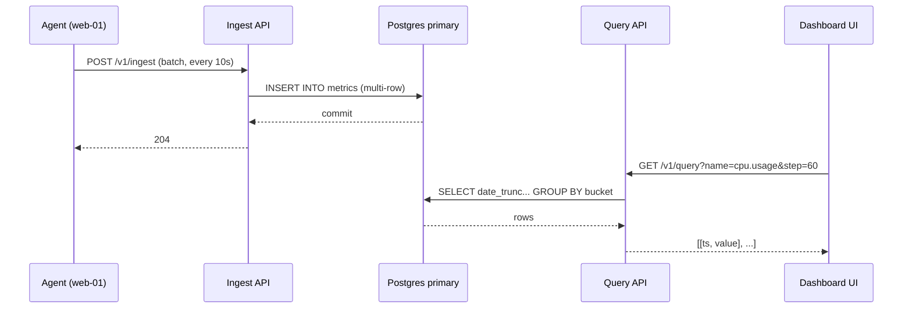

## Current State After V0

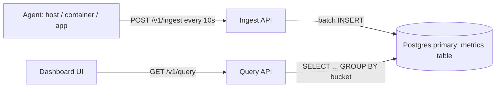

Nothing is marked new, since this is the first version.

**Every current flow:**

*Write path*
1. The agent samples the host every 10s.
2. The agent POSTs the batch to the Ingest API.
3. The Ingest API validates it and runs a multi-row `INSERT` into the Postgres `metrics` table.
4. The Ingest API returns `204`. On failure, the agent retries next tick.

*Read path*
1. The UI calls `GET /v1/query` with a name, labels, range and step.
2. The Query API builds a `date_trunc` plus aggregate query.
3. Postgres scans the `(name, ts)` index and aggregates.
4. The Query API returns the points and the UI draws them.

## Interview Follow-ups

**Q: Why push instead of pull?**
Push works for short-lived containers and jobs. They may die before any scraper reaches them. It also needs no service discovery in V0. The cost is that we must protect the Ingest API from overload, which comes later.

**Q: Why not just use a time-series database from the start?**
You can say you would. But the interview wants to see why. V0 shows the shape of the data first, so each later change has a visible trigger. If you jump straight to a TSDB, you can't explain what problem it solves.

## Recap

| Concept | The Insight |
|---|---|
| A metric sample | Name + labels + timestamp + number. That is the whole data model. |
| Push agent | Short-lived containers can report before they die. Scrapers might miss them. |
| V0 store | One relational table gives exact aggregates and simple SQL. |
| Read path | A dashboard is a `GROUP BY time bucket` query over a name and time range. |

**Interview arc:** *"A monitoring system starts as agents pushing samples into one table that a query API buckets by time, which is exact and simple, but it hasn't yet been tested against thousands of hosts writing every 10 seconds."*

**Next:** we do the math on 55,000 sources and watch the single Postgres primary fall over. Say "next" when ready.


-----------------------------------------------------------------------------------------------------------------------
-----------------------------------------------------------------------------------------------------------------------
-----------------------------------------------------------------------------------------------------------------------
-----------------------------------------------------------------------------------------------------------------------


## V1: Replace the Row Store with a Time-Series Engine

V1 has one job: make writes cheap and storage small. Nothing else changes. Buffering, sharding, replication and rollups are all deferred.

## Break It

Run the numbers once, because they decide everything.

- 5,000 hosts + 50,000 containers = 55,000 sources.
- Assume about 100 series per source (CPU per core, memory, disk, network, app counters). That is 5.5M series.
- At one sample per 10s, that is **550,000 samples per second**.
- Per day, that is about 47 billion samples.

At roughly 110 bytes per Postgres row (value, timestamp, JSON labels, index entry):

- **Storage:** about 5 TB per day. 15 days is about 78 TB.
- **Write rate:** a tuned single Postgres primary sustains maybe 30-50K inserts per second. We need 550K. That is more than 10x over.

On Monday at 9am, Priya opens her dashboard. The Postgres primary is at 100% CPU. Agents are retrying. Her CPU chart takes 40 seconds to load and has holes in it.

This is the crux, so let's walk the naive attempts.

### Attempt 1: Bigger Postgres, fewer indexes, COPY

Meera: "Just buy the biggest box, use `COPY`, and drop the index."

Arjun: "Without the index, every dashboard query scans billions of rows. With it, every insert updates a B-tree at a random spot."

It looked reasonable because vertical scaling is easy and `COPY` is faster than `INSERT`. It breaks in two ways:

- Even the best case tops out around 100-200K rows per second.
- The 5 TB per day does not shrink.

### Attempt 2: Time-partitioned Postgres (a partition per day or hour)

It looked reasonable because the newest partition's index stays in memory, so inserts get faster. It breaks because we still store one row per sample. Every 8-byte value carries about 100 bytes of overhead, and the same labels are repeated 47 billion times. Inserts improve maybe 2-3x. Storage barely moves.

### Attempt 3: Cassandra, one cell per sample

Key is `(series, hour)`, clustered by `ts`. It looked reasonable because it scales writes horizontally. It breaks because:

- Each sample is still a separate cell with its own overhead.
- Aggregation happens in the client, so every dashboard pulls raw points over the wire.
- It drags sharding into a version that is only about the storage layout.

### The real fix: three observations

**Observation 1: labels never change, so say them once.** The first time we see `cpu.usage{host=web-01}`, we assign a `series_id`. Every later sample carries only the ID.

**Observation 2: samples in one series are boring.** Timestamps arrive every 10s. Values barely move. So we store only the change.

Here is a worked example for `cpu.usage` on `web-01`:

```
timestamps: 1000, 1010, 1020, 1030
deltas:        -    10    10    10
delta-of-delta:      -     0     0      <- 1 bit each

values:  0.62, 0.62, 0.62, 0.63
XOR with previous:  0 -> 1 bit, 0 -> 1 bit, small -> few bits
```

This is the Gorilla scheme from Facebook. It gets a sample down to about **1.4 bytes** from 16 raw bytes.

**Observation 3: writes are append-only.** New samples always go to "now." So we write to an in-memory head chunk plus a sequential log. No random B-tree updates.

Think of the ship's logbook again. We stop writing one line per reading. We keep one sheet per gauge. The gauge's name is written once at the top, and each entry notes only the change since the last reading.

### The new numbers

- 47B samples per day × 1.4 bytes = **about 66 GB per day**.
- 15 days is about **1 TB**. Down from 78 TB.
- 550K appends per second is in-memory work plus sequential disk, which one good node can do.
- Active series memory is roughly 5.5M × 3 KB = about 16-20 GB of RAM. Hold that thought, because cardinality will come back.

### Options compared

| Option | Writes per node | Bytes per sample | Range query | Verdict |
|---|---|---|---|---|
| Tuned Postgres | 30-100K/s | ~110 | Good until it's huge | Rejected |
| Partitioned Postgres (Timescale-style) | 100-200K/s | ~110 raw, lower if compressed | Good | Viable at smaller scale |
| Cassandra, cell per sample | High, scales out | ~30+ | Weak, client-side aggregation | Rejected |
| Purpose-built TSDB engine | 500K+/s | ~1.4 | Strong, chunk-level | Chosen |

## Solve It

**Storage class justification:** a time-series store is the right class. The write pattern is append-only points sorted by time. The read pattern is range scans over a few series. Neither row stores nor key-value stores are shaped like that.

- ✅ **What we gained**
  - About 11x more write headroom per node.
  - About 75x less storage per sample.
  - V0's guarantee survives: raw samples are kept, so aggregates stay exact.
- ⚠️ **What we gave up / new problems**
  - No SQL. We now support a selector plus aggregation only.
  - One node is a single point of failure. A crash means downtime until restart and WAL replay.
  - Memory now scales with active series. This is the cardinality risk.
  - Late or out-of-order samples are limited or rejected. Old chunks are immutable.
  - If the node dies between fsyncs, we can lose the last WAL batch (about 1-2s).
- ❌ **What we considered and rejected**
  - Tuned or partitioned Postgres: per-row overhead stays, 78 TB per 15 days.
  - Cassandra: aggregation moves to the client, and sharding sneaks into this version.
  - Elasticsearch: built for text search, and its per-document overhead is heavier still.

## Implement It

### On-disk and in-memory layout (first appearance)

```
tsdb-node/
  wal/
    000001  000002 ...        append-only, CRC-checked records
  head/ (in memory)
    series_by_key: hash(name+labels) -> series_id
    head_chunk:    series_id -> open compressed chunk
    postings:      "label=value" -> sorted [series_id, ...]
  blocks/
    01H8..  (one block = 2 hours of data)
      meta.json    {"minTime":..,"maxTime":..,"numSeries":..,"numSamples":..}
      index        series table + postings (inverted index)
      chunks/000001  compressed chunks
```

**Series table (inside each block's `index`):**

```json
{ "series_id": 12,
  "labels": {"__name__":"cpu.usage","host":"web-01","region":"ap-south-1"},
  "chunks": [ {"minT":1763424000,"maxT":1763431200,"file":"000001","offset":4096} ] }
```

**Postings (inverted index):**

```
"__name__=cpu.usage" -> [12, 44, 97, ...]
"host=web-01"        -> [12, 13, 14, ...]
```

A query like `cpu.usage{host="web-01"}` is an intersection of two sorted lists. Result: `[12]`.

### Who writes / who reads

| Structure | Who writes, and when | Who reads, and when | Lives in |
|---|---|---|---|
| WAL | TSDB append path, on every sample batch | TSDB on restart (replay) | Local SSD on the TSDB node |
| Head chunks | TSDB append path, on every sample | Query path, for the last ~2h | RAM on the TSDB node |
| Postings and series map (head) | TSDB, when a new series is first seen | Query path, on every selector | RAM on the TSDB node |
| Blocks | Flush job inside the TSDB, every 2h | Query path, for data older than ~2h | Local SSD on the TSDB node |

### Write path

The agent request is unchanged: `POST /v1/ingest` with the same body as V0.

1. The Ingest API validates the batch (same as V0).
2. It calls the TSDB node's append API for each sample.
3. The TSDB appends:

```python
def append(name, labels, ts, value):
    key = hash64(name + sorted_labels(labels))
    sid = series_by_key.get(key)
    if sid is None:                                  # new series
        sid = next_series_id()
        series_by_key[key] = sid
        index_in_postings(sid, name, labels)         # update RAM postings
        wal.write(SeriesRecord(sid, name, labels))
    wal.write(SampleRecord(sid, ts, value))          # sequential disk write
    head_chunk[sid].append(ts, value)                # delta-of-delta + XOR
```

4. The WAL is fsynced in small batches (about every second).
5. The Ingest API returns `204`.

### Flush and compaction path (new, background)

1. Every 2 hours, the TSDB cuts the head. It writes all closed chunks, the series table and the postings into a new block directory.
2. It deletes the WAL segments covered by that block.
3. A retention job deletes blocks older than 15 days.

### Restart path (new)

1. On start, the TSDB loads the block indexes.
2. It replays the WAL to rebuild head chunks and RAM postings.
3. It then accepts writes and queries.

### Read path

`GET /v1/query?...` is unchanged. Only the Query API's backend changed.

1. The Query API parses `cpu.usage{host=web-01}` into matchers.
2. It calls the TSDB's `select(matchers, minT, maxT)`.
3. The TSDB intersects postings: `postings["__name__=cpu.usage"] ∩ postings["host=web-01"]` gives `[12]`.
4. **Branch: time range.**
   - Last 2 hours: read head chunks from RAM.
   - Older: use `meta.json` to pick the blocks that overlap the range, then read the chunk offsets from each block's index.
5. It decodes the chunks and returns the samples.
6. The Query API buckets them by `step` and applies `avg` or `p99`. This is the same exact math as V0, in app code instead of SQL.

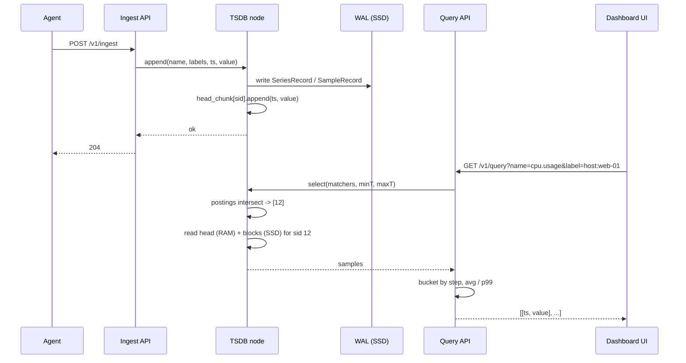

## Current State After V1

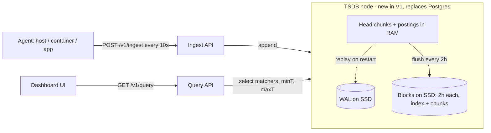

**Every current flow:**

*Write path*
1. The agent samples the host every 10s and POSTs a batch to the Ingest API.
2. The Ingest API validates it and calls the TSDB's `append` per sample.
3. The TSDB writes the WAL, then appends to the in-RAM head chunk. A new series also creates a postings entry.
4. The Ingest API returns `204`.

*Read path*
1. The UI calls `GET /v1/query`.
2. The Query API calls the TSDB's `select`.
3. The TSDB intersects postings, then reads the head (RAM) for recent data and blocks (SSD) for older data.
4. The Query API buckets and aggregates, then returns the points.

*Flush and retention (background)*
1. Every 2h, the head becomes a block and the covered WAL is deleted.
2. Blocks older than 15 days are deleted.

*Restart*
1. Load block indexes, replay the WAL, then serve.

## Interview Follow-ups

**Q: Why not just use TimescaleDB?**
At smaller scale, I would. It keeps SQL and gives compression. But at 550K samples per second, we want per-series chunk encoding and an in-RAM head, not a row engine with compression bolted on. I would name the break point and the numbers, not claim Timescale is bad.

**Q: What happens if the TSDB node crashes?**
It restarts and replays the WAL. We lose at most the last un-fsynced batch (about 1-2s). But it is down for the whole restart, which can take minutes with a big head. That is a known gap. Replication closes it later.

## Recap

| Concept | The Insight |
|---|---|
| Series ID | Store the labels once. Every sample carries only a small ID. |
| Delta-of-delta + XOR | Regular timestamps and slow-moving values compress to about 1.4 bytes per sample. |
| Head + WAL | Writes become RAM appends plus sequential disk, with no random index updates. |
| Inverted index | Label lookups become intersections of sorted ID lists. |
| Trade | We gave up SQL and a safe single node to get 11x writes and 75x less storage. |

**Interview arc:** *"A row per sample in Postgres dies at 550K samples per second and 5 TB per day, because every 8-byte value carries 100 bytes of labels and index, so a time-series engine interns labels into series IDs, compresses each series with delta-of-delta and XOR, and appends to a WAL plus in-memory head instead of updating a B-tree."*

**Next:** at 9am, a deploy restarts 20,000 containers at once. The TSDB stalls for 30 seconds while agents retry, and data is dropped. We put a durable buffer in front of the writes. Say "next" when ready.


-----------------------------------------------------------------------------------------------------------------------
-----------------------------------------------------------------------------------------------------------------------
-----------------------------------------------------------------------------------------------------------------------
-----------------------------------------------------------------------------------------------------------------------


## V2: A Durable Buffer in Front of the TSDB

V2 has one job: stop losing samples when the TSDB node is slow or down. Sharding, replication and rollups all stay deferred.

## Break It

Monday, 9:00am. The platform team restarts the TSDB node for a kernel patch.

On restart the node must replay its WAL to rebuild the in-RAM head. With 5.5M series, that takes about **4 minutes**.

For those 4 minutes, every Ingest API call fails. Each agent keeps only its last 6 batches (one minute) in memory. Everything older is dropped.

- Loss: 3 minutes × 550K samples per second = **about 99M samples gone for good**.
- Every chart in the company shows a 3-minute hole.

At 9:04 the node comes back, and it gets hit again:

- 55,000 agents release their 6-batch backlog on the same tick. That is **33M samples** at once.
- The node does about 700K samples per second. Live traffic already uses 550K. That leaves **150K per second of headroom**.
- Ingest API calls time out after 5s. Agents resend the same batches without any delay. The queue grows.

A deploy that restarts 20,000 containers does the same in miniature. It creates millions of new series in seconds, and the slow new-series path stalls the node.

This is the crux, so let's walk the naive fixes.

### Attempt 1: Bigger agent buffers, retry forever

Meera: "Agents keep 6 batches. Make it 60 and retry until it works."

Arjun: "Containers are the thing that dies. A killed pod takes its buffer with it. And 55,000 agents retrying on the same tick hit the node together."

It looked reasonable because buffering is the obvious fix. It breaks in two ways:
- Ephemeral containers lose their buffer exactly when they are replaced.
- Synchronized retries turn a 4-minute outage into a stampede on recovery.

### Attempt 2: Autoscale the Ingest API tier

It looked reasonable because the tier is stateless, and "add more pods" is the standard answer. It breaks because the Ingest API was never the bottleneck. The single TSDB writer is. More pods mean more concurrent writes into the same node, and more timeouts. During a restart, there is nowhere to put the data anyway.

### Attempt 3: Rate limit with 429s

It looked reasonable because it protects the node. It breaks because it sheds load exactly during incidents, when Priya needs metrics most. And while the node is down, there is still no place to hold the data.

### The real fix: a durable log between ingest and storage

Think of a loading dock. Trucks arrive in bursts. The warehouse crew unloads at a steady pace. If the crew is out for a few hours, the pallets wait on the dock. Nothing is thrown away.

The Ingest API stops writing to the TSDB directly. It appends each batch to a durable log and returns `204`. A separate **TSDB Writer** pulls from the log at the pace the TSDB can handle.

A burst becomes lag, not loss. A restart becomes a pause, not a hole.

The log does not need to be huge. 55,000 agents pushing every 10s is **5,500 messages per second**, about 4 KB each after compression. That is trivial for Kafka, even at 5x burst.

### Options compared

| Option | Survives TSDB restart | Absorbs 4x burst | Data loss risk | New ops burden |
|---|---|---|---|---|
| Bigger agent buffer | No (pods die) | Partly | High | None |
| Autoscale Ingest API | No | No | High | Low |
| Rate limit (429) | No | Sheds instead | High | Low |
| Durable log (Kafka) | Yes | Yes (becomes lag) | Low | Medium |

## Solve It

**New storage class justification:** a durable append-only log. Data is written once, read in order, and can be replayed from any offset. That matches "hold it safely until the consumer is ready." No other store we have gives us replay for free.

- ✅ **What we gained**
  - Bursts become consumer lag instead of dropped samples.
  - The TSDB can restart with zero data loss. The writer resumes from its last committed offset.
  - Ingest latency no longer depends on TSDB speed.
  - The log can be replayed later (for example into a second consumer).
- ⚠️ **What we gave up / new problems**
  - One more hop, so data is slightly stale. Normally 1-2s behind, more during a burst.
  - Delivery is at-least-once. The writer can re-read a batch after a crash, so the TSDB must ignore duplicates.
  - Thin headroom hurts. After a 4-minute outage the backlog is about 132M samples. At 150K per second of spare capacity, that is about **15 minutes** before dashboards are fresh again. That is the argument for scaling the TSDB out later.
  - A new system to run. Kafka itself becomes the new, much rarer, loss window.
- ❌ **What we considered and rejected**
  - Redis Streams: memory-bound, and costly for 6 hours of retention.
  - SQS: no replay and no per-key ordering at this scale.
  - Exactly-once delivery: complex for no gain. At-least-once plus an idempotent append is enough.
  - Kinesis or Pulsar: workable. Kafka (or MSK) is the default answer, and the design is the same.

## Implement It

### Message shape (first appearance)

One Kafka record equals one agent push.

```json
{
  "source_id": "web-01",
  "batch_id": "web-01-1763436000",
  "received_at": 1763436001,
  "samples": [
    {"name":"cpu.usage","labels":{"host":"web-01","region":"ap-south-1"},"ts":1763436000,"value":0.62}
  ]
}
```

**Key = `source_id`.** One source always emits the same series, so ordering per series is preserved within a partition.

### Who writes / who reads

| Structure | Who writes, and when | Who reads, and when | Lives in |
|---|---|---|---|
| `metrics.raw` topic | Ingest API, on every push | TSDB Writer (consumer group `tsdb-writer`) | Kafka cluster, 3 brokers across AZs |
| `metrics.dlq` topic | TSDB Writer, when a record cannot be decoded | On-call engineer or a replay tool, manually | Same Kafka cluster |
| Consumer offsets | TSDB Writer, after each WAL sync | TSDB Writer, on restart | Kafka (`__consumer_offsets`) |

### Topic config

```bash
kafka-topics.sh --create --topic metrics.raw \
  --partitions 24 --replication-factor 3 \
  --config min.insync.replicas=2 \
  --config retention.ms=21600000 \      # 6 hours
  --config compression.type=lz4
```

Six hours of retention is about 0.5 TB per copy. That is enough to cover a long outage while we recover. The 24 partitions let us add consumers later without repartitioning.

### Write path

**API call (unchanged):**

```http
POST /v1/ingest
{"source_id":"web-01","samples":[{"name":"cpu.usage","labels":{"host":"web-01"},"ts":1763436000,"value":0.62}]}
```

**Steps:**
1. The Ingest API validates the batch, same as before.
2. The Ingest API produces to Kafka and waits for the broker ack:

```python
producer = AIOKafkaProducer(
    bootstrap_servers=BROKERS,
    acks="all",                 # leader + in-sync replicas must have it
    enable_idempotence=True,    # producer retries won't duplicate
    compression_type="lz4",
    linger_ms=5,
    request_timeout_ms=3000,
)

@app.post("/v1/ingest", status_code=204)
async def ingest(batch: Batch):
    validate(batch)
    try:
        await producer.send_and_wait(
            "metrics.raw",
            key=batch.source_id.encode(),
            value=encode(batch),
        )
    except KafkaError:
        raise HTTPException(503, headers={"Retry-After": "5"})
```

3. `204` now means "durable in the log," not "queryable."
4. If Kafka is unreachable, the Ingest API returns `503` with `Retry-After`. The agent falls back to its small ring buffer.

### Agent retry (changed)

```python
def push_with_retry(batch, max_attempts=6):
    for attempt in range(max_attempts):
        if post(batch).status in (200, 204):
            return True
        cap = min(60, 2 ** attempt)             # 1,2,4,8,16,32s
        time.sleep(random.uniform(0, cap))      # full jitter: no stampede
    ring_buffer.push(batch)                     # keep for next tick (last 6)
    return False
```

Full jitter spreads 55,000 agents across the whole window instead of one tick.

### TSDB Writer (new service)

```python
consumer = Consumer(group_id="tsdb-writer", enable_auto_commit=False,
                    auto_offset_reset="earliest", max_poll_records=500)
consumer.subscribe(["metrics.raw"])

while True:
    records = consumer.poll(timeout_ms=500)
    try:
        for rec in records:
            try:
                batch = decode(rec.value)
            except DecodeError:
                dlq.send("metrics.dlq", rec.value)   # poison record, don't block
                continue
            tsdb.append_batch(batch.samples)         # idempotent, see below
        tsdb.wal_sync()                              # durable in TSDB first
        consumer.commit()                            # then move the offset
    except TSDBUnavailable:
        consumer.seek_to_committed()                 # rewind, nothing committed
        time.sleep(backoff())                        # records stay in Kafka
```

**Order matters:** WAL sync first, offset commit second. A crash between them means a re-read, never a loss.

### TSDB append, delta only (idempotency)

```python
def append(sid, ts, value):
    last_ts, last_v = head_chunk[sid].last()
    if ts == last_ts and value == last_v:
        return "dup_ignored"                         # replayed batch
    if ts <= last_ts:
        return "out_of_order_rejected"               # counted in a metric
    # ... same as V1: WAL record, then head chunk append
```

### Read path

Unchanged from V1. One difference: data becomes queryable only after the Writer commits it, so freshness is the consumer lag.

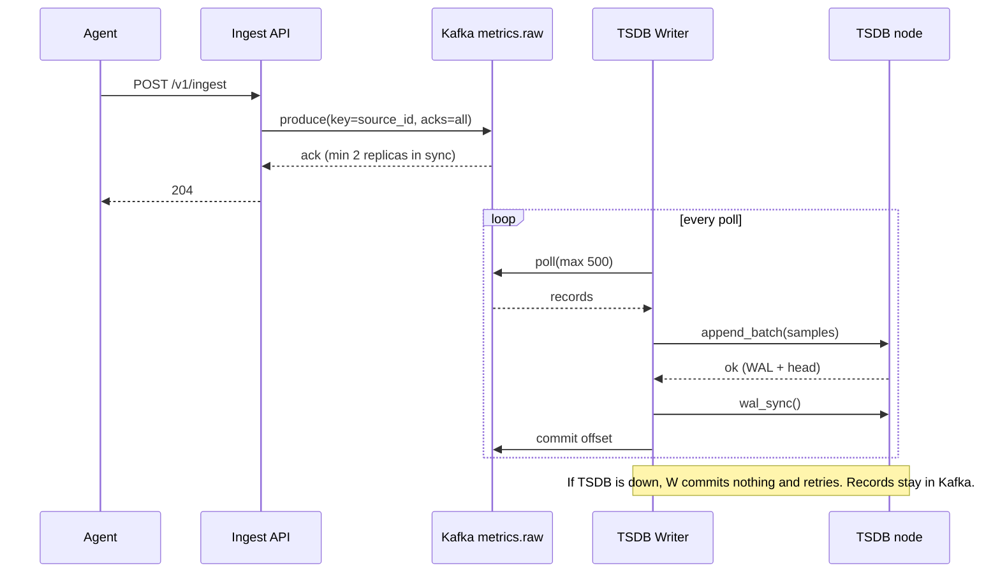

## Current State After V2

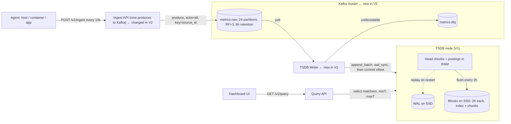

**Every current flow:**

*Write path*
1. The agent samples every 10s and POSTs the batch, with jittered retry on failure.
2. The Ingest API validates it and produces to `metrics.raw` with key `source_id`, waiting for `acks=all`.
3. The Ingest API returns `204`. The batch is durable but not yet queryable.
4. The TSDB Writer polls up to 500 records. Undecodable ones go to `metrics.dlq`.
5. The Writer calls `append_batch`. The TSDB drops exact duplicates, writes the WAL, and appends to the head.
6. The Writer syncs the WAL, then commits the offset.

*Read path*
1. Unchanged from V1: the UI calls the Query API, which calls the TSDB `select`, buckets and aggregates, and returns points.
2. Freshness now equals consumer lag. About 1-2s normally.

*Flush and retention (background)*
1. Unchanged: every 2h the head becomes a block, and blocks older than 15 days are deleted.

*TSDB restart (changed)*
1. The TSDB replays its WAL (about 4 minutes).
2. Meanwhile, the Ingest API keeps returning `204`, because Kafka is up.
3. The Writer's appends fail, so it commits nothing and backs off.
4. After replay, the Writer resumes from its last committed offset and drains the backlog.

*Kafka unavailable (new)*
1. The Ingest API returns `503` with `Retry-After`.
2. Agents back off with jitter and hold a small ring buffer.

## Interview Follow-ups

**Q: Why not make the agents write to Kafka directly?**
That would put Kafka credentials and client libraries on 55,000 ephemeral hosts. A thin Ingest tier gives us one place for validation, auth and rate limits. It also lets agents stay simple HTTP clients.

**Q: What if Kafka itself goes down?**
The Ingest API returns `503` and agents retry with jitter, keeping a one-minute ring buffer. Kafka runs RF=3 across AZs with `min.insync.replicas=2`, so losing one broker is invisible. Total Kafka loss is the remaining loss window. It is far rarer than a TSDB restart, and that is the trade we are making deliberately.

## Recap

| Concept | The Insight |
|---|---|
| Durable log | Put a log between ingest and storage so bursts become lag, not loss. |
| `acks=all` + `min.insync.replicas=2` | A `204` means the batch survives losing a broker. |
| Commit after WAL sync | Crash between the two means a re-read, never a loss. |
| Idempotent append | At-least-once delivery is safe when a duplicate `(series, ts, value)` is ignored. |
| Jittered backoff | Without jitter, 55,000 agents retry on the same tick and cause the next outage. |
| Trade | We pay one hop of staleness and a new system to run, and we buy zero loss on TSDB restarts. |

**Interview arc:** *"Agents writing straight to a single TSDB lose a minute of data per outage and stampede it on recovery, because buffers die with their pods and retries synchronize, so a durable log with acks=all sits in front, the writer commits offsets only after its WAL is synced, and an idempotent append makes at-least-once delivery safe."*

**Next:** Priya asks for a 90-day chart. We only keep 15 days of raw data, and even 15 days of 10-second samples takes tens of seconds to scan. Next we build rollups and downsampling. Say "next" when ready.


-----------------------------------------------------------------------------------------------------------------------
-----------------------------------------------------------------------------------------------------------------------
-----------------------------------------------------------------------------------------------------------------------
-----------------------------------------------------------------------------------------------------------------------


## V3: Rollups and Tiered Retention

V3 has one job: make long time ranges fast and cheap. Sharding, replication and caching all stay deferred.

## Break It

Tuesday, 10am. Priya wants a 90-day chart of average CPU across the 2,000 hosts in the `checkout` service. She is writing a capacity plan.

Two things go wrong.

**First, the data isn't there.** We keep 15 days of raw samples. Days 16 to 90 were deleted by the retention job. The chart is blank for 75 days.

**Second, the data we have is slow to read.** Say she asks for the last 15 days instead.
- One series is 8,640 samples per day. Over 15 days that is about 130K samples.
- 2,000 series is **260M samples** to decode, on a node that is also taking 550K writes per second.
- The chart is about 1,000 pixels wide. We decode 260M samples to draw 1,000 points.

If we stretched raw retention to a year to fix the first problem:
- 66 GB per day × 365 = **about 24 TB** on one node's SSD.
- A 90-day query would decode 2,000 series × 777,600 samples = **1.5 billion samples**.

This is the crux of the version, so let's walk the naive fixes.

### Attempt 1: Keep raw data for a year

Meera: "Storage is cheap. Raise retention to 365 days."

Arjun: "Then her 90-day query decodes 1.5 billion samples to draw 1,000 points."

It looked reasonable because it fixes the missing data in one config line. It breaks because the cost is in the read, not the disk. Disk grows 24x. The query is no faster.

### Attempt 2: Let the query's `step` do the work

It looked reasonable because the API already takes `step=3600`, and we already bucket in the Query API. It breaks because `step` only shrinks the output. The TSDB still decodes every raw sample before the Query API throws 99% of them away.

### Attempt 3: Downsample by keeping every Nth sample

It looked reasonable because it cuts the data by N and is trivial to build. It breaks because it throws away the thing monitoring exists to show. A 40-second CPU spike to 100% lands between kept samples and vanishes. The chart says the box was healthy at the exact moment it was not.

### The real fix: precomputed aggregates per time bucket

Think of a ship's logbook again. After each month, the captain writes one summary line per gauge: how many readings, the total, the lowest, the highest. The old pages can go in the archive. A year later, you read 12 summary lines, not 260,000 entries.

For each raw series and each time bucket, we store a few numbers instead of every sample:

```
bucket 09:00-09:05 for cpu.usage{host=web-01}
  count = 30     (30 samples at 10s)
  sum   = 18.9
  min   = 0.41
  max   = 0.97   <- the spike survives
```

From those four numbers:
- `avg = sum / count`
- `max = max of max`
- `min = min of min`

One rule matters here. **Never average averages.** An average of 5-minute averages is wrong whenever buckets have different counts. Averages come from `sum / count`, always.

We keep three tiers:

| Tier | Resolution | Retention | Used for |
|---|---|---|---|
| raw | 10s | 15 days | Last few hours, debugging |
| 5m | 5 minutes | 90 days | Week and month views |
| 1h | 1 hour | 400 days | Quarter and year views |

The 1h tier is built from the 5m tier, not from raw. `count` and `sum` add, and `min` and `max` merge. The result is identical to computing from raw.

### The new numbers

- 5m tier: 47B ÷ 30 buckets, 4 values each, about **9 GB per day**, 90 days is **about 0.8 TB**.
- 1h tier: 47B ÷ 360, 4 values each, about **0.7 GB per day**, 400 days is **about 0.3 TB**.
- Total for a year of history: about **2 TB**, not 24 TB.
- The 90-day query reads 2,000 series × 2,160 hourly buckets = **4.3M values**, not 1.5B. That is about 350x less.

### Options compared

| Option | Spikes preserved | Long-range query cost | Storage for 1 year | Verdict |
|---|---|---|---|---|
| Raw for a year | Yes | 1.5B samples | 24 TB | Rejected |
| Rely on `step` only | Yes | Unchanged | Unchanged | Rejected |
| Keep every Nth sample | No | Fast | Small | Rejected |
| Count/sum/min/max rollups | Yes (min, max) | 4.3M values | 2 TB | Chosen |

## Solve It

- ✅ **What we gained**
  - 90-day and 1-year views read about 350x less data.
  - A year of history costs about 2 TB, not 24 TB.
  - Spikes survive because we keep `min` and `max`.
  - Rollups are final once written. Raw blocks are immutable after the 2h flush (V1), so no late sample can change a closed bucket.
- ⚠️ **What we gave up / new problems**
  - **V0's exactness is gone for old data.** After 15 days, we cannot compute a true p99. A percentile cannot be rebuilt from averages or from other percentiles.
  - The fix for percentiles is to emit latency as histogram buckets (`http_latency_bucket{le="0.1"}` and so on). Those counters sum correctly at any tier, and the Query API computes p99 from summed buckets. That is a requirement on what agents emit.
  - Counters (like `requests_total`) are not summable, so they need a different aggregate, `last`.
  - Three tiers means three block types to compact, query and delete.
  - Raw drill-down is impossible past 15 days. Nobody can zoom into a 4-month-old spike at 10s resolution.
- ❌ **What we considered and rejected**
  - Decimation (every Nth sample): drops spikes.
  - Average only: cannot be merged later and cannot give `max`.
  - Computing rollups at query time and caching the result: first view is still slow, and caching is its own later version.
  - Streaming rollups in a separate stream processor (Flink): valid at larger scale, but it adds a whole new system. Rolling up closed blocks inside the TSDB is simpler.

## Implement It

### Schema delta

Only these two things change. The WAL, head and postings are untouched.

```json
// blocks/<id>/meta.json   (one field added)
{"minTime":1763424000,"maxTime":1763431200,"resolution":"5m","numSeries":5500000}

// series entry inside a rollup block's index   (one field added)
{ "series_id": 12,
  "labels": {"__name__":"cpu.usage","host":"web-01"},
  "kind": "gauge",
  "chunks": [ {"agg":"count","file":"000001","offset":0},
              {"agg":"sum",  "file":"000001","offset":812},
              {"agg":"min",  "file":"000001","offset":1620},
              {"agg":"max",  "file":"000001","offset":2431} ] }
```

Each aggregate is its own compressed chunk, reusing the V1 encoding. A counter series stores a single `last` chunk instead.

### Who writes / who reads

| Structure | Who writes, and when | Who reads, and when | Lives in |
|---|---|---|---|
| 5m rollup blocks | Rollup job, right after each 2h raw block is flushed | Query API via TSDB `select`, for ranges over about 1 day | Local SSD on the TSDB node |
| 1h rollup blocks | Rollup job, built from 5m blocks, once per 24h of data | Query API via TSDB `select`, for ranges over about 2 weeks | Local SSD on the TSDB node |
| Raw blocks | Flush job (V1) | Query API, for fine-grained ranges | Local SSD on the TSDB node |
| Tier retention | Retention job, runs hourly | Not read | Same SSD |

### Rollup job (new background task)

Triggered after a raw block is flushed. Buckets are aligned to epoch multiples, and 2h blocks are aligned too. So no 5-minute bucket ever straddles two blocks.

```python
def rollup_raw_block(raw_block, step=300):
    out = BlockWriter(resolution="5m",
                      minT=raw_block.minT, maxT=raw_block.maxT)
    for sid in raw_block.series_ids():
        kind = raw_block.series_kind(sid)             # gauge or counter
        for bucket_start, samples in group_by_bucket(raw_block.samples(sid), step):
            if kind == "gauge":
                out.add(sid, bucket_start,
                        count=len(samples),
                        sum=sum(v for _, v in samples),
                        min=min(v for _, v in samples),
                        max=max(v for _, v in samples))
            else:                                      # counter
                out.add(sid, bucket_start, last=samples[-1][1])
    out.finalize()                                     # writes index + meta.json

def rollup_5m_to_1h(blocks_5m_for_one_day):
    # count and sum add, min and max merge, last takes the latest
    ...
```

### Retention job (changed)

```python
RETENTION = {"raw": days(15), "5m": days(90), "1h": days(400)}

def enforce():
    for blk in all_blocks():
        if now() - blk.maxT > RETENTION[blk.resolution]:
            delete(blk)
```

Safety rule: a raw block is deleted only after its 5m rollup exists. The same goes for 5m and 1h.

### Query planning (changed, in the Query API)

```python
TIERS = [("1h", 3600, days(400)), ("5m", 300, days(90)), ("raw", 10, days(15))]  # coarsest first

def plan(start, end, step):
    step = max(step, (end - start) // 1000)            # cap at about 1,000 points
    for name, res, retention in TIERS:
        if res <= step and (now() - start) <= retention:
            return name, step
    return "raw", step                                 # fallback, finest tier
```

Worked examples:

| Range | Effective step | Tier picked |
|---|---|---|
| 1 hour | 10s | raw |
| 15 days | about 1,300s | 5m |
| 90 days | about 7,800s | 1h |

### Read path

**API call (same shape as before, one field added in the response):**

```http
GET /v1/query?name=cpu.usage&label=service:checkout&start=1755660000&end=1763436000&step=3600&agg=avg
→ {"resolution":"1h","step":7776,"points":[[1755660000,0.58],[1755667776,0.61], ...]}
```

**Steps:**
1. The Query API calls `plan(start, end, step)`. For 90 days it gets `("1h", 7776)`.
2. It calls `tsdb.select(matchers, minT, maxT, resolution="1h")`.
3. The TSDB intersects postings (unchanged from V1), then reads the `count` and `sum` chunks from the 1h blocks covering the range.
4. For each output bucket, the Query API computes:

```python
avg = sum(sum_chunk[b]) / sum(count_chunk[b])    # never mean of means
```

5. For `agg=max` it takes `max(max_chunk[b])`. For `p99` it sums the `_bucket` series per `le` and interpolates.
6. It returns the points.

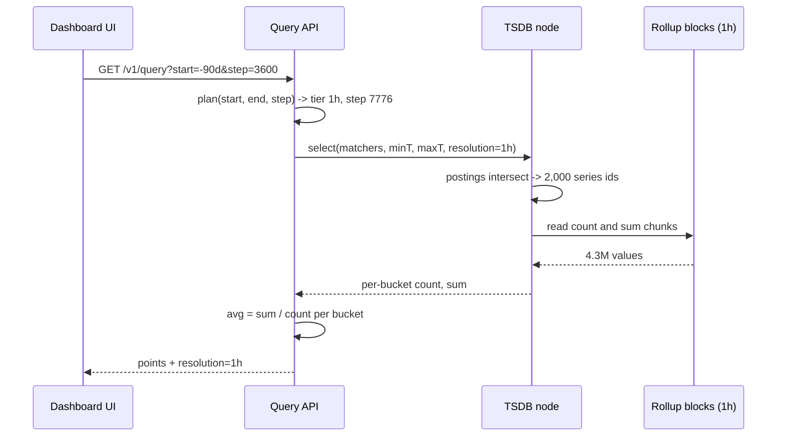

## Current State After V3

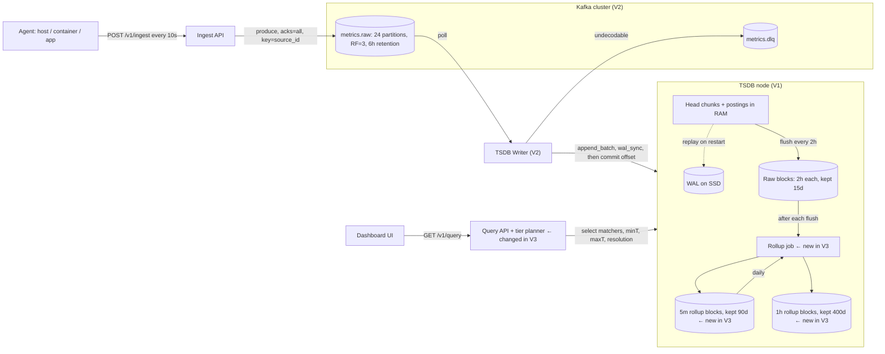

**Every current flow:**

*Write path (unchanged from V2)*
1. The agent samples every 10s and POSTs with jittered retry.
2. The Ingest API validates, then produces to Kafka `metrics.raw` with `acks=all`, and returns `204`.
3. The TSDB Writer polls Kafka, appends to the TSDB (WAL, then head), syncs the WAL, then commits the offset.

*Read path (changed)*
1. The UI calls `GET /v1/query`.
2. The Query API caps the range at about 1,000 points, then picks the coarsest tier whose resolution fits the step and whose retention covers the start.
3. The TSDB intersects postings and reads the head, raw blocks or rollup blocks, depending on tier.
4. The Query API computes `avg` as `sum / count`, `max` as max of max, and p99 from summed histogram buckets, then returns points and the resolution used.

*Flush and rollup (changed, background)*
1. Every 2h the head becomes a raw block, and the covered WAL is deleted.
2. The Rollup job builds a 5m block from each new raw block.
3. Once per day it builds the 1h block from that day's 5m blocks.

*Retention (changed, background)*
1. Raw blocks go after 15 days, 5m after 90, 1h after 400. A block is deleted only once its coarser rollup exists.

*TSDB restart (unchanged)*
1. Load block indexes, replay the WAL, then the Writer drains Kafka from its last committed offset.

## Interview Follow-ups

**Q: Why not store only the average per bucket?**
Because an average cannot be merged. The 1h average from twelve 5m averages is only right if every bucket has the same count, and late or missing data breaks that. With `count` and `sum` you can merge any number of buckets exactly. Storing `min` and `max` also keeps spikes visible, which an average hides.

**Q: How do you get p99 over 6 months if you only keep rollups?**
You can't from raw percentiles, so you change what the agent emits. Latency is sent as cumulative histogram buckets. Those are counters, so they add up across time and across hosts. The Query API sums the bucket counts for the range, then interpolates to find the 99th percentile. The answer is approximate, within the bucket width, and that is the trade for keeping it queryable at all.

## Recap

| Concept | The Insight |
|---|---|
| Rollups | Query cost depends on how many values you read, so precompute the buckets once and read those. |
| count + sum, not avg | You can merge `count` and `sum` forever. You can never merge averages. |
| min and max | Keep them in every bucket so spikes survive downsampling. |
| Tier planner | Pick the coarsest tier that fits the step and covers the start. A chart needs about 1,000 points, not millions. |
| Histograms | Percentiles can't be rolled up, but histogram bucket counts can. |
| Trade | We gave up exactness and raw drill-down on old data to make a year queryable in about 2 TB. |

**Interview arc:** *"Raw 10-second samples can't serve a 90-day chart, because retention is 15 days and decoding 1.5 billion samples to draw 1,000 points is hopeless, so a rollup job stores count, sum, min and max per 5-minute and 1-hour bucket, and the query planner picks the coarsest tier that fits the step, which cuts the read 350x and the year of storage from 24 TB to 2 TB."*

**Next:** everything we've built lives on one TSDB node, with one SSD holding about 3 TB and no second copy. A disk failure erases all history, and any heavy query competes with 550K writes per second on the same machine. Say "next" when ready.


-----------------------------------------------------------------------------------------------------------------------
-----------------------------------------------------------------------------------------------------------------------
-----------------------------------------------------------------------------------------------------------------------
-----------------------------------------------------------------------------------------------------------------------


## V4: Shard the TSDB

V4 has one job: spread the TSDB's writes, memory and disk across several nodes. Last time I teased two problems, a dead disk and a node that is too small. They are two versions. Sharding comes first because it fixes the node that is too small. Replication gets its own version right after.

## Break It

Friday, Black Friday, 6am. The autoscaler grows the fleet from 50,000 containers to 110,000.

- Sources: 5,000 hosts + 110,000 containers = 115,000.
- Series: about 11.5M, at 100 per source.
- Writes: about **1.15M samples per second**.

The single TSDB node tops out near 700K per second. Three things happen in order:

1. **Lag grows.** The Writer falls 450K samples per second behind. After an hour, dashboards are about 39 minutes stale. After about 9 hours, lag passes Kafka's 6-hour retention, and unread data starts expiring.
2. **RAM runs out.** The head needs about 11.5M × 3 KB = **35 GB**. The node has 32 GB. At 6:20 the kernel OOM-kills the TSDB.
3. **Recovery is slow.** The WAL replay for a 35 GB head takes about 8 minutes. Meanwhile, the lag gets worse.

Priya's checkout dashboard is 40 minutes behind on the busiest morning of the year. The disk is also heading for 6 TB on a single SSD.

The ingest tier and the query tier are stateless, so they scale by adding pods behind a load balancer. The TSDB is different. It holds state in four places:

- the WAL
- the head chunks in RAM
- the postings index
- the blocks on disk

You can't clone that node and split the traffic, because each clone would hold a different half of the story. You must **split the state itself**. That is sharding.

This is the crux, so let's walk the naive attempts.

### Attempt 1: Bigger machine

Meera: "Move to 256 GB RAM and 64 cores. One box, no new design."

Arjun: "That fixes this Friday. Next year the fleet doubles again. And a restart replays 35 GB of head, which means 8 minutes of outage."

It looked reasonable because there is no new architecture to build. It breaks in two ways:
- The cost curve gets steep, and there is a hard ceiling.
- The node stays a single point of failure with a slow restart.

### Attempt 2: `hash(source) % N`

Meera: "Simple. `hash(source_id) % 6` picks the node."

Arjun: "Now we add a seventh node for the next sale. `hash % 7` gives a different answer for almost every source."

It looked reasonable because it is two lines of code and spreads load evenly. It breaks when N changes. Going from 6 to 7 nodes remaps about **86%** of sources. Their data lives on the old nodes, so almost everything must move, and almost all history stops being found where the new function says it is.

### Attempt 3: Shard by time or by metric name

- **By time:** each node owns a day. Retention is trivial. But every write goes to today's node. That is one hot node and five idle ones.
- **By metric name:** `cpu.usage` and `http_requests` are the biggest metrics in the fleet. The node that owns them is the hot node.

Both look reasonable because dashboards query by time and by metric. Both break because the write traffic is not evenly spread across that key.

### The real fix: many small fixed shards, assigned to nodes

Think of a library that outgrew its building. You don't reshelve every book by a new rule each time you open a branch. You pre-label **24 crates**. Each book goes into a crate by a rule that never changes. Crates are assigned to buildings, and when a new building opens, you move whole crates.

For us:
- A **virtual shard** (vshard) is a fixed bucket. We use 24.
- `vshard(src) = hash(source_id) % 24`. This never changes.
- A **shard map** says which node owns each vshard. Only this map changes.

### Which key to hash?

| Shard key | What it optimizes | What it breaks |
|---|---|---|
| `hash(full label set)` | Perfectly even spread | One host's series scatter everywhere. Even "web-01 CPU" asks all shards. |
| `hash(source_id)` | One host lives on one shard. Matches our Kafka key. | Service-wide queries still fan out. A huge source can skew a shard. |
| Metric name | Dashboards for one metric hit one shard | `cpu.usage` is the biggest metric, so that shard is the hotspot. |
| Time range | Retention is trivial | All writes hit the newest shard. |

**Decision: `hash(source_id)`.** It matches the Kafka key from V2, so one partition equals one vshard. Our write traffic is also even per source, since every source emits every 10s.

### Do hotspots exist here?

Rate is even. **Series count per source is not.** A Kubernetes node exporter can carry 50,000 series. A bug that adds `user_id` as a label can create a million series from one source. That blows up one shard's RAM, even though write rates look normal.

Known fixes for a hot shard:

| Fix | Mechanism | Cost |
|---|---|---|
| Per-source series cap | The shard rejects new series past a limit | Over-limit data is dropped, so it needs alerting on the drops |
| Move the vshard | Give the hot vshard a bigger or emptier node | Needs the reshard procedure below |
| Salting | Key becomes `src + "#" + (hash(metric) % 4)`, so one source spreads over 4 vshards | Every query for that host fans out to 4 shards |

**Pick:** the series cap by default, plus vshard moves when needed. Salting only for a source that is legitimately huge.

### Resharding cost

| Approach | Sources that move when going from 6 to 7 nodes |
|---|---|
| `hash % N` | about 86% |
| 24 fixed vshards, rebalanced | 3 or 4 whole vshards, about 12-17% |

We move whole vshards. A move pauses only that one Kafka partition. The 6-hour log from V2 holds the writes until the move completes.

### The numbers

- **6 shards**, with 4 vshards each.
- Steady state: 550K ÷ 6 ≈ **92K samples per second per shard**, about 13% of capacity.
- Black Friday: 1.15M ÷ 6 ≈ **190K per shard**, about 27% of capacity.
- RAM per shard: 11.5M ÷ 6 × 3 KB ≈ **6 GB**.
- A single shard restart replays only about 1.9M series, roughly **1 minute**, and only that shard lags.

## Solve It

- ✅ **What we gained**
  - Writes, RAM and disk are split six ways, with room to double again.
  - A restart delays one shard's slice of the fleet instead of all of it.
  - Moving to more nodes is a bounded, per-vshard operation.
  - V2 and V3 still work: each vshard keeps its own Kafka partition, WAL, head, and rollup tiers.
- ⚠️ **What we gave up / new problems**
  - **Service-level queries fan out to all 6 shards.** Latency is the slowest shard's latency, so tail latency gets worse.
  - Shards must return **mergeable partials** (`count`, `sum`, `min`, `max`, histogram buckets). V3's design makes this possible. A raw percentile would not merge.
  - Shards are not read at one instant. Each has its own lag, so the newest point on a chart can differ by 1-2 seconds across shards.
  - A **shard map** is new state that must be consistent. Stale maps send queries to the wrong node.
  - **A shard that dies still loses its slice of history.** One node, one SSD, no copy. That is V5.
- ❌ **What we considered and rejected**
  - Vertical scaling alone: ceiling, cost, 8-minute restarts.
  - `hash % N`: 86% of data moves on every resize.
  - Time-based or metric-name sharding: hot nodes by construction.
  - Series-level hashing on a ring (Cortex or Mimir style): valid at larger scale, but it is built around replication. We want replication as its own version.
  - Cassandra or a managed TSDB: would replace everything V1 to V3 built, with no new lesson.

## Implement It

### Shard map (new store, first appearance)

**Storage class:** a small, strongly consistent key-value store with watches. It is tiny (kilobytes) and read often. etcd fits: it provides compare-and-swap on writes, and clients can watch for changes.

```json
// etcd key: /tsdb/shardmap
{
  "version": 7,
  "vshards": 24,
  "assignments": {
    "0": "tsdb-1", "1": "tsdb-1", "2": "tsdb-1", "3": "tsdb-1",
    "4": "tsdb-2", "5": "tsdb-2", "6": "tsdb-2", "7": "tsdb-2",
    "...": "...",
    "20": "tsdb-6", "21": "tsdb-6", "22": "tsdb-6", "23": "tsdb-6"
  }
}
```

### Who writes / who reads

| Structure | Who writes, and when | Who reads, and when | Lives in |
|---|---|---|---|
| Shard map `/tsdb/shardmap` | Rebalance tool, once per reshard (compare-and-swap on `version`) | TSDB nodes (on start, plus watch) and Query API (cached, plus watch) | etcd, 3 nodes |
| `metrics.raw` partition `v` | Ingest API, on every push from a source with `vshard(src) == v` | The TSDB node that owns vshard `v` | Kafka |
| Per-source series counter | The owning shard, whenever it creates a new series | The same shard, on the next new series | RAM on each shard |
| `/data/vs-<n>/` (wal, head, raw/5m/1h blocks) | The Writer for vshard `n` | Local `select` for vshard `n` | SSD on the owning node |

**On-disk layout delta:** each node holds **one small TSDB instance per vshard**, not one big one. That is what lets us copy a vshard as a plain directory.

```
/data/
  vs-0/ { wal/, blocks/, rollup-5m/, rollup-1h/ }
  vs-1/ { ... }
  vs-2/ ...
```

**Label delta:** the agent stamps a reserved label `src=<source_id>` on every series. It is 1:1 with the host or pod, so it adds no cardinality. The Query API uses it to route.

### One shared shard function

```python
N_VSHARDS = 24

def vshard(src_id: str) -> int:
    return murmur2(src_id.encode()) % N_VSHARDS   # same hash as Kafka's default

def owner(v: int) -> str:
    return shardmap["assignments"][str(v)]        # e.g. "tsdb-3"
```

Both the Ingest API and the Query API import this one function. It must never change. Changing it re-buckets everything.

### Write path

The agent call is unchanged: `POST /v1/ingest` with the same body.

1. The Ingest API validates the batch (unchanged).
2. It picks the partition explicitly instead of leaving it to the default partitioner:

```python
await producer.send_and_wait(
    "metrics.raw",
    key=batch.source_id.encode(),
    value=encode(batch),
    partition=vshard(batch.source_id),
)
```

3. Each TSDB node reads the shard map at startup and **assigns** its own partitions. This replaces the V2 consumer-group `subscribe`.

```python
mine = [int(v) for v, n in shardmap["assignments"].items() if n == NODE_ID]
consumer.assign([TopicPartition("metrics.raw", v) for v in mine])
```

We use `assign`, not `subscribe`, so a Kafka rebalance can never hand a partition to a node that doesn't hold its blocks.

4. The Writer routes each record to the vshard-local TSDB instance, then runs V2's flow: append, WAL sync, offset commit.
5. **Cardinality cap** (new check at series creation):

```python
SRC_SERIES_CAP = 20_000

def on_new_series(src, labels):
    if series_count_by_src[src] >= SRC_SERIES_CAP:
        metrics.inc("series_rejected_total", src=src)   # alert on this
        return REJECT
    series_count_by_src[src] += 1
    return ACCEPT
```

### Read path

**API call (unchanged):**

```http
GET /v1/query?name=cpu.usage&label=service:checkout&start=1763432400&end=1763436000&step=60&agg=avg
```

The Query API is now a **coordinator**.

1. It plans the tier (V3 logic, unchanged).
2. It picks the shards to ask:

```python
def target_nodes(matchers):
    src = matchers.get_eq("src")
    if src:                                             # e.g. src="web-01"
        return {owner(vshard(src))}                     # one shard
    return set(shardmap["assignments"].values())        # all 6 shards
```

3. **Branch: one shard or many.**
   - `src=web-01` is one node. This is the fast path.
   - `service=checkout` has no `src`, so all 6 are asked in parallel.
4. Each node runs V3's query locally and returns **partials, not raw samples**:

```http
POST /internal/select_partial   (to each tsdb node)
→ {"buckets":[{"t":1763432400,"count":3000,"sum":1860.0,"min":0.2,"max":0.97}, ...]}
```

5. The coordinator merges the partials, with a 2s timeout per node:

```python
partials = await gather(*[n.select_partial(req, timeout=2.0) for n in nodes],
                        return_exceptions=True)
ok = [p for p in partials if not isinstance(p, Exception)]
merged = {}
for p in ok:
    for b in p["buckets"]:
        m = merged.setdefault(b["t"], {"count":0,"sum":0,"min":inf,"max":-inf})
        m["count"] += b["count"]; m["sum"] += b["sum"]
        m["min"] = min(m["min"], b["min"]); m["max"] = max(m["max"], b["max"])
return {"points": finalize(merged, req.agg),     # avg = sum / count
        "partial": len(ok) < len(nodes)}         # tell the UI if a shard was missing
```

6. If a shard times out, the chart still renders, and the response carries `"partial": true`. The UI shows a banner.

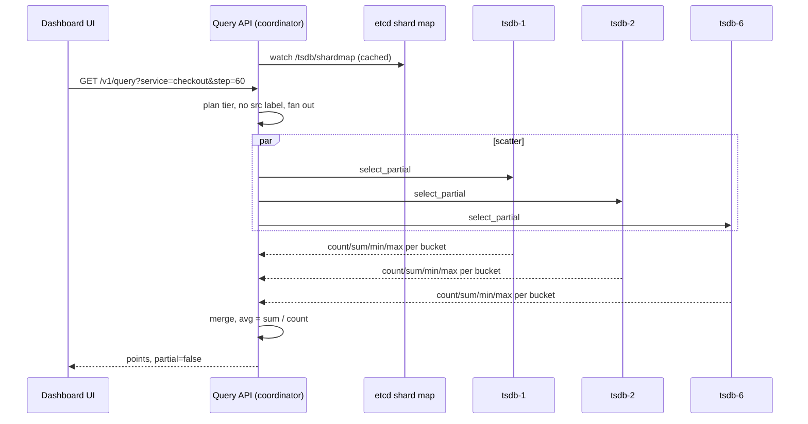

### Moving a vshard (new operational flow)

Example: move vshard 17 from `tsdb-3` to the new `tsdb-7`.

1. Start `tsdb-7` empty. It joins the cluster but owns nothing.
2. **Bulk copy while live:** `rsync -a tsdb-3:/data/vs-17/ /data/vs-17/`. Writes keep flowing.
3. **Short pause:** `tsdb-3` stops consuming partition 17, flushes its head into a block, and runs a final delta `rsync`. Kafka holds the incoming records. Nothing is lost.
4. The rebalance tool writes the new map with compare-and-swap: `version 7 → 8`, `assignments["17"] = "tsdb-7"`.
5. `tsdb-7` sees the change and runs `consumer.assign([TopicPartition("metrics.raw", 17)])`, starting at the last committed offset. It drains the backlog.
6. The Query API's watch picks up version 8. Reads for vshard 17 now go to `tsdb-7`.
7. `tsdb-3` deletes `/data/vs-17/` after a grace period, once no reader still uses version 7.

Only partition 17 lags, for about a minute or two. The other 23 vshards are untouched.

## Current State After V4

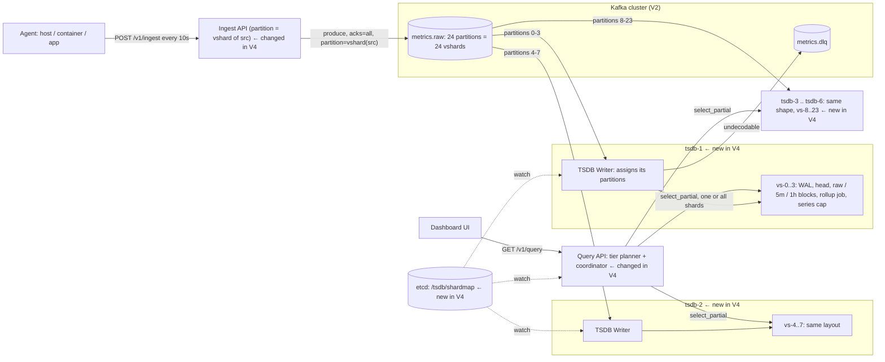

**Every current flow:**

*Write path (changed)*
1. The agent samples every 10s and POSTs with jittered retry.
2. The Ingest API validates, then produces to `metrics.raw` at partition `vshard(src_id)` with `acks=all`, and returns `204`.
3. The TSDB node that owns that vshard reads its assigned partitions.
4. Its Writer appends to the vshard-local TSDB (WAL, head), applying the per-source series cap on new series.
5. The Writer syncs the WAL, then commits the offset.

*Read path (changed)*
1. The UI calls `GET /v1/query`.
2. The Query API plans the tier (V3), then picks the shards: one if a `src` label is present, otherwise all 6.
3. Each shard runs the local query and returns partials (`count`, `sum`, `min`, `max`).
4. The coordinator merges them, computes `avg = sum / count`, and returns points plus a `partial` flag.

*Flush, rollup and retention (unchanged logic, now per vshard)*
1. Each vshard flushes its head every 2h, builds 5m and 1h rollups, and deletes by tier retention, as in V3.

*Vshard move (new)*
1. Bulk copy, pause the partition, final copy, flip the map with compare-and-swap, resume on the new node, and delete the old copy after a grace period.

*TSDB restart (changed)*
1. One node replays only its own vshards' WALs (about a minute). Writers resume from committed offsets. Other shards are unaffected.

## Interview Follow-ups

**Q: Why not a consistent-hash ring with virtual nodes?**
Fixed vshards do the same job. Both bound data movement when membership changes. Rings help when nodes join and leave often and there is no coordinator. Here, operators resize the cluster deliberately, so an etcd shard map is simpler. It also lets one vshard equal one Kafka partition, which keeps ingest and storage aligned.

**Q: A service-level query hits all 6 shards and one is slow. What do you do?**
Each shard call has a 2s timeout, and the coordinator returns what it has with `partial: true`. That is honest and fast. It does not fix the slow shard, and today there is only one copy of its data to ask. Once replicas exist, we can send a hedged request to a second copy.

## Recap

| Concept | The Insight |
|---|---|
| Stateful tier | Stateless tiers scale by adding pods. The TSDB holds WAL, head and blocks, so you must split the state itself. |
| Shard key | `hash(source_id)` keeps a host on one shard and matches the Kafka key. |
| Fixed vshards | `hash % N` moves 86% on a resize. 24 fixed vshards move whole crates, about 12-17%. |
| Hotspot is cardinality | Write rate per source is even. Series count per source is not, so cap it. |
| Mergeable partials | Fan-out only works because every shard returns `count`, `sum`, `min`, `max`, not raw samples. |
| Trade | We pay tail latency and a shard map to split 1.15M writes per second six ways. |

**Interview arc:** *"One TSDB node can't hold 1.15M writes per second or 35 GB of head, and `hash % N` would remap 86% of sources on every resize, so we hash `source_id` into 24 fixed virtual shards that match the Kafka partitions, keep a versioned shard map in etcd, move whole shards when nodes are added, and have a coordinator merge count, sum, min and max partials from each shard at query time."*

**Next:** at 3am `tsdb-4`'s SSD dies. Its slice of 400 days of history is gone, and Kafka only holds the last 6 hours. We make every shard survive losing a disk. Say "next" when ready.


-----------------------------------------------------------------------------------------------------------------------
-----------------------------------------------------------------------------------------------------------------------
-----------------------------------------------------------------------------------------------------------------------
-----------------------------------------------------------------------------------------------------------------------


## V5: Replicate Each Shard

V5 has one job: make sure losing a disk, a node, or a whole zone loses no history and stops no reads. Hot-query caching, front-door scaling and multi-region stay deferred.

Replication means keeping the same data on more than one machine. Today every vshard exists exactly once. A second and third copy mean one machine dying is a non-event.

## Break It

Saturday, 3:07am. The SSD controller on `tsdb-4` dies. It owned vshards 12 to 15.

- About 1/6 of the cluster's history lived on that disk. That is roughly 400 GB: 15 days raw, 90 days of 5m, 400 days of 1h.
- It covers about 17% of all sources, chosen by hash. Those hosts are fixed, not random.
- Kafka holds only 6 hours. We can rebuild 6 hours of a 400-day history. The rest is gone.

Priya's capacity plan for those hosts now starts yesterday evening.

Reads break too, and more quietly. Every service-level query fans out to all 6 shards. `tsdb-4` times out after 2s on every call. Every `checkout` chart now returns `partial: true`. The average is computed over only 83% of hosts, and it looks plausible.

Even a healthy restart does this for about a minute, because the WAL replay from V1 makes that shard unreadable.

Before choosing a mechanism, check whether read replicas are justified here. The ratio is 550K sample writes per second against a few hundred queries per second. This system is overwhelmingly write-dominated. We are **not** adding copies to scale reads. We add them for durability and availability. Serving reads from them is a free side effect.

### Attempt 1: Nightly snapshots to S3

It looked reasonable because it is cheap and standard. It breaks on the gap. A snapshot at midnight and a failure at 11:59pm means a 24-hour-old restore. Kafka covers only the last 6 hours, so **18 hours are gone for good**. It also gives no availability: reads stay broken until the restore finishes.

### Attempt 2: RAID-1 inside each node

It looked reasonable because disk failures are the commonest fault. It breaks on everything else. A kernel panic, a bad patch, or a lost zone still takes the whole node down. The 1-minute `partial: true` window on every restart stays exactly as it was.

### Attempt 3: Primary-backup with synchronous WAL shipping

It looked reasonable because it is the classic textbook answer. It breaks because it rebuilds something we already own. Kafka is already an ordered, durable, replayable log. Shipping our own WAL adds a network round trip to every write, plus leader election and fencing.

### Options compared

| Option | Survives disk loss | Survives zone loss | Write-path cost | Failover machinery |
|---|---|---|---|---|
| Nightly snapshots | Partly (18h hole) | Partly | None | Manual restore |
| RAID-1 per node | Yes | No | None | None |
| Sync WAL shipping (primary-backup) | Yes | Yes | +1 round trip per write | Election, fencing |
| Quorum-write ring (Cortex style) | Yes | Yes | Wait for 2 of 3 | Hinted handoff, repair |
| **Each replica reads the same Kafka partition** | Yes | Yes | None | None for writes |

## Solve It

**Decision: three replicas per vshard, one in each availability zone. Each replica independently consumes the same Kafka partition.**

The idea is simple. Same ordered input plus the same deterministic code gives the same state. Kafka supplies the order. Each replica runs V4's Writer on its own.

**Replica count:** three, not two. With two, a failed disk leaves one copy during the hour it takes to rebuild. A second fault in that hour loses data. Three survives one failure with a spare.

**Sync or async:** the `204` still waits only for Kafka (`acks=all`, `min.insync.replicas=2`, from V2). That is the durability point. The three TSDB replicas then apply the record independently, each within about 1-2 seconds. Relative to `204`, replication is asynchronous.

**Consistency model:** eventual between replicas. Each can be 0-2s behind the others. Staleness matters in exactly one flow: a dashboard that refreshes every 10s and lands on a fresh replica, then a lagging one, so the line's last point jumps backwards. We handle it with watermarks below.

- ✅ **What we gained**
  - Losing any one node, or a whole zone, loses no data. Reads continue immediately from the other copies with no `partial: true`.
  - The write path is unchanged. There is no leader election, and no split-brain because there is one ordered log and no writers competing.
  - Rolling patches no longer make charts partial.
  - A slow replica can be hedged around, which claws back the tail latency V4 introduced.
- ⚠️ **What we gave up / new problems**
  - **3x storage** (about 7 TB total) and **3x ingest CPU**. Each replica compresses, indexes and rolls up on its own. The cluster grows from 6 nodes to 9.
  - Replicas are eventually consistent. We must clip the last bucket on reads.
  - **Determinism is now a correctness requirement.** A wall-clock block cut or a counter-based series ID would make replicas drift apart.
  - New state: a replica lifecycle (`bootstrapping`, `ready`) in the shard map, plus repair and bootstrap jobs.
  - A replica down longer than Kafka's 6 hours can't replay the gap. It must copy blocks from a peer.
- ❌ **What we considered and rejected**
  - Snapshots, RAID, sync WAL shipping: covered above.
  - Quorum-write ring: valid, but it replaces Kafka as the durability point and adds hinted handoff and read repair.
  - Object-store blocks (Thanos style): valuable for cheap long retention, but it does not replicate the 2h head, and it is a different version.
  - Replicas for read scaling: the read:write ratio doesn't justify it.

### Failover: what happens when a replica dies?

Known fixes for replica failover, with this system's answer:

| Fix | Mechanism | Fits here? |
|---|---|---|
| Route around | Circuit breaker marks a replica unhealthy after 3 failures, and the coordinator skips it | **Yes, for reads** |
| Hedged requests | Send a second request to another replica if the first is slower than p95 | **Yes, for tail latency** |
| Leader promotion | Elect a new primary and fence the old one | No, there is no leader |

For writes there is no failover at all. A dead replica stops consuming. Kafka holds its records. When it returns, it resumes from its committed offset.

## Implement It

### Shard map delta (etcd, `/tsdb/shardmap`)

```json
{
  "version": 9,
  "vshards": 24,
  "replicas": {
    "12": [ {"node":"tsdb-a1","az":"a","state":"ready"},
            {"node":"tsdb-b2","az":"b","state":"ready"},
            {"node":"tsdb-c3","az":"c","state":"ready"} ]
  }
}
```

Placement rule: three replicas of a vshard, in three distinct zones. Each of the 9 nodes holds 8 vshard replicas. Steady write load per node is 8 × 23K ≈ 183K samples per second, about 26% of capacity. Black Friday is about 55%.

### Determinism changes (to V1 to V3 internals)

```python
# 1. Series IDs come from the labels, not a counter
series_id = hash64(name + sorted_labels(labels))      # replicas never need to agree

# 2. Block cut is driven by data, not by wall clock
def maybe_cut(vs):
    wm = vs.watermark                                  # max sample ts applied for this vshard
    while vs.oldest_window_end + GRACE_5M <= wm:       # 2h windows, epoch-aligned
        cut_block(vs, vs.oldest_window_end)
```

Every replica applies the same records in the same order. So they hit the same watermark at the same offset and cut identical blocks. The series cap and out-of-order rejection from V1 and V4 are also order-driven.

### Block meta delta

```json
{"id":"raw-1763424000","resolution":"raw","vshard":12,
 "minTime":1763424000,"maxTime":1763431200,
 "kafkaOffsetEnd":88123411,"sha256":"9f2c..."}
```

Block IDs are now `{resolution}-{minTime}`, not random. Two replicas' copies of the same block have the same ID and, if correct, the same hash.

### Who writes / who reads

| Structure | Who writes, and when | Who reads, and when | Lives in |
|---|---|---|---|
| Shard map `replicas` | Placement controller on a resize or replacement (CAS on `version`) | TSDB nodes (start + watch), Query API (cached + watch) | etcd |
| Replica `state` | The replica itself, flipping `bootstrapping` to `ready` once caught up (CAS) | Query API, on every plan | etcd |
| Consumer offsets | Each node's Writer, per node group `tsdb-writer-<node>`, after each WAL sync | Same Writer, on restart | Kafka |
| Sealed blocks and manifests | Each node's flush and rollup jobs | Local `select`, plus peers during repair and bootstrap | SSD on each node |

### Write path (changed, writer only)

Agent call and Ingest API are unchanged. The Writer now has one consumer group **per node**, so three nodes read the same partition independently.

```python
mine = [int(v) for v, reps in shardmap["replicas"].items()
        if any(r["node"] == NODE_ID for r in reps)]
consumer = Consumer(group_id=f"tsdb-writer-{NODE_ID}", enable_auto_commit=False)
consumer.assign([TopicPartition("metrics.raw", v) for v in mine])
# rest of the loop: append_batch, wal_sync, commit (unchanged from V2)
```

### Read path (changed, in the Query API coordinator)

**API call:** unchanged, `GET /v1/query?...`.

1. The coordinator plans the tier and the target vshards (V3, V4).
2. It picks **exactly one** replica per vshard. It never merges two copies of the same vshard, which would double-count.

```python
def pick_replica(v, exclude=()):
    cands = [r for r in shardmap["replicas"][str(v)]
             if r["state"] == "ready" and r["node"] not in exclude
             and breaker.allows(r["node"])]
    local = [r for r in cands if r["az"] == MY_AZ]
    return min(local or cands, key=lambda r: ewma_latency[r["node"]])

plan = defaultdict(list)                       # node -> vshards it will answer
for v in target_vshards:
    plan[pick_replica(v)["node"]].append(v)
```

3. **Branch: normal or slow.** It sends one `select_partial(vshards=[...])` per node. If a node hasn't answered within p95 (about 150 ms), it re-plans those vshards on other replicas and takes whichever answer arrives first. The loser is cancelled and discarded.
4. If a node errors 3 times, the circuit breaker opens, and the coordinator skips that node for 30s.
5. **Watermark clipping.** Each partial includes the per-vshard watermark. The coordinator drops trailing buckets past the lowest one:

```python
safe_end = min(p["watermark"][v] for p in partials for v in p["vshards"])
points = [pt for pt in merged_points if pt.bucket_end <= safe_end]
```

6. The merge is the same as V4 (`count`, `sum`, `min`, `max`). `partial: true` now means all 3 replicas of some vshard failed, which is rare.

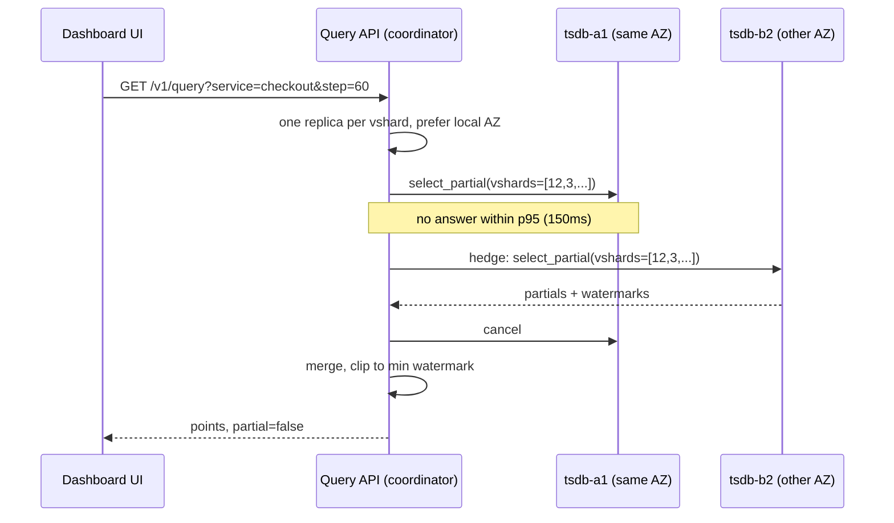

### Repair (new, background, every node, hourly)

Sealed blocks are immutable, so comparing hashes is cheap and safe.

```python
for v in my_vshards:
    for peer in peers(v):
        theirs = http_get(peer, f"/internal/blocks?vs={v}")      # [{id, sha256}]
        for b in theirs:
            if b.id not in mine[v] or mine[v][b.id].sha256 != b.sha256:
                copy_block(peer, v, b.id)    # with 3 copies, majority hash wins
```

### Bootstrap a replacement (new flow)

Example: `tsdb-4`'s disk died, and `tsdb-a1` is replaced by a fresh `tsdb-a4`.

1. The placement controller swaps `tsdb-a1` for `tsdb-a4` in each affected vshard, state `bootstrapping`, with a CAS from version 9 to 10. The Query API stops routing to it, since it is not `ready`.
2. For each vshard, `tsdb-a4` copies the sealed blocks from a healthy peer, throttled, and verifies each `sha256`.
3. It reads the newest block's `kafkaOffsetEnd`. That is within the 6h Kafka window because blocks seal every 2h.
4. It seeks its consumer to `kafkaOffsetEnd + 1` and replays into the head.
5. When its lag drops below 5s, it flips its own state to `ready` with a CAS. Reads start flowing to it.

This takes about an hour end to end. Nothing is lost, and reads never stopped, because the other two copies served throughout.

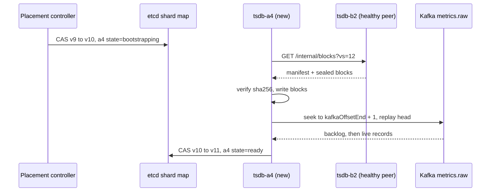

## Current State After V5

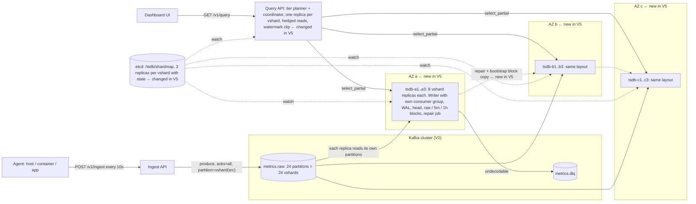

**Every current flow:**

*Write path (Writer changed, rest unchanged)*
1. The agent samples every 10s and POSTs with jittered retry.
2. The Ingest API validates, produces to `metrics.raw` at partition `vshard(src_id)` with `acks=all`, and returns `204`.
3. Each of the 3 replicas of that vshard reads the partition independently, using its own consumer group.
4. Each replica's Writer applies the series cap, appends to its WAL and head (series ID = hash of labels), syncs the WAL, and commits its own offset.

*Read path (changed)*
1. The UI calls `GET /v1/query`. The Query API plans the tier and target vshards.
2. It picks one `ready` replica per vshard, preferring its own zone and lowest latency, and groups vshards by node.
3. Each node returns partials plus watermarks. A slow node is hedged to another replica.
4. The coordinator merges the partials, clips to the lowest watermark, and returns points plus a `partial` flag.

*Flush, rollup and retention (unchanged logic, now deterministic)*
1. Each replica cuts a 2h block when its vshard watermark passes the window end plus 5 minutes, then builds the 5m and 1h rollups and applies tier retention.

*Repair (new)*
1. Hourly, each replica diffs sealed-block hashes with its peers and copies any missing or mismatched block (majority hash wins).

*Replica bootstrap (new)*
1. Mark `bootstrapping`, copy blocks from a peer, replay Kafka from the newest block's offset, flip to `ready`.

*Node restart (changed)*
1. The restarting node replays its WAL. Reads for its vshards go to the other two replicas, so there is no `partial: true`. The Writer then resumes from its committed offset.

*Vshard move (changed)*
1. A resize now moves one replica of a vshard using the V4 procedure. The other two keep serving.

## Interview Follow-ups

**Q: Why not replicate between TSDB nodes with a write quorum?**
We already pay for a durable, ordered, replicated log. A quorum adds a second durability mechanism and a round trip to the slowest replica on every write. It also needs hinted handoff and read repair. Independent consumption reaches the same end state with none of that. The cost is that replicas are eventually consistent, which a dashboard can tolerate.

**Q: A replica is down for 8 hours, but Kafka keeps only 6. What now?**
It can't replay the gap, so it bootstraps. It copies sealed blocks from a healthy peer, then resumes Kafka from the newest block's offset. We alert at 3 hours of lag so the controller acts well before the window closes. The 6-hour retention is a real operational limit, not just a buffer size.

## Recap

| Concept | The Insight |
|---|---|
| Why replicate | This system is write-dominated, so replicas buy durability and availability, not read scaling. |
| Kafka as the replication log | Same ordered input into three independent Writers gives three identical copies. The `204` waits only for Kafka. |
| Determinism | Replicas stay identical only if series IDs, block cuts and rejections depend on the log, not on counters or clocks. |
| Hash-diffed immutable blocks | Deterministic block IDs plus `sha256` make repair a simple diff, and the majority hash wins. |
| One replica per vshard | Merge exactly one copy of each vshard, hedge the slow ones, and clip to the lowest watermark. |
| Trade | We pay 3x storage and CPU and accept seconds of skew between copies. In return a disk, node, or zone can die with no data loss. |

**Interview arc:** *"A single copy of each shard loses 400 days of history when one SSD dies and leaves charts partial on every restart, and snapshots leave an 18-hour hole, so we keep three replicas in three zones that each consume the same Kafka partition independently, make every decision deterministic so they stay identical, repair by diffing immutable block hashes, and read exactly one replica per shard with hedging and watermark clipping."*

**Next:** every piece so far hides one fact. The Ingest API and Query API are still single processes. At 5,500 pushes per second and a few hundred refreshing dashboards, the front door saturates before any TSDB does. Say "next" when ready.


-----------------------------------------------------------------------------------------------------------------------
-----------------------------------------------------------------------------------------------------------------------
-----------------------------------------------------------------------------------------------------------------------
-----------------------------------------------------------------------------------------------------------------------


## V6: Scale the Front Door

V6 has one job: let the Ingest API and the Query API grow and shrink by adding and removing copies. Caching stays deferred. A pile of dashboards asking the same question is a caching problem, and it comes next.

Think of a supermarket with one cashier. The line grows. You can hire a faster cashier, or you can open more lanes.

A faster cashier has a ceiling. And when she takes a break, the store stops. More lanes have no ceiling. But they only work if any customer can use any lane. That means no cashier may keep a customer's basket in her head. Basket-in-the-head is "local state." The first job is to find it.

## Break It

Black Friday, 6:12am. The fleet is at 115,000 sources, from V4. That is **11,500 pushes per second** into the Ingest API.

The Ingest API is one instance. We already scaled it up once, to 16 vCPU. A 2-vCPU slice handles about 1,500 pushes per second, so this box tops out near **12,000**. At 11,500 it runs at 96% CPU.

A routine deploy restarts it. It is down for 20 seconds.

- Every agent gets "connection refused." It retries with jitter (V2).
- The backlog is 20s × 11,500 = **230K pushes**.
- They return within about 16 seconds, on top of live traffic. That is about 14,000 per second of retries plus 11,500 live.
- Demand is **25,500 per second** against a ceiling of 12,000. That is 213%.

Requests queue and hit the 5s timeout. Agents retry again. Load stays above capacity even after the original blip is long gone.

It lasts about 4 minutes. Each agent keeps only a 60s ring buffer. Sources that never got through lose up to **3 minutes** of samples.

Look at what is behind the door. Kafka is barely warm. The TSDB nodes sit near 55%. The only saturated thing in the system is the front door.

The Query API fails the same way on a different axis. 600 engineers watch the checkout dashboards. Each has 10 panels refreshing every 10s. That is **600 queries per second** on one instance that tops out near 200. Each query fans out to 6 vshards. Charts time out at 10s, and the UI retries.

This is the crux, so let's walk the naive fixes.

### Attempt 1: A bigger box

Meera: "We're at 16 cores. Go to 64."

Arjun: "That moves the ceiling to about 48,000 a second. It's still one machine. Every deploy, patch or crash is still a 20-second outage for 115,000 agents."

It looked reasonable because there is no new design. It breaks on three things:
- Cost grows faster than capacity.
- There is still a hard ceiling.
- The box is still a single point of failure.

### Attempt 2: DNS round robin

Meera: "Eight Ingest instances behind one hostname with eight A records."

Arjun: "An agent resolves it once and keeps the connection open for hours. When an instance dies, its agents keep dialing a dead IP until their cache expires. DNS has no health checks."

It looked reasonable because it is free and needs no new component. It breaks because DNS cannot see load, health or deploys. A rolling deploy leaves agents pinned to instances that have already gone.

### Attempt 3: L4 load balancer, round robin per connection

It looked reasonable because a real load balancer fixes the health-check problem. It breaks on two things:
- Agents keep one HTTP connection open and reuse it. Connection-level balancing pins that connection to one instance.
- When autoscaling goes from 8 to 16 instances, the 8 new ones get only new connections. They sit idle while the old 8 stay at 90%.
- Push cost varies about 100x. A Kubernetes node exporter sends 50,000 samples. A small host sends 100. Balancing by connection ignores that.

### The real fix: many identical instances behind a per-request balancer

Three parts:
1. **Stateless instances.** Any instance can serve any request.
2. **An L7 load balancer** that balances per request and checks health.
3. **An autoscaler** that adds and removes instances for us.

### What state would these servers hold if left alone?

| State | Where it lives | Verdict |
|---|---|---|
| Ingest: Kafka producer batch buffer (5ms linger) | Process RAM | Safe. `204` is returned only after the broker ack. If an instance dies mid-batch, the agent never got a `204` and retries. |
| Ingest: Kafka idempotent-producer sequence numbers | Process RAM, per producer | A retry can land on a different instance and write a duplicate. Already handled by the TSDB's idempotent append (V2). |
| Query: shard map copy | Process RAM, fed by an etcd watch | Derived data. Rebuilt on start. Readiness waits for it. |
| Query: per-node latency EWMA and circuit-breaker state | Process RAM | Soft state. Each instance learns on its own. We do not share it. |
| Query: in-flight merges | Process RAM | Lost on a crash. The UI retries. |

Nothing needs to move. The sources of truth are already Kafka, etcd and the TSDB. Sharing breaker state through Redis would add a dependency worse than the problem it solves.

### Which balancing algorithm?

This is a known sub-problem, so let's enumerate the candidates.

```python
# Round robin: take turns
i = (i + 1) % N

# Least outstanding requests: scan everyone
target = min(backends, key=lambda b: b.in_flight)

# Power of two choices: sample two, pick the lighter
a, b = random.sample(backends, 2)
target = a if a.in_flight <= b.in_flight else b

# Consistent hash on source_id: same source, same instance
target = ring.lookup(source_id)
```

| Algorithm | What it optimizes | What it breaks here |
|---|---|---|
| Round robin | Simplicity | Pushes cost 100x apart, so it overloads unlucky instances |
| Least outstanding | Even in-flight load | Needs a scan, and several balancers can herd onto the same "lightest" instance |
| **Power of two choices** | Near-even load, cheap, no herding | Slightly less exact than a full scan |
| Consistent hash on source | Stickiness | We have no state to stick to, and a huge source makes one hot instance |

**Decision:** power of two choices, least-request.

### Options compared

| Option | Ceiling | Survives an instance dying | Deploy without downtime | Elastic |
|---|---|---|---|---|
| Bigger box | Hard | No | No | No |
| DNS round robin | None | No | No | Slowly |
| L4 per connection | None | Yes | Partly | New instances sit idle |
| L7 per request + autoscale | None | Yes | Yes | Yes |

### Sizing

- Ingest: 1,500 pushes per second per 2-vCPU instance. At a 50% CPU target, that is **750 per second per instance**.
- Steady 5,500 per second needs about 8 instances. Black Friday at 11,500 needs about 16. We set min 6, max 24.
- At 50% target, 16 instances absorb a 2x burst (24,000 per second).
- Query: about 200 queries per second per instance. 600 at peak at 50% target means about 6. Min 3, max 12.

## Solve It

- ✅ **What we gained**
  - No hard ceiling. We add copies instead of buying a bigger machine.
  - An instance dying or a rolling deploy is invisible to agents.
  - Headroom plus elasticity absorbs a retry storm.
  - Separate pools and separate balancers for ingest and query. A dashboard storm can no longer starve ingestion (a bulkhead).
- ⚠️ **What we gave up / new problems**
  - We pay about 2x CPU for headroom (32 vCPU instead of 16). Idle capacity is the price of elasticity.
  - Autoscaling lags 1 to 2 minutes, so headroom and rolling deploys must cover the gap.
  - The load balancer is a new component. It must itself be redundant across 3 AZs (a managed or Envoy fleet).
  - Cross-instance retries can create duplicates. The TSDB's idempotent append absorbs them.
  - Each Query instance learns about slow or broken replicas by itself. A new instance may hit a bad replica once before its breaker opens.
  - More instances means more Kafka producer connections. At 24 instances this is small.
- ❌ **What we considered and rejected**
  - Bigger box: ceiling, cost, outage on every deploy.
  - DNS round robin and L4 per connection: pins agents, cannot see load.
  - Consistent hashing or sticky sessions: we have no state to be sticky to.
  - Serverless function per push: at 5,500 pushes per second that is about 475M invocations a day. You pay for each one and lose long-lived Kafka connections.
  - Sharing breaker state through Redis: a new dependency worse than the problem.

## Implement It

### Who writes / who reads

| Structure | Who writes, and when | Who reads, and when | Lives in |
|---|---|---|---|
| Instance readiness (`/healthz/ready`) | Each instance, computed on every request | The LB health checker (every 2s) and the orchestrator readiness probe | Process RAM, exposed over HTTP |
| Instance CPU metric | The orchestrator's node agent (kubelet), continuously | The autoscaler, every 15s | Orchestrator metrics store |
| Replica count | The autoscaler, on every decision | The orchestrator, to create or remove pods | Orchestrator control plane |
| Query soft state (shard map copy, EWMA, breaker) | That one instance, from its etcd watch and its own calls | The same instance's request handlers | Process RAM |

The autoscaler reads the orchestrator's own CPU metrics, not our platform. If it read ours, a broken ingest would blind the platform and the autoscaler together.

### Deployment spec (Kubernetes shown, first appearance)

```yaml
apiVersion: apps/v1
kind: Deployment
metadata: {name: ingest-api}
spec:
  replicas: 8
  strategy:
    rollingUpdate: {maxUnavailable: 25%, maxSurge: 25%}
  template:
    spec:
      terminationGracePeriodSeconds: 45
      topologySpreadConstraints:          # spread evenly across 3 AZs
      - maxSkew: 1
        topologyKey: topology.kubernetes.io/zone
        whenUnsatisfiable: DoNotSchedule
        labelSelector: {matchLabels: {app: ingest-api}}
      containers:
      - name: ingest-api
        resources: {requests: {cpu: "2", memory: 2Gi}}
        readinessProbe: {httpGet: {path: /healthz/ready, port: 8080}, periodSeconds: 2, failureThreshold: 2}
        livenessProbe:  {httpGet: {path: /healthz/live,  port: 8080}, periodSeconds: 10, failureThreshold: 3}
        lifecycle: {preStop: {exec: {command: ["sleep", "10"]}}}
```

`query-api` has the same shape with `replicas: 3` and its own labels.

### Autoscaler config

```yaml
apiVersion: autoscaling/v2
kind: HorizontalPodAutoscaler
metadata: {name: ingest-api}
spec:
  scaleTargetRef: {apiVersion: apps/v1, kind: Deployment, name: ingest-api}
  minReplicas: 6          # 2 per AZ
  maxReplicas: 24
  metrics:
  - type: Resource
    resource: {name: cpu, target: {type: Utilization, averageUtilization: 50}}
  behavior:
    scaleUp:   {stabilizationWindowSeconds: 0,   policies: [{type: Percent, value: 100, periodSeconds: 30}]}
    scaleDown: {stabilizationWindowSeconds: 600, policies: [{type: Pods, value: 1, periodSeconds: 120}]}
```

Scale up fast, scale down slowly. The slow scale-down means a burst does not leave us under-sized 5 minutes later.

### Load balancer config (Envoy shown)

```yaml
clusters:
- name: ingest_api
  type: STRICT_DNS
  lb_policy: LEAST_REQUEST
  least_request_lb_config: {choice_count: 2}            # power of two choices
  health_checks:
  - {timeout: 1s, interval: 2s, unhealthy_threshold: 2, healthy_threshold: 2,
     http_health_check: {path: /healthz/ready}}
  outlier_detection: {consecutive_5xx: 5, interval: 5s, base_ejection_time: 30s}
  circuit_breakers:
    thresholds: [{max_requests: 2000, max_pending_requests: 500}]
# route for POST /v1/ingest: no retry_policy.
# The agent owns retries (V2). LB retries on top would multiply them.
```

`query_api` is a second cluster behind a second balancer, with the same policy and a 10s request timeout.

### Readiness and graceful shutdown (Ingest API)

```python
ready, draining = False, False

@app.on_event("startup")
async def start():
    await producer.start()                    # connects, fetches Kafka metadata
    global ready; ready = True

@app.get("/healthz/ready")
async def healthz():
    if draining or not ready or producer_metadata_stale():
        raise HTTPException(503)
    return {"ok": True}

def on_sigterm():
    global draining; draining = True          # LB stops routing within ~4s
    # server then finishes in-flight requests; producer.stop() flushes before exit
```

For the Query API, ready means `shard_map_loaded and etcd_watch_age < 30s`. A stale shard map is worse than no instance, so a dead watch takes the instance out of rotation.

### Ingest request path

**API call (unchanged):**

```http
POST https://ingest.metrics.example.com/v1/ingest
{"source_id":"web-01","samples":[{"name":"cpu.usage","labels":{"host":"web-01"},"ts":1763436000,"value":0.62}]}
```

1. The agent sends the POST to the load balancer's address.
2. The balancer samples two ready instances at random and picks the one with fewer requests in flight.
3. The instance validates, produces to Kafka partition `vshard(src)` with `acks=all`, and returns `204` (unchanged from V2 and V4).
4. **Branch: the instance dies mid-request.**
   - The balancer's connection resets, and the agent sees an error.
   - The agent retries after a jittered delay (V2). The balancer sends it to another instance.
   - Kafka may now hold the batch twice. The TSDB drops the duplicate `(series, ts, value)` (V2).
5. **Branch: an instance goes unhealthy.**
   - Two failed readiness checks (about 4s) remove it from rotation.
   - Five consecutive `5xx` eject it for 30s.
6. **Branch: every instance is saturated.**
   - The circuit breaker answers `503` with `Retry-After` immediately, instead of queuing for 5s.
   - Agents back off with jitter.

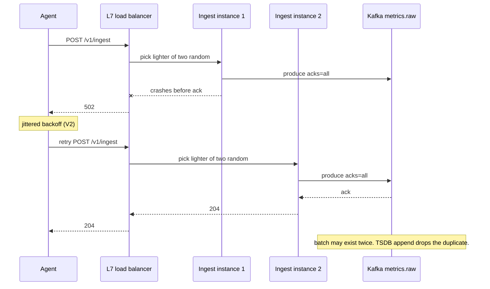

### Rolling deploy (new flow)

1. The orchestrator starts a new pod. It is not ready until the Kafka producer has started.
2. After two passing health checks, the balancer adds it.
3. The orchestrator sends `SIGTERM` to an old pod. It sets `draining`, so readiness fails.
4. The balancer stops sending it new requests within about 4s. The 10s `preStop` sleep covers that gap.
5. In-flight requests finish within the 45s grace period.
6. At most 25% of pods are down at once, so the 20s total outage never happens.

### Query request path

Unchanged from V5 except for the balancer. The Query LB picks an instance by the same policy, and the instance runs V5's plan, fan-out, hedge and merge. A new instance loads the shard map from etcd and opens its watch before it reports ready.

## Current State After V6

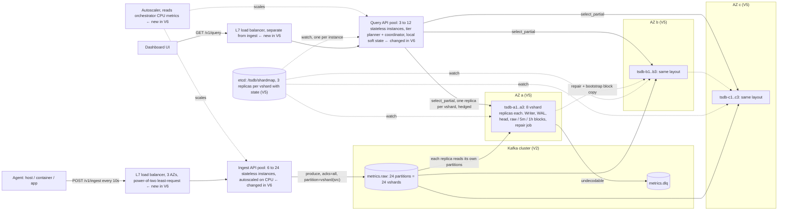

**Every current flow:**

*Write path (front door changed, rest unchanged)*
1. The agent samples every 10s and POSTs to the load balancer, with jittered retry.
2. The balancer picks one of two random ready instances, the one with fewer requests in flight.
3. The Ingest instance validates, produces to `metrics.raw` at partition `vshard(src_id)` with `acks=all`, and returns `204`.
4. Each of the 3 replicas of that vshard reads the partition independently, applies the series cap, appends to WAL and head, syncs the WAL and commits its own offset. Duplicates from cross-instance retries are dropped by the idempotent append.

*Read path (front door changed, rest unchanged)*
1. The UI calls `GET /v1/query` on the Query load balancer.
2. The balancer picks a Query instance by the same policy.
3. The instance plans the tier, picks one ready replica per vshard (own zone first), hedges slow nodes, and gets partials plus watermarks.
4. It merges, clips to the lowest watermark and returns points plus a `partial` flag.

*Autoscaling (new)*
1. The autoscaler reads CPU every 15s and aims for 50%. It can double the pool every 30s, and removes one pod every 2 minutes after a 10-minute calm.

*Rolling deploy and instance failure (new)*
1. New pods join after readiness. Old pods drain on `SIGTERM`. At most 25% are down at once.
2. A failed instance is removed after 2 failed checks or ejected after 5 consecutive `5xx`.

*Flush, rollup and retention: unchanged from V3 and V5.*

*Repair and replica bootstrap: unchanged from V5.*

*Vshard move: unchanged from V4 and V5.*

*TSDB node restart: unchanged from V5.*

## Interview Follow-ups

**Q: Why L7 and not L4?**
Agents hold one connection open for many pushes. An L4 balancer pins that connection to one instance. New instances stay idle after a scale-out. L7 balances every request, and it can read health and fail fast. The cost is a little more CPU at the balancer. For 11,500 requests per second, that is trivial.

**Q: Autoscaling takes about 2 minutes. What protects you in the meantime?**
Four things, in layers. We run at a 50% CPU target, so there is 2x headroom before the autoscaler even moves. Rolling deploys never take down more than 25%. Agents retry with full jitter, so retries are spread out. And behind the door, Kafka and the TSDB were already sized for burst. Autoscaling handles the sustained change. Headroom handles the first 2 minutes.

## Recap

| Concept | The Insight |
|---|---|
| Local state audit | Before scaling out, list what each instance holds in RAM. Here it is all derived or safely retried. |
| Single instance | A 20s deploy turned into a 4-minute retry storm at 213% of capacity, even though everything behind it was under 60% busy. |
| L7, per request | Agents reuse connections, so only per-request balancing sends new work to new instances. |
| Power of two choices | Pushes cost 100x apart, so pick the lighter of two random instances. It is cheap and avoids herding. |
| Headroom and rolling deploys | Autoscaling lags, so size for 2x burst and never remove more than 25% at once. |
| Separate pools | Ingest and query have their own instances and balancers, so a dashboard storm cannot starve ingestion. |

**Interview arc:** *"A single front-door instance, even a 16-core one, turns a 20-second deploy into a retry storm at 213% of capacity because agents' retries stack on live traffic, so we make every instance stateless, put them behind an L7 power-of-two least-request balancer across three zones, autoscale at a 50% CPU target for headroom, roll deploys 25% at a time with readiness draining, and let the TSDB's idempotent append absorb the duplicates that cross-instance retries create."*

**Next:** 600 engineers refresh the same 10 checkout panels every 10 seconds. That is 600 queries per second, and about 99% of them ask a question someone asked 3 seconds ago. Each one still fans out to 6 shards. We stop recomputing identical answers. Say "next" when ready.


-----------------------------------------------------------------------------------------------------------------------
-----------------------------------------------------------------------------------------------------------------------
-----------------------------------------------------------------------------------------------------------------------
-----------------------------------------------------------------------------------------------------------------------


## V7: Cache Query Results

V7 has one job: stop recomputing the same dashboard answer hundreds of times. Multi-region stays deferred.

## Break It

Black Friday, 11:40am. Checkout error rate spikes.

400 engineers open the `checkout-overview` dashboard. It has 12 panels, and each panel refreshes every 10s.

- That is 400 × 12 ÷ 10 = **480 queries per second**.
- Only **12 distinct questions** are being asked. Each one repeats about 40 times per refresh.
- Ten panels are short views (last hour). They are cheap.
- Two panels are 30-day views of service-wide CPU. The Query API picks the 5m tier (V3). That reads 2,000 series × 8,640 buckets × 2 values, about **35M values**, or roughly 0.7 CPU-seconds per query.
- 80 heavy queries per second × 0.7 = **56 cores** of decode work, plus about 4 cores for the light panels.

That work lands on the 9 TSDB nodes. They have 16 cores each, 144 in total. Ingest already uses about 55% on Black Friday (V5). Query work adds about 6.7 cores per node on top of about 8.8 for ingest, so the nodes are at **97%**.

Two things break:
1. Query p99 goes from 1.2s to **14s**. The UI times out at 10s and retries, which adds load.
2. The Writers share those cores. Ingest lag climbs from 2s to about **40s** on the busiest shards.

So at the moment everyone is staring at the dashboard, it is 40 seconds stale. And the dashboard is what caused it.

The system also **re-derives answers that cannot change**. Last Tuesday's CPU is a sealed rollup block (V3, V5). We recompute it from disk 80 times a second.

This is the crux, so let's walk the naive fixes.

### Attempt 1: Scale out

Meera: "Autoscale the Query API. Add 12 more pods."

Arjun: "The Query API isn't the bottleneck. More pods means more identical fan-outs into the same 9 nodes."

It looked reasonable because scaling out fixed the front door in V6. It breaks because the cost is in the TSDB. Adding TSDB nodes means buying 3 replicas of every shard (V5). We would be paying for more hardware to answer the same question 40 times.

### Attempt 2: Browser and CDN caching (`Cache-Control: max-age=10`)

It looked reasonable because HTTP caching is free and built in. It breaks in two ways:
- Each browser keeps its own copy. 400 tabs still send 400 requests.
- The tab refreshes every 10s, so the cache expires exactly when the next request fires.

### Attempt 3: Redis keyed on the full request URL, TTL 10s

Meera: "Cache the whole response in Redis. The key is the URL."

Arjun: "Look at the URL. The UI sets `end` to now. Priya's tab says `end=1763436000`, Karan's says `end=1763436003`."

Meera: "So every key is different."

Arjun: "Hit rate is zero, and we have added a Redis hop."

It looked reasonable because it is the textbook cache. It breaks because the key contains a clock. The 40 viewers ask the same question, but the keys never match. Even with a match, a 10s TTL would recompute all 30 days every 10 seconds.

### The real fix: three observations

Think of a newspaper. Back issues are printed once and stacked. Only today's page is re-set during the day.

**Observation 1: make identical questions look identical.** Align the time range to bucket boundaries. Then 400 viewers with different clocks produce the same key.

**Observation 2: closed history never changes.** A sealed block is final (V3, V5). Cache it for hours with no invalidation logic at all.

**Observation 3: only the newest edge moves.** A 30-day panel changes only in its last few hours. Recompute that slice. Fetch the other 29 days from the cache.

### Where to cache?

| Layer | Decision | Why |
|---|---|---|
| Browser | No | Per-viewer copy. It cannot share work across users. |
| CDN | **No** | About 600 internal engineers, not millions. The URL contains a moving `end`. Responses are authenticated. A CDN adds auth and purge complexity for near-zero hits. |
| **App layer (shared Redis)** | **Yes** | One copy serves every Query API instance. |
| TSDB | No | Blocks already sit in the OS page cache. The cost is decode and merge, not disk. |

### Options compared

| Option | Hit rate for 40 identical viewers | Freshness | Complexity |
|---|---|---|---|
| Scale out Query API / TSDB | n/a (no reuse) | Fresh | Low, but pays for duplicates |
| Browser / CDN cache | About 0% | n/a | Low |
| Redis, raw URL key, short TTL | About 0% | Within 10s | Low |
| Redis, aligned segments, sealed forever | About 99% | Head within 5s | Medium |
| Recording rules (precompute per panel) | High, but only for known panels | Fresh | High, always-on cost |

## Solve It

**New storage class justification:** an in-memory key-value cache. Access is by exact key. Values are small blobs (a few KB). We need TTL expiry, LRU eviction and sub-millisecond reads. That does not match etcd (small, strongly consistent config) or the TSDB.

- ✅ **What we gained**
  - About 99% of dashboard queries are served from Redis. TSDB query load drops from about 60 cores to well under 1.
  - A 30-day refresh recomputes about 6 hours, not 30 days.
  - Ingest lag goes back to about 2s on Black Friday, because the cores return to the Writers.
  - Closed segments need no invalidation, because sealed blocks are immutable.
- ⚠️ **What we gave up / new problems**
  - **Staleness.** The newest segment can be up to about 5s old, plus up to 10s more if served stale while refreshing. Plus consumer lag.
  - **Cache correctness is now a risk.** Caching one incomplete answer would show wrong data for hours. We never cache `partial: true` results.
  - A new dependency and a new failure mode. If Redis fails, 480 queries per second hit the TSDB again.
  - Ad hoc exploratory queries have unique selectors. They never hit, and they pay one extra Redis round trip.
  - Query CPU still shares cores with ingest on the TSDB nodes. Isolating them (cgroup limits) is a separate hardening step.
- ❌ **What we considered and rejected**
  - Browser and CDN caching, as above.
  - Caching the whole response by URL, as above.
  - Recording rules: precomputing the panels. It moves cost to an always-on write path, and it only covers panels we know about. It will matter for alert evaluation later.
  - An in-process LRU per Query instance: with 3 to 12 cold copies, hit rate is far lower. Not shared.
  - Caching inside the TSDB: it does not remove the fan-out or the merge.

### Cache stampede: the known sub-problem

When a hot key is missing, 400 viewers all miss at once and all compute. These are the real fixes.

**Fix 1: single-flight inside each instance.** One computation per key per process. Everyone else awaits it.

```python
inflight: dict[str, asyncio.Future] = {}

async def single_flight(key, compute):
    if key in inflight:
        return await inflight[key]
    fut = asyncio.get_running_loop().create_future()
    inflight[key] = fut
    try:
        v = await compute(); fut.set_result(v); return v
    except Exception as e:
        fut.set_exception(e); raise
    finally:
        inflight.pop(key, None)
```

**Fix 2: Redis lease across instances.** One winner computes. The rest poll briefly.

```python
async def with_lease(key, compute, ttl):
    if await redis.set(key + ":lock", NODE_ID, nx=True, px=3000):
        v = await compute()
        await redis.set(key, encode(v), ex=ttl)
        await redis.delete(key + ":lock")
        return v
    for _ in range(10):                       # wait up to about 500 ms
        await asyncio.sleep(0.05)
        if (raw := await redis.get(key)): return decode(raw)
    return await compute()                    # winner was slow or died
```

**Fix 3: stale-while-revalidate.** Serve the old value while one worker refreshes it.

```python
# value stored with soft_exp = now + 5s; Redis TTL = soft + 10s
entry = await redis.get(key)
if entry and now() < entry.soft_exp:
    return entry.v                             # fresh
if entry:                                      # soft-expired but still stored
    if await redis.set(key + ":lock", NODE_ID, nx=True, px=3000):
        asyncio.create_task(refresh(key))      # one refresher
    return entry.v                             # serve stale, no waiting
```

**Which fits here:**
- **Closed segments:** they miss only on first population. Single-flight plus the lease is enough. Nobody waits long, and it happens once per segment.
- **The open head segment:** it expires every 5s, so waiting is not acceptable. Stale-while-revalidate keeps latency flat, and viewers see data at most 15s old.

## Implement It

### Cache key and value (first appearance)

```
q:v1:{tier}:{qhash}:{group}:{segment_start}
q:v1:5m:9c1f2ab7:-:1763424000
```

- `v1` is a version prefix. Bumping it to `v2` invalidates everything at once.
- `qhash` is a hash of the sorted matchers (`__name__="cpu.usage"`, `service="checkout"`). It includes no time.
- `group` is the `by` clause, or `-`.
- The key does **not** include `step` or the aggregation. Segments are stored at the tier's own resolution, and `avg`, `min` and `max` all come from the same four numbers (V3).

```json
{ "v": 1, "res": 300, "seg_start": 1763424000,
  "groups": { "": { "count": [30,30,...72 items], "sum": [18.9, ...],
                    "min": [0.41, ...], "max": [0.97, ...] } } }
```

**Segment lengths per tier:**

| Tier | Segment | Buckets per segment | Sealed TTL |
|---|---|---|---|
| raw (10s) | 1 hour | 360 | 6 hours |
| 5m | 6 hours | 72 | 24 hours |
| 1h | 7 days | 168 | 7 days |

A service-wide 6-hour segment is about 2.3 KB. A 30-day panel is 120 segments, about 280 KB in one `MGET`.

**Protocol delta (TSDB to Query API):** `select_partial` now returns, per tier, `sealed_until`: the end time of the newest sealed block on that vshard. The coordinator takes the minimum across the vshards it asked. It is the "is this segment closed?" signal.

### Who writes / who reads

| Structure | Who writes, and when | Who reads, and when | Lives in |
|---|---|---|---|
| Result segments `q:v1:...` | Query API coordinator, after a fan-out fills a missing segment | Query API coordinator, on every query (`MGET`) | Redis, 1 primary + 1 replica across 2 AZs |
| Lease keys `...:lock` | The coordinator that wins `SET NX PX 3000` | Other coordinators waiting on that key | Redis |
| In-flight map | The coordinator, per key being computed | Same instance's other requests | Process RAM |
| `sealed_until` per tier | Each TSDB node, in every partial response | Query API coordinator, per fan-out | Response payload (derived from block manifests) |

**Sizing:** the working set is about 5,000 active panel queries × about 100 KB, so roughly **1 GB**. Redis runs with 4 GB:

```
maxmemory 4gb
maxmemory-policy allkeys-lru
```

### Read path (changed, in the Query API coordinator)

**API call (unchanged):**

```http
GET /v1/query?name=cpu.usage&label=service:checkout&start=1760844000&end=1763436000&step=3600&agg=avg
```

1. Plan the tier (V3). Round `step` up to a multiple of the tier resolution.
2. Build the key parts. `qhash` is a hash of the sorted matchers.
3. Cut the range into aligned segments:

```python
SEG = {"raw": 3600, "5m": 21600, "1h": 604800}
starts = range((req.start // SEG[tier]) * SEG[tier], req.end, SEG[tier])
keys = [f"q:v1:{tier}:{qhash}:{req.group_by or '-'}:{s}" for s in starts]
```

4. Fetch every segment in one round trip: `cached = await redis.mget(keys)`. A Redis timeout over 20ms is treated as a miss, not an error.
5. **Branch: hit or miss.**
   - Hit on every segment: skip to step 8. No fan-out happens.
   - Miss: gather the missing segments into contiguous runs. Use single-flight, plus the Redis lease for cold sealed segments.
6. For each run, one fan-out (V5: one replica per vshard, hedged):

```python
partials = await fanout(req, tier, run.start, run.end)   # asks for res = tier resolution
merged, sealed_until, partial = merge(partials)
```

7. **Branch: store or skip.**

```python
for seg in split(merged, run, SEG[tier]):
    if partial or size(seg) > 256_000:
        continue                                  # never cache incomplete or huge results
    sealed = seg.end <= sealed_until[tier]
    ttl = TTL_SEALED[tier] if sealed else 5 + 10  # head: 5s soft + 10s stale window
    await redis.set(seg.key, encode(seg), ex=ttl)
```

8. Stitch all segments in time order, clip to the lowest watermark (V5), and re-bucket to the requested step by merging `count` and `sum` and taking min of `min` and max of `max` (V3). Then compute `avg = sum / count` and return.

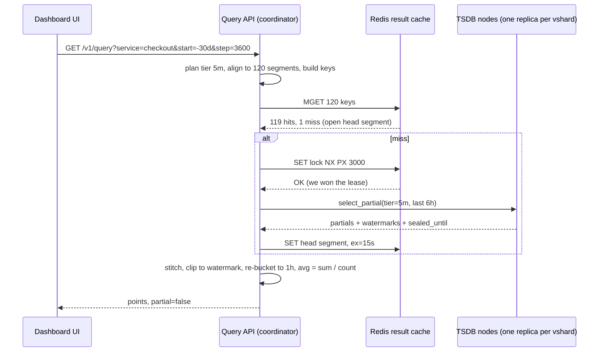

### Invalidation (explicit)

- **Closed segments:** no invalidation. They are immutable, and replicas produce identical sealed blocks (V5), so any replica gives the same answer.
- **Head segment:** expires by TTL after 5s, with a 10s stale window.
- **Emergency:** bump the key prefix `v1` to `v2` in config. Old entries age out through LRU.
- **Retention:** every TTL is shorter than its tier's retention, so we never serve data the TSDB has already deleted.

### Redis failure

The cache is an optimization, not a dependency. On error or a 20ms timeout, the coordinator computes directly. Single-flight still collapses the 40 duplicates per instance, and a concurrency cap on fan-outs protects the TSDB nodes.

## Current State After V7

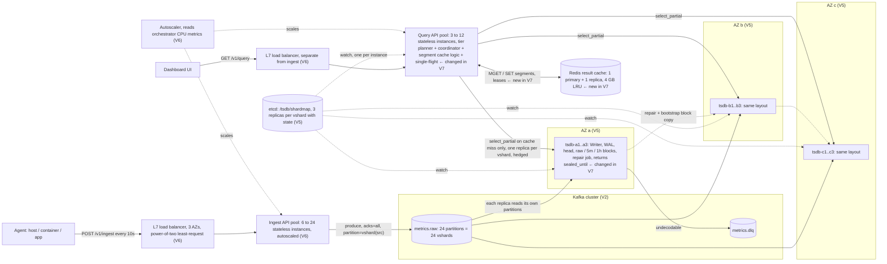

**Every current flow:**

*Write path (unchanged from V6)*
1. The agent samples every 10s and POSTs to the load balancer, with jittered retry.
2. The balancer picks the lighter of two random ready Ingest instances.
3. The instance validates, produces to `metrics.raw` at partition `vshard(src_id)` with `acks=all`, and returns `204`.
4. Each of the 3 replicas of that vshard reads the partition, applies the series cap, appends to WAL and head, syncs the WAL and commits its own offset. Duplicates are dropped by the idempotent append.

*Read path (changed)*
1. The UI calls `GET /v1/query`. The Query load balancer picks an instance.
2. The instance plans the tier, rounds the step to the tier resolution, and cuts the range into aligned segments.
3. It reads all segment keys from Redis with one `MGET`.
4. For missing segments, it takes the lease, fans out to one replica per vshard (hedged), merges the partials, and stores each complete segment. Sealed segments get a long TTL. The head gets 5s plus a 10s stale window. Partial results are never stored.
5. It stitches the segments, clips to the lowest watermark, re-buckets to the step, computes `avg = sum / count`, and returns points plus a `partial` flag.

*Flush, rollup, retention, repair, bootstrap, vshard move and TSDB restart: unchanged from V3 to V5.*

*Autoscaling, rolling deploys and instance failure: unchanged from V6.*

*Redis failure (new)*
1. Reads time out at 20ms and are treated as misses. The coordinator computes directly with single-flight and a concurrency cap.

## Interview Follow-ups

**Q: Why cache segments instead of whole responses?**
Because whole responses are keyed by a moving clock and differ by step and aggregation. Segments are aligned to fixed boundaries and stored at the tier resolution, so different viewers, steps and aggregates reuse the same entries. Sealed segments never change, so a 30-day panel recomputes only its newest few hours.

**Q: What if the cache serves a wrong answer?**
We take three precautions:
- We never store `partial: true` results.
- We only give a long TTL when `seg.end <= sealed_until`.
- The key carries a version prefix, so a bad write can be wiped by bumping it.

The leftover risk is a bug in stitching or splitting. We cover it with tests that compare cached and uncached answers on the same range.

## Recap

| Concept | The Insight |
|---|---|
| Identical questions | A clock in the key means zero hits. Align time to bucket boundaries and the 40 viewers share one answer. |
| Sealed means immutable | Closed segments need no invalidation, only a TTL to bound memory. |
| Only the edge moves | A 30-day refresh recomputes about 6 hours, not 30 days. |
| Cache partials, not answers | Storing `count`, `sum`, `min`, `max` at tier resolution lets any step and aggregate reuse the same entry. |
| Stampede | Single-flight and a lease for cold segments. Stale-while-revalidate for the head. |
| Trade | We accept up to about 15s of head staleness and a new dependency, and we cut query CPU on the TSDB from about 60 cores to under 1. |

**Interview arc:** *"Four hundred people refreshing the same dashboard turned 12 distinct questions into 480 queries per second, and a 14-second p99 plus 40 seconds of ingest lag because their cores are shared, and caching the whole response by URL fails because the URL contains the clock, so we align time to segment boundaries, store sealed segments of count, sum, min and max in Redis with no invalidation, recompute only the head, and use single-flight, a lease and stale-while-revalidate to stop stampedes."*

**Next:** at 2:40am the whole region loses power. Every AZ goes dark together, and the platform that would tell you the region is down is down with it. We take the platform across regions. Say "next" when ready.


-----------------------------------------------------------------------------------------------------------------------
-----------------------------------------------------------------------------------------------------------------------
-----------------------------------------------------------------------------------------------------------------------
-----------------------------------------------------------------------------------------------------------------------


## V8: Regional Cells and Federated Query

V8 has one job: make a failure in one region hide only that region. Backup of old data and host-health detection stay deferred.

Multi-region means running the platform in more than one data-center region, so one region's failure is not everyone's failure. The hard part is deciding who owns each write and how to answer questions that span regions.

## Break It

Sunday, 2:40am. A network failure takes out all three AZs of ap-south-1 (Mumbai) for 3 hours.

The whole platform lives there. Ingest, Kafka, the TSDB nodes, etcd, Redis and the Query API are all dark.

The monitored fleet is spread across three regions, about a third each. The 37,000 sources in eu-west-1 and us-east-1 are healthy and serving customers. Their agents push to Mumbai, about 130-190ms away. Now every push fails.

- Agents hold only a 60s ring buffer (V2).
- Samples lost: about 370K per second × 10,800s ≈ **4 billion samples**, gone for good.
- Aoife is on call in Dublin. At 3:10am an eu-west-1 database starts failing. She opens the dashboard and every chart is blank.

A failure in 1/3 of the fleet blinded 100% of it. The tool that should explain the incident is the thing that is down.

This is the crux, so let's walk the naive fixes.

### Attempt 1: Standby region with replicated Kafka

Meera: "Keep Mumbai primary. Mirror Kafka to Frankfurt, and flip DNS if Mumbai dies."

Arjun: "At 2:40am who decides Mumbai is dead, and not just unreachable from us? If we guess wrong, both regions think they are primary."

It looked reasonable because it is the textbook disaster-recovery answer. It breaks in four ways:
- Mirroring lags by seconds, so some data is always lost.
- The standby is idle hardware we pay for all year.
- Promotion is a human decision, so the blind window is minutes to hours.
- Two-thirds of the fleet still ships every push across an ocean.

### Attempt 2: Active-active, replicate everything everywhere

It looked reasonable because any region could then answer any query on its own. It breaks in two ways:
- Every sample crosses two oceans, and storage triples in each region.
- If an agent ever fails over, the same series has samples in two regions. A `sum` across regions then double-counts unless we build dedup and conflict rules.

### Attempt 3: One Kafka cluster stretched across regions

It looked reasonable because there is one logical log and no replication tool. It breaks in two ways:
- `min.insync.replicas=2` forces every ack to wait for another region, about 150ms. That undoes V2's cheap `204`.
- In a WAN partition, the minority side cannot ack, so it goes blind. Same failure, new cause.

### The real fix: three observations

Think of a retail chain. Each store keeps its own ledger. Head office does not hold a copy of every receipt. To get total sales, it asks each store for its totals and adds them. If one store burns down, head office knows exactly which store is missing from the sum.

**Observation 1: every series has exactly one writer.** A metric is produced by one process on one host in one region. If we make that structural, two regions never write the same series. There are no conflicts to resolve, because none can occur.

**Observation 2: we already have mergeable partials.** V3 built `count`, `sum`, `min` and `max`, and V4 and V5 merge them across shards. Merging across regions is the same operation. After aggregation, a result is about 30 KB, so we can move the question to the data.

**Observation 3: monitor a region from inside it.** When a region goes dark, the workloads in it usually go dark too. The case that hurts is a monitoring failure that hides a healthy region. So each region should be able to see itself with no help from the others.

So we build **cells**: each region runs the full V2-V7 stack by itself. A thin global layer fans a query out to all cells and merges the partials.

### Options compared

| Option | Blast radius of a region failure | Data loss | Cross-region traffic | Conflict risk | Cost |
|---|---|---|---|---|---|
| Single region (V7) | Everything | Agents' 60s buffer | Agents push across oceans | None | 1x |
| Active-passive standby | Passive takes over after a human decision | Seconds of lag | All data, constantly | Split brain on a wrong promotion | About 2x, half idle |
| Active-active full replication | Other regions unaffected | Seconds of lag | All data to all regions | Double counting on failover | About 3x storage |
| Stretched Kafka | Minority side blind in a partition | None | Every write waits on the WAN | Low | 1x plus WAN latency |
| **Cells + federated query** | **Only the failed region's data is missing** | **Local, same as V5** | **About 30 KB per query per cell** | **None by construction** | **1x data, 3x control plane** |

## Solve It

**Decision: write ownership belongs to the region where the source runs.** That is its home cell. The Ingest API stamps every series with a `cell` label, so a series is born in one cell and stays there. Reads federate: ask every cell, merge the partials, and say which cells were missing.

- ✅ **What we gained**
  - A regional failure hides only that region's data. The other two cells keep ingesting and serving.
  - The write path never crosses an ocean, so the `204` stays fast.
  - No cross-region replication, no conflict resolution, no global consensus store.
  - The WAN carries only aggregated partials, at most about 30 KB per cell per query.
  - V3 mergeable partials, V5 watermark clipping, and V7 "never cache partials" all carry over unchanged.
- ⚠️ **What we gave up / new problems**
  - There is no second copy of a cell's data. While a cell is down, its metrics are unavailable.
  - A cross-region chart can silently undercount when a cell is missing. So every response carries `partial` and `missing_cells`, and the UI shows a banner.
  - Global latency is the slowest cell: WAN RTT plus cell time, capped by a 2s timeout.
  - The global chart's right edge is the lowest watermark among reachable cells. A lagging cell holds the whole view back.
  - Ratios like error rate must be computed after merging `sum` across cells. This is V3's "never average averages" at a bigger scale.
  - We now run three of everything (Kafka, etcd, Redis, balancers). Config drift between cells is a real risk, so it all comes from infrastructure-as-code.
  - A region that is destroyed, not just dark, loses its history. Backup is deferred.
- ❌ **What we considered and rejected**
  - Active-passive, full active-active and stretched Kafka: covered above.
  - Failing agents over to another cell: it splits one series' history across cells, and workloads in a dark region are usually dark too. An agent keeps its home cell.
  - A global etcd shard map: a global consensus store is itself a cross-region dependency.
  - A global Redis cache: a WAN round trip on every cache hit.

## Implement It

### Cell sizing

Each cell is the V5 design at a third of the size. It has 3 TSDB nodes, one per AZ, and each node holds a replica of all 24 vshards. At Black Friday, a cell takes about 383K samples per second, so each node runs at about 55%, the same as V5. Ingest scales 3 to 8 pods per cell, and query scales 3 to 6.

### Config store: `cells.yaml` (new, first appearance)

```yaml
version: 3
cells:
  - {id: ap-south-1, query: https://query.internal.ap-south-1.metrics.example.com}
  - {id: eu-west-1,  query: https://query.internal.eu-west-1.metrics.example.com}
  - {id: us-east-1,  query: https://query.internal.us-east-1.metrics.example.com}
```

It is a plain file in the config repo, rolled out to every region by the same pipeline. It is not etcd. We avoid a global strongly consistent store on purpose.

### Label delta

```json
{ "series_id": 12,
  "labels": {"__name__":"cpu.usage","host":"web-01","src":"web-01","cell":"eu-west-1"} }
```

`cell` is a second reserved label, next to `src` from V4. The series ID is `hash64(name + sorted_labels)` (V5), so `cell` is part of the identity. Two cells can never produce the same series.

### Who writes / who reads

| Structure | Who writes, and when | Who reads, and when | Lives in |
|---|---|---|---|
| `cells.yaml` | Platform team via the config pipeline, when a cell is added or retired | Query API global mode (hot reload), agent rollout tooling | Config repo, mounted as a ConfigMap in every cell |
| `cell` label | Ingest API, on every sample | TSDB postings and Query API matchers, like any label | Inside every series' label set |
| Per-cell health and breaker state | The Query API instance, from its own call outcomes | The same instance's `global_query` | Process RAM (soft state, like V5) |
| DNS records and health checks | Platform team via IaC. The health check polls each region's Query LB `/healthz/ready` every 10s | Users' resolvers | Managed DNS |
| Kafka, etcd, TSDB, Redis, autoscaler | As in V2 to V7, within each cell only | Within each cell only | Each cell |

### Write path (two small changes)

**API call (agent in Dublin):**

```http
POST https://ingest.eu-west-1.metrics.example.com/v1/ingest
{"source_id":"web-01","samples":[{"name":"cpu.usage","labels":{"host":"web-01"},"ts":1763436000,"value":0.62}]}
```

1. **Agent config change.** The agent's `ingest_url` is set at deploy time to its own region's endpoint. We do not use geo-DNS, because a client's location must never decide which cell owns its series.
2. **Ingest API change.** It overwrites the `cell` label on every sample. An agent cannot send a wrong or forged one.

```python
CELL_ID = os.environ["CELL_ID"]          # "eu-west-1"
for s in batch.samples:
    s.labels["cell"] = CELL_ID           # overwrite anything the agent sent
```

3. The rest is unchanged from V6, inside the cell: balancer, Kafka produce with `acks=all` at partition `vshard(src)`, the replicas' Writers, and idempotent append.
4. **Branch: the home cell is unhealthy.** Agents back off with jitter and keep the 60s ring buffer (V2). That is the same accepted loss window as a Kafka outage.

### Cell query endpoint (new, internal)

Each cell's Query API gains one endpoint. It runs the whole V7 path inside the cell: segments from Redis, fan-out on a miss, hedging, watermarks. Then it re-buckets to the requested step and returns partials.

```http
POST /internal/cell/query        (mTLS, internal CA)
{"matchers":[{"name":"__name__","op":"=","value":"cpu.usage"},
             {"name":"service","op":"=","value":"checkout"}],
 "start":1760844000,"end":1763436000,"step":3600,"by":[]}

→ {"cell":"eu-west-1","tier":"5m","partial":false,"watermark":1763435998,
   "groups":{"":{"t0":1760844000,"step":3600,
                 "count":[...],"sum":[...],"min":[...],"max":[...]}}}
```

Every cell runs the same tier planner and retention, so tiers always agree. A response is at most about 1,000 points × 4 arrays. We cap it at 1,000 groups per cell.

### Global read path (changed, a mode of the Query API)

**API call (unchanged for the UI):**

```http
GET /v1/query?name=cpu.usage&label=service:checkout&start=-30d&step=3600&agg=avg
```

1. Users reach the nearest healthy region through latency-based DNS. If a region's Query LB fails 3 checks, which is about 30s, DNS stops returning it. With a 30s TTL, users move within about a minute.
2. The Query API instance reads `cells.yaml`. If the query has a `cell=` matcher, it asks only that cell. This mirrors the `src` routing from V4.
3. It asks all selected cells in parallel:

```python
async def global_query(req):
    cells = cells_cfg.active()
    if (c := req.matchers.get_eq("cell")):
        cells = [x for x in cells if x.id == c]

    async def ask(cell):
        if cell.id == MY_CELL:
            return await cell_query(req)                 # in-process, no WAN
        if not breaker.allows(cell.id):
            raise CellOpen(cell.id)
        return await http_post(cell.query + "/internal/cell/query", req, timeout=2.0)

    results = await asyncio.gather(*[ask(c) for c in cells], return_exceptions=True)
    ok      = [r for r in results if not isinstance(r, Exception)]
    missing = [c.id for c, r in zip(cells, results) if isinstance(r, Exception)]
    if not ok:
        raise HTTPException(503)

    merged   = merge_groups(ok)            # count, sum add. min, max merge. Same as V4.
    safe_end = min(r["watermark"] for r in ok)       # V5 rule, now across cells
    return {"points": finalize(merged, req.agg, safe_end),
            "partial": bool(missing) or any(r["partial"] for r in ok),
            "missing_cells": missing}
```

4. **Branch: cell is local.** An in-process call with no WAN hop.
5. **Branch: remote cell is slow or down.** It times out at 2s and lands in `missing`. After 3 failures the breaker (V5) opens for 30s.
6. **Branch: all cells fail.** The instance returns `503`.
7. Single-flight (V7) wraps `global_query`, so 40 identical viewers cost one cross-region fan-out per instance.
8. Merged global results are not cached, because the merge of three small partials is cheap. Each cell still caches its own segments in its own Redis (V7), and a partial result is never stored.

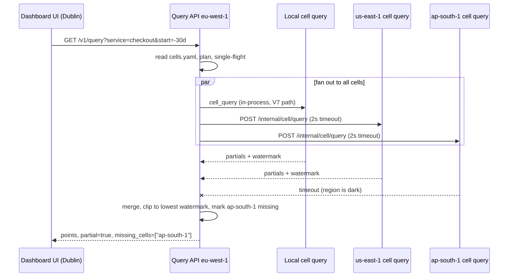

## Current State After V8

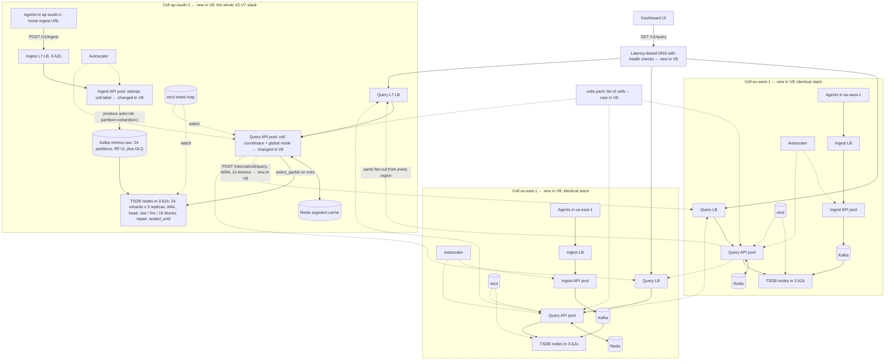

**Every current flow:**

*Write path (changed at the edges only)*
1. The agent samples every 10s and POSTs to its home cell's ingest URL, with jittered retry.
2. The cell's balancer picks the lighter of two random ready Ingest instances.
3. The Ingest instance validates and overwrites the `cell` label. It produces to the cell's `metrics.raw` at partition `vshard(src_id)` with `acks=all`, then returns `204`.
4. Each of the 3 replicas of that vshard reads the partition, applies the series cap, appends to its WAL and head, syncs, and commits its own offset. Duplicates are dropped by idempotent append.

*Cell-local read path (the V7 path, now an internal endpoint)*
1. The cell coordinator plans the tier, cuts the range into aligned segments, and reads them from the cell's Redis with one `MGET`.
2. On a miss, it takes the lease and fans out to one replica per vshard (hedged, one per AZ). It stores complete segments only. It never stores partial results.
3. It stitches, clips to the lowest watermark, re-buckets to the step, and returns `count`, `sum`, `min`, `max`.

*Global read path (new)*
1. DNS sends the user to the nearest healthy region. A Query API instance reads `cells.yaml`.
2. It asks every selected cell in parallel: its own in-process, the others over the WAN with a 2s timeout.
3. It merges the partials, clips to the lowest reachable watermark, and returns points with `partial` and `missing_cells`.

*Flush, rollup and retention (unchanged from V3 and V5, per cell)*
1. Each replica cuts a 2h block, builds 5m and 1h rollups, and deletes by tier retention.

*Repair, bootstrap, vshard move, node restart (unchanged from V4 and V5, inside each cell)*

*Autoscaling, rolling deploys, instance failure (unchanged from V6, per cell)*

*Region failure (new)*
1. The dark region's Query LB fails DNS health checks. Users are routed to another region in about a minute.
2. Other cells keep ingesting and serving. Global queries return `partial: true` with the dark region listed in `missing_cells`.
3. When the region returns, its TSDB nodes replay their WALs and rejoin the fan-out when the breaker closes.

## Interview Follow-ups

**Q: Why not replicate data across regions so each region can answer alone?**
It would triple storage and ship every sample over the WAN. Replicas would lag, so two regions could give different answers. A failed-over agent could also put the same series in two places and double-count it. Metrics have a natural single writer and tiny aggregated results, so moving the question to the data is cheaper and safer than moving the data to the question.

**Q: What if a region is lost permanently, not just dark?**
Its history is gone today. A dark region comes back with its disks, but a destroyed one does not. The fix is a different mechanism: asynchronously copy sealed 5m and 1h blocks to a buddy region's object store, for restore only. Block IDs and hashes are already deterministic (V5), so those copies are idempotent. That is backup, not federation, so it gets its own version if we want it.

## Recap

| Concept | The Insight |
|---|---|
| Failure domain | Monitor a region from inside it, so one region's failure hides only that region. |
| Single writer by construction | A series is born in one cell and stamped with `cell`, so there is nothing to reconcile. |
| Federate, don't replicate | Send the question to the data and get back about 30 KB of mergeable partials. |
| Honest partial results | `missing_cells` plus never caching partials. A silent undercount is worse than an error. |
| Trade | We run three control planes and keep one copy of each cell's data, in exchange for a bounded blast radius. |

**Interview arc:** *"A single-region platform goes blind everywhere when one region fails and loses billions of samples, and replicating data across regions triples cost and risks double counting, so each region runs a self-contained cell that owns its sources' writes under a stamped cell label, and a federated query merges the cells' count, sum, min and max partials, flagging any missing cell instead of hiding it."*

**Next:** web-01 died at 3:12 and its chart just stops. A dead host sends nothing, so no query can say "down". Our P1 health view needs a way to detect silence. Say "next" when ready.


-----------------------------------------------------------------------------------------------------------------------
-----------------------------------------------------------------------------------------------------------------------
-----------------------------------------------------------------------------------------------------------------------
-----------------------------------------------------------------------------------------------------------------------


## V9: Detect Silence and Build the Health View

V9 has one job: answer "which hosts are down right now?" and show a health trend per host and service. Backup of old data and alerting stay deferred. Alerting is P2.

Think of a school roll call. The teacher can't mark a student absent by listening to who speaks. She needs a roster. But the roster can't be a list someone types in by hand, or it goes stale on day one. So we let it build itself from who has spoken. A student who says "I'm leaving" is crossed off. A student who stops answering without saying goodbye is flagged.

## Break It

Tuesday, 3:12am. A bad kernel patch crashes 140 of the 2,000 `checkout` hosts in eu-west-1. That is 7% of the service.

Nothing looks wrong:
- The average CPU line for `checkout` goes from 58% to 62%. The survivors absorb the load. That is inside normal daily variation.
- No chart has a hole. Aggregates average whoever reported.
- Each dead host's own chart just stops. Nobody is looking at it.

At 7:30am, support reports slow checkouts. That is **4 hours 18 minutes** of 7% lost capacity, undetected. Aoife asks one question: "Which checkout hosts are down right now?" Nothing in the platform can answer it.

The reason is simple. A dead host sends nothing, and the TSDB only stores what arrives. Silence is not a row.

This is the crux, so let's walk the naive attempts.

### Attempt 1: Ask the TSDB for series that went quiet

Meera: "List every series seen in the last 24 hours that has no sample in the last 2 minutes."

Arjun: "How many sources go quiet legitimately every day? Containers autoscale. About 30% of our 50,000 turn over daily."

Meera: "That's 15,000 retirees."

Arjun: "Plus your 140 real crashes. Your list has 15,140 rows. 0.9% of them are the problem."

It looked reasonable because the data is already there and the scan is cheap. It breaks because the TSDB can't tell **dead** from **deliberately removed**. Both are silence.

### Attempt 2: Agents announce shutdown

It looked reasonable because a goodbye message cleanly separates retirees from the rest. It breaks on the cases we care about. A kernel panic, an OOM kill and a power loss send nothing. By definition, a crashed host cannot say goodbye. (We will still use the goodbye, but only to clear the retirees.)

### Attempt 3: A registry of expected hosts (CMDB)

It looked reasonable because "expected minus seen" is exactly the right question. It breaks on upkeep. A person maintains the list, and it is wrong the day after a scale-out. At 15,000 containers retiring and appearing per day, no manual list survives. Pulling the list from the orchestrator (Kubernetes, the cloud API) works for those platforms, but it ties us to each one, and it misses bare-metal hosts.

### Options compared

| Option | Finds crashed hosts | Ignores retired containers | Self-maintaining | Verdict |
|---|---|---|---|---|
| Scan TSDB for quiet series | Yes | No (99% noise) | Yes | Rejected |
| Agent goodbye only | No | Yes | Yes | Half the answer |
| Manual CMDB | Yes | Yes | No | Rejected |
| Orchestrator API as the roster | Yes | Yes | Yes | Valid, but one integration per platform |
| **Self-building roster + goodbye + silence timer** | **Yes** | **Yes** | **Yes** | **Chosen** |

## Solve It

The idea has three parts:
1. **Every push is a heartbeat.** A small **Health Tracker** watches the stream and remembers when each source last spoke.
2. **A goodbye clears retirees.** An agent that shuts down gracefully sends `final: true`. Silence **without** a goodbye is the signal.
3. **The verdict becomes a metric.** The tracker writes an `up` series (1 or 0) per source into the normal pipeline. The trend chart then needs no new machinery.

### States

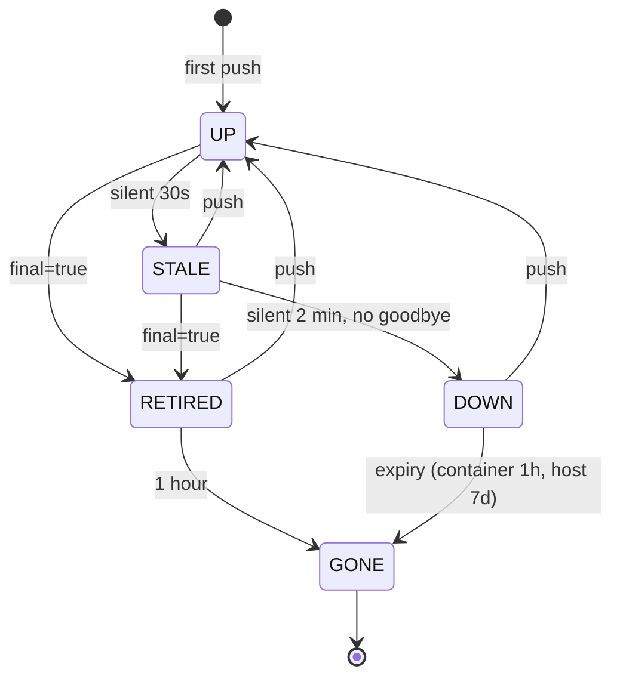

| State | Rule (silence, measured in broker time) | `up` sample | Is it an incident? |
|---|---|---|---|
| UP | Pushed within 30s | 1 | No |
| STALE | Silent 30s to 2 min | 1 (not yet judged) | Watch |
| DOWN | Silent over 2 min, no goodbye | 0 | Yes |
| RETIRED | Sent `final: true` | none | No |
| GONE | DOWN past expiry, or RETIRED past 1h | none (row deleted) | No |
| UNKNOWN | The source's partition is quiet (our pipeline's fault) | none | We don't know |

**Why 30s and 2 minutes?** An agent's retry chain can delay one push by up to about 63 seconds (V2 backoff: 1+2+4+8+16+32). So 30s means "late", not "dead". We only declare DOWN after 2 minutes. Faster detection would flood Aoife with false alarms during every front-door blip.

**The big trap is our own outage.** If Ingest or Kafka breaks, every source goes quiet at once. A naive tracker would mark 38,000 sources DOWN. So the tracker never judges silence by wall-clock time. It judges it against the **newest record on that source's partition**. If the partition itself has gone quiet, that is a pipeline problem, and its sources become UNKNOWN, not DOWN.

- ✅ **What we gained**
  - "Which hosts are down?" is one indexed query, with no noise from retired containers.
  - Health history is just a series: `avg(up)` is the fraction of hosts up, and `min(up)` shows any blip (V3 kept `min` in every bucket).
  - The write path is untouched. The tracker is a separate consumer.
  - Our own failures show as UNKNOWN, never as a false fleet-wide DOWN.
- ⚠️ **What we gave up / new problems**
  - Detection has a floor of about 2 minutes. That is the price of avoiding false alarms.
  - **DOWN means "silent to monitoring", not "proven dead".** A network partition between a host and the cell looks identical. One vantage point can't tell them apart.
  - **A host that never spoke is invisible.** The roster only contains sources that pushed at least once. Catching a host that never started needs an expected-inventory feed. We leave that out.
  - Crashed containers (no goodbye) show as DOWN until expiry. At about 1% ungraceful, that is roughly 150 per day, each visible for 1 hour.
  - The tracker is now critical. If it dies silently, the fleet looks healthy. We cover that with a freshness check below.
  - One new relational store per cell, plus about 1% more ingest (3,800 `up` samples per second against about 383K on Black Friday).
- ❌ **What we considered and rejected**
  - Scanning the TSDB for quiet series: 99% noise.
  - Goodbye-only: misses real crashes.
  - Manual CMDB: stale on arrival.
  - Orchestrator API as the roster: valid, but one integration per platform. It could be added later as a second source of "expected".
  - **Ingest API updating `last_seen` on every push:** it puts a second dependency into the write path that V2 kept Kafka-only. That is 3,800 extra writes per second, and a slow health store would slow ingestion.

## Implement It

### Contract and config changes

**Agent.** On `SIGTERM` it sends one last push (best effort, within its grace period):

```http
POST /v1/ingest
{"source_id":"web-0412","final":true,"samples":[]}
```

The Ingest API passes `final` through into the Kafka record unchanged.

**Kafka topic.** We switch to broker-assigned timestamps. That gives the tracker one clock per partition, and it ignores Ingest clock skew.

```bash
kafka-configs.sh --alter --entity-type topics --entity-name metrics.raw \
  --add-config message.timestamp.type=LogAppendTime
```

A buffered batch an agent replays after an outage still counts as alive, because "alive" means it is pushing now.

### Store (first appearance)

**Storage class justification:** relational. The data is small (about 38K rows per cell), it is filtered by `(service, state)`, and it is written only on state changes. It must also survive tracker restarts. Redis is wrong here: our V7 Redis evicts under LRU, so it can lose a DOWN row.

```sql
CREATE TABLE source_state (
  src          TEXT PRIMARY KEY,
  service      TEXT NOT NULL,
  kind         TEXT NOT NULL,        -- 'host' | 'container'
  vshard       SMALLINT NOT NULL,    -- = Kafka partition
  state        TEXT NOT NULL,        -- up | stale | down | retired
  last_seen    TIMESTAMPTZ NOT NULL, -- written at each transition
  state_since  TIMESTAMPTZ NOT NULL
);
CREATE INDEX ON source_state (service, state);

CREATE TABLE tracker_status (
  instance           TEXT PRIMARY KEY,
  partitions         INT[]       NOT NULL,
  unknown_partitions INT[]       NOT NULL,
  evaluated_at       TIMESTAMPTZ NOT NULL
);
```

### Who writes / who reads

| Structure | Who writes, and when | Who reads, and when | Lives in |
|---|---|---|---|
| `last_seen` map and partition watermarks | Health Tracker, on every record | Same tracker's 10s tick | Tracker RAM |
| `source_state` | Health Tracker (the instance that owns the source's partition), on state transitions only, in batched upserts | Query API on each fleet-view load. Tracker on start or rebalance. | Postgres, Multi-AZ, one per cell |
| `tracker_status` | Each tracker instance, every 10s | Query API on each fleet-view load | Same Postgres |
| `up` series | Health Tracker, every 10s per UP, STALE or DOWN source, produced to `metrics.raw` | Writers (like any sample), Query API (like any metric) | TSDB, all replicas |
| Tracker consumer offsets | Health Tracker | Health Tracker | Kafka, group `health-tracker` |

### Health Tracker (new service)

Three instances per cell. They use a normal Kafka consumer group. Group rebalancing is safe here, unlike the TSDB Writers in V4. The tracker holds no local blocks, and it rebuilds its state on every rebalance.

```python
STALE_AFTER, DOWN_AFTER, QUIET_PARTITION = 30, 120, 15
EXPIRE = {"container": 3600, "host": 7 * 86400}

def on_record(rec):
    if header(rec, "origin") == "health-tracker":      # skip our own up samples
        return
    p = rec.partition
    watermark[p] = max(watermark[p], rec.timestamp)    # broker append time
    env = decode_envelope(rec.value)                   # source_id, final, first sample's labels
    s = registry.get(env.source_id) or new_source(env, vshard=p)
    s.last_seen = rec.timestamp
    if env.final:
        set_state(s, RETIRED)
    elif s.state in (STALE, DOWN, RETIRED):
        set_state(s, UP)

def tick(now):                                          # every 10s
    for p in my_partitions:
        wm = watermark[p]
        if now - wm > QUIET_PARTITION:                  # the partition is quiet: our pipeline
            unknown.add(p); continue                    # is broken, so do not judge its sources
        unknown.discard(p)
        for s in sources_on(p):
            silent = wm - s.last_seen                   # same clock for every source on p
            if s.state == RETIRED:
                if silent > 3600: set_state(s, GONE)
            elif s.state == DOWN and silent > EXPIRE[s.kind]:
                set_state(s, GONE)
            elif s.state in (UP, STALE) and silent > DOWN_AFTER:
                set_state(s, DOWN)
            elif s.state == UP and silent > STALE_AFTER:
                set_state(s, STALE)
            if s.state in (UP, STALE, DOWN):
                emit_up(s, 0 if s.state == DOWN else 1, ts=wm // 10 * 10)
    flush_transitions_to_postgres()                    # batched upserts, DELETE for GONE
    upsert_tracker_status(my_partitions, unknown, now)

def emit_up(s, value, ts):
    producer.send("metrics.raw", key=s.src, partition=s.vshard,
        headers=[("origin", b"health-tracker")],
        value=encode({"source_id": s.src, "samples": [
            {"name": "up", "ts": ts, "value": value,
             "labels": {"src": s.src, "service": s.service, "kind": s.kind, "cell": CELL_ID}}]}))
```

Rounding `ts` to 10s means two trackers briefly emitting the same sample during a rebalance produce the same `(series, ts, value)`. The TSDB's idempotent append (V2) drops the duplicate.

### Detection flow

```mermaid
sequenceDiagram
    participant A as Agent web-0412
    participant I as Ingest API
    participant K as Kafka metrics.raw
    participant H as Health Tracker
    participant P as Postgres source_state
    participant W as TSDB Writers

    A->>I: POST /v1/ingest (every 10s)
    I->>K: produce (key=src, partition=vshard)
    K-->>H: record (key + broker timestamp)
    H->>H: last_seen[web-0412] = T
    Note over A: 3:12:00 kernel panic, no more pushes
    H->>H: tick: silent 30s, state STALE
    H->>P: upsert state=stale
    H->>K: up=1 (header origin=health-tracker)
    H->>H: tick: silent 2 min, no goodbye, state DOWN
    H->>P: upsert state=down, last_seen=3:12:00
    loop every 10s while DOWN
        H->>K: up=0
    end
    K-->>W: up samples, like any metric
```

### Fleet view: read path

**API calls:**

```http
GET /v1/health/summary?service=checkout
→ {"counts":{"up":1860,"stale":0,"down":140,"retired":12,"unknown":0},"health":"ok"}

GET /v1/health/sources?service=checkout&state=down&limit=200
→ [{"src":"web-0412","kind":"host","down_since":"2026-11-17T03:14:00Z","last_seen":"2026-11-17T03:12:00Z"}, ...]
```

1. The cell's Query API reads `tracker_status` and decides which partitions it can trust:

```python
fresh   = [r for r in rows if now - r.evaluated_at <= 30]
covered = set().union(*[set(r.partitions) for r in fresh]) if fresh else set()
unknown = (set(range(24)) - covered).union(*[set(r.unknown_partitions) for r in fresh])
```

Any partition with no fresh tracker or a quiet stream is UNKNOWN. This is the "who watches the watcher" guard: a dead tracker shows as `unknown`, never as healthy.

2. It queries Postgres and relabels untrusted rows:

```sql
SELECT CASE WHEN vshard = ANY($1) THEN 'unknown' ELSE state END AS state,
       count(*)
FROM source_state
WHERE service = $2
GROUP BY 1;
```

3. **Branch: global view.** The coordinator calls each cell's `/internal/cell/health` and adds the counts. It reports `missing_cells` for any cell that times out (V8 rule).

### Trend: read path (unchanged machinery)

```http
GET /v1/query?name=up&label=service:checkout&start=-24h&step=300&agg=avg
GET /v1/query?name=up&label=src:web-0412&start=-30d&step=3600&agg=min
```

This is V3's `sum / count` for the fraction up, and `min` for any outage inside a bucket. Both go through the V7 segment cache and the V4 to V5 fan-out with no change.

```mermaid
sequenceDiagram
    participant U as Dashboard UI
    participant Q as Query API
    participant P as Postgres
    participant R as Redis + TSDB (V7 path)

    U->>Q: GET /v1/health/summary?service=checkout
    Q->>P: SELECT instance, partitions, unknown_partitions, evaluated_at FROM tracker_status
    Q->>P: SELECT state, count(*) ... GROUP BY 1
    P-->>Q: counts
    Q-->>U: counts + health flag
    U->>Q: GET /v1/query?name=up&agg=avg&step=300
    Q->>R: segments (cached) or fan-out on miss
    R-->>Q: count / sum partials
    Q-->>U: trend points
```

### Tracker restart or rebalance (new)

1. Load that instance's partitions' `source_state` rows into RAM, skipping GONE.
2. Seek each partition to now minus 3 minutes (`offsets_for_times`). Three minutes is longer than the 2-minute DOWN rule, so a live source can't look silent just because of the replay window.
3. Replay to the head to rebuild `last_seen`. Don't judge anything during replay.
4. Start ticking. A source that wasn't seen in the replay now ages into STALE or DOWN, which is correct.

## Current State After V9

The cells `eu-west-1` and `us-east-1` are identical to `ap-south-1`, including the Health Tracker and Postgres. Only `ap-south-1` is drawn in full.

```mermaid
graph TB
    UI["Dashboard UI"] -->|"GET /v1/query, /v1/health/*"| DNS["Latency-based DNS with health checks (V8)"]
    DNS --> LBQ1
    DNS --> LBQ2
    DNS --> LBQ3
    CFG["cells.yaml (V8)"] -.-> QA1

    subgraph C1["Cell ap-south-1 (V8): full stack"]
        AG1["Agents: host / container / app, final push on SIGTERM ← changed in V9"] -->|"POST /v1/ingest"| LBI1["Ingest L7 LB, 3 AZs (V6)"]
        LBI1 --> ING1["Ingest API pool: stamps cell label, passes final flag (V6, V8)"]
        ING1 -->|"produce acks=all, partition=vshard(src)"| K1[("Kafka metrics.raw: 24 partitions, RF=3, LogAppendTime ← changed in V9, plus DLQ")]
        K1 --> T1["TSDB nodes in 3 AZs: 24 vshards x 3 replicas, WAL, head, raw / 5m / 1h blocks, repair, sealed_until (V5)"]
        K1 -->|"key + broker timestamp, group health-tracker"| HT1["Health Tracker: 3 instances, last_seen + watermarks in RAM ← new in V9"]
        HT1 -->|"up=1/0 every 10s, header origin=health-tracker"| K1
        HT1 -->|"state transitions only"| PG1[("Postgres: source_state, tracker_status ← new in V9")]
        E1[("etcd shard map (V5)")] -.-> T1
        LBQ1["Query L7 LB (V6)"] --> QA1["Query API pool: cell coordinator, global mode, health endpoints ← changed in V9"]
        QA1 <--> R1[("Redis segment cache (V7)")]
        QA1 -->|"select_partial on miss"| T1
        QA1 -->|"health queries ← new in V9"| PG1
        E1 -.-> QA1
        AS1["Autoscaler (V6)"] -.-> ING1
        AS1 -.-> QA1
    end

    subgraph C2["Cell eu-west-1: identical stack, incl. Health Tracker + Postgres ← new in V9"]
        S2["Ingest, Kafka, TSDB, etcd, Redis, Query API, autoscaler"]
    end
    subgraph C3["Cell us-east-1: identical stack, incl. Health Tracker + Postgres ← new in V9"]
        S3["Ingest, Kafka, TSDB, etcd, Redis, Query API, autoscaler"]
    end
    LBQ2["Query LB, eu-west-1"] --> S2
    LBQ3["Query LB, us-east-1"] --> S3
    QA1 -.->|"POST /internal/cell/query and /internal/cell/health over WAN, 2s timeout"| LBQ2
    QA1 -.-> LBQ3
    S2 -.->|"same cross-cell fan-out from every region"| LBQ1
    S3 -.-> LBQ1
```

**Every current flow:**

*Write path (changed at the edges)*
1. The agent samples every 10s and POSTs to its home cell's ingest URL, with jittered retry. On `SIGTERM` it sends a final push with `final: true`.
2. The cell's balancer picks the lighter of two random ready Ingest instances.
3. The instance validates, overwrites the `cell` label, produces to `metrics.raw` at partition `vshard(src_id)` with `acks=all`, and returns `204`. Kafka stamps the record with broker time.
4. Each of the 3 replicas of that vshard reads the partition, applies the series cap, appends to WAL and head, syncs, and commits its own offset. Duplicates are dropped by idempotent append.

*Health detection (new, runs beside the write path)*
1. The Health Tracker reads every record's key and broker timestamp (its own consumer group) and keeps `last_seen` per source and a watermark per partition.
2. Every 10s it judges silence against the partition watermark. A quiet partition makes its sources UNKNOWN.
3. On a state change it writes `source_state` in Postgres. For UP, STALE and DOWN sources it produces an `up` sample to `metrics.raw`, which the Writers store like any metric.

*Cell-local read path (unchanged from V8)*
1. The coordinator plans the tier, cuts aligned segments, and reads Redis with one `MGET`.
2. On a miss, it takes the lease and fans out to one replica per vshard (hedged), stores complete segments only, stitches, clips to the lowest watermark and returns `count`, `sum`, `min`, `max`.

*Global read path (unchanged from V8)*
1. DNS sends the user to the nearest healthy region. The instance fans out to all cells and merges, flagging `missing_cells`.

*Fleet view (new)*
1. The Query API reads `tracker_status` to find untrusted partitions, then queries `source_state` and relabels untrusted rows as `unknown`. In global mode, it sums per-cell counts.

*Health trend (new, uses existing machinery)*
1. `up` is queried like any metric. `avg` gives the fraction up, and `min` shows any blip.

*Flush, rollup, retention, repair, bootstrap, vshard move, node restart: unchanged from V3 to V5, per cell.*

*Autoscaling, rolling deploys, instance failure: unchanged from V6.*

*Cache: unchanged from V7.*

*Region failure: unchanged from V8. The dark region's health counts are missing, and the response says so.*

*Tracker restart (new)*
1. Load its rows, replay the last 3 minutes of its partitions, then start ticking.

*Pipeline failure (new)*
1. A quiet partition makes its sources UNKNOWN. A dead tracker makes its partitions UNKNOWN. Nothing falsely turns DOWN or falsely turns healthy.

## Interview Follow-ups

**Q: If your ingest pipeline breaks, doesn't every host look dead?**
Not here. The tracker never compares against the wall clock. It compares a source's `last_seen` to the newest record on the same partition. If the partition itself has gone quiet for 15 seconds, that is our fault. Its sources become UNKNOWN, with no DOWN verdicts. A tracker that dies also shows as UNKNOWN, because the view only trusts partitions with a fresh `evaluated_at`.

**Q: How do you tell a crashed container from one that was scaled in?**
The agent sends a goodbye on graceful shutdown, so scale-ins become RETIRED immediately. A crash sends nothing. That is exactly the "silent with no goodbye" case, so it becomes DOWN after 2 minutes. Containers that die ungracefully are a small fraction (about 150 of 15,000 per day), and they expire after 1 hour so they don't clutter the view.

## Recap

| Concept | The Insight |
|---|---|
| Silence isn't data | You can't query for what's missing. Start from a roster that builds itself from who has spoken. |
| Dead vs retired | A goodbye clears deliberate exits. Silence without a goodbye is the signal. |
| Debounce | 30s is late, 2 min is down. Agent retries can delay a push by about 63s. |
| Judge silence by partition time | Compare a source to its own partition's newest record. A quiet partition means UNKNOWN, never a fleet-wide DOWN. |
| Verdict as a metric | The tracker writes `up` into the normal pipeline, so trends reuse V3 rollups: `avg(up)` for fraction up, `min(up)` for blips. |
| Trade | Detection has a 2-minute floor, DOWN means "silent to monitoring", and hosts that never spoke are invisible. |

**Interview arc:** *"A dead host just stops sending, so a time-series store can't show it and scanning for quiet series drowns the 140 real crashes in 15,000 retired containers, so a Health Tracker builds a roster from the stream, agents say goodbye on graceful exit so only silence without a goodbye becomes DOWN after a debounce, silence is judged against the partition's own clock so our outages show UNKNOWN instead of a false fleet-wide DOWN, and the verdict is written back as an `up` series so trends reuse the rollups."*

**Next:** the Mumbai data center floods, and its disks are destroyed, not just dark. V8's federation hides a failed region but can't bring 400 days of its history back. We copy sealed blocks to object storage. Say "next" when ready.


-----------------------------------------------------------------------------------------------------------------------
-----------------------------------------------------------------------------------------------------------------------
-----------------------------------------------------------------------------------------------------------------------
-----------------------------------------------------------------------------------------------------------------------


## V10: Back Up Sealed Blocks Outside the Region

V10 has one job: recover a cell's history after its region is destroyed. Replicas (V5) and federation (V8) don't cover that case. Alerting stays cut, since it is P2.

A bank keeps your money in one vault. It also keeps a sealed copy of the ledger in another city. The copy is never the live book. It holds only finished, sealed pages, so every page is complete and checkable.

## Break It

Wednesday, 9:20am. A flood takes out the Mumbai data center. All three AZs of ap-south-1 are in one metro, so all three flood. The facility is out for about 3 weeks.

Everything on disk is destroyed:
- All 3 TSDB replicas, so all copies of the cell's history.
- Kafka, which held only the last 6 hours (V2).
- etcd, Redis and Postgres.

A cell holds about **0.7 TB** of unique data: 15 days raw (about 0.33 TB), 90 days of 5m (about 0.27 TB), 400 days of 1h (about 0.1 TB). On disk, that is 3 copies, about 2.1 TB, and all of it is gone.

Our config survives, because it lives in git: the IaC, `cells.yaml` and the shard map. We can rebuild an empty cell in about 45 minutes.

An empty cell is not enough. Priya's Black Friday capacity review needs Mumbai's checkout CPU for the last two Black Fridays. That is a 1h-tier read from 12 months ago. It is a blank chart, and it will stay blank. V8's federation shows `partial: true, missing_cells: ["ap-south-1"]`. It can hide a dead region. It cannot bring the region's history back.

This is the crux, so let's walk the naive attempts.

### Attempt 1: Nightly disk snapshots

It looked reasonable because it is standard and needs no code. It breaks in three ways:
- **Wasteful.** We snapshot all 3 replicas, so we pay to store the same 0.7 TB three times.
- **Torn.** A snapshot of a live disk is crash-consistent. It catches WAL, head and half-written blocks mid-flight.
- **Stale.** Recovery point is up to 24 hours, and a snapshot is tied to one replica's disk layout.

### Attempt 2: Mirror Kafka to another region

Meera: "We already have Kafka. Mirror `metrics.raw` to Dublin and keep it there."

Arjun: "Keep it for how long? Retention is 6 hours. To hold 400 days of raw samples, that is about 9 TB a cell. With RF=3, about 26 TB."

Meera: "So we keep 15 days."

Arjun: "Then it holds raw only. We would replay and re-roll everything to rebuild the 1h tier."

It looked reasonable because the log is already there and it is continuous. It breaks because we would be keeping raw samples for 400 days. That is the same cost V3 rejected.

### Attempt 3: Warm standby cell in a buddy region

It looked reasonable because it is the classic disaster-recovery pattern. It breaks in two ways:
- **Cost.** It is a second full cell, idle until the day we need it.
- **History.** It consumes a mirrored Kafka, so it also only has the last 6 hours. It never got the old history.

V8 adds a third problem. If the standby ever served queries, it would hold the same series as the primary. Federation would double-count them. V8 depends on every series having one owner.

### The real fix: back up the blocks we already seal

Look at what we already have:
- **Immutable.** A sealed block never changes (V1, V3).
- **Deterministic.** Block IDs are `{resolution}-{minTime}` and the content is identical on every replica (V5).
- **Verifiable.** Each has a `sha256` (V5).
- **Already compressed**, and sealed every 2 hours.

That is exactly the shape an object store wants: big, write-once files that are checked by hash. There is no WAL to snapshot and no log to mirror.

Think of the sealed envelope again. We never copy the open page. We copy each envelope after it is closed.

### Options compared

| Option | Recovery point (RPO) | Restore | Storage per cell | Verdict |
|---|---|---|---|---|
| Nightly disk snapshots | Up to 24h | Replica-specific | 2.1 TB (3 copies) | Rejected |
| Mirror Kafka | 6h of raw only | Re-ingest and re-roll | 9 TB raw or more | Rejected |
| Warm standby cell | Seconds, but only 6h of history | Fast, but no old data | A whole second cell | Rejected |
| **Sealed blocks to object storage** | **About 2h** | **Copy blocks back, no re-indexing** | **0.7 TB, one copy** | **Chosen** |

## Solve It

**Decision:** every sealed block in all three tiers is uploaded once to an object-storage bucket **in another region**.

- **Which region?** A ring. ap-south-1 backs up to a bucket in eu-west-1, eu-west-1 to us-east-1, and us-east-1 to ap-south-1. No new regions are needed. A bucket lives in the object store, so it does not depend on the buddy cell being up.
- **Which tiers?** All three. Raw is only 22 GB a day per cell. The whole upload is about **25 GB per day** per cell, which costs tens of dollars a month.
- **Not backed up:** the WAL, the head and Kafka. That is the next 2 hours of data plus the Kafka window. This is the recovery-point cost.

**Storage class justification:** a blob store. The data is large, written once, read rarely, and needs very high durability at the lowest price per GB. A block-device snapshot is tied to one disk, and a database adds nothing here.

- ✅ **What we gained**
  - A cell survives total loss of its region with a known recovery point.
  - We store one copy (0.7 TB), not three.
  - Restore needs no re-indexing. Series IDs are `hash64(labels)` (V5), so block indexes work as they are.
  - It also protects against a bug or a bad operator command. Replication copies a corruption to all three replicas, and determinism makes a rollup bug identical on all of them. A versioned bucket in a separate account does not.
- ⚠️ **What we gave up / new problems**
  - **Recovery point is about 2 hours, not zero.** We lose the newest unsealed head, plus the 6h of Kafka that is in the same flooded region.
  - **Restore is not instant.** About 2 hours end to end (numbers below).
  - **An untested backup is not a backup.** We must run restore drills.
  - A new dependency and cross-region traffic (about 25 GB per day per cell).
  - **Dashboards during restore are incomplete,** and the V7 cache could remember that emptiness. We handle this explicitly.
  - The `kafkaOffsetEnd` inside a restored block refers to the dead Kafka cluster. Restore must ignore it.
- ❌ **What we considered and rejected**
  - Nightly disk snapshots, Kafka mirroring and a warm standby: covered above.
  - Writing every sample to object storage as it arrives: too many tiny files, and it duplicates the Kafka log.
  - Streaming the WAL to the bucket every minute: it would cut the recovery point to minutes. It is a valid upgrade, and it adds a new uploader and replay path. A few hours of loss is acceptable for monitoring.
  - Cross-region copies of all 3 replicas: pays 3x for identical data.

### Who uploads? A known sub-problem

Three replicas hold the same block. If all three upload, we triple the WAN cost. If we pick one fixed uploader and it is down, nothing is backed up until someone notices. These are the real fixes:

| Option | Mechanism | Cost |
|---|---|---|
| All replicas upload | Each does its own `PUT` | 3x WAN and request cost |
| One fixed uploader | One replica owns all uploads | If it is down or slow, the backup stops silently |
| **Designated uploader by hash, others verify later** | `replica = hash(block_id) % 3` uploads right away. The other two check after 30 minutes and upload only if it is missing. | One cheap `HEAD` per block per replica |

Pick the third.

### Recovery numbers

| Stage | Time | Why |
|---|---|---|
| Empty cell by IaC | about 45 min | Kafka, etcd, nodes, Redis, Postgres, balancers |
| 1h tier (0.1 TB) | about 8 min | At about 200 MB/s over the WAN |
| 5m tier (0.27 TB) | about 22 min | Same rate |
| Raw tier (0.33 TB) | about 28 min | Same rate |
| Replicas 2 and 3 | about 12 min | Copy from the first restored replica inside the region, at about 1 GB/s |

Quarter-and-year charts are back at about **1 hour**. Everything is back at about **2 hours**. We restore coarse tiers first, because a long-range chart needs very little data. Live ingest runs from minute 45, so new data is never waiting on the restore.

## Implement It

### Object layout (first appearance)

The resolution comes first in the key so that bucket lifecycle rules can filter by prefix.

```
s3://backup-<cell>/v1/<resolution>/<vshard>/<block_id>/
    meta.json
    index
    chunks/000001
    MANIFEST.json        <- written last: the commit marker
```

```json
// MANIFEST.json
{ "block_id": "raw-1763424000", "vshard": 12, "resolution": "raw", "format": 1,
  "minTime": 1763424000, "maxTime": 1763431200, "kafkaOffsetEnd": 88123411,
  "files": [ {"name":"meta.json",      "size":212,       "sha256":"a1..."},
             {"name":"index",          "size":48211934,  "sha256":"7c..."},
             {"name":"chunks/000001",  "size":517734400, "sha256":"9f..." } ] }
```

A block without a `MANIFEST.json` does not exist as far as restore is concerned. A crash mid-upload leaves harmless orphan files.

### Bucket settings

```json
{ "Versioning": "Enabled",
  "Lifecycle": [
    {"Prefix":"v1/raw/", "ExpireDays": 17},     // 15d retention + 2d margin
    {"Prefix":"v1/5m/",  "ExpireDays": 92},
    {"Prefix":"v1/1h/",  "ExpireDays": 402}
  ],
  "Policy": "deny s3:DeleteObject* for every principal except the lifecycle service" }
```

The bucket is in a separate cloud account. Only the TSDB uploaders can write, and only the restore role can read. A compromised cell cannot delete its own backups.

### Who writes / who reads

| Structure | Who writes, and when | Who reads, and when | Lives in |
|---|---|---|---|
| Backup block objects and `MANIFEST.json` | The TSDB node's backup uploader, after each block seals (designated replica at once, others after 30 min if missing) | Restore job on a rebuilt cell, plus the monthly drill | Object storage bucket `backup-<cell>`, in the buddy region |
| `backup_lag_seconds{vshard,tier}` | Uploader, after each upload, as an ordinary metric through the normal pipeline | The platform team's own health dashboard | TSDB, like any metric |
| `/tsdb/restore` state `{"active":true,"frontier":{...}}` | Restore job, as it progresses | Query API on each cell query | etcd, in the cell |

### Upload path (new, background)

Triggered when a flush or rollup job (V3) seals a block. The uploader runs in each TSDB node.

1. The node reads the shard map and picks the designated replica:

```python
def on_block_sealed(blk):
    reps = sorted(ready_replicas(blk.vshard))          # from the shard map (V5)
    first = reps[hash64(blk.id) % len(reps)] == NODE_ID
    schedule(upload_if_missing, blk, delay=0 if first else 1800)   # 30 min grace
```

2. It uploads the data files first and the manifest last, using put-if-absent:

```python
def upload_if_missing(blk):
    key = f"v1/{blk.res}/{blk.vshard}/{blk.id}"
    if s3.exists(f"{key}/MANIFEST.json"):
        return                                          # someone already finished it
    files = []
    for f in blk.files():                               # meta.json, index, chunks/*
        s3.put(f"{key}/{f.name}", f.stream, sha256=f.sha256, if_none_match="*")
        files.append({"name": f.name, "size": f.size, "sha256": f.sha256})
    s3.put(f"{key}/MANIFEST.json", manifest_json(blk, files), if_none_match="*")
    emit("backup_lag_seconds", now() - blk.maxTime, vshard=blk.vshard, tier=blk.res)
```

3. **Branch: two replicas race.** Both upload byte-identical files (V5). The second `if_none_match` fails harmlessly.
4. **Branch: upload fails.** Retry with exponential backoff and jitter. The block stays on local disk, so it is never deleted before it is backed up. Retention (V3) now also checks for the manifest.
5. The 5m and 1h blocks upload on the same path after the rollup job creates them.

```mermaid
sequenceDiagram
    participant F as Flush + rollup job
    participant D as tsdb-b2 (designated by hash)
    participant S as Backup bucket (buddy region)
    participant O as tsdb-a1 (other replica)

    F->>D: block raw-1763424000 sealed
    F->>O: block raw-1763424000 sealed
    D->>S: PUT meta.json, index, chunks (if-none-match)
    D->>S: PUT MANIFEST.json (last)
    D->>D: emit backup_lag_seconds
    Note over O: waits 30 min
    O->>S: HEAD MANIFEST.json
    S-->>O: exists, skip
```

### Restore path (new, runbook for a destroyed cell)

1. **Provision.** IaC rebuilds an empty cell under the same cell ID `ap-south-1`. The ID is a logical name, and DNS points it at the new infrastructure. The shard map is regenerated from git, with all replicas `bootstrapping`.
2. **Open ingest at once.** Agents resume pushing to the new cell. The Writers consume the new Kafka from offset 0. Health Tracker (V9) rebuilds `source_state` from the first push of every agent, in about a minute.
3. **Set the restore flag** in etcd: `/tsdb/restore {"active": true}`.
4. **Restore one replica, coarse tiers first:**

```python
def restore_vshard_tier(vs, tier):
    manifests = list_manifests(f"v1/{tier}/{vs}/")                 # only keys with MANIFEST.json
    manifests.sort(key=lambda m: m.maxTime, reverse=(tier == "raw"))   # raw newest first
    for m in manifests:
        tmp = f"/data/vs-{vs}/{tier}/.tmp-{m.block_id}"
        for f in m.files:
            download(f"v1/{tier}/{vs}/{m.block_id}/{f.name}", tmp)
            assert sha256_of(tmp, f) == f.sha256                   # verify every file
        os.rename(tmp, f"/data/vs-{vs}/{tier}/{m.block_id}")       # appears atomically
        tsdb.reload_blocks(vs)
        # kafkaOffsetEnd is ignored: it belongs to the dead cluster
```

Order: all 24 vshards of `1h`, then `5m`, then `raw`. Blocks are verified against the manifest. A mismatch retries once and then aborts the restore for that block.

5. **Copy to the other two replicas.** They use V5's bootstrap block copy from the restored peer, inside the region.
6. **Clear the flag** when every manifest is restored. Then bump the V7 cache key prefix from `v1` to `v2`.

```mermaid
sequenceDiagram
    participant I as IaC pipeline
    participant C as New cell (empty)
    participant R as Restore job (tsdb-a1)
    participant S as Backup bucket
    participant P as Peers tsdb-b1, tsdb-c1

    I->>C: provision cell ap-south-1 (shard map from git)
    C->>C: agents push, Writers consume from offset 0
    I->>R: start restore (flag active=true)
    loop tier 1h, then 5m, then raw
        R->>S: list MANIFEST.json, download files
        R->>R: verify sha256, rename into place, reload_blocks
    end
    R->>P: bootstrap block copy (V5), in-region
    P-->>R: replicas ready
    R->>C: flag active=false, bump cache prefix to v2
```

### Read path while restoring (changed in the cell coordinator)

The API call is unchanged. One rule is added. While `/tsdb/restore.active` is true:

1. The cell coordinator reads the segment cache as usual, but writes nothing to it. A sealed segment that happens to be empty must not be cached for 24 hours.
2. The cell response gets `"restoring": true`. The global coordinator turns it into a banner: "history for ap-south-1 is still restoring".
3. When the flag clears and the prefix moves to `v2`, any stray entry is dead. This is V7's emergency switch, used on purpose.

### Restore drill (new, monthly)

1. A job picks one random vshard and a random 30-day range.
2. It restores that vshard from the bucket onto a scratch node.
3. It runs the same query on the scratch node and on a live replica. The merged `count` and `sum` must match.
4. It reports pass or fail. A failing drill is a priority incident.

## Current State After V10

The cells `eu-west-1` and `us-east-1` are identical to `ap-south-1`, including uploaders. Only `ap-south-1` is drawn in full.

```mermaid
graph TB
    UI["Dashboard UI"] -->|"GET /v1/query, /v1/health/*"| DNS["Latency-based DNS with health checks (V8)"]
    DNS --> LBQ1
    DNS --> LBQ2
    DNS --> LBQ3
    CFG["cells.yaml (V8)"] -.-> QA1

    subgraph C1["Cell ap-south-1 (V8): full stack"]
        AG1["Agents: host / container / app, final push on SIGTERM (V9)"] -->|"POST /v1/ingest"| LBI1["Ingest L7 LB, 3 AZs (V6)"]
        LBI1 --> ING1["Ingest API pool: stamps cell label, passes final flag (V6, V8)"]
        ING1 -->|"produce acks=all, partition=vshard(src)"| K1[("Kafka metrics.raw: 24 partitions, RF=3, LogAppendTime (V9), plus DLQ")]
        K1 --> T1["TSDB nodes in 3 AZs: 24 vshards x 3 replicas, WAL, head, raw / 5m / 1h blocks, repair, sealed_until, backup uploader ← changed in V10"]
        K1 -->|"group health-tracker"| HT1["Health Tracker: 3 instances (V9)"]
        HT1 -->|"up=1/0 every 10s"| K1
        HT1 -->|"state transitions"| PG1[("Postgres: source_state, tracker_status (V9)")]
        E1[("etcd: shard map (V5), restore flag ← new in V10")] -.-> T1
        LBQ1["Query L7 LB (V6)"] --> QA1["Query API pool: cell coordinator, global mode, health endpoints, restoring flag ← changed in V10"]
        QA1 <--> R1[("Redis segment cache (V7)")]
        QA1 -->|"select_partial on miss"| T1
        QA1 --> PG1
        E1 -.-> QA1
        AS1["Autoscaler (V6)"] -.-> ING1
        AS1 -.-> QA1
    end

    subgraph C2["Cell eu-west-1: identical stack, incl. uploaders ← new in V10"]
        S2["Ingest, Kafka, TSDB, Health Tracker, Postgres, etcd, Redis, Query API"]
    end
    subgraph C3["Cell us-east-1: identical stack, incl. uploaders ← new in V10"]
        S3["Ingest, Kafka, TSDB, Health Tracker, Postgres, etcd, Redis, Query API"]
    end
    LBQ2["Query LB, eu-west-1"] --> S2
    LBQ3["Query LB, us-east-1"] --> S3
    QA1 -.->|"POST /internal/cell/query and /health over WAN, 2s timeout (V8)"| LBQ2
    QA1 -.-> LBQ3
    S2 -.->|"same cross-cell fan-out from every region"| LBQ1
    S3 -.-> LBQ1

    BK1[("Bucket backup-ap-south-1, stored in eu-west-1 ← new in V10")]
    BK2[("Bucket backup-eu-west-1, stored in us-east-1 ← new in V10")]
    BK3[("Bucket backup-us-east-1, stored in ap-south-1 ← new in V10")]
    T1 -->|"sealed blocks + MANIFEST, hash-designated uploader ← new in V10"| BK1
    S2 -->|"sealed blocks"| BK2
    S3 -->|"sealed blocks"| BK3
    BK1 -.->|"restore after region loss, coarse tiers first ← new in V10"| T1
```

**Every current flow:**

*Write path (unchanged from V9)*
1. The agent samples every 10s and POSTs to its home cell, with jittered retry. On `SIGTERM` it sends a final push with `final: true`.
2. The cell's balancer picks the lighter of two random ready Ingest instances.
3. The instance validates, overwrites the `cell` label, produces to `metrics.raw` at partition `vshard(src_id)` with `acks=all`, and returns `204`.
4. Each of the 3 replicas of that vshard reads the partition, applies the series cap, appends to WAL and head, syncs and commits its own offset. Duplicates are dropped.

*Health detection (unchanged from V9)*
1. The Health Tracker keeps `last_seen` per source and a watermark per partition. A quiet partition makes its sources UNKNOWN.
2. On a state change it updates `source_state` and emits `up` samples through the normal pipeline.

*Cell-local read path (changed)*
1. The coordinator plans the tier, cuts aligned segments, and reads Redis with one `MGET`.
2. On a miss, it takes the lease, fans out to one replica per vshard (hedged), stores complete segments, stitches, clips to the lowest watermark, and returns the partials.
3. While a restore is active, it stores nothing in Redis and sets `restoring: true`.

*Global read path (unchanged from V8)*
1. DNS sends the user to the nearest healthy region. That instance fans out to all cells and merges, flagging `missing_cells`.

*Fleet view and health trend (unchanged from V9)*

*Flush, rollup and retention (changed)*
1. Each replica cuts a 2h block, builds 5m and 1h rollups, and deletes by tier retention. A block is deleted locally only after its manifest exists in the bucket.

*Backup upload (new)*
1. The hash-designated replica uploads data files then `MANIFEST.json` with put-if-absent. The other two verify after 30 minutes. The bucket lives in the buddy region.

*Region destroyed: rebuild and restore (new)*
1. Provision an empty cell with IaC under the same ID, open ingest, restore 1h then 5m then raw from the bucket, bootstrap the other two replicas from the first, clear the flag, bump the cache prefix.

*Restore drill (new)*
1. Monthly, restore one vshard and range to a scratch node, and compare query results with a live replica.

*Repair, bootstrap, vshard move, node restart: unchanged from V4 and V5.*

*Autoscaling, rolling deploys, instance failure: unchanged from V6.*

*Region dark but not destroyed: unchanged from V8. It comes back with its disks, and there is no restore.*

## Interview Follow-ups

**Q: You already have three replicas in three AZs. Why isn't that enough?**
Replicas protect against a node or an AZ. They do not protect against losing the region, and they replicate mistakes. A bad retention job, a rollup bug or an operator deleting data hits all three copies. Because replicas are deterministic, a bug is identical on all of them. A versioned bucket in a separate account, in another region, survives all of that.

**Q: A 2-hour recovery point seems large. Can you do better?**
Yes. We could archive WAL segments to the bucket every minute and replay them after the block restore. That brings the loss to minutes. It also means a new uploader, a replay path and more bucket traffic. For 10-second monitoring data, losing 2 hours in a region-destroying event is a fair trade. I would ask the interviewer about their recovery objective before paying for it.

## Recap

| Concept | The Insight |
|---|---|
| Replicas are not backups | Three AZs protect against a node or zone. A flood, a bug or a bad delete hits all copies at once. |
| Blocks are the backup unit | Sealed, immutable, deterministic and hash-checked blocks go to object storage as they are. No re-indexing. |
| Manifest last | Upload data files, then the manifest. A block without a manifest does not exist. |
| Designated uploader | The replica picked by `hash(block_id) % 3` uploads. The others check later. This avoids 3x cost and a single point of failure. |
| Restore order | Coarse tiers first. A year-long chart needs 0.1 TB, so it is back in about an hour. |
| Honest recovery | The cell says `restoring` and the cache writes nothing, so empty history is never remembered. |

**Interview arc:** *"Three replicas in three AZs all die together when a region floods, and Kafka only holds 6 hours, so we upload every sealed block in all three tiers, with manifest-last commit and a hash-designated uploader, to a versioned bucket in a buddy region, and restore into a rebuilt cell coarse tiers first, accepting about 2 hours of data loss and about 2 hours to recover."*

**Next:** the design is interview-complete for the scoped requirements. We do the final wrap-up: one full architecture diagram, every end-to-end path, the "why not X" arsenal, the master recap table, and an offer to run a mock interview. Say "next" when ready.


-----------------------------------------------------------------------------------------------------------------------
-----------------------------------------------------------------------------------------------------------------------
-----------------------------------------------------------------------------------------------------------------------
-----------------------------------------------------------------------------------------------------------------------


## Final Wrap-Up

## Full Architecture

One cell is drawn in full. `eu-west-1` and `us-east-1` run the identical stack. The solid arrows are the write path. The dashed arrows are the read path, plus control and background traffic.

```mermaid
graph TB
    UI["Dashboard UI"] --> DNS["Latency-based DNS with health checks"]
    DNS --> LBQ["Query L7 LB: power-of-two least-request"]

    subgraph CELL["Cell ap-south-1: self-contained, one of three"]
        AG["Agents: host / container / app, push every 10s, final push on SIGTERM"] -->|"POST /v1/ingest, jittered retry"| LBI["Ingest L7 LB, 3 AZs"]
        LBI --> ING["Ingest API pool: 6-24 stateless pods, stamps cell label"]
        ING -->|"produce, acks=all, partition = vshard(src)"| KF[("Kafka metrics.raw: 24 partitions, RF=3, 6h, plus DLQ")]
        KF -->|"each replica reads own partitions"| TS["TSDB nodes in 3 AZs: 24 vshards x 3 replicas. Writer, WAL, head, raw / 5m / 1h blocks, rollup job, repair, backup uploader"]
        KF -->|"group health-tracker"| HT["Health Tracker x3: last_seen per source, partition watermarks"]
        HT -->|"up=1/0 every 10s"| KF
        HT --> PG[("Postgres: source_state, tracker_status")]
        ETCD[("etcd: shard map with replica state, restore flag")] -.->|"watch"| TS
        LBQ --> QA["Query API pool: 3-12 pods. Tier planner, segment cache logic, single-flight, hedged fan-out, global mode"]
        QA <-.->|"MGET / SET segments, leases"| RC[("Redis segment cache, 4 GB LRU")]
        QA -.->|"select_partial on cache miss, one replica per vshard"| TS
        QA -.->|"fleet view"| PG
        ETCD -.->|"watch"| QA
        AS["Autoscaler: CPU target 50%"] -.-> ING
        AS -.-> QA
    end

    CFG["cells.yaml in git"] -.-> QA
    QA -.->|"POST /internal/cell/query, 2s timeout"| OTHER["Other cells: eu-west-1, us-east-1"]
    OTHER -.->|"count / sum / min / max partials + watermark"| QA
    TS -->|"sealed blocks + MANIFEST, hash-designated uploader"| BK[("Versioned bucket in buddy region, separate account")]
    BK -.->|"restore after region loss: 1h, then 5m, then raw"| TS
```

## Every End-to-End Path

### 1. Write path

1. The agent samples the host every 10s and POSTs `/v1/ingest` to its home cell, with jittered retry.
2. The L7 balancer picks the lighter of two random ready Ingest pods.
3. The Ingest pod validates and overwrites the `cell` label.
4. It produces to `metrics.raw` at partition `vshard(src_id)` with `acks=all`, then returns `204`.
5. Each of the 3 replicas of that vshard reads the partition with its own consumer group.
6. Each Writer applies the series cap, writes its WAL, appends to the head, and syncs.
7. Each Writer commits its offset after the sync. Duplicates are dropped by idempotent append.

```mermaid
sequenceDiagram
    participant A as Agent
    participant L as L7 LB
    participant I as Ingest pod
    participant K as Kafka partition
    participant R as 3 TSDB replicas

    A->>L: POST /v1/ingest
    L->>I: lighter of two random
    I->>K: produce acks=all, partition=vshard(src)
    K-->>I: ack (2 in-sync replicas)
    I-->>A: 204
    par each replica independently
        K-->>R: poll
        R->>R: series cap, WAL, head append
        R->>R: wal_sync, then commit offset
    end
```

### 2. Health detection path

1. The Health Tracker reads the same records in its own consumer group.
2. It keeps `last_seen` per source and a watermark per partition, using broker time.
3. Every 10s it judges silence against the partition watermark: 30s is STALE and 2 minutes with no goodbye is DOWN.
4. A quiet partition makes its sources UNKNOWN, never DOWN.
5. On a state change it upserts `source_state` in Postgres.
6. It emits `up` samples back into `metrics.raw`, so they are stored like any metric.

### 3. Cell-local read path

1. The UI calls `GET /v1/query` through DNS and the Query L7 balancer.
2. The Query pod plans the tier (raw, 5m or 1h) and rounds the step to the tier resolution.
3. It cuts the range into aligned segments and reads them from Redis with one `MGET`.
4. On a miss, it takes a lease, then fans out to one replica per vshard. A slow node is hedged to another replica.
5. Each node returns `count`, `sum`, `min`, `max`, a watermark and `sealed_until`.
6. The pod stores complete segments only: sealed ones with a long TTL, the head with 5s plus a 10s stale window.
7. It stitches, clips to the lowest watermark, and computes `avg = sum / count`.

### 4. Global read path

```mermaid
sequenceDiagram
    participant U as Dashboard UI
    participant Q as Query pod (nearest cell)
    participant L as Local cell path
    participant E as Cell eu-west-1
    participant S as Cell us-east-1

    U->>Q: GET /v1/query?service=checkout&start=-30d
    Q->>Q: read cells.yaml, plan, single-flight
    par fan out to all cells
        Q->>L: in-process cell query (Redis, then TSDB on miss)
        Q->>E: POST /internal/cell/query (2s timeout)
        Q->>S: POST /internal/cell/query (2s timeout)
    end
    L-->>Q: partials + watermark
    E-->>Q: partials + watermark
    S--xQ: timeout (region dark)
    Q->>Q: merge, clip to lowest watermark
    Q-->>U: points, partial=true, missing_cells=[us-east-1]
```

### 5. Fleet health view

1. The Query pod reads `tracker_status` to find partitions it can trust.
2. It queries `source_state` and relabels rows on untrusted partitions as `unknown`.
3. In global mode it sums per-cell counts and reports `missing_cells`.
4. The trend chart is an ordinary query on `up`: `avg` for fraction up, `min` for blips.

### 6. Background path: flush, rollup, retention, backup

1. Every 2h, each replica cuts the head into a raw block, driven by the data watermark so replicas cut identically.
2. The rollup job builds 5m blocks from raw, and 1h blocks from 5m, each with `count`, `sum`, `min`, `max`.
3. The hash-designated replica uploads data files, then `MANIFEST.json`, to the buddy-region bucket. The others verify 30 minutes later.
4. Retention deletes raw after 15 days, 5m after 90, 1h after 400, and only when the coarser tier and the backup manifest exist.
5. Hourly, each replica diffs sealed-block hashes with its peers and copies any missing or mismatched block.

### 7. Failure paths

**TSDB node loss or replacement**
1. Reads move to the other two replicas, with no `partial: true`.
2. A replacement joins as `bootstrapping`, copies sealed blocks from a peer, and replays Kafka from the newest block's offset.
3. It flips to `ready` when lag is under 5s.

**Region dark**
1. DNS health checks drop the region within about a minute.
2. Other cells keep ingesting and serving. Global answers carry `missing_cells`.
3. The region returns with its disks and rejoins when the circuit breaker closes.

**Region destroyed**
1. IaC rebuilds an empty cell under the same ID, and agents resume pushing.
2. The restore job downloads 1h, then 5m, then raw blocks from the bucket and verifies every hash.
3. The other two replicas copy from the first inside the region.
4. The cell reports `restoring`, and the cache stores nothing until it finishes.

## The "Why Not X" Arsenal

1. **Why not stay on Postgres or Timescale?** A row per sample costs about 110 bytes. At 550K samples per second that is 5 TB a day. Per-series compression gets it to about 1.4 bytes per sample, and appends hit RAM and a WAL, not a B-tree.
2. **Why push instead of pull?** Short-lived containers can die before a scraper reaches them. Push also needs no service discovery. The cost is protecting the ingest tier, which the durable log and autoscaling cover.
3. **Why not quorum writes between TSDB nodes?** Kafka is already a durable, ordered log. Replicas that read the same partition end up identical, with no election and no extra write round trip. The cost is seconds of skew, which watermarks hide.
4. **Why fixed vshards instead of `hash % N` or a ring?** `hash % N` remaps about 86% of sources on a resize. 24 fixed vshards, matching the Kafka partitions, move whole crates, about 12-17%, through a small etcd map.
5. **Why not a CDN or browser cache?** The audience is about 600 internal engineers and the URL contains a moving `end`. We cache aligned segments in a shared Redis instead. Sealed segments never need invalidating.
6. **Why not active-active across regions?** It triples storage and ships every sample over the WAN. A failed-over agent could put one series in two places and double-count it. Cells with one writer per series and federated partials avoid all of that.
7. **Why store `count` and `sum`, not an average?** Averages can't be merged across buckets, shards or cells. `count` and `sum` merge exactly, and `min` and `max` keep spikes visible.
8. **Why aren't three replicas a backup?** They die together in a regional disaster, and they copy a bad delete or a rollup bug to every copy. A versioned bucket in another account and region survives both.

## Master Recap Table

| Version | Concept | The Insight |
|---|---|---|
| V0 | A metric sample | Name, labels, timestamp and a number. That is the whole data model. |
| V0 | Push agent | Short-lived containers can report before they die. Scrapers might miss them. |
| V0 | First store | One relational table gives exact aggregates and simple SQL. |
| V0 | Read path | A dashboard is a `GROUP BY` time bucket over a name and a time range. |
| V1 | Series ID | Store labels once. Every sample carries only a small ID. |
| V1 | Delta-of-delta and XOR | Regular timestamps and slow values compress to about 1.4 bytes per sample. |
| V1 | Head and WAL | Writes become RAM appends plus sequential disk, with no random index updates. |
| V1 | Inverted index | Label lookups are intersections of sorted ID lists. |
| V1 | Trade | We gave up SQL and a safe single node for 11x writes and 75x less storage. |
| V2 | Durable log | Bursts become lag, not loss. |
| V2 | `acks=all` + `min.insync.replicas=2` | A `204` survives losing a broker. |
| V2 | Commit after WAL sync | A crash between the two means a re-read, never a loss. |
| V2 | Idempotent append | At-least-once delivery is safe when duplicates are ignored. |
| V2 | Jittered backoff | Without jitter, 55,000 agents retry on the same tick. |
| V3 | Rollups | Query cost is values read, so precompute the buckets. |
| V3 | `count` + `sum`, not average | They merge forever. Averages never do. |
| V3 | `min` and `max` | Spikes survive downsampling. |
| V3 | Tier planner | Pick the coarsest tier that fits the step. A chart needs about 1,000 points. |
| V3 | Histograms | Percentiles can't be rolled up, but bucket counts can. |
| V4 | Stateful tier | You can't clone a TSDB. You must split its state. |
| V4 | Shard key | `hash(source_id)` keeps a host on one shard and matches the Kafka key. |
| V4 | Fixed vshards | 24 fixed crates move whole, instead of remapping 86%. |
| V4 | Hotspot is cardinality | Write rate per source is even. Series count is not, so cap it. |
| V4 | Mergeable partials | Fan-out works because shards return `count`, `sum`, `min`, `max`. |
| V5 | Why replicate | This system is write-dominated, so replicas buy durability, not read scaling. |
| V5 | Kafka as replication log | Same ordered input into three Writers gives three identical copies. |
| V5 | Determinism | Series IDs and block cuts must depend on the log, not counters or clocks. |
| V5 | Hash-diffed immutable blocks | Repair is a simple diff, and the majority hash wins. |
| V5 | One replica per vshard | Merge one copy of each vshard, hedge slow ones, clip to the lowest watermark. |
| V6 | Local state audit | List what each instance holds in RAM before scaling out. |
| V6 | Single instance | A 20s deploy became a 4-minute retry storm at 213% of capacity. |
| V6 | L7 per request | Agents reuse connections, so only per-request balancing feeds new pods. |
| V6 | Power of two choices | Pushes cost 100x apart. Pick the lighter of two random pods. |
| V6 | Headroom and rolling deploys | Autoscaling lags, so keep 2x headroom and never drain more than 25%. |
| V6 | Separate pools | A dashboard storm can't starve ingestion. |
| V7 | Identical questions | A clock in the key means zero hits. Align time to boundaries. |
| V7 | Sealed means immutable | Closed segments need no invalidation, only a TTL. |
| V7 | Only the edge moves | A 30-day refresh recomputes about 6 hours. |
| V7 | Cache partials | `count`, `sum`, `min`, `max` at tier resolution serve any step and aggregate. |
| V7 | Stampede | Single-flight and a lease for cold segments, stale-while-revalidate for the head. |
| V8 | Failure domain | Monitor a region from inside it. |
| V8 | Single writer by construction | A stamped `cell` label means nothing to reconcile. |
| V8 | Federate, don't replicate | Send the question to the data and get back about 30 KB of partials. |
| V8 | Honest partial results | `missing_cells` and never caching partials. A silent undercount is worse than an error. |
| V9 | Silence isn't data | Build the roster from who has spoken. |
| V9 | Dead vs retired | A goodbye clears deliberate exits. Silence without one is the signal. |
| V9 | Debounce | 30s is late, 2 minutes is down. |
| V9 | Judge by partition time | A quiet partition means UNKNOWN, never a fleet-wide DOWN. |
| V9 | Verdict as a metric | `up` reuses the rollups: `avg` for fraction up, `min` for blips. |
| V10 | Replicas are not backups | They die together and copy mistakes. |
| V10 | Blocks are the backup unit | Sealed, deterministic, hash-checked files go to object storage as they are. |
| V10 | Manifest last | A block without a manifest does not exist. |
| V10 | Designated uploader | `hash(block_id) % 3` uploads. The others verify later. |
| V10 | Restore order | Coarse tiers first. A year-long chart needs only 0.1 TB. |
| V10 | Honest recovery | The cell says `restoring`, and the cache stores nothing meanwhile. |

**The design in one breath:** *"Agents push to a stateless, autoscaled front door that writes to a durable log. Replicated, sharded time-series nodes consume that log and compress each series. Rollups keep long ranges cheap. A segment cache absorbs dashboard load. Regional cells with federated queries limit blast radius, a health tracker detects silence, and sealed blocks in another region cover disaster recovery."*

## What Next?

Pick one:

**(a) Drill deeper** into one piece. Good candidates are Gorilla compression, the inverted index and cardinality control, the stampede fixes, or the restore drill.

**(b) Mock interview.** I play the interviewer, give you the problem cold, and pressure-test your design with follow-ups. I would push hardest on the crux: ingestion, cardinality and rollups.

Which one do you want?


-----------------------------------------------------------------------------------------------------------------------
-----------------------------------------------------------------------------------------------------------------------
-----------------------------------------------------------------------------------------------------------------------
-----------------------------------------------------------------------------------------------------------------------


-----------------------------------------------------------------------------------------------------------------------
-----------------------------------------------------------------------------------------------------------------------
-----------------------------------------------------------------------------------------------------------------------
-----------------------------------------------------------------------------------------------------------------------


-----------------------------------------------------------------------------------------------------------------------
-----------------------------------------------------------------------------------------------------------------------
-----------------------------------------------------------------------------------------------------------------------
-----------------------------------------------------------------------------------------------------------------------


-----------------------------------------------------------------------------------------------------------------------
-----------------------------------------------------------------------------------------------------------------------
-----------------------------------------------------------------------------------------------------------------------
-----------------------------------------------------------------------------------------------------------------------


-----------------------------------------------------------------------------------------------------------------------
-----------------------------------------------------------------------------------------------------------------------
-----------------------------------------------------------------------------------------------------------------------
-----------------------------------------------------------------------------------------------------------------------


-----------------------------------------------------------------------------------------------------------------------
-----------------------------------------------------------------------------------------------------------------------
-----------------------------------------------------------------------------------------------------------------------
-----------------------------------------------------------------------------------------------------------------------


-----------------------------------------------------------------------------------------------------------------------
-----------------------------------------------------------------------------------------------------------------------
-----------------------------------------------------------------------------------------------------------------------
-----------------------------------------------------------------------------------------------------------------------


-----------------------------------------------------------------------------------------------------------------------
-----------------------------------------------------------------------------------------------------------------------
-----------------------------------------------------------------------------------------------------------------------
-----------------------------------------------------------------------------------------------------------------------


-----------------------------------------------------------------------------------------------------------------------
-----------------------------------------------------------------------------------------------------------------------
-----------------------------------------------------------------------------------------------------------------------
-----------------------------------------------------------------------------------------------------------------------


-----------------------------------------------------------------------------------------------------------------------
-----------------------------------------------------------------------------------------------------------------------
-----------------------------------------------------------------------------------------------------------------------
-----------------------------------------------------------------------------------------------------------------------


-----------------------------------------------------------------------------------------------------------------------
-----------------------------------------------------------------------------------------------------------------------
-----------------------------------------------------------------------------------------------------------------------
-----------------------------------------------------------------------------------------------------------------------


