# Distributed Monitoring Platform: Learning Roadmap

We'll go one chapter at a time, and I won't move on until you say the current one is clear.

| # | Chapter | The question it answers |
|---|---|---|
| **1** | **Requirements, scale math and the Day-0 design** | What are we building, and why does the obvious design fail? |
| 2 | Collection: push vs pull, agents, service discovery | How do metrics get out of 100k machines reliably? |
| 3 | Ingestion pipeline: buffering, Kafka, backpressure | What happens when traffic spikes or storage is slow? |
| 4 | Storage: why SQL fails, time-series DBs, compression | How do we store 2M writes/sec cheaply? |
| 5 | Sharding, replication, cardinality explosion | How do we scale storage and survive node loss? |
| 6 | Retention, downsampling, tiered storage | How do we keep a year of data without going bankrupt? |
| 7 | Query path: dashboards, caching, CDN, time ranges | How do we make a 30-day graph load in under a second? |
| 8 | Alerting: rule evaluation, dedup, flapping | How do we wake people up correctly? |
| 9 | Scaling, error handling, cold start / pre-warming | What breaks at 10x, and how do we recover? |
| 10 | Multi-region and disaster recovery | What if a whole region dies? |
| 11 | Observability of the monitor, deployments, migrations and security | Who monitors the monitor, and how do we ship changes safely? |
| 12 | Interview wrap-up: full design, trade-offs, rapid-fire Q&A | Putting it together |

---

# Chapter 1: Requirements, Scale Math and the Day-0 Design

## 1. The story begins

Imagine a startup called **ShopFast** with 5 servers. One night the checkout server runs out of disk space, the site goes down, and customers complain on Twitter before the engineers notice. The CTO says: *"We need to know before our customers do."*

So the question we're solving is: **"How do we know our systems are healthy, and how do we find out quickly when they aren't?"**

That's what a monitoring platform does. Examples in the real world are Prometheus, Datadog, Google's Borgmon/Monarch, Facebook's Gorilla/ODS and Uber's M3.

## 2. Vocabulary you must own first

Interviewers expect you to use these words precisely.

**Metric**: a named measurement. Example: `cpu_usage_percent`.

**Labels (tags/dimensions)**: key-value pairs that identify *what* is being measured. Example: `cpu_usage_percent{host="web-17", region="us-east", env="prod"}`.

**Time series**: one unique combination of metric name and labels, followed over time. Each distinct label combination is a **separate series**.

**Sample (data point)**: `(timestamp, value)`, for example `(14:11:10, 73.2)`.

```
cpu_usage_percent{host="web-17"}  →  (14:11:00, 71.0), (14:11:10, 73.2), (14:11:20, 69.8) ...
cpu_usage_percent{host="web-18"}  →  (14:11:00, 12.5), (14:11:10, 13.1), (14:11:20, 12.9) ...
```

These are two different series, because the `host` label differs.

**Metric types** (a classic interview question):

| Type | Behaviour | Example | How you read it |
|---|---|---|---|
| **Gauge** | Goes up and down | memory used, queue depth, temperature | Read the value directly |
| **Counter** | Only goes up (resets to 0 on restart) | total HTTP requests, bytes sent | Compute a *rate* over time: `rate(requests_total[5m])` |
| **Histogram** | Counts of observations in buckets | request latency buckets (≤10ms, ≤50ms, ≤100ms...) | Estimate percentiles (p50, p99) |
| **Summary** | Percentiles computed on the client | p99 latency per instance | Cannot be aggregated across instances (we'll see why later) |

> **Why counters matter:** If you store "requests per second" directly and a sample is lost, that information is gone forever. If you store the cumulative counter instead, you can compute the rate over *any* window, and a lost sample doesn't hurt much because the next sample still carries the total. Counters are loss-tolerant, which is a nice design trick.

**Cardinality**: the number of unique time series. This is the single most important scaling concept in monitoring systems, and we'll come back to it in Chapter 5. A quick preview:

```
http_requests_total{service, endpoint, status_code, host}
50 services × 20 endpoints × 5 status codes × 200 hosts = 1,000,000 series
```

If someone adds `user_id` as a label, with 10M users, that metric becomes 10M × 1M series. The system dies. That's **cardinality explosion**.

## 3. Requirements

**Functional requirements**
1. **Collect** metrics from servers, containers and applications (infra metrics like CPU and memory, plus app metrics like request count and latency).
2. **Store** metrics and keep history.
3. **Query and visualize** metrics over different time ranges (last 15 minutes, 24 hours, 30 days, 1 year), with aggregations (avg, sum, p99, rate) and grouping (by service, region).
4. **Alerting**: notify when conditions are met (e.g. CPU > 90% for 5 minutes).

> In the interview, ask: *"Do you want alerting in scope?"* The prompt says "monitor infrastructure health", so alerting is implied. We'll include it but treat it as secondary to collection, storage and query.

**Non-functional requirements** (these drive every design decision)

| Requirement | Target | Why |
|---|---|---|
| **Write-heavy, always-on ingestion** | Millions of samples/sec | Metrics never stop arriving |
| **High availability of ingestion & alerting** | 99.99% | If the monitor is down during an outage, you're blind exactly when you need it most |
| **Low-latency queries** | Dashboards < 1–2 s for typical queries | Humans debugging an incident won't wait |
| **Fresh data** | Visible within ~10–30 s of being generated | Stale data is useless during incidents |
| **Scalability** | Horizontal, to 100k+ targets | Fleet keeps growing |
| **Durability, with trade-offs** | Losing a few samples is OK; losing hours is not | Monitoring data is *approximate by nature*, which lets us relax consistency |
| **Cost-efficiency** | Long retention without huge storage bills | Data volume is massive |

**Key insight for interviews:** this system is the **opposite** of a bank. A bank prioritizes consistency (never lose or duplicate a transaction). A monitoring system prioritizes **availability and write throughput** over strict consistency. Missing 1 of 360 samples in an hour doesn't change any decision. In CAP terms, we lean **AP**.

## 4. Back-of-the-envelope scale estimation

Always do this out loud in interviews. It shows *why* you're making later choices.

**Assumptions** (state them, and ask whether they're okay):
- 10,000 servers, each running ~10 containers → **100,000 monitored targets** (servers + containers + app instances)
- Each target exposes ~200 metrics (series)
- Collection interval: **10 seconds**

```
Active series      = 100,000 × 200            = 20 million series
Samples per second = 20,000,000 / 10 s        = 2 million samples/sec
Samples per day    = 2M × 86,400              ≈ 172.8 billion samples/day
```

**Storage**

```
Raw sample size (8-byte timestamp + 8-byte value) = 16 bytes
Per day raw  = 172.8 B × 16 bytes   ≈ 2.76 TB/day
Per year raw ≈ 1 PB/year
```

That's already heavy, so we'll attack this in Chapters 4 and 6 with compression and downsampling. A preview of the numbers:
- Delta/XOR compression (Facebook's Gorilla paper): ~1.37 bytes/sample → ~**240 GB/day**, about **12x smaller**.

**Read side** (usually much smaller than writes)

```
Say 5,000 engineers, 500 concurrent dashboard viewers, each dashboard has 10–20 panels
Each panel refreshes every 30 s → ~ 500 × 15 / 30 = 250 queries/sec average
Alert rules: 50,000 rules evaluated every 30 s → ~1,700 queries/sec (internal)
```

So **writes are ~2M/sec and reads only ~2k/sec**. This is a write-dominated system with read patterns that are different in kind: reads are mostly *recent data, aggregated*, often repeated (the same dashboard loaded by many people).

## 5. Day-0 design: the simplest thing that works

ShopFast's first engineer builds this:

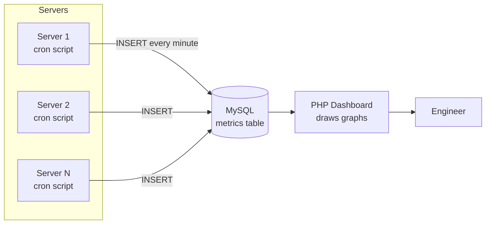

**How it works**
- A cron job on each server runs every minute: reads CPU (`top`), disk (`df`), memory (`free`).
- It runs a direct SQL insert:

```sql
CREATE TABLE metrics (
  id        BIGINT AUTO_INCREMENT PRIMARY KEY,
  host      VARCHAR(64),
  name      VARCHAR(64),
  value     DOUBLE,
  ts        TIMESTAMP,
  INDEX (host, name, ts)
);

INSERT INTO metrics (host, name, value, ts) VALUES ('web-17', 'cpu', 73.2, NOW());
```

- The dashboard page runs:

```sql
SELECT ts, value FROM metrics
WHERE host='web-17' AND name='cpu' AND ts > NOW() - INTERVAL 1 HOUR;
```

And an alert script runs `SELECT` every minute and sends an email if `value > 90`.

**With 5 servers and 5 metrics each**, that's 25 inserts a minute, which is trivial. This genuinely works. Many real companies start exactly here. Don't over-engineer on Day 0, and in an interview, saying "I'd start simple, then evolve it" is a strong signal.

## 6. Then ShopFast grows, and the cracks appear

A year later ShopFast has 10,000 servers and containers everywhere. Let's watch this design fail, one problem at a time. **In the interview, each of these becomes a design decision you justify.**

### Problem 1: Write throughput

Our requirement was ~2M samples/sec. A single MySQL server with a B-tree index handles maybe **5k–20k inserts/sec** before the disk and index maintenance become the bottleneck.

*Why is it slow?* Every insert updates the primary key *and* the secondary index `(host, name, ts)`. B-tree inserts cause **random I/O** (the new row lands somewhere in the middle of the index), page splits and fsyncs. We're ~100–200x short.

### Problem 2: Connection storm

100,000 targets each opening a DB connection every few seconds means the DB holds tens of thousands of connections. Each connection costs memory, and MySQL falls over at a few thousand. We also have the **thundering herd** problem: cron fires on the minute boundary, so *every* machine hits the DB in the same second.

### Problem 3: Tight coupling and no buffering

If the DB is slow or restarting, the cron scripts block, time out or lose data. Producers are directly coupled to the consumer. Worse, the DB credentials live on every server, which is a security problem.

### Problem 4: Storage explosion

172 billion rows a day, and each row carries the full `host` and `name` strings repeated every time. That's **tens of TB a day** in a row-store. The index alone dwarfs RAM, so queries thrash the disk.

### Problem 5: Slow queries over long ranges

"Show CPU for the last 30 days" means 30 days × 8,640 samples/day = ~260k rows for *one* series. Now a dashboard asks "average CPU across all 500 web servers for 30 days", which is 130 million rows scanned and aggregated at query time. The DB takes minutes.

### Problem 6: Deletion and retention

To drop data older than 90 days, we run `DELETE FROM metrics WHERE ts < ...`. On a table this size that's a multi-hour operation that locks and bloats the table and kills performance for everyone else.

### Problem 7: Single point of failure

One DB. If it dies, we lose history *and* the ability to alert, **exactly when the fleet is in trouble**.

### Problem 8: Wrong tool for the data shape

Look at the access pattern:
- Writes are **append-only** (we never update an old sample).
- Data is naturally ordered by **time**.
- Reads are almost always "a *range* of time for a *set of series*".
- Old data is rarely read at full resolution.

A general-purpose relational DB is built for updates, joins and transactions, and we use **none** of that. We're paying for features we don't need and missing optimizations we do (compression, time-based partitioning, cheap deletion).

Here's the whole failure picture:

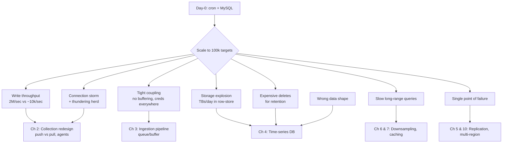

That's the roadmap of the whole story: **every later chapter exists because of a problem listed here.**

## 7. High-level shape we'll evolve toward

Here's a preview so you know where we're heading. Don't memorize it yet; we'll build each box in turn and justify it.

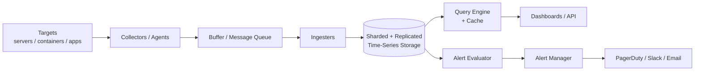

## 8. Interview tips for this chapter

1. **Open with clarifying questions**: number of targets, metrics per target, scrape interval, retention, whether logs and traces are in scope (usually *not*; metrics only), whether alerting is in scope.
2. **State your assumptions and do the math** (the 2M samples/sec number guides everything).
3. **Declare the nature of the system**: write-heavy, append-only, time-ordered, AP over CP, approximate data is acceptable.
4. **Mention the three pillars** to show breadth, then scope down: *metrics* (numbers over time), *logs* (events), *traces* (request journeys). We're designing **metrics**.
5. Show the naive design briefly and explain *why* it breaks. This is exactly the "evolution" narrative interviewers love.

## 9. Check your understanding

Try answering these in your own words before replying:

1. Why is storing `requests_per_second` as a gauge worse than storing a cumulative `requests_total` counter?
2. We have `latency{service, endpoint, host}` with 20 services, 30 endpoints and 100 hosts. How many series is that? What happens if we add `request_id` as a label?
3. Why do we say a monitoring system leans **AP** rather than CP?
4. Give two reasons a B-tree-indexed MySQL table is a poor fit for metrics.

---

**Tell me which parts are clear and which are fuzzy**, or just answer the questions above. Once you say you're comfortable, we'll move to **Chapter 2: Collection**, where we'll tackle push vs pull, agents and service discovery, and see why the first fix almost everyone tries (pushing straight to a bigger DB) leads to the next problem.


-----------------------------------------------------------------------------------------------------------------------
-----------------------------------------------------------------------------------------------------------------------
-----------------------------------------------------------------------------------------------------------------------
-----------------------------------------------------------------------------------------------------------------------


## Quick answer key for Chapter 1

1. **Counter vs gauge:** A counter is loss-tolerant. If a sample is dropped, the next one still carries the cumulative total, so you can compute the rate over any window (1m, 5m, 1h). A pre-computed per-second gauge locks you into one window, and a lost sample is lost information.
2. **Cardinality:** 20 × 30 × 100 = **60,000 series**. Adding `request_id` (unbounded, unique per request) creates a new series for every request, which means billions of series. This is cardinality explosion, and the index and memory blow up.
3. **AP over CP:** Dropping 1 of 360 hourly samples changes no decision, but refusing writes during a partition makes us blind. We choose availability and throughput, and accept approximate or slightly stale data.
4. **B-tree problems:** random I/O on inserts and index maintenance, no time-aware compression, repeated label strings in every row, and very expensive `DELETE`-based retention.

---

# Chapter 2: Collection (Getting Metrics Out of 100,000 Targets)

**The question:** how does a metric leave a server or container and reach our platform, reliably, at scale, without hurting the thing being monitored?

## Act 1: "Just point everything at a bigger database"

After Chapter 1's failures, ShopFast's first reaction is the obvious one: *buy a bigger DB and keep the cron scripts.* That doesn't fix the real problem, which is the **collection model**. A cron script on every machine writing directly to a central store causes:

- Connection storms and the thundering herd (every cron fires at :00).
- Credentials spread across 100k machines.
- Producers blocked when the DB is slow.
- Each team writing its own ad-hoc script (inconsistent names, units, formats).

So the first real evolution is to **separate "producing metrics" from "shipping metrics."**

## Act 2: Introduce a local agent

Instead of cron scripts, each host runs one small **agent** (a daemon). Examples are Datadog Agent, Telegraf, collectd and the Prometheus node_exporter.

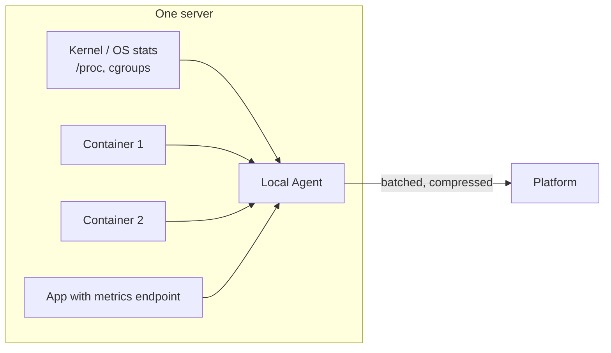

What the agent does, and why each piece exists:

| Agent responsibility | Why |
|---|---|
| **Collect locally** (read `/proc`, cgroup stats, app endpoints) | Local reads are cheap and don't cross the network |
| **Batch** (e.g. 10 s of samples in one request) | One request carrying 200 series beats 200 requests |
| **Compress** (gzip/snappy/protobuf) | Metric names repeat, so they compress extremely well |
| **Buffer locally** (in memory or small disk queue) | Survives short network or platform outages |
| **Retry with exponential backoff + jitter** | Avoids hammering a recovering backend |
| **Enrich with labels** (host, region, env, k8s pod) | Consistent metadata without app teams doing anything |
| **Authenticate** (mTLS or token) | Only one identity per host instead of a DB password in every script |

This fixes connection storms (one connection per host, not per metric) and decouples producers from the backend. But a new design question arrives: **who initiates the connection, the agent or the platform?**

## Act 3: The push model

**Push:** agents (or apps) actively send metrics to the platform.

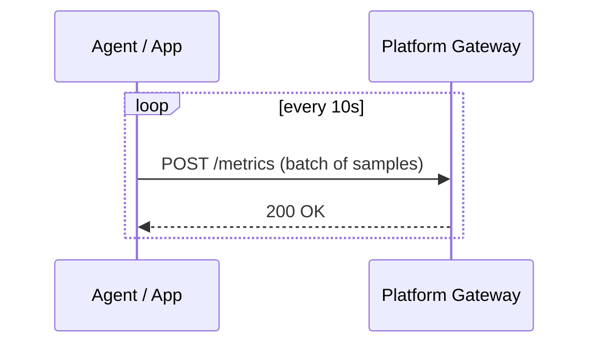

Examples: StatsD, Graphite, Datadog, OpenTelemetry (OTLP push), CloudWatch.

**Advantages**
- Works for **short-lived jobs** (a batch job that runs for 3 seconds can push its metrics before dying).
- Works through **firewalls and NAT**: the target only makes outbound connections.
- The app controls timing, so it can emit event-driven metrics immediately.
- Simple for serverless functions.

**Problems we hit in practice**
1. **No ground truth about liveness.** If a server stops sending, is it dead, partitioned, or does it simply have nothing to say? Silence is ambiguous, so we need heartbeat logic.
2. **Backend can be overwhelmed.** Agents push at *their* pace. During an incident (when every service logs errors and emits more metrics) load on the platform *increases*, exactly when we need it most. We need **admission control and rate limiting** at the gateway.
3. **Config drift.** To change what or how often a metric is collected, you must update 100k agents.
4. **Hard to debug.** To check "is host X reporting correctly?", you need to look at the sender.
5. **Misconfigured or buggy clients** can flood the platform (a bad deploy pushing 100x metrics).
6. **Timestamp trust.** Clients stamp their own samples, and clocks drift.

Hold those problems in mind, because they motivated a famous alternative.

## Act 4: The pull model

Engineers at Google (Borgmon) and later SoundCloud (Prometheus) flipped the direction. **Every target simply exposes its current metrics on an HTTP endpoint** (e.g. `GET /metrics`), and a central **scraper** fetches them on a schedule.

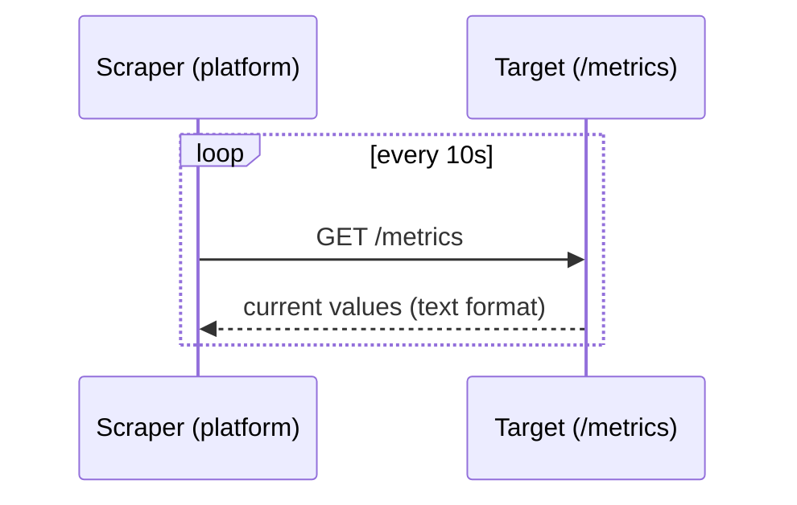

Example `/metrics` response (Prometheus text format):

```
# TYPE http_requests_total counter
http_requests_total{endpoint="/checkout",status="200"} 1027
http_requests_total{endpoint="/checkout",status="500"} 3
# TYPE memory_used_bytes gauge
memory_used_bytes 4.2e9
```

**Why pull solved real problems**
- **Liveness for free:** if the scrape fails, the platform *knows* the target is down and records a synthetic metric `up{instance="web-17"} = 0`. Silence is no longer ambiguous.
- **Platform controls the load:** the scraper decides rate and timing. Under pressure it can slow down or skip scrapes (**backpressure by design**).
- **Central config:** change the scrape interval or add relabeling rules in one place.
- **Easy debugging:** you can `curl` a target's `/metrics` yourself and see what the platform sees.
- **The platform assigns the timestamp**, which removes clock-skew issues from many different hosts.

**But pull has its own problems**
1. **Short-lived jobs** may start and finish between two scrapes and never get scraped.
2. **Firewalls / NAT / multi-tenant networks:** the scraper must *reach* every target, so you need network paths into every environment (VPCs, customer networks).
3. **Scale of scraping:** 100k targets / 10 s = **10,000 scrapes/sec**. One scraper can't do this.
4. **How do scrapers know which targets exist?** In a container world, IPs change constantly. This is the **discovery problem**.

Let's fix them one at a time.

## Act 5: The discovery problem (containers are ephemeral)

On Day 0 you could keep a static list of 5 servers in a config file. With Kubernetes, a pod might live 20 minutes and get a new IP each time. A static list is wrong within minutes.

**Solution: service discovery.** The scraper subscribes to a **source of truth** about what is running:

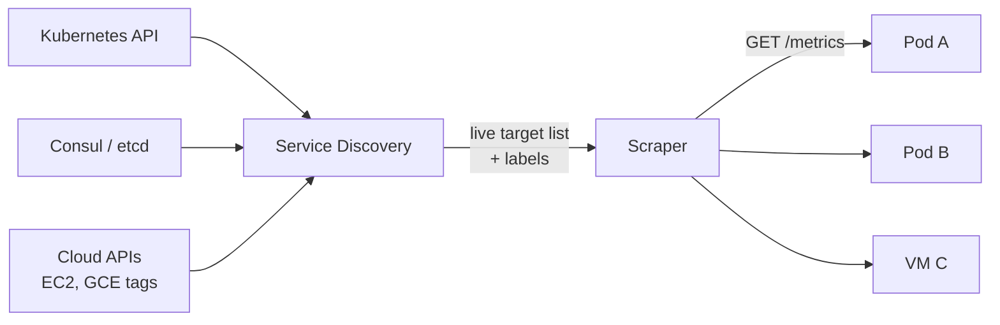

How it works:
- The scraper **watches** the Kubernetes API for pods, services and endpoints (using watch streams rather than polling).
- Pod labels and annotations (`team=payments`, `prometheus.io/scrape=true`) become metric labels through **relabeling rules**.
- When a pod dies, it's removed from the target list; when a new one starts, it is picked up in seconds.

**Example:** a new `checkout` pod starts → the API server emits an event → discovery adds `10.2.4.17:8080` with labels `{service=checkout, version=v42}` → the next scrape cycle collects it. **No human edits any config.**

The alternative approach (*self-registration*) is that each instance registers itself in Consul or etcd with a TTL heartbeat, and the scraper reads from there. This is common in non-Kubernetes environments.

## Act 6: Scaling the scrapers

10,000 scrapes/sec is too much for one process (and a single machine would be a SPOF). So we need many scrapers, and we must decide **who scrapes which target**.

**Option A: manual partitioning**, such as "scraper 1 handles team A." This is simple but leads to uneven load and manual toil.

**Option B: hash-based sharding.** Each scraper computes `hash(target) % N`, and scrapes only its share.

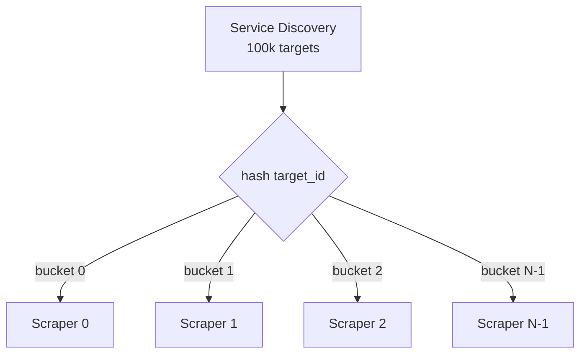

**Problem with `% N`:** when you add or remove a scraper (N changes), **almost every target moves** to a different scraper. That causes missed or duplicate scrapes during the reshuffle. Use **consistent hashing** (or rendezvous hashing), where adding or removing a scraper only moves ~1/N of the targets. We'll go deep on consistent hashing in Chapter 5, so for now remember: *"hash-sharded, and use consistent hashing so rebalancing is cheap."*

**Scraper failure:** what if scraper 2 dies? Two common strategies:
- **Active-passive:** a standby takes over that shard (a lease in etcd or ZooKeeper decides who the owner is).
- **Redundant scraping (HA pairs):** *two* scrapers scrape the same targets and write the same data, and downstream deduplicates. It costs 2x scrape load but gives **zero gap on failure**. Many production systems choose this because gaps in monitoring data are costly.

**Avoiding the thundering herd on the targets:** if 5,000 targets all get scraped at exactly :00, you create load bursts on the network and platform. Scrapers apply a **deterministic offset**, `offset = hash(target) % interval`, so scrapes are spread evenly across the 10-second window. This is a classic detail interviewers love.

**Hierarchical alternative:** for very large or multi-datacenter fleets, put a **regional scraper tier** close to the targets that does the scraping and pre-aggregation, and a **global tier** that collects from regions. (Prometheus calls this *federation*; Borgmon used a similar hierarchy.) It keeps scrape traffic local and sends only aggregated data across WAN links.

## Act 7: Fixing pull's weaknesses, and the hybrid design

**Short-lived jobs:** use a **push gateway/aggregator**. The batch job pushes its final metrics to an intermediate service that holds them, and the scraper then pulls from that gateway like any other target. (Caution: the gateway becomes a SPOF and a place where stale metrics can linger, so use it only for jobs that truly can't be scraped.)

**Firewalls / customer networks:** run a **local collector** inside the remote network. It scrapes locally (pull works fine inside the network) and then **pushes outbound** to the central platform. This is the pattern Datadog Agent, Grafana Agent and the OpenTelemetry Collector follow.

**Result: a hybrid.** Pull inside trusted networks for control and liveness, push across network boundaries and for ephemeral jobs.

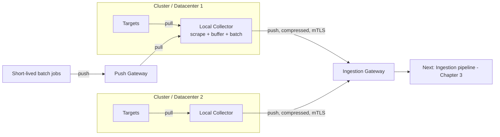

## Act 8: Collection-side details interviewers probe

**1. Push vs pull: the comparison table**

| Aspect | Pull | Push |
|---|---|---|
| Liveness detection | Built in (`up` metric) | Needs heartbeats |
| Load control | Platform decides | Clients decide (needs rate limits) |
| Short-lived jobs | Poor (needs gateway) | Natural |
| Firewalls/NAT | Hard (needs network reachability) | Easy (outbound only) |
| Config changes | Central | Per-client |
| Timestamps | Set by scraper | Set by client (clock skew risk) |
| Debuggability | `curl /metrics` | Harder |
| Examples | Prometheus, Borgmon | StatsD, Datadog, OTLP |

**There is no universal winner.** Say this in the interview, then justify your pick from the requirements. For "thousands of servers, containers and apps" with Kubernetes-style discovery, I'd pull inside clusters and push across boundaries.

**2. Staleness markers:** when a target disappears, a graph shouldn't show its last value for 5 minutes as if still alive. The scraper writes a special **stale marker** at the next missed scrape, so queries and graphs stop the line cleanly.

**3. Scrape failure handling**
- Timeout per scrape (e.g. 80% of the interval) so a hung target doesn't block a worker.
- **Bounded concurrency** per scraper (worker pool), so one slow target can't consume all threads.
- Record `up=0` and `scrape_duration_seconds` so we can monitor the monitor.

**4. Protecting against bad targets:** enforce **limits per scrape**, such as a max sample count (e.g. reject a target that suddenly emits 1M series), a max label count and a max label value length. This is the **first line of defense against cardinality explosion**, and we'll pair it with limits in storage later.

**5. Security:** mTLS between agents and the platform, per-tenant API tokens, and an allow-list so scrapers don't become an SSRF vector (scraping internal metadata endpoints).

**6. Overhead on the monitored host:** the agent must be lightweight (target < 1% CPU and ~50 MB RAM). Monitoring that degrades production is self-defeating. Use cgroup limits on the agent itself.

**7. Time:** the collector assigns the timestamp at scrape time, and the scrape-time offset is at most the scrape latency. For push, either trust but sanity-check client timestamps (reject samples too far in the future or past) or overwrite them at the gateway.

## Interview-style summary (60-second version)

> "Each host runs a lightweight agent, or we scrape its metrics endpoint. Within a cluster I'd use **pull** because it gives liveness detection, central control and platform-controlled load. Targets are found by **service discovery** (Kubernetes watch API), since containers are ephemeral. Scrapers are **sharded with consistent hashing**, with HA pairs to avoid gaps, and scrape times are **jittered** to avoid thundering herds. For short-lived jobs and cross-network cases I use **push through a gateway or local collector**. Collectors batch, compress, buffer and retry with backoff, and enforce per-target limits to guard against cardinality explosions."

## Check your understanding

1. Why does pull give you "free" liveness detection, and how would you get it in a pure push system?
2. A scraper uses `hash(target) % N` and you scale from 10 to 11 scrapers. Roughly what fraction of targets get reassigned? Why is that a problem, and what's the fix?
3. Why do we offset scrape times with `hash(target) % interval`?
4. Your company has a nightly batch job that runs for 20 seconds. Which collection approach would you use and why?
5. A buggy deploy makes one service emit 2 million unique series. Where in the collection layer would you stop it?

---

Answer these or tell me what's fuzzy. When you're comfortable, we'll go to **Chapter 3: the Ingestion Pipeline**. There the problem is that our collectors now deliver ~2M samples/sec and the storage layer can't absorb spikes or failures directly. That is where **queues like Kafka, backpressure and write-path design** enter the story.


-----------------------------------------------------------------------------------------------------------------------
-----------------------------------------------------------------------------------------------------------------------
-----------------------------------------------------------------------------------------------------------------------
-----------------------------------------------------------------------------------------------------------------------


## Answer key for Chapter 2

1. **Liveness:** In pull, a failed scrape is a *fact* the platform observes, so it records `up=0`. In push, silence is ambiguous (dead, partitioned or idle?). You'd need heartbeats with a TTL and an "absent for N minutes" alert. That alert can false-fire if the network between agent and platform is partitioned, even though the host is healthy.
2. **`% N` rebalancing:** Going from 10 to 11 scrapers, a target stays put only when `hash % 10 == hash % 11`, which is about 1/11 of the time, so **~91% of targets move**. That causes mass duplicate or missed scrapes during the reshuffle. **Consistent hashing** moves only about 1/11 (~9%).
3. **Scrape offsets:** They spread scrapes evenly across the interval so neither targets, the network nor the platform see synchronized bursts at :00, :10 and so on.
4. **20-second nightly job:** Have the job **push its final metrics (success, duration, records processed, last-success timestamp) to a push gateway/collector** when it finishes, then alert on "last success timestamp is too old". Pull is fragile here because the job may finish between scrapes and its final totals would be lost.
5. **2M-series bug:** At the **collector**, a per-scrape `sample_limit` rejects the whole scrape and records the failure. At the **gateway**, a per-tenant active-series limit protects the backend. Defense in depth means both layers.

---

# Chapter 3: The Ingestion Pipeline

**The question:** collectors now hand us ~2M samples/sec. How do we absorb that safely (spikes, slow storage, restarts, bad clients) without losing data?

## Act 1: The direct write path

After Chapter 2, ShopFast's first version of the backend is simple: collectors push to a **gateway**, and the gateway writes straight into the storage nodes.

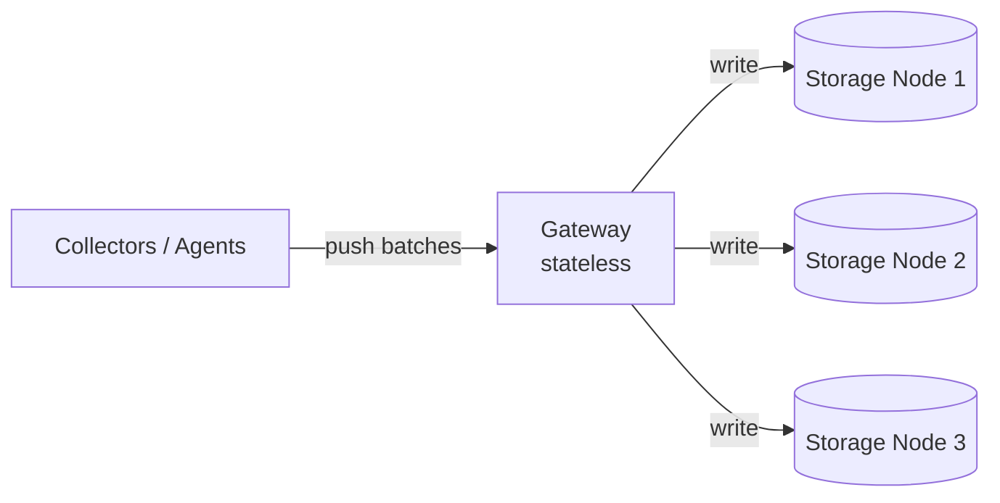

### What the gateway is for (it is not a dumb proxy)

| Job | Detail |
|---|---|
| **Authenticate / authorize** | mTLS or API token → which tenant? |
| **Validate** | Reject malformed names or labels, too many labels, label values over 1 KB |
| **Timestamp sanity** | Reject samples too far in the future or too old (say > 1 h) |
| **Rate limit** | Per-tenant token bucket (samples/sec); return HTTP **429 + Retry-After** |
| **Series limit** | Cap on active series per tenant (the cardinality shield from Ch 2) |
| **Deduplicate HA pairs** | Our redundant scrapers send the same data twice. Each carries a `replica` label, and the gateway elects one replica per cluster (via a lease in etcd or Consul) and drops the other's samples |
| **Route** | Compute `hash(series labels)` → decide which storage node owns the series |

The gateway is **stateless**, so it scales horizontally behind a load balancer. Capacity check: if each request carries ~500 samples, 2M samples/s is ~4,000 requests/s. At roughly 300-500 req/s per instance (decode + validate + hash) that's ~10 instances, and ~40 for a 4x spike. Easy.

## Act 2: Reality hits, and the direct path hurts

### Problem 1: Traffic is bursty

During an outage every service emits errors, retries and logs, so metric volume **rises exactly when we need the system most**. A 4x burst means 8M samples/s hitting storage nodes sized for 2M.

### Problem 2: Storage is not always fast

Storage nodes periodically do heavy work: compaction, flushing memory to disk, GC pauses, restarts. When a node stalls for 30 s, the gateway has nowhere to put its samples. It must either block (pushing latency back to every collector) or drop data.

### Problem 3: Deployments cause gaps

Rolling-restart a storage node and every write to it during the restart fails. With a direct path, a routine deploy means a visible hole in graphs.

### Problem 4: Everyone wants the data

Storage isn't the only consumer. We also want:
- a **real-time alert evaluator**,
- a **stream aggregator** (pre-computing rollups),
- an **archiver** to cheap object storage (S3),
- maybe an anomaly-detection job.

With the direct path, the gateway would have to write to every one of them, so **any slow consumer slows ingestion for all**.

### Problem 5: No replay

A bug in the ingester corrupts 2 hours of data. With the direct path those samples are gone, because no copy of the raw stream exists.

All five problems point to the same missing thing: **a durable buffer between producers and consumers.**

## Act 3: Introduce a distributed log (Kafka)

Insert a message log between the gateway and storage:

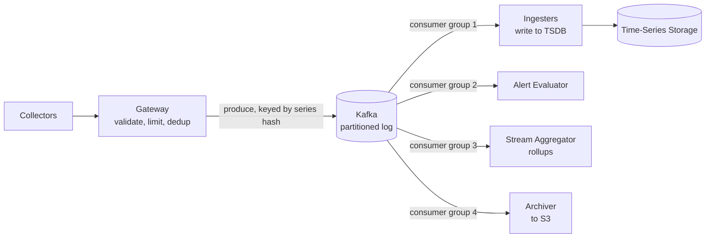

### Why a log solves each problem

| Problem | How the log fixes it |
|---|---|
| **Bursts** | The log absorbs spikes. Producers append at full speed and consumers drain at their own pace. Consumer **lag** temporarily grows, then shrinks |
| **Slow or stalled storage** | The gateway is no longer coupled to it. Samples wait safely in the log |
| **Deployments** | Stop an ingester and its consumer offset stays put. When it restarts, it resumes where it left off. **No gap** |
| **Many consumers** | Each consumer group has its **own offset**, so a slow archiver doesn't slow alerting |
| **Replay** | The log keeps data for e.g. 24-72 h. Fix the bug, reset the offset and reprocess |

### Why Kafka specifically (you should be able to justify this)

- **Sequential append-only disk writes**: fast even on spinning disks or cheap SSDs, because there is no random I/O. This is the same property that made B-trees bad in Chapter 1.
- **Partitioning** gives horizontal scale for both writes and parallel consumers.
- **Replication** across brokers gives durability.
- **Consumer groups with offsets** give independent progress and replay.
- Mature, with high throughput and a huge ecosystem. Alternatives are Pulsar, Kinesis and Redpanda, and the reasoning is the same.

## Act 4: Design the log properly

### 4.1 The partition key (the most important decision)

We need to choose what to hash on when assigning a sample to a partition.

| Key | Result |
|---|---|
| **Random / round-robin** | Perfectly even load, but samples of one series scatter across partitions. Every ingester ends up holding fragments of every series, which breaks compression locality and makes ordering per series impossible |
| **Tenant ID** | Locality per tenant, but **hot tenant = hot partition** (one huge customer overwhelms a single partition) |
| **Metric name** | Skewed: `http_requests_total` has millions of series while others have 10 |
| **Hash of full series identity (metric name + sorted labels)** | **Even distribution** AND all samples of a series land in **one partition, in order** |

We choose the last one: `partition = hash(metric_name + sorted_labels) % num_partitions`.

Benefits:
- Per-series **ordering** is guaranteed (Kafka preserves order within a partition).
- Each ingester consumes a stable subset of series, so it builds that series' compressed chunk **in memory, contiguously** (essential for Chapter 4's compression).
- Load is spread statistically evenly because there are millions of distinct series.

### 4.2 How many partitions?

```
Ingress: 2M samples/s × ~20 bytes (protobuf + labels dictionary encoded) ≈ 40 MB/s
A comfortable per-partition write rate ≈ 5-10 MB/s
Minimum ≈ 4-8 partitions for throughput alone
```

But throughput isn't the binding constraint. Partitions also set **max consumer parallelism** (one consumer per partition within a group), and plan for 4x burst plus growth. A sensible choice is **~128-256 partitions**.

**Caveat to mention:** changing the partition count later changes `hash % N`, so series move to different partitions. Over-provision upfront, and if you must resize, use a planned migration (a new topic plus dual-write). Same lesson as Chapter 2's modulo problem.

### 4.3 Capacity and retention

```
40 MB/s × 86,400 s ≈ 3.4 TB/day raw (before Kafka compression)
Replication factor 3, 24 h retention → ~10 TB across the cluster
```

A few brokers with local SSDs handle this easily. We choose retention to cover our worst realistic recovery time, so 24 h is typical and 48-72 h is safer if a weekend outage is possible.

### 4.4 Producer durability settings

This is where you show real Kafka knowledge:

| Setting | Choice | Why |
|---|---|---|
| `acks` | `all` + `min.insync.replicas=2` | A sample acknowledged to the gateway survives one broker loss. For lowest latency (and willing to lose a tiny slice on broker failure) `acks=1` is defensible for metrics, so **state the trade-off** |
| `enable.idempotence` | `true` | Avoids duplicates caused by producer retries |
| `linger.ms` / `batch.size` | e.g. 10-50 ms, 1 MB | Batching massively improves throughput and compression, at the cost of a few ms of freshness |
| `compression.type` | `snappy` or `zstd` | Metric names and labels compress very well |
| Replication factor | 3 across racks/AZs | Survive a rack or AZ loss |

## Act 5: The consumer side, where ingesters live

An **ingester** consumes its partitions and does the real work:

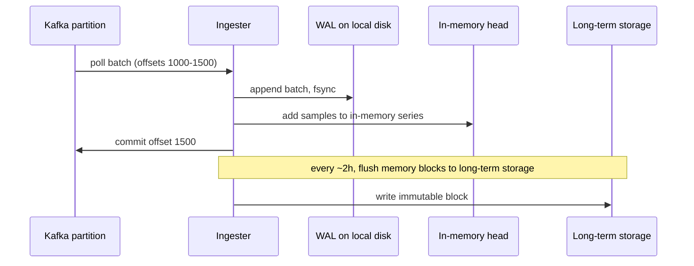

Key points:

1. **Commit the offset only after the data is durable** (WAL fsync'd). If the ingester crashes before committing, Kafka redelivers, so we get **at-least-once** delivery.
2. **At-least-once means duplicates.** The fix is to make the write **idempotent**: a sample `(series, timestamp, value)` that already exists is ignored or overwritten (same series and timestamp = same sample). That's far simpler than Kafka exactly-once transactions, and a common interview insight: *"I don't need exactly-once, I need idempotent writes."*
3. **Why a WAL if Kafka is already durable?** The ingester's memory is lost on crash, and replaying hours from Kafka is slow. The WAL lets it recover quickly, and Kafka is the safety net beyond the WAL. We'll go deeper on the WAL, head blocks and flushing in Chapter 4.
4. **Consumer lag** (latest offset minus committed offset) is the **#1 health metric** of this pipeline. Alert on it.

## Act 6: Backpressure, rate limiting and load shedding

A log is a buffer, not magic. It's finite, so we need explicit rules for overload at each layer:

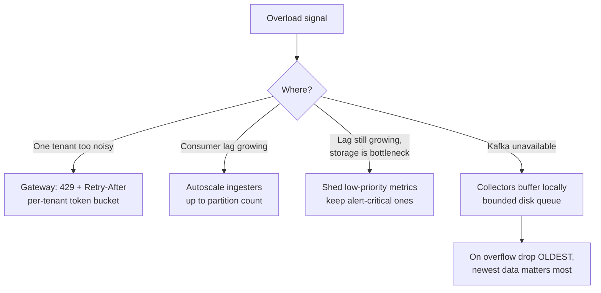

Details worth explaining:

- **Token bucket per tenant:** each tenant gets N samples/sec with a burst allowance. Over the limit gets a `429`, and **collectors must honour `Retry-After` with exponential backoff + jitter**. Without jitter, thousands of retrying collectors synchronize and create a retry storm.
- **Priority tiers / load shedding:** tag metrics (or tenants) as critical (SLO and alerting metrics), standard or best-effort (debug). When the system is overloaded, drop best-effort first. Alerts still fire, which is the whole point of the platform.
- **Bounded everything:** gateway queues, agent buffers and WAL size all have limits. Unbounded queues turn overload into out-of-memory crashes, which is worse than a controlled drop.
- **Why drop oldest on buffer overflow?** For monitoring, recent data is more valuable than stale data. A 2-hour-old sample is much less useful than the current one.
- **Poison messages:** a malformed message must not block a partition forever. Retry a bounded number of times, then send it to a **dead-letter topic** and move on.

## Act 7: Pre-aggregating in the stream

A second consumer group, the **stream aggregator** (Kafka Streams, Flink or a custom service), can compute rollups on the fly, for example:

```
Raw:        http_requests_total{service, endpoint, host}    ← 1,000,000 series
Aggregated: http_requests_total:by_service{service}         ← 50 series
```

**Why:** a dashboard asking for "requests per service" otherwise has to read and sum a million series at query time. Pre-aggregating makes it a trivial read. This is the idea behind **recording rules** (Prometheus) and M3's aggregator tier. We'll use it again in Chapters 6 and 7.

The cost is that you lose the dropped dimensions in the aggregated series (fine, the raw series still exist for debugging).

## Act 8: The alternative: skipping the queue

A fair interviewer may ask: *"Isn't Kafka overkill?"* Some real systems (e.g. Cortex/Mimir in their classic mode) skip it. The distributor writes directly to ingesters with replication factor 3 and a **quorum** (2 of 3 must acknowledge), and ingesters keep a WAL. Newer Mimir versions later added a Kafka-based ingest path precisely because of the problems above.

| | Direct write (quorum) | Via Kafka |
|---|---|---|
| Latency | Lower | A few ms to tens of ms more |
| Moving parts | Fewer | One more cluster to run and monitor |
| Burst absorption | Limited by ingester memory | Large buffer |
| Deployments | Needs careful rolling restarts and replication | Trivial (offsets) |
| Replay / multiple consumers | Hard | Native |
| Failure isolation | Slow ingester can slow writes | Decoupled |

**Good interview answer:** "At our scale and with several consumers (alerting, aggregation, archival) the queue is worth its operational cost. For a smaller deployment I'd start with direct quorum writes and add a queue later when the pain appears." That shows judgment rather than dogma.

## Act 9: Late and out-of-order data (a preview)

Because collectors buffer during outages, samples can arrive **minutes late**, so a sample timestamped 14:05 may arrive after one from 14:20. Two things follow:
- **Per-series ordering in Kafka is by arrival, not timestamp**, so storage must tolerate some out-of-order samples within a window (say 1 h), and reject or handle older ones separately.
- Pre-aggregations must decide how long to wait before closing a window (**watermarks**).

We'll solve this inside the storage engine in Chapter 4 and revisit it in Chapter 9.

## Interview-style summary (60-second version)

> "Collectors send batched, compressed samples to a **stateless gateway fleet** that authenticates, validates, enforces per-tenant rate and series limits, dedups HA replicas, and produces to **Kafka**, partitioned by a hash of the series identity. That gives per-series ordering, even load and compression locality. Kafka decouples producers from storage, absorbs bursts, makes deployments gap-free and lets multiple consumer groups (ingesters, alert evaluator, stream aggregator, archiver) progress independently, with 24-48 h of replay. Ingesters write to a WAL, then memory, and **commit offsets only after durability**, giving at-least-once delivery with **idempotent writes** instead of exactly-once. Overload is handled with 429 and jittered backoff, priority-based load shedding, autoscaling on consumer lag, and bounded buffers."

## Check your understanding

1. Why is `hash(full series identity)` a better partition key than `tenant_id` or `metric_name`? What does it break if we use round-robin?
2. An ingester crashes after writing to its WAL but *before* committing its offset. What happens on restart, and why is that safe?
3. Consumer lag is climbing steadily and you already have as many ingesters as partitions. What are your options?
4. Why must retrying collectors use **jitter** and not just exponential backoff?
5. When would you choose the direct-write (no Kafka) design instead?

---

Answer these or tell me what's unclear. When you're ready, we'll go to **Chapter 4: Storage**. Our ingesters now need somewhere to put 172 billion samples a day, and we'll see why general-purpose databases fail and how **time-series databases** (WAL, head block, chunks, Gorilla compression, inverted index) are built from first principles.


-----------------------------------------------------------------------------------------------------------------------
-----------------------------------------------------------------------------------------------------------------------
-----------------------------------------------------------------------------------------------------------------------
-----------------------------------------------------------------------------------------------------------------------


## Answer key for Chapter 3

1. **Partition key:** Hashing the full series identity spreads load evenly (millions of distinct series) and keeps every sample of one series **in one partition, in order**. That gives each ingester contiguous data to compress. `tenant_id` creates hot partitions for big tenants, and `metric_name` is badly skewed (one metric can have millions of series). **Round-robin** scatters each series across all partitions, which loses per-series ordering and compression locality. Every ingester also ends up indexing *every* series, so index memory multiplies.
2. **Crash before offset commit:** On restart the ingester replays its WAL to rebuild memory. Kafka redelivers the uncommitted batch, so some samples arrive twice. Because writes are **idempotent** (same series and timestamp is ignored), the duplicates are harmless. That's at-least-once delivery made safe.
3. **Lag climbing with ingesters = partitions:** Find the bottleneck first (disk, compaction, CPU). Then use vertical scaling or faster batching, a planned partition increase (new topic and dual-write), cardinality or relabel drops, shedding best-effort metrics, or 429s at the gateway. Also extend Kafka retention so unread data doesn't expire.
4. **Jitter:** Collectors that failed together retry together. Exponential backoff alone keeps them synchronized (everyone retries at +1s, +2s, +4s), producing recurring storms. Jitter spreads the retries.
5. **Skip Kafka when:** the scale is small, there's only one consumer, you want minimal moving parts, or nobody on the team can operate Kafka. Use quorum writes and add the queue when the pain appears.

---

# Chapter 4: Storage (Building a Time-Series Database)

**The question:** our ingesters must durably store ~2M samples/sec (172 billion a day) and later answer "this series, this time range" in milliseconds. What storage engine fits?

## Act 1: What does our data actually look like?

Before choosing a database, list the **workload properties**. This is the habit that makes your interview answers convincing.

| Property | Implication |
|---|---|
| Writes are **append-only** (never update an old sample) | No need for in-place update machinery |
| Writes arrive **roughly in time order** | Recent data is "hot" |
| Reads are "**these series, this time range**" | Index by series, store by time |
| Samples in a series are **highly similar** (timestamps 10 s apart, values change slowly) | Extremely compressible |
| Old data is read rarely and usually at lower resolution | Tiering and downsampling possible (Chapter 6) |
| Deleting means "drop everything older than X" | Retention should be a cheap bulk operation |
| Never need joins or multi-row transactions | Relational features are wasted |

## Act 2: The attempts, and why each one fails

**Attempt 1: MySQL/Postgres (Chapter 1).** B-tree random writes, repeated label strings, expensive DELETEs. Already failed.

**Attempt 2: Wide-column NoSQL (Cassandra / HBase, as in OpenTSDB, KairosDB).** The common trick is one row per series per time bucket (say per hour), with columns for each sample offset. It scales writes horizontally and LSM storage handles the write rate. Better, but:
- Compression is generic (LZ4/snappy on blocks). It can't exploit the fact that consecutive timestamps differ by exactly 10 s, so you still pay several bytes per sample.
- Label queries (`env=prod AND region=us-east`) need a secondary index or scans, and that's the hard part.
- Retention still means tombstones and compaction pain.
- Heavy to operate for a narrow use case.

**Attempt 3: Elasticsearch / document store.** Great inverted index, but every sample is a document with large per-document overhead (tens to hundreds of bytes), so storage cost is 10x or more.

**Attempt 4: In-memory only (Facebook's Gorilla).** Facebook found most queries hit the **last 26 hours**, so Gorilla keeps recent data in compressed RAM across many nodes and writes durable copies elsewhere. This is brilliant for hot data but too expensive for long retention.

The conclusion that Google (Monarch), Facebook (Gorilla), Prometheus, InfluxDB and M3 all reached independently: **build a purpose-made time-series storage engine** that combines the best ideas of each:
1. An **LSM-style write path** (WAL + memory + immutable files) for fast sequential writes.
2. **Time-partitioned immutable blocks** so retention is "delete a directory".
3. **Specialized compression** for timestamps and values.
4. An **inverted index** over labels for series lookup.

Let's build it piece by piece.

## Act 3: The write path (LSM thinking, applied to metrics)

Why LSM? Recall that B-trees update pages in place (random I/O). An **LSM tree** turns every write into a sequential append: write to a log, buffer in memory, and periodically dump sorted immutable files. Sequential I/O is orders of magnitude faster than random I/O on any disk.

Our time-series version:

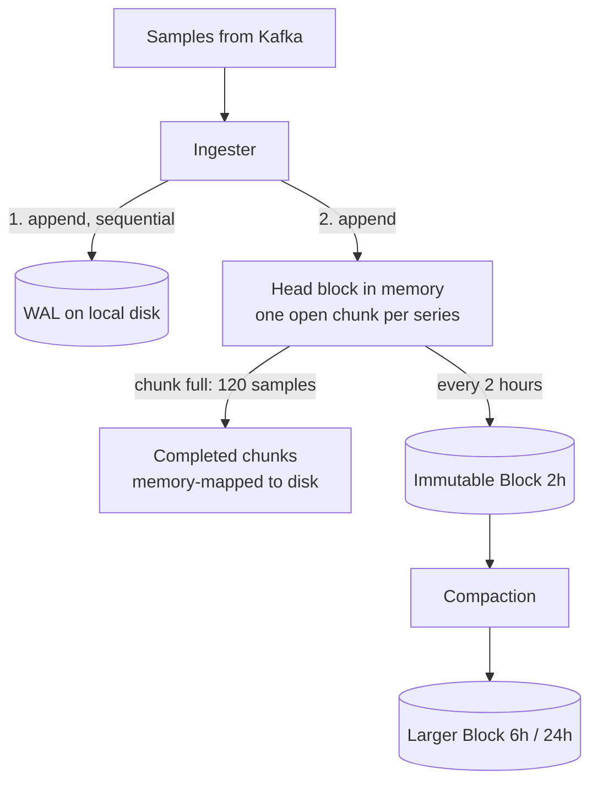

Step by step for one sample `cpu{host=web-17} @ 14:11:10 = 73.2`:

1. **Look up the series** in an in-memory map (`labels hash → series_id`). If it's new, assign an ID and add it to the index.
2. **Append to the WAL** (write-ahead log), a sequential file. This is our crash insurance.
3. **Append to the series' open chunk in memory** (the *head*). The chunk is a compressed byte array, and we append to it.
4. When the chunk reaches **120 samples** (~20 minutes at 10 s), it is "cut", sealed and moved to disk (memory-mapped) so RAM isn't consumed forever. A new open chunk starts.
5. Every **2 hours**, all head data older than the window is written out as an immutable **block**, and the WAL segments covering it are deleted.

### Why a WAL, since Kafka already has the data?

Kafka lets us recover *eventually*, but replaying hours of messages is slow and puts load on the cluster. The WAL gives fast local crash recovery. On restart: replay the WAL (usually well under a few minutes), rebuild the head, then resume from Kafka's last committed offset. Kafka is the second line of defense.

### The WAL fsync trade-off

- `fsync` after every write: safest but slow.
- **Group commit**: batch many samples (e.g. one Kafka poll = hundreds of samples) per fsync. This is what we do, since ingesters already receive batches. If the machine crashes, at most the un-fsynced tail is lost, and Kafka replays it.

## Act 4: Compression (the part that makes it affordable)

Recall the math: 16 bytes/sample raw gives 2.76 TB/day. Facebook's **Gorilla paper** showed how to hit **~1.37 bytes/sample on average**, about 12x smaller. The key insight: **consecutive samples are very predictable**.

### 4.1 Timestamps: delta-of-delta

A scrape every 10 s gives timestamps like:

```
t0 = 1700000000
t1 = 1700000010   delta = 10
t2 = 1700000020   delta = 10
t3 = 1700000030   delta = 10
t4 = 1700000041   delta = 11   (scrape was 1s late)
t5 = 1700000050   delta = 9
```

Instead of storing 64-bit timestamps, store the **delta of the delta**:

```
delta-of-delta:   (t2-t1)-(t1-t0) = 0
                  (t3-t2)-(t2-t1) = 0
                  (t4-t3)-(t3-t2) = +1
                  (t5-t4)-(t4-t3) = -2
```

Encoding scheme (variable length):
- `0` (**one bit**) if delta-of-delta is 0.
- `10` + 7 bits for small values (about -63 to +64).
- `110` + 9 bits, `1110` + 12 bits, and `1111` + 32 bits for larger jumps.

In Facebook's production data, about **96% of timestamps compressed to a single bit**. A 64-bit timestamp became 1 bit.

### 4.2 Values: XOR with the previous value

Metric values are 64-bit floats. Consecutive values are often identical (e.g. total memory capacity) or very close (CPU 71.0 → 71.2). The IEEE-754 representations of close numbers share the same sign, exponent and leading mantissa bits.

**XOR the current value with the previous**:
- If identical → XOR is all zeros → store **one `0` bit**.
- Otherwise, the XOR result has a run of **leading zeros** and **trailing zeros** with a small block of "meaningful bits" in between. Store only that block, plus its position, and reuse the previous block's position when it fits (control bit `10`), else store the new leading-zero count (5 bits) and length (6 bits) (control bit `11`).

About **51% of values compressed to a single bit** in Facebook's data.

**Counter example:** a counter going 1027, 1031, 1033... is stored as a double with an integer value, so only the top mantissa bits are non-zero and the XOR has a long run of trailing zeros. Only a handful of bits are stored.

### 4.3 Result

```
Raw:         16 bytes/sample
Compressed:  ~1.37 bytes/sample   (Gorilla paper average)

2M samples/s × 1.37 B ≈ 2.7 MB/s  ≈ 237 GB/day   (vs 2.76 TB/day raw)
```

> **Interview insight:** this compression only works if samples of one series are stored **contiguously and in time order**. That's why Chapter 3 partitioned Kafka by series identity and why chunks are per series. Scattered samples would destroy the compression ratio. The entire pipeline was designed around this.

**Chunk size trade-off:** a chunk is decoded **from its start** (delta-of-delta and XOR are sequential), so bigger chunks compress slightly better but force reading more data to reach a point in the middle. ~120 samples balances both.

## Act 5: Finding series fast (the inverted index)

Storing data is half the problem. A query like:

```
avg(cpu_usage{env="prod", region="us-east", service="checkout"})
```

must find all matching series among **20 million**. Scanning every series's labels is unacceptable.

**Solution: an inverted index**, the same structure search engines use. For each `label=value` pair keep a **postings list**: the sorted list of series IDs that have that pair.

```
env="prod"          → [1, 2, 3, 5, 8, 13, 21, ...]
region="us-east"    → [2, 3, 5, 6, 13, 34, ...]
service="checkout"  → [3, 5, 13, 55, ...]
__name__="cpu_usage"→ [1, 2, 3, 5, 6, 8, 13, ...]
```

**Query = intersect the postings lists** (a merge of sorted lists, linear time) → `[3, 5, 13]`. Now we know exactly which series to read.

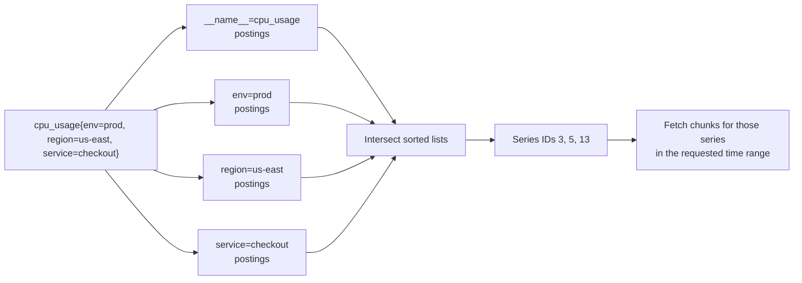

Implementation details worth mentioning:
- Postings lists are sorted, so they are **delta-encoded** and compressed.
- Labels are stored **once per series** in the index, not once per sample. This directly fixes Chapter 1's wasteful repeated-string rows. A sample is effectively just `(series_id, timestamp, value)`.
- Regex or negative matchers (`env!="dev"`) are more expensive (they must expand to all matching values), so query engines limit them.

### Where cardinality hurts, concretely

Every active series costs memory in the head: its labels, index entries, and an open chunk. A rough planning number is **~3 KB per active series**:

```
20 million series × ~3 KB ≈ 60 GB of RAM just for the active head
```

That is far more than one machine should hold (and one machine would be a SPOF). Hence **we must shard series across many ingesters**. That's Chapter 5.

**Series churn** is a related trap. In Kubernetes every deploy creates new pods, and a new pod name means a new series (`pod="checkout-7d9f-xk2lp"`). Even if only 100k series are *active* at once, 10 deploys a day could create millions of *distinct* series over a day, and the index must store all of them. Ask in interviews: "active series" or "total series over the retention window"?

## Act 6: Blocks, compaction and retention

Every 2 hours the head is flushed into an **immutable block**, a self-contained directory:

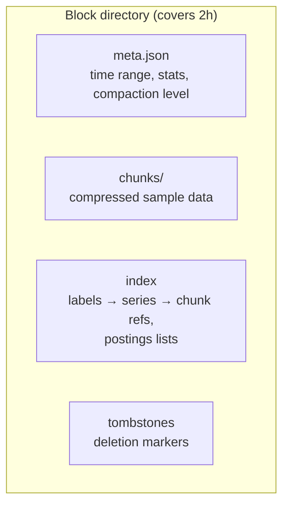

**Why immutable blocks are great:**
- Each block is independent, so a query touches only blocks that overlap its time range.
- No locking between readers and writers, because data never changes in place.
- Easy to **back up, copy and upload to object storage** (S3) as plain files.
- **Retention is trivial**: for "keep 90 days", delete block directories whose end time is older than 90 days. It's O(1) per block, with no row-by-row DELETE (fixing Chapter 1, Problem 6).

**Compaction** merges small adjacent blocks into larger ones (2h → 6h → 24h → ...):
- Fewer blocks means fewer files for queries to open.
- Overlapping or duplicate data gets merged and deduplicated.
- Index and chunks can be **re-optimized** (e.g. dropping series with no samples left).
- It also removes **deleted** data (tombstones are applied here).

The cost of compaction is write amplification and I/O/CPU spikes, which is why a compacting node can look "slow". That's the same stall that motivated Kafka in Chapter 3. We cap block size (e.g. 24-31 days, or ~10% of retention) so compaction doesn't rewrite huge files forever.

## Act 7: Out-of-order and duplicate samples

Compressed chunks are **append-only** (delta-of-delta needs the previous timestamp), so you can't insert an older sample into the middle. Policy:

| Case | Handling |
|---|---|
| In-order sample | Append to the open chunk |
| **Duplicate**: same series and timestamp, **same value** | Ignore (this makes Kafka's at-least-once delivery safe) |
| Same series and timestamp, **different value** | Reject and count it (it signals a bug or conflicting sources) |
| **Out-of-order within a window** (say 1 h; e.g. a collector flushing its buffer after an outage) | Write into a separate out-of-order chunk, merged during compaction |
| Older than the window | Reject with a clear error (or route to a separate backfill path) |

This is the storage half of the "late data" problem we previewed in Chapter 3.

## Act 8: The read path

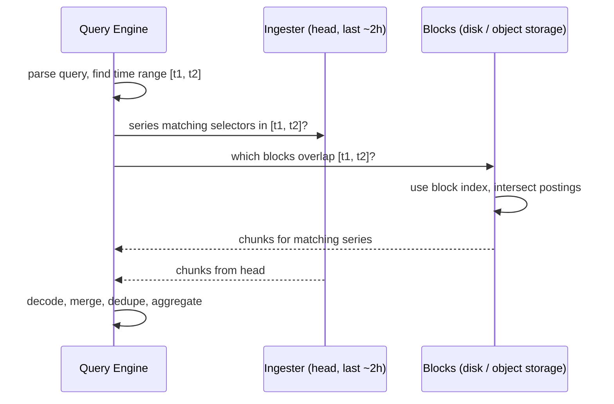

Important performance facts:
- Block **metadata** (time ranges) lets us skip irrelevant blocks immediately.
- Chunks are **decoded sequentially** from the first sample in the chunk, so reading a 1-hour window costs a few chunks per series, not the whole day.
- The OS **page cache** keeps hot chunks and index pages in memory, so recent dashboards are served mostly from RAM.

## Act 9: Where does 1 year of data live?

Local SSDs on ingesters aren't the place for a year of data (cost, node failures). The usual evolution:

- Ingesters keep the **last ~2-24 hours** locally (head + recent blocks).
- Completed blocks are **uploaded to object storage (S3/GCS)**: cheap (≈ $0.02/GB-month), very durable (11 nines) and effectively unlimited.
- Query-time components fetch block indexes and chunk ranges from S3, using caches. (Thanos, Cortex, Mimir and M3 take this approach.)

```
237 GB/day × 365 ≈ 86 TB/year  (single copy)
S3 at ~$0.023/GB-month ≈ $2,000/month for the whole year at full resolution
```

In comparison, the same year on replicated SSDs would cost many times more. Chapter 6 shrinks it further with downsampling and tiering. The distributed query layer over these blocks comes in Chapters 5 and 7.

## What we've built so far

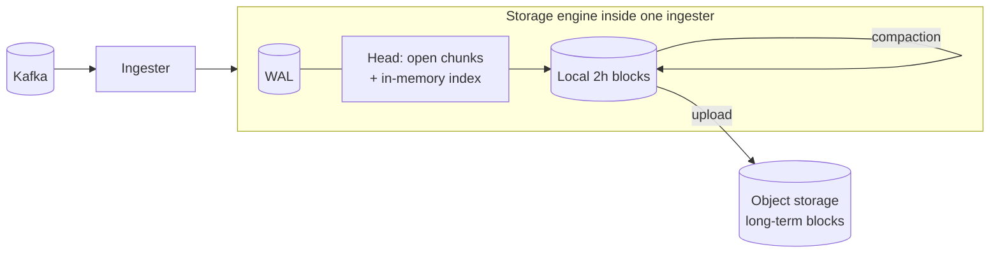

## Interview-style summary (60-second version)

> "Metrics are append-only, time-ordered, highly compressible and queried by series and time range, so I'd use a purpose-built **time-series storage engine**, LSM-style. Each ingester appends to a **WAL** for crash recovery, then to an in-memory **head** with one open compressed chunk per series. Chunks use **delta-of-delta for timestamps and XOR for float values**, which is Gorilla-style compression, roughly 1.4 bytes per sample versus 16 raw, so our 2.76 TB/day becomes about 240 GB/day. Every 2 hours the head is flushed into an **immutable block** with its own chunks and an **inverted index** (label → postings list of series IDs), and queries intersect postings lists to find series. Blocks are compacted, uploaded to **object storage**, and **retention is just deleting old blocks**. Duplicates are idempotent, and out-of-order samples are accepted within a window. The main scaling limit is memory per active series, so cardinality control and sharding are critical."

## Check your understanding

1. Timestamps are 100, 110, 120, 130, 141, 150. Compute the deltas and the delta-of-deltas. Roughly how many bits would the first three DoDs take?
2. Why does the inverted index intersect *sorted* postings lists, and what is the complexity?
3. Your cluster has 20M active series at ~3 KB each. Why can't a single big machine just hold this? (Give at least two reasons.)
4. Why is "delete data older than 90 days" nearly free in this design but painful in MySQL?
5. A collector is offline for 30 minutes, then flushes its buffered samples. What happens to those samples at the storage layer under our out-of-order policy? What if it was offline for 3 hours?

---

Answer these or tell me what's fuzzy. When you're ready, we'll go to **Chapter 5: Sharding, Replication and Cardinality**. There we'll spread series across many ingesters with consistent hashing, replicate for durability using quorum writes, and then deal with the problem that replication creates: duplicated data at query time, plus the cardinality explosion that can still take the whole cluster down.


-----------------------------------------------------------------------------------------------------------------------
-----------------------------------------------------------------------------------------------------------------------
-----------------------------------------------------------------------------------------------------------------------
-----------------------------------------------------------------------------------------------------------------------


## Answer key for Chapter 4

1. **Timestamps 100, 110, 120, 130, 141, 150:** The deltas are 10, 10, 10, 11, 9. The delta-of-deltas are **0, 0, +1, -2**. The first three DoDs (0, 0, +1) cost about 1 + 1 + (2-bit prefix + 7 bits = 9) = **~11 bits**, versus 192 bits raw. (The first timestamp is stored in full and the first delta in a fixed field, which is a one-time cost per chunk.)
2. **Sorted postings lists:** Two pointers walk both lists, advancing the smaller one, so the intersection is a linear **O(n + m)** merge with no hashing or random lookups. Starting with the *shortest* list and skipping ahead in the longer ones is faster still. Sorted IDs also delta-encode and compress well.
3. **Why one machine can't hold 20M series:** (a) it's a **SPOF**; (b) 2M samples/s of CPU, network and disk I/O is more than one node comfortably handles; (c) **WAL replay and recovery** of 60 GB takes very long after a restart; (d) growth has a ceiling, and RAM and GC pauses get worse as the heap grows; (e) the **blast radius** of one failure is the whole fleet's monitoring.
4. **Retention:** Blocks are immutable and time-partitioned, so retention means deleting whole block directories, which is O(1) per block. In MySQL, `DELETE` touches billions of rows, updates indexes, bloats the table and holds locks.
5. **Late collector:** After 30 minutes, the samples fall **inside the 1-hour out-of-order window**. They go into an out-of-order chunk and are merged at compaction. After 3 hours, they're **outside the window** and get rejected (counted in a metric), unless a separate backfill path exists. That's why collector buffers are bounded: it is pointless to keep data the backend will refuse.

---

# Chapter 5: Sharding, Replication and Cardinality

**The question:** Chapter 4 gave us a good storage engine on *one* ingester. But 20 million series, 2M samples/s and "never go blind" don't fit on one machine. How do we spread the load (sharding), survive failures (replication), and survive our own users (cardinality)?

## Act 1: How big does the cluster need to be?

Plan capacity the way you would in an interview:

```
Active series           : 20 million
Replication factor (RF) : 3   (explained below)
Series-replicas total   : 20M × 3 = 60 million
Comfortable per ingester: ~1.5M series (~4.5 GB head + room for compaction, queries, GC)

Ingesters needed = 60M / 1.5M = 40
Add ~50% headroom for spikes, deploys, growth → ~60 ingesters
```

Now the design question: **which series goes to which ingester?**

## Act 2: Choosing a sharding key

| Strategy | What happens | Verdict |
|---|---|---|
| **By time** (shard 1 = today, shard 2 = yesterday) | All current writes hit the newest shard | **Hot shard**. Bad for a write-heavy system |
| **By metric name** | `http_requests_total` has millions of series, other metrics have a few | **Heavy skew** |
| **By host/tenant** | Hot tenant or huge host overloads one node. Also, "all services' CPU" queries span every shard anyway | Skewed |
| **By hash of series identity** (name + sorted labels) | Even distribution; all samples of a series stay together, in order | **Best**. Same key we chose for Kafka in Chapter 3 |

So: `shard = hash(metric_name + sorted_labels)`.

### First attempt: `hash % N`

With N = 60 ingesters, `owner = hash % 60`. Chapter 2 already showed the flaw: going from 60 to 61, a key stays only if `hash % 60 == hash % 61`, so about **98% of series move**. In our system that means ~98% of series suddenly route to a *different* ingester, losing continuity, and every chunk, WAL and cache is now in the wrong place. This is unacceptable for a cluster we must scale without downtime.

## Act 3: Consistent hashing (the fix)

**Idea:** map both *keys* and *nodes* onto the same circular hash space (say 0 to 2^32). A key belongs to the **first node clockwise** from its position.

Mermaid can't draw a circle well, so here's an ASCII version:

```
                    0 / 2^32
                       |
              Node C ● | ● key k3
                 .     |     .
             .         |         .
          k2 ●         |         ● Node A
         .             |             .
        |                             |  k1 → clockwise → Node A
          .                         .
             .                   .
                 .   ● Node B  .
                      ● key k4  (→ clockwise → Node C, wrapping around)
```

Rule: each key walks clockwise and lands on the next node.

**Adding a node D** between A and B: only the keys between the previous node and D move to D. All other keys stay put. On average only **1/(N+1)** of keys move, compared to ~98% with modulo.

### Problem: uneven slices

With a handful of random positions, one node might own 40% of the ring and another 5%. Worse, when a node dies, *all* its load goes to just its clockwise neighbor, which might then fall over too (**cascading failure**).

### Fix: virtual nodes (tokens)

Give each physical node **many positions** on the ring (e.g. 128 or 512 tokens). Each node now owns many small, scattered slices.

- Load evens out statistically (law of large numbers).
- When a node dies, its slices are absorbed by **many different** neighbors, so each takes a small extra share.
- Heterogeneous hardware: a machine with twice the RAM gets twice the tokens.

**Interview line:** *"Consistent hashing with virtual nodes: bounded data movement on scale events, even load, and graceful failure redistribution."*

## Act 4: Replication (because machines die)

With sharding alone, if an ingester dies we lose its in-memory head (the last up-to-2 hours of its series) and those series can't be written until someone takes over. We need **copies**.

**Replication factor RF = 3:** each series is stored on **3 different ingesters**: the owner and the next 2 *distinct* nodes clockwise on the ring.

### Zone-aware placement

Three replicas on three machines in the *same rack* is fake safety. We place the replicas in **three different availability zones** (one per zone). Losing a whole AZ then costs one replica of each series, never all three.

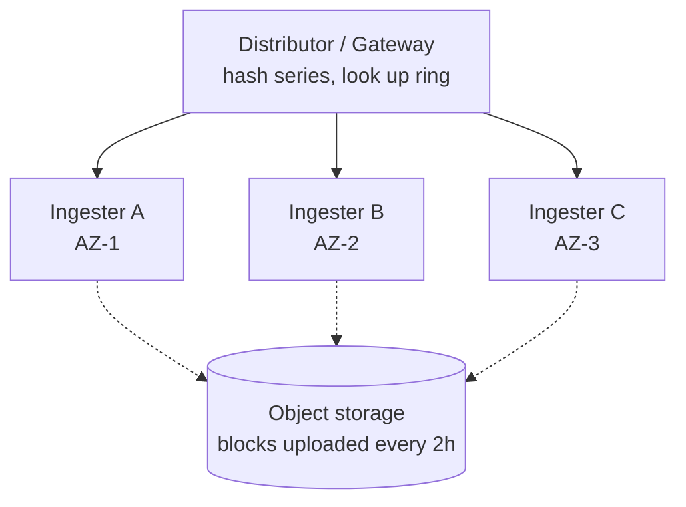

### Write quorum

The distributor sends each sample to all 3 replicas and **declares success when 2 acknowledge (W = 2)**.

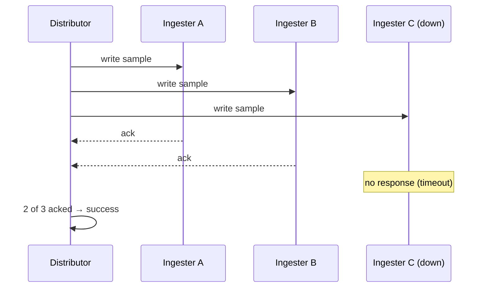

**Why quorum math matters:**
- **RF = 3, W = 2** tolerates **1** replica failure for writes with no impact on callers.
- If a read must reach R replicas, **W + R > N** guarantees the read set overlaps the write set (the classic quorum rule). With N=3, W=2, R=2: 2 + 2 = 4 > 3. ✔
- If **2 replicas** of the same series are down, writes for those series fail (W can't be met). **Kafka-buffered writes and collector retries** let us ride out short windows like this without data loss.

### Why not Raft/Paxos for strong consensus?

A good interviewer will ask. Our data is **append-only and idempotent**: the same `(series, timestamp)` always has the same value, with no conflicting updates to arbitrate. Without conflicts there is nothing for consensus to decide. Quorum writes plus deduplication give us enough, at a fraction of the coordination cost. Consensus is reserved for **small, critical metadata** (the ring membership, leader election for HA dedup).

### What happens when a node comes back after a crash?

1. It replays its **WAL** and recovers what it had acknowledged.
2. It has a **gap** for the period it was down. The other two replicas have that data.
3. We don't copy the missing data back right away (hinted handoff / repair). Instead, the **query layer merges replicas**, so the gap is invisible to users, and later the **compactor** merges the replicas' blocks into one complete copy in object storage (see Act 6).

This is a deliberate trade-off. Strict repair would cost network and complexity for samples that are already safe elsewhere.

## Act 5: Scaling out and in (resharding is cheap here)

Chapter 4 gave us a hidden gift: **an ingester only holds about 2 hours of data locally.** Older data is already in immutable blocks in object storage. That makes resharding far easier than in a typical database:

```mermaid
sequenceDiagram
    participant N as New Ingester D
    participant R as Ring (etcd / gossip)
    participant O as Old owners
    N->>R: join as JOINING, claim tokens
    R-->>N: tokens assigned
    N->>R: become ACTIVE
    Note over O,N: new samples for D's ranges now go to D
    Note over O: old owners keep their existing series until<br/>they flush them (≤ 2h), no data copying
    Note over N,O: queries ask both during the overlap
```

- **No bulk data migration.** New writes start flowing to the new node. The old owners keep what they have and flush it to S3 as usual.
- Queries fan out to the union of old and new owners during the transition (up to ~2h).
- **Scale-in** is the reverse: the node enters LEAVING, stops accepting new series, **flushes its head to blocks**, uploads them, and then exits.

Ring states (JOINING / ACTIVE / LEAVING / UNHEALTHY) and ring storage (gossip protocol, or a store like etcd/Consul) are worth naming in interviews. Clients cache the ring, so a stale view causes a retry, not data loss.

## Act 6: New problems created by sharding and replication

Every fix creates new problems. That's the story of every real system.

### Problem A: Queries now fan out

A query like `sum(rate(http_requests_total[5m]))` involves series spread across **all 60 ingesters** (hash-sharding scattered them) plus blocks in object storage.

```mermaid
flowchart LR
    Q[Query Engine] -->|recent data, last ≤2h| I1[Ingester 1]
    Q --> I2[Ingester 2]
    Q --> IN[Ingester ...60]
    Q -->|older data| ST[Store Gateway<br/>reads blocks from S3]
    I1 --> M[Merge + dedup + aggregate]
    I2 --> M
    IN --> M
    ST --> M
    M --> R[Result]
```

This is **scatter-gather**. Its cost: **tail latency**. The query is as slow as the slowest of 60 responders (if each has a 1% chance to be slow, the chance that *at least one* of 60 is slow is ~45%). Mitigations: per-request timeouts, **hedged requests** (send a second request to another replica if the first is slow), and using only replicas that responded when a quorum is enough.

### Problem B: 3 copies of every sample

Replication means a query for one series returns **three copies** of each sample. The query merge step must **deduplicate by (series, timestamp)**. The same holds in object storage: if all three ingesters upload their blocks, we'd store 3x the data (258 TB/year instead of 86 TB, and the bill triples).

**Fix: vertical compaction.** A **compactor** service reads the three replica blocks for the same time range, merges and dedups them, and writes **one** block back to S3, then deletes the duplicates. S3 already provides its own durability (11 nines), so we don't need 3 copies there.

```mermaid
flowchart LR
    A[Block from Ingester A] --> C[Compactor<br/>merge + dedup]
    B[Block from Ingester B] --> C
    D[Block from Ingester C] --> C
    C --> O[(One deduplicated block)]
```

### Problem C: Noisy neighbors, and one bad tenant can hurt everyone

If tenant X has a runaway metrics bug, series from X are hash-spread over **all** ingesters, so **every ingester** is stressed and **every tenant** suffers. Hash sharding gives perfect load balance and a **maximum blast radius**. Those two goals pull in opposite directions.

**Fix: shuffle sharding.** Assign each tenant a **small, pseudo-random subset** of ingesters (e.g. 6 of 60) derived deterministically from the tenant ID. The tenant's series are hashed only across *its* subset.

```mermaid
flowchart LR
    TA[Tenant A] --> I1[Ingester 1]
    TA --> I2[Ingester 2]
    TA --> I3[Ingester 3]
    TB[Tenant B] --> I3
    TB --> I4[Ingester 4]
    TB --> I5[Ingester 5]
    TC[Tenant C] --> I1
    TC --> I5
    TC --> I6[Ingester 6]
```

If tenant A misbehaves and takes down ingesters 1, 2 and 3, B and C each lose *some* capacity but are not fully down. The math is the striking part:

```
Number of distinct 6-ingester subsets out of 60 = C(60, 6) = 50,063,860
Chance another tenant lands on exactly the same 6 ≈ 1 in 50 million
```

Even if the poison tenant crashes all 6 of its ingesters, a given other tenant almost certainly still has several healthy ones. Query paths use the same subset, so tenant queries also touch only 6 nodes, which **reduces fan-out and tail latency**, a nice double benefit. Cost: slightly less perfect balance and more complex routing.

## Act 7: Cardinality explosion

This is the failure that real monitoring teams fear most, so be ready to discuss it for several minutes.

### How it happens

Active series = **product of label cardinalities**:

```
http_requests_total{service, endpoint, status, host}
50 × 20 × 5 × 200 = 1,000,000 series     ← fine

Someone adds user_id (10 million users):
                    = 10,000,000,000,000 potential series   ← cluster dies
```

Common culprits: `user_id`, `request_id`, full URLs with IDs (`/orders/839201`), error message text, timestamps, and **pod or container names that churn** with every deployment.

### What it breaks

| Component | Effect |
|---|---|
| Ingester memory | ~3 KB per series, so OOM crashes |
| Index | Postings lists explode, slower writes and queries |
| Compaction | Larger blocks, longer I/O |
| Queries | `sum(...)` over millions of series times out |
| Cost | Storage grows by orders of magnitude |

A crash is worse than just failure: after restart, the WAL replays the same poison series and the node crashes again (a **crash loop**).

### Defense in depth (this layered answer is what impresses interviewers)

```mermaid
flowchart TD
    A[Sample arrives] --> L1{Collector:<br/>per-scrape sample_limit,<br/>label count/length limits}
    L1 -->|ok| L2{Gateway:<br/>per-tenant active-series limit,<br/>per-metric limit}
    L2 -->|ok| L3{Ingester:<br/>local series limit<br/>global limit × RF / shard size}
    L3 -->|ok| W[Write]
    L1 -->|reject whole scrape| X1[Record error metric]
    L2 -->|reject NEW series only| X2[429 + alert tenant]
    L3 -->|reject NEW series only| X3[Counter: series_limit_hit]
```

1. **Collector limits**: stop it at the source (as in Chapter 2).
2. **Per-tenant active-series limit** at the gateway, e.g. 5M series per team.
3. **Reject only *new* series**, never existing ones. If a team hits its limit, their established metrics (and their alerts) must keep working. Dropping a whole batch would blind them.
4. **Per-ingester local limits** derived from the global limit: `local = global × RF / ingesters_in_shuffle_shard`. They protect individual nodes from memory exhaustion even if the global counters lag.
5. **Relabeling and drop rules**: strip dangerous labels at ingestion.
6. **Cardinality tooling**: dashboards for "top 10 metrics by series count", series-growth alerts at 80% of the quota, and **per-team cost attribution** so teams feel the cost. This social side matters in real organizations.
7. **Head garbage collection**: a series with no samples for ~2 hours is dropped from the in-memory head, which keeps *churn* from accumulating.
8. **Design guidance**: labels must have **bounded** values. High-cardinality details belong in **logs and traces**, and metrics can link to a trace through **exemplars** (a trace ID attached to a histogram bucket).

## Act 8: How this fits with the Kafka design from Chapter 3

We introduced Kafka partitioned by series hash in Chapter 3, so you may ask: *"where's the ring in that design?"* Two valid architectures exist, and you should be able to discuss both:

| | **Model A: Ring + quorum writes** (classic Cortex/Mimir) | **Model B: Kafka-partition replicas** (our Chapter 3 pipeline) |
|---|---|---|
| Sharding | Consistent-hash ring of ingesters | **Partition** = shard, series hash picks partition |
| Replication | Distributor writes to RF=3 ingesters, quorum W=2 | **3 ingesters (one per AZ) each consume the same partition**, independent offsets |
| Write success | Needs 2 of 3 acks | Success = durable in Kafka (RF=3 brokers) |
| Ingester down | Quorum covers; node has a gap | Node resumes from its offset, **no gap** |
| Resharding | Move tokens | Change partition assignment (and the partition count needs care, per Chapter 3) |
| Extra cost | Distributor fan-out ×3 | Kafka cluster to run |

In Model B, the "replicas" aren't copied by the writer at all. They're **independent materializations of the same log**, which is simpler to reason about and gives gap-free restarts. Quorum, zone-awareness, vertical compaction and shuffle sharding all still apply. Choose A for fewer moving parts, B when you already need the log for burst absorption, replay and multiple consumers (our situation).

## Interview-style summary (60-second version)

> "I'd shard by a **hash of the series identity** so load is even and each series' samples stay together for compression. I'd use **consistent hashing with virtual nodes**, so scaling out moves only ~1/N of the data, and failures spread across many neighbors. Resharding is cheap because ingesters hold only ~2 hours; older data is in object storage. I'd replicate with **RF=3 across three AZs** and a **W=2 quorum**. Metrics are append-only and idempotent, so quorum plus dedup is enough and we don't need Raft. The queries **scatter-gather** across ingesters and dedup, using hedged requests to tame tail latency. A **compactor** merges the three replicas into one block in S3. To limit blast radius from a noisy tenant I'd use **shuffle sharding**, and to survive **cardinality explosions** I'd have layered limits (collector, gateway, ingester) that reject only *new* series so alerts keep working, plus cardinality dashboards and cost attribution."

## Check your understanding

1. Going from 60 to 61 ingesters, what fraction of series move under `hash % N`? Under consistent hashing? Why do virtual nodes matter?
2. With RF=3, W=2, one ingester down and a second ingester in the same replica set also fails. What happens to writes for series on that set? What saves us from losing data?
3. Why don't we use Raft for replicating samples?
4. Why does S3 only need *one* copy of each block, while ingesters need three?
5. Tenant X hits its series limit. Why should we reject only *new* series rather than the whole write request?
6. Explain shuffle sharding to a teammate in two sentences, and give one benefit beyond blast-radius reduction.

---

Answer these or tell me what's fuzzy. When you're ready, we'll move to **Chapter 6: Retention, Downsampling and Tiered Storage**. Our storage is now scalable and replicated, but keeping every 10-second sample for a year is wasteful, since nobody needs 10-second resolution from 8 months ago. We'll see how rollups, tiering and per-resolution retention cut cost by an order of magnitude, and the tricky part of why you can't simply average everything when you downsample.


-----------------------------------------------------------------------------------------------------------------------
-----------------------------------------------------------------------------------------------------------------------
-----------------------------------------------------------------------------------------------------------------------
-----------------------------------------------------------------------------------------------------------------------


## Answer key for Chapter 5

1. **Resharding 60 → 61:** Under `hash % N`, a key stays only if `hash % 60 == hash % 61`, which happens ~1/61 of the time, so **~98% of series move**. Under consistent hashing only the new node's slices move, **~1/61 (~1.6%)**. Virtual nodes give an even load, spread a dead node's load across many neighbors (no cascading failure), and let bigger machines take more tokens.
2. **Two replicas down in the same set:** W=2 can't be met, so writes for series on that set **fail or are retried**. No data is lost, because the surviving replica still has what it acknowledged, and collectors and the Kafka buffer hold the rest until a quorum returns. Only series on that replica set are affected.
3. **No Raft for samples:** Data is append-only and idempotent, so there are no conflicting writes to arbitrate. Consensus would add coordination latency to every write for no benefit. We keep it for small metadata (ring membership, HA leader election).
4. **One copy in S3:** Object storage already replicates internally (11 nines of durability). Ingesters hold volatile data (memory and local disk), so they need replicas for availability and durability *before* the flush.
5. **Reject only new series:** Existing series keep flowing, so dashboards and **alerts keep working** for the team that hit the limit. Rejecting the whole request would blind them exactly when something is wrong.
6. **Shuffle sharding:** Each tenant is deterministically mapped to a small random subset of ingesters, so a misbehaving tenant can only hurt its own subset, and the chance that another tenant shares the same subset is tiny. **Extra benefit:** queries fan out to only those few nodes, so tail latency drops and caches stay warmer.

---

# Chapter 6: Retention, Downsampling and Tiered Storage

**The question:** our storage scales and survives failures. But a year of 10-second data is slow to query and wasteful to keep. How do we keep long history cheaply and still draw a 1-year graph in under a second?

## Act 1: The real problem is query cost, not storage cost

Storage first. Chapter 4 gave us ~237 GB/day compressed, so a year at full resolution is ~86 TB, roughly $2,000/month in S3. That's survivable. So why change anything?

Look at what a dashboard does. A panel is about **1,000 pixels wide**. Count the points per series at 10 s resolution:

| Time range | Points per series (raw 10 s) |
|---|---|
| 6 hours | 2,160 |
| 24 hours | 8,640 |
| 30 days | 259,200 |
| 1 year | **3,153,600** |

A 1,000-pixel panel can't show 3 million points, so we'd read 3,000 points per pixel and throw almost all of them away. Now aggregate across many series, using Chapter 1's example "average CPU across 500 web servers over 30 days":

```
500 series × 259,200 samples = 129.6 million samples to fetch, decode, and average
```

That's seconds to minutes of work, plus a lot of S3 reads. A 1-year version is ~1.6 billion samples. **Nobody waits for that.**

There's also a usage reality: when did you last need 10-second resolution from 8 months ago? Old data is only used for **trends**, so coarse resolution is enough.

## Act 2: Attempt 1, plain retention (just delete old data)

"Keep 15 days at full resolution, delete the rest." This is trivially cheap (Chapter 4: dropping old blocks is O(1)), and queries are bounded.

But the business needs long history:
- **Capacity planning:** "How fast is disk usage growing per quarter?"
- **Seasonality:** "How did we do during last year's sale?" (year-over-year)
- **SLO reports:** 30- and 90-day availability.
- **Regression hunting:** "When did latency creep up?"

Deleting everything after 15 days gives these teams nothing. So we need to **keep old data at lower resolution.**

## Act 3: Attempt 2, downsampling

**Idea:** as data ages, replace it with fewer, coarser samples. A common ladder:

| Resolution | Reduction vs. 10 s raw |
|---|---|
| 10 s (raw) | 1x |
| 5 minutes | 30x fewer points |
| 1 hour | 360x fewer points |

Now the same 30-day, 500-series query reads 500 × 8,640 = **4.3 M samples at 5 m**, or 500 × 720 = **360 k at 1 h**, versus 129.6 M raw.

Simple enough? **No.** There's a trap, and it's a favorite interview topic.

## Act 4: The averaging trap (what do you keep per window?)

The naive approach is to replace each 5-minute window with its **average**. This breaks in four ways.

### Trap 1: Averages hide spikes

A window has 30 samples (10 s each). CPU is 10% for 29 of them and 100% for one 10-second spike.

```
average = (29×10 + 100) / 30 ≈ 13%   ← the spike is gone
max     = 100%
```

An alert or investigation for "CPU hit 100%" can't find it in the downsampled data. So we keep **min and max** too.

### Trap 2: Averaging averages is wrong

When we later downsample 5 m → 1 h, we'd average the 5-minute averages. But windows can have different sample counts (missed scrapes, a pod that restarted).

```
Window 1: 10 samples, avg 50   (sum = 500)
Window 2:  2 samples, avg 90   (sum = 180)

Average of averages = (50 + 90) / 2 = 70      ← wrong
True average = (500 + 180) / 12 ≈ 56.7        ← right
```

So we store **sum and count**, not the average (`avg = sum / count` at query time). Sums and counts compose correctly across any number of re-aggregations.

### Trap 3: Counters need reset-aware handling

Recall counters (Chapter 1): cumulative, and they reset to 0 on restart. Raw samples: `100, 150, [restart] 10, 40`.

```
Naive "last - first" = 40 - 100 = -60               ← nonsense
True increase = (150-100) + 10 + (40-10) = 90      ← drop at restart treated as reset to 0
```

The downsampler must **detect resets and stitch the counter** into a monotonic series (`100, 150, 160, 190`) *before* keeping the last value per window. Then `rate()` and `increase()` still work on the coarse data.

### Trap 4: Percentiles can't be averaged (this closes the loop from Chapter 1)

Server A: p99 = 100 ms over 1,000 requests. Server B: p99 = 500 ms over 10 requests.

```
Average of p99s = 300 ms             ← misleading
True p99 over all 1,010 requests     ← much closer to 100 ms (B is under 1% of traffic)
```

Pre-computed percentiles (what **summaries** store) can't be re-aggregated, either across servers or across time. The fix is **histograms**: store **bucket counters** (`requests ≤ 10 ms`, `≤ 50 ms`, `≤ 100 ms`...). Counters sum correctly across servers and downsample correctly across time, and we compute the quantile at query time from the summed buckets. That's why histograms win over summaries for large fleets.

### What a downsampled window stores

| Metric type | Per-window aggregates kept |
|---|---|
| **Gauge** | `min`, `max`, `sum`, `count` (average is derived: `sum / count`) |
| **Counter** | Last value after reset-stitching |
| **Histogram buckets** | Treated as counters, downsampled the same way |

(Thanos stores roughly this set: count, sum, min, max and counter.) That's **~5 values per window**, which matters for cost, next.

## Act 5: Where and when to downsample

```mermaid
flowchart LR
    ING[Ingesters<br/>2h blocks] -->|upload| RAW[(Raw 10s blocks<br/>retention 15 days)]
    RAW --> CMP[Compactor<br/>merge replicas + compact]
    CMP --> DS1[Downsampler → 5m]
    DS1 --> M5[(5m blocks<br/>retention 180 days)]
    M5 --> DS2[Downsampler → 1h]
    DS2 --> H1[(1h blocks<br/>retention 2 years)]
    RET[Retention enforcer] -.deletes expired blocks.-> RAW
    RET -.-> M5
    RET -.-> H1
```

Design notes interviewers like:

1. **A background batch job on blocks in object storage**, not on the hot write path. Downsampling must never slow ingestion.
2. **Downsample only compacted, "settled" blocks.** Late and out-of-order data (Chapter 4, 1-hour window) must have already arrived. If we downsample a block and *then* a late sample lands in the raw block, the coarse copy is silently stale. Real systems wait until blocks are well past the out-of-order window (Thanos waits ~40 hours before the 5 m pass).
3. **Downsampling is additional, not a replacement.** The 5 m blocks sit **alongside** raw. Storage only drops when the **raw retention expires**. This is a subtle point: downsampling alone makes queries faster, and *retention per resolution* is what saves money.
4. **Retention is enforced per resolution** (15 d raw, 180 d 5 m, 2 y 1 h), again just by deleting block directories.

### Downsampling vs. recording rules (they're often confused)

| | Downsampling | Recording rules / stream aggregation (Chapter 3) |
|---|---|---|
| Reduces | **Time resolution** (10 s → 5 m) | **Dimensions / cardinality** (drop `host`, `pod`) |
| Same series? | Yes, same labels, fewer points | No, a new, smaller series set |
| Typical purpose | Cheap long-range queries | Fast dashboards on heavy metrics |

They're complementary. A mature platform does both.

## Act 6: Picking the right resolution at query time

The query engine decides which tier to read based on the **time range** and the **panel width**.

```mermaid
flowchart LR
    Q[Query: range + panel width] --> S[step = range / pixels]
    S --> R{coarsest resolution<br/>where resolution ≤ step / 5}
    R -->|fine| RAWQ[Raw 10s]
    R -->|medium| M5Q[5m blocks]
    R -->|coarse| H1Q[1h blocks]
```

Rule of thumb: pick the **coarsest resolution that is ≤ step ÷ 5**, so each output point still summarizes several underlying samples (and `rate()` always has ≥ 2 samples in its window).

Worked examples (1,000 px panel):

| Panel range | step = range / 1000 | step ÷ 5 | Chosen resolution | Points per series |
|---|---|---|---|---|
| 6 hours | ~22 s | ~4 s | **raw 10 s** | ~2,160 |
| 30 days | ~43 min | ~8.6 min | **5 m** (300 s fits, 1 h doesn't) | 8,640 |
| 1 year | ~8.8 h | ~1.75 h | **1 h** | 8,760 |

Notice something nice: **every panel reads about the same order of magnitude of points (2k-9k per series), regardless of range.** That's the goal: *query cost proportional to what you can display, not to the time span.*

Also handle the boundary: a 30-day panel needs 5 m data for most of the range but raw for "now" (the last couple of hours, if 5 m blocks don't exist yet). The engine **stitches resolutions** across the range.

## Act 7: Tiered storage (hot, warm, cold)

Different ages have different access patterns, so they deserve different storage:

```mermaid
flowchart LR
    H["HOT<br/>Ingester memory + local SSD<br/>last 2–24h"] --> W["WARM<br/>Object storage, standard class<br/>+ caches on store-gateways<br/>raw 15d, 5m 180d"]
    W --> C["COLD<br/>Cheaper object class<br/>1h data, up to 2 years<br/>compliance / audits"]
```

| Tier | Holds | Why this medium | Query latency |
|---|---|---|---|
| **Hot** | Last 2-24 h | RAM + SSD; serves dashboards and alert evaluation | ms |
| **Warm** | Recent raw blocks, 5 m blocks | Object storage + local caches (index headers, hot chunks) | 10s-100s of ms |
| **Cold** | 1 h and older | Infrequent-access object class (roughly half the price of standard; archive classes far cheaper but with retrieval delays) | 100s of ms - seconds |

**Lifecycle policies** (S3 rules) move blocks between classes automatically by age, so there's no custom code. Caution: very cold "archive" classes (hours to restore) are fine for compliance but **not** for dashboards, so keep anything interactive in an instant-access class.

## Act 8: The cost math, end to end

Assume the Chapter 4 baseline of 237 GB/day (compressed raw, single copy in S3) and the retention ladder above.

```
Raw 10s:  237 GB/day × 15 days                    ≈ 3.5 TB
5m:       30× fewer points × 5 aggregates ≈ 1/6 size
          ≈ 40 GB/day × 180 days                   ≈ 7.1 TB
1h:       360× fewer points × 5 aggregates ≈ 1/72 size
          ≈ 3.3 GB/day × 730 days                  ≈ 2.4 TB
                                           Total   ≈ 13 TB

Same 2 years at full resolution: 237 GB × 730       ≈ 173 TB

At ~$0.023/GB-month:  13 TB ≈ $300/month   vs   173 TB ≈ $4,000/month   (~13x cheaper)
```

Honest caveat for the interview: the coarse-data sizes are approximate. Coarse aggregates are **less regular**, so Gorilla-style compression (Chapter 4) works less well on them, and the real savings will be somewhat smaller than 13x. The shape of the argument still holds.

And the **query-side win is bigger than the storage win**: the 30-day, 500-series query dropped from 130 M samples to 4.3 M (**30x**), and a one-year query to under 5 M instead of 1.6 B (**360x**).

## Act 9: Hard parts and edge cases

1. **Alerting never uses downsampled data.** Alerts run on hot, raw data, and fresh data is always in the hot tier. Downsampling is for humans looking at history.
2. **Per-metric retention is hard in block-based storage.** A block mixes thousands of metrics, so "keep this metric 2 years, that one 7 days" would mean rewriting blocks. Practical answers: set retention **per tenant** (tenants have separate blocks), run **separate clusters or tenants for different classes** (critical SLO metrics vs. debug metrics), or accept coarse retention rules. This is a real trade-off to name.
3. **Deletion requests (privacy, bad data):** blocks are immutable, so we write a **tombstone**, and the compactor rewrites the block later (Chapter 4). It's slow, and a good reason to keep personal data out of metrics entirely.
4. **Which aggregation for a given query?** `max_over_time` should read the stored `max`, `avg` should use `sum/count`, and `rate` reads the stitched counter. The query engine must map functions to the right stored aggregate, and some functions just aren't answerable from coarse data (e.g. an exact quantile over a window needs raw data or histogram buckets).
5. **Reprocessing cost:** if you change the downsampling scheme later (say add a 15 m tier), you must reprocess history. Another reason to choose the ladder thoughtfully at the start.
6. **Failed or delayed downsampling job:** queries fall back to the finer resolution, which is slower but still **correct**. The design degrades gracefully rather than failing, which is worth saying out loud.

## Interview-style summary (60-second version)

> "Reading a year of 10-second data for a 1,000-pixel graph is wasteful (3 million points per series), so I'd keep **raw data for ~15 days and downsample older data** to 5-minute and 1-hour resolutions, with retention enforced per resolution by dropping whole blocks. When downsampling I wouldn't just average. For gauges I'd store **min, max, sum and count** (so spikes survive and re-aggregation is correct), for counters I'd **stitch resets** and keep the last value, and I'd use **histogram buckets instead of pre-computed percentiles** so quantiles remain aggregatable. Downsampling is a **background job on settled blocks in object storage**, after the late-data window has passed. At query time the engine picks the **coarsest resolution ≤ step/5**, so each panel reads only a few thousand points per series whatever the time range. Storage is **tiered**: hot (RAM/SSD, last hours), warm (object storage with caches), cold (cheaper class), with lifecycle rules. For our numbers that cuts two years of storage from ~173 TB to ~13 TB and long-range query cost by 30-360x. Alerts always use hot raw data."

## Check your understanding

1. A 30-minute window of CPU samples is replaced by its average. Why can an alert like "CPU > 95% at any time" no longer be answered from this data, and what do we store to fix it?
2. Window A has 6 samples (avg 20), window B has 3 samples (avg 80). What is the correct combined average, and what's the naive "average of averages"?
3. Counter samples: `500, 700, 50, 120` (restart between 700 and 50). What's the true increase, and what stitched series would the downsampler emit?
4. Why do histograms downsample and aggregate correctly while summaries (pre-computed p99) don't?
5. We just added a 5-minute downsampler, but our storage bill didn't go down. Why, and what actually reduces it?
6. For a 7-day panel (1,000 px wide), which resolution would the rule of thumb select (raw 10 s, 5 m, or 1 h), and how did you get there?

---

Answer these or tell me what's fuzzy. When you're ready, we'll move to **Chapter 7: The Query Path (dashboards, caching, CDN and time ranges)**. We have fast, cheap, multi-resolution data, but hundreds of engineers all load the same dashboards, and every refresh fans out across dozens of nodes. We'll see how query frontends, time-splitting, result caches, cache invalidation for *moving* time windows, the CDN for dashboard assets, and cache pre-warming turn this into a snappy experience.


-----------------------------------------------------------------------------------------------------------------------
-----------------------------------------------------------------------------------------------------------------------
-----------------------------------------------------------------------------------------------------------------------
-----------------------------------------------------------------------------------------------------------------------


## Answer key for Chapter 6

1. **Averaged window:** A 30-minute average smooths a 10-second spike at 100% into something like 15%, so "CPU > 95% at any time" can't be answered. We fix it by storing **min and max** per window alongside sum and count.
2. **Combined average:** (6×20 + 3×80) / 9 = 360 / 9 = **40**. The naive average of averages is (20 + 80) / 2 = **50**, which overweights the smaller window. That's why we store sum and count instead of the average.
3. **Counter `500, 700, 50, 120`:** The true increase is (700 − 500) + 50 + (120 − 50) = **320**. After reset-stitching the downsampler emits **500, 700, 750, 820**, which is monotonic, so `rate()` and `increase()` still work.
4. **Histograms vs summaries:** Histogram buckets are plain counters, so they can be **summed across servers and across time**, and the quantile is computed *after* summing. A summary's p99 is already a computed answer for one instance, and you can't combine p99s correctly.
5. **Downsampling didn't cut the bill:** Downsampling *adds* coarse blocks alongside raw, so storage grows slightly. It only shrinks once **raw retention is shortened** and old raw blocks are deleted.
6. **7-day panel:** step = 604,800 s / 1,000 ≈ 605 s, and step ÷ 5 ≈ 121 s. The 5 m tier (300 s) is too coarse for that rule, so it picks **raw 10 s**, which is ~60,000 points per series. This is a correction to my earlier claim: I said every panel reads about 2k-9k points, but I only tested 6 h, 30 d and 1 y. A 7-day panel falls between tiers and breaks the pattern. Real systems handle this by loosening the rule (e.g. step ÷ 2 allows the 5 m tier, about 2k points) or by adding an intermediate tier. The "÷ 5" rule is a tunable, not a law.

---

# Chapter 7: The Query Path (Dashboards, Caching, CDN, Time Ranges)

**The question:** we now have fast, cheap, multi-resolution data. But hundreds of engineers load dashboards, and every panel fans out across dozens of nodes. How do we keep it fast for humans and safe for the cluster?

## Act 1: The naive read path

```mermaid
flowchart LR
    U[Dashboard UI] --> Q[Querier]
    Q --> I[Ingesters]
    Q --> S[Store Gateways / S3]
```

A browser sends `GET /api/v1/query_range?query=...&start=...&end=...&step=30s`, and a querier fans out, merges and returns a series of points. This works fine at 5 users. Let's break it with our Chapter 1 numbers.

### The load picture

```
500 concurrent viewers × 15 panels, each auto-refreshing every 30 s
→ 7,500 panel queries per refresh cycle → ~250 queries/sec (as estimated in Ch 1)
```

The count is modest, but **each query can be heavy**, and several things go wrong:

| Problem | What happens |
|---|---|
| **1. Massive duplicate work** | 200 people watch the same "checkout service" dashboard, so the cluster computes the *identical* answer 200 times every 30 s |
| **2. The sliding window** | A "last 6 hours" panel refreshes every 30 s. 99.9% of the window is the same as 30 s ago, yet we recompute all of it |
| **3. Giant single queries** | One query for `sum(rate(...))` over 1M series runs on one querier, takes forever and eats its RAM |
| **4. Noisy neighbor** | One person runs a regex over a year of data and everyone else's dashboards stall |
| **5. Incident stampede** | During an outage, 300 engineers open the same dashboard in the same minute. Load peaks exactly when the system is most stressed |
| **6. Query kills the cluster** | A pathological query exhausts memory and takes queriers (and possibly ingesters) down, so a *read* problem causes a *write* outage |

Each of these motivates a component, so let's add them.

## Act 2: The query frontend, a smart layer in front of the queriers

```mermaid
flowchart LR
    U[Browser] -->|static assets| CDN[CDN]
    U -->|query_range API| LB[Load Balancer]
    LB --> QF[Query Frontend<br/>split, shard, cache, dedup]
    QF <--> RC[(Result Cache)]
    QF --> QS[Query Scheduler<br/>per-tenant fair queue]
    QS --> Q1[Querier 1]
    QS --> Q2[Querier 2]
    Q1 & Q2 --> ING[Ingesters<br/>recent data]
    Q1 & Q2 --> SG[Store Gateways]
    SG --> S3[(Object storage)]
    SG <--> CC[(Index and chunk caches)]
```

The frontend is **stateless** (scale horizontally) and does five jobs. Together they answer Problems 1-3.

### Job 1: Time-splitting (parallelism plus cacheability)

A 30-day query is cut into **day-aligned sub-queries** that run in parallel:

```
Query: last 30 days, step 5m
 ├─ Day  1 ──▶ querier
 ├─ Day  2 ──▶ querier      (all 30 run in parallel,
 ├─ ...                      results stitched together)
 └─ Day 30 ──▶ querier
```

Two benefits: a long query finishes in roughly the time of a one-day query, and **each day's result becomes an independently cacheable unit**. Past days never change, so they're cacheable for a long time.

### Job 2: Query sharding (splitting by series)

Time-splitting doesn't help when one *day* has 1M series. So we also split along the **series dimension**. For `sum(rate(http_requests_total[5m]))`:

```
shard 1/16 → sum over series with hash % 16 == 0  → partial sum
shard 2/16 → ...                                   → partial sum
...                                                   
Frontend: add up the 16 partial sums → final answer
```

This works for **decomposable** aggregations: sum, count, min, max (and avg as sum ÷ count). It doesn't work directly for things needing all raw values at once (e.g. exact quantile across series). For `histogram_quantile` you shard the inner `sum by (le)` and compute the quantile after merging. It's the same principle as Chapter 6: *keep intermediate results that compose.*

### Job 3: The result cache and the sliding window

This is the interview-favorite part. Let's follow a live dashboard.

```mermaid
sequenceDiagram
    participant U as Browser
    participant F as Query Frontend
    participant C as Result Cache
    participant Q as Queriers
    U->>F: last 6h, step 30s (at 14:00:00)
    F->>C: lookup extent
    C-->>F: miss
    F->>Q: compute 08:00:00 to 14:00:00
    Q-->>F: 720 points
    F->>C: store extent 08:00:00-14:00:00
    F-->>U: result
    Note over U,F: 30 seconds later
    U->>F: last 6h, step 30s (at 14:00:30)
    F->>C: lookup
    C-->>F: hit for 08:00:30-14:00:00
    F->>Q: compute ONLY 14:00:00-14:00:30
    Q-->>F: 1 new point
    F->>F: merge cached + new, return
```

The cache stores **extents** (time ranges of results) keyed by `(tenant, normalized query, step)`. For each request the frontend:
1. Looks up which parts of `[start, end]` are already cached.
2. Computes **only the missing portion** (here just the newest 30 seconds, instead of 6 hours).
3. Merges, returns and caches the new extent.

Two details make this work in practice:

- **Step alignment.** Round `start` and `end` down to multiples of `step` before querying. Two users asking at 14:00:07 and 14:00:19 then produce the same grid of timestamps, so they share cache entries. Without alignment, every user's grid is offset and almost nothing hits.
- **Don't cache the freshest data.** Recent samples can still change (out-of-order data, Chapter 4; replicas catching up). So results with timestamps within the last minute or few minutes are **not cached** (or get a very short TTL). It's a trade-off: caching the newest data aggressively risks showing stale or incomplete points. Older results come from immutable blocks and are **safe to cache for a long time**. That connects back to Chapter 4: immutability makes caching easy.

**Effect:** a refresh that used to compute 720 points per series now computes ~1-3. That's a 100-700x reduction for the common "auto-refresh" case.

### Job 4: Request coalescing (singleflight)

Back to the incident stampede (Problem 5). 300 engineers open the same 12-panel dashboard at the same moment:

```
Without coalescing: 300 × 12 = 3,600 identical queries hit the backend
With coalescing:    12 backend queries; the other 3,588 requests wait
                    for the in-flight result and share it
```

The frontend keeps a map of **in-flight queries keyed by the normalized query**. A second identical request attaches to the first one's result instead of starting its own. Also known as **request collapsing**, it stops a **cache stampede / thundering herd** (many callers missing the same cold key at once).

### Job 5: Retry and partial results

When a sub-query fails (a slow or crashed querier), the frontend **retries just that piece** on another querier instead of failing the whole request. For dashboards we can decide to return **partial results with a warning** ("1 of 16 shards timed out") rather than an error, since a slightly incomplete graph beats a blank panel during an incident. Alert evaluation, in contrast, must be strict, and we'll cover why in Chapter 8.

## Act 3: Protecting the cluster (Problems 4 and 6)

Caching makes the *normal* case cheap. We still need defenses against *abnormal* queries and unfair usage.

### 3.1 The scheduler and fair queuing

Queriers are a finite pool. If requests are served first-come-first-served, one tenant who submits 500 heavy queries fills the queue and everyone else waits. The **query scheduler** keeps a **separate queue per tenant** and serves them **round-robin**:

```
Tenant A queue: [q q q q q q q q ...]   ← 500 queued
Tenant B queue: [q]
Tenant C queue: [q q]
Scheduler: A, B, C, A, C, A, A, A ...   ← B and C are not starved
```

Combine this with the **shuffle sharding** from Chapter 5, so each tenant's queries land on a small subset of queriers, and a bad tenant can only exhaust *its own* subset.

### 3.2 Hard limits (reject before running)

| Limit | Protects against |
|---|---|
| **Max time range** (e.g. 31-90 days for raw) | "Show me everything" queries |
| **Max series fetched per query** (e.g. 500k) | Unbounded selectors like `{__name__=~".+"}` |
| **Max samples / bytes per query** | Memory exhaustion |
| **Max concurrent queries per tenant** | One tenant monopolizing resources |
| **Per-query timeout** (e.g. 60-120 s) | Runaway queries |
| **Max query parallelism / shards** | A single query consuming the whole pool |

Reject violators fast with an actionable message ("query would touch 4.2M series, limit is 500k, add more label filters"). Users learn quickly, and the cluster stays alive. Also give **ad-hoc exploration** and **dashboard refreshes** different priorities, so a person typing a slow exploratory query doesn't delay the on-call dashboard.

### 3.3 Isolate reads from writes

The most important architectural rule here: **the read path and write path scale and fail independently.**

```mermaid
flowchart LR
    subgraph WRITE["Write path"]
        GW[Gateways] --> K[(Kafka)] --> ING[Ingesters]
    end
    subgraph READ["Read path"]
        QF[Query Frontend] --> QR[Queriers] --> SG[Store Gateways]
    end
    ING -.recent data.-> QR
    S3[(Object storage)] --> SG
    ING -->|flush blocks| S3
```

- A query of death crashes **queriers**. Ingestion carries on, and no data is lost.
- Queriers read blocks from S3 through **store gateways**, which are *not* the ingesters, so heavy historical queries don't touch the hot write nodes.
- Ingesters are asked only about the **recent window** (slightly longer than their local retention, say the last ~13 h); anything older goes to store gateways. That limits fan-out for most queries, and the overlap is deduplicated at merge time.

This is a direct payoff of the Chapter 4 decision to push completed blocks to object storage.

## Act 4: The caching layers, a full map

"Where do you cache?" is a standard follow-up. Layers, from the user inward:

```mermaid
flowchart LR
    B[Browser cache<br/>assets + short-lived API responses] --> CDN[CDN<br/>static assets]
    CDN --> RC[Result cache<br/>query frontend]
    RC --> QC[Querier<br/>deduped in-flight work]
    QC --> MC[Metadata cache<br/>label names/values, series lookups]
    QC --> IC[Index cache<br/>postings, series entries]
    QC --> CC[Chunk cache<br/>hot chunks from S3]
    CC --> S3[(Object storage)]
```

| Layer | What's cached | Invalidation |
|---|---|---|
| **Result cache** | Query results by time extent | Old extents are immutable. Freshest data is not cached. Short TTL when tombstones or backfill are possible |
| **Index cache** | Block index pieces (postings lists, label lookups) | Block is immutable, so only evict by LRU. Key includes the block ID |
| **Chunk cache** | Compressed chunks fetched from S3 | Same: immutable, so the key is (block, chunk range) |
| **Metadata cache** | Block lists, label values, "which blocks overlap this range" | Short TTL (minutes), since new blocks keep arriving |
| **Browser / HTTP** | Dashboard JSON, short-lived query responses | `Cache-Control: private, max-age` of a few seconds |

**The unifying insight:** *immutable blocks mean cache keys never go stale.* The hard problem in caching, invalidation, mostly disappears for historical data. Only the newest minutes are tricky, and we simply don't cache those.

**Cache failure policy:** the cache is an **optimization, not a dependency**. If the cache cluster dies, the frontend must still work, just slower. But if all traffic suddenly falls through, the queriers can be overwhelmed, so combine this with the limits and fair queue above. State that explicitly in interviews.

## Act 5: CDN, honestly scoped

The prompt mentions CDN, and interviewers like to ask. Be precise about where it helps in a monitoring system.

| Content | CDN? | Reason |
|---|---|---|
| **Dashboard UI assets** (JS, CSS, images, fonts) | **Yes** | Static, content-hashed filenames (`app.3f9a1c.js`), long TTL, `immutable`. A deploy changes the hash, so there's no invalidation problem. Reduces latency for globally distributed engineers |
| **Query API responses** | **Generally no** | Per-user and per-tenant authorization, highly specific time ranges, and freshness matters. Edge caching risks leaking data across tenants and adds little over the result cache |
| **Public status pages / shared snapshots** | **Yes, short TTL** | Thousands of anonymous viewers hit the same view during an incident. Generate the data once (JSON in object storage), put a 15-30 s TTL on the CDN, and the origin sees a handful of requests instead of thousands |

Saying "a CDN for the UI and for public snapshot pages, but not for authenticated query results" shows you understand *what* to cache and *why*, rather than reciting "CDN" as a buzzword.

## Act 6: Choosing the right data for the range (tying back to Chapter 6)

For each sub-query, the frontend or querier chooses:
1. **Resolution** (raw, 5 m, 1 h) by the `step ÷ 5` rule (or your tuned variant).
2. **Source**: ingesters for the most recent window, store gateways for the rest, with stitching at the boundary.
3. **Blocks**: use block metadata (min/max time, labels) to skip any block outside the range, and bloom or index lookups to skip blocks that can't contain the series.

**How a range query is evaluated** (brief but useful): for `step=30s` over 6 hours, the engine evaluates the expression at 720 timestamps. At each timestamp, a selector like `cpu_usage` takes the **most recent sample within a lookback window** (and a `rate(x[5m])` takes the samples in the 5 minutes before that timestamp). That's why the output point count is controlled by `step`, not by how many raw samples exist, and why picking a `step` that's too small for the stored resolution produces repeated values.

**UI-side discipline** reduces load more cheaply than any backend trick:
- The UI sends `step` based on panel width (no point asking for more than ~1 point per pixel).
- Hidden tabs and off-screen panels **don't refresh**.
- Refresh intervals have a **floor** (say 10-30 s), and the "last N" windows align to the step.

## Act 7: Cache pre-warming (the "cold start" question)

Caches start empty after a deploy, scale-up or failure, and that's when users get slow dashboards and the backend gets a **cold-cache stampede**: every request misses and goes to S3 and the queriers at once.

Strategies, in order of effort:

| Strategy | How it works |
|---|---|
| **Rolling restarts with readiness gates** | Replace cache and store-gateway nodes one at a time, and mark a node **ready only after it has loaded** what it needs |
| **Store-gateway warm-up** | On startup, download and open the lightweight **block index headers** (sparse index) for the blocks it owns, *before* joining the ring. Lazy-load chunk data afterward. Use **shuffle sharding** so each gateway owns a limited set of blocks (smaller warm-up) |
| **Replay popular queries** | Mine the last 24 h of query logs for the top N dashboard queries and replay them against the new cache (or **shadow traffic**) before shifting real users |
| **Recording rules / pre-aggregation** | The heaviest, most-viewed queries are pre-computed (Chapter 3), so even a cold cache reads small series |
| **Stampede protection** | Request coalescing (Act 2) plus **bounded concurrency** on S3 reads, plus jittered TTLs so cached entries don't all expire at the same moment |
| **Multi-replica cache with consistent hashing** | One cache node dying loses only ~1/N of the keys instead of everything (the same idea as Chapter 5) |

We'll revisit **ingester bootup** (WAL replay time, readiness) in Chapter 9, because it has its own subtleties.

## Act 8: Storing the dashboards themselves

A small but real component: dashboard definitions (panels, queries, variables, folders, permissions) are **metadata**, not time series. Put them in a normal **relational DB** (Postgres) behind a stateless API, **versioned** so people can roll back edits, and ideally managed **as code** (JSON/YAML in Git), reviewed and deployed through CI. This is small data (megabytes), read-heavy, and cacheable, so a primary plus replicas is plenty. Don't over-engineer it, and say so in the interview.

## Interview-style summary (60-second version)

> "Reads and writes are separate paths. Dashboards call a **query frontend** that's stateless and does the heavy lifting: it **splits queries by time** (day-aligned, run in parallel), **shards by series** for decomposable aggregations like sum and count, and keeps a **result cache of time extents**, so an auto-refreshing 'last 6h' panel computes only the newest 30 seconds instead of the whole window. Step-aligned timestamps let different users share cache entries, and we don't cache the last minute or few minutes because that data can still change. Identical in-flight queries are **coalesced** so an incident stampede of 300 engineers costs 12 backend queries, not 3,600. A **scheduler with per-tenant fair queues**, plus hard limits on range, series, samples and concurrency, keeps a bad query from hurting others or taking the cluster down. Queriers pull recent data from ingesters and older data from **store gateways** over object storage, with index, chunk and metadata caches, and since blocks are immutable those cache entries never go stale. A **CDN** serves the UI assets and public status snapshots, not authenticated query results. Cold caches are handled with readiness gates, index-header preloading, query replay, request coalescing and bounded concurrency."

## Check your understanding

1. A "last 1 hour" panel with `step=15s` refreshes every 15 s. Explain how the result cache avoids recomputing, and why step alignment matters.
2. Why do we *not* cache results for the most recent minute or two, and what's the cost of that choice?
3. Which of these can be **query-sharded** by series hash and merged simply: `sum`, `avg`, `max`, `quantile over all series`? What's the trick for `avg`?
4. 300 engineers open the same 12-panel dashboard during an incident. What happens with and without request coalescing?
5. Why is the cache considered an optimization rather than a dependency, and what extra protection do you need if it fails?
6. Would you put the `/query_range` API behind a CDN? What *would* you put behind one?

---

Answer these or tell me what's fuzzy. When you're ready, we'll move to **Chapter 8: Alerting**. Dashboards are for humans who are already looking, but nobody watches graphs at 3 a.m. We'll build rule evaluation at scale, and then deal with the hard problems: flapping, alert storms, deduplication and grouping, silencing, notification routing, and why an alerting system must be *more* reliable than the monitoring system it sits on.


-----------------------------------------------------------------------------------------------------------------------
-----------------------------------------------------------------------------------------------------------------------
-----------------------------------------------------------------------------------------------------------------------
-----------------------------------------------------------------------------------------------------------------------


## Answer key for Chapter 7

1. **Result cache:** "Last 1 hour" at `step=15s` is 240 points per series. The cache stores the already-computed extent, so each refresh computes **only the newest uncached step or two** and merges it with the cached part. **Step alignment** rounds `start` and `end` to multiples of the step, so every user's request lands on the same timestamp grid and shares cache entries. With unaligned timestamps, each user's grid is offset and almost every lookup misses.
2. **Not caching the freshest data:** The newest samples can still change (late or out-of-order samples, replicas catching up, a slow scrape). Caching them would freeze an incomplete point in the graph. The cost is that the last minute or two is **recomputed on every refresh**, which is small and bounded.
3. **Query sharding:** `sum` and `max` merge simply (sum of partial sums, max of partial maxes). `avg` shards as **sum and count separately**, then divides after the merge (averaging partial averages would be wrong, as in Chapter 6). A **quantile across all series** is *not* simply decomposable, because it needs every value. For latency quantiles, shard the inner `sum by (le)` over histogram buckets, merge, then compute the quantile.
4. **Coalescing:** With it, 12 backend queries run and the other 3,588 requests share those in-flight results. Without it, **3,600** identical queries (300 × 12) hit the backend at the worst possible moment.
5. **Cache is an optimization:** If it dies, queries still work, only slower. The danger is that all traffic suddenly falls through to queriers and S3 (a stampede). You need coalescing, bounded S3 concurrency, per-tenant fair queues and query limits, plus a gradual warm-up when the cache returns.
6. **CDN:** Not for `/query_range`: results are per-tenant and authorized, freshness matters, and edge caching risks cross-tenant leaks while adding little over the result cache. Use it for **UI static assets** (content-hashed filenames) and **public status or snapshot pages** with a 15-30 s TTL.

---

# Chapter 8: Alerting

**The question:** nobody stares at dashboards at 3 a.m. How do we automatically detect problems and notify the right person quickly, without waking everyone for noise and without missing real incidents?

## Act 1: The naive alerter

ShopFast's first version is a cron script:

```
every minute:
    cpu = query("avg cpu for host web-17")
    if cpu > 90:
        send_email("oncall@shopfast.com", "CPU high on web-17")
```

It works until the fleet grows. Then the failures arrive:

| Problem | What happens |
|---|---|
| **1. Blips** | A 10-second CPU spike (a GC pause, a deploy) pages someone at 3 a.m. for a non-problem |
| **2. Flapping** | CPU hovers around 90%, so the alert fires, resolves, fires, resolves. 40 emails an hour |
| **3. Alert storm** | A network switch dies and 800 hosts become unreachable. The on-call gets **800 emails** in 2 minutes and can't tell the root cause from the symptoms |
| **4. Duplicates** | The script runs on 2 machines for redundancy, so everyone gets every email twice |
| **5. Per-host rules don't scale** | One rule per host means 10,000 rules to maintain |
| **6. No escalation** | The on-call is asleep or the email was missed, and nobody else is told |
| **7. The alerter dies silently** | If the script crashes, there is *no alert about the lack of alerts* |
| **8. Load** | 50,000 ad-hoc queries every minute compete with dashboards |

We'll fix these in layers. The final design splits alerting into **two services with different jobs**:

```mermaid
flowchart LR
    R[(Rule Store<br/>Git + DB)] --> E[Rule Evaluators<br/>sharded fleet]
    D[(Recent data<br/>hot tier)] --> E
    E -->|firing / resolved alerts| A[Alert Manager cluster<br/>dedupe, group, inhibit, silence, route]
    A --> N1[Pager / phone]
    A --> N2[Slack / chat]
    A --> N3[Email / ticket]
```

- **Evaluator** decides *"is this condition true?"*
- **Alert manager** decides *"who should hear about it, how, and how often?"*

Keeping these separate is the key architectural insight of this chapter.

## Act 2: Alert rules and their lifecycle

Instead of one script per host, a **rule** is a *query + condition + duration* that applies to **all matching series**:

```yaml
- alert: HighErrorRate
  expr: |
    sum by (service) (rate(http_requests_total{status=~"5.."}[5m]))
      / sum by (service) (rate(http_requests_total[5m])) > 0.05
  for: 5m
  labels:
    severity: page
    team: payments
  annotations:
    summary: "{{ $labels.service }} error rate above 5%"
    runbook: "https://wiki/runbooks/high-error-rate"
```

One rule now covers every service (Problem 5), and **labels** drive routing later.

The `for: 5m` clause fixes Problem 1. The condition must hold **continuously for 5 minutes** before the alert fires:

```mermaid
stateDiagram-v2
    [*] --> Inactive
    Inactive --> Pending: expression true
    Pending --> Inactive: expression false before for-duration ends
    Pending --> Firing: expression true for the whole for-duration
    Firing --> Resolved: expression false
    Resolved --> Inactive
```

Each evaluation produces a **state per label set**. `HighErrorRate{service="checkout"}` and `HighErrorRate{service="search"}` are tracked independently.

**The trade-off to state:** a longer `for` means fewer false alarms but a slower detection of real problems. Choose it per alert based on how bad a brief outage is. (We'll quantify this latency in Act 7.)

## Act 3: Evaluating rules at scale

Our estimate was **50,000 rules every 30 s ≈ 1,700 evaluations per second**. Design questions:

### 3.1 Which data should the evaluator read?

| Option | Verdict |
|---|---|
| Go through the normal query path (frontend, cache, store gateway) | Avoid. A **cache could return stale results**, and S3 latency or a heavy dashboard query could delay alerts |
| **Read the hot tier directly** (ingesters or recent-data store), via a dedicated, prioritized path | **Choose this**. Alerts need the *latest* data, which lives in ingesters (Chapter 4), and a separate path means a dashboard overload can't delay an alert |
| **Stream evaluation** on the Kafka log (Chapter 3 consumer group) | Great for simple threshold rules with very low latency, but awkward for rules over long windows like `rate(...[5m])` joined across metrics |

Most real systems use query-based evaluation for expressiveness, and some add a stream path for the simplest, most critical rules. State this trade-off explicitly.

### 3.2 Sharding the evaluators

Rules are grouped into **rule groups** that must be evaluated together, in order (a recording rule's output can feed an alert in the same group). Shard by **hash of the group**, using the same consistent-hash ring as Chapter 5, so each group has one owner at a time.

```mermaid
flowchart TD
    RS[(Rule groups)] --> RING{Consistent hash ring}
    RING --> E1[Evaluator 1]
    RING --> E2[Evaluator 2]
    RING --> E3[Evaluator 3]
    E1 & E2 & E3 --> Q[Dedicated read path<br/>ingesters / hot tier]
    E1 & E2 & E3 --> AM[Alert Manager]
```

- Evaluator dies → ring membership changes and another picks up its groups within seconds. An **evaluation gap of a few cycles** is the cost, which is acceptable because the next evaluation re-derives the truth.
- **HA option:** two evaluators run the same groups, and the alert manager dedups (Act 5). It costs 2x query load but gives a zero-gap failover. Choose it for the most critical groups only.

### 3.3 Don't lose the "pending" state on restart

If an evaluator restarts, its in-memory timers (alert X has been pending for 4 of 5 minutes) vanish, and the alert would wait a full `for` period again. Fix: the evaluator **writes its alert state back as time series** (e.g. `ALERTS{alertname=..., state=firing}` and an `ALERTS_FOR_STATE` timestamp). After restart it reads these back to restore pending timers. It's elegant because the monitoring system's own storage holds the state, and the same series power dashboards like "which alerts fired last week".

### 3.4 Strictness: unknown is not "OK"

If the evaluator's query **times out or returns partial results**, it must **not** conclude "no problem". Compare with Chapter 7's dashboards, where we allowed partial results with a warning. For alerting the rule is the opposite:

- A failed or partial evaluation is recorded as an **evaluation error**, the previous state is kept, and a separate alert on `rule_evaluation_failures` pages the platform team.
- Never let "couldn't check" silently become "healthy".

### 3.5 Protecting the evaluator

- Per-rule **timeout** (e.g. 10 s) and series limits, so one expensive rule can't starve others.
- Expensive expressions should be **recording rules** (pre-aggregated, Chapters 3 and 7), and alerts then read the small result.
- Per-tenant **rule count and evaluation-cost quotas**, so one team can't submit 100,000 rules.
- Stagger evaluation with a hash-based offset (same trick as scrape jitter in Chapter 2), so we don't see a spike every :00 and :30.

## Act 4: Making alerts less noisy

Beyond `for`, these are the techniques interviewers expect you to name.

**Hysteresis (different thresholds to fire and to clear).** Fire when CPU > 90%, resolve only when CPU < 80%. The gap stops flapping around a single threshold. A simpler variant is `keep_firing_for: 10m`, which holds an alert open for a while after the condition clears.

**Alert on symptoms, not causes.** Page on *"users are seeing errors"* or *"p99 latency > 1 s"*, not *"CPU is 92%"*. High CPU with happy users isn't an emergency, and cause-based alerts create most of the noise. Cause metrics stay on dashboards for diagnosis. (This is the guidance behind Google's SRE book.)

**SLO burn-rate alerts (the modern approach).** Suppose the SLO is 99.9% success over 30 days, giving an **error budget of 0.1%**. The *burn rate* is how fast you consume it relative to "exactly on budget":

```
burn rate 1    → budget lasts exactly 30 days
burn rate 14.4 → at that pace, 2% of the monthly budget is gone in 1 hour
                  (14.4 × 1h / 720h = 2%)
```

Multi-window, multi-burn-rate alerting:

| Severity | Condition | Meaning |
|---|---|---|
| **Page** | burn rate > 14.4 over **1 h AND 5 m** | Fast burn, act now |
| **Page** | burn rate > 6 over **6 h AND 30 m** | Slower, still urgent |
| **Ticket** | burn rate > 1 over **3 days** | Slow leak, fix in business hours |

The long window prevents blips from paging, and the short window makes the alert **clear quickly** once the problem is fixed. It's the best answer to "how do you avoid both noise and missed incidents?"

**Rate-of-change and prediction.** For disks: `predict_linear(disk_free[6h], 4*3600) < 0` pages "this disk will be full in 4 hours", which is far more actionable than "disk is 85% full".

## Act 5: The alert manager (grouping, dedup, routing)

Now Problems 3, 4 and 6. The alert manager receives a stream of firing and resolved alerts from evaluators and decides what humans see.

```mermaid
sequenceDiagram
    participant E as Evaluators
    participant AM as Alert Manager
    participant P as Pager / Slack
    E->>AM: alert fired (service=A, node=n1)
    E->>AM: alert fired (service=A, node=n2)
    E->>AM: alert fired (service=A, node=n3)
    Note over AM: dedup, then group by alertname+cluster
    AM->>AM: group_wait 30s (collect more alerts for this group)
    AM->>P: ONE notification: 3 alerts firing
    E->>AM: alert fired (service=A, node=n4)
    AM->>AM: group_interval 5m (batch new additions)
    AM->>P: updated notification: 4 firing
    Note over AM,P: repeat_interval 4h: remind if still firing
```

Its main features, each tied to a problem:

| Feature | What it does | Problem solved |
|---|---|---|
| **Deduplication** | Identical alerts (same label set) from multiple evaluators or evaluation cycles become one | Duplicates (Problem 4) |
| **Grouping** | Bundle alerts by labels (e.g. `cluster`, `alertname`) into **one notification** | The 800-email storm (Problem 3) |
| **`group_wait`** | Delay the first notification slightly to collect related alerts | Avoid sending 1 message then 5 more |
| **`group_interval` / `repeat_interval`** | Throttle updates to a group, and re-remind occasionally | Avoid spam, avoid forgetting |
| **Inhibition** | If a *high-level* alert is firing, **suppress dependent ones** (`ClusterDown` inhibits all `ServiceX down in that cluster`) | Symptoms drowning the root cause |
| **Silences** | Time-boxed mutes by label matcher (planned maintenance, known issue) | Planned work shouldn't page |
| **Routing tree** | Route by labels: `team=payments, severity=page` → payments pager, `severity=ticket` → Jira, everything → a Slack channel | Right person, right channel |
| **Escalation** (usually via the paging service) | Not acked in 5 min → next person, then manager | Missed pages (Problem 6) |

**Worked example:** a top-of-rack switch fails and 800 pods in one rack lose connectivity.
1. Evaluators fire 800 `PodUnreachable` alerts, plus 1 `RackSwitchDown`.
2. **Inhibition:** `RackSwitchDown` suppresses `PodUnreachable` for the same `rack` label.
3. **Grouping:** anything left is grouped by `rack`.
4. Result: **one page: "Rack 14 switch down"** instead of 800.

### High availability of the alert manager

Run 3 alert manager instances. Every evaluator sends alerts to **all** of them. The instances share a **notification log** by gossip, so when instance 1 has already sent a given group's notification, the others skip it.

- **No consensus (Raft) needed.** Because we're AP (the same reasoning as Chapter 5), the rule is: **prefer duplicate notifications over missing notifications.** If gossip is partitioned, every instance sends, and a human gets 2 pages instead of 0.
- Silences and notification state replicate between instances through the same gossip.

### Reliable delivery

Notification providers fail too (Slack outage, SMS gateway down), so:
- **Retry with exponential backoff and jitter** (Chapter 3).
- **Fallback channels:** push notification → SMS → phone call.
- **Escalation policies and on-call schedules** (typically a dedicated paging service such as PagerDuty or Opsgenie, with ack and resolve callbacks).
- **Queue per receiver**, so a hung webhook can't block other notifications.
- Track **notification success and latency** as metrics.

## Act 6: Alerting must be more reliable than monitoring

Problem 7: *who watches the watcher?* Alerting is useless exactly when it breaks. Defenses:

1. **Dead man's switch (watchdog).** One rule `expr: vector(1)` is **always firing**. The alert manager sends it every few minutes to an **external** service (different provider, different network). If that service stops receiving the heartbeat, **it** pages humans. This catches the entire pipeline failing: evaluators, alert manager, network, and notification config.

```mermaid
flowchart LR
    W[Always-firing Watchdog rule] --> AM[Alert Manager]
    AM -->|heartbeat every 5 min| EXT[External dead-man service]
    EXT -->|heartbeat missing 15 min| PG[Page the platform on-call]
```

2. **Independent failure domains.** The alerting path shouldn't depend on things that fail together: for example, the evaluators read the **hot tier**, not S3 or the cache, and critical alerts shouldn't depend on Kafka being healthy. A **second, small "meta-monitoring" instance**, ideally in another region, watches the primary platform's key health signals (ingestion lag, evaluator success rate, alert manager reachability). Chapter 11 returns to this.
3. **Handle missing data explicitly.** What if a service **stops reporting**? There are no samples, so `error_rate > 5%` never becomes true, and the alert stays silent. Use presence checks: `up == 0` (from Chapter 2's liveness) or `absent(metric)` or "no data for N minutes". Choose per alert: no-data on a critical service = **alert**; no-data on a batch job metric between runs = **ignore**. This "no data" state is one of the most common interview traps.
4. **Freshness check.** If ingestion is lagging (Kafka consumer lag, Chapter 3), the evaluator is judging old data. Include a **data-freshness guard** and a separate page on pipeline lag, so a lagging pipeline doesn't produce quiet, wrong "all healthy" results.

## Act 7: How fast do we find out? (end-to-end latency)

A favorite quantitative question: *how long between the problem starting and the human being told?*

```
Scrape interval (worst case)      10 s
Pipeline: gateway → Kafka → ingester   ~5 s
Evaluation interval (worst case)  30 s
`for` duration                    300 s  (5 min)
Alert manager group_wait          30 s
Notification delivery             ~5 s
──────────────────────────────────────
Total                             ~380 s  ≈ 6.3 minutes
```

The `for` clause dominates. Levers to cut detection time:
- Shorter `for` for severe, unambiguous symptoms (e.g. `up == 0` for 1 m).
- Lower evaluation interval for critical groups (e.g. 10 s) at higher query cost.
- Burn-rate alerts, which fire as soon as a *large* amount of budget burns.
- Stream evaluation for the few rules that need seconds.

**Trade-off summary:** faster detection means more evaluation load and more false positives. Be explicit that this is a dial, not a free win.

## Act 8: Operating alerts (the human side)

Technical correctness isn't enough, because **alert fatigue** destroys on-call effectiveness:

- **Every page must be actionable and urgent**, and link a **runbook**. If it needs no action, it should be a ticket or dashboard, not a page.
- **Ownership labels** (`team`, `service`) on every rule, so routing works and orphan alerts are visible.
- **Alert reviews:** track which alerts fire most often, which were never acted on, and the **page-to-action ratio**, and delete or fix the noisy ones.
- **Rules as code:** stored in Git, peer-reviewed, validated in CI (syntax, test cases against recorded data), and deployed gradually. A bad rule that fires 10,000 alerts is an incident of its own.
- **Severity levels** (page vs ticket vs info) with different channels and response times.

## Interview-style summary (60-second version)

> "I'd split alerting into **rule evaluators** and an **alert manager**. Rules are query-plus-condition-plus-`for` that apply to all matching series, written as code in Git. Evaluators are a fleet **sharded by rule group on a consistent-hash ring**, reading the **hot tier through a dedicated, prioritized path** (not the cached dashboard path), with per-rule timeouts, recording rules for heavy expressions, and jittered schedules. They persist alert state as time series so pending timers survive restarts, and they treat a failed or partial evaluation as an *error*, never as 'healthy'. To reduce noise I'd use `for`, hysteresis, symptom-based alerts and **multi-window multi-burn-rate SLO alerts**. The **alert manager** (3 instances with gossip) **dedups, groups, inhibits, silences and routes by labels**, so 800 pods behind a dead switch become one page, and it prefers duplicate notifications over missing ones. Delivery uses retries with jitter, fallback channels and escalation. Reliability comes from a **dead man's switch to an external service**, independent failure domains, a meta-monitoring instance, explicit **no-data handling** and data-freshness checks. End-to-end detection is roughly scrape + pipeline + evaluation + `for` + group wait, about 6 minutes for a 5-minute `for`, and the `for` duration is the main dial."

## Check your understanding

1. What does `for: 5m` do, and what's the trade-off of making it 30 s or 30 m?
2. A rack switch fails and 800 pod alerts fire. Walk through how **inhibition** and **grouping** turn this into one page.
3. An evaluator's query to the hot tier times out. Why must the rule *not* resolve to "healthy", and how does this differ from dashboards in Chapter 7?
4. Why does the alert manager cluster use gossip and accept duplicate notifications instead of using Raft?
5. A service silently stops emitting metrics. Why doesn't `error_rate > 5%` fire, and what two mechanisms catch it?
6. Compute the burn rate that consumes 5% of a 30-day budget in 6 hours. (Hint: burn rate = fraction of budget consumed ÷ fraction of the window elapsed.)

---

Answer these or tell me what's fuzzy. When you're ready, we'll move to **Chapter 9: Scaling, Error Handling and Cold Start**. We'll go through what breaks at 10x scale, one component at a time: backpressure chains, ingester crash recovery and WAL replay time, rolling restarts without gaps, clock skew and late data, hot-partition and hot-series problems, store-gateway bootup, and the failure-mode table you should be ready to recite in an interview.


-----------------------------------------------------------------------------------------------------------------------
-----------------------------------------------------------------------------------------------------------------------
-----------------------------------------------------------------------------------------------------------------------
-----------------------------------------------------------------------------------------------------------------------


## Answer key for Chapter 8

1. **`for: 5m`:** The condition must stay true continuously for 5 minutes before the alert fires. At **30 s**, you detect real problems faster but page on blips (GC pauses, deploys). At **30 m**, you get almost no false alarms but a real outage can run for half an hour before anyone knows. It's a dial between false positives and detection time.
2. **Rack switch:** `RackSwitchDown` fires along with 800 `PodUnreachable` alerts. **Inhibition** suppresses `PodUnreachable` for any alert with the same `rack` label. Anything not suppressed is **grouped** by `rack`, so one notification goes out: "Rack 14 switch down".
3. **Timeout on evaluation:** "Couldn't check" is not "healthy". If a failed evaluation resolved the alert, a real incident would silently clear. The evaluator records an **evaluation error**, keeps the previous state, and a separate alert on evaluation failures pages the platform team. In dashboards (Ch 7) partial results with a warning are fine because a **human sees the warning**. Alerting is automatic, so nobody sees it.
4. **Gossip, not Raft:** Alerting is AP, and a missed page is far worse than a duplicate page. Raft would block notifications when quorum is lost, and the shared state (notification log, silences) is small and tolerates inconsistency. If gossip partitions, every instance sends, and a human gets two pages instead of zero.
5. **Silent service:** With no samples there are no series, so the error-rate expression returns an empty result and is never true. Two mechanisms catch it: **`up == 0`** (liveness from scraping, Chapter 2) and **`absent(metric)` / no-data alerts**.
6. **Burn rate:** 6 hours of a 30-day window is 6/720 of the window. Burn rate = 5% ÷ (6/720) = 0.05 × 120 = **6**. That's the "burn rate 6 over 6 h" row in the table.

---

# Chapter 9: Scaling, Error Handling and Cold Start

**The question:** we have a full pipeline: collect, buffer, store, shard, replicate, downsample, query, alert. Now the interviewer asks, *"What breaks at 10x? What happens when component X dies? How do you restart without gaps?"* This chapter is about answering those with confidence.

## Act 1: What does 10x look like?

```
1x:   100k targets,  20M series,  2M samples/s
10x:  1M targets,   200M series, 20M samples/s
```

Rerun the Chapter 5 capacity math:

```
Series-replicas = 200M × 3 = 600M
At ~1.5M series per ingester → 400 ingesters (+50% headroom → ~600)
Active head RAM = 200M × 3 KB = 600 GB per replica set, 1.8 TB across RF=3
Kafka ingress  ≈ 20M × ~20 B = 400 MB/s
```

Go component by component. Interviewers love this, because it shows you know *which* parts scale trivially and which don't.

| Component | What happens at 10x | Fix |
|---|---|---|
| **Gateways** | 4k → 40k req/s. Stateless, so add instances (10 → ~100) | Autoscale on CPU and request rate |
| **Kafka** | 40 → 400 MB/s. Per-partition load is fine with 256 partitions, but broker network and disk become the limit | More brokers, rack-aware replica placement, compression. **Partition count caps consumer parallelism**, so we over-provisioned in Chapter 3 |
| **Ingesters** | ~60 → ~600. The hash ring, gossip traffic and rollout time all grow | **Cells** (below) |
| **Compactor** | One compactor can't merge 10x the blocks | Shard compaction by tenant and time range, with a ring of compactors |
| **Store gateways** | Block count and index headers explode (S3 `LIST` becomes slow and costly) | **Bucket index** (a periodically updated manifest of all blocks per tenant), bigger compacted blocks, and sharded block ownership with replication |
| **Queries** | Fan-out grows with ingester count, so tail latency worsens (more nodes means more chances to hit a slow one) | Shuffle sharding limits each tenant to a subset, plus hedged requests |
| **Alert evaluators** | 50k → 500k rules | More shards, recording rules for heavy expressions, per-tenant rule quotas |
| **Metadata** (ring, rules, dashboards) | Usually fine | Cache aggressively |

### The big structural answer: cells

Past a certain size, a single giant cluster has its own problems: ring gossip gets noisy, one bad deploy touches everything, and one cardinality bomb can threaten the whole fleet. The senior answer is **cell-based architecture**:

```mermaid
flowchart TD
    GL[Global router<br/>tenant → cell mapping] --> C1
    GL --> C2
    GL --> C3
    subgraph C1["Cell 1: tenants A–F"]
        G1[Gateways] --> K1[(Kafka)] --> I1[Ingesters] --> S1[(Own S3 prefix)]
    end
    subgraph C2["Cell 2: tenants G–M"]
        G2[Gateways] --> K2[(Kafka)] --> I2[Ingesters] --> S2[(Own S3 prefix)]
    end
    subgraph C3["Cell 3: tenants N–Z"]
        G3[Gateways] --> K3[(Kafka)] --> I3[Ingesters] --> S3b[(Own S3 prefix)]
    end
```

Each cell is a complete, independent copy of the stack, sized to a **known tested capacity** (say 2M samples/s). Tenants are pinned to a cell.

- **Blast radius** shrinks: a bad deploy, runaway tenant or poisoned Kafka topic hurts one cell, not everyone.
- **Scaling** becomes "add a cell" instead of "scale a giant cluster beyond what we've tested."
- **Deployments** roll cell by cell, with a canary cell first.
- **Cost:** more operational objects, some bin-packing waste, and a global query layer if a query needs data from several cells (most don't, since a tenant lives in one cell).

## Act 2: Hot spots

Hash-sharding spreads *series* evenly, but load isn't only about series. Four kinds of hot spots matter:

| Hot spot | Symptom | Mitigation |
|---|---|---|
| **Hot tenant** | One tenant's volume saturates its shuffle-shard subset | Per-tenant rate and series limits, move the tenant to a larger shard size or its own cell |
| **Hot query** | Everyone opens the same dashboard during an incident | Result cache and request coalescing (Chapter 7) |
| **Hot postings list** | A label like `env="prod"` matches 90% of series, so intersecting its giant postings list is expensive | Start from the **smallest** postings list and skip-seek through larger ones, cache hot lists, push users to selective matchers |
| **Hot block / hot store gateway** | Everyone queries "last 24 h", so the same few blocks and gateways take all reads | **Replicate block ownership (RF 2-3)** across gateways and balance reads across replicas, plus the chunk cache |

## Act 3: Backpressure, end to end

Chapter 3 introduced backpressure at one point. Now trace how pressure propagates through the whole pipeline when the **slowest stage** is struggling, here storage:

```mermaid
flowchart LR
    ING[Ingesters slow<br/>compaction or disk stall] -->|consumer lag grows| K[(Kafka absorbs<br/>up to retention)]
    K -->|lag > threshold| A1[Autoscale ingesters<br/>alert platform team]
    K -->|lag still growing,<br/>retention at risk| A2[Shed best-effort metrics<br/>at gateway]
    A2 -->|still overloaded| A3[Gateway 429 + Retry-After]
    A3 --> A4[Collectors buffer locally<br/>bounded, drop oldest]
```

The principles to state out loud:

1. **Absorb first, shed last.** Each stage has a buffer: Kafka (hours), collector disk (minutes to an hour). Use them in order.
2. **Pressure flows upstream as explicit signals** (429, `Retry-After`, lag metrics), never as silent timeouts.
3. **Every queue is bounded.** Unbounded queues just move the failure to out-of-memory, later and worse.
4. **Shed by priority.** Drop debug and best-effort metrics before SLO and alert-critical ones.

### The retry amplification trap

Suppose each layer retries failed calls up to 3 attempts: collector → gateway → distributor → ingester. A single failing ingester call can become 3 × 3 × 3 = **27 attempts**, so a *slow* backend gets **hit harder precisely because it is slow**, which makes it slower: a **retry storm** (metastable failure).

Defenses:
- **Retry at only one layer** (usually the outermost, closest to the data source).
- **Retry budgets:** retries may add at most ~10% extra load (a token bucket), then stop.
- **Exponential backoff with jitter** (Chapter 3).
- **Deadline propagation:** if the client's deadline has passed, nobody downstream should keep working on it.
- **Circuit breakers:** after N consecutive failures, stop calling a bad node for a cool-off period and let it recover.
- **Timeouts everywhere**, shorter than the caller's timeout.

## Act 4: Failure-by-failure walkthrough

### 4.1 Ingester crash

```mermaid
sequenceDiagram
    participant I as Ingester (restarting)
    participant W as Local WAL
    participant K as Kafka
    participant R as Ring
    Note over I: process crashed
    I->>R: (not yet joined; replicas serve reads and writes)
    I->>W: replay WAL → rebuild head and index
    I->>K: resume from last committed offset
    I->>I: catch up on lag
    I->>R: mark READY when lag is small
```

**What users see:** nothing. The other two replicas hold the same series, and queries merge replicas. Writes still reach the quorum (W=2).

**Recovery time is the thing to quantify.** Illustrative numbers (state your assumptions in an interview):

```
Head: 1.5M series × 2 h at 10 s = 720 samples each → ~1.1 billion samples
Replay speed (multi-threaded): ~5M samples/s  (assumption)
→ ~220 s ≈ 4 minutes, plus index rebuild
```

Replay is dominated by **series count** (rebuilding the in-memory index) and **sample volume**. Ways to shorten it:

- **Checkpoint and truncate the WAL** as chunks are cut and memory-mapped, so replay doesn't re-read data that's already safe on disk.
- **Memory-map completed chunks**, so only the open chunk per series needs replay.
- **Smaller ingesters** (fewer series each), so there's less to replay, at the cost of more nodes.
- **Don't join the ring as READY until caught up**, so queries never see a half-built node.

### 4.2 Rolling deployments without gaps (a quick preview)

Chapter 11 covers deployments fully. The key mechanics belong here, because they interact with recovery:

```
600 ingesters in 3 zones = 200 per zone
Restart at most 10% of a zone at a time (20 nodes), ~5 min each to become READY
→ 10 batches × 5 min = 50 min per zone → ~2.5 hours for all three zones
```

Rules that make this safe:
- **One zone at a time**, so every series always has ≥ 2 live replicas and W=2 holds.
- **Wait for READY** (WAL replayed, lag caught up) before the next batch.
- **Static consumer-group membership or cooperative rebalancing** in Kafka, so a restart doesn't trigger a stop-the-world partition reshuffle. A classic gotcha: a naive consumer group rebalance pauses all consumers for seconds to minutes.
- **Graceful stop:** finish in-flight writes, fsync the WAL, flush or checkpoint, then exit.

### 4.3 Kafka broker failure

RF=3 with `min.insync.replicas=2` means one broker dying triggers **leader election** for its partitions in seconds. Producers see a short latency bump and retry. With a second broker lost, partitions with only one in-sync replica **stop accepting writes** (by design, since durability beats availability here). The gateway keeps rejecting with 429, and collectors buffer.

Also watch **under-replicated partitions** and **ISR shrink** as early-warning metrics.

### 4.4 Gateway and collector failure

- **Gateway:** stateless behind a load balancer with health checks. A dead instance just disappears from rotation, and collectors retry another.
- **Collector (agent) crash:** the OS supervisor or Kubernetes restarts it. It loses only its in-memory buffer (seconds of data), and this is why agents also keep a small **on-disk buffer** for longer outages.
- **Scraper pair (HA):** the duplicate scraper keeps going, and the gateway dedups (Chapters 2-3).

### 4.5 Object storage outage

S3 unavailable means:
- **Block uploads fail.** Ingesters keep blocks **on local disk** and retry. So we must size local SSD for **24-48 h** of blocks, not just 2 h, plus an alert on upload failures and disk-fill rate.
- **Queries for old data fail or degrade** (the cache serves what it has). Recent data (hot tier) keeps working, and **alerting keeps working**, because we deliberately made it independent of S3 (Chapter 8).
- **Compaction and downsampling pause**, and they catch up later.

Design lesson: *dependency direction matters.* Critical paths (ingest, alert) depend only on things that fail rarely and locally.

### 4.6 Compactor failure

Blocks pile up uncompacted, so queries open more files, get **slower, but stay correct**. Alert on compaction lag. This is a good example of a **graceful degradation** failure mode, where nothing is lost, just slower.

### 4.7 Poison data and bad deploys

- **Poison message** in Kafka: bounded retries, then a **dead-letter topic** (Chapter 3).
- **Bad ingester release** that corrupts data: canary one zone or cell, watch error rates and lag, **roll back**, and use **Kafka replay** (reset offsets) to rebuild lost data. This is why we kept 24-72 h of log retention.

## Act 5: Time problems (clock skew, late and future data)

Time is the sneakiest source of bugs in a monitoring system.

1. **Who stamps the sample?** Pull: the scraper stamps at scrape time, so a *single* trusted clock family. Push: client clocks vary. Mitigations: NTP/chrony everywhere, monitor clock offset as a metric, and have the gateway **overwrite or sanity-check** timestamps.
2. **Future timestamps are dangerous.** If one client sends a sample stamped **+1 day**, the head's notion of "newest time" can jump forward, and then **every normal sample looks "too old"** relative to it and gets rejected as out-of-window. One buggy client could effectively disable ingestion for a shard. **Fix at the gateway:** reject samples more than a few minutes in the future and count them.
3. **Late data** after an outage: accepted within the out-of-order window (1 h, Chapter 4), rejected beyond it. Collector buffers are bounded to the same window so they never hold data that would be refused.
4. **Downsampling and rollup windows** wait past the out-of-order window before closing (Chapter 6), so late data lands before the coarse blocks are built.
5. **Daylight saving and time zones:** store **UTC only**, and convert in the UI.

## Act 6: Cold start and pre-warming, consolidated

"Bootup" questions come up a lot, so here's the whole picture, node type by node type:

| Node | What it must load | Readiness rule | Speed-up |
|---|---|---|---|
| **Ingester** | WAL → head, index, resume offsets | READY only when replay is done and lag is small | Checkpointed WAL, mmapped chunks, smaller nodes |
| **Store gateway** | Block list (bucket index), **index headers** for owned blocks | READY after index headers are loaded; chunks load lazily | Local disk cache of index headers, shuffle-sharded ownership |
| **Query frontend / querier** | Almost nothing (stateless) | Instant | Result cache pre-warm via **replaying top dashboard queries** |
| **Cache nodes** | Nothing (empty) | Instant, but a cold cache means a stampede | Replicated cache, consistent hashing, warm via query replay, request coalescing |
| **Alert evaluator** | Rule groups, restored `for` state from stored `ALERTS_FOR_STATE` series | READY after state restore | Stagger group evaluation |
| **Kafka consumer** | Offsets | Immediate | Static membership |
| **Brand-new cell or region** | Everything empty | Start **dark**, then shift traffic gradually: 1%, 10%, 50% | Shadow traffic, synthetic load tests |

The **common thread**: *a node should not receive production traffic until it is actually ready, and it should not make every dependency work harder than usual while it warms up.* Hence readiness gates, gradual traffic shifting and bounded concurrency during warm-up.

## Act 7: The graceful degradation ladder

When overloaded, degrade in a **planned order**, protecting what matters most:

```mermaid
flowchart TD
    N[Normal operation] --> L1[1. Shed best-effort metrics<br/>at gateway]
    L1 --> L2[2. Serve stale cache,<br/>lower dashboard refresh rates]
    L2 --> L3[3. Force coarser resolution<br/>for long-range queries]
    L3 --> L4[4. Reject ad-hoc exploratory queries,<br/>keep dashboards]
    L4 --> L5[5. Shed standard-priority tenants<br/>keep critical tenants]
    L5 --> P[ALWAYS PROTECTED:<br/>ingestion of critical metrics + alert evaluation + paging]
```

State it as a principle: **what we protect at all costs is ingestion of critical metrics and alerting, because they are what the platform is for.** Dashboards are the first luxury to give up.

Supporting mechanisms:
- **Bulkheads:** separate resource pools (CPU, threads, connections) for the alert path, ingestion path, dashboard queries and ad-hoc queries, so one can't starve the others.
- **Feature flags / kill switches** to disable expensive features instantly.
- **Admission control** based on current load, not only fixed quotas.

## Act 8: The failure-mode table (recite this)

| Failure | Impact | Detection | Mitigation / recovery | Data loss? |
|---|---|---|---|---|
| Collector crash | Gap of seconds | `up`, agent heartbeat | Supervisor restart, disk buffer | Seconds at most |
| Gateway instance dies | None | LB health checks | Other instances, collector retry | No |
| Kafka broker dies | Brief latency bump | Under-replicated partitions | RF=3, leader election | No |
| Ingester dies | None (replicas) | Ring health, lag | WAL replay + Kafka resume | No |
| Whole AZ lost | Reduced capacity, 2 of 3 replicas | AZ health | Quorum W=2, autoscale | No |
| Slow storage / compaction stall | Lag grows | Consumer lag | Kafka absorbs, autoscale, shed | No |
| S3 outage | Old-data queries fail | Upload errors | Local disk buffer (24-48 h), cache | No, if outage < buffer |
| Compactor down | Slower queries | Compaction lag | Restart, catch up | No |
| Cache cluster down | Slower queries, stampede risk | Cache hit rate | Coalescing, limits, warm-up | No |
| Cardinality bomb | Memory and OOM risk | Series count by tenant | Limits, reject new series, shuffle shard | Only offending new series |
| Bad deploy | Errors, lag | Canary metrics | Roll back, replay from Kafka | No (log replay) |
| Clock-skewed client | Rejected or misplaced samples | Reject counters | Gateway timestamp guards | That client's samples |
| Evaluator dies | Alert gap of a few cycles | Watchdog, eval failures | Ring reassigns, HA pair for critical groups | No data, brief alert gap |

## Interview-style summary (60-second version)

> "At 10x I'd walk the pipeline: gateways scale horizontally, Kafka needs more brokers (partitions were over-provisioned up front), compaction and store-gateway ownership get sharded, and the ingester fleet and its ring become the part that needs a structural answer, which is **cells**: independent, tested-capacity copies of the stack with tenants pinned to a cell, to cap blast radius and make scaling 'add a cell'. Overload is handled with **bounded buffers, explicit backpressure signals, priority-based shedding, retry budgets with jitter and only one retrying layer** to avoid retry storms. An ingester crash is invisible to users because of **RF=3 with quorum**, and it recovers by replaying a checkpointed WAL and resuming from its Kafka offset, becoming READY only when caught up. Rolling deploys go **one zone at a time** with readiness gates. If S3 dies, ingestion and alerting continue and ingesters buffer blocks locally for 24-48 h. I guard against **future timestamps** at the gateway, because one bad client can otherwise make every normal sample look too old. Under overload I degrade in a planned ladder and always protect ingestion of critical metrics and alerting."

## Check your understanding

1. At 10x scale (200M series, RF=3, ~1.5M series per ingester), how many ingesters do you need before headroom, and why can't you just keep one big ring forever? What's the alternative?
2. Three layers each retry 3 times. How many attempts reach the bottom layer, and what combination of techniques prevents the retry storm?
3. An ingester with 1.1 B samples in its WAL restarts. Roughly how long until it's READY at 5M samples/s, and name two ways to shorten that.
4. Why must a rolling deploy touch **only one zone at a time**? What property would break otherwise?
5. A client sends samples timestamped one day in the future. Describe the damage, and where you stop it.
6. S3 is down for 6 hours. Which parts of the platform still work, which degrade, and what sizing decision made this survivable?

---

Answer these or tell me what's fuzzy. When you're ready, we'll move to **Chapter 10: Multi-Region and Disaster Recovery**. We've handled the loss of nodes and a zone, but what if an **entire region** goes down, and the monitoring platform goes with it? We'll cover active-active vs active-passive, global vs regional data, cross-region replication of blocks, global query views, RPO and RTO targets, failover, and the question that trips many candidates up: *where does the monitoring system for the monitoring system live?*


-----------------------------------------------------------------------------------------------------------------------
-----------------------------------------------------------------------------------------------------------------------
-----------------------------------------------------------------------------------------------------------------------
-----------------------------------------------------------------------------------------------------------------------


## Answer key for Chapter 9

1. **10x sizing:** 200M × 3 = 600M series-replicas ÷ 1.5M per ingester = **400 ingesters**, or ~600 with 50% headroom. One giant ring forever is risky: gossip traffic grows, a bad deploy or cardinality bomb touches everyone, rollouts take hours, and you're running at a scale you've never tested. The alternative is **cells**: independent copies of the stack at tested capacity, with tenants pinned to a cell.
2. **Retry storm:** 3 × 3 × 3 = **27 attempts** reach the bottom layer per original request. The defenses work together: **retry at only one layer**, **retry budgets** (~10% extra load), **exponential backoff with jitter**, **deadline propagation**, **circuit breakers** and shorter timeouts at each lower layer.
3. **WAL replay:** 1.1 B ÷ 5 M/s = **~220 s, about 4 minutes**, plus index rebuild. To shorten it: **checkpoint and truncate the WAL** as chunks are cut, **memory-map completed chunks** so only open chunks replay, or run **smaller ingesters** with fewer series each.
4. **One zone at a time:** With RF=3 spread across 3 zones, restarting one zone leaves every series with **≥ 2 live replicas**, so the W=2 quorum holds. Restarting two zones at once would leave some series with one replica, and writes for them would fail.
5. **Future timestamps:** The head's notion of "newest time" jumps a day ahead, so every normal sample now looks "too old" and is rejected. One bad client can effectively disable ingestion for a shard. **Stop it at the gateway**: reject samples more than a few minutes in the future and count them.
6. **S3 down 6 hours:** Ingestion, alerting and recent-data queries keep working, because they depend on Kafka, ingesters and the hot tier, not S3. Old-data queries fail or are served from cache only, and compaction and downsampling pause. It's survivable because we sized **local SSD for 24-48 h of blocks**, so ingesters keep them and retry uploads.

---

# Chapter 10: Multi-Region and Disaster Recovery

**The question:** we've survived node, broker and zone failures. What if an **entire region** goes down, and the monitoring platform goes with it? And what if the region is fine, but the monitoring stack inside it isn't?

## Act 1: Why this matters more than usual

Monitoring has a nasty property: **it is needed most when everything else is broken.** A region outage (power, network, a bad config push, a cloud control-plane failure) is exactly when 300 engineers need dashboards and alerts working. Several well-known public outages were prolonged because the tools needed to diagnose them depended on the very thing that had failed.

So we ask three questions for every part of the platform:
- **RTO** (recovery time objective): how long can it be down?
- **RPO** (recovery point objective): how much data can we lose?
- **Does it depend on something that fails together with it?**

## Act 2: Attempt 1, single region plus backups

ShopFast turns on cross-region copying of S3 for durability and calls it DR.

What this gets right: **blocks are immutable** (Chapter 4), so replication is just copying files, with no conflicts and no ordering problems.

What it misses when the region dies:

| Lost | Consequence |
|---|---|
| **Ingestion** | Collectors have nowhere to send data, so we're blind |
| **Alerting** | No evaluators, no alert manager, no pages |
| **Hot tier** (last ~2 h in ingesters and Kafka) | Never reached S3, so it's lost |
| **Dashboards and queries** | The query stack is down |
| **Recovery** | "Restore from backup" means standing up 600 ingesters, caches and store gateways cold, which takes hours |

Backups give **durability**, not **availability**. Interviewers want to hear you separate the two.

## Act 3: The key insight, data is naturally regional

Our targets already live in specific regions. Metrics from `us-east` servers are mostly interesting to people monitoring `us-east`. So:

> **Monitor locally, aggregate globally.**

Each region runs its **own complete stack** (a cell, from Chapter 9) that monitors its own targets and evaluates its own alerts. A small **global layer** sits on top for cross-region views.

```mermaid
flowchart TB
    subgraph A["Region A: complete stack"]
        TA[Targets] --> CA[Collectors] --> GA[Gateways] --> KA[(Kafka)] --> IA[Ingesters]
        IA --> SA[(Object storage A)]
        IA --> EA[Evaluators + Alert Manager]
        QA[Query Frontend A] --> IA
        QA --> SA
    end
    subgraph B["Region B: complete stack"]
        TB[Targets] --> CB[Collectors] --> GB[Gateways] --> KB[(Kafka)] --> IB[Ingesters]
        IB --> SB[(Object storage B)]
        IB --> EB[Evaluators + Alert Manager]
        QB[Query Frontend B] --> IB
        QB --> SB
    end
    SA -. async replication .-> SB
    SB -. async replication .-> SA
    GQ[Global Query Layer] --> QA
    GQ --> QB
    EA -. small pre-aggregated rollups .-> GL[(Global cluster<br/>about 1% of the volume)]
    EB -. small pre-aggregated rollups .-> GL
    GL --> GE[Global alert evaluator]
```

Why this beats one big global cluster:
- **A regional failure only affects that region's monitoring.** Other regions keep alerting and querying normally.
- **Data stays near its source.** Raw samples never cross regions, and 2M samples/s over WAN links would be slow and expensive.
- **Latency:** regional dashboards are fast. Only the global view pays cross-region latency.
- **Compliance:** some tenants require data to stay in a geography (data residency). Pinning a tenant to a region makes that simple.

## Act 4: Surviving the loss of a region's monitoring

Regional autonomy covers *"Region B is fine, Region A is fine, but a global thing broke."* It doesn't cover *"Region A's monitoring stack is dead while A's workloads are still running."* That's the dangerous case, since A's applications are now unmonitored.

### Buddy regions and collector failover

Pair regions (A ↔ B). Each collector is configured with an **ordered list of endpoints**: its local gateway first, the buddy region's gateway second.

```mermaid
sequenceDiagram
    participant C as Collector in Region A
    participant GA as Gateway A (down)
    participant GB as Gateway B (buddy)
    C->>GA: push batch
    GA--xC: timeout
    C->>C: retries fail, circuit breaker opens, buffer on disk
    C->>GB: push batch (labelled origin_region=A)
    GB-->>C: 200 OK
    Note over C,GB: periodically probe Gateway A and fail back gradually
```

Details worth mentioning:
- **Client-side failover**, not only DNS. DNS caching and ignored TTLs make DNS-based failover slow and unreliable. DNS or global load balancing is still useful for humans and the query API.
- Samples carry an `origin_region` label, so they remain attributable, and Region B's ingesters take the extra load. Region B must have **headroom for its buddy's traffic**, which is a real cost, and is why we cap each cell's utilization (say at 50% for a pair).
- **Collector disk buffers** (Chapter 3) bridge the gap while failover happens.
- **Failback** is gradual (1%, 10%, 50%, 100%) so we don't create a thundering herd on the recovering region.

### Alerting during failover

Region A's evaluators are down, so someone else must evaluate A's alert rules. Two options:

| Approach | How | Trade-off |
|---|---|---|
| **Standby evaluators in the buddy region** | Same rule groups loaded but **dormant**, and they take over when A's evaluators miss heartbeats | Simple, but needs the data to be queryable in B, which is true once collectors fail over |
| **Active-active evaluators** | Both regions evaluate A's rules all the time | Zero gap, 2x query cost, and duplicate alerts to dedup |

Duplicates are handled the same way as always: **prefer duplicate pages over missing pages**. Alert notifications carry a deterministic dedup key (rule + labels), and a **global notification service** (or the external paging provider) collapses duplicates across regions.

## Act 5: Replicating data between regions (blocks vs the stream)

We have two things to replicate, with very different costs.

**Cold data (completed blocks in object storage):**
- Use the cloud provider's **async bucket replication**. Blocks are immutable, so there are no conflicts, and it works at the file level.
- Typical lag is minutes (some providers offer a lag guarantee, e.g. a 15-minute target; check the SLA you'd rely on).
- Cost: ~237 GB/day of compressed blocks. At an assumed ~$0.02/GB for cross-region transfer, that's **about $5/day**.

**Hot data (the last ~2 hours: Kafka and ingester heads):**

| Option | RPO for hot data | Cost |
|---|---|---|
| **Don't replicate** | Up to ~2 h of data from a failed region is lost (its targets' latest data) | Free |
| **Mirror the Kafka stream asynchronously** (MirrorMaker-style, cluster linking) | Seconds to minutes | 40 MB/s ≈ 3.4 TB/day before compression, so **~$70/day** at the same assumed rate, about **14x** the block-replication cost |

A senior answer is to match the RPO to the **value of the data**:
- **Critical tenants and alert-critical metrics:** mirror the stream (or write them to both regions at the collector).
- **Everything else:** replicate blocks only, and accept that a regional disaster may lose the last couple of hours of non-critical data from the failed region.

Also point out something that often surprises people: **if the whole region is truly gone, the targets in it are probably gone too.** The most valuable monitoring data then belongs to *other* regions and to the post-mortem history, which is already safe in replicated blocks.

## Act 6: The global query layer

Engineers sometimes want "error rate across all regions". Do **not** ship raw samples across regions. Instead:

```mermaid
flowchart LR
    U[Engineer] --> GQ[Global Query Layer]
    GQ -->|push down: sum by service of rate| QA[Region A frontend]
    GQ -->|push down| QB[Region B frontend]
    GQ -->|push down| QC[Region C frontend]
    QA -->|small partial result| M[Merge]
    QB -->|small partial result| M
    QC -->|small partial result| M
    M --> U
```

- The global layer **pushes the aggregation down** into each region. Each returns only a small partial result, and the global layer merges them. This works for the same decomposable operations as Chapter 7 (sum, count, min, max, histogram bucket sums).
- If a region is unreachable, return **partial results with a clear warning** ("Region C unavailable"), which is acceptable for dashboards (Chapter 7). Alert evaluation must never treat that as healthy (Chapter 8).
- Cross-region latency (50-150 ms per round trip) is paid once per query, not per sample.

### Global alerts

A rule like "global checkout error rate > 2%" needs data from every region. Each region runs **recording rules** that produce small pre-aggregated series (e.g. per-service request and error counts) and forwards **only those** to a small **global cluster**, perhaps 1% of total volume. A global evaluator reads that cluster.

Important: **regional alerts must not depend on the global cluster.** If the global tier fails, every region keeps evaluating its own alerts. This is the **static stability** principle: the data plane keeps working when the control or aggregation plane is down.

## Act 7: Control-plane data (rules, dashboards, config)

This is small, relational data, so the answer is simple:

- **Source of truth in Git** (alert rules, dashboard definitions, routing config, tenant limits), deployed to every region by CI. Each region has its **own local copy**, so a region needs nothing remote to keep running.
- Any database-backed metadata (user dashboards, silences) uses a **primary with an async replica** in another region and a documented failover. Silences gossip within each alert manager cluster.
- The platform must keep running with **stale config** if the control plane is unreachable.

## Act 8: Failover mechanics and split brain

Metrics make this unusually forgiving. In a database, dual writes risk conflicting data. Here, writes are **append-only and idempotent** (Chapters 3-4): the same `(series, timestamp)` always carries the same value. So if both regions briefly accept the same sample during a messy failover, **dedup resolves it**, and we don't need a consensus protocol across regions.

What *does* need care:
- **HA dedup leadership** (which of two redundant scrapers wins, Chapter 3) is **per region**, with its lease in a regional store, so a partition can't cause an empty election.
- **Ring and gossip membership** stay regional. We never stretch a hash ring across regions.
- **Duplicated alerts** are handled by deterministic dedup keys, as above.

### DR strategies (the standard menu)

| Strategy | What's running in the DR region | RTO | Cost |
|---|---|---|---|
| **Backup and restore** | Only replicated blocks | Hours | Lowest |
| **Pilot light** | Core data stores and a minimal stack, scaled to near zero | Tens of minutes | Low |
| **Warm standby** | Full stack at reduced capacity, scaled up on failover | Minutes | Medium |
| **Active-active (buddy regions)** | Full stack serving real traffic | Seconds to a minute | Highest (needs ~2x headroom for a pair) |

For monitoring, I'd choose **active-active regional stacks with buddy failover** for **ingestion and alerting** (RTO of a minute or two), and only **warm standby** for **historical queries** (RTO of minutes is fine for people reading old graphs).

## Act 9: RPO and RTO targets (the table to recite)

| Capability | RTO | RPO | How |
|---|---|---|---|
| **Ingestion** | ~1-2 min | ~0 (collector buffers) | Client-side failover to the buddy region, disk buffers |
| **Alerting** | ~1-5 min | n/a (re-evaluates from fresh data) | Standby or active-active evaluators, dedup keys |
| **Recent dashboards** (last hours) | Minutes | Seconds to minutes if the stream is mirrored, else up to ~2 h | Buddy region queries, optional Kafka mirroring |
| **Historical dashboards** | Minutes to tens of minutes | Replication lag, ~minutes | Replicated blocks, warm standby store gateways with pre-loaded index headers |
| **Rules and dashboard config** | Instant (regional copy) | Last Git commit | Git as source of truth |

Tie it back to the cold-start lesson from Chapter 9: a warm standby is only "warm" if its **store gateways have already loaded the index headers** of the replicated blocks. Otherwise the first big query after failover is a cold-cache stampede.

## Act 10: Who monitors the monitor? (the trick question)

If our platform runs in Region A and monitors Region A's services, what watches the platform when Region A goes dark? Principles:

1. **No circular dependencies.** The platform must not depend on services it monitors, such as the CI/CD pipeline that deploys it, the internal DNS, the auth and secrets service, or the on-call tooling's network path. List those dependencies explicitly and check them.
2. **An independent meta-monitor:** a small, simple monitoring setup in a **different region (ideally a different provider or account)**, watching only the platform's vital signs: ingestion rate, consumer lag, evaluator success, alert manager reachability, and the **dead man's switch** (Chapter 8) delivered to an external service.
3. **External black-box probes:** synthetic checks from outside our infrastructure (e.g. "can a user load the dashboard?", "does the public API respond?") that don't depend on any internal telemetry.
4. **Break-glass access and runbooks stored outside the platform**, so engineers can still log in and find instructions during a total outage.
5. **Game days:** regularly **practise** region failover (turn off a region, in a controlled way) and verify RTO, RPO and the runbooks. An untested DR plan is a hope, not a plan.

## What changed in our architecture

```mermaid
flowchart LR
    subgraph Per-region cells
        C1[Cell A] 
        C2[Cell B]
        C3[Cell C]
    end
    C1 <-. buddy failover + block replication .-> C2
    C2 <-. buddy failover + block replication .-> C3
    C1 & C2 & C3 -. rollups only .-> G[Global aggregation cluster]
    G --> GQ[Global query + global alerts]
    M[Independent meta-monitor<br/>different region/provider] -. watches .-> C1 & C2 & C3 & G
```

## Interview-style summary (60-second version)

> "Monitoring is needed most when everything else is failing, so I treat region loss as a first-class case. The key insight is that **data is naturally regional**, so each region runs a **complete, independent stack** (a cell) that ingests, stores and alerts on its own targets, and a **small global layer** handles cross-region views. Regional alerting never depends on the global tier (static stability). For region-level loss, collectors have **ordered endpoint lists with client-side failover** to a **buddy region** that keeps headroom for it, buffering locally meanwhile, so ingestion RTO is about a minute or two with near-zero RPO. Completed blocks are **immutable**, so **async bucket replication** gives cheap durability (~$5/day vs ~$70/day to mirror the raw stream), and I'd mirror the stream only for critical tenants. Because writes are **idempotent**, dual delivery during failover is resolved by dedup, with no cross-region consensus, and alert duplicates are handled by deterministic dedup keys, preferring a duplicate page to a missed one. The **global query layer pushes aggregation down** to regions and returns partial results with a warning if one is out, and global alerts read small pre-aggregated rollups. Rules live in Git and are deployed to every region. Finally, I'd run an **independent meta-monitor in a different region or provider**, with external probes and a dead man's switch, avoid circular dependencies, and regularly rehearse failover with game days."

## Check your understanding

1. Why is "enable cross-region S3 replication" a backup strategy and not a full DR strategy? List at least three things that are still lost or unavailable.
2. Explain "monitor locally, aggregate globally" and give two benefits over one global cluster.
3. Region A's monitoring stack dies but its applications are healthy. Walk through what happens to ingestion and to alerting.
4. Why can we fail over **without** a cross-region consensus protocol, where a database would struggle?
5. Compare the cost and RPO of replicating blocks vs mirroring the Kafka stream. When would you pay for the stream?
6. Why should regional alerts never depend on the global cluster, and what is this principle called?
7. Name three things you'd check to make sure the monitoring platform has no circular dependency on what it monitors.

---

Answer these or tell me what's fuzzy. When you're ready, we'll move to **Chapter 11: Observability of the Platform, Deployments, Migrations and Security**. We'll cover the platform's own SLIs and SLOs, how to roll out changes safely (canaries, cell-by-cell rollouts, rollback), how to migrate storage schemas, partition counts and entire clusters without losing data, and securing the platform with authentication, tenant isolation, encryption and audit logs.


-----------------------------------------------------------------------------------------------------------------------
-----------------------------------------------------------------------------------------------------------------------
-----------------------------------------------------------------------------------------------------------------------
-----------------------------------------------------------------------------------------------------------------------


## Answer key for Chapter 10

1. **Replication is durability, not availability.** Copying S3 across regions still leaves you without **ingestion** (collectors have nowhere to send), **alerting** (no evaluators or alert manager), the **hot tier** (the last ~2 h never reached S3), **queries and dashboards**, and a **fast recovery** (rebuilding ~600 ingesters, caches and store gateways cold takes hours).
2. **Monitor locally, aggregate globally:** each region runs a complete stack for its own targets, and a small global layer handles cross-region views. Benefits: a regional failure stays regional, raw samples never cross the WAN (cost and latency), regional dashboards stay fast, and data residency is easy to satisfy.
3. **Region A's stack dies, apps healthy:** Collectors' circuit breakers open, they buffer to disk, then fail over to the **buddy region's gateway** with an `origin_region` label. The buddy has headroom for the extra load. Alerts: **standby evaluators** in the buddy region take over when heartbeats stop (or active-active evaluators run all the time), with deterministic dedup keys so duplicates collapse. Failback is gradual (1%, 10%, 50%, 100%).
4. **No cross-region consensus:** Writes are append-only and idempotent, so the same `(series, timestamp)` always has the same value. Dual delivery during a messy failover is resolved by dedup, and there are no conflicting updates to arbitrate.
5. **Blocks vs stream:** Blocks cost ~$5/day with minutes of lag. Mirroring the stream costs ~$70/day (~14x) but gives an RPO of seconds to minutes for the hot window. Pay for the stream only for **critical tenants or alert-critical metrics**.
6. **Static stability:** The data plane (ingest, regional alerting) must keep working when the aggregation or control plane (the global cluster) is down.
7. **Circular dependencies to check:** the **CI/CD pipeline** that deploys the platform, **internal DNS**, the **auth/secrets service**, the **on-call and paging network path**, the **container registry** (image pulls on restart), and the **identity provider** used for logins.

---

# Chapter 11: Observability of the Platform, Deployments, Migrations and Security

**The question:** the architecture is complete on paper. Now the interviewer asks the operational questions: *How do you know the platform itself is healthy? How do you ship changes without causing gaps? How do you move data or change a core parameter live? How do you secure it?* I'll treat these as one chapter, because they share a single idea: **the monitoring platform is production infrastructure that must be run more carefully than the things it monitors.**

---

# Part A: Observability of the platform itself

## A1. Define what "healthy" means (SLIs and SLOs)

Don't start with 500 dashboards. Start with the user promises:

| Promise | SLI (how we measure it) | Example SLO |
|---|---|---|
| **Ingestion works** | Fraction of valid samples accepted (not 5xx or dropped) | 99.9% |
| **Data is fresh** | Time from sample generation to queryable, measured at p99 | < 30 s for 99.9% of the time |
| **Queries are fast and available** | Fraction of dashboard queries that succeed under 2 s | 99.5% |
| **Alerts get delivered** | Time from condition becoming true to notification sent | < 2 min over the evaluation and `for` delay for 99.9% of alerts |
| **Data is durable** | Blocks uploaded and verified, replica counts | No loss beyond the documented RPO |

Error budget arithmetic (as in Chapter 8): a 99.9% SLO over 30 days allows 0.1% × 43,200 min = **43.2 minutes** of badness. Page on **burn rate**, not raw thresholds.

## A2. The signals per component (what to say in an interview)

Use the **RED** method (Rate, Errors, Duration) for request-driven parts and **USE** (Utilization, Saturation, Errors) for resources.

| Component | Key signals |
|---|---|
| **Gateway** | Request rate, 5xx and 429 rate **per tenant**, latency, rejected samples by reason (too old, too new, over limit) |
| **Kafka** | **Consumer lag** (the #1 signal), under-replicated partitions, ISR shrink, disk usage, produce latency |
| **Ingester** | Active series, memory, WAL replay time, chunk-cut rate, out-of-order rejects, **block upload failures**, local disk free |
| **Compactor** | Time since last successful compaction, blocks pending, failures |
| **Store gateway / queriers** | Cache hit rates (index, chunk, result), S3 latency and errors, queue wait time, limit-exceeded counts |
| **Evaluators** | Evaluation duration vs interval, **missed evaluations**, evaluation errors |
| **Alert manager** | Notifications sent and failed per receiver, gossip health, queue depth |
| **Tenant level** | Active series vs quota, samples/s, query cost, top metrics by cardinality (this doubles as billing and showback data) |

## A3. The most important idea: the end-to-end canary

Component metrics can all look green while the *pipeline* is broken (a mis-routed partition, a stuck consumer, a cache returning stale data). So run a **synthetic canary** that exercises the whole path as a real user would:

```mermaid
flowchart LR
    P[Canary writer<br/>emits canary_ts every 10s<br/>value = now] --> GW[Gateway] --> K[(Kafka)] --> I[Ingester]
    I --> Q[Query path]
    R[Canary reader<br/>queries canary_ts every 10s] --> Q
    R --> CALC[latency = now - value<br/>success = point exists]
    CALC --> SLI[Freshness and availability SLIs]
```

- The writer encodes the **current time as the sample value**. The reader fetches the latest sample and computes `now - value`. That is the **true end-to-end freshness**.
- Run canaries **per cell and per region**, and for each major path (write, query recent, query old, alert evaluation using a rule that is *meant* to fire, with the notification landing in a test channel).
- Canaries are **black-box**, so they catch what white-box metrics miss. They also give you an SLI independent of component internals.

## A4. Logs, traces and who watches whom

- **Structured logs** with a request or trace ID, shipped through a **separate, simpler pipeline** (not through the platform being debugged).
- **Distributed tracing** with sampling for slow queries (a trace shows which shard or cache layer caused a 10 s query). Metrics can link to traces via **exemplars**.
- **Meta-monitoring is independent** (Chapter 10): a small separate stack in another region or account watches the platform's vital signs, so an outage of the main platform can't silence its own alarms. Its alerts go to the paging provider through a path that doesn't depend on the main platform, and a **dead man's switch** proves the whole chain works.
- **Runbook per alert**, plus a "platform health" dashboard that follows the data path left to right, so on-call can find the broken stage in seconds.

---

# Part B: Deployments

## B1. Why deploys are the biggest risk

Most large outages come from **changes**: new code, **config pushes**, expired certificates. For a platform with stateful, quorum-sensitive components, a careless deploy can create exactly the gaps we've worked to avoid.

## B2. Strategy by component type

| Component | Strategy | Key safety rule |
|---|---|---|
| **Stateless** (gateways, query frontends, queriers, evaluators partially) | **Rolling update with surge**, canary first (1 instance, then 10%, then all) | Readiness probe must pass before taking traffic. Automatic rollback on error-rate regression |
| **Ingesters** (stateful, quorum) | **One zone at a time**, small batches, wait for READY (WAL replayed, lag small) | Never reduce live replicas below quorum. Graceful shutdown: finish writes, fsync WAL, checkpoint |
| **Store gateways** | Rolling, wait until **index headers loaded** | Keep enough replicas of each block owner live |
| **Kafka brokers** | Rolling, one broker at a time, wait for **no under-replicated partitions** before the next | Controlled shutdown, `min.insync.replicas` respected |
| **Caches** | Rolling with consistent hashing, so only 1/N keys are lost per node | Watch hit rate and backend load during the roll |
| **Compactors** | Stop-the-world is acceptable (they catch up) | Make jobs idempotent so interrupted work resumes cleanly |

Using the Chapter 9 numbers: 200 ingesters per zone, batches of 20, ~5 minutes to READY, so ~50 minutes per zone and ~2.5 hours across three zones (assumptions). That's a reason to keep ingesters **small and fast to recover**, and a reason deploy time is a real design constraint.

## B3. Progressive delivery across cells

Cells (Chapter 9) give us a natural unit for staged rollout:

```mermaid
flowchart LR
    CI[Build + tests<br/>+ config validation] --> C0[Canary cell<br/>internal tenants, dogfood]
    C0 -->|bake 1-2h, SLOs + canaries green| W1[Wave 1: 1 production cell]
    W1 -->|bake| W2[Wave 2: ~25% of cells]
    W2 -->|bake| W3[Wave 3: remaining cells,<br/>one region at a time]
    C0 -. regression .-> RB[Automatic rollback]
    W1 -. regression .-> RB
    W2 -. regression .-> RB
```

- **Bake time** between waves lets slow-burn problems (memory leaks, cache effects, compaction behaviour) appear before the change spreads.
- **Automated gates** compare the canary cell's SLIs and end-to-end canaries against the baseline. A human only approves exceptions.
- **Never deploy to both buddy regions at the same time**, or a bad release defeats the whole point of having a buddy.
- **No deploys during an active incident** (change freeze), except fixes.

## B4. Config is code (and often the bigger risk)

Rule changes, tenant limits, routing and ring config can break things as badly as code does. Treat them the same way:
- Stored in **Git**, peer-reviewed, **validated in CI** (syntax, dry-run evaluation of new alert rules against recorded data, limits sanity checks).
- **Staged rollout** through the same cell waves, not a global push.
- **Feature flags / kill switches** for risky behaviour, flipped without a deploy.
- A **last-known-good** config kept locally, so a bad push or an unreachable control plane doesn't take down running nodes (static stability again).

## B5. Compatibility: expand, then contract

Old and new versions run side by side during every rollout, so **every change must be compatible with N-1**.

Adding a new field to the sample wire format, safely:

1. **Deploy readers first.** Release a version that *understands* the new format but doesn't emit it yet.
2. **Enable writers** (flag or next release) once all readers are upgraded.
3. **Remove the old path** in a later release, after rollback is no longer needed.

Rolling back a *writer* is then safe, because readers still understand both. This ordering rule is a classic interview answer. The same logic applies to block formats, Kafka message schemas (use a schema registry with compatibility checks), and APIs.

## B6. Rollback and recovery

- Rollbacks must be **fast and rehearsed**: keep the previous version's artifacts ready, and make sure rollback is *also* compatible with the data already written.
- If a bad ingester release corrupted data in flight, we **reset consumer offsets and replay from Kafka** (24-72 h retention, Chapter 3), and idempotent writes absorb the duplicates.
- Blocks are **immutable**, so a bad compactor release can't damage originals if it writes new blocks and deletes old ones only after verification. Keep a delay before physical deletion.

---

# Part C: Migrations (changing things that hold data)

Because **data is immutable and writes are idempotent**, migrations are mostly *copy, dedup and switch*, not *transform in place*. That's a significant advantage you should point out.

## C1. Changing the block or index format

1. Release readers that understand **both v1 and v2** (expand).
2. Switch **new blocks** to v2 (writers).
3. Leave old blocks as v1, or let the **compactor rewrite them lazily** when it compacts them anyway.
4. Drop v1 support only after the oldest v1 block has expired by retention. No big-bang rewrite is needed.

## C2. Changing the Kafka partition count

Chapter 3 warned that `hash % N` changes when N changes. Procedure:

```mermaid
sequenceDiagram
    participant G as Gateways
    participant OLD as Topic v1 (256 partitions)
    participant NEW as Topic v2 (512 partitions)
    participant I as Ingesters
    Note over G,NEW: Step 1: create topic v2, start consumers on v2
    G->>OLD: write (as before)
    G->>NEW: dual-write from time T0
    Note over I: Step 2: ingesters consume BOTH, dedup handles overlap
    Note over G,OLD: Step 3: stop writing to v1 at T1
    Note over I,OLD: Step 4: v1 consumers drain to the end, then stop
    Note over OLD: Step 5: delete v1 after retention
```

Overlap is harmless because writes are idempotent. Per-series ordering across the switch is covered by the out-of-order window (Chapter 4). That's why it's safe to cut over mid-stream.

## C3. Moving a tenant between cells (rebalancing or isolation)

```mermaid
sequenceDiagram
    participant R as Global Router
    participant A as Source Cell
    participant B as Target Cell
    R->>A: all writes (before)
    Note over R,B: Phase 1: dual-write new samples to A and B
    R->>B: also write (starting at T0)
    Note over A,B: Phase 2: backfill. Copy tenant's old blocks A to B (immutable files), update B's bucket index
    Note over A,B: Phase 3: validate. Compare series counts, sample counts and sample query results (shadow reads)
    R->>B: switch reads to B
    Note over R,A: Phase 4: stop writes to A, keep A read-only for a safety window
    Note over A: Phase 5: let A's copy expire or delete after confidence
```

Key points: blocks copy as plain files (no conflicts), the dual-write period covers the gap between "start copying" and "switch", dedup absorbs overlap, and **rollback is trivial** until the final deletion (just point the router back).

## C4. Migrating the whole backend (e.g. replacing one TSDB with another)

Same pattern at a larger scale: **dual-write**, **backfill**, **shadow queries** (send real dashboard queries to both systems and diff the results), **gradual read cutover per tenant**, and a long **read-only fallback** window. Validate with checksums and statistical comparisons, because exact float equality may differ slightly across engines.

## C5. Other changes worth one line each

- **Adding or removing ingesters:** token changes, no data copy (Chapter 5).
- **Changing the downsampling ladder:** a background reprocess of historical blocks, and queries fall back to finer resolutions until it completes (Chapter 6).
- **Changing retention:** it takes effect by deleting blocks. Shortening is irreversible, so do it with a delay, and announce it.
- **Certificate and key rotation:** support **overlapping validity** (old and new accepted together) so rotation never causes an outage. Expired certs are a leading cause of avoidable outages.

---

# Part D: Security

## D1. Threat model first

| Threat | Example |
|---|---|
| **Unauthorized writes** | A rogue process floods or poisons metrics |
| **Unauthorized reads** | An engineer or tenant sees another team's data |
| **Information leakage via metrics** | Labels containing emails, tokens or internal hostnames |
| **Abuse and DoS** | A tenant sends 10x its quota, or runs queries that crash queriers |
| **Server-side request forgery** | A scraper is tricked into hitting internal endpoints |
| **Supply chain / agent compromise** | A malicious agent binary runs on 100k hosts |
| **Insider or credential misuse** | Someone silences alerts or deletes rules unnoticed |

## D2. Defense layers

```mermaid
flowchart LR
    A[Agent / Collector<br/>least privilege, signed binary] -->|mTLS, short-lived cert, tenant identity| GW[Gateway<br/>authN, tenant resolution, limits]
    GW -->|internal mTLS, tenant ID injected by gateway| ING[Ingesters<br/>per-tenant data and limits]
    ING --> S3[(Object storage<br/>encrypted, per-tenant prefix + IAM)]
    U[Engineer] -->|SSO OIDC/SAML + MFA| QF[Query Frontend<br/>RBAC + label-based access control]
    QF -->|tenant and enforced matchers| QR[Queriers]
    AUD[(Immutable audit log)]
    GW -.-> AUD
    QF -.-> AUD
```

### Authentication
- **Agents to platform:** **mTLS with short-lived certificates** (issued and rotated automatically, e.g. via a workload identity system), or per-tenant tokens in simpler setups. Avoid long-lived shared secrets in 100k agent configs.
- **Humans:** SSO via OIDC or SAML with MFA, and **service accounts with scoped tokens** for automation. No shared admin logins.
- **Internal service to service:** mutual TLS everywhere, because "inside the network" is not a trust boundary.

### Authorization and tenant isolation
- **Tenant identity comes from the authenticated credential**, never from a client-supplied header. The gateway **sets** the tenant ID, and internal components trust it only because the connection is authenticated internally.
- **Data isolation:** tenant ID is part of every series key, index and block path (separate S3 prefix with IAM policy, and optionally per-tenant encryption keys for high-compliance tenants). A query can never see another tenant's blocks.
- **Resource isolation:** per-tenant limits, fair queues and shuffle sharding (Chapters 5 and 7).
- **RBAC and label-based access control:** teams see only what they need. A common technique is a proxy that **forces label matchers** into every query (`{team="payments"}`), enforced server-side. Be honest about limitations: the proxy must parse queries correctly, and sub-queries or functions that join across series can leak if the enforcement is naive. Stronger isolation means separate tenants.
- **Dashboards and alerts:** permissions per folder or team, plus **audit** on every change.

### Encryption
- **In transit:** TLS everywhere.
- **At rest:** disk encryption on ingesters and Kafka, and SSE-KMS on object storage, with key access restricted by IAM and logged.

### Protecting the collection layer
- **SSRF protection:** scrapers restricted by an **allow-list** of networks, and denied access to cloud metadata addresses and sensitive internal endpoints.
- `/metrics` endpoints can reveal internals, so they should be reachable only from the scrapers' network (network policies), and optionally require auth.
- **Agent least privilege:** run as non-root where possible, read-only access to `/proc` and cgroups, resource-limited (Chapter 2), with **signed, verified binaries** and controlled auto-update.

### Data hygiene (security and cardinality share a cause)
- **Never put PII, tokens or secrets in labels.** It's a privacy problem *and* a cardinality problem. Enforce it with **relabel and drop rules** at the gateway, plus linting of label names in CI.
- **Deletion requests:** use tombstones and compaction rewrites (Chapter 4), and better, keep personal data out of metrics entirely.
- **Data residency:** pin tenants to regions (Chapter 10).

### Abuse and DoS
Edge rate limiting and a WAF in front of the gateways, payload-size and label-size limits, per-tenant quotas, and query limits (Chapter 7). Treat bad-but-authenticated tenants as a threat too.

### Audit
- **Immutable, tamper-evident audit logs** (write-once storage) for: logins, query access to sensitive tenants, rule and routing changes, **silence creation**, limit changes and admin actions.
- Alert on suspicious patterns (a silence on a critical alert created at 3 a.m. by someone not on call).
- **Break-glass access** for incidents, with time limits, approvals and automatic review afterwards.

---

## Interview-style summary (60-second version)

> "I'd run the platform like production infrastructure that must be *more* reliable than what it watches. **Observability:** define SLOs for ingestion availability, freshness, query latency and alert delivery, alert on burn rate, track per-component RED and USE signals (consumer lag first), and run **end-to-end synthetic canaries** that write a timestamped metric and read it back, since they catch failures that component metrics miss. An **independent meta-monitor** in another region watches the platform, with a dead man's switch. **Deployments:** stateless tiers roll with canaries and readiness gates, stateful tiers roll **one zone at a time** waiting for READY so quorum is never lost, and releases move through **cells in waves with bake time and automatic rollback**. Config is code, validated and staged, and changes follow **expand-then-contract** for N-1 compatibility. **Migrations** are copy-dedup-switch: because blocks are immutable and writes idempotent, I can change partition counts with dual topics, or move a tenant by dual-writing, copying block files, shadow-validating reads, then cutting over with an easy rollback. **Security:** mTLS with short-lived certificates for agents, SSO and RBAC for people, tenant identity set by the gateway, per-tenant data paths and encryption, enforced label matchers or separate tenants, SSRF protection in scrapers, no PII in labels, quotas and rate limits against abuse, and immutable audit logs with break-glass access."

## Check your understanding

1. Why do you need an end-to-end canary when you already have per-component metrics? How does the writer encode what the reader needs to compute freshness?
2. A 99.9% ingestion SLO over 30 days: how much downtime budget is that, and why alert on burn rate rather than on one failed minute?
3. Why can ingesters be rolled **one zone at a time** but not two at once? What do you wait for between batches?
4. Explain **expand-then-contract** with an example. Why does it make rollback safe?
5. You need to double the Kafka partitions from 256 to 512 with no data gap. List the steps, and say why overlapping data is harmless.
6. In the tenant-move procedure, why is it safe to roll back until the very end?
7. Name three ways to stop one tenant reading another's metrics, and one limitation of label-injection proxies.
8. Why is putting a user ID in a metric label both a security *and* a cardinality problem?

---

Answer these or tell me what's fuzzy. When you're ready, we'll move to **Chapter 12: the Interview Wrap-Up**. We'll assemble the complete architecture in one clean diagram, walk through how to structure the 45 minutes (what to say first, where to go deep), compare alternatives (Prometheus/Thanos vs M3 vs Gorilla-style vs managed services), cover the common follow-up questions and trade-offs, and finish with a rapid-fire Q&A you can rehearse.


-----------------------------------------------------------------------------------------------------------------------
-----------------------------------------------------------------------------------------------------------------------
-----------------------------------------------------------------------------------------------------------------------
-----------------------------------------------------------------------------------------------------------------------


## Answer key for Chapter 11

1. **End-to-end canary:** Component metrics can all be green while the pipeline is broken (a mis-routed partition, a stuck consumer, a cache serving stale results). The canary writer emits a metric whose **value is the current timestamp**. The reader fetches the latest sample and computes `now - value`, which is the true freshness. A missing sample counts as an availability failure.
2. **99.9% over 30 days:** 0.1% × 43,200 min = **43.2 minutes** of budget. One failed minute is only ~2.3% of that budget and isn't worth a page. **Burn-rate alerts** fire when the budget is being consumed fast enough to matter (long window), and clear quickly once the problem is fixed (short window).
3. **One zone at a time:** With RF=3 across 3 zones, restarting one zone leaves ≥ 2 live replicas per series, so the W=2 quorum holds. Between batches wait for **READY**: WAL replayed, consumer lag small, ring healthy.
4. **Expand-then-contract:** Deploy readers that understand the new format first, then enable writers, then remove the old path later. Rolling back a writer is safe because readers still understand both formats.
5. **Doubling partitions:** Create topic v2 (512 partitions) and start consumers on it, dual-write from T0, have ingesters consume both, stop writing to v1 at T1, drain v1, and delete it after retention. The overlap is harmless because writes are **idempotent** and the out-of-order window covers ordering at the switch.
6. **Tenant move rollback:** I need to correct something here. In my procedure, Phase 4 said "stop writes to A", and after that, rolling back would leave A missing recent data. To keep rollback trivial, **keep dual-writing to A during the safety window** and stop only when you're ready to commit. Until then, rollback is just pointing the router back, and deletion of A's copy comes last.
7. **Tenant isolation:** (a) the gateway sets the tenant ID from the authenticated credential, (b) per-tenant block prefixes with IAM and optional per-tenant encryption keys, (c) enforced label matchers or separate tenants for stronger isolation. **Limitation:** an injection proxy must parse queries correctly, and nested or cross-series queries can leak if it's naive.
8. **User ID in a label:** It's a **cardinality** problem (millions of series per metric) and a **privacy and security** problem (PII sits in the index, dashboards and logs, and deleting it from immutable blocks is painful).

---

# Chapter 12: The Interview Wrap-Up

You've now seen the whole evolution. This last chapter turns it into something you can *perform* in 45 minutes: the full architecture, how to pace the conversation, comparisons with real systems, likely follow-ups and a rapid-fire round.

## 1. The final architecture on one page

```mermaid
flowchart TB
    subgraph SRC["Sources"]
        T[Servers / containers / apps<br/>expose /metrics]
        BJ[Short-lived jobs]
    end
    subgraph COL["Collection"]
        SD[Service discovery<br/>K8s / Consul] --> SC[Scrapers / agents<br/>consistent-hash sharded, HA pair,<br/>jittered, sample limits]
        BJ --> PG[Push gateway]
        PG --> SC
        T --> SC
    end
    subgraph ING["Ingestion"]
        GW[Gateways: authN, validate, rate and series limits,<br/>HA dedup, timestamp guards]
        K[(Kafka<br/>partitioned by series hash, RF=3)]
    end
    subgraph STO["Storage per cell"]
        I[Ingesters RF=3 across AZs<br/>WAL, head, Gorilla-style chunks,<br/>inverted index, 2h blocks]
        S3[(Object storage<br/>immutable blocks)]
        CP[Compactor + downsampler<br/>dedup replicas, 5m / 1h tiers,<br/>retention]
    end
    subgraph READ["Read path"]
        QF[Query frontend<br/>split, shard, result cache, coalescing]
        QS[Scheduler: per-tenant fair queues]
        QR[Queriers]
        SG[Store gateways<br/>index and chunk caches]
        UI[Dashboards UI<br/>assets via CDN]
    end
    subgraph ALR["Alerting"]
        EV[Rule evaluators<br/>ring-sharded, hot-tier reads]
        AM[Alert manager x3<br/>dedup, group, inhibit, silence, route]
        PGR[Pager / Slack / Email]
    end
    SC --> GW --> K --> I
    I --> S3
    S3 --> CP --> S3
    UI --> QF --> QS --> QR
    QR --> I
    QR --> SG --> S3
    K --> EV
    I --> EV
    EV --> AM --> PGR
    GL[Global layer: rollups, global query, global alerts]
    I -. recording rules .-> GL
    MM[Independent meta-monitor + dead man's switch<br/>other region / provider]
    MM -. watches .-> GW & K & I & EV & AM
```

Memorize this as five lanes: **collect → buffer → store → query → alert**, with the **cell** (independent full stack per region or tenant group) as the unit of scaling, deployment and blast radius.

## 2. How to run the 45 minutes

| Time | Phase | What you say and do |
|---|---|---|
| **0-5** | Requirements and scope | Ask: how many targets and metrics, scrape interval, retention, tenants, alerting in scope, logs and traces out of scope. State non-functionals: write-heavy, availability over consistency, fresh data in seconds, approximate data is acceptable |
| **5-10** | Estimation | 100k targets × 200 series = 20M series, **2M samples/s**, 16 B raw is **2.76 TB/day**, compressed **~240 GB/day**, reads **~2k QPS** |
| **10-15** | Naive design, then high-level | "Cron plus SQL works at 5 servers, and here's exactly where it breaks." Then draw the five lanes |
| **15-35** | Deep dives (pick 3-4 based on interviewer interest) | Collection (push vs pull), ingestion (Kafka, backpressure), storage (TSDB, compression, index), sharding and replication, query path, alerting |
| **35-42** | Reliability and operations | Failure modes, multi-region, deployments, observability of the platform |
| **42-45** | Wrap up | Summarize trade-offs, what you'd do differently at smaller or larger scale, and what you'd build next |

**Habits that separate strong candidates:**
- **Tell the evolution.** "Simplest thing, here's the failure, here's the fix, here's the new problem." Interviewers are scoring your reasoning.
- **State trade-offs explicitly.** Every choice has a "because" and a "cost".
- **Quantify.** Numbers make your choices defensible.
- **Check in.** "Want me to go deeper on storage or on alerting?" shows collaboration.
- **Admit uncertainty.** "I'm not sure of the exact number, but the order of magnitude is..." is fine.

## 3. Real-world systems, so you can name-drop accurately

| System | Core idea | Notable design choices |
|---|---|---|
| **Prometheus** | Single-node TSDB, **pull** model, PromQL, local disk | Simple and excellent for one cluster. Not horizontally scalable or long-term durable by itself |
| **Thanos** | Prometheus plus **sidecars uploading blocks to object storage**, global query, compaction and downsampling | Keeps Prometheus's simplicity, adds long-term storage and global view. Scaling ingestion still means more Prometheus servers |
| **Cortex / Mimir** | **Horizontally scalable multi-tenant** Prometheus-compatible backend: distributors, ingesters on a hash ring (RF=3, quorum), object storage, query frontend, shuffle sharding | Very close to the design we built (Mimir is Grafana Labs' evolution of Cortex) |
| **M3 (Uber)** | Distributed TSDB (M3DB) with a **streaming aggregation tier** | Strong on aggregation and downsampling at very large scale |
| **Gorilla (Facebook)** | **In-memory** TSDB for recent data (roughly the last day), Gorilla compression | Showed that most queries are on recent data, and gave the delta-of-delta and XOR compression we used |
| **Monarch (Google)** | Planet-scale, in-memory, **regional zones plus global query layer** | The "monitor locally, aggregate globally" idea at huge scale |
| **VictoriaMetrics / InfluxDB** | Purpose-built TSDBs with their own storage engines and compression | Alternatives when you don't want to assemble components |
| **Managed (Datadog, CloudWatch, etc.)** | Push-based agents, SaaS backend | Buy vs build is a legitimate interview point |

**Buy vs build:** at small scale, a managed service or single Prometheus is the right answer. You build when cost at volume, data residency, customization or scale exceeds what vendors give you. Saying this shows maturity.

## 4. The core trade-offs (be ready to defend each)

| Decision | Chosen | Alternative | Why we chose it |
|---|---|---|---|
| Collection model | Pull inside clusters, push across boundaries | Push everywhere | Liveness, platform-controlled load, central config. Push for short-lived jobs and firewalls |
| Buffering | Kafka between gateway and storage | Direct writes with quorum | Bursts, gap-free deploys, multiple consumers, replay. Cost: another system to run |
| Consistency | AP, idempotent writes, quorum W=2 of RF=3 | Consensus (Raft) | Append-only data has no conflicts to arbitrate |
| Sharding | Consistent hash of series identity + virtual nodes | Time, tenant or metric-name sharding | Even load, compression locality, cheap rebalancing |
| Storage engine | Purpose-built TSDB (WAL + head + immutable blocks) | RDBMS, Cassandra, Elasticsearch | Append-only, time-ordered, compressible, bulk retention |
| Long-term data | Object storage with downsampling tiers | Replicated SSDs at full resolution | ~10x cheaper, queries proportional to what is displayed |
| Query speed | Split, shard, result cache, coalescing | Brute-force fan-out | Sliding windows and duplicate dashboards dominate |
| Alert reads | Hot tier, dedicated path | Shared query path | Alerts must not be delayed by dashboard load or stale caches |
| Failure posture | Prefer duplicates over gaps (pages, writes) | Strict exactly-once | A missed page costs more than a duplicate one |
| Scaling unit | Cells | One giant cluster | Blast radius, tested capacity, staged rollouts |

## 5. Likely follow-up questions and strong answers

**"How would you handle a tenant that sends 100x its normal volume?"**
Gateway rate limits return 429 with `Retry-After` (collectors back off with jitter). Series limits reject only *new* series, so existing metrics and alerts keep working. Shuffle sharding confines the damage to a small subset of ingesters, and a persistent heavy tenant gets moved to a bigger shard or its own cell.

**"Why not just use Elasticsearch or Cassandra?"**
They can work (OpenTSDB used HBase), but generic compression gives several bytes per sample instead of ~1.4, label queries need extra indexing, retention needs tombstones and compaction pain, and per-document overhead is large. A purpose-built engine wins on cost and latency.

**"What if two collectors send different values for the same series and timestamp?"**
Identical value: ignore (idempotent). Different value: reject the later one and increment a conflict counter, because it signals a bug or misconfiguration (for example two clusters using the same labels).

**"How do you guarantee no data loss?"**
You don't promise zero loss for everything. State the actual guarantees: acknowledged samples are in Kafka with RF=3 and `min.insync.replicas=2`, ingesters keep a WAL, there are 3 replicas across zones, blocks go to durable object storage, and collectors buffer during outages. State the RPO per capability, and be honest that metrics are approximate by nature.

**"How would you support 1-second resolution for a few critical metrics?"**
Per-metric or per-tenant scrape intervals, separate tenants or cells for high-frequency data, a shorter raw retention for them, and recording rules for dashboards. The cost scales linearly with resolution, so apply it selectively.

**"A dashboard is slow. How do you debug it?"**
Trace the query: how many series did it match (cardinality)? Which resolution did it hit? Cache hit or miss? Which shard or store gateway was slow (tail latency)? Was it queued behind another tenant? Check queue wait time, S3 latency, index cache hit rate, then apply the fix: tighten matchers, add a recording rule, or lower the resolution.

**"How do you test this system?"**
Load tests at 2-3x expected volume with realistic cardinality, chaos tests (kill ingesters, brokers, a zone), regular region-failover game days, synthetic end-to-end canaries in production, replay of production traffic into a staging cell, and alert-rule unit tests against recorded data.

**"What would you change for a small startup?"**
One Prometheus (or a managed service), scraping with service discovery, a single Alertmanager, Grafana, and remote-write to cheap long-term storage later. Add Kafka, sharding and cells only when specific pain appears, which is the evolution story we followed.

**"Logs and traces?"**
They're different pillars with different storage needs (logs are text-heavy with full-text search, traces are request graphs sampled at the source). Connect them to metrics through shared labels and **exemplars**, but keep metrics separate, with bounded cardinality.

## 6. Rapid-fire Q&A (cover the right side and answer aloud)

| Question | Short answer |
|---|---|
| Counter vs gauge? | Counter only increases (use rate), gauge goes up and down |
| Why counters over pre-computed rates? | Loss-tolerant and flexible over any window |
| Why histograms over summaries? | Buckets aggregate across servers and time, p99s don't |
| What is cardinality? | Number of unique series = product of label value counts |
| Pull's main advantage? | Liveness for free, platform-controlled load |
| Partition key? | Hash of full series identity |
| Why not `hash % N`? | Nearly everything moves when N changes. Use consistent hashing |
| What do virtual nodes fix? | Uneven load and cascading failure after a node loss |
| Delivery semantics? | At-least-once plus idempotent writes |
| Why a WAL if Kafka exists? | Fast local crash recovery, Kafka is the second line |
| Timestamp compression? | Delta-of-delta, ~1 bit for regular intervals |
| Value compression? | XOR with the previous value, ~1 bit when unchanged |
| Bytes per sample? | ~1.4 compressed vs 16 raw |
| How does a label query work? | Intersect sorted postings lists from the inverted index |
| Retention mechanism? | Delete whole immutable blocks |
| Why downsample? | Query cost and storage, but store min, max, sum, count |
| Query resolution rule? | Coarsest tier ≤ step ÷ N (tunable) |
| Why not cache the last minute? | It can still change (late data, replicas) |
| What is request coalescing? | Identical in-flight queries share one backend execution |
| CDN for what? | UI assets and public snapshots, not authenticated query results |
| Alert vs evaluator vs manager? | Evaluator decides if true, manager decides who hears |
| What does `for` do? | Requires the condition to hold continuously before firing |
| Inhibition? | A high-level alert suppresses dependent ones |
| Dead man's switch? | Always-firing alert to an external service proving the pipeline works |
| Why shuffle sharding? | Tiny chance two tenants share a node set, so blast radius shrinks |
| One zone at a time deploys? | Keeps ≥ 2 replicas live so W=2 holds |
| What are cells? | Independent full-stack copies, each with a tested capacity |
| Region failure answer? | Buddy-region collector failover, regional autonomy, replicated blocks |
| Biggest silent trap? | No-data: silence never triggers a threshold alert |
| Biggest operational risk? | Changes: deploys and config pushes |

## 7. The numbers to carry in your head

```
Targets 100k × 200 series = 20M series        Scrape 10 s → 2M samples/s
Raw 16 B/sample → 2.76 TB/day                  Compressed ~1.37 B → ~237 GB/day
Active series memory ≈ 3 KB each → 60 GB per replica of 20M series
RF=3 → 60M series-replicas → ~40 ingesters at 1.5M each (~60 with headroom)
Chunk ≈ 120 samples (~20 min)                  Head block = 2 hours
Raw retention ~15 d, 5 m tier ~180 d, 1 h tier ~2 y   (assumptions)
Alert detection ≈ scrape + pipeline + eval + for + group_wait ≈ 6 min with for=5m
Error budget 99.9% / 30 d = 43.2 min
```

Say "assuming…" when you use them. They're consistent with each other, which is what matters.

## 8. Common mistakes to avoid

1. **Jumping to the final architecture** without showing why each piece exists.
2. **Treating it like a bank:** insisting on strong consistency or exactly-once where idempotence is enough.
3. **Forgetting cardinality.** It's the most common real-world killer, so raise it yourself.
4. **Using a relational DB without justifying** why it fails at this scale.
5. **Averaging when downsampling,** or averaging percentiles.
6. **Ignoring the alerting path's special needs** (independence, no-data handling).
7. **No story for the monitor of the monitor.**
8. **No numbers.**
9. **Over-engineering for a small scale** when the interviewer gave small numbers. Match the design to the requirements.

---

## Where you are now

You've covered the full journey: requirements and scale, collection, ingestion, storage, sharding and replication, retention and downsampling, the query path with caching and CDN, alerting, scaling and failure handling, multi-region and DR, and operations and security.

If you want to cement it, I'd suggest one of these next:

1. **Mock interview:** I play the interviewer, ask the opening question, probe and push back, and give you feedback on structure and depth.
2. **Deep dive** on any chapter that still feels shaky (compression, consistent hashing, quorum math, burn-rate alerts and cell design are the usual ones).
3. **Variations:** how the design changes for a *logs* platform or a *distributed tracing* platform, and what's reusable from this one.

Tell me which you'd like, or ask about any concept from the whole series.


-----------------------------------------------------------------------------------------------------------------------
-----------------------------------------------------------------------------------------------------------------------
-----------------------------------------------------------------------------------------------------------------------
-----------------------------------------------------------------------------------------------------------------------


-----------------------------------------------------------------------------------------------------------------------
-----------------------------------------------------------------------------------------------------------------------
-----------------------------------------------------------------------------------------------------------------------
-----------------------------------------------------------------------------------------------------------------------


-----------------------------------------------------------------------------------------------------------------------
-----------------------------------------------------------------------------------------------------------------------
-----------------------------------------------------------------------------------------------------------------------
-----------------------------------------------------------------------------------------------------------------------


-----------------------------------------------------------------------------------------------------------------------
-----------------------------------------------------------------------------------------------------------------------
-----------------------------------------------------------------------------------------------------------------------
-----------------------------------------------------------------------------------------------------------------------


-----------------------------------------------------------------------------------------------------------------------
-----------------------------------------------------------------------------------------------------------------------
-----------------------------------------------------------------------------------------------------------------------
-----------------------------------------------------------------------------------------------------------------------


-----------------------------------------------------------------------------------------------------------------------
-----------------------------------------------------------------------------------------------------------------------
-----------------------------------------------------------------------------------------------------------------------
-----------------------------------------------------------------------------------------------------------------------


-----------------------------------------------------------------------------------------------------------------------
-----------------------------------------------------------------------------------------------------------------------
-----------------------------------------------------------------------------------------------------------------------
-----------------------------------------------------------------------------------------------------------------------


-----------------------------------------------------------------------------------------------------------------------
-----------------------------------------------------------------------------------------------------------------------
-----------------------------------------------------------------------------------------------------------------------
-----------------------------------------------------------------------------------------------------------------------


-----------------------------------------------------------------------------------------------------------------------
-----------------------------------------------------------------------------------------------------------------------
-----------------------------------------------------------------------------------------------------------------------
-----------------------------------------------------------------------------------------------------------------------


-----------------------------------------------------------------------------------------------------------------------
-----------------------------------------------------------------------------------------------------------------------
-----------------------------------------------------------------------------------------------------------------------
-----------------------------------------------------------------------------------------------------------------------


-----------------------------------------------------------------------------------------------------------------------
-----------------------------------------------------------------------------------------------------------------------
-----------------------------------------------------------------------------------------------------------------------
-----------------------------------------------------------------------------------------------------------------------


-----------------------------------------------------------------------------------------------------------------------
-----------------------------------------------------------------------------------------------------------------------
-----------------------------------------------------------------------------------------------------------------------
-----------------------------------------------------------------------------------------------------------------------


