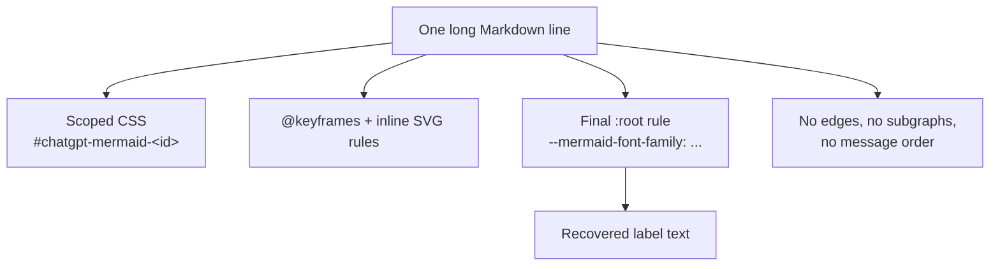
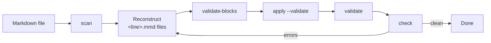
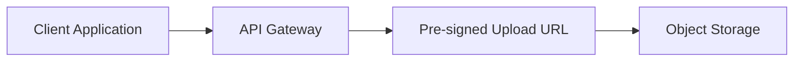
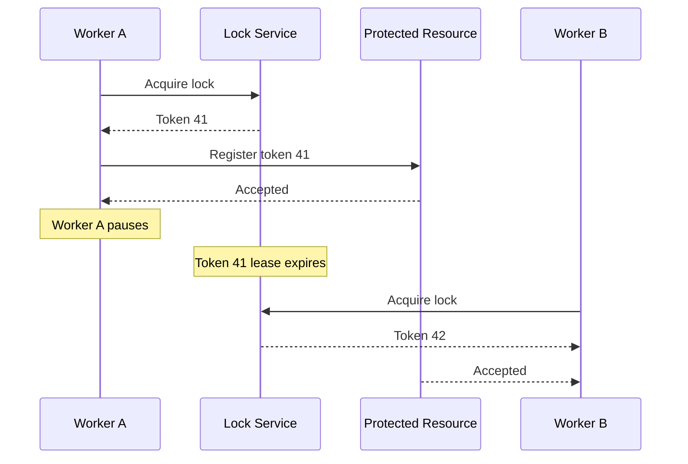

# ChatGPT Mermaid Cleanup Toolkit

<!-- mermaid-cleanup: ignore-file — this document quotes artifacts as examples. -->

A small, dependency-free Python CLI for repairing Markdown files where ChatGPT
exported Mermaid diagrams as inline HTML/CSS instead of a normal ```` ```mermaid ````
block.

It has two jobs:

1. **Tell you what is inside an artifact without making you read it.** `scan`
   reports the artifact's line number, diagram type, recovered labels, and a few
   lines of surrounding prose.
2. **Put validated Mermaid back into the file safely.** `apply` refuses to touch
   anything that is not an artifact, renders every replacement first, and
   preserves the file's line endings.

The layout is intentionally boring: one Python file, one test file, one folder
of docs. There is no package to install and no virtualenv.

---

## 1. The problem

When you ask ChatGPT for a Mermaid diagram, the chat UI renders it to SVG. If you
then copy the rendered result (or export the conversation in a way that keeps the
rendered HTML), the Markdown file ends up with something like this:

```text
\#chatgpt-mermaid-a1b2c3_{font-family:-apple-system-body;font-size:16px;}
@keyframes dash{to{stroke-dashoffset:0;}}
#chatgpt-mermaid-a1b2c3_ .node rect{fill:rgb(0, 40, 77);}
... thousands more CSS characters ...
#chatgpt-mermaid-a1b2c3_ :root{--mermaid-font-family:...}
Client ApplicationAPI GatewayPre-signed Upload URLObject Storage
```

That is **one line**. Three things are wrong with it:

| Symptom | Why it hurts |
| --- | --- |
| One 5,000–10,000 character line of CSS | Unreadable, terrible diffs, blows up context windows, trips linters |
| Inline `<svg>` / `@keyframes` / `data-look` styling | Renders inconsistently or not at all outside ChatGPT |
| No graph structure | Only the visible text survives — the edges, subgraphs, and message order are gone |

The last point is the important one. **The artifact does not contain the
diagram.** It contains the diagram's *styling* and a flat concatenation of its
*labels*. Any tool that claims to "convert" it is really reconstructing it from
the labels plus the surrounding prose.

That is why this toolkit is built around a human/agent reconstruction step rather
than a magic converter.

---

## 2. What is actually inside an artifact



Reading left to right:

1. **Scoped selectors** — every rule is prefixed with an id such as
   `#chatgpt-mermaid-a1b2c3_`, which is how ChatGPT avoids leaking styles.
2. **Animation and SVG rules** — `@keyframes dash`, fill/stroke colors, edge label
   alignment. These describe appearance only.
3. **A final `:root{--mermaid-font-family:...}` declaration.** This is the useful
   boundary. Everything after the *last* occurrence of this rule is plain text
   lifted from the rendered diagram.
4. **Concatenated labels.** Node text, edge labels, participant names, and notes
   are glued together with no separators. `Replication and conflicthandling`
   probably means `Replication and conflict<br/>handling`.

The toolkit exploits exactly this layout: it finds the last
`--mermaid-font-family:...}` and treats the remainder as the label payload.

---

## 3. How the toolkit works



### 3.1 Detect

A line is treated as an artifact when **both** are true:

```python
"chatgpt-mermaid" in line and (len(line) > 500 or "--mermaid-font-family" in line)
```

The length check avoids flagging a normal sentence that happens to mention the
word. The `--mermaid-font-family` check catches short artifacts that still carry
the ChatGPT marker.

### 3.2 Classify

The CSS class names reveal the diagram type:

| Tokens found in the line | Reported kind | Rebuild as |
| --- | --- | --- |
| `.actor`, `.messageText`, `sequenceNumber` | `sequence` | `sequenceDiagram` |
| `.mindmap`, `.mindmap-node` | `mindmap` | `mindmap` |
| `.timeline`, `.timeline-node` | `timeline` | `timeline` |
| `.cluster`, `.mermaid-decision`, `.node rect`, `flowchart-link` | `flowchart` | `flowchart` |
| `stateGroup`, `.statediagram`, `state-start` | `state` | `stateDiagram-v2` |
| none of the above | `unknown` | read the prose to decide |

### 3.3 Recover labels

```python
LABEL_RE = re.compile(r"--mermaid-font-family:[^}]*\}")
```

`scan` takes the substring after the **last** match and prints it. For sequence
diagrams it also prints `participant_prefix`: the text before the first
`chatgpt-mermaid` marker, which usually holds participant names in render order.

Because labels are concatenated, `scan` also prints a few lines of context on each
side of the artifact. The prose is usually enough to decide where one label ends
and the next begins.

### 3.4 Rebuild

This is the only step that needs judgement. You write one `.mmd` file per
artifact, named after the artifact's **line number in the Markdown file**
(`83.mmd`, `491.mmd`, ...). The file holds Mermaid source only — no fences.

See the [reconstruction cookbook](#6-reconstruction-cookbook) below.

### 3.5 Validate and apply

`validate-blocks` runs `mmdc` on every `.mmd` file and prints `OK` or `FAIL` with
the Mermaid parser error. `apply --validate` repeats that check immediately before
writing, so a bad diagram never reaches the Markdown.

`apply` then replaces each artifact line with a standard fenced block: an opening
fence tagged `mermaid`, the body, then a closing fence. Nothing else on the line
survives.

It works **bottom-up** so earlier line numbers stay valid, and it rewrites the
file using the same newline style it detected on read.

### 3.6 Verify

- `validate FILE` extracts and renders every fenced Mermaid block in the file.
- `check FILE` is the cheap final gate: zero artifacts, zero leftover CSS/SVG
  markers, balanced fences.

`check` exits `1` when it finds errors, so it works in scripts.

### 3.7 Documenting artifacts without tripping the checker

Any Markdown file that *quotes* artifacts — like this README — will look like it
contains real ones. Add this HTML comment anywhere in the file to tell `scan` and
`check` to skip artifact and leftover-marker detection:

```markdown
<!-- mermaid-cleanup: ignore-file -->
```

The directive is invisible when rendered and does not affect `apply`, `validate`,
or `validate-blocks`. Use it only for documentation, never for a file you are
actually trying to clean.

---

## 4. Quick start

From the repository root:

```bash
TOOL=mermaid-cleanup/mermaid_cleanup.py
FILE=00-system-design/Fundamentals/Distributed-Consensus/Course/GPT/07-Quorum-in-Depth.md
WORK=/tmp/mermaid-work/quorum

python3 "$TOOL" scan "$FILE"

mkdir -p "$WORK"
# create $WORK/<line-number>.mmd files from the scan output

python3 "$TOOL" validate-blocks "$WORK"
python3 "$TOOL" apply "$FILE" --blocks "$WORK" --validate
python3 "$TOOL" validate "$FILE"
python3 "$TOOL" check "$FILE"
```

If rendering fails on the first run, check the environment:

```bash
python3 "$TOOL" doctor
```

---

## 5. End-to-end example

### The file before (abridged)

```text
# Sample

Before.

\#chatgpt-mermaid-e2e_{font-family:-apple-system-body;font-size:16px;}@keyframes dash{...}#chatgpt-mermaid-e2e_ .node rect{...}#chatgpt-mermaid-e2e_ :root{--mermaid-font-family:test;}Client ApplicationAPI GatewayPre-signed Upload URLObject Storage

After.
```

### `scan`

```text
$ python3 mermaid-cleanup/mermaid_cleanup.py scan sample.md --context 2
FILE: sample.md
lines: 7
artifacts: 1
mermaid blocks: 0
fence lines: 0 (balanced)
CSS/SVG marker occurrences: 4
lines over 500 chars: 0

[1] line 5 (flowchart, 337 chars)
    section: Sample
    labels: Client ApplicationAPI GatewayPre-signed Upload URLObject Storage
    context:
      3: Before.
      4:
      5: <<<ARTIFACT>>>
      6:
      7: After.
```

`line 5` and the four labels are all you need. Note that the artifact is short
enough here that the "lines over 500 chars" count is `0`; detection still works
because the `--mermaid-font-family` marker is present.

### The reconstructed block

`blocks/5.mmd`:



### `apply`

```text
$ python3 mermaid-cleanup/mermaid_cleanup.py apply sample.md --blocks blocks --validate
Validating replacement blocks before applying...
OK   block for line 5

Replaced 1 artifact(s) in sample.md
Backup: /var/folders/.../T/mermaid-cleanup-backups/sample-20261105-100739.md.bak
Remaining artifacts: 0
Mermaid blocks: 1
```

### The file after

````text
# Sample

Before.


After.
````

Everything outside the artifact line is byte-for-byte unchanged, including the
blank lines around it.

---

## 6. Reconstruction cookbook

### 6.1 Flowcharts

- Use `flowchart TD` for pipelines and layered architecture, `flowchart LR` for
  request/response flows.
- Quote labels containing spaces, punctuation, slashes, or `<br/>`:
  `A["Node A: Primary"]`.
- Rebuild wrapped labels with `<br/>`:
  `["Authentication and<br/>Authorization"]`.
- Use subgraphs for things the artifact names as groups:

  ```mermaid
  flowchart TD
      subgraph PA["Partition A"]
          A[Node A]
      end
      subgraph PB["Partition B"]
          B[Node B]
      end
      PA -.->|Network Partition| PB
  ```

- Use decisions for questions:

  ```mermaid
  flowchart TD
      Q{Was A successfully fenced?}
      Q -->|Yes| P[Promote Node B]
      Q -->|No| N[Do not promote B yet]
  ```

- If a recovered label is a claim with no obvious owner (for example
  `Majority Quorum = 3`), attach it to the node it describes with a dotted edge
  instead of inventing a new box.

### 6.2 Sequence diagrams

`scan` gives you `participant_prefix` and the label list. The prefix is often in
reverse render order, so place participants in the order that makes the prose
read correctly.



Rules of thumb:

- `->>` for requests, `-->>` for responses.
- Put a `Note over X:` immediately after the message that causes it.
- One `participant` line per actor, in left-to-right order.

### 6.3 State diagrams

Use `stateDiagram-v2`, one `state "Label" as X` per recovered state, and label
transitions with the recovered edge text. Rebuild decisions as transitions from a
`state ... <<choice>>` only if the labels clearly describe a branch; otherwise
keep the simpler source state.

### 6.4 Mindmaps and timelines

- Mindmaps: root node first, then `child` / `child --> grandchild` in recovered
  order.
- Timelines: `timeline` + `section` + `time : event` entries, in prose order.
  ChatGPT often wraps long event text; rejoin it before writing the block.

### 6.5 Common label repairs

| Recovered text | Likely original |
| --- | --- |
| `Authentication andAuthorization` | `Authentication and<br/>Authorization` |
| `Majority Quorum = 3A + B + CA + B + DB + C + E` | One label plus three example sets |
| `Token 41Worker A pausesToken 41 lease expires` | Message label, then two notes |
| `Partition 1..N` | A subgraph title, not a node |

When in doubt, prefer **more structure that matches the prose** over a single node
containing a run-on sentence.

---

## 7. Command reference

| Command | What it does | Exit code |
| --- | --- | --- |
| `doctor` | Prints Python, `mmdc`, Chrome, Puppeteer config, and renders a sample | `1` if the sample fails |
| `scan FILE` | Artifacts, kinds, labels, participant prefix, section headings, context | `0` |
| `check FILE` | Artifacts, leftover CSS/SVG markers, fence balance, long lines (honours `ignore-file`) | `1` if errors |
| `extract FILE --out DIR` | Writes existing fenced blocks as `<start-line>.mmd` + `manifest.json` | `1` if none |
| `apply FILE --blocks PATH` | Replaces artifacts from a directory of `<line>.mmd` files or a JSON map | `1` if artifacts remain |
| `validate FILE` | Renders every fenced Mermaid block in a Markdown file | `1` if any fail |
| `validate-blocks DIR` | Renders every `.mmd` file in a directory | `1` if any fail |

### Options

| Option | Applies to | Effect |
| --- | --- | --- |
| `--context N` | `scan` | Lines of context on each side (default `6`, use `0` for none) |
| `--json` | `scan`, `check` | Machine-readable output |
| `--lines 83,491` | `apply` | Apply only these artifact lines |
| `--validate` | `apply` | Render each block before writing (recommended) |
| `--no-backup` | `apply` | Skip the temp backup |
| `--puppeteer-config PATH` | `apply`, `validate`, `validate-blocks` | Use an existing Puppeteer config |
| `--timeout SECONDS` | rendering commands | Per-diagram render timeout (default `180`) |
| `--keep` | `validate`, `validate-blocks` | Keep generated `.mmd`/`.svg` files |

### Blocks input formats

`apply --blocks` accepts either:

- a **directory** of `<line-number>.mmd` files, or
- a **JSON object** mapping line number to body: `{"83": "flowchart TD\n..."}`, or
- a **JSON array** of `{"line": 83, "body": "..."}` objects.

Non-numeric files in a directory are ignored with a warning.

### Exit-code gotcha

`apply --lines 83,491` only replaces the selected lines, then reports how many
artifacts remain. If the file has other artifacts, the exit code is `1` even
though the selected replacements succeeded. Use the printed `Remaining artifacts`
count, not the exit code, to judge a partial apply.

---

## 8. Safety model

| Guarantee | How it is enforced |
| --- | --- |
| Only artifacts are touched | Each target line must pass `is_artifact()` |
| Markdown structure is preserved | Replacement is line-local; nothing else is rewritten |
| No nested fences | Bodies containing `` ``` `` are rejected |
| Empty bodies are rejected | `normalize_body()` refuses whitespace-only input |
| Bad diagrams never land | `--validate` renders each block before writing |
| Line endings survive | CRLF/LF and trailing-newline state are detected and reapplied |
| Line numbers stay valid | Replacements run from the bottom up |
| You can undo | A timestamped `.bak` is written to the system temp directory |

Backups land in:

```text
/var/folders/.../T/mermaid-cleanup-backups/     # macOS
/tmp/mermaid-cleanup-backups/                    # Linux
```

To restore, copy the `.bak` file over the original. To skip backups, pass
`--no-backup` — only do this when the file is already committed or staged.

`apply` is **not** atomic: it writes the file in place. Keep the file in git and
commit before large cleanups.

---

## 9. Why this saves tokens

- `scan` reads the giant line but never prints it. Only the recovered labels and a
  few context lines enter the conversation.
- Detection, label extraction, and diagram-type inference live in the script, so
  they do not need to be rediscovered per file.
- Candidate diagrams are written as small `.mmd` files, so fixes are cheap.
- `apply --validate` collapses edit → render → fix into one step.
- `check` gives a short, deterministic pass/fail instead of a manual review.

The first cleanup of a file costs roughly the same as before; every subsequent
file, and every retry, costs far less.

---

## 10. Architecture and files

```text
mermaid-cleanup/
├── mermaid_cleanup.py        # CLI + all core logic
├── test_mermaid_cleanup.py   # standard-library unit tests
├── README.md                 # this document
├── AGENTS.md                 # condensed notes for agent sessions
└── .gitignore                # __pycache__, rendered output
```

Inside `mermaid_cleanup.py`:

| Section | Responsibility |
| --- | --- |
| `load_markdown` / `write_markdown` | Read and write while preserving newline style |
| `is_artifact` / `artifact_kind` / `extract_labels` | Detection and classification |
| `find_artifacts` / `scan_payload` / `check_payload` | Reporting |
| `extract_mermaid_blocks` | Parse existing fenced `mermaid` blocks |
| `puppeteer_config` / `render_mermaid` | Browser and `mmdc` plumbing |
| `validate_markdown` / `validate_block_files` | Rendering checks |
| `apply_replacements` | Safe replacement |
| `run_doctor` | Environment diagnosis |

### Extending it

- **New diagram type:** add its CSS tokens to `artifact_kind()` and a row to the
  table in section 3.2.
- **New leftover marker:** add it to `LEFTOVER_PATTERNS`.
- **New input format for `apply`:** extend `load_replacement_blocks()`.
- **Any behaviour change:** add a test first. The suite covers detection, label
  recovery, artifact replacement, refusal on non-artifacts, CRLF preservation,
  and rendering.

```bash
cd mermaid-cleanup
python3 -m unittest -v test_mermaid_cleanup.py
```

The rendering test is skipped automatically when `mmdc` is not installed.

---

## 11. Requirements and setup

- **Python 3.10+** (standard library only)
- **Mermaid CLI**

  ```bash
  npm install -g @mermaid-js/mermaid-cli
  ```

- **A Chromium-based browser** (Chrome, Chromium, or Edge)

The CLI auto-detects common macOS and Linux browser paths. Override the choice
with:

```bash
export PUPPETEER_EXECUTABLE_PATH="/path/to/chrome"
# or
export CHROME_PATH="/path/to/chrome"
```

`doctor` prints what it found and renders a two-node flowchart:

```text
$ python3 mermaid-cleanup/mermaid_cleanup.py doctor
Python: 3.14.7
Working directory: /Users/riyaz/Personal/Learning
mmdc: /opt/homebrew/bin/mmdc (12.2.0)
Chrome: /Applications/Google Chrome.app/Contents/MacOS/Google Chrome
Puppeteer config: /var/folders/.../T/mermaid-cleanup/puppeteer.json
Sample render: OK
```

The generated Puppeteer config looks like this:

```json
{
  "executablePath": "/Applications/Google Chrome.app/Contents/MacOS/Google Chrome",
  "args": ["--no-sandbox"]
}
```

---

## 12. Troubleshooting and FAQ

**`Mermaid CLI not found`**

```bash
npm install -g @mermaid-js/mermaid-cli
```

**`mmdc` fails with a browser or sandbox error**

Write a Puppeteer config and pass it explicitly:

```json
{
  "executablePath": "/Applications/Google Chrome.app/Contents/MacOS/Google Chrome",
  "args": ["--no-sandbox"]
}
```

```bash
python3 mermaid-cleanup/mermaid_cleanup.py validate FILE --puppeteer-config puppeteer.json
```

**`check` says fences are unbalanced**

`check` counts every line whose first non-space characters are ` ``` `. That
includes a line that merely *mentions* a fence inside prose. Look at the reported
fence count; if the file genuinely has an odd number of fence lines, find the
unclosed block. Inline single-backtick code spans are ignored.

**A block renders with `mmdc` but not in my Markdown preview**

Different renderers bundle different Mermaid versions. Prefer stable syntax:
`flowchart`, `sequenceDiagram`, `stateDiagram-v2`, `mindmap`, `timeline`. Avoid
newer experimental diagram types and per-node HTML styling.

**`scan` shows no labels**

The artifact may have been partially cleaned already, or the export used a
different marker. Check the line yourself only as a last resort:

```bash
python3 mermaid-cleanup/mermaid_cleanup.py scan FILE --json
```

Then extend `LABEL_RE` if the export format differs.

**Labels are mangled or merged**

Expected. The artifact is a flat text dump. Use `scan`'s `section` and `context`
fields plus the prose to split labels. When two labels are ambiguous, mirror the
order used in the surrounding explanation.

**`apply` exits `1` even though it printed success**

You used `--lines` on a file that still has other artifacts. See the exit-code
gotcha in section 7.

**`check` warns about long lines**

Long prose lines are warnings, not errors. Only investigate if the line also
contains an artifact marker. Run `scan` to confirm.

**A documentation file reports artifacts**

It is quoting them. Add `<!-- mermaid-cleanup: ignore-file -->` somewhere in the
file; see section 3.7.

**My artifact spans multiple lines**

This toolkit is line-based, matching ChatGPT's actual export format. A
multi-line artifact needs manual handling first; then `apply` can take over.

---

## 13. Limits

- **Structure is not recoverable from the artifact.** Edges, subgraphs, message
  order, and notes must be inferred from labels and prose. The toolkit makes that
  inference cheap; it does not automate it.
- **Detection is heuristic.** A normal line containing `chatgpt-mermaid` and one
  of the two markers would be treated as an artifact. `apply` re-checks each
  target line, but review the scan before applying.
- **Only fenced ```` ```mermaid ```` blocks are validated.** Indented code blocks
  and `~~~` fences are not recognised.
- **UTF-8 only.** Files are decoded as UTF-8.
- **The renderer is not the target renderer.** A block that renders in `mmdc` can
  still look different in GitHub, VS Code, or your blog. The validation catches
  syntax errors, not layout differences.

---

## 14. Agent usage

The repository ships a matching OpenCode skill:

```text
.opencode/skills/mermaid-cleanup/SKILL.md
```

It advertises the workflow to the model and delegates to this CLI. In a normal
session the agent can load it with the skill id `mermaid-cleanup`, or you can
mention `@mermaid-cleanup` in a prompt. `mermaid-cleanup/AGENTS.md` holds the same
rules in a shorter form for non-OpenCode tools.
