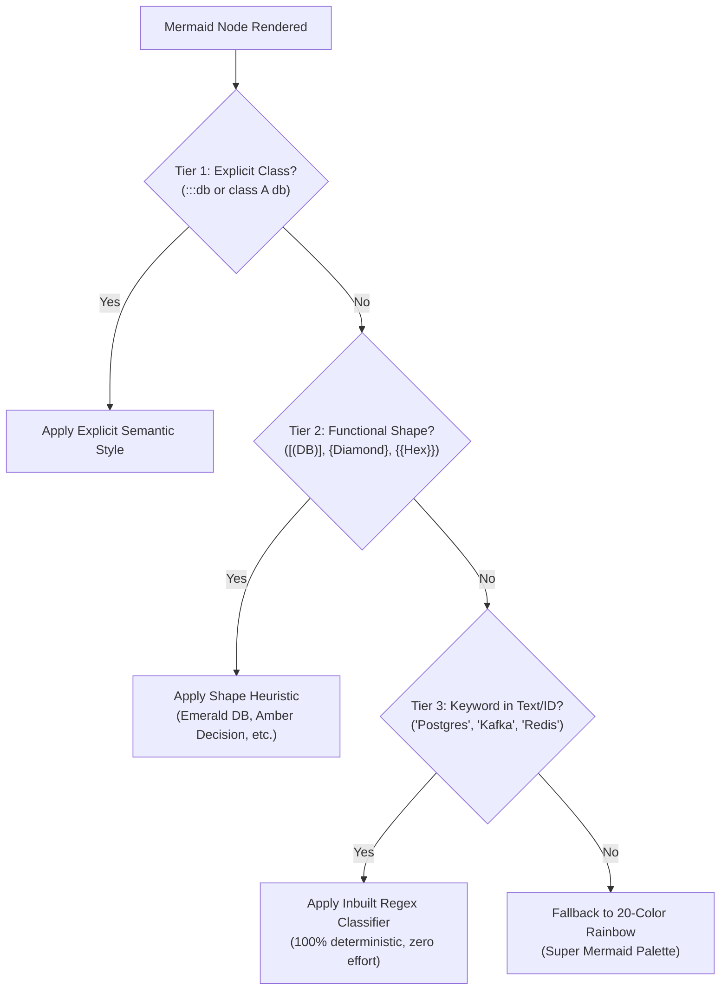
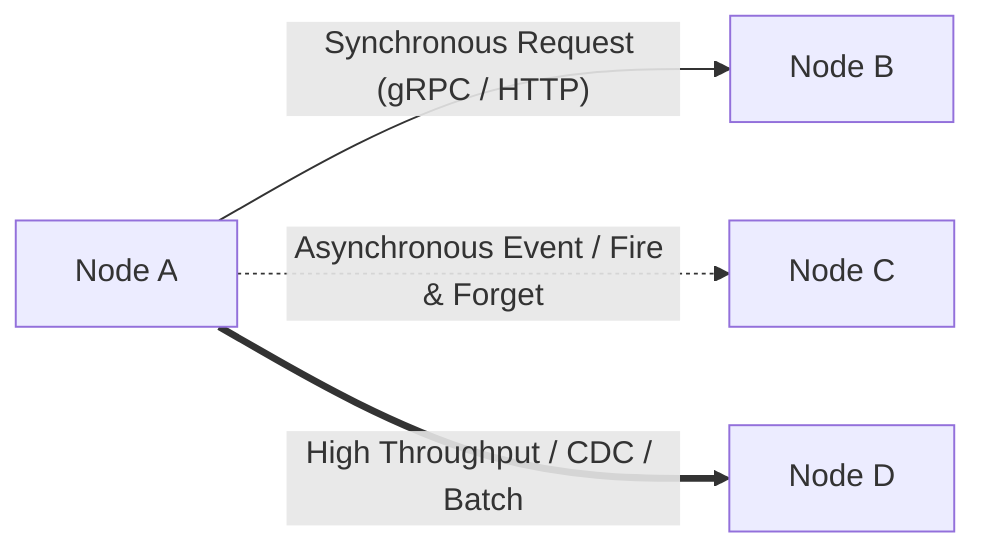
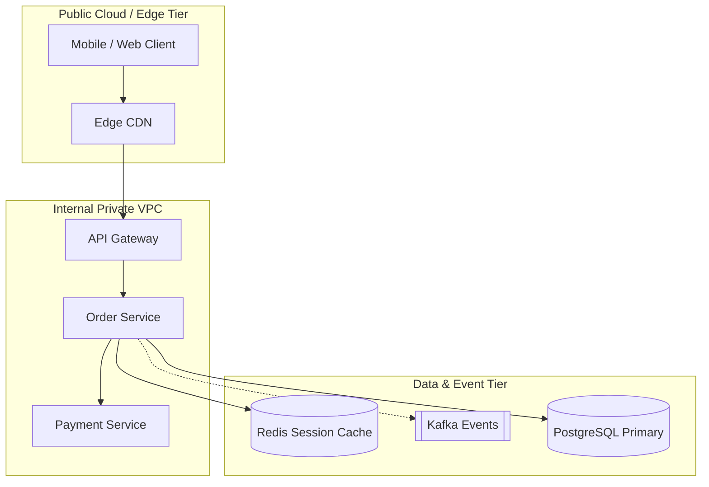
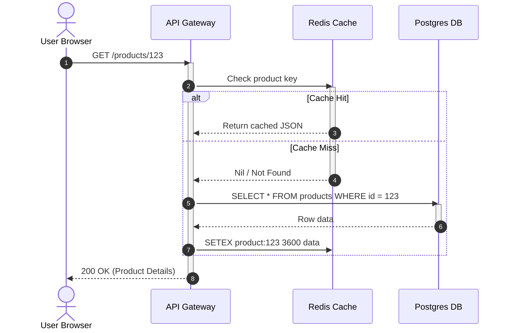
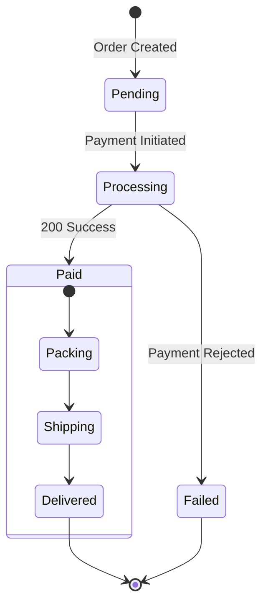

# Mermaid Diagramming Guide: Semantic, Consistent & Beautiful

This guide outlines the architectural design system and conventions configured for Markdown Preview Enhanced (MPE) in this vault.

---

## 1. The 3-Tier Semantic Classification System

Diagrams automatically receive intelligent colors and typography through three complementary tiers:

---

## 2. Semantic Classes Reference

Assign classes inline via `NodeId[Label]:::className` or in a block via `class NodeId className`.

| Class Name | Aliases | Semantic Role | Color Accent | When to Use |
| :--- | :--- | :--- | :--- | :--- |
| `:::client` | `:::user` | Clients, Users, Frontends | **Cyan** (`#06B6D4`) | Mobile Apps, Browsers, SPA, Actors |
| `:::gateway` | `:::ingress`, `:::proxy` | Entry Points & Routing | **Sky Blue** (`#0EA5E9`) | API Gateway, Nginx, ALB, Envoy |
| `:::service` | `:::compute` | Core Business Logic | **Indigo** (`#6366F1`) | Microservices, Workers, Lambdas |
| `:::cache` | — | High-Speed In-Memory Cache | **Amber** (`#F59E0B`) | Redis, Memcached, Local Cache |
| `:::queue` | `:::stream`, `:::broker` | Asynchronous Messaging | **Purple** (`#8B5CF6`) | Kafka, RabbitMQ, SQS, Kinesis |
| `:::db` | `:::storage` | Persistent State & Storage | **Emerald** (`#10B981`) | PostgreSQL, MySQL, DynamoDB, S3 |
| `:::external`| `:::thirdparty` | 3rd-Party APIs & Partners | **Muted Slate (Dashed)** (`#94A3B8`) | Stripe, Twilio, OAuth Providers |
| `:::alert` | `:::fail`, `:::dlq` | Error, Failure, Dead Letter | **Crimson Red** (`#EF4444`) | DLQ, Circuit Breaker Open, 500s |
| `:::success` | `:::ok` | Success & Terminal OK | **Mint Green** (`#059669`) | 200 OK, Healthy, Approved |
| `:::decision`| — | Branching & Conditionals | **Amber Gold** (`#F59E0B`) | Validations, Auth Checks, Routing Rules |

---

## 3. Automatic Shape Heuristics (Zero Effort)

Mermaid functional shapes automatically get styled with their architectural roles without adding any classes:

| Shape Syntax | Shape Type | Auto-Assigned Theme |
| :--- | :--- | :--- |
| `[(PostgreSQL)]` | Cylinder | **Database Emerald** (`#10B981`) |
| `{Is Authorized?}` | Rhombus / Diamond | **Decision Amber** (`#F59E0B`) |
| `{{Stripe Payment}}` | Hexagon | **3rd-Party External** (Dashed Slate) |
| `([Start / Complete])` | Stadium / Pill | **Terminal / State Marker** |
| `[[Kafka Event Log]]` | Subroutine | **Queue Purple** (`#8B5CF6`) |

---

## 4. Automatic Keyword Detection (Zero Effort)

When you write a normal box `[Label]`, the preview webview scans the label text or node ID and automatically applies the matching role:
- Words like **"Postgres"**, **"MySQL"**, **"Database"**, **"Storage"** $\rightarrow$ `:::db`
- Words like **"Redis"**, **"Memcached"**, **"Cache"** $\rightarrow$ `:::cache`
- Words like **"Kafka"**, **"RabbitMQ"**, **"Queue"**, **"Stream"** $\rightarrow$ `:::queue`
- Words like **"Gateway"**, **"Ingress"**, **"Reverse Proxy"**, **"ALB"** $\rightarrow$ `:::gateway`
- Words like **"Client"**, **"Browser"**, **"Mobile App"**, **"User"** $\rightarrow$ `:::client`
- Words like **"Error"**, **"Failed"**, **"DLQ"**, **"Timeout"** $\rightarrow$ `:::alert`
- Words like **"Success"**, **"Healthy"**, **"200 OK"** $\rightarrow$ `:::success`
- Words like **"Stripe"**, **"Twilio"**, **"3rd Party"** $\rightarrow$ `:::external`

---

## 5. Architectural Conventions & Best Practices

### A. Graph Direction
- Use **`flowchart TD`** (Top-Down) for **hierarchical architectures** (Client $\rightarrow$ Gateway $\rightarrow$ Service $\rightarrow$ Data).
- Use **`flowchart LR`** (Left-to-Right) for **pipelines, event streams, and state machines**.

### B. Connector Semantics

- **`-->`**: Synchronous call / primary request path.
- **`-.->`**: Asynchronous notification / decoupled event.
- **`==>`**: High-throughput data stream / critical path.

### C. Subgraphs as Architectural Boundaries
Use subgraphs to delineate trust boundaries (Public Internet vs VPC vs Data Tier):

---

## 6. Sequence Diagrams Best Practices

### A. Return Messages vs Calls
- Use `->>` for synchronous requests.
- Use `-->>` for return responses (renders with muted, dashed slate lines).
- Use `--)` for asynchronous notifications.

### B. Fragments & Notes
Group logic using `alt` / `opt` / `loop`:

---

## 7. State Machines (`stateDiagram-v2`)

State diagrams render with crisp rounded capsules and distinctive green start / red end states:

